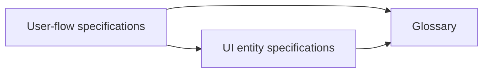

# Maintained specifications

The registries define vocabulary, interface structure and observable behavior.
Their dependency direction is deliberate:



[Glossary](../glossary/README.md) defines names and meanings without backlinks,
usage lists, procedures, implementation details or references to specifications.
[UI entities](../ui/README.md) define structure and interactions using those
terms. [Behavior contracts](../user-flows/README.md) consume both. Agents and
scripts may read every layer. Consumer lookup is an `impact` report.

## Sources and generated output

- `docs/glossary/terms.json`: stable term IDs, canonical names, aliases, categories,
  definitions and optional nonempty, known term-ID naming scopes. Same-scope names
  and aliases are unique after case-folding, whitespace normalization and Unicode
  NFC normalization; different scopes may reuse a name. Original display spelling
  is preserved. Definitions contain
  no inline, reference, shortcut, HTML or raw links; shortcut links resolve against
  reference labels in the rendered glossary. Ordinary punctuation remains valid.
- `docs/ui/entities.json`: existing entity IDs, glossary terms, containment,
  scoped elements, conditional states, interactions, connection endpoints,
  implementation anchors, existing assertion keys and explicit coverage gaps.
  Widget types have separate displayed instances with pane/repetition context.
  Each instance has exactly `id`, `type`, `pane` and `repeat`, all nonempty text;
  stable slash-separated pane/widget instance IDs remain supported. Assertion
  inventory entries need at least one entity owner. An inventory or coverage
  table row alone cannot make an unowned test count as implementation coverage.
  `documents` describes owned table/diagram blocks. `source_map`, `assertions`
  and `coverage_groups` keep implementation/test coverage independent of flows.
  External connections identify their boundary and owned endpoint separately
  from the explanatory external-destination text.
  Only widgets own named elements: each element has exactly `id` and `term`,
  with ID `W-ID.local-name`; the local name matches `[a-z][a-z0-9-]*`.
  Connection endpoints are nonempty arrays of entity IDs or declared widget
  element IDs. `from`, `to`, `connection_type`, `external_boundary`,
  `endpoint_description` and `trigger` belong only to connection entities;
  interaction prose remains available on other kinds. Unknown entity fields
  are rejected.
- `docs/user-flows/catalog.json`: scenario IDs, glossary/UI references, structured
  flow graphs, implementation/test references, gaps and verification argv arrays.
  Suites declare nonempty `commands` argv arrays and optional `inputs` paths for
  indirect verification dependencies; paths name existing repository files or
  directories. Each graph has a `start`, unique `nodes` with plain-text `label`,
  optional
  `scenario` and `terminal: true`, and `edges` with `from`, `to` and optional
  `label`. Every node is reachable and can reach a terminal; terminals have no
  outgoing edges. Branch labels describe conditions, failures and recovery.

The current UI and behavior catalogs use schema version `2`; integer version `1`
remains supported for legacy snapshots. Glossary and receipt versions remain the
JSON integer `1`. Version values are never coerced from booleans, floats, strings
or null. Successful verification requires JSON integer exit status `0`; boolean
false and floating zero cannot supply successful evidence.
The same catalog and receipt scalar checks apply to legacy and unified entry
points. Read-only validation rejects malformed evidence without rewriting it.

Specification registries, supporting foundation JSON, review inputs and receipts
reject duplicate object member names at every nesting depth, including equivalent
escaped names. A later value cannot overwrite an earlier definition or rejected
verification result. Identical names in separate objects remain valid.

Declared collection fields require actual JSON arrays with the declared entry
types before rendering, impact analysis or coverage checks iterate them. Objects,
including false-valued membership entries, and strings cannot become containment,
assertion, scenario or gap declarations. Optional arrays may be absent where the
schema permits; present values still require arrays. This applies to registry
inventories, nested mapping/recipe collections and suite commands and inputs.
Invalid collection shapes fail before generated outputs are written. Ambiguous
review JSON fails before verification or removal of selected prior records.

Version-2 gaps are stored objects with integer `version: 1`, globally unique stable
`id`, `kind`, `severity`, `owner`, exact `reason` and `next_verification` text. Flow
gaps also name a declared `scenario`; UI/coverage gaps cannot claim scenarios.
Kinds distinguish `known-limitation` from `unverified-behavior`; severities are
`P1`, `P2` or `P3`. Owners are the layer maintainer or specification coordinator.
Preserve stored IDs when narrowing a reason or next step. Migration requires
explicit metadata and never infers verification from a reason. Legacy prose gaps
remain readable without invented severity, ownership or completion claims.

Edit registries and separately authored prose, then render. UI table and diagram
blocks use `<!-- specs:NAME -->` pairs. Flow diagrams and references live inside
the existing `flow-references` block; generated changes are excluded from authored
behavior comparisons. Labels are escaped into constrained Mermaid syntax. Render
preserves all prose outside owned blocks and has reproducible output.
Rendering validates registries, document ownership, ordered nonoverlapping markers
and each table recipe's header width, then validates the complete candidate tree
before writing any output. Preflight dependency and glossary reference-label checks
use authored Markdown outside registered owned blocks, so obsolete generated links
or label definitions cannot prevent repair. Current registries, unregistered marker
content outside owned blocks and the complete generated candidate still receive
those checks. An owned body includes obsolete nested comments and is rebuilt in
full. Stale owned blocks remain renderable. Tables reject mismatched row widths,
and flow diagrams use
deterministic internal node aliases so registry IDs cannot become Mermaid keywords.
Only registry-owned blocks at their registered document path are excluded from
authored prose comparisons and fingerprints. Outside owned bodies, unknown marker
pairs remain authored.
Foundation dependency checks decode URL/HTML spellings and Markdown punctuation
escapes before normalizing inline, reference, HTML and raw destinations. JSON
foundation fields are scanned as decoded strings. Glossary shortcut labels also
resolve definitions in supported quote/list containers and nested continuation
lines, including next-line destinations; relative indented code does not supply
reference labels. Ordinary escaped brackets and permitted destinations remain
valid. These scanner checks do not claim to implement every Markdown extension. Explicit `flow:ID` references
remain forbidden without a matching catalog entry; comparisons also retain old
flow IDs when checking references after a rename or deletion.

## Local commands and comparison semantics

Python 3.11+ (including standard-library TOML support) and Git suffice for the
fast checks. Verification suites also require the Go/Node/Playwright prerequisites
in the root README. No model credentials, agents, network calls or hosted workflow
are part of the specification gate.

```sh
python3 scripts/specs.py render
make specs-validate
python3 scripts/specs.py report --base HEAD
python3 scripts/specs.py report --base HEAD --json
python3 scripts/specs.py gaps --json
python3 scripts/specs.py impact --base HEAD --json
make specs-check
make specs-ci

# Exact committed comparison, suitable for any CI provider after fetching SHAs.
# Check out HEAD_SHA cleanly; install repository verification prerequisites.
python3 scripts/specs.py check --base BASE_SHA --head HEAD_SHA --json
make verify FLOW_ARGS='--base BASE_SHA --head HEAD_SHA'

# Explicit branch comparison, or the index without unstaged work.
python3 scripts/specs.py impact --base main --merge-base --json
python3 scripts/specs.py check --base HEAD --staged --json
make ci FLOW_BASE=main
```

`--base` is exact. `--merge-base` uses the common ancestor with the selected head
(or HEAD when checking worktree/index). `--head` reads committed blobs, `--staged`
reads only the index, and the default reads tracked and unignored worktree files.
Missing refs fail without fetching or fallback. Worktree file modes follow Git's
owner-execute bit: group/other execute bits do not change canonical input identity.
Git-enumerated ordinary untracked files remain inputs, subject to Git ignores.
When Git collapses an untracked embedded repository to a directory entry, worktree
snapshotting fails rather than silently skipping its contents; staged and committed
selections remain independent. Tracked gitlinks are unsupported in index/commit
snapshots, which accept regular file blobs only. Writes require the working tree.
`validate`, `impact` and `check` are read-only. Errors return nonzero; `--json`
provides machine-readable reports. The legacy `scripts/user_flows.py` commands and
`make flows-*` targets remain aliases in a registry checkout.

`report` is a read-only presentation of impact: bounded human output shows next
argv first, review subjects, deduplicated reasons and actual old/current source and
assertion anchors. Compact JSON retains complete inventories without receipt or
fingerprint dumps. Selected head/index reports omit worktree write commands.
Suggested reconciliation still requires substantive review and real verification;
a report records no success. `gaps` inventories typed kind/severity/owner counts,
next-verification availability and records; legacy reasons stay explicitly untyped.
`make specs-report` and `make specs-gaps` expose these views. Existing `impact`,
`check`, `validate`, `render` and `reconcile` stdout/flags remain compatible.

The CLI/public facades remain `scripts/specs.py` and `scripts/user_flows.py`.
Focused `scripts/specs_lib/` modules own Git/JSON/schema, reference checks,
rendering, impact, receipts, process execution and pure reporting/gap helpers.
Public callback/patch points and legacy dispatch remain compatible. Old/new Python
modules under that directory are automatic operational fingerprint inputs; the
tooling suite also declares the directory explicitly. Non-Python data still needs
ordinary mapping or a justified exclusion.

Impact considers old and new mappings, removed/renamed entities and mapped files.
Terms affect consuming entities and flows. UI changes propagate to containing
and interacting entities and consuming flows. Shared UI state can make this
conservative. Flow-only changes leave foundations untouched. Tooling/maintenance
instruction changes require review of all layers. Reports name affected IDs,
reasons and suggested roles; reverse links are computed, never stored in docs.

## Reviewed reconciliation

Review every affected subject: `glossary`, `ui`, and each `flow-FLOW_ID`. Registry
reviews aggregate affected term/entity IDs; their fingerprints include those IDs,
old/new definitions, transitive dependencies, mapped inputs, maintenance tooling,
authored layer prose, policy and verification commands. Removing mappings cannot
hide relevant old inputs. A changed base or dependency invalidates evidence.
Fingerprints include repository file/directory arguments in verification commands and
each suite’s explicit `inputs`, expanded against both snapshots. Declare indirect build
and discovery dependencies that do not appear in argv. The maintained Go/browser/release
suites include their source and build inputs; tooling also includes `Makefile`,
`scripts/verify.sh`, `AGENTS.md`, this guide, and every `scripts/test_specs*.py` module.
A changed runner, prerequisite file or newly discovered specification test invalidates
earlier verification even if its argv is unchanged.
The ordinary Go race suite and Make test target use `-count=1` so each run
executes assertions against current subprocess-built fake-provider helpers; Go
cached successes do not reliably track those helper sources.
One Make worker invocation owns shared preparation for local and hosted
verification. Public entrypoints select its failure policy. Locked npm
dependencies, frontend compilation, plugin embedding and the shared browser fake
provider are explicit phony prerequisites. Each runs once per graph
and runs again in a separate invocation, so changed inputs and deleted outputs
cannot hide behind a preparation stamp. Standalone build and test commands also
prepare their prerequisites. Verification phases remain ordered under parallel
Make flags, with performance after heavy suites. Hosted Python/browser setup
belongs to that graph after exact comparison selection. Reconciliation and the
subsequent local CI invocation remain separate required verification runs.
The tooling suite declares the provider/helper packages and module file copied by
its cache regression as indirect inputs.

Historical ownerless UI assertion inventories also remain review inputs after
cleanup. Their definitions and old content identities conservatively select
existing UI subjects and consumers; a UI-free registry falls back to existing
flow subjects. Old paths retain current content or absence as freshness inputs.
This does not invent entity ownership or let ownerless tests supply behavioral
implementation/test cochanges. Structural inventory cleanup remains reviewable,
while ordinary entity-owned assertion changes retain precise consumer impact.

Historical suite definitions and removed runner/input paths remain review and
freshness inputs. Historical and current directory selectors expand against both
comparison snapshots, so newly added members under a removed selector still
invalidate evidence; fingerprints preserve each file’s absence and executable mode.
Execution uses current suites declared by surviving contracts,
plus mandatory tooling. A retired contract uses a still-declared suite's current
commands; when its suite is also retired, current contracts sharing mapped
implementation/tests or explicitly consuming it must supply replacement suites.
Shared glossary terms alone do not establish replacement coverage. Missing related
current verification fails with an error; historical commands are never replayed
against a different current tree.

Prepare a temporary review file outside the repository. Decisions are substantive
and subject-specific; a minimum note length rejects empty acknowledgements but
cannot prove semantic correctness. Example shape (replace with actual findings):

```json
{
  "flow-triage-inbox": {
    "kind": "structure",
    "description": "S1/S2 retain independent read and discovery states; this change corrects only entity references.",
    "implementation": "Inspected item selection and revision-aware read handling; no observable transition changed.",
    "tests": "Read the stale-revision assertion; the newer revision remains unread after the older displayed read."
  }
}
```

Kinds are `behavior`, `refactor`, `terminology`, `structure`, or pinned initial
`adoption`. A `behavior` review requires related implementation and test changes
even when the description already matches the intended result. New or retired
behavior requires those changes under every non-adoption classification.
Directly changed UI contracts are checked individually, so unrelated widget
changes cannot supply their required code or tests. Flows include implementation
and assertion mappings of consumed UI entities when identifying related changes.
Indirectly affected, unchanged UI consumers still need review but need no
independent code/test edits.

A UI-only `mixed` review can combine initial adoption with actual behavior changes.
It has the aggregate `description`, `implementation`, `tests` notes plus `contracts`
keyed by every direct `ui:ENTITY-ID` contract. Each child has exactly one existing
review kind and its own three substantive notes; no nested mixed review or silent
fallback is allowed. Per-contract adoption remains pinned to the original source
baseline and requires owned source/assertion paths and anchors there. New helper
behavior needs related code/tests. Plain reviews stay compatible; product-flow
adoption is neither broadened nor overridden by this UI-only format.

Accurate behavior can remain after refactors, naming corrections and structural
reference updates with explicit reviewed reasons and fresh verification.
Generated diagrams/reference blocks are not independent behavioral changes.
The deterministic gate establishes mapped file changes and successful commands,
not the semantic value of an assertion. Semantic review must reject a behavior
change misclassified as structural and ensure changed tests meaningfully exercise
the intended outcome.
Historical flow-only receipts are retained under `docs/user-flows/reconciliations/`;
the unified gate reads only `docs/specs/reconciliations/`.

```sh
python3 scripts/specs.py reconcile --base HEAD --review /tmp/spec-review.json
python3 scripts/specs.py check --base HEAD --json
```

The runner inspects declared argv arrays, executes deduplicated required suites,
sets `CODE_FACTORY_REAL_CODEX=0`, removes superseded selected records before
verification, and checks fingerprints again after success. Failure or mutation
writes no new success. Each verifier starts in a new Linux session and owned
process group. Timeout, SIGINT, SIGTERM, nonzero exit and successful completion
all signal that group with TERM, allow a bounded grace period, then send KILL
and reap the leader. The leader remains unreaped until the final group signal
to prevent process-group ID reuse; previous signal handlers are restored. A
cancellation received during timeout cleanup supersedes the pending timeout
after cleanup and preserves the SIGINT/SIGTERM exit status.
Processes that detach from the original group are outside this cleanup guarantee.
Do not hand-edit records. Stage records with all their inputs for index checks.

The default Make targets and `scripts/verify.sh` also force
`CODE_FACTORY_REAL_CODEX=0`, overriding inherited and command-line opt-ins. Run
`make test-real-provider` explicitly for authenticated real-model lifecycle checks;
it is outside default CI. The tooling suite runs legacy flow tests plus all
specification modules:

```sh
python3 scripts/test_user_flows.py
python3 -m unittest discover -s scripts -p 'test_specs*.py'
```

Local fixture results never close real-host, accessibility, soak, login or opt-in
provider gaps.

## Ownership and initial adoption

The five [project agent definitions](../../.codex/agents/) use the documented
[standalone TOML format](https://learn.chatgpt.com/docs/agent-configuration/subagents#custom-agents).
These five required roles inherit model/permissions and authorize no unattended
runs, authentication, publishing or live changes. Their required names, fields
and ownership paths remain checked. Unrelated agent files may declare their own
settings and ownership policy; they retain ordinary mapping and impact rules.
The four required maintenance skills retain the fixed two-field frontmatter
order (`name`, then one-line `description`). Descriptions use a constrained YAML
string subset: safe plain scalars, YAML single quotes with doubled apostrophes,
or JSON-style double quotes, optionally followed by a space-separated comment.
Decoded and trimmed descriptions contain 1–1024 characters, no angle brackets
and no initial `[TODO:` placeholder. Nonstring/ambiguous plain scalars,
collections, tags, anchors, aliases, block scalars, malformed quoting and invalid
controls are rejected. Literal tabs outside quoted values or comment bodies are
invalid. This is the required skills' supported subset, not a general YAML parser. Skills under `.agents/skills/` define coordinator,
glossary, UI and behavior maintenance; the specification reviewer is read-only.

Registry adoption migrates the existing uncommitted documentation against
`53ff8be70ddf852b6b13226582ccfaa9cef1f9dc`. Initial UI adoption is valid only when
mapped implementation/tests already exist at that source baseline. The existing
14-product-flow adoption list and base remain unchanged. The contributor flow
has implementation and test changes. This establishes a maintained source-derived
baseline, not new product behavior or completed UI/host acceptance.

## Current render, schema and runner review · 2026-10-20

The contributor contract now maps the actual render, UI-schema and verification
runner assertions individually. Render preflight rejects unowned or non-Markdown
UI targets, malformed recipes and overlapping owned blocks before any writes;
full candidate validation precedes writes for unified and legacy rendering.
Table recipes enforce exact header and row widths, while flow diagrams use
safe deterministic internal aliases for reserved registry node IDs. UI validation
limits named scoped elements to widgets, types connection endpoints and metadata,
rejects connection-only fields on other kinds and rejects unknown entity fields.
The model and diagram renderer also ignore wrong-kind connection fields.

Runner regressions use isolated Linux probes with TERM-ignoring descendants to
check cleanup on timeout, cancellation, failure and success, prior-record
invalidation, literal argv, fixture environment and deduplicated execution.
Only the short-lived test harness uses child-subreaper state to reap its adopted
grandchildren; production verification leaves process-wide subreaper state alone.
These worktree probes map to the fail-closed scenario; committed and index
comparison assertions remain mapped to their dedicated snapshot tests. Required
fixture reconciliation and branch CI results are recorded separately after execution.
Seven render-repair tests also verify that obsolete owned bodies can be replaced,
including nested obsolete comments, while authored/unknown-marker content, current
registry references and newly generated reference-label context still fail closed.
Two cleanup-cancellation tests deliver real signals after timeout cleanup starts
and verify preserved cancellation status, restored handlers, owned-group cleanup
and absence of success records.
