# UI entity specification

Source-derived baseline, 2026-10-20. This describes the current owned UI, not a
redesign or a claim of complete visual/accessibility acceptance. The [acceptance ledger](../acceptance.md) records observed results.
Canonical vocabulary lives in the [glossary](../glossary/README.md).

Read in this order:

1. [Widgets and their elements](widgets.md): controls, displays, inputs, outputs
   and conditional states.
2. [Panes](panes.md): related widgets sharing a selected item, task or settings
   context.
3. [Pages and dialogs](pages.md): complete surfaces and their pane composition.
4. [Connections](connections.md): selection, navigation, submission, refresh and
   external transitions, including state ownership.
5. [Implementation and test references](references.md): source locations, existing
   assertions and explicit gaps.

## Entity model

| Entity | Definition | Identity and relationships |
| --- | --- | --- |
| Element | One named input, action, label, indicator or repeated display field within a widget. | Scoped to its widget, for example `W-INBOX-QUERY.search`. An element is not necessarily one DOM node. |
| Widget | A cohesive control or display with a defined purpose, element inventory and interaction contract. | Stable `W-*` type ID. Repeated instances use a record key, for example `W-ITEM-ROW[itemId]`. A widget type may appear in several panes. |
| Pane | A group of widgets that share a task or selected-record context. | Stable `P-*` ID. It can remain present while its widgets display loading, empty, ready or error states. |
| Page | A complete logical task surface with a pane layout and entry/exit connections. | Stable `PAGE-*` ID. The embedded app's tabs are pages even though they do not have separate browser routes. |
| Dialog | A temporary task surface above a page, with its own panes and close/submit transitions. | Stable `D-*` ID. Launch and attention are dialogs, not extra navigation pages. |
| Shell | Shared identity, navigation, connection/error feedback and continuity notice around embedded pages. | `S-FACTORY`. The host calls the complete embedded app a widget; this specification reserves `W-*` for controls/displays inside it. |

Containment is `page/dialog → pane → widget instance → named elements`. Shared
shell panes appear alongside every embedded page. Each widget instance belongs
to its displayed pane; reuse of a widget type does not imply shared draft state.
These IDs are specification IDs, not existing HTML IDs or component names.

Structural prose specifies visible meaning and interaction. Framework components,
transport methods and test locations live in [references](references.md). A logical
widget can be inline in a larger component; this catalog does not require a code
refactor into one component per entity.

## Useful charts

Two diagrams are useful and answer different questions:

- A **containment diagram** answers “what is this screen made of?” Keep the full
  inventory in tables and expand only representative widget elements in the chart.
- A **navigation/state diagram** answers “what opens, changes or submits when the
  user acts?” It should distinguish selecting a pane, opening a dialog and changing
  a page. The [connection catalog](connections.md) contains that diagram and a
  launch phase boundaries.

A sequence diagram is useful for a particular round trip, such as answering a
question, when discussing UI/service timing. It is not necessary for the overall
entity inventory. Numeric charts, such as bar or pie charts, do not describe these
relationships well. Mermaid keeps these structural diagrams editable in the repo.

```mermaid
flowchart TD
    N0["S-FACTORY"]
    N1["W-IDENTITY"]
    N2["W-NAVIGATION"]
    N3["W-GLOBAL-ERROR"]
    N4["W-CONNECTION-BLOCKER"]
    N5["W-CONTINUITY-NOTICE"]
    N6["W-INBOX-QUERY"]
    N7["W-SYNC-HEALTH"]
    N8["W-ITEM-ROW"]
    N9["W-INBOX-EMPTY"]
    N10["W-ITEM-OVERVIEW"]
    N11["W-ITEM-ACTIONS"]
    N12["W-PRIORITY"]
    N13["W-RELATIONSHIPS"]
    N14["W-TICKET-CONTEXT"]
    N15["W-PR-EVIDENCE"]
    N16["W-ITEM-HISTORY"]
    N17["W-RUN-ROW"]
    N18["W-RUN-EMPTY"]
    N19["W-RUN-CONTROLS"]
    N20["W-ATTENTION-NOTICE"]
    N21["W-TRANSCRIPT"]
    N22["W-MESSAGE"]
    N23["W-DIALOG-FRAME"]
    N24["W-LAUNCH-EDITOR"]
    N25["W-LAUNCH-REVIEW"]
    N26["W-QUESTIONS"]
    N27["W-APPROVAL"]
    N28["W-ELICITATION"]
    N29["W-REPOSITORY-SETTINGS"]
    N30["W-POLICY-SETTINGS"]
    N31["W-JIRA-CREDENTIAL"]
    N32["W-PROFILE-SETTINGS"]
    N33["W-SKILL-SETTINGS"]
    N34["W-DIAGNOSTICS"]
    N35["W-PACKAGE-OVERVIEW"]
    N36["W-CONNECTION-GUIDE"]
    N37["W-OWNER-CONSENT"]
    N38["W-LOCAL-TUNNEL-KEY"]
    N39["W-BROWSER-LAB"]
    N40["P-IDENTITY"]
    N41["P-NAVIGATION"]
    N42["P-FEEDBACK"]
    N43["P-CONTINUITY"]
    N44["P-INBOX-QUERY"]
    N45["P-INBOX-LIST"]
    N46["P-ITEM-DETAIL"]
    N47["P-RUN-LIST"]
    N48["P-RUN-DETAIL"]
    N49["P-REPOSITORIES"]
    N50["P-POLICIES"]
    N51["P-PROFILES"]
    N52["P-SKILLS"]
    N53["P-DIAGNOSTICS"]
    N54["P-LAUNCH-FRAME"]
    N55["P-LAUNCH-EDITOR"]
    N56["P-LAUNCH-REVIEW"]
    N57["P-ATTENTION-FRAME"]
    N58["P-QUESTIONS"]
    N59["P-APPROVAL"]
    N60["P-ELICITATION"]
    N61["P-PACKAGE-OVERVIEW"]
    N62["P-CONNECTION-GUIDE"]
    N63["P-OWNER-CONSENT"]
    N64["P-LOCAL-TUNNEL-KEY"]
    N65["P-BROWSER-LAB"]
    N66["PAGE-INBOX"]
    N67["PAGE-AGENTS"]
    N68["PAGE-SETTINGS"]
    N69["D-LAUNCH"]
    N70["D-ATTENTION"]
    N71["PAGE-PACKAGE"]
    N72["PAGE-OWNER-CONSENT"]
    N73["PAGE-LOCAL-TUNNEL-SETUP"]
    N74["PAGE-BROWSER-LAB"]
    N111["PAGE-REPORTS"]
    N112["P-REPORT-LIST"]
    N113["P-REPORT-DETAIL"]
    N114["W-REPORT-LIST"]
    N115["W-REPORT-DETAIL"]
    N0 --> N40
    N0 --> N41
    N0 --> N42
    N0 --> N43
    N0 --> N66
    N0 --> N67
    N0 --> N68
    N0 --> N69
    N0 --> N70
    N0 --> N111
    N66 --> N44
    N66 --> N45
    N66 --> N46
    N67 --> N47
    N67 --> N48
    N68 --> N49
    N68 --> N50
    N68 --> N51
    N68 --> N52
    N68 --> N53
    N69 --> N54
    N69 --> N55
    N69 --> N56
    N70 --> N57
    N70 --> N58
    N70 --> N59
    N70 --> N60
    N71 --> N61
    N71 --> N62
    N72 --> N63
    N73 --> N64
    N74 --> N65
    N111 --> N112
    N111 --> N113
    I0["P-IDENTITY/W-IDENTITY"]
    N40 --> I0
    I0 -.->|"type"| N1
    I1["P-NAVIGATION/W-NAVIGATION"]
    N41 --> I1
    I1 -.->|"type"| N2
    I2["P-FEEDBACK/W-GLOBAL-ERROR"]
    N42 --> I2
    I2 -.->|"type"| N3
    I3["P-FEEDBACK/W-CONNECTION-BLOCKER"]
    N42 --> I3
    I3 -.->|"type"| N4
    I4["P-CONTINUITY/W-CONTINUITY-NOTICE"]
    N43 --> I4
    I4 -.->|"type"| N5
    I5["P-INBOX-QUERY/W-INBOX-QUERY"]
    N44 --> I5
    I5 -.->|"type"| N6
    I6["P-INBOX-QUERY/W-SYNC-HEALTH"]
    N44 --> I6
    I6 -.->|"type"| N7
    I7["P-INBOX-LIST/W-ITEM-ROW"]
    N45 --> I7
    I7 -.->|"type"| N8
    I8["P-INBOX-LIST/W-INBOX-EMPTY"]
    N45 --> I8
    I8 -.->|"type"| N9
    I9["P-ITEM-DETAIL/W-ITEM-OVERVIEW"]
    N46 --> I9
    I9 -.->|"type"| N10
    I10["P-ITEM-DETAIL/W-ITEM-ACTIONS"]
    N46 --> I10
    I10 -.->|"type"| N11
    I11["P-ITEM-DETAIL/W-PRIORITY"]
    N46 --> I11
    I11 -.->|"type"| N12
    I12["P-ITEM-DETAIL/W-RELATIONSHIPS"]
    N46 --> I12
    I12 -.->|"type"| N13
    I13["P-ITEM-DETAIL/W-TICKET-CONTEXT"]
    N46 --> I13
    I13 -.->|"type"| N14
    I14["P-ITEM-DETAIL/W-PR-EVIDENCE"]
    N46 --> I14
    I14 -.->|"type"| N15
    I15["P-ITEM-DETAIL/W-ITEM-HISTORY"]
    N46 --> I15
    I15 -.->|"type"| N16
    I16["P-RUN-LIST/W-RUN-ROW"]
    N47 --> I16
    I16 -.->|"type"| N17
    I17["P-RUN-LIST/W-RUN-EMPTY"]
    N47 --> I17
    I17 -.->|"type"| N18
    I18["P-RUN-DETAIL/W-RUN-CONTROLS"]
    N48 --> I18
    I18 -.->|"type"| N19
    I19["P-RUN-DETAIL/W-ATTENTION-NOTICE"]
    N48 --> I19
    I19 -.->|"type"| N20
    I20["P-RUN-DETAIL/W-TRANSCRIPT"]
    N48 --> I20
    I20 -.->|"type"| N21
    I21["P-RUN-DETAIL/W-MESSAGE"]
    N48 --> I21
    I21 -.->|"type"| N22
    I22["P-RUN-DETAIL/W-RUN-EMPTY"]
    N48 --> I22
    I22 -.->|"type"| N18
    I23["P-REPOSITORIES/W-REPOSITORY-SETTINGS"]
    N49 --> I23
    I23 -.->|"type"| N29
    I24["P-POLICIES/W-POLICY-SETTINGS"]
    N50 --> I24
    I24 -.->|"type"| N30
    I25["P-POLICIES/W-JIRA-CREDENTIAL"]
    N50 --> I25
    I25 -.->|"type"| N31
    I26["P-PROFILES/W-PROFILE-SETTINGS"]
    N51 --> I26
    I26 -.->|"type"| N32
    I27["P-SKILLS/W-SKILL-SETTINGS"]
    N52 --> I27
    I27 -.->|"type"| N33
    I28["P-DIAGNOSTICS/W-DIAGNOSTICS"]
    N53 --> I28
    I28 -.->|"type"| N34
    I29["P-LAUNCH-FRAME/W-DIALOG-FRAME"]
    N54 --> I29
    I29 -.->|"type"| N23
    I30["P-LAUNCH-EDITOR/W-LAUNCH-EDITOR"]
    N55 --> I30
    I30 -.->|"type"| N24
    I31["P-LAUNCH-REVIEW/W-LAUNCH-REVIEW"]
    N56 --> I31
    I31 -.->|"type"| N25
    I32["P-ATTENTION-FRAME/W-DIALOG-FRAME"]
    N57 --> I32
    I32 -.->|"type"| N23
    I33["P-QUESTIONS/W-QUESTIONS"]
    N58 --> I33
    I33 -.->|"type"| N26
    I34["P-APPROVAL/W-APPROVAL"]
    N59 --> I34
    I34 -.->|"type"| N27
    I35["P-ELICITATION/W-ELICITATION"]
    N60 --> I35
    I35 -.->|"type"| N28
    I36["P-ELICITATION/W-APPROVAL"]
    N60 --> I36
    I36 -.->|"type"| N27
    I37["P-PACKAGE-OVERVIEW/W-PACKAGE-OVERVIEW"]
    N61 --> I37
    I37 -.->|"type"| N35
    I38["P-CONNECTION-GUIDE/W-CONNECTION-GUIDE"]
    N62 --> I38
    I38 -.->|"type"| N36
    I39["P-OWNER-CONSENT/W-OWNER-CONSENT"]
    N63 --> I39
    I39 -.->|"type"| N37
    I40["P-LOCAL-TUNNEL-KEY/W-LOCAL-TUNNEL-KEY"]
    N64 --> I40
    I40 -.->|"type"| N38
    I41["P-BROWSER-LAB/W-BROWSER-LAB"]
    N65 --> I41
    I41 -.->|"type"| N39
    I42["P-REPORT-LIST/W-REPORT-LIST"]
    N112 --> I42
    I42 -.->|"type"| N114
    I43["P-REPORT-DETAIL/W-REPORT-DETAIL"]
    N113 --> I43
    I43 -.->|"type"| N115
```

<!-- specs:containment -->

<!-- /specs:containment -->

Solid arrows show containment. Dotted type arrows connect each displayed
instance to its reusable widget type. Dialogs belong to the shell; auxiliary
pages remain separate roots. Connections have their own relationship diagram.

## Maintenance boundary

For a UI change, reconcile the affected widget's elements and states, its pane
membership, page/dialog placement, and connection endpoints. Keep stable IDs when
the purpose remains the same. Retire an ID when the entity is actually removed;
update its incoming/outgoing connections and test references together.

The [entity registry](entities.json) owns the inventory and generated tables.
Run `python3 scripts/specs.py render` after edits and
`python3 scripts/specs.py validate` to check structure, references and output.
UI specifications depend on canonical terminology; higher-level behavior is
maintained by consumers. Coverage tables remain independent.

Only source inspection and documentation checks were needed for this baseline.
No installed UI, authentication, service or browser-session change is implied.

## Displayed widget instances

<!-- specs:instances -->
| Instance | Widget type | Pane | Multiplicity/context |
| --- | --- | --- | --- |
| `P-IDENTITY/W-IDENTITY` | `W-IDENTITY` | `P-IDENTITY` | one per displayed pane |
| `P-NAVIGATION/W-NAVIGATION` | `W-NAVIGATION` | `P-NAVIGATION` | one per displayed pane |
| `P-FEEDBACK/W-GLOBAL-ERROR` | `W-GLOBAL-ERROR` | `P-FEEDBACK` | one per displayed pane |
| `P-FEEDBACK/W-CONNECTION-BLOCKER` | `W-CONNECTION-BLOCKER` | `P-FEEDBACK` | one per displayed pane |
| `P-CONTINUITY/W-CONTINUITY-NOTICE` | `W-CONTINUITY-NOTICE` | `P-CONTINUITY` | one per displayed pane |
| `P-INBOX-QUERY/W-INBOX-QUERY` | `W-INBOX-QUERY` | `P-INBOX-QUERY` | one per displayed pane |
| `P-INBOX-QUERY/W-SYNC-HEALTH` | `W-SYNC-HEALTH` | `P-INBOX-QUERY` | one per displayed pane |
| `P-INBOX-LIST/W-ITEM-ROW` | `W-ITEM-ROW` | `P-INBOX-LIST` | item ID |
| `P-INBOX-LIST/W-INBOX-EMPTY` | `W-INBOX-EMPTY` | `P-INBOX-LIST` | one per displayed pane |
| `P-ITEM-DETAIL/W-ITEM-OVERVIEW` | `W-ITEM-OVERVIEW` | `P-ITEM-DETAIL` | one per displayed pane |
| `P-ITEM-DETAIL/W-ITEM-ACTIONS` | `W-ITEM-ACTIONS` | `P-ITEM-DETAIL` | one per displayed pane |
| `P-ITEM-DETAIL/W-PRIORITY` | `W-PRIORITY` | `P-ITEM-DETAIL` | one per displayed pane |
| `P-ITEM-DETAIL/W-RELATIONSHIPS` | `W-RELATIONSHIPS` | `P-ITEM-DETAIL` | one per displayed pane |
| `P-ITEM-DETAIL/W-TICKET-CONTEXT` | `W-TICKET-CONTEXT` | `P-ITEM-DETAIL` | one per displayed pane |
| `P-ITEM-DETAIL/W-PR-EVIDENCE` | `W-PR-EVIDENCE` | `P-ITEM-DETAIL` | one per displayed pane |
| `P-ITEM-DETAIL/W-ITEM-HISTORY` | `W-ITEM-HISTORY` | `P-ITEM-DETAIL` | one per displayed pane |
| `P-RUN-LIST/W-RUN-ROW` | `W-RUN-ROW` | `P-RUN-LIST` | run ID |
| `P-RUN-LIST/W-RUN-EMPTY` | `W-RUN-EMPTY` | `P-RUN-LIST` | one per displayed pane |
| `P-RUN-DETAIL/W-RUN-CONTROLS` | `W-RUN-CONTROLS` | `P-RUN-DETAIL` | one per displayed pane |
| `P-RUN-DETAIL/W-ATTENTION-NOTICE` | `W-ATTENTION-NOTICE` | `P-RUN-DETAIL` | request ID |
| `P-RUN-DETAIL/W-TRANSCRIPT` | `W-TRANSCRIPT` | `P-RUN-DETAIL` | one per displayed pane |
| `P-RUN-DETAIL/W-MESSAGE` | `W-MESSAGE` | `P-RUN-DETAIL` | one per displayed pane |
| `P-RUN-DETAIL/W-RUN-EMPTY` | `W-RUN-EMPTY` | `P-RUN-DETAIL` | one per displayed pane |
| `P-REPOSITORIES/W-REPOSITORY-SETTINGS` | `W-REPOSITORY-SETTINGS` | `P-REPOSITORIES` | one per displayed pane |
| `P-POLICIES/W-POLICY-SETTINGS` | `W-POLICY-SETTINGS` | `P-POLICIES` | one per displayed pane |
| `P-POLICIES/W-JIRA-CREDENTIAL` | `W-JIRA-CREDENTIAL` | `P-POLICIES` | one per displayed pane |
| `P-PROFILES/W-PROFILE-SETTINGS` | `W-PROFILE-SETTINGS` | `P-PROFILES` | one per displayed pane |
| `P-SKILLS/W-SKILL-SETTINGS` | `W-SKILL-SETTINGS` | `P-SKILLS` | one per displayed pane |
| `P-DIAGNOSTICS/W-DIAGNOSTICS` | `W-DIAGNOSTICS` | `P-DIAGNOSTICS` | one per displayed pane |
| `P-LAUNCH-FRAME/W-DIALOG-FRAME` | `W-DIALOG-FRAME` | `P-LAUNCH-FRAME` | one per displayed pane |
| `P-LAUNCH-EDITOR/W-LAUNCH-EDITOR` | `W-LAUNCH-EDITOR` | `P-LAUNCH-EDITOR` | one per displayed pane |
| `P-LAUNCH-REVIEW/W-LAUNCH-REVIEW` | `W-LAUNCH-REVIEW` | `P-LAUNCH-REVIEW` | one per displayed pane |
| `P-ATTENTION-FRAME/W-DIALOG-FRAME` | `W-DIALOG-FRAME` | `P-ATTENTION-FRAME` | one per displayed pane |
| `P-QUESTIONS/W-QUESTIONS` | `W-QUESTIONS` | `P-QUESTIONS` | one per displayed pane |
| `P-APPROVAL/W-APPROVAL` | `W-APPROVAL` | `P-APPROVAL` | one per displayed pane |
| `P-ELICITATION/W-ELICITATION` | `W-ELICITATION` | `P-ELICITATION` | one per displayed pane |
| `P-ELICITATION/W-APPROVAL` | `W-APPROVAL` | `P-ELICITATION` | one per displayed pane |
| `P-PACKAGE-OVERVIEW/W-PACKAGE-OVERVIEW` | `W-PACKAGE-OVERVIEW` | `P-PACKAGE-OVERVIEW` | one per displayed pane |
| `P-CONNECTION-GUIDE/W-CONNECTION-GUIDE` | `W-CONNECTION-GUIDE` | `P-CONNECTION-GUIDE` | one per displayed pane |
| `P-OWNER-CONSENT/W-OWNER-CONSENT` | `W-OWNER-CONSENT` | `P-OWNER-CONSENT` | one per displayed pane |
| `P-LOCAL-TUNNEL-KEY/W-LOCAL-TUNNEL-KEY` | `W-LOCAL-TUNNEL-KEY` | `P-LOCAL-TUNNEL-KEY` | one per displayed pane |
| `P-BROWSER-LAB/W-BROWSER-LAB` | `W-BROWSER-LAB` | `P-BROWSER-LAB` | one per displayed pane |
| `P-REPORT-LIST/W-REPORT-LIST` | `W-REPORT-LIST` | `P-REPORT-LIST` | one per report page |
| `P-REPORT-DETAIL/W-REPORT-DETAIL` | `W-REPORT-DETAIL` | `P-REPORT-DETAIL` | one per report page |
<!-- /specs:instances -->

## Canonical entity names

<!-- specs:terminology -->
| Entity | Kind | Canonical glossary name |
| --- | --- | --- |
| `S-FACTORY` | shell | [Factory shell](../glossary/README.md#ui-s-factory), [Coverage gap](../glossary/README.md#coverage-gap), [Unverified behavior](../glossary/README.md#unverified-behavior) |
| `W-IDENTITY` | widget | [Identity widget](../glossary/README.md#ui-w-identity), [Coverage gap](../glossary/README.md#coverage-gap), [Unverified behavior](../glossary/README.md#unverified-behavior) |
| `W-NAVIGATION` | widget | [Navigation widget](../glossary/README.md#ui-w-navigation), [Coverage gap](../glossary/README.md#coverage-gap), [Unverified behavior](../glossary/README.md#unverified-behavior) |
| `W-GLOBAL-ERROR` | widget | [Global error widget](../glossary/README.md#ui-w-global-error), [Coverage gap](../glossary/README.md#coverage-gap), [Unverified behavior](../glossary/README.md#unverified-behavior) |
| `W-CONNECTION-BLOCKER` | widget | [Connection blocker widget](../glossary/README.md#ui-w-connection-blocker), [Coverage gap](../glossary/README.md#coverage-gap), [Unverified behavior](../glossary/README.md#unverified-behavior) |
| `W-CONTINUITY-NOTICE` | widget | [Continuity notice widget](../glossary/README.md#ui-w-continuity-notice), [Coverage gap](../glossary/README.md#coverage-gap), [Unverified behavior](../glossary/README.md#unverified-behavior) |
| `W-INBOX-QUERY` | widget | [Inbox query widget](../glossary/README.md#ui-w-inbox-query), [Coverage gap](../glossary/README.md#coverage-gap), [Unverified behavior](../glossary/README.md#unverified-behavior) |
| `W-SYNC-HEALTH` | widget | [Sync health widget](../glossary/README.md#ui-w-sync-health), [Coverage gap](../glossary/README.md#coverage-gap), [Unverified behavior](../glossary/README.md#unverified-behavior) |
| `W-ITEM-ROW` | widget | [Item row widget](../glossary/README.md#ui-w-item-row), [Coverage gap](../glossary/README.md#coverage-gap), [Unverified behavior](../glossary/README.md#unverified-behavior) |
| `W-INBOX-EMPTY` | widget | [Inbox empty widget](../glossary/README.md#ui-w-inbox-empty), [Coverage gap](../glossary/README.md#coverage-gap), [Unverified behavior](../glossary/README.md#unverified-behavior) |
| `W-ITEM-OVERVIEW` | widget | [Item overview widget](../glossary/README.md#ui-w-item-overview), [Coverage gap](../glossary/README.md#coverage-gap), [Unverified behavior](../glossary/README.md#unverified-behavior) |
| `W-ITEM-ACTIONS` | widget | [Item actions widget](../glossary/README.md#ui-w-item-actions), [Coverage gap](../glossary/README.md#coverage-gap), [Unverified behavior](../glossary/README.md#unverified-behavior) |
| `W-PRIORITY` | widget | [Priority widget](../glossary/README.md#ui-w-priority), [Coverage gap](../glossary/README.md#coverage-gap), [Unverified behavior](../glossary/README.md#unverified-behavior) |
| `W-RELATIONSHIPS` | widget | [Relationships widget](../glossary/README.md#ui-w-relationships), [Coverage gap](../glossary/README.md#coverage-gap), [Unverified behavior](../glossary/README.md#unverified-behavior) |
| `W-TICKET-CONTEXT` | widget | [Ticket context widget](../glossary/README.md#ui-w-ticket-context), [Coverage gap](../glossary/README.md#coverage-gap), [Unverified behavior](../glossary/README.md#unverified-behavior) |
| `W-PR-EVIDENCE` | widget | [Pr evidence widget](../glossary/README.md#ui-w-pr-evidence), [Coverage gap](../glossary/README.md#coverage-gap), [Unverified behavior](../glossary/README.md#unverified-behavior) |
| `W-ITEM-HISTORY` | widget | [Item history widget](../glossary/README.md#ui-w-item-history), [Coverage gap](../glossary/README.md#coverage-gap), [Unverified behavior](../glossary/README.md#unverified-behavior) |
| `W-RUN-ROW` | widget | [Run row widget](../glossary/README.md#ui-w-run-row), [Coverage gap](../glossary/README.md#coverage-gap), [Unverified behavior](../glossary/README.md#unverified-behavior) |
| `W-RUN-EMPTY` | widget | [Run empty widget](../glossary/README.md#ui-w-run-empty), [Coverage gap](../glossary/README.md#coverage-gap), [Unverified behavior](../glossary/README.md#unverified-behavior) |
| `W-RUN-CONTROLS` | widget | [Run controls widget](../glossary/README.md#ui-w-run-controls), [Coverage gap](../glossary/README.md#coverage-gap), [Unverified behavior](../glossary/README.md#unverified-behavior), [Question recovery](../glossary/README.md#question-recovery) |
| `W-ATTENTION-NOTICE` | widget | [Attention notice widget](../glossary/README.md#ui-w-attention-notice), [Coverage gap](../glossary/README.md#coverage-gap), [Unverified behavior](../glossary/README.md#unverified-behavior), [Question recovery](../glossary/README.md#question-recovery) |
| `W-TRANSCRIPT` | widget | [Transcript widget](../glossary/README.md#ui-w-transcript), [Coverage gap](../glossary/README.md#coverage-gap), [Unverified behavior](../glossary/README.md#unverified-behavior), [Question recovery](../glossary/README.md#question-recovery) |
| `W-MESSAGE` | widget | [Message widget](../glossary/README.md#ui-w-message), [Coverage gap](../glossary/README.md#coverage-gap), [Unverified behavior](../glossary/README.md#unverified-behavior) |
| `W-DIALOG-FRAME` | widget | [Dialog frame widget](../glossary/README.md#ui-w-dialog-frame), [Coverage gap](../glossary/README.md#coverage-gap), [Unverified behavior](../glossary/README.md#unverified-behavior), [Keyboard focus](../glossary/README.md#keyboard-focus), [Modal dialog](../glossary/README.md#modal-dialog) |
| `W-LAUNCH-EDITOR` | widget | [Launch editor widget](../glossary/README.md#ui-w-launch-editor), [Coverage gap](../glossary/README.md#coverage-gap), [Unverified behavior](../glossary/README.md#unverified-behavior) |
| `W-LAUNCH-REVIEW` | widget | [Launch review widget](../glossary/README.md#ui-w-launch-review), [Coverage gap](../glossary/README.md#coverage-gap), [Unverified behavior](../glossary/README.md#unverified-behavior) |
| `W-QUESTIONS` | widget | [Questions widget](../glossary/README.md#ui-w-questions), [Coverage gap](../glossary/README.md#coverage-gap), [Unverified behavior](../glossary/README.md#unverified-behavior), [Question recovery](../glossary/README.md#question-recovery) |
| `W-APPROVAL` | widget | [Approval widget](../glossary/README.md#ui-w-approval), [Coverage gap](../glossary/README.md#coverage-gap), [Unverified behavior](../glossary/README.md#unverified-behavior) |
| `W-ELICITATION` | widget | [Elicitation widget](../glossary/README.md#ui-w-elicitation), [Coverage gap](../glossary/README.md#coverage-gap), [Unverified behavior](../glossary/README.md#unverified-behavior) |
| `W-REPOSITORY-SETTINGS` | widget | [Repository settings widget](../glossary/README.md#ui-w-repository-settings), [Coverage gap](../glossary/README.md#coverage-gap), [Unverified behavior](../glossary/README.md#unverified-behavior) |
| `W-POLICY-SETTINGS` | widget | [Policy settings widget](../glossary/README.md#ui-w-policy-settings), [Coverage gap](../glossary/README.md#coverage-gap), [Unverified behavior](../glossary/README.md#unverified-behavior), [Question recovery](../glossary/README.md#question-recovery) |
| `W-JIRA-CREDENTIAL` | widget | [Jira credential widget](../glossary/README.md#ui-w-jira-credential), [Coverage gap](../glossary/README.md#coverage-gap), [Unverified behavior](../glossary/README.md#unverified-behavior) |
| `W-PROFILE-SETTINGS` | widget | [Profile settings widget](../glossary/README.md#ui-w-profile-settings), [Coverage gap](../glossary/README.md#coverage-gap), [Unverified behavior](../glossary/README.md#unverified-behavior) |
| `W-SKILL-SETTINGS` | widget | [Skill settings widget](../glossary/README.md#ui-w-skill-settings), [Coverage gap](../glossary/README.md#coverage-gap), [Unverified behavior](../glossary/README.md#unverified-behavior) |
| `W-DIAGNOSTICS` | widget | [Diagnostics widget](../glossary/README.md#ui-w-diagnostics), [Coverage gap](../glossary/README.md#coverage-gap), [Unverified behavior](../glossary/README.md#unverified-behavior) |
| `W-PACKAGE-OVERVIEW` | widget | [Package overview widget](../glossary/README.md#ui-w-package-overview), [Coverage gap](../glossary/README.md#coverage-gap), [Unverified behavior](../glossary/README.md#unverified-behavior) |
| `W-CONNECTION-GUIDE` | widget | [Connection guide widget](../glossary/README.md#ui-w-connection-guide), [Coverage gap](../glossary/README.md#coverage-gap), [Unverified behavior](../glossary/README.md#unverified-behavior) |
| `W-OWNER-CONSENT` | widget | [Owner consent widget](../glossary/README.md#ui-w-owner-consent), [Coverage gap](../glossary/README.md#coverage-gap), [Unverified behavior](../glossary/README.md#unverified-behavior) |
| `W-LOCAL-TUNNEL-KEY` | widget | [Local tunnel key widget](../glossary/README.md#ui-w-local-tunnel-key), [Coverage gap](../glossary/README.md#coverage-gap), [Known limitation](../glossary/README.md#known-limitation) |
| `W-BROWSER-LAB` | widget | [Browser lab widget](../glossary/README.md#ui-w-browser-lab), [Coverage gap](../glossary/README.md#coverage-gap), [Unverified behavior](../glossary/README.md#unverified-behavior) |
| `P-IDENTITY` | pane | [Identity pane](../glossary/README.md#ui-p-identity), [Coverage gap](../glossary/README.md#coverage-gap), [Unverified behavior](../glossary/README.md#unverified-behavior) |
| `P-NAVIGATION` | pane | [Navigation pane](../glossary/README.md#ui-p-navigation), [Coverage gap](../glossary/README.md#coverage-gap), [Unverified behavior](../glossary/README.md#unverified-behavior) |
| `P-FEEDBACK` | pane | [Feedback pane](../glossary/README.md#ui-p-feedback), [Coverage gap](../glossary/README.md#coverage-gap), [Unverified behavior](../glossary/README.md#unverified-behavior) |
| `P-CONTINUITY` | pane | [Continuity pane](../glossary/README.md#ui-p-continuity), [Coverage gap](../glossary/README.md#coverage-gap), [Unverified behavior](../glossary/README.md#unverified-behavior) |
| `P-INBOX-QUERY` | pane | [Inbox query pane](../glossary/README.md#ui-p-inbox-query), [Coverage gap](../glossary/README.md#coverage-gap), [Unverified behavior](../glossary/README.md#unverified-behavior) |
| `P-INBOX-LIST` | pane | [Inbox list pane](../glossary/README.md#ui-p-inbox-list), [Coverage gap](../glossary/README.md#coverage-gap), [Unverified behavior](../glossary/README.md#unverified-behavior) |
| `P-ITEM-DETAIL` | pane | [Item detail pane](../glossary/README.md#ui-p-item-detail), [Coverage gap](../glossary/README.md#coverage-gap), [Unverified behavior](../glossary/README.md#unverified-behavior) |
| `P-RUN-LIST` | pane | [Run list pane](../glossary/README.md#ui-p-run-list), [Coverage gap](../glossary/README.md#coverage-gap), [Unverified behavior](../glossary/README.md#unverified-behavior) |
| `P-RUN-DETAIL` | pane | [Run detail pane](../glossary/README.md#ui-p-run-detail), [Coverage gap](../glossary/README.md#coverage-gap), [Unverified behavior](../glossary/README.md#unverified-behavior) |
| `P-REPOSITORIES` | pane | [Repositories pane](../glossary/README.md#ui-p-repositories), [Coverage gap](../glossary/README.md#coverage-gap), [Unverified behavior](../glossary/README.md#unverified-behavior) |
| `P-POLICIES` | pane | [Policies pane](../glossary/README.md#ui-p-policies), [Coverage gap](../glossary/README.md#coverage-gap), [Unverified behavior](../glossary/README.md#unverified-behavior) |
| `P-PROFILES` | pane | [Profiles pane](../glossary/README.md#ui-p-profiles), [Coverage gap](../glossary/README.md#coverage-gap), [Unverified behavior](../glossary/README.md#unverified-behavior) |
| `P-SKILLS` | pane | [Skills pane](../glossary/README.md#ui-p-skills), [Coverage gap](../glossary/README.md#coverage-gap), [Unverified behavior](../glossary/README.md#unverified-behavior) |
| `P-DIAGNOSTICS` | pane | [Diagnostics pane](../glossary/README.md#ui-p-diagnostics), [Coverage gap](../glossary/README.md#coverage-gap), [Unverified behavior](../glossary/README.md#unverified-behavior) |
| `P-LAUNCH-FRAME` | pane | [Launch frame pane](../glossary/README.md#ui-p-launch-frame), [Coverage gap](../glossary/README.md#coverage-gap), [Unverified behavior](../glossary/README.md#unverified-behavior) |
| `P-LAUNCH-EDITOR` | pane | [Launch editor pane](../glossary/README.md#ui-p-launch-editor), [Coverage gap](../glossary/README.md#coverage-gap), [Unverified behavior](../glossary/README.md#unverified-behavior) |
| `P-LAUNCH-REVIEW` | pane | [Launch review pane](../glossary/README.md#ui-p-launch-review), [Coverage gap](../glossary/README.md#coverage-gap), [Unverified behavior](../glossary/README.md#unverified-behavior) |
| `P-ATTENTION-FRAME` | pane | [Attention frame pane](../glossary/README.md#ui-p-attention-frame), [Coverage gap](../glossary/README.md#coverage-gap), [Unverified behavior](../glossary/README.md#unverified-behavior) |
| `P-QUESTIONS` | pane | [Questions pane](../glossary/README.md#ui-p-questions), [Coverage gap](../glossary/README.md#coverage-gap), [Unverified behavior](../glossary/README.md#unverified-behavior) |
| `P-APPROVAL` | pane | [Approval pane](../glossary/README.md#ui-p-approval), [Coverage gap](../glossary/README.md#coverage-gap), [Unverified behavior](../glossary/README.md#unverified-behavior) |
| `P-ELICITATION` | pane | [Elicitation pane](../glossary/README.md#ui-p-elicitation), [Coverage gap](../glossary/README.md#coverage-gap), [Unverified behavior](../glossary/README.md#unverified-behavior) |
| `P-PACKAGE-OVERVIEW` | pane | [Package overview pane](../glossary/README.md#ui-p-package-overview), [Coverage gap](../glossary/README.md#coverage-gap), [Unverified behavior](../glossary/README.md#unverified-behavior) |
| `P-CONNECTION-GUIDE` | pane | [Connection guide pane](../glossary/README.md#ui-p-connection-guide), [Coverage gap](../glossary/README.md#coverage-gap), [Unverified behavior](../glossary/README.md#unverified-behavior) |
| `P-OWNER-CONSENT` | pane | [Owner consent pane](../glossary/README.md#ui-p-owner-consent), [Coverage gap](../glossary/README.md#coverage-gap), [Unverified behavior](../glossary/README.md#unverified-behavior) |
| `P-LOCAL-TUNNEL-KEY` | pane | [Local tunnel key pane](../glossary/README.md#ui-p-local-tunnel-key), [Coverage gap](../glossary/README.md#coverage-gap), [Known limitation](../glossary/README.md#known-limitation) |
| `P-BROWSER-LAB` | pane | [Browser lab pane](../glossary/README.md#ui-p-browser-lab), [Coverage gap](../glossary/README.md#coverage-gap), [Unverified behavior](../glossary/README.md#unverified-behavior) |
| `PAGE-INBOX` | page | [Inbox page](../glossary/README.md#ui-page-inbox), [Coverage gap](../glossary/README.md#coverage-gap), [Unverified behavior](../glossary/README.md#unverified-behavior) |
| `PAGE-AGENTS` | page | [Agents page](../glossary/README.md#ui-page-agents), [Coverage gap](../glossary/README.md#coverage-gap), [Unverified behavior](../glossary/README.md#unverified-behavior) |
| `PAGE-SETTINGS` | page | [Settings page](../glossary/README.md#ui-page-settings), [Coverage gap](../glossary/README.md#coverage-gap), [Unverified behavior](../glossary/README.md#unverified-behavior) |
| `D-LAUNCH` | dialog | [Launch dialog](../glossary/README.md#ui-d-launch), [Coverage gap](../glossary/README.md#coverage-gap), [Unverified behavior](../glossary/README.md#unverified-behavior), [Keyboard focus](../glossary/README.md#keyboard-focus), [Modal dialog](../glossary/README.md#modal-dialog) |
| `D-ATTENTION` | dialog | [Attention dialog](../glossary/README.md#ui-d-attention), [Coverage gap](../glossary/README.md#coverage-gap), [Unverified behavior](../glossary/README.md#unverified-behavior), [Keyboard focus](../glossary/README.md#keyboard-focus), [Modal dialog](../glossary/README.md#modal-dialog) |
| `PAGE-PACKAGE` | page | [Package page](../glossary/README.md#ui-page-package), [Coverage gap](../glossary/README.md#coverage-gap), [Unverified behavior](../glossary/README.md#unverified-behavior) |
| `PAGE-OWNER-CONSENT` | page | [Owner consent page](../glossary/README.md#ui-page-owner-consent), [Coverage gap](../glossary/README.md#coverage-gap), [Unverified behavior](../glossary/README.md#unverified-behavior) |
| `PAGE-LOCAL-TUNNEL-SETUP` | page | [Local tunnel setup page](../glossary/README.md#ui-page-local-tunnel-setup), [Coverage gap](../glossary/README.md#coverage-gap), [Known limitation](../glossary/README.md#known-limitation) |
| `PAGE-BROWSER-LAB` | page | [Browser lab page](../glossary/README.md#ui-page-browser-lab), [Coverage gap](../glossary/README.md#coverage-gap), [Unverified behavior](../glossary/README.md#unverified-behavior) |
| `C-NAVIGATE` | connection | [Navigate connection](../glossary/README.md#ui-c-navigate), [Coverage gap](../glossary/README.md#coverage-gap), [Unverified behavior](../glossary/README.md#unverified-behavior) |
| `C-FILTER` | connection | [Filter connection](../glossary/README.md#ui-c-filter), [Coverage gap](../glossary/README.md#coverage-gap), [Unverified behavior](../glossary/README.md#unverified-behavior) |
| `C-SELECT-ITEM` | connection | [Select item connection](../glossary/README.md#ui-c-select-item), [Coverage gap](../glossary/README.md#coverage-gap), [Unverified behavior](../glossary/README.md#unverified-behavior) |
| `C-EMPTY-SETUP` | connection | [Empty setup connection](../glossary/README.md#ui-c-empty-setup), [Coverage gap](../glossary/README.md#coverage-gap), [Unverified behavior](../glossary/README.md#unverified-behavior) |
| `C-ITEM-STATE` | connection | [Item state connection](../glossary/README.md#ui-c-item-state), [Coverage gap](../glossary/README.md#coverage-gap), [Unverified behavior](../glossary/README.md#unverified-behavior) |
| `C-PRIORITY` | connection | [Priority connection](../glossary/README.md#ui-c-priority), [Coverage gap](../glossary/README.md#coverage-gap), [Unverified behavior](../glossary/README.md#unverified-behavior) |
| `C-LINK` | connection | [Link connection](../glossary/README.md#ui-c-link), [Coverage gap](../glossary/README.md#coverage-gap), [Unverified behavior](../glossary/README.md#unverified-behavior) |
| `C-LAUNCH-OPEN` | connection | [Launch open connection](../glossary/README.md#ui-c-launch-open), [Coverage gap](../glossary/README.md#coverage-gap), [Unverified behavior](../glossary/README.md#unverified-behavior) |
| `C-LAUNCH-PROFILE` | connection | [Launch profile connection](../glossary/README.md#ui-c-launch-profile), [Coverage gap](../glossary/README.md#coverage-gap), [Unverified behavior](../glossary/README.md#unverified-behavior) |
| `C-PREPARE` | connection | [Prepare connection](../glossary/README.md#ui-c-prepare), [Coverage gap](../glossary/README.md#coverage-gap), [Unverified behavior](../glossary/README.md#unverified-behavior) |
| `C-LAUNCH-EDIT` | connection | [Launch edit connection](../glossary/README.md#ui-c-launch-edit), [Coverage gap](../glossary/README.md#coverage-gap), [Unverified behavior](../glossary/README.md#unverified-behavior) |
| `C-START` | connection | [Start connection](../glossary/README.md#ui-c-start), [Coverage gap](../glossary/README.md#coverage-gap), [Unverified behavior](../glossary/README.md#unverified-behavior) |
| `C-SELECT-RUN` | connection | [Select run connection](../glossary/README.md#ui-c-select-run), [Coverage gap](../glossary/README.md#coverage-gap), [Unverified behavior](../glossary/README.md#unverified-behavior) |
| `C-RUN-ACTION` | connection | [Run action connection](../glossary/README.md#ui-c-run-action), [Coverage gap](../glossary/README.md#coverage-gap), [Unverified behavior](../glossary/README.md#unverified-behavior) |
| `C-FOLLOW-UP` | connection | [Follow up connection](../glossary/README.md#ui-c-follow-up), [Coverage gap](../glossary/README.md#coverage-gap), [Unverified behavior](../glossary/README.md#unverified-behavior) |
| `C-RUN-ATTENTION` | connection | [Run attention connection](../glossary/README.md#ui-c-run-attention), [Coverage gap](../glossary/README.md#coverage-gap), [Unverified behavior](../glossary/README.md#unverified-behavior) |
| `C-GLOBAL-ATTENTION` | connection | [Global attention connection](../glossary/README.md#ui-c-global-attention), [Coverage gap](../glossary/README.md#coverage-gap), [Unverified behavior](../glossary/README.md#unverified-behavior) |
| `C-ATTENTION-CHAT` | connection | [Attention chat connection](../glossary/README.md#ui-c-attention-chat), [Coverage gap](../glossary/README.md#coverage-gap), [Unverified behavior](../glossary/README.md#unverified-behavior) |
| `C-ANSWER` | connection | [Answer connection](../glossary/README.md#ui-c-answer), [Coverage gap](../glossary/README.md#coverage-gap), [Unverified behavior](../glossary/README.md#unverified-behavior) |
| `C-DISMISS` | connection | [Dismiss connection](../glossary/README.md#ui-c-dismiss), [Coverage gap](../glossary/README.md#coverage-gap), [Unverified behavior](../glossary/README.md#unverified-behavior) |
| `C-REPOSITORY-SAVE` | connection | [Repository save connection](../glossary/README.md#ui-c-repository-save), [Coverage gap](../glossary/README.md#coverage-gap), [Unverified behavior](../glossary/README.md#unverified-behavior) |
| `C-DISCOVER-SKILLS` | connection | [Discover skills connection](../glossary/README.md#ui-c-discover-skills), [Coverage gap](../glossary/README.md#coverage-gap), [Unverified behavior](../glossary/README.md#unverified-behavior) |
| `C-POLICY-SAVE` | connection | [Policy save connection](../glossary/README.md#ui-c-policy-save), [Coverage gap](../glossary/README.md#coverage-gap), [Unverified behavior](../glossary/README.md#unverified-behavior) |
| `C-CREDENTIAL-SAVE` | connection | [Credential save connection](../glossary/README.md#ui-c-credential-save), [Coverage gap](../glossary/README.md#coverage-gap), [Unverified behavior](../glossary/README.md#unverified-behavior) |
| `C-PROFILE-SAVE` | connection | [Profile save connection](../glossary/README.md#ui-c-profile-save), [Coverage gap](../glossary/README.md#coverage-gap), [Unverified behavior](../glossary/README.md#unverified-behavior) |
| `C-SKILL-SAVE` | connection | [Skill save connection](../glossary/README.md#ui-c-skill-save), [Coverage gap](../glossary/README.md#coverage-gap), [Unverified behavior](../glossary/README.md#unverified-behavior) |
| `C-DIAGNOSE` | connection | [Diagnose connection](../glossary/README.md#ui-c-diagnose), [Coverage gap](../glossary/README.md#coverage-gap), [Unverified behavior](../glossary/README.md#unverified-behavior) |
| `C-STATE-REFRESH` | connection | [State refresh connection](../glossary/README.md#ui-c-state-refresh), [Coverage gap](../glossary/README.md#coverage-gap), [Unverified behavior](../glossary/README.md#unverified-behavior) |
| `C-TRANSCRIPT` | connection | [Transcript connection](../glossary/README.md#ui-c-transcript), [Coverage gap](../glossary/README.md#coverage-gap), [Unverified behavior](../glossary/README.md#unverified-behavior) |
| `C-PACKAGE` | connection | [Package connection](../glossary/README.md#ui-c-package), [Coverage gap](../glossary/README.md#coverage-gap), [Unverified behavior](../glossary/README.md#unverified-behavior) |
| `C-CONSENT` | connection | [Consent connection](../glossary/README.md#ui-c-consent), [Coverage gap](../glossary/README.md#coverage-gap), [Unverified behavior](../glossary/README.md#unverified-behavior) |
| `C-EXTERNAL-AUTH` | connection | [External auth connection](../glossary/README.md#ui-c-external-auth), [Coverage gap](../glossary/README.md#coverage-gap), [Unverified behavior](../glossary/README.md#unverified-behavior) |
| `C-TUNNEL-KEY` | connection | [Tunnel key connection](../glossary/README.md#ui-c-tunnel-key), [Coverage gap](../glossary/README.md#coverage-gap), [Known limitation](../glossary/README.md#known-limitation) |
| `C-BROWSER-LAB` | connection | [Browser lab connection](../glossary/README.md#ui-c-browser-lab), [Coverage gap](../glossary/README.md#coverage-gap), [Unverified behavior](../glossary/README.md#unverified-behavior) |
| `C-QUESTION-RECOVERY` | connection | [Question recovery data connection](../glossary/README.md#ui-c-question-recovery), [Question recovery](../glossary/README.md#question-recovery) |
| `C-DISMISS-QUESTION` | connection | [Question dismissal connection](../glossary/README.md#ui-c-dismiss-question), [Question recovery](../glossary/README.md#question-recovery) |
| `PAGE-REPORTS` | page | [Reported issues page](../glossary/README.md#ui-page-reports), [Issue report](../glossary/README.md#issue-report), [Report ledger](../glossary/README.md#report-ledger), [Delivery evidence](../glossary/README.md#delivery-evidence) |
| `P-REPORT-LIST` | pane | [Report list pane](../glossary/README.md#ui-p-report-list), [Issue report](../glossary/README.md#issue-report), [Report ledger](../glossary/README.md#report-ledger), [Delivery evidence](../glossary/README.md#delivery-evidence) |
| `P-REPORT-DETAIL` | pane | [Report detail pane](../glossary/README.md#ui-p-report-detail), [Issue report](../glossary/README.md#issue-report), [Report ledger](../glossary/README.md#report-ledger), [Delivery evidence](../glossary/README.md#delivery-evidence) |
| `W-REPORT-LIST` | widget | [Report list widget](../glossary/README.md#ui-w-report-list), [Issue report](../glossary/README.md#issue-report), [Report ledger](../glossary/README.md#report-ledger), [Delivery evidence](../glossary/README.md#delivery-evidence) |
| `W-REPORT-DETAIL` | widget | [Report detail widget](../glossary/README.md#ui-w-report-detail), [Issue report](../glossary/README.md#issue-report), [Report ledger](../glossary/README.md#report-ledger), [Delivery evidence](../glossary/README.md#delivery-evidence) |
| `C-REPORT-SELECT` | connection | [Report selection connection](../glossary/README.md#ui-c-report-select), [Issue report](../glossary/README.md#issue-report), [Report ledger](../glossary/README.md#report-ledger), [Delivery evidence](../glossary/README.md#delivery-evidence) |
| `C-REPORT-EVIDENCE` | connection | [Report evidence connection](../glossary/README.md#ui-c-report-evidence), [Issue report](../glossary/README.md#issue-report), [Report ledger](../glossary/README.md#report-ledger), [Delivery evidence](../glossary/README.md#delivery-evidence) |
| `C-REPORT-RECOVER` | connection | [Report recovery connection](../glossary/README.md#ui-c-report-recover), [Issue report](../glossary/README.md#issue-report), [Report ledger](../glossary/README.md#report-ledger), [Delivery evidence](../glossary/README.md#delivery-evidence) |
| `C-REPORT-REFRESH` | connection | [Report refresh connection](../glossary/README.md#ui-c-report-refresh), [Issue report](../glossary/README.md#issue-report), [Report ledger](../glossary/README.md#report-ledger), [Delivery evidence](../glossary/README.md#delivery-evidence) |
<!-- /specs:terminology -->
