# UI entity model

UI definitions consume glossary meanings. Stable IDs for retained surfaces are preserved. Pipeline launch editors, report ledgers and agent-authoring forms are retired; configuration uses a persistent conversation and explicit diff confirmation.

```mermaid
flowchart TD
    N0["W-IDENTITY"]
    N1["W-NAVIGATION"]
    N2["W-GLOBAL-ERROR"]
    N3["W-CONNECTION-BLOCKER"]
    N4["W-INBOX-QUERY"]
    N5["W-ITEM-ROW"]
    N6["W-INBOX-EMPTY"]
    N7["W-ITEM-OVERVIEW"]
    N8["W-ITEM-ACTIONS"]
    N9["W-PRIORITY"]
    N10["W-RELATIONSHIPS"]
    N11["W-RUN-CONTROLS"]
    N12["W-WORK-STATUS"]
    N13["W-TRANSCRIPT"]
    N14["W-MESSAGE"]
    N15["W-WAITING-ROW"]
    N16["W-QUESTIONS"]
    N17["W-APPROVAL"]
    N18["W-ELICITATION"]
    N19["W-CONFIGURATION-CHAT"]
    N20["W-EFFECTIVE-SETTINGS"]
    N21["W-CONFIGURATION-PROPOSAL"]
    N22["W-EVENT-BATCHES"]
    N23["P-IDENTITY"]
    N24["P-NAVIGATION"]
    N25["P-FEEDBACK"]
    N26["P-INBOX-QUERY"]
    N27["P-INBOX-LIST"]
    N28["P-ITEM-DETAIL"]
    N29["P-RUN-DETAIL"]
    N30["P-WAITING-QUEUE"]
    N31["P-QUESTIONS"]
    N32["P-APPROVAL"]
    N33["P-ELICITATION"]
    N34["P-CONFIGURATION"]
    N35["P-EVENTS"]
    N36["PAGE-INBOX"]
    N37["PAGE-MY-PRS"]
    N38["PAGE-REVIEW-PRS"]
    N39["PAGE-WORKING"]
    N40["PAGE-AGENTS"]
    N41["PAGE-AGENT"]
    N42["PAGE-SETTINGS"]
    N43["PAGE-EVENTS"]
    N44["S-FACTORY"]
    N45["S-SETTINGS"]
    N64["PAGE-LOCAL-TUNNEL-SETUP"]
    N65["PAGE-PACKAGE"]
    N66["P-BROWSER-LAB"]
    N67["PAGE-OWNER-CONSENT"]
    N68["W-CONNECTION-GUIDE"]
    N69["PAGE-BROWSER-LAB"]
    N71["W-OWNER-CONSENT"]
    N72["W-LOCAL-TUNNEL-KEY"]
    N73["W-BROWSER-LAB"]
    N74["P-PACKAGE-OVERVIEW"]
    N75["W-PACKAGE-OVERVIEW"]
    N77["P-LOCAL-TUNNEL-KEY"]
    N78["P-CONNECTION-GUIDE"]
    N79["P-OWNER-CONSENT"]
    N36 --> N26
    N36 --> N27
    N37 --> N26
    N37 --> N27
    N38 --> N26
    N38 --> N27
    N39 --> N26
    N39 --> N27
    N40 --> N30
    N41 --> N28
    N41 --> N29
    N41 --> N31
    N41 --> N32
    N41 --> N33
    N42 --> N34
    N42 --> N29
    N42 --> N31
    N42 --> N32
    N42 --> N33
    N43 --> N35
    N44 --> N23
    N44 --> N24
    N44 --> N25
    N44 --> N36
    N44 --> N37
    N44 --> N38
    N44 --> N39
    N44 --> N40
    N44 --> N41
    N44 --> N42
    N44 --> N43
    N45 --> N23
    N45 --> N25
    N45 --> N42
    N64 --> N77
    N65 --> N74
    N65 --> N78
    N67 --> N79
    N69 --> N66
    I0["P-IDENTITY/W-IDENTITY"]
    N23 --> I0
    I0 -.->|"type"| N0
    I1["P-NAVIGATION/W-NAVIGATION"]
    N24 --> I1
    I1 -.->|"type"| N1
    I2["P-FEEDBACK/W-GLOBAL-ERROR"]
    N25 --> I2
    I2 -.->|"type"| N2
    I3["P-FEEDBACK/W-CONNECTION-BLOCKER"]
    N25 --> I3
    I3 -.->|"type"| N3
    I4["P-INBOX-QUERY/W-INBOX-QUERY"]
    N26 --> I4
    I4 -.->|"type"| N4
    I5["P-INBOX-LIST/W-ITEM-ROW"]
    N27 --> I5
    I5 -.->|"type"| N5
    I6["P-INBOX-LIST/W-INBOX-EMPTY"]
    N27 --> I6
    I6 -.->|"type"| N6
    I7["P-ITEM-DETAIL/W-ITEM-OVERVIEW"]
    N28 --> I7
    I7 -.->|"type"| N7
    I8["P-ITEM-DETAIL/W-ITEM-ACTIONS"]
    N28 --> I8
    I8 -.->|"type"| N8
    I9["P-ITEM-DETAIL/W-PRIORITY"]
    N28 --> I9
    I9 -.->|"type"| N9
    I10["P-ITEM-DETAIL/W-RELATIONSHIPS"]
    N28 --> I10
    I10 -.->|"type"| N10
    I11["P-RUN-DETAIL/W-RUN-CONTROLS"]
    N29 --> I11
    I11 -.->|"type"| N11
    I12["P-RUN-DETAIL/W-WORK-STATUS"]
    N29 --> I12
    I12 -.->|"type"| N12
    I13["P-RUN-DETAIL/W-TRANSCRIPT"]
    N29 --> I13
    I13 -.->|"type"| N13
    I14["P-RUN-DETAIL/W-MESSAGE"]
    N29 --> I14
    I14 -.->|"type"| N14
    I15["P-WAITING-QUEUE/W-WAITING-ROW"]
    N30 --> I15
    I15 -.->|"type"| N15
    I16["P-QUESTIONS/W-QUESTIONS"]
    N31 --> I16
    I16 -.->|"type"| N16
    I17["P-APPROVAL/W-APPROVAL"]
    N32 --> I17
    I17 -.->|"type"| N17
    I18["P-ELICITATION/W-ELICITATION"]
    N33 --> I18
    I18 -.->|"type"| N18
    I19["P-CONFIGURATION/W-CONFIGURATION-CHAT"]
    N34 --> I19
    I19 -.->|"type"| N19
    I20["P-CONFIGURATION/W-EFFECTIVE-SETTINGS"]
    N34 --> I20
    I20 -.->|"type"| N20
    I21["P-CONFIGURATION/W-CONFIGURATION-PROPOSAL"]
    N34 --> I21
    I21 -.->|"type"| N21
    I22["P-EVENTS/W-EVENT-BATCHES"]
    N35 --> I22
    I22 -.->|"type"| N22
    I23["P-ELICITATION/W-APPROVAL"]
    N33 --> I23
    I23 -.->|"type"| N17
    I24["P-PACKAGE-OVERVIEW/W-PACKAGE-OVERVIEW"]
    N74 --> I24
    I24 -.->|"type"| N75
    I25["P-CONNECTION-GUIDE/W-CONNECTION-GUIDE"]
    N78 --> I25
    I25 -.->|"type"| N68
    I26["P-OWNER-CONSENT/W-OWNER-CONSENT"]
    N79 --> I26
    I26 -.->|"type"| N71
    I27["P-LOCAL-TUNNEL-KEY/W-LOCAL-TUNNEL-KEY"]
    N77 --> I27
    I27 -.->|"type"| N72
    I28["P-BROWSER-LAB/W-BROWSER-LAB"]
    N66 --> I28
    I28 -.->|"type"| N73
    I29["P-ITEM-DETAIL/W-NAVIGATION-back"]
    N28 --> I29
    I29 -.->|"type"| N1
    I30["P-RUN-DETAIL/W-NAVIGATION-back"]
    N29 --> I30
    I30 -.->|"type"| N1
    I31["P-INBOX-LIST/W-WORK-STATUS"]
    N27 --> I31
    I31 -.->|"type"| N12
    I32["P-ITEM-DETAIL/W-WORK-STATUS"]
    N28 --> I32
    I32 -.->|"type"| N12
```

<!-- specs:containment -->

<!-- /specs:containment -->

<!-- specs:instances -->
| Instance | Widget type | Pane | Multiplicity/context |
| --- | --- | --- | --- |
| `P-IDENTITY/W-IDENTITY` | `W-IDENTITY` | `P-IDENTITY` | per selected record or pane |
| `P-NAVIGATION/W-NAVIGATION` | `W-NAVIGATION` | `P-NAVIGATION` | per selected record or pane |
| `P-FEEDBACK/W-GLOBAL-ERROR` | `W-GLOBAL-ERROR` | `P-FEEDBACK` | per selected record or pane |
| `P-FEEDBACK/W-CONNECTION-BLOCKER` | `W-CONNECTION-BLOCKER` | `P-FEEDBACK` | per selected record or pane |
| `P-INBOX-QUERY/W-INBOX-QUERY` | `W-INBOX-QUERY` | `P-INBOX-QUERY` | per selected record or pane |
| `P-INBOX-LIST/W-ITEM-ROW` | `W-ITEM-ROW` | `P-INBOX-LIST` | per selected record or pane |
| `P-INBOX-LIST/W-INBOX-EMPTY` | `W-INBOX-EMPTY` | `P-INBOX-LIST` | per selected record or pane |
| `P-ITEM-DETAIL/W-ITEM-OVERVIEW` | `W-ITEM-OVERVIEW` | `P-ITEM-DETAIL` | per selected record or pane |
| `P-ITEM-DETAIL/W-ITEM-ACTIONS` | `W-ITEM-ACTIONS` | `P-ITEM-DETAIL` | per selected record or pane |
| `P-ITEM-DETAIL/W-PRIORITY` | `W-PRIORITY` | `P-ITEM-DETAIL` | per selected record or pane |
| `P-ITEM-DETAIL/W-RELATIONSHIPS` | `W-RELATIONSHIPS` | `P-ITEM-DETAIL` | per selected record or pane |
| `P-RUN-DETAIL/W-RUN-CONTROLS` | `W-RUN-CONTROLS` | `P-RUN-DETAIL` | per selected record or pane |
| `P-RUN-DETAIL/W-WORK-STATUS` | `W-WORK-STATUS` | `P-RUN-DETAIL` | per selected record or pane |
| `P-RUN-DETAIL/W-TRANSCRIPT` | `W-TRANSCRIPT` | `P-RUN-DETAIL` | per selected record or pane |
| `P-RUN-DETAIL/W-MESSAGE` | `W-MESSAGE` | `P-RUN-DETAIL` | per selected record or pane |
| `P-WAITING-QUEUE/W-WAITING-ROW` | `W-WAITING-ROW` | `P-WAITING-QUEUE` | per selected record or pane |
| `P-QUESTIONS/W-QUESTIONS` | `W-QUESTIONS` | `P-QUESTIONS` | per selected record or pane |
| `P-APPROVAL/W-APPROVAL` | `W-APPROVAL` | `P-APPROVAL` | per selected record or pane |
| `P-ELICITATION/W-ELICITATION` | `W-ELICITATION` | `P-ELICITATION` | per selected record or pane |
| `P-CONFIGURATION/W-CONFIGURATION-CHAT` | `W-CONFIGURATION-CHAT` | `P-CONFIGURATION` | per selected record or pane |
| `P-CONFIGURATION/W-EFFECTIVE-SETTINGS` | `W-EFFECTIVE-SETTINGS` | `P-CONFIGURATION` | per selected record or pane |
| `P-CONFIGURATION/W-CONFIGURATION-PROPOSAL` | `W-CONFIGURATION-PROPOSAL` | `P-CONFIGURATION` | per selected record or pane |
| `P-EVENTS/W-EVENT-BATCHES` | `W-EVENT-BATCHES` | `P-EVENTS` | per selected record or pane |
| `P-ELICITATION/W-APPROVAL` | `W-APPROVAL` | `P-ELICITATION` | one per displayed pane |
| `P-PACKAGE-OVERVIEW/W-PACKAGE-OVERVIEW` | `W-PACKAGE-OVERVIEW` | `P-PACKAGE-OVERVIEW` | one per displayed pane |
| `P-CONNECTION-GUIDE/W-CONNECTION-GUIDE` | `W-CONNECTION-GUIDE` | `P-CONNECTION-GUIDE` | one per displayed pane |
| `P-OWNER-CONSENT/W-OWNER-CONSENT` | `W-OWNER-CONSENT` | `P-OWNER-CONSENT` | one per displayed pane |
| `P-LOCAL-TUNNEL-KEY/W-LOCAL-TUNNEL-KEY` | `W-LOCAL-TUNNEL-KEY` | `P-LOCAL-TUNNEL-KEY` | one per displayed pane |
| `P-BROWSER-LAB/W-BROWSER-LAB` | `W-BROWSER-LAB` | `P-BROWSER-LAB` | one per displayed pane |
| `P-ITEM-DETAIL/W-NAVIGATION-back` | `W-NAVIGATION` | `P-ITEM-DETAIL` | one contextual Back-only instance on the focused record page |
| `P-RUN-DETAIL/W-NAVIGATION-back` | `W-NAVIGATION` | `P-RUN-DETAIL` | one contextual Back-only instance on the focused record page |
| `P-INBOX-LIST/W-WORK-STATUS` | `W-WORK-STATUS` | `P-INBOX-LIST` | item ID |
| `P-ITEM-DETAIL/W-WORK-STATUS` | `W-WORK-STATUS` | `P-ITEM-DETAIL` | selected item |
<!-- /specs:instances -->

<!-- specs:terminology -->
| Entity | Kind | Canonical glossary name |
| --- | --- | --- |
| `W-IDENTITY` | widget | [Identity widget](../glossary/README.md#ui-w-identity) |
| `W-NAVIGATION` | widget | [Navigation widget](../glossary/README.md#ui-w-navigation) |
| `W-GLOBAL-ERROR` | widget | [Global error widget](../glossary/README.md#ui-w-global-error) |
| `W-CONNECTION-BLOCKER` | widget | [Connection blocker widget](../glossary/README.md#ui-w-connection-blocker) |
| `W-INBOX-QUERY` | widget | [Inbox query widget](../glossary/README.md#ui-w-inbox-query) |
| `W-ITEM-ROW` | widget | [Item row widget](../glossary/README.md#ui-w-item-row) |
| `W-INBOX-EMPTY` | widget | [Inbox empty widget](../glossary/README.md#ui-w-inbox-empty) |
| `W-ITEM-OVERVIEW` | widget | [Item overview widget](../glossary/README.md#ui-w-item-overview) |
| `W-ITEM-ACTIONS` | widget | [Item actions widget](../glossary/README.md#ui-w-item-actions) |
| `W-PRIORITY` | widget | [Priority widget](../glossary/README.md#ui-w-priority) |
| `W-RELATIONSHIPS` | widget | [Relationships widget](../glossary/README.md#ui-w-relationships) |
| `W-RUN-CONTROLS` | widget | [Run controls widget](../glossary/README.md#ui-w-run-controls) |
| `W-WORK-STATUS` | widget | [Work status widget](../glossary/README.md#ui-w-work-status) |
| `W-TRANSCRIPT` | widget | [Transcript widget](../glossary/README.md#ui-w-transcript) |
| `W-MESSAGE` | widget | [Message widget](../glossary/README.md#ui-w-message) |
| `W-WAITING-ROW` | widget | [Waiting message widget](../glossary/README.md#ui-w-waiting-row) |
| `W-QUESTIONS` | widget | [Questions widget](../glossary/README.md#ui-w-questions) |
| `W-APPROVAL` | widget | [Approval widget](../glossary/README.md#ui-w-approval) |
| `W-ELICITATION` | widget | [Elicitation widget](../glossary/README.md#ui-w-elicitation) |
| `W-CONFIGURATION-CHAT` | widget | [W Configuration Chat](../glossary/README.md#ui-w-configuration-chat) |
| `W-EFFECTIVE-SETTINGS` | widget | [W Effective Settings](../glossary/README.md#ui-w-effective-settings) |
| `W-CONFIGURATION-PROPOSAL` | widget | [W Configuration Proposal](../glossary/README.md#ui-w-configuration-proposal) |
| `W-EVENT-BATCHES` | widget | [W Event Batches](../glossary/README.md#ui-w-event-batches) |
| `P-IDENTITY` | pane | [Identity pane](../glossary/README.md#ui-p-identity) |
| `P-NAVIGATION` | pane | [Navigation pane](../glossary/README.md#ui-p-navigation) |
| `P-FEEDBACK` | pane | [Feedback pane](../glossary/README.md#ui-p-feedback) |
| `P-INBOX-QUERY` | pane | [Inbox query pane](../glossary/README.md#ui-p-inbox-query) |
| `P-INBOX-LIST` | pane | [Inbox list pane](../glossary/README.md#ui-p-inbox-list) |
| `P-ITEM-DETAIL` | pane | [Item detail pane](../glossary/README.md#ui-p-item-detail) |
| `P-RUN-DETAIL` | pane | [Run detail pane](../glossary/README.md#ui-p-run-detail) |
| `P-WAITING-QUEUE` | pane | [Waiting messages pane](../glossary/README.md#ui-p-waiting-queue) |
| `P-QUESTIONS` | pane | [Questions pane](../glossary/README.md#ui-p-questions) |
| `P-APPROVAL` | pane | [Approval pane](../glossary/README.md#ui-p-approval) |
| `P-ELICITATION` | pane | [Elicitation pane](../glossary/README.md#ui-p-elicitation) |
| `P-CONFIGURATION` | pane | [P Configuration](../glossary/README.md#ui-p-configuration) |
| `P-EVENTS` | pane | [P Events](../glossary/README.md#ui-p-events) |
| `PAGE-INBOX` | page | [Issues page](../glossary/README.md#ui-page-inbox) |
| `PAGE-MY-PRS` | page | [My pull requests page](../glossary/README.md#ui-page-my-prs) |
| `PAGE-REVIEW-PRS` | page | [Review pull requests page](../glossary/README.md#ui-page-review-prs) |
| `PAGE-WORKING` | page | [Working page](../glossary/README.md#ui-page-working) |
| `PAGE-AGENTS` | page | [Messages page](../glossary/README.md#ui-page-agents) |
| `PAGE-AGENT` | page | [Agent page](../glossary/README.md#ui-page-agent) |
| `PAGE-SETTINGS` | page | [Settings page](../glossary/README.md#ui-page-settings) |
| `PAGE-EVENTS` | page | [Page Events](../glossary/README.md#ui-page-events) |
| `S-FACTORY` | shell | [Factory shell](../glossary/README.md#ui-s-factory) |
| `S-SETTINGS` | shell | [Settings surface](../glossary/README.md#ui-s-settings) |
| `C-NAVIGATE` | connection | [Navigate connection](../glossary/README.md#ui-c-navigate) |
| `C-FILTER` | connection | [Filter connection](../glossary/README.md#ui-c-filter) |
| `C-SELECT-ITEM` | connection | [Select item connection](../glossary/README.md#ui-c-select-item) |
| `C-ITEM-STATE` | connection | [Item state connection](../glossary/README.md#ui-c-item-state) |
| `C-PRIORITY` | connection | [Priority connection](../glossary/README.md#ui-c-priority) |
| `C-LINK` | connection | [Link connection](../glossary/README.md#ui-c-link) |
| `C-START-CHAT` | connection | [First message start connection](../glossary/README.md#ui-c-start-chat) |
| `C-FOLLOW-UP` | connection | [Follow up connection](../glossary/README.md#ui-c-follow-up) |
| `C-RUN-ACTION` | connection | [Run action connection](../glossary/README.md#ui-c-run-action) |
| `C-ANSWER` | connection | [Answer connection](../glossary/README.md#ui-c-answer) |
| `C-STATE-REFRESH` | connection | [State refresh connection](../glossary/README.md#ui-c-state-refresh) |
| `C-TRANSCRIPT` | connection | [Transcript connection](../glossary/README.md#ui-c-transcript) |
| `C-OPEN-SETTINGS` | connection | [Dedicated settings entry](../glossary/README.md#ui-c-open-settings) |
| `C-CONFIGURATION-PROPOSE` | connection | [C Configuration Propose](../glossary/README.md#ui-c-configuration-propose) |
| `C-CONFIGURATION-CONFIRM` | connection | [C Configuration Confirm](../glossary/README.md#ui-c-configuration-confirm) |
| `C-EVENT-INSPECT` | connection | [C Event Inspect](../glossary/README.md#ui-c-event-inspect) |
| `C-PACKAGE` | connection | [Package connection](../glossary/README.md#ui-c-package), [Coverage gap](../glossary/README.md#coverage-gap), [Unverified behavior](../glossary/README.md#unverified-behavior) |
| `C-BROWSER-LAB` | connection | [Browser lab connection](../glossary/README.md#ui-c-browser-lab), [Coverage gap](../glossary/README.md#coverage-gap), [Unverified behavior](../glossary/README.md#unverified-behavior) |
| `PAGE-LOCAL-TUNNEL-SETUP` | page | [Local tunnel setup page](../glossary/README.md#ui-page-local-tunnel-setup), [Coverage gap](../glossary/README.md#coverage-gap), [Known limitation](../glossary/README.md#known-limitation) |
| `PAGE-PACKAGE` | page | [Package page](../glossary/README.md#ui-page-package), [Coverage gap](../glossary/README.md#coverage-gap), [Unverified behavior](../glossary/README.md#unverified-behavior) |
| `P-BROWSER-LAB` | pane | [Browser lab pane](../glossary/README.md#ui-p-browser-lab), [Coverage gap](../glossary/README.md#coverage-gap), [Unverified behavior](../glossary/README.md#unverified-behavior) |
| `PAGE-OWNER-CONSENT` | page | [Owner consent page](../glossary/README.md#ui-page-owner-consent), [Coverage gap](../glossary/README.md#coverage-gap), [Unverified behavior](../glossary/README.md#unverified-behavior) |
| `W-CONNECTION-GUIDE` | widget | [Connection guide widget](../glossary/README.md#ui-w-connection-guide), [Coverage gap](../glossary/README.md#coverage-gap), [Unverified behavior](../glossary/README.md#unverified-behavior) |
| `PAGE-BROWSER-LAB` | page | [Browser lab page](../glossary/README.md#ui-page-browser-lab), [Coverage gap](../glossary/README.md#coverage-gap), [Unverified behavior](../glossary/README.md#unverified-behavior) |
| `C-CONSENT` | connection | [Consent connection](../glossary/README.md#ui-c-consent), [Coverage gap](../glossary/README.md#coverage-gap), [Unverified behavior](../glossary/README.md#unverified-behavior) |
| `W-OWNER-CONSENT` | widget | [Owner consent widget](../glossary/README.md#ui-w-owner-consent), [Coverage gap](../glossary/README.md#coverage-gap), [Unverified behavior](../glossary/README.md#unverified-behavior) |
| `W-LOCAL-TUNNEL-KEY` | widget | [Local tunnel key widget](../glossary/README.md#ui-w-local-tunnel-key), [Coverage gap](../glossary/README.md#coverage-gap), [Known limitation](../glossary/README.md#known-limitation) |
| `W-BROWSER-LAB` | widget | [Browser lab widget](../glossary/README.md#ui-w-browser-lab), [Coverage gap](../glossary/README.md#coverage-gap), [Unverified behavior](../glossary/README.md#unverified-behavior) |
| `P-PACKAGE-OVERVIEW` | pane | [Package overview pane](../glossary/README.md#ui-p-package-overview), [Coverage gap](../glossary/README.md#coverage-gap), [Unverified behavior](../glossary/README.md#unverified-behavior) |
| `W-PACKAGE-OVERVIEW` | widget | [Package overview widget](../glossary/README.md#ui-w-package-overview), [Coverage gap](../glossary/README.md#coverage-gap), [Unverified behavior](../glossary/README.md#unverified-behavior) |
| `C-TUNNEL-KEY` | connection | [Tunnel key connection](../glossary/README.md#ui-c-tunnel-key), [Coverage gap](../glossary/README.md#coverage-gap), [Known limitation](../glossary/README.md#known-limitation) |
| `P-LOCAL-TUNNEL-KEY` | pane | [Local tunnel key pane](../glossary/README.md#ui-p-local-tunnel-key), [Coverage gap](../glossary/README.md#coverage-gap), [Known limitation](../glossary/README.md#known-limitation) |
| `P-CONNECTION-GUIDE` | pane | [Connection guide pane](../glossary/README.md#ui-p-connection-guide), [Coverage gap](../glossary/README.md#coverage-gap), [Unverified behavior](../glossary/README.md#unverified-behavior) |
| `P-OWNER-CONSENT` | pane | [Owner consent pane](../glossary/README.md#ui-p-owner-consent), [Coverage gap](../glossary/README.md#coverage-gap), [Unverified behavior](../glossary/README.md#unverified-behavior) |
<!-- /specs:terminology -->
