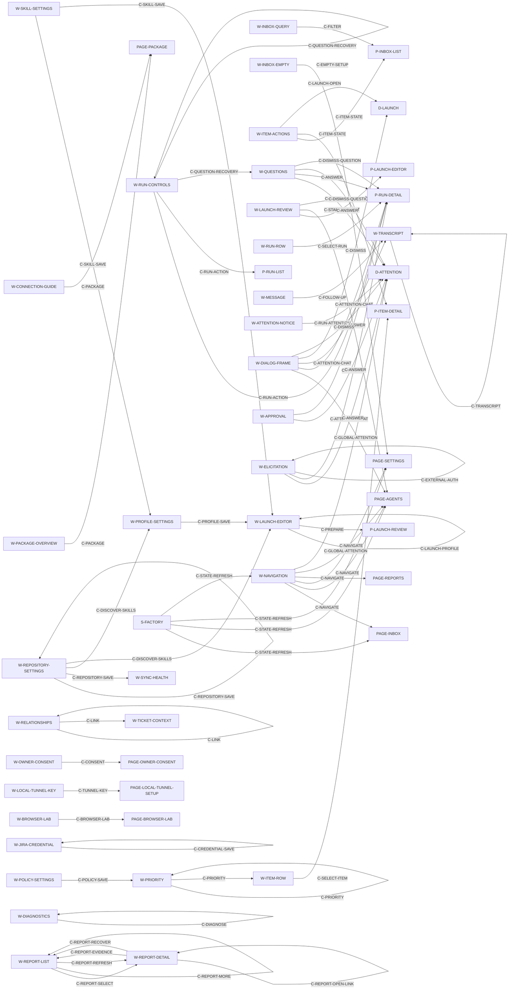

# UI connections and transitions

[Entity model](README.md) · [Widgets](widgets.md) · [Panes](panes.md) ·
[Pages](pages.md) · [Source/tests](references.md)

Containment is defined in the pane and page tables. This document records
interaction/data connections separately so a visual relationship is not mistaken
for a clickable navigation control.

## Relationship types

| Type | Meaning |
| --- | --- |
| contains | A page/dialog places a pane; a pane places widget instances; a widget names its elements. |
| selects | A control changes which record a pane displays, while staying on the same page. |
| navigates | The active logical page changes. |
| opens / closes | A dialog is shown/dismissed above a page. Closing alone has no service-side task effect. |
| submits | An explicit action changes application state or responds to a live request. |
| refreshes | Updated shared state supplies new values to widgets; it is not a navigation action. |
| references | A displayed identifier or local relationship names another domain record. It is not necessarily a clickable link. |
| external | A host-mediated link, artifact download or callback leaves the current owned surface. |

## Connection catalog

<!-- specs:connections-0 -->
| ID | From → to | Trigger and carried context | Result/type |
| --- | --- | --- | --- |
| `C-NAVIGATE` | `W-NAVIGATION` → one embedded `PAGE-*` | Inbox/Agents/Reported issues/Settings click. | Navigates. Keeps shell selections/search/filter; remounts page-local components. |
| `C-FILTER` | `W-INBOX-QUERY` → `P-INBOX-LIST` | Search text and filter value. | Selects visible rows locally. The selected detail may remain visible even if its row no longer matches. |
| `C-SELECT-ITEM` | `W-ITEM-ROW[itemId]` → `P-ITEM-DETAIL` | Click a row; item ID. | Selects and loads detail; the displayed revision is marked read. This can change unread indicators in the list. |
| `C-EMPTY-SETUP` | `W-INBOX-EMPTY` → `PAGE-SETTINGS` | Add repository click. | Navigates without saving settings or automatically focusing a field. |
| `C-ITEM-STATE` | `W-ITEM-ACTIONS` → persisted item state → shared snapshot indicators; detail history is a separately retained read. | Unread, acknowledge New or record action; item ID. | Submits item state changes, refreshes snapshot indicators and rereads selected detail/history on success. Independent read/New/action indicators and unrelated drafts remain unchanged. |
| `C-PRIORITY` | `W-PRIORITY` → item priority → list/detail | Save override or clear override; item ID and value. | Submits then refreshes; does not modify provider labels. |
| `C-LINK` | `W-RELATIONSHIPS` → selected item's relationships/context | Add submits `source` and `target`; Remove submits `source`, `target` and `remove: true`. | Submits local Add/Remove, then refreshes selected relationships without clearing unrelated drafts. A late earlier response cannot replace later selected detail. |
| `C-LAUNCH-OPEN` | `W-ITEM-ACTIONS.launch` → `D-LAUNCH` | Selected item entry. | Opens editor using current profiles and skills. No process starts. |
| `C-LAUNCH-PROFILE` | `W-LAUNCH-EDITOR.profile` → its editable fields | Select a profile. | Replaces prompt/model/effort/skill drafts; keeps the current base draft. |
| `C-PREPARE` | `W-LAUNCH-EDITOR.review` → `P-LAUNCH-REVIEW` | Item, profile, edited prompt/model/effort/skills/base. | Submits preparation and shows a durable prepared snapshot. Failure retains the editor and its drafts with a dialog-local alert; no Start occurs. |
| `C-LAUNCH-EDIT` | `W-LAUNCH-REVIEW.edit` → `P-LAUNCH-EDITOR` | Edit launch click. | Returns to the editor. The preceding prepared record is retained, not modified/deleted. |
| `C-START` | `W-LAUNCH-REVIEW.start` → `PAGE-AGENTS`/`P-RUN-DETAIL` | Prepared run ID. | Busy disables Start during a request. Received success selects the run; lost/error response retains review with a dialog-local alert. Retrying an already accepted run rejects; inspect that same retained run. |
| `C-SELECT-RUN` | `W-RUN-ROW[runId]` → `P-RUN-DETAIL` | Click a run row. | Selects run, pending requests and transcript context. Does not resume it. |
| `C-RUN-ACTION` | `W-RUN-CONTROLS` → selected run → Agents widgets | Interrupt, Resume or Cleanup; selected run ID. | Submits an explicit action, refreshing snapshot on success or failure. Cleanup retires/stales the retained session before dirty refusal; the interrupted UI retains work/history/draft and requires explicit Resume. |
| `C-FOLLOW-UP` | `W-MESSAGE` → selected run → `W-TRANSCRIPT` | Message text and displayed current-turn context. | Submits idle follow-up or active steering. Stale active-turn responses fail; success clears the message draft. |
| `C-RUN-ATTENTION` | `W-ATTENTION-NOTICE[requestId]` → `D-ATTENTION` | Notice click; request ID belonging to the selected run. | Opens that request without answering. |
| `C-GLOBAL-ATTENTION` | `W-NAVIGATION.needs-attention` → Agents and optional `D-ATTENTION` | Current pending-request list. | Navigates to Agents; opens its first pending request if present. It does not automatically change selected run. |
| `C-ATTENTION-CHAT` | `W-DIALOG-FRAME.open-chat` → `PAGE-AGENTS`/`P-RUN-DETAIL`; textual fallback inspection also selects W-TRANSCRIPT. | Current attention's owning run ID. | Closes attention, selects its run and navigates to Agents. No answer is submitted. Text fallback uses Inspect technical transcript and preserves the owning run draft. |
| `C-ANSWER` | `W-QUESTIONS` / `W-APPROVAL` / `W-ELICITATION` → request/run state | Response matched to current request ID. | Submits once through request identity validation. Success closes attention, selects the owner and starts a five-second local confirmation independently of refresh. Failed/uncertain submissions never confirm or replay; refresh failure after success is reported separately. |
| `C-DISMISS` | Launch/attention close control → underlying page | Close click or Escape inside the active dialog. | Dismisses only that dialog and restores its connected opener when permitted. No attention answer or interrupt is sent. |
| `C-REPOSITORY-SAVE` | `W-REPOSITORY-SETTINGS.save` → repository summary / sync inputs | Repository ID, checkout and default base. | Submits and refreshes settings/health. Inbox items arrive through background synchronization, not an implied immediate import. |
| `C-DISCOVER-SKILLS` | `W-REPOSITORY-SETTINGS.discover-skills` → profile and launch skill choices | Draft checkout or fallback root. | Loads/discovers skills and refreshes shared choices without saving the repository first. |
| `C-POLICY-SAVE` | `W-POLICY-SETTINGS` → config / priority assessment inputs | Parsed label mapping, policy, notification setting, optional tenant/email. | Submits configuration; later background assessment can update priority displays. Does not create a host subscription. |
| `C-CREDENTIAL-SAVE` | `W-JIRA-CREDENTIAL` → private credential store | Dedicated password-field submission. | Saves a nonempty token through the authenticated app tool and clears the reusable password field on success. Stored value is not supplied back to a widget. This is separate from the temporary local setup form and its expiry/single-use checks. |
| `C-PROFILE-SAVE` | `W-PROFILE-SETTINGS` → future `W-LAUNCH-EDITOR` | Saved profile draft. | Refreshes available/default launch settings; existing prepared snapshots stay unchanged. |
| `C-SKILL-SAVE` | `W-SKILL-SETTINGS` → profile/launch skill choices | Managed skill name/instructions. | Refreshes shared skills; immutable prepared skill snapshots stay unchanged. |
| `C-DIAGNOSE` | `W-DIAGNOSTICS` → its result display | Check connection click. | Reads health, no repair or page transition. |
| `C-STATE-REFRESH` | Shared updated state → Inbox/Agents/Settings summaries, shell counts | Successful polling or action refresh. | Refreshes shared snapshot after successful or failed actions, preserving action errors. Successful selected item mutations also trigger a separate guarded detail reread. Background work/attention updates do not save local drafts. |
| `C-TRANSCRIPT` | History pages → `W-TRANSCRIPT` | Selected run and current history cursor; optional reset to beginning. | Refreshes display only. Resetting history does not resume/replay agent work. |
| `C-PACKAGE` | Package page links → artifacts / external host setup | Download or follow documented setup instructions. | External. Missing registered app mapping can make browser download fail; it does not silently create a connection. |
| `C-CONSENT` | External host → `PAGE-OWNER-CONSENT` → registered host callback | Valid private request; Allow or Deny. | External. Consumes request; authentication then occurs in host, not by navigating into a local inbox URL. |
| `C-EXTERNAL-AUTH` | `W-ELICITATION.open-authorization` → external authorization page | Request-supplied URL opened through host. | External. Continue reports the user's completion decision; it does not independently prove external success. |
| `C-TUNNEL-KEY` | `W-LOCAL-TUNNEL-KEY` → alternate local transport session | Single-use private setup input. | Submits and removes form on success; does not navigate into Settings or activate Jira. |
| `C-BROWSER-LAB` | `W-BROWSER-LAB` controls → isolated browser → screenshot/location | Explicit lab navigation/click/key/scroll operations. | Developer utility feedback loop; never an Inbox/Agents page transition. |
| `C-QUESTION-RECOVERY` | Recovery records bind classification and clarification stage, shared attempt count and confirmed question evidence to the owning run. Unresolved classification stops progress without adding attention. | Owning recovery or attention identity. | Recovery records bind classification and clarification stage, shared attempt count and confirmed question evidence to the owning run. Unresolved classification stops progress without adding attention. |
| `C-DISMISS-QUESTION` | No reply needed dismisses a pending textual fallback without submitting an answer or advancing work. | Owning recovery or attention identity. | No reply needed dismisses a pending textual fallback without submitting an answer or advancing work. |
| `C-REPORT-SELECT` | `W-REPORT-LIST.select` → `W-REPORT-DETAIL` | Report row selection | Reads selected report without starting an agent. Selection and mutation ordering discard superseded details; journal updates queue a refresh behind a pending read so details can progress during ongoing changes. |
| `C-REPORT-EVIDENCE` | `W-REPORT-DETAIL.add-evidence` → `W-REPORT-DETAIL`, `W-REPORT-LIST` | Add evidence; selected report ID, draft text and retained idempotency key. | Append idempotent host observations and queue reports waiting for information. |
| `C-REPORT-RECOVER` | `W-REPORT-DETAIL.resume` → `W-REPORT-DETAIL`, `W-REPORT-LIST` | Resume or reconcile report; selected report ID, recovery note and effects acknowledgement. | Validate recovery prerequisites and acknowledgement before resuming retained work. |
| `C-REPORT-REFRESH` | `W-REPORT-LIST.refresh` → `W-REPORT-LIST`, `W-REPORT-DETAIL` | Refresh issues and releases | Read external issue and verified delivery evidence, retaining successful state on failure; never starts an agent. |
| `C-REPORT-QUERY` | `W-REPORT-LIST.search/processing-filter/component-filter/version-filter` → `W-REPORT-LIST` | Search or processing/component/version filter changes; current query values. | Loads the matching report subset and resets the loaded range to its first page. Existing selected detail remains independently selected. |
| `C-REPORT-MORE` | `W-REPORT-LIST.load-more` → `W-REPORT-LIST` | Load more reports; current query, next cursor and loaded range. | Extends the displayed range with bounded pages and unique report IDs. Journal updates retain pending pagination and refresh the loaded range. |
| `C-REPORT-OPEN-LINK` | `W-REPORT-DETAIL.open-issue/open-fix/open-release` → external GitHub issue, fix PR/commit or release page; owned endpoint `W-REPORT-DETAIL` | Open a retained issue, fix or release URL through the host. | Sends the stored URL to the host open-link boundary; a fix without a PR uses its repository/commit URL. Failures use the shared report error alert. Opening a link does not verify issue, fix or release state. |
<!-- /specs:connections-0 -->

## Navigation overview

<!-- specs:connections -->

<!-- /specs:connections -->

The Needs attention connection also switches the current page to Agents. Its
dialog-selection effect does not imply the run-selection effect of Open agent
chat. This distinction is explicit in `C-GLOBAL-ATTENTION`/`C-ATTENTION-CHAT`.

## Launch phase boundaries

Review submits preparation and replaces editing with the prepared review on
success. Preparation failure retains editing; start failure retains review.
Edit returns to editing. Close dismisses either phase while retaining prepared
records. Successful start selects Agents and the run. Close remains available
during in-flight preparation/start and does not cancel the request.

## Update and lifecycle boundaries

- Updates travel through the host connection. The embedded iframe has no direct
  local-service request path and does not receive owner credentials.
- Visible shared-state/history polling normally repeats once per second, with
  hidden-view delay and failure backoff. This is implementation timing documented
  for reconciling the current UI, not proof of a real-host delivery deadline.
- Loading content and loading a page are different transitions. An item read can
  make a row cease to match the unread filter while leaving its detail selected.
- Request resolution removes pending badges/notices on the next relevant refresh.
  A request that disappears cannot be answered successfully using stale identity.
- Closing a view or changing tabs is a view transition. Agent completion,
  interruption, failure and recovery are application transitions with separate
  application lifecycle effects.
