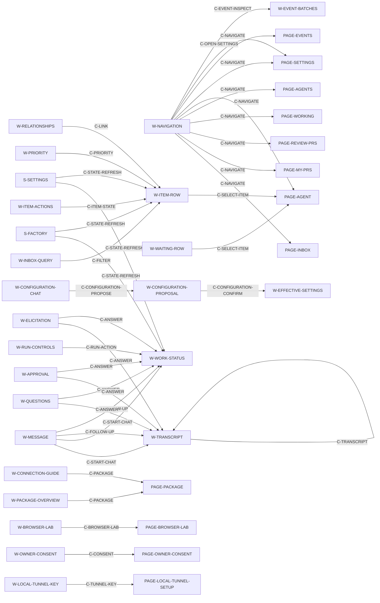

# Connections

Connections name their endpoints and the carried request. Reading a view never authorizes an agent turn.

<!-- specs:connections-0 -->
| ID | From → to | Trigger and carried context | Result/type |
| --- | --- | --- | --- |
| `C-NAVIGATE` | W-NAVIGATION → PAGE-INBOX, PAGE-MY-PRS, PAGE-REVIEW-PRS, PAGE-WORKING, PAGE-AGENTS, PAGE-AGENT, PAGE-SETTINGS, PAGE-EVENTS | Select a saved page without launching an agent. | Select a saved page without launching an agent. |
| `C-FILTER` | W-INBOX-QUERY → W-ITEM-ROW | Filter saved entries. | Filter saved entries. |
| `C-SELECT-ITEM` | W-ITEM-ROW, W-WAITING-ROW → PAGE-AGENT | Read selected item and exact revision; no session creation. | Read selected item and exact revision; no session creation. |
| `C-ITEM-STATE` | W-ITEM-ACTIONS → W-ITEM-ROW | Acknowledge local discovery. | Acknowledge local discovery. |
| `C-PRIORITY` | W-PRIORITY → W-ITEM-ROW | Persist a manual priority override or clear it. | Persist a manual priority override or clear it. |
| `C-LINK` | W-RELATIONSHIPS → W-ITEM-ROW | Add or remove a manual relationship; discovered evidence remains. | Add or remove a manual relationship; discovered evidence remains. |
| `C-RUN-ACTION` | W-RUN-CONTROLS → W-WORK-STATUS | Explicit run/resume/interrupt/cleanup; interruption holds automatic work. | Explicit run/resume/interrupt/cleanup; interruption holds automatic work. |
| `C-FOLLOW-UP` | W-MESSAGE → W-TRANSCRIPT, W-WORK-STATUS | Chat attaches queued events and bypasses timer; unblocked active work is steered. | Chat attaches queued events and bypasses timer; unblocked active work is steered. |
| `C-ANSWER` | W-QUESTIONS, W-APPROVAL, W-ELICITATION → W-TRANSCRIPT, W-WORK-STATUS | Answer the exact live request once; stale identities fail. | Answer the exact live request once; stale identities fail. |
| `C-STATE-REFRESH` | S-FACTORY, S-SETTINGS → W-WORK-STATUS, W-ITEM-ROW | Read saved state without a model call. | Poll pending saved revisions every 250 ms while visible, then every second when idle or ten seconds when hidden; superseded responses cannot replace current content. Read selectors are limited to1,024 UTF-8 bytes and explicitly rejected before projection admission; accepted identities and source documents are complete. |
| `C-TRANSCRIPT` | W-TRANSCRIPT → W-TRANSCRIPT | Read a bounded page of retained redacted output. | Read a bounded page of retained redacted output. |
| `C-PACKAGE` | Package page links → artifacts / external host setup | Download or follow documented setup instructions. | External package downloads and OAuth connection guidance. Only a valid observed registration enables the primary browser package. Portable downloads stay advanced; no connection is fabricated. |
| `C-CONSENT` | External host → `PAGE-OWNER-CONSENT` → registered host callback | Valid private request; Allow or Deny. | External. Consumes request; authentication then occurs in host, not by navigating into a local inbox URL. |
| `C-TUNNEL-KEY` | `W-LOCAL-TUNNEL-KEY` → alternate local transport session | Single-use private setup input. | A successful private submission removes the form. An unknown save outcome locks the used submission and requires saved-state inspection or fresh setup authorization; the submitted key is never automatically replayed. Alternate transport remains disabled in the pilot. |
| `C-BROWSER-LAB` | `W-BROWSER-LAB` controls → isolated browser → screenshot/location | Explicit lab navigation/click/key/scroll operations. | Developer utility feedback loop; never an Inbox/Agents page transition. |
| `C-OPEN-SETTINGS` | W-NAVIGATION → PAGE-SETTINGS | Open configuration chat and settings. | Open configuration chat and settings. |
| `C-START-CHAT` | W-MESSAGE → W-TRANSCRIPT, W-WORK-STATUS | Authorized first message creates the canonical retained session. | Authorized first message creates the canonical retained session. |
| `C-CONFIGURATION-PROPOSE` | W-CONFIGURATION-CHAT → W-CONFIGURATION-PROPOSAL | Read/propose only; agent cannot confirm. | Read/propose only; agent cannot confirm. |
| `C-CONFIGURATION-CONFIRM` | W-CONFIGURATION-PROPOSAL → W-EFFECTIVE-SETTINGS | Explicit human confirmation rejects stale versions and applies at safe turn boundaries. | Explicit human confirmation rejects stale versions and applies at safe turn boundaries. |
| `C-EVENT-INSPECT` | W-NAVIGATION → W-EVENT-BATCHES | Inspect event rules, normalized changes and delivery claims without flushing. | Inspect event rules, normalized changes and delivery claims without flushing. |
<!-- /specs:connections-0 -->

<!-- specs:connections -->

<!-- /specs:connections -->
