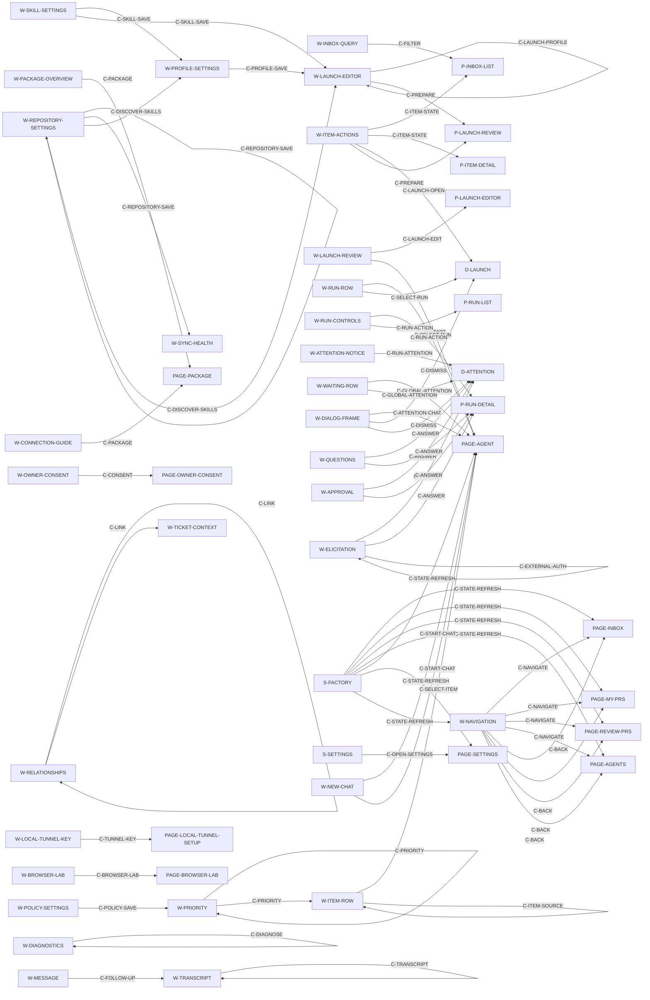

# UI connections and transitions

[Entity model](README.md) · [Widgets](widgets.md) · [Panes](panes.md) ·
[Pages](pages.md) · [Source/tests](references.md)

Containment is defined in the pane and page tables. This document records
interaction/data connections separately so a visual relationship is not mistaken
for a clickable navigation control.

## Relationship types

| Type | Meaning |
| --- | --- |
| contains | A page/dialog places a pane; a pane places widget instances; a widget names its elements. |
| selects | A control changes which record a pane displays, while staying on the same page. |
| navigates | The active logical page changes. |
| opens / closes | A dialog is shown/dismissed above a page. Closing alone has no service-side task effect. |
| submits | An explicit action changes application state or responds to a live request. |
| refreshes | Updated shared state supplies new values to widgets; it is not a navigation action. |
| references | A displayed identifier or local relationship names another domain record. It is not necessarily a clickable link. |
| external | A host-mediated link, artifact download or callback leaves the current owned surface. |

## Connection catalog

<!-- specs:connections-0 -->
| ID | From → to | Trigger and carried context | Result/type |
| --- | --- | --- | --- |
| `C-NAVIGATE` | `W-NAVIGATION` → one embedded `PAGE-*` | Issues, My PRs, Review PRs or Messages tab. | Navigates between four task queues with independent query state; configuration remains a separate document. |
| `C-FILTER` | `W-INBOX-QUERY` → `P-INBOX-LIST` | Search text and filter value. | Applies per-tab kind/ownership/review membership, filter and query. Pending issues exclude linked PRs; lists sort by priority then update time. |
| `C-SELECT-ITEM` | Work row → item conversation | Click a row; item ID. | Loads and marks the displayed item revision read, continues the newest retained conversation or shows a prefilled first message. Never starts or prepares on selection. |
| `C-ITEM-STATE` | `W-ITEM-ACTIONS` → persisted item state → shared snapshot indicators; detail history is a separately retained read. | Unread, acknowledge New or record action; item ID. | Submits item state changes, refreshes snapshot indicators and rereads selected detail/history on success. Independent read/New/action indicators and unrelated drafts remain unchanged. |
| `C-PRIORITY` | `W-PRIORITY.override` → local priority state and displayed item | Picker change; automatic clears the override. | Saves immediately, disables during submission and restores the saved value with inline error on failure. |
| `C-LINK` | `W-RELATIONSHIPS` → selected item's relationships/context | Add submits `source` and `target`; Remove submits `source`, `target` and `remove: true`. | Submits local Add/Remove, then refreshes selected relationships without clearing unrelated drafts. A late earlier response cannot replace later selected detail. |
| `C-LAUNCH-OPEN` | `W-ITEM-ACTIONS.launch` → `D-LAUNCH` | Selected item entry. | New run under Item details prepares an optional proposal and opens its durable review. No workspace/process starts until Start. |
| `C-LAUNCH-PROFILE` | `W-LAUNCH-EDITOR.profile` → its editable fields | Select a profile. | Replaces prompt/model/effort/skill drafts; keeps the current base draft. |
| `C-PREPARE` | Default launch or editor Review → prepared review | Default launch, or explicit Review after customization. | Default launch prepares immediately; optional edits reprepare explicitly. Preparation errors keep retry and Edit available without Start. |
| `C-LAUNCH-EDIT` | `W-LAUNCH-REVIEW.edit` → `P-LAUNCH-EDITOR` | Edit launch click. | Returns to the editor. The preceding prepared record is retained, not modified/deleted. |
| `C-START` | `W-LAUNCH-REVIEW.start` → `PAGE-AGENTS`/`P-RUN-DETAIL` | Prepared run ID. | Explicit Start only. Error/lost response reads the same run; accepted work opens, still-prepared work permits retry, unknown status disables Start/Edit and offers Check start status. |
| `C-SELECT-RUN` | Retained run or draft row → conversation or review | Retained conversation or draft row inside the owning item’s Work history. | Opens the selected retained conversation within the owning item, preserving the originating work queue Back context. Prepared rows reopen their existing immutable review without preparing or starting again. |
| `C-RUN-ACTION` | `W-RUN-CONTROLS` → selected run → Agents widgets | Interrupt, Resume or Cleanup; selected run ID. | Explicit interrupt or cleanup refreshes state, retaining action failures and dirty work. Message submission is the continuation action for inactive retained sessions; there is no Resume button. |
| `C-FOLLOW-UP` | `W-MESSAGE` → selected run → `W-TRANSCRIPT` | Message text and displayed current-turn context. | Send with current-turn identity while active, or restore the inactive retained session using this message as its first new turn. Success clears only unchanged submitted text after acceptance; failures preserve drafts and never cause automatic replay. |
| `C-RUN-ATTENTION` | `W-ATTENTION-NOTICE[requestId]` → `D-ATTENTION` | Notice click; request ID belonging to the selected run. | Opens that request without answering. |
| `C-GLOBAL-ATTENTION` | Messages request → owning run and attention dialog | Select one pending request. | Selects that exact owning run and request; identifies item/profile and returns to that conversation after answering. |
| `C-ATTENTION-CHAT` | Attention dialog → owning conversation | Current attention's owning run ID. | Closes attention and opens the owning conversation without submitting an answer. |
| `C-ANSWER` | `W-QUESTIONS` / `W-APPROVAL` / `W-ELICITATION` → request/run state | Response matched to current request ID. | Submits to the matching request. Success selects the owning run, refreshes and closes; a refresh failure is reported in the shell without replaying the answer. Answer failures stay in attention. Original approval payloads are preserved behind readable labels. |
| `C-DISMISS` | Launch/attention close control → underlying page | Close click or Escape inside the active dialog. | Dismisses only that dialog and restores its connected opener when permitted. No attention answer or interrupt is sent. |
| `C-REPOSITORY-SAVE` | `W-REPOSITORY-SETTINGS.save` → repository summary / sync inputs | Repository ID, checkout and default base. | Shows saving/success/error within the independent settings view. Successful saves remain there; other open task views receive refreshed shared data without navigation or draft reset. |
| `C-DISCOVER-SKILLS` | `W-REPOSITORY-SETTINGS.discover-skills` → profile and launch skill choices | Draft checkout or fallback root. | Loads/discovers skills and refreshes shared choices without saving the repository first. |
| `C-POLICY-SAVE` | `W-POLICY-SETTINGS` → config / priority assessment inputs | Label/priority rows, assessment prompt and notification setting; disabled Jira values are not editable here. | Submits configuration; later background assessment can update priority displays. Does not create a host subscription. |
| `C-PROFILE-SAVE` | `W-PROFILE-SETTINGS` → future `W-LAUNCH-EDITOR` | Saved profile draft. | Refreshes available/default launch settings; existing prepared snapshots stay unchanged. |
| `C-SKILL-SAVE` | `W-SKILL-SETTINGS` → profile/launch skill choices | Managed skill name/instructions. | Refreshes shared skills; immutable prepared skill snapshots stay unchanged. |
| `C-DIAGNOSE` | `W-DIAGNOSTICS` → its result display | Check connection click. | Shows local Checking feedback and then health results or an exact local error. No repair or page transition. |
| `C-STATE-REFRESH` | Shared updated state → Inbox/Agents/Settings summaries, shell counts | Successful polling or action refresh. | Refreshes shared snapshot after successful or failed actions, preserving action errors. Successful selected item mutations also trigger a separate guarded detail reread. Background work/attention updates do not save local drafts. Only an explicit allowlist of read operations retries transient transport errors. The exact host-wrapped McpServerError connection failure is recognized as transport; other tool/business errors and all mutations are never automatically replayed. Poll recovery clears only polling feedback, not action failures. |
| `C-TRANSCRIPT` | History pages → `W-TRANSCRIPT` | Selected run and current history cursor; optional reset to beginning. | Refreshes display only. Resetting history does not resume/replay agent work. |
| `C-PACKAGE` | Package page links → artifacts / external host setup | Download or follow documented setup instructions. | External package downloads and OAuth connection guidance. Only a valid observed registration enables the primary browser package. Portable downloads stay advanced; no connection is fabricated. |
| `C-CONSENT` | External host → `PAGE-OWNER-CONSENT` → registered host callback | Valid private request; Allow or Deny. | External. Consumes request; authentication then occurs in host, not by navigating into a local inbox URL. |
| `C-EXTERNAL-AUTH` | `W-ELICITATION.open-authorization` → external authorization page | Request-supplied URL opened through host. | External. Continue reports the user's completion decision; it does not independently prove external success. |
| `C-TUNNEL-KEY` | `W-LOCAL-TUNNEL-KEY` → alternate local transport session | Single-use private setup input. | Submits and removes form on success; does not navigate into Settings or activate Jira. |
| `C-BROWSER-LAB` | `W-BROWSER-LAB` controls → isolated browser → screenshot/location | Explicit lab navigation/click/key/scroll operations. | Developer utility feedback loop; never an Inbox/Agents page transition. |
| `C-BACK` | Conversation Back → originating work or Messages tab | Back action on the record page. | Restores list query, scroll and row focus when the row exists; missing rows leave a usable focus fallback. Ordinary drafts remain keyed to their records. |
| `C-ITEM-SOURCE` | Inbox source link → original GitHub issue or pull request in the host browser | Click or keyboard activation of the displayed repository/number carries the original item URL. | Opens through host openLink. It does not select/read/acknowledge or start work. Denied or failed opens remain visible in the current list. |
| `C-OPEN-SETTINGS` | Host open_settings invocation → independent settings document | The settings entry tool advertises its own content-specific resource and output template. | Opens configuration in its own view. The inbox entry and legacy resource remain inbox-only. Both surfaces reuse authenticated bridged tools without owner credentials or direct iframe localhost access. |
| `C-START-CHAT` | First-message Start → retained run conversation | Explicit Start with the visible message and authority. | Prepares then starts once; verifies the same run after an uncertain response. Preserves per-item draft and recovery state. |
<!-- /specs:connections-0 -->

## Navigation overview

<!-- specs:connections -->

<!-- /specs:connections -->

The Messages request connection also selects its owning conversation. Its
request selection and the dialog’s Open agent chat action both preserve owning-run identity. The latter defers the answer.

## Launch phase boundaries

Review submits preparation and replaces editing with the prepared review on
success. Preparation failure retains editing; start failure retains review.
Edit returns to editing. Close dismisses either phase while retaining prepared
records. Successful start shows the run in its conversation. Close remains available
during in-flight preparation/start and does not cancel the request.

## Update and lifecycle boundaries

- Updates travel through the host connection. The embedded iframe has no direct
  local-service request path and does not receive owner credentials.
- Visible shared-state/history polling normally repeats once per second, with
  hidden-view delay and failure backoff. This is implementation timing documented
  for reconciling the current UI, not proof of a real-host delivery deadline.
- Loading content and loading a page are different transitions. An item read can
  make a row cease to match the unread filter while leaving its detail selected.
- Request resolution removes pending badges/notices on the next relevant refresh.
  A request that disappears cannot be answered successfully using stale identity.
- Closing a view or changing tabs is a view transition. Agent completion,
  interruption, failure and recovery are application transitions with separate
  application lifecycle effects.
