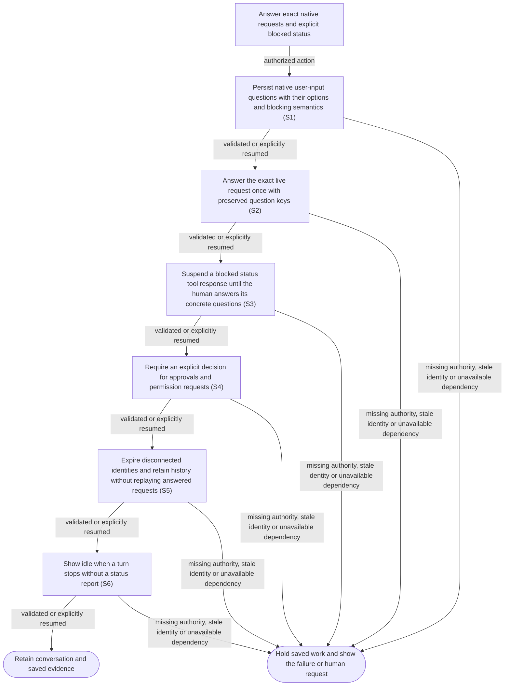

# Answer exact native requests and explicit blocked status

## Goal

Answer exact native requests and explicit blocked status.

## Preconditions

The private owner connection is established. Application data starts clean in the session-state database; native Codex authentication and configuration remain outside application state. GitHub source text is task data, not new authority.

## Main flow

1. Persist native user-input questions with their options and blocking semantics.

2. Answer the exact live request once with preserved question keys.

3. Suspend a blocked status tool response until the human answers its concrete questions.

4. Require an explicit decision for approvals and permission requests.

5. Expire disconnected identities and retain history without replaying answered requests.

6. Show idle when a turn stops without a status report.

## Alternatives and recovery

Read-only inspection does not launch a model turn. Surface validation or provider errors and retain saved work. Human questions, explicit interruptions and uncertain deliveries hold automatic dispatch. Resume against current retained history; never replay an uncertain send or an answered RPC blindly. Explicit cleanup preserves dirty worktrees.

Show local submission feedback before waiting for the connection. Acceptance is
separate from delivery: keep queued and running work pending, and preserve the
owning conversation draft until delivery succeeds. Navigation and unrelated
conversations remain usable. Repeated request identities retrieve the original
work; connection recovery never submits the command again. After restart, effects
with retained intent are uncertain and memory-only work can be lost. Neither is
authority to replay a mutation or reuse an expired answer.

Question text and JSON drafts remain in memory by exact request identity through loading and navigation. Clear only the successfully delivered draft. If answers empty the final page while other questions remain, return to the last available page.

## Scenarios

- **S1** — Persist native user-input questions with their options and blocking semantics.
- **S2** — Answer the exact live request once with preserved question keys.
- **S3** — Suspend a blocked status tool response until the human answers its concrete questions.
- **S4** — Require an explicit decision for approvals and permission requests.
- **S5** — Expire disconnected identities and retain history without replaying answered requests.
- **S6** — Show idle when a turn stops without a status report.

## Verification scope

The assertion references below establish their fixture scope. Native installed-host, real-provider and assistive-technology acceptance require separate dated observations. The retired pipeline editor, review artifacts, AI question repair and built-in issue-report ledger have no compatibility path.

<!-- flow-references -->
## Terminology and UI references

Glossary: [reported-work-status](../glossary/README.md#reported-work-status), [retained-session](../glossary/README.md#retained-session).
UI entities: [PAGE-AGENTS](../ui/README.md#PAGE-AGENTS), [W-QUESTIONS](../ui/README.md#W-QUESTIONS), [W-APPROVAL](../ui/README.md#W-APPROVAL), [W-ELICITATION](../ui/README.md#W-ELICITATION), [W-WORK-STATUS](../ui/README.md#W-WORK-STATUS).

## Flow diagram

## Implementation references

- [internal/factory/requests.go](../../internal/factory/requests.go) — Exact session-bound native requests and explicit status, without classifiers. (`func (s *Service) Answer(`)
- [internal/factory/native.go](../../internal/factory/native.go) — Direct native app-server retained thread creation and resumption. (`func (s *Service) attach(`)
- [web/src/wrapper.tsx](../../web/src/wrapper.tsx) — Saved inbox, session conversation, human input and confirmed configuration. (`function Factory(`)
- [internal/transport/factory.go](../../internal/transport/factory.go) — Session, configuration, event and retained triage APIs. (`func NewFactory(`)
- [internal/transport/factory_projection.go](../../internal/transport/factory_projection.go) — Bounded view-specific bodyless inbox and compact session/question state; source detail and configuration are separate. (`func factoryState(`)
- [internal/transport/questions.go](../../internal/transport/questions.go) — Bounded session/status question collections preserve exact payloads and total counts. (`func questionPage(`)

## Test references

- [web/tests/wrapper.spec.ts](../../web/tests/wrapper.spec.ts) — `native options remain intact and answers address the exact request`; S1, S2. Selecting a native option preserves the exact question identity and answer key.
- [internal/factory/service_test.go](../../internal/factory/service_test.go) — `func TestStatusToolBlockingAndNativeAnswers(`; S1, S2, S3, S4. Explicit status, suspended blocked tool and exact native answers separate work status from execution.
- [web/tests/wrapper.spec.ts](../../web/tests/wrapper.spec.ts) — `native approvals require an explicit decision`; S4. Explicit decline sends the exact native approval request identity and decision.
- [internal/factory/service_test.go](../../internal/factory/service_test.go) — `func TestRestartExpiresIdentitiesAndNeverReplaysUncertainBatch(`; S5. Restart expires RPC identities and holds uncertain delivery without blind replay.
- [internal/factory/service_test.go](../../internal/factory/service_test.go) — `func TestRepositoryQuietOverrideAndIdleWithoutStatus(`; S6. Repository quiet override, completion without report, and source closure retain history.
- [internal/factory/service_test.go](../../internal/factory/service_test.go) — `func TestNativeChoicesApprovalAmendmentsAndPermissionDenials(`; S2, S4. Exact native choices, offered approval amendment payloads and bounded permission denial/grants.
- [web/tests/wrapper.spec.ts](../../web/tests/wrapper.spec.ts) — `native approval options preserve exact amendment payloads`; S4. Selecting the offered native approval amendment preserves its exact structured decision payload.
- [web/tests/wrapper.spec.ts](../../web/tests/wrapper.spec.ts) — `elicitation preserves schema responses rejected drafts and explicit decisions`; S1, S2. Form elicitation shows native schema, rejects malformed JSON locally, preserves server-rejected draft, and sends exact accept content, decline and cancel decisions.
- [web/tests/wrapper.spec.ts](../../web/tests/wrapper.spec.ts) — `URL elicitation opens through the host and native verification is never fabricated`; S1, S2. URL mode uses host open-link and explicit continue; unsupported native device verification offers cancel without fabricating proof.
- [web/tests/wrapper.spec.ts](../../web/tests/wrapper.spec.ts) — `native secret inputs retain rejected answers without rendering secret text`; S2. Secret question uses a password input, preserves a rejected draft without visible plaintext, and sends the exact answer only on explicit resend.
- [internal/factory/regressions_test.go](../../internal/factory/regressions_test.go) — `func TestElicitationSchemaAndRemainingBlockers(`; S1, S2. Missing content and wrong schema types retain requests without replies; valid answer preserves another pending blocker and final decline resumes execution.
- [internal/factory/regressions_test.go](../../internal/factory/regressions_test.go) — `func TestSecretVaultFailureCannotBecomeUnpersistedRetry(`; S2. A real readonly-vault write failure leaves the question pending with no reply or in-memory commitment; identical retry persists before answering and resumed output stays redacted.
- [internal/factory/regressions_test.go](../../internal/factory/regressions_test.go) — `func TestSecretAnswerWithRedactedQuestionIDSurvivesResume(`; S2. A masked secret question ID restores the original native answer key and exact value, durably retains the new secret, and redacts split/completed/fresh-service resumed output.
- [internal/transport/operations_test.go](../../internal/transport/operations_test.go) — `func TestQuestionPagesKeepExactLargePayloads(`; S1, S2. A second page of large Unicode requests preserves total count, stable identity and the complete exact question body through versioned chunks.
- [web/tests/wrapper.spec.ts](../../web/tests/wrapper.spec.ts) — `question pages retain exact requests beyond the first page`; S1, S2. Navigate to requests 51–55 and deliver the exact second-page question identity and free-text answer.
- [web/tests/wrapper.spec.ts](../../web/tests/wrapper.spec.ts) — `question text and JSON drafts survive pending reads and navigation`; S1, S2. Free-text and elicitation JSON drafts remain keyed by exact question identity through pending reads and navigation while stale forms are hidden.
- [web/tests/wrapper.spec.ts](../../web/tests/wrapper.spec.ts) — `answering the final question page returns to remaining requests`; S1, S2. Answer all five final-page requests and automatically return to the remaining 50 requests without a false empty state.

## Verification and gaps

Local suites: `go`, `browser`.
Fixture success does not establish real-host acceptance.
- **S2** — `gap-flow-answer-attention-s2-01` · Unverified behavior · P1 · owner: specification-coordinator. External native user-verification and every supported approval/dialog variant lack real-host coverage. Next verification: Record actual-host native user-verification and supported approval/dialog variants using version-bound nonsecret observations; preserve fixture and real-host distinctions.
- **S5** — `gap-flow-answer-attention-s5-01` · Unverified behavior · P2 · owner: specification-coordinator. Fixtures cover queue discovery, exact question/options, answer delivery and same-thread continuation. No installed ChatGPT Work attention acceptance is established by this development port; actual-host normal, multi-agent/page, stale/duplicate, uncertain-delivery and recovered-text variants remain unverified. Next verification: Observe normal queue discovery and same-thread answer continuation, then multi-agent/page, stale/duplicate, uncertain-delivery and recovered-text variants in an explicitly scoped private-pilot campaign for the installed port version, without replaying delivery or substituting runs.

<!-- /flow-references -->
