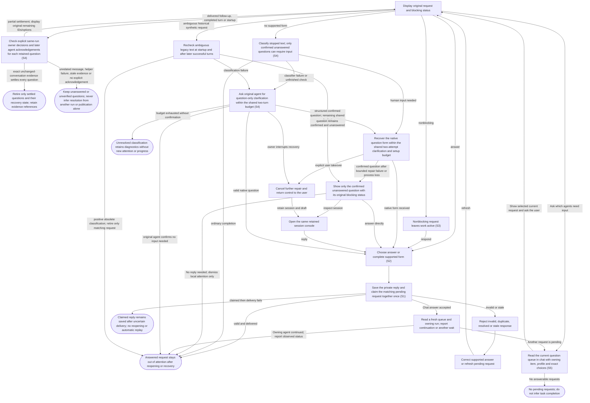

# Answer agent questions and approval requests

## Goal

The owner sees requests for attention and sends a valid response to the originating session once.

## Preconditions

An agent has requested a question, approval, permission grant or supported form response.

## Main flow

1. Open Messages to see unanswered native, structured-message and recovered textual questions and approvals, with owning item, request type and question. Select a request to open its owning conversation and attention dialog.
2. Choose an answer or complete the supported form.
3. Submit the answer and return to the owning run’s conversation.

An accepted response is saved privately together with the one-time answer claim
before delivery. Its exact content remains encrypted even if delivery becomes
uncertain. The request leaves actionable attention and stays absent after reopening,
disconnect or restart; an answered repair cannot become a new fallback question.
Recovery also retires an older duplicate fallback for that answered episode,
while preserving unrelated unanswered requests. Invalid or rejected duplicate
responses cannot replace the saved answer.

In chat, ask which agents need an answer. The connected plugin lists the same
answerable requests with their item, profile, exact questions and options. It
asks for your response, sends it to the matching request once, and checks the
fresh queue and owning run before reporting continuation. An empty queue means
no answerable requests now, not that every task finished. Reads and pagination
never start work or answer for you; secret fields stay in the embedded form.
On-demand queue access does not imply background host notifications.

## Alternatives and recovery

Keyboard focus stays within the dialog through updates. Escape defers the answer and restores its connected opener; it does not submit a response.

Messages counts valid unanswered questions and approvals, including nonblocking questions and retained message/text questions; an empty queue remains available with a concise status. Answering one request removes only that request from the waiting list. Retained conversations and prepared launches are available only in their owning item’s Work history. Answered, stale and orphaned requests are excluded. Live RPC requests require their original connected process; retained message/text questions can restore their session. Approval command, reason and requested access are readable fields; original data is available under Technical details. Allow once, Allow for this session, Deny and Cancel preserve the exact original response values. Answers are local to each request; secret answers never enter ordinary item/run draft storage.

Nonblocking requests leave work active and remain visible in both Messages and the owning conversation. Invalid answers and grants beyond requested permissions are rejected. Duplicate, resolved or stale requests cannot be answered again. Requesting interruption immediately prevents answering the agent's native questions, including while the agent is still stopping. Delivery failure after a response is claimed is not automatically replayed. Unsupported host verification stays explicit.

A delivered conversational message, completed turn or startup schedules background reconciliation of retained message/text questions. Only a specific owner decision followed by an explicit agent acknowledgement in the same run can retire that question. Partial decisions preserve the other original question IDs and options; resolved, cancelled or superseded questions leave actionable attention with evidence references retained. A read-only helper checks bounded redacted conversation evidence and cannot answer questions or grant permissions. Missing or ambiguous evidence, helper failure, a changed conversation or another run’s completed review preserves the outstanding asks. Saved-state reads remain immediate and never invoke this helper. Native requests and approvals still require their original protocol response.

If continuing after an answer fails before anything is sent, the session remains inactive. An acknowledged continuation stays active when saving its status fails; inspect uncertain delivery before sending again.

Daemon startup preserves unanswered questions without continuing past them. Lost native questions remain answerable through a retained textual continuation; lost approvals expire and must be requested again through the native approval path. No old answer or approval is replayed during automatic session recovery.

Closing or merging the source item terminates its sessions and retires their pending questions and approvals. Those asks cannot be answered or recreated through recovery; history remains available.

When an agent stops with text, the application classifies whether input is actually needed. Classifier failure asks the original retained agent for question-only clarification in Plan mode with read-only access and no approvals. Clarification, native-form repair and retained setup share at most two durable attempts. Only a confirmed unanswered question becomes a text fallback, preserving its original blocking status; unresolved classification retains diagnostics without attention or progress. Takeover cancels further repair. An uncertain textual fallback also offers No reply needed, clearing that local ask without advancing the session or authorizing anything. An answer continues the same work with its original mode and authority; a failed or uncertain send is never replayed automatically.

## Scenarios

- **S1** A blocking question is visible and answered exactly once, including concurrent submissions.
- **S2** Approval choices and form content are validated without broadening permissions.
- **S3** Nonblocking requests leave the run active; native requests reject responses once interruption is requested, and stale requests reject responses after recovery.

- **S5** The chat queue is discoverable, read only, oldest first and paginated without skipping requests when earlier asks resolve. It preserves owning context and exact options, excludes stale/answered/orphaned requests, and verifies that an accepted answer resumes the same agent without removing another agent’s ask.

- **S4** Render native and structured-message questions; classify stopped text and clarify failures within the shared two-attempt setup/form budget. Retain only confirmed unanswered fallback questions with original blocking status and the same session console. Preserve answer claims and redaction across recovery.

Automatic recovery exchanges appear as technical activity under Details or in the session console. Your responses keep their ordinary conversation role.

During plugin maintenance an answer is refused with explicit feedback; the caller retains its draft. Maintenance cannot begin while live waiting/running agent work owns the provider. No answer is replayed automatically.

Successful conversational answers return local delivery state, the originating run/turn/thread identities and remaining pending attention, so queue discovery and answer verification normally take two calls. Accepted delivery does not establish task completion. Uncertain delivery still requires reading current state without replay.

A durable native answer claim remains final through process loss, including when recovery has not yet recorded the claim. It never becomes a new question or an automatic repeated answer.

Take over after a repair answer preserves that final claim and cancels pending automatic continuation, whether the repair has acknowledged the answer or is still completing.

Unclassified completion text and classifier/configuration/process failures never establish a question. Startup reconnects the retained thread only for constrained clarification when needed; ordinary task continuation requires owner direction or an answer to a genuine question. Exhausted unconfirmed recovery retains diagnostics and stops progress without adding attention. Owner takeover cancels recovery, including late callbacks.

Before reconnecting the retained agent, recovery durably claims the intended delivery attempt. Failed setup consumes that claim; successful setup reuses it for the first question-only turn. Only remaining shared budget permits an automatic retry, and unconfirmed recovery becomes unresolved after exhaustion. Restart never resets or replays a claimed attempt. Later successful owner-directed work still supplies evidence for rechecking an ambiguous request.

Ambiguous historical text requests are rechecked at startup and after later successful turns, even while they prevent new-question detection. A positive completion-only, resolved or superseded classification retires only the matching synthetic request and records its resolution with history intact. Idle status or turn completion alone never retires an unanswered question. Historical unfinished checks remain unconfirmed; native requests and attempted form repairs supply positive evidence.

Historical checks in one run do not delay question detection in another run. Within a run, historical requests are reconciled before checking its latest stopped response for a new question. Historical clarification keeps ownership until it completes or is explicitly stopped. When it finishes without a pending question, the latest stopped response is still checked using its original identity; an unfinished historical recovery cannot be displaced or leave permanent progress.

Takeover waiting for a busy recovery turn in one run does not delay another run's question detection.

Take over invalidates the whole queued completion check, including new-question detection after historical reconciliation. Retired recovery startup cannot overwrite a replacement task started by the owner after takeover.

Positive reclassification replaces ambiguous text with the actual confirmed question. If native clarification replaces an older text request before process loss, its confirmed unanswered question remains answerable as one text fallback with the original delivery status and shared attempt count. Changed or replaced requests receive a fresh identity so answers or dismissals from an older view cannot target the current question. Replacement history remains intact. Answered, dismissed and cancelled requests stay final.

Completion of a native clarification turn preserves its unanswered question as a fallback even when unrelated attention remains pending. Its original nonblocking delivery and consumed attempts stay intact.

A retained async question keeps its owning answer route across process loss and restart. Matching obsolete text duplicates retire with their payload and resolution history intact. A live repair answer completes that turn before continuation restores the original task policy. An answer claims the originating question before delivery, so sibling routes and stale request or recovery snapshots cannot repeat it, including after uncertain delivery. Unrelated requests retain their identities.

Cancelling automatic recovery does not establish that a genuine pending async question was answered or became obsolete. After restart, Take over can still clear its recovery progress while that question remains available for an explicit answer.

<!-- flow-references -->
## Terminology and UI references

Glossary: [attention-request](../glossary/README.md#attention-request), [agent-run](../glossary/README.md#agent-run), [state-blocking](../glossary/README.md#state-blocking), [state-continuing](../glossary/README.md#state-continuing), [coverage-gap](../glossary/README.md#coverage-gap), [unverified-behavior](../glossary/README.md#unverified-behavior), [keyboard-focus](../glossary/README.md#keyboard-focus), [modal-dialog](../glossary/README.md#modal-dialog), [question-recovery](../glossary/README.md#question-recovery), [session-console](../glossary/README.md#session-console), [state-terminated](../glossary/README.md#state-terminated).
UI entities: [D-ATTENTION](../ui/README.md#D-ATTENTION), [P-ATTENTION-FRAME](../ui/README.md#P-ATTENTION-FRAME), [P-QUESTIONS](../ui/README.md#P-QUESTIONS), [P-APPROVAL](../ui/README.md#P-APPROVAL), [P-ELICITATION](../ui/README.md#P-ELICITATION), [W-DIALOG-FRAME](../ui/README.md#W-DIALOG-FRAME), [W-ATTENTION-NOTICE](../ui/README.md#W-ATTENTION-NOTICE), [W-QUESTIONS](../ui/README.md#W-QUESTIONS), [W-APPROVAL](../ui/README.md#W-APPROVAL), [W-ELICITATION](../ui/README.md#W-ELICITATION), [C-RUN-ATTENTION](../ui/README.md#C-RUN-ATTENTION), [C-ATTENTION-CHAT](../ui/README.md#C-ATTENTION-CHAT), [C-ANSWER](../ui/README.md#C-ANSWER), [C-EXTERNAL-AUTH](../ui/README.md#C-EXTERNAL-AUTH), [PAGE-AGENTS](../ui/README.md#PAGE-AGENTS), [P-WAITING-QUEUE](../ui/README.md#P-WAITING-QUEUE), [W-WAITING-ROW](../ui/README.md#W-WAITING-ROW), [C-GLOBAL-ATTENTION](../ui/README.md#C-GLOBAL-ATTENTION), [W-QUESTION-RECOVERY](../ui/README.md#W-QUESTION-RECOVERY), [W-SESSION-CONSOLE](../ui/README.md#W-SESSION-CONSOLE), [C-DISMISS-QUESTION](../ui/README.md#C-DISMISS-QUESTION).

## Flow diagram

## Implementation references

- [internal/app/runs.go](../../internal/app/runs.go) — Durable claims and request-specific validation (`func (m *Manager) Answer(`)
- [web/src/main.tsx](../../web/src/main.tsx) — Question, approval and form dialogs (`function AttentionDialog(`)
- [internal/codex/client.go](../../internal/codex/client.go) — Process request-response transport
- [internal/domain/types.go](../../internal/domain/types.go) — Shared domain, persistence, transport or dependency contract
- [internal/store/store.go](../../internal/store/store.go) — Shared domain, persistence, transport or dependency contract
- [internal/transport/mcp.go](../../internal/transport/mcp.go) — Shared domain, persistence, transport or dependency contract
- [go.mod](../../go.mod) — Shared domain, persistence, transport or dependency contract
- [go.sum](../../go.sum) — Shared domain, persistence, transport or dependency contract
- [web/src/types.ts](../../web/src/types.ts) — Embedded UI build and host-fixture configuration
- [web/src/style.css](../../web/src/style.css) — Embedded UI build and host-fixture configuration
- [web/src/bridge.ts](../../web/src/bridge.ts) — Embedded UI build and host-fixture configuration
- [web/package.json](../../web/package.json) — Embedded UI build and host-fixture configuration
- [web/package-lock.json](../../web/package-lock.json) — Embedded UI build and host-fixture configuration
- [web/tsconfig.json](../../web/tsconfig.json) — Embedded UI build and host-fixture configuration
- [web/vite.config.ts](../../web/vite.config.ts) — Embedded UI build and host-fixture configuration
- [web/index.html](../../web/index.html) — Embedded UI build and host-fixture configuration
- [web/playwright.config.ts](../../web/playwright.config.ts) — Embedded UI build and host-fixture configuration
- [web/fixture-ports.ts](../../web/fixture-ports.ts) — Shared validated loopback fixture origins preserve default ports and allow isolated browser verification alongside another checkout. (`export const fixtureUIOrigin =`)
- [internal/testhost/main.go](../../internal/testhost/main.go) — Embedded UI build and host-fixture configuration
- [internal/testutil/fakecodex/main.go](../../internal/testutil/fakecodex/main.go) — Embedded UI build and host-fixture configuration
- [internal/testutil/testutil.go](../../internal/testutil/testutil.go) — Embedded UI build and host-fixture configuration
- [internal/web/embed.go](../../internal/web/embed.go) — Embedded UI build and host-fixture configuration
- [web/src/modal-focus.ts](../../web/src/modal-focus.ts) — Initial modal focus, visible-control Tab containment, Escape dismissal, focus preservation across updates and conditional opener restoration. (`export function useModalFocus(`)
- [internal/app/questions.go](../../internal/app/questions.go) — Durable native/message/text question routing, bounded form repair, redaction and retained continuation. (`func (m *Manager) answerSynthetic(`)
- [internal/app/plugins.go](../../internal/app/plugins.go) — Plugin maintenance excludes new answer delivery without replay. (`func (m *Manager) PluginAction(`)
- [internal/app/attention.go](../../internal/app/attention.go) — Read-only oldest-first actionable question/approval queue with compact owning context, run filtering, bounded cursor pagination and no provider RPC IDs or answer data. (`func (a *App) ListAttention(`)
- [plugin/skills/code-factory/SKILL.md](../../plugin/skills/code-factory/SKILL.md) — Conversational queue discovery, exact user/question matching, safe one-time answer, fresh queue/run verification and explicit host subscription limits.
- [internal/app/continuation.go](../../internal/app/continuation.go) — Verify fresh source for initial/automatic continuation; message-triggered restoration supplies saved context and lets the agent perform task-required GitHub reads. (`func (m *Manager) continuationContext(`)
- [internal/providers/continuation.go](../../internal/providers/continuation.go) — Targeted conditional GitHub source read bypasses local TTL while retaining shared budget and cooldown enforcement. (`func (g *GitHub) CurrentWorkItem(`)
- [internal/transport/tracking.go](../../internal/transport/tracking.go) — Targeted saved-state reads, compact tracking, durable progress or asynchronous observation without delaying status. (`func (s *Server) dashboard(`)
- [internal/store/reads.go](../../internal/store/reads.go) — Targeted saved-state reads, compact tracking, durable progress or asynchronous observation without delaying status. (`func Select[T any](`)
- [internal/app/attention_reconciliation.go](../../internal/app/attention_reconciliation.go) — Background same-run per-question reconciliation after delivery, completion and startup. Requires exact owner decision and subsequent agent acknowledgement; uncertainty preserves attention, native approvals are excluded. (`func (m *Manager) reconcileAttention(`)
- [internal/store/conversation.go](../../internal/store/conversation.go) — Bounded same-run redacted conversation evidence excludes tools, internal recovery input, old source messages and other runs. (`func (s *Store) ConversationEvidence(`)
- [internal/store/vault.go](../../internal/store/vault.go) — Encrypt exact attention replies in the same transaction as answer and recovery claims; no plaintext answer payload in public state. (`func (v *Vault) SetTx(`)
- [internal/store/conversation.go](../../internal/store/conversation.go) — Transaction guard counts ordinary owner/agent completions and opaque same-run completion chunks as possible conversation changes without importing omitted content as evidence. (`func (t *Tx) ConversationVersion(`)
- [internal/aiworkflows/client.go](../../internal/aiworkflows/client.go) — YAML workflow execution retains native session policy, questions, interrupts and application-owned recovery. (`func (c *Client) CallWorkflow(`)
- [internal/aiworkflows/workflows/attention-check.yml](../../internal/aiworkflows/workflows/attention-check.yml) — Embedded model-turn workflow definition and native structured-output contract where applicable. (`name:`)
- [internal/aiworkflows/workflows/question-check.yml](../../internal/aiworkflows/workflows/question-check.yml) — Embedded model-turn workflow definition and native structured-output contract where applicable. (`name:`)
- [internal/aiworkflows/workflows/question-repair.yml](../../internal/aiworkflows/workflows/question-repair.yml) — Embedded model-turn workflow definition and native structured-output contract where applicable. (`name:`)

## Test references

- [internal/app/app_test.go](../../internal/app/app_test.go) — `func TestAgentQuestionExactlyOnceAndRecovery(`; S1. Successful answer and duplicate rejection.
- [internal/app/app_test.go](../../internal/app/app_test.go) — `func TestConcurrentPollingSteeringAndAnswersThenDirtyCleanup(`; S1. Concurrent answers have one successful claimant.
- [internal/app/app_test.go](../../internal/app/app_test.go) — `func TestAttentionValidationPreservesPermissionAndFormBoundaries(`; S2. Permission subset and schema validation.
- [internal/app/app_test.go](../../internal/app/app_test.go) — `func TestNonblockingApprovalsCrashAndResume(`; S2, S3. Nonblocking status and approval choices.
- [internal/app/app_test.go](../../internal/app/app_test.go) — `func TestRecoveryStalesRequestsAndPreservesIdleRuns(`; S3. Completed idle sessions retain their status and workspace; expired native requests become stale and reject answers.
- [web/tests/factory.spec.ts](../../web/tests/factory.spec.ts) — `test("MCP bridge drives the assembled daemon through launch, question, answer and follow-up"`; S1. Actual UI dialog through assembled fixture.
- [web/tests/factory.spec.ts](../../web/tests/factory.spec.ts) — `test("keyboard attention stays contained through updates and Escape restores the pending opener"`; S1. Keyboard question choices survive polling, Tab remains contained, Escape defers without answering and restores opener; later one answer reaches idle with polite run status.
- [web/tests/factory.spec.ts](../../web/tests/factory.spec.ts) — `test("global attention selects its owning run and returns to its conversation after answering"`; S1. Owning title/profile and run selection survive answer completion.
- [web/tests/factory.spec.ts](../../web/tests/factory.spec.ts) — `readable approval choices preserve payloads in a narrow`; S2. Both themes preserve original decisions and requested permission-turn payloads behind readable labels.
- [web/tests/factory.spec.ts](../../web/tests/factory.spec.ts) — `Messages lists waiting agents and answering removes only its owning request`; S1. Two waiting agents show item/profile/questions; selecting second identifies its context, exact request is answered, its conversation opens, and the other request remains.
- [internal/app/questions_test.go](../../internal/app/questions_test.go) — `func TestStoppedQuestionRecoveryNativeAndFallback(`; S4. Same-session bounded question repair, at-most-once answers and original-mode restoration.
- [internal/app/questions_test.go](../../internal/app/questions_test.go) — `func TestStructuredMessageQuestionSurvivesRestartAndClaimsAnswerOnce(`; S4. Async questions survive restart and concurrent answers have one claimant.
- [web/tests/factory.spec.ts](../../web/tests/factory.spec.ts) — `text fallback opens the same session console`; S4. Fallback routes the exact answer to its request and console mode retains the reply draft without a new launch.
- [internal/app/questions_test.go](../../internal/app/questions_test.go) — `func TestTextQuestionDismissalCannotAnswerOrApproveNativeRequests(`; S4. Text-only dismissal cannot approve a native request or launch work.
- [web/tests/factory.spec.ts](../../web/tests/factory.spec.ts) — `an uncertain textual reply can be dismissed without advancing`; S4. Uncertain helper output is reviewable and dismissible without sending another task turn.
- [internal/app/plugins_test.go](../../internal/app/plugins_test.go) — `func TestPluginMaintenanceCannotRaceStartsOrAcceptInjectedArguments(`; S1. An answer call is refused during exclusive plugin maintenance before any request can be delivered.
- [internal/app/attention_test.go](../../internal/app/attention_test.go) — `func TestAttentionQueueFiltersAndPaginatesWithoutSkippingResolvedRequests(`; S5. Queue reads only pending-request owners, so unrelated retained run snapshots cannot affect lookup work. Preserves live and retained asks, orphan/status filtering, options/blocking privacy and RunID/ItemID-bound pagination even after preceding requests resolve.
- [internal/transport/attention_test.go](../../internal/transport/attention_test.go) — `func TestMCPAttentionQueueWaitAnswerContinueAndStaleRecovery(`; S1, S3, S5. Independent MCP SDK fixture prepares and starts two agents, observes blocking questions, rejects wrong IDs/malformed/duplicate answers, resumes the owning session, preserves the other ask and rejects interrupted RPC answers.
- [internal/transport/mcp_test.go](../../internal/transport/mcp_test.go) — `func TestAuthenticatedMCPDiscoveryToolsAndUI(`; S5. Authenticated discovery advertises list_attention to model/app as a read-only local operation; unauthenticated discovery rejects.
- [internal/app/continuation_test.go](../../internal/app/continuation_test.go) — `func TestContinuationProvidesFreshChangesWithoutReplacingSession(`; S3. Fresh title/body/update/assignment changes reach the retained agent in structured source context while thread, workspace and original task remain unchanged.
- [internal/app/continuation_test.go](../../internal/app/continuation_test.go) — `func TestClosedOrMergedSourcePermanentlyTerminatesContinuation(`; S3. Closed issue, closed PR and merged PR prevent another provider invocation; messages/resume are refused and dirty cleanup preserves terminal state and unsaved files.
- [internal/app/continuation_test.go](../../internal/app/continuation_test.go) — `func TestUnverifiedSourceNeverStartsProviderOrReplaysTask(`; S3. Failed fresh source reads fail visibly before provider or workspace creation with no stale fallback.
- [internal/app/continuation_test.go](../../internal/app/continuation_test.go) — `func TestSyncedClosureStopsActiveWorkAndRetiresQuestions(`; S3. Synced source closure retires active provider work, stales pending questions, survives restart without resurrecting asks and remains terminal after source reopening.
- [internal/app/work_tracking_test.go](../../internal/app/work_tracking_test.go) — `func TestRefreshPullRequestsTerminatesOnlyClosedSourceSessions(`; S3. Accepted targeted closed/merged PR refresh terminates only that source session, retires its question and retains history and dirty workspace; a linked open issue keeps its session and question, and reopening cannot resume the terminated run.
- [web/tests/factory.spec.ts](../../web/tests/factory.spec.ts) — `terminated work retains history and cleanup without allowing continuation`; S3. Both themes show Stopped and terminal reason, retain cleanup and history, disable Send and expose no Interrupt or launch action.
- [internal/transport/tracking_test.go](../../internal/transport/tracking_test.go) — `func TestMCPDailyWorkflowsUseOneOrTwoCallsAndReturnDeliveryState(`; S5. Asserts saved-state target resolution, exact question/receipt pagination, bounded projection or daily one/two-call delivery behavior.
- [internal/app/attention_reconciliation_test.go](../../internal/app/attention_reconciliation_test.go) — `func TestDeliveredMessageReconcilesOnlyAcknowledgedQuestions(`; S4. Partial acknowledgement retires only Q1, retains actionable Q2 and permits its answer; full same-run acknowledged completion clears the group; unrelated continuation preserves both.
- [internal/app/attention_reconciliation_test.go](../../internal/app/attention_reconciliation_test.go) — `func TestAttentionReconciliationPreservesUnprovenOrOtherRunRequests(`; S4. Other-run review completion, forged quotes/IDs, reversed evidence order and an intervening run turn cannot retire the original requests.
- [internal/app/attention_reconciliation_test.go](../../internal/app/attention_reconciliation_test.go) — `func TestAttentionReconciliationHelperFailureRetainsQuestions(`; S4. An invalid helper decision leaves both original requests pending after delivery and continuation.
- [internal/app/attention_reconciliation_test.go](../../internal/app/attention_reconciliation_test.go) — `func TestAttentionReconciliationRetiresRecoveryAndPreservesNativeApprovals(`; S4. A cancelled synthetic question retires its recovery episode without answering or dismissing an unrelated native command approval.
- [internal/app/attention_answers_test.go](../../internal/app/attention_answers_test.go) — `func TestAnsweredRepairNeverReappearsAfterRecovery(`; S1, S4, S5. Restart settles answered and legacy partially saved recovery episodes, retires pre-existing duplicate fallbacks, preserves unrelated unanswered requests and remains stable on repeated recovery.
- [internal/app/attention_answers_test.go](../../internal/app/attention_answers_test.go) — `func TestAnsweredRepairDisconnectDoesNotCreateFallback(`; S4. A provider disconnect after claiming a repair answer resolves recovery without creating another text question.
- [internal/app/attention_answers_test.go](../../internal/app/attention_answers_test.go) — `func TestAttentionRepliesPersistEncryptedAndStayOutOfQueue(`; S1, S2, S3, S4, S5. Native, nonblocking, approval, message and text replies survive a new database/vault connection exactly; invalid/duplicate submissions cannot overwrite them and repeated restart keeps the queue empty.
- [internal/app/attention_answers_test.go](../../internal/app/attention_answers_test.go) — `func TestUncertainAttentionReplyIsRetainedWithoutReopening(`; S1, S4, S5. Unavailable session leaves an encrypted exact reply and uncertain status, no plaintext journal, no reopened request and no duplicate replay.
- [internal/app/attention_answers_test.go](../../internal/app/attention_answers_test.go) — `func TestNativeAnswerRollsBackWhenRecoveryCannotBeSaved(`; S1, S4. A missing recovery record rolls back both the encrypted answer and native answer claim, leaving the unanswered request visible and answerable.
- [internal/app/questions_test.go](../../internal/app/questions_test.go) — `func TestRestartMaterializesAlreadyPersistedFallback(`; S4. A stored fallback checkpoint without attention is materialized once across repeated restarts, preserving original question/episode IDs and attempt count without provider invocation.
- [internal/app/questions_test.go](../../internal/app/questions_test.go) — `func TestTextQuestionFollowupRejectsStaleActiveTurnBeforeClaim(`; S3, S4. Wrong or empty active-turn tokens reject a textual follow-up before attention/Vault claim or provider request; pending question remains.
- [internal/app/messages_test.go](../../internal/app/messages_test.go) — `func TestDisconnectedQuestionFollowupRestoresOneSubmittedTurn(`; S3, S4. Actual provider-loss follow-up uses the returned TrackWork continuation fields, preserves historical turn/thread/workspace/authority and encrypted claim, and resumes exactly the submitted response without original-task or generic replay.
- [internal/app/attention_reconciliation_test.go](../../internal/app/attention_reconciliation_test.go) — `func TestAttentionReconciliationRejectsChunkedConversationChanges(`; S4. Actual oversized completion producer changes journal version while run status/turn stay fixed; stale inference preserves the exact pending request. Unchanged/other-run/ordinary-tool controls still settle; opaque tool chunks conservatively preserve uncertainty.
- [internal/app/question_classification_test.go](../../internal/app/question_classification_test.go) — `func TestClassifierFailuresClarifyCompletionWithoutAttention(`; S4. Classifier startup, disconnect, timeout, invalid-result and configuration errors trigger original-agent clarification; completion creates no attention.
- [internal/app/question_classification_test.go](../../internal/app/question_classification_test.go) — `func TestClarificationSharesBudgetAndRequiresEvidence(`; S4. Native/structured clarification shares two turns with form repair; malformed, failed and disconnected replies exhaust into diagnostics. Observed restarted helper completion delivers no third recovery turn or attention.
- [internal/app/question_classification_test.go](../../internal/app/question_classification_test.go) — `func TestRestartCheckingAutomaticallyClarifiesRetainedThread(`; S4. Unfinished legacy checking reconnects only for constrained Plan-mode clarification, preserving thread/worktree/profile and never issuing ordinary Resume.
- [internal/app/question_classification_test.go](../../internal/app/question_classification_test.go) — `func TestRestartClarificationPreservesClaimedAttempt(`; S4. Restart from an actually running clarification preserves the durable shared attempt count and submits only question-only turns; actual turn/start inputs cannot contain ordinary unfinished-task continuation.
- [internal/app/question_classification_test.go](../../internal/app/question_classification_test.go) — `func TestLegacyCompletionRequestReconcilesWithoutDiscardingRealQuestion(`; S4. Startup and later successful turn events retire matching obsolete legacy text with resolution events while preserving a confirmed unanswered question.
- [internal/app/question_classification_test.go](../../internal/app/question_classification_test.go) — `func TestClarificationTakeoverAndAnswerRace(`; S4. Locally bounded concurrent owner takeover and native answer preserve the durable claim; cancellation stays reachable on stall and late recovery callbacks cannot recreate questions.
- [web/tests/factory.spec.ts](../../web/tests/factory.spec.ts) — `test("clarification progress has no attention badge and stops when unresolved"`; S4. Clarification shows shared attempts and takeover without attention badges; unresolved classification stops progress and permits owner messages.
- [web/tests/factory.spec.ts](../../web/tests/factory.spec.ts) — `test("nonblocking recovered text question keeps its continuing label"`; S4. Explicit nonblocking recovered text uses the continuing label without a waiting notice.
- [internal/app/question_classification_test.go](../../internal/app/question_classification_test.go) — `func TestUnconfirmedRecoveryNeverMaterializesText(`; S4. All unconfirmed stages refuse text materialization; legacy checking stays unconfirmed even with attempts while actual form repairs retain positive evidence.
- [internal/app/question_classification_test.go](../../internal/app/question_classification_test.go) — `func TestLegacyUnansweredTextQuestionSurvivesReclassification(`; S4. Positive legacy reclassification replaces unclassified pending text with the actual confirmed question under a fresh request identity without consuming attempts; old answers/dismissals reject, and dismissal of the current request stays final across restart.
- [internal/app/question_classification_test.go](../../internal/app/question_classification_test.go) — `func TestLegacyClarificationSupersedesOnlyMatchingSynthetic(`; S4. Native clarification atomically supersedes only matching legacy text; process loss creates one fresh answerable fallback with retained attempts, delivery and unrelated history, rejecting stale legacy answers and dismissals.
- [internal/app/question_classification_test.go](../../internal/app/question_classification_test.go) — `func TestRestartClaimedRecoveryAnswerDoesNotAskAgain(`; S4. Restart from a running claimed repair resolves the final answer, preserves its attempt count, creates no attention and leaves the original task interrupted without ordinary continuation.
- [internal/app/question_classification_test.go](../../internal/app/question_classification_test.go) — `func TestTakeoverInvalidatesLegacyClassifierCallback(`; S4. An explicit provider gate holds legacy classification pending until takeover completes; the later callback cannot establish a question, with a bounded completion wait and reachable cleanup.
- [internal/app/question_classification_test.go](../../internal/app/question_classification_test.go) — `func TestRestartNativeEvidencePreservesNonblockingQuestion(`; S4. A pending native question supplies actual question text, original nonblocking delivery and retained attempts after restart; its superseded text remains historical and a fresh request becomes current.
- [internal/app/question_classification_test.go](../../internal/app/question_classification_test.go) — `func TestClarificationResultRejectsIncompleteOrTrailingDecisions(`; S4. Structured clarification rejects missing/null values, empty positive questions, wrong types, unknown fields and trailing content; complete positive and negative decisions remain valid.
- [internal/app/question_classification_test.go](../../internal/app/question_classification_test.go) — `func TestTextFallbackDoesNotReviveFinalOrUnrelatedRequests(`; S4. Stale materialization leaves answered/dismissed/resolved attention and identical pending requests unchanged; cancelled/answered/resolved/unconfirmed recovery, live native requests and unrelated identities emit no new events.
- [internal/app/question_classification_test.go](../../internal/app/question_classification_test.go) — `func TestNativeAnswerClaimSurvivesProcessLoss(`; S4. Durable native answer claims survive process disconnect and restart between attention claim and recovery write, preserving answered history and attempts without fallback, reconnect or replay.
- [internal/app/question_classification_test.go](../../internal/app/question_classification_test.go) — `func TestStartupTakeoverCancelsRecoveryBeforeSessionAttachment(`; S4. Provider-gated startup checking/clarifying classification remains pending until zero-attempt takeover commits before attachment; released callbacks cannot create attention or reconnect.
- [internal/app/question_classification_test.go](../../internal/app/question_classification_test.go) — `func TestStartupTakeoverCancelsAfterSessionAttachment(`; S4. An initialization gate proves one durable claimed attempt with no delivered turn; takeover suppresses late native/async setup callbacks and later explicit continuation can ask a fresh genuine question.
- [internal/app/question_classification_test.go](../../internal/app/question_classification_test.go) — `func TestHistoricalClassifierDoesNotBlockAnotherRunsQuestion(`; S4. A historical classifier remains stalled while another run independently classifies and presents its genuine unanswered question.
- [internal/app/question_classification_test.go](../../internal/app/question_classification_test.go) — `func TestHistoricalRetirementStillChecksLatestQuestion(`; S4. Within one run, positively retiring an older pending legacy request still leads to detection and presentation of its latest genuine stopped-text question.
- [internal/app/question_classification_test.go](../../internal/app/question_classification_test.go) — `func TestRetainedSetupFailureExhaustsSharedBudget(`; S4. Initialize/resume and missing-thread/worktree setup failures consume intended attempts durably before setup, retry only within the shared budget and remain unresolved after exhaustion across repeated startup.
- [internal/app/question_classification_test.go](../../internal/app/question_classification_test.go) — `func TestStalledRecoveryTakeoverDoesNotBlockAnotherRunsQuestion(`; S4. A blocked-goroutine stack proves takeover reached the session mutex held by gated recovery turn/start before another run starts and presents its genuine question; release lets takeover finish.
- [internal/app/question_classification_test.go](../../internal/app/question_classification_test.go) — `func TestSetupFailureStillRechecksLaterSuccessfulWork(`; S4. After retained setup becomes unavailable, later successful owner-directed work still supplies obsolescence evidence, retires the matching legacy request and preserves consumed attempts.
- [internal/app/question_classification_test.go](../../internal/app/question_classification_test.go) — `func TestAsyncRecoveryRetainsSingleRouteAcrossRestart(`; S4. An originating async question remains the one pending answer route across restart without a duplicate textual fallback.
- [internal/app/question_classification_test.go](../../internal/app/question_classification_test.go) — `func TestAsyncRecoveryUncertainClaimSurvivesStaleSnapshotAndRestart(`; S4. An async answer is claimed against its originating recovery before uncertain delivery; stale awaiting/fallback snapshots and restart cannot reopen the claim or reset attempts.
- [internal/app/question_classification_test.go](../../internal/app/question_classification_test.go) — `func TestAsyncRecoveryRetiresOnlyMatchingDuplicate(`; S4. Restart atomically retires only matching persisted duplicate text with payload/events intact, retains async identity/nonblocking delivery/attempts, and rejects stale attention snapshots and late sibling routes.
- [internal/app/question_classification_test.go](../../internal/app/question_classification_test.go) — `func TestOriginatingRecoveryClaimsExcludeSiblingAnswers(`; S4. Concurrent async/text sibling answers have one accepted originating claim; other siblings resolve before delivery and restart creates no new attention.
- [internal/app/question_classification_test.go](../../internal/app/question_classification_test.go) — `func TestRetainedSetupReusesClaimForLastPermittedTurn(`; S4. Successful retained setup reuses its preclaimed last permitted attempt for the actual native clarification turn without double counting or skipping delivery.
- [internal/app/question_classification_test.go](../../internal/app/question_classification_test.go) — `func TestRestartUnavailableSetupUsesRemainingBudget(`; S4. An older early-unresolved setup record uses only its one remaining durable attempt after restart; setup failure exhausts the budget without attention or another restart loop.
- [internal/app/question_classification_test.go](../../internal/app/question_classification_test.go) — `func TestAsyncRecoveryTakeoverPreservesGenuineQuestion(`; S4. A held live clarification receives an async notification injected through onMessage; takeover before or after restart cancels only automatic recovery, preserves the genuine nonblocking request and attempt count, and permits its explicit originating answer. This does not exercise provider async emission.
- [internal/app/question_classification_test.go](../../internal/app/question_classification_test.go) — `func TestAsyncRecoveryDisconnectRetainsOnlyAsyncRoute(`; S4. Actual retained-process closure preserves the nonblocking async request as the only pending route immediately before restart, with its attempt count intact.
- [internal/app/question_classification_test.go](../../internal/app/question_classification_test.go) — `func TestLiveAsyncRecoveryAnswerRestoresOriginalPolicy(`; S4. A live async repair-turn answer retires matching duplicate store/session routes, completes the repair and continues with original mode/model/effort/sandbox/approval policy while retaining the durable claim.
- [internal/app/question_classification_test.go](../../internal/app/question_classification_test.go) — `func TestTakeoverAfterClaimPreventsQueuedRepairContinuation(`; S4. Before and after acknowledgement, takeover finalizes the claimed async answer and prevents a causally released queued continuation before provider shutdown. Private missing-cancellation mutation fails claim and actual continuation assertions.
- [internal/app/question_classification_test.go](../../internal/app/question_classification_test.go) — `func TestCompletedNativeRecoveryPreservesQuestionBesideUnrelatedAttention(`; S4. When a nonblocking native clarification turn completes beside unrelated pending attention, its stale native handle becomes one answerable nonblocking fallback while unrelated requests and consumed attempts remain unchanged.
- [internal/app/question_classification_test.go](../../internal/app/question_classification_test.go) — `func TestRetiredResumeCannotOverwriteOwnerReplacement(`; S4. An actual successful retained thread/resume response is held at its session lock; a staged lock-owned retirement/replacement transition proves the retired launch cannot overwrite the replacement's running state, turn or identity.
- [internal/app/question_classification_test.go](../../internal/app/question_classification_test.go) — `func TestTakeoverInvalidatesEntireQueuedCompletion(`; S4. Takeover during provider-gated historical reconciliation invalidates the entire queued completion callback, preventing the subsequent stopped-turn classifier from creating fresh recovery or attention.
- [internal/app/question_classification_test.go](../../internal/app/question_classification_test.go) — `func TestRejectedAsyncRecoveryAnswerPreventsQueuedContinuation(`; S4. A held clarification receives an injected async question; a gated provider rejects its answer steer while a real completion callback waits on the session lock. No original-task continuation is sent, the originating claim remains final with its attempt count, and uncertain attention rejects replay.
- [internal/app/question_classification_test.go](../../internal/app/question_classification_test.go) — `func TestLatestDetectionPreservesActiveHistoricalClarification(`; S4. Stages the session boundary after failed historical recheck installs clarification and before queued repair runs; latest detection must retain that recovery pointer and create no competing recovery.
- [internal/app/question_classification_test.go](../../internal/app/question_classification_test.go) — `func TestHistoricalClarificationStillChecksLatestQuestion(`; S4. A real fixture process holds historical clarification after a failed helper check; its injected negative clarification result and completion resolve the historical recovery at one attempt before the latest genuine question becomes its own answerable fallback with the original turn identity.
- [internal/app/recovery_test.go](../../internal/app/recovery_test.go) — `func TestStartupClassifiesJournaledFinalOfRestoredCompletedTurn(`; S4. Actual final-message journal production before lost turn/completed restores a large owning textual question into one confirmed Messages route; ordinary completed text actually resolves with no attention or repair, same retained authority and no ordinary task replay across repeated recovery.
- [internal/app/recovery_test.go](../../internal/app/recovery_test.go) — `func TestTakeoverCancelsRestoredCompletedTurnClassification(`; S4. Interrupt completes while restored completion classification is gated; releasing and joining that callback before daemon shutdown preserves cancelled recovery with no attention or question-only repair.
- [internal/app/launch_retry_test.go](../../internal/app/launch_retry_test.go) — `func TestSlowInterruptLeavesOtherRunsAndDeferredAdmissionResponsive(`; S1. A real fake-provider interrupt stays blocked behind a controlled process barrier while deferred polling, unrelated Start, Answer and Interrupt complete; cancellation intent and exact original RPC IDs persist, then the same accepted deferred claim starts after capacity clears.
- [internal/app/launch_retry_test.go](../../internal/app/launch_retry_test.go) — `func TestSlowInterruptCannotChangeReplacementOrCleanedSession(`; S1. A completed old turn can be replaced or deliberately cleaned while its interrupt response is blocked; the old RPC reports disconnect and stale old-session events cannot overwrite replacement authority or resurrect cleaned work.
- [internal/aiworkflows/client_test.go](../../internal/aiworkflows/client_test.go) — `func TestWorkflowPreservesPolicySkillsAndInteractiveReplies(`; S1. YAML execution regression; assertions preserve provider completion, admission, authority or private checkpoint boundaries.
- [internal/aiworkflows/client_test.go](../../internal/aiworkflows/client_test.go) — `func TestEveryAIWorkflowUsesYAMLAndWaitsForProviderCompletion(`; S2. YAML execution regression; assertions preserve provider completion, admission, authority or private checkpoint boundaries.
- [internal/app/workflows_test.go](../../internal/app/workflows_test.go) — `func TestWorkflowAdmissionPreservesStartingStateAndRecoveryClaim(`; S4. Blocked native admission stays starting; answered recovery is claimed before its sole continuation is sent.
- [internal/aiworkflows/client_test.go](../../internal/aiworkflows/client_test.go) — `func TestInteractiveCompletionDoesNotWaitForCheckpointFlush(`; S1. Blocked workflow checkpoint cannot delay native completion/answer routing; closing drains the successful checkpoint.
- [internal/app/attention_answers_test.go](../../internal/app/attention_answers_test.go) — `func TestNativeAnswerRejectsDurableInterruptBeforeProviderCompletion(`; S3. Durable interruption rejects a native answer before provider completion without claiming attention or saving its reply; completion stales the original request.
- [internal/app/workflows_test.go](../../internal/app/workflows_test.go) — `func TestAnsweredContinuationPreservesStateOnStorageFailure(`; S4. Storage faults before dispatch preserve idle and an answered unclaimed recovery; a fault after acknowledgement preserves the active turn and diagnostic, with no erroneous idle event or repeated continuation after storage recovers.

## Verification and gaps

Local suites: `go`, `browser`.
Fixture success does not establish real-host acceptance.
- **S2** — `gap-flow-answer-attention-s2-01` · Unverified behavior · P1 · owner: specification-coordinator. External native user-verification and every supported approval/dialog variant lack real-host coverage. Next verification: Record actual-host native user-verification and supported approval/dialog variants using version-bound nonsecret observations; preserve fixture and real-host distinctions.
- **S5** — `gap-flow-answer-attention-s5-01` · Unverified behavior · P2 · owner: specification-coordinator. Fixtures cover queue discovery, exact question/options, answer delivery and same-thread continuation. No installed ChatGPT Work attention acceptance is established by this development port; actual-host normal, multi-agent/page, stale/duplicate, uncertain-delivery and recovered-text variants remain unverified. Next verification: Observe normal queue discovery and same-thread answer continuation, then multi-agent/page, stale/duplicate, uncertain-delivery and recovered-text variants in an explicitly scoped private-pilot campaign for the installed port version, without replaying delivery or substituting runs.
- **S4** — `gap-flow-answer-attention-s4-reconciliation-real-host` · Unverified behavior · P2 · owner: user-flow-maintainer. Same-run per-question resolution and conservative failure boundaries pass fixtures, but installed real-helper partial/full acknowledgement classification has not been observed. Next verification: In the dedicated private pilot, send a partial answer to two async questions, observe the real helper retain the unanswered question, then settle it and verify restart persistence and actionable queue removal.

<!-- /flow-references -->
