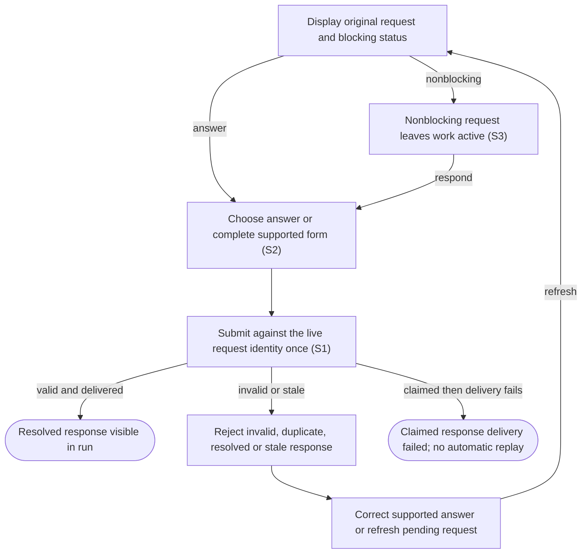

# Answer agent questions and approval requests

## Goal

The owner sees requests for attention and sends a valid response to the matching live task once.

## Preconditions

An agent has requested a question, approval, permission grant or supported form response.

## Main flow

1. Open Messages to see live pending questions and approvals blocking agents on human input, with owning item, request type and question. Select a request to open its owning conversation and attention dialog.
2. Choose an answer or complete the supported form.
3. Submit the answer and return to the owning run’s conversation.

## Alternatives and recovery

Keyboard focus stays within the dialog through updates. Escape defers the answer and restores its connected opener; it does not submit a response.

Messages counts only live pending blocking requests; an empty queue remains available with a concise status. Answering one request removes only that request from the waiting list. Retained conversations and prepared launches are available only in their owning item’s Work history. Nonblocking, answered, stale, orphaned and disconnected requests are excluded from Messages. Approval command, reason and requested access are readable fields; original data is available under Technical details. Allow once, Allow for this session, Deny and Cancel preserve the exact original response values. Answers are local to each request; secret answers never enter ordinary item/run draft storage.

Nonblocking requests do not stop the run and remain available in that item’s conversation without appearing in Messages. Invalid answers and grants beyond requested permissions are rejected. Duplicate, resolved or stale requests cannot be answered again. Delivery failure after a response is claimed is not automatically replayed. Unsupported host verification stays explicit.

## Scenarios

- **S1** A blocking question is visible and answered exactly once, including concurrent submissions.
- **S2** Approval choices and form content are validated without broadening permissions.
- **S3** Nonblocking requests leave the run active; stale requests reject responses after recovery.

<!-- flow-references -->
## Terminology and UI references

Glossary: [attention-request](../glossary/README.md#attention-request), [agent-run](../glossary/README.md#agent-run), [state-blocking](../glossary/README.md#state-blocking), [state-continuing](../glossary/README.md#state-continuing), [coverage-gap](../glossary/README.md#coverage-gap), [unverified-behavior](../glossary/README.md#unverified-behavior), [keyboard-focus](../glossary/README.md#keyboard-focus), [modal-dialog](../glossary/README.md#modal-dialog).
UI entities: [D-ATTENTION](../ui/README.md#D-ATTENTION), [P-ATTENTION-FRAME](../ui/README.md#P-ATTENTION-FRAME), [P-QUESTIONS](../ui/README.md#P-QUESTIONS), [P-APPROVAL](../ui/README.md#P-APPROVAL), [P-ELICITATION](../ui/README.md#P-ELICITATION), [W-DIALOG-FRAME](../ui/README.md#W-DIALOG-FRAME), [W-ATTENTION-NOTICE](../ui/README.md#W-ATTENTION-NOTICE), [W-QUESTIONS](../ui/README.md#W-QUESTIONS), [W-APPROVAL](../ui/README.md#W-APPROVAL), [W-ELICITATION](../ui/README.md#W-ELICITATION), [C-RUN-ATTENTION](../ui/README.md#C-RUN-ATTENTION), [C-ATTENTION-CHAT](../ui/README.md#C-ATTENTION-CHAT), [C-ANSWER](../ui/README.md#C-ANSWER), [C-EXTERNAL-AUTH](../ui/README.md#C-EXTERNAL-AUTH), [PAGE-AGENTS](../ui/README.md#PAGE-AGENTS), [P-WAITING-QUEUE](../ui/README.md#P-WAITING-QUEUE), [W-WAITING-ROW](../ui/README.md#W-WAITING-ROW), [C-GLOBAL-ATTENTION](../ui/README.md#C-GLOBAL-ATTENTION).

## Flow diagram

## Implementation references

- [internal/app/runs.go](../../internal/app/runs.go) — Durable claims and request-specific validation (`func (m *Manager) Answer(`)
- [web/src/main.tsx](../../web/src/main.tsx) — Question, approval and form dialogs (`function AttentionDialog(`)
- [internal/codex/client.go](../../internal/codex/client.go) — Process request-response transport
- [internal/domain/types.go](../../internal/domain/types.go) — Shared domain, persistence, transport or dependency contract
- [internal/store/store.go](../../internal/store/store.go) — Shared domain, persistence, transport or dependency contract
- [internal/transport/mcp.go](../../internal/transport/mcp.go) — Shared domain, persistence, transport or dependency contract
- [go.mod](../../go.mod) — Shared domain, persistence, transport or dependency contract
- [go.sum](../../go.sum) — Shared domain, persistence, transport or dependency contract
- [web/src/types.ts](../../web/src/types.ts) — Embedded UI build and host-fixture configuration
- [web/src/style.css](../../web/src/style.css) — Embedded UI build and host-fixture configuration
- [web/src/bridge.ts](../../web/src/bridge.ts) — Embedded UI build and host-fixture configuration
- [web/package.json](../../web/package.json) — Embedded UI build and host-fixture configuration
- [web/package-lock.json](../../web/package-lock.json) — Embedded UI build and host-fixture configuration
- [web/tsconfig.json](../../web/tsconfig.json) — Embedded UI build and host-fixture configuration
- [web/vite.config.ts](../../web/vite.config.ts) — Embedded UI build and host-fixture configuration
- [web/index.html](../../web/index.html) — Embedded UI build and host-fixture configuration
- [web/playwright.config.ts](../../web/playwright.config.ts) — Embedded UI build and host-fixture configuration
- [internal/testhost/main.go](../../internal/testhost/main.go) — Embedded UI build and host-fixture configuration
- [internal/testutil/fakecodex/main.go](../../internal/testutil/fakecodex/main.go) — Embedded UI build and host-fixture configuration
- [internal/testutil/testutil.go](../../internal/testutil/testutil.go) — Embedded UI build and host-fixture configuration
- [internal/web/embed.go](../../internal/web/embed.go) — Embedded UI build and host-fixture configuration
- [web/src/modal-focus.ts](../../web/src/modal-focus.ts) — Initial modal focus, visible-control Tab containment, Escape dismissal, focus preservation across updates and conditional opener restoration. (`export function useModalFocus(`)

## Test references

- [internal/app/app_test.go](../../internal/app/app_test.go) — `func TestAgentQuestionExactlyOnceAndRecovery(`; S1. Successful answer and duplicate rejection.
- [internal/app/app_test.go](../../internal/app/app_test.go) — `func TestConcurrentPollingSteeringAndAnswersThenDirtyCleanup(`; S1. Concurrent answers have one successful claimant.
- [internal/app/app_test.go](../../internal/app/app_test.go) — `func TestAttentionValidationPreservesPermissionAndFormBoundaries(`; S2. Permission subset and schema validation.
- [internal/app/app_test.go](../../internal/app/app_test.go) — `func TestNonblockingApprovalsCrashAndResume(`; S2, S3. Nonblocking status and approval choices.
- [internal/app/app_test.go](../../internal/app/app_test.go) — `func TestRecoveryStalesRequestsAndIdleRuns(`; S3. Recovery invalidates pending request identity.
- [web/tests/factory.spec.ts](../../web/tests/factory.spec.ts) — `test("MCP bridge drives the assembled daemon through launch, question, answer and follow-up"`; S1. Actual UI dialog through assembled fixture.
- [web/tests/factory.spec.ts](../../web/tests/factory.spec.ts) — `test("keyboard attention stays contained through updates and Escape restores the pending opener"`; S1. Keyboard question choices survive polling, Tab remains contained, Escape defers without answering and restores opener; later one answer reaches idle with polite run status.
- [web/tests/factory.spec.ts](../../web/tests/factory.spec.ts) — `test("global attention selects its owning run and returns to its conversation after answering"`; S1. Owning title/profile and run selection survive answer completion.
- [web/tests/factory.spec.ts](../../web/tests/factory.spec.ts) — `readable approval choices preserve payloads in a narrow`; S2. Both themes preserve original decisions and requested permission-turn payloads behind readable labels.
- [web/tests/factory.spec.ts](../../web/tests/factory.spec.ts) — `Messages lists waiting agents and answering removes only its owning request`; S1. Two waiting agents show item/profile/questions; selecting second identifies its context, exact request is answered, its conversation opens, and the other request remains.

## Verification and gaps

Local suites: `go`, `browser`.
Fixture success does not establish real-host acceptance.
- **S2** — `gap-flow-answer-attention-s2-01` · Unverified behavior · P1 · owner: specification-coordinator. External native user-verification and every supported approval/dialog variant lack real-host coverage. Next verification: Record actual-host native user-verification and supported approval/dialog variants using version-bound nonsecret observations; preserve fixture and real-host distinctions.

<!-- /flow-references -->
