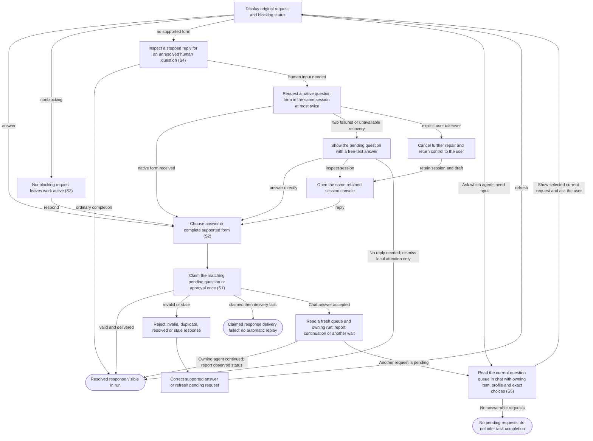

# Answer agent questions and approval requests

## Goal

The owner sees requests for attention and sends a valid response to the originating session once.

## Preconditions

An agent has requested a question, approval, permission grant or supported form response.

## Main flow

1. Open Messages to see unanswered native, structured-message and recovered textual questions and approvals, with owning item, request type and question. Select a request to open its owning conversation and attention dialog.
2. Choose an answer or complete the supported form.
3. Submit the answer and return to the owning run’s conversation.

In chat, ask which agents need an answer. The connected plugin lists the same
answerable requests with their item, profile, exact questions and options. It
asks for your response, sends it to the matching request once, and checks the
fresh queue and owning run before reporting continuation. An empty queue means
no answerable requests now, not that every task finished. Reads and pagination
never start work or answer for you; secret fields stay in the embedded form.
On-demand queue access does not imply background host notifications.

## Alternatives and recovery

Keyboard focus stays within the dialog through updates. Escape defers the answer and restores its connected opener; it does not submit a response.

Messages counts valid unanswered questions and approvals, including nonblocking questions and retained message/text questions; an empty queue remains available with a concise status. Answering one request removes only that request from the waiting list. Retained conversations and prepared launches are available only in their owning item’s Work history. Answered, stale and orphaned requests are excluded. Live RPC requests require their original connected process; retained message/text questions can restore their session. Approval command, reason and requested access are readable fields; original data is available under Technical details. Allow once, Allow for this session, Deny and Cancel preserve the exact original response values. Answers are local to each request; secret answers never enter ordinary item/run draft storage.

Nonblocking requests leave work active and remain visible in both Messages and the owning conversation. Invalid answers and grants beyond requested permissions are rejected. Duplicate, resolved or stale requests cannot be answered again. Delivery failure after a response is claimed is not automatically replayed. Unsupported host verification stays explicit.

Daemon startup preserves unanswered questions without continuing past them. Lost native questions remain answerable through a retained textual continuation; lost approvals expire and must be requested again through the native approval path. No old answer or approval is replayed during automatic session recovery.

Closing or merging the source item terminates its sessions and retires their pending questions and approvals. Those asks cannot be answered or recreated through recovery; history remains available.

When an agent stops with a textual question, the application first checks whether input is actually needed. A helper can request a supported form in the same session at most twice. A successful form is displayed directly; failed or unavailable repair exposes the original question with a free-text answer and an optional session console. Takeover cancels further repair. An uncertain textual fallback also offers No reply needed, clearing that local ask without advancing the session or authorizing anything. An answer continues the same work with its original mode and authority; a failed or uncertain send is never replayed automatically.

## Scenarios

- **S1** A blocking question is visible and answered exactly once, including concurrent submissions.
- **S2** Approval choices and form content are validated without broadening permissions.
- **S3** Nonblocking requests leave the run active; stale requests reject responses after recovery.

- **S5** The chat queue is discoverable, read only, oldest first and paginated without skipping requests when earlier asks resolve. It preserves owning context and exact options, excludes stale/answered/orphaned requests, and verifies that an accepted answer resumes the same agent without removing another agent’s ask.

- **S4** Render native and structured-message questions; repair a stopped textual ask at most twice, then offer free-text continuation and the same session console. Preserve answer claims and redaction across recovery.

Automatic recovery exchanges appear as technical activity under Details or in the session console. Your responses keep their ordinary conversation role.

During plugin maintenance an answer is refused with explicit feedback; the caller retains its draft. Maintenance cannot begin while live waiting/running agent work owns the provider. No answer is replayed automatically.

<!-- flow-references -->
## Terminology and UI references

Glossary: [attention-request](../glossary/README.md#attention-request), [agent-run](../glossary/README.md#agent-run), [state-blocking](../glossary/README.md#state-blocking), [state-continuing](../glossary/README.md#state-continuing), [coverage-gap](../glossary/README.md#coverage-gap), [unverified-behavior](../glossary/README.md#unverified-behavior), [keyboard-focus](../glossary/README.md#keyboard-focus), [modal-dialog](../glossary/README.md#modal-dialog), [question-recovery](../glossary/README.md#question-recovery), [session-console](../glossary/README.md#session-console), [state-terminated](../glossary/README.md#state-terminated).
UI entities: [D-ATTENTION](../ui/README.md#D-ATTENTION), [P-ATTENTION-FRAME](../ui/README.md#P-ATTENTION-FRAME), [P-QUESTIONS](../ui/README.md#P-QUESTIONS), [P-APPROVAL](../ui/README.md#P-APPROVAL), [P-ELICITATION](../ui/README.md#P-ELICITATION), [W-DIALOG-FRAME](../ui/README.md#W-DIALOG-FRAME), [W-ATTENTION-NOTICE](../ui/README.md#W-ATTENTION-NOTICE), [W-QUESTIONS](../ui/README.md#W-QUESTIONS), [W-APPROVAL](../ui/README.md#W-APPROVAL), [W-ELICITATION](../ui/README.md#W-ELICITATION), [C-RUN-ATTENTION](../ui/README.md#C-RUN-ATTENTION), [C-ATTENTION-CHAT](../ui/README.md#C-ATTENTION-CHAT), [C-ANSWER](../ui/README.md#C-ANSWER), [C-EXTERNAL-AUTH](../ui/README.md#C-EXTERNAL-AUTH), [PAGE-AGENTS](../ui/README.md#PAGE-AGENTS), [P-WAITING-QUEUE](../ui/README.md#P-WAITING-QUEUE), [W-WAITING-ROW](../ui/README.md#W-WAITING-ROW), [C-GLOBAL-ATTENTION](../ui/README.md#C-GLOBAL-ATTENTION), [W-QUESTION-RECOVERY](../ui/README.md#W-QUESTION-RECOVERY), [W-SESSION-CONSOLE](../ui/README.md#W-SESSION-CONSOLE), [C-TEXT-DISMISS](../ui/README.md#C-TEXT-DISMISS).

## Flow diagram

## Implementation references

- [internal/app/runs.go](../../internal/app/runs.go) — Durable claims and request-specific validation (`func (m *Manager) Answer(`)
- [web/src/main.tsx](../../web/src/main.tsx) — Question, approval and form dialogs (`function AttentionDialog(`)
- [internal/codex/client.go](../../internal/codex/client.go) — Process request-response transport
- [internal/domain/types.go](../../internal/domain/types.go) — Shared domain, persistence, transport or dependency contract
- [internal/store/store.go](../../internal/store/store.go) — Shared domain, persistence, transport or dependency contract
- [internal/transport/mcp.go](../../internal/transport/mcp.go) — Shared domain, persistence, transport or dependency contract
- [go.mod](../../go.mod) — Shared domain, persistence, transport or dependency contract
- [go.sum](../../go.sum) — Shared domain, persistence, transport or dependency contract
- [web/src/types.ts](../../web/src/types.ts) — Embedded UI build and host-fixture configuration
- [web/src/style.css](../../web/src/style.css) — Embedded UI build and host-fixture configuration
- [web/src/bridge.ts](../../web/src/bridge.ts) — Embedded UI build and host-fixture configuration
- [web/package.json](../../web/package.json) — Embedded UI build and host-fixture configuration
- [web/package-lock.json](../../web/package-lock.json) — Embedded UI build and host-fixture configuration
- [web/tsconfig.json](../../web/tsconfig.json) — Embedded UI build and host-fixture configuration
- [web/vite.config.ts](../../web/vite.config.ts) — Embedded UI build and host-fixture configuration
- [web/index.html](../../web/index.html) — Embedded UI build and host-fixture configuration
- [web/playwright.config.ts](../../web/playwright.config.ts) — Embedded UI build and host-fixture configuration
- [internal/testhost/main.go](../../internal/testhost/main.go) — Embedded UI build and host-fixture configuration
- [internal/testutil/fakecodex/main.go](../../internal/testutil/fakecodex/main.go) — Embedded UI build and host-fixture configuration
- [internal/testutil/testutil.go](../../internal/testutil/testutil.go) — Embedded UI build and host-fixture configuration
- [internal/web/embed.go](../../internal/web/embed.go) — Embedded UI build and host-fixture configuration
- [web/src/modal-focus.ts](../../web/src/modal-focus.ts) — Initial modal focus, visible-control Tab containment, Escape dismissal, focus preservation across updates and conditional opener restoration. (`export function useModalFocus(`)
- [internal/app/questions.go](../../internal/app/questions.go) — Durable native/message/text question routing, bounded form repair, redaction and retained continuation. (`func (m *Manager) answerSynthetic(`)
- [internal/app/plugins.go](../../internal/app/plugins.go) — Plugin maintenance excludes new answer delivery without replay. (`func (m *Manager) PluginAction(`)
- [internal/app/attention.go](../../internal/app/attention.go) — Read-only oldest-first actionable question/approval queue with compact owning context, run filtering, bounded cursor pagination and no provider RPC IDs or answer data. (`func (a *App) ListAttention(`)
- [plugin/skills/code-factory/SKILL.md](../../plugin/skills/code-factory/SKILL.md) — Conversational queue discovery, exact user/question matching, safe one-time answer, fresh queue/run verification and explicit host subscription limits.
- [internal/app/continuation.go](../../internal/app/continuation.go) — Revalidate current source before initial start or retained-session continuation; supply deterministic changes as untrusted context and terminate all sessions on source closure/merge. (`func (m *Manager) continuationContext(`)
- [internal/providers/continuation.go](../../internal/providers/continuation.go) — Targeted conditional GitHub source read bypasses local TTL while retaining shared budget and cooldown enforcement. (`func (g *GitHub) CurrentWorkItem(`)

## Test references

- [internal/app/app_test.go](../../internal/app/app_test.go) — `func TestAgentQuestionExactlyOnceAndRecovery(`; S1. Successful answer and duplicate rejection.
- [internal/app/app_test.go](../../internal/app/app_test.go) — `func TestConcurrentPollingSteeringAndAnswersThenDirtyCleanup(`; S1. Concurrent answers have one successful claimant.
- [internal/app/app_test.go](../../internal/app/app_test.go) — `func TestAttentionValidationPreservesPermissionAndFormBoundaries(`; S2. Permission subset and schema validation.
- [internal/app/app_test.go](../../internal/app/app_test.go) — `func TestNonblockingApprovalsCrashAndResume(`; S2, S3. Nonblocking status and approval choices.
- [internal/app/app_test.go](../../internal/app/app_test.go) — `func TestRecoveryStalesRequestsAndPreservesIdleRuns(`; S3. Completed idle sessions retain their status and workspace; expired native requests become stale and reject answers.
- [web/tests/factory.spec.ts](../../web/tests/factory.spec.ts) — `test("MCP bridge drives the assembled daemon through launch, question, answer and follow-up"`; S1. Actual UI dialog through assembled fixture.
- [web/tests/factory.spec.ts](../../web/tests/factory.spec.ts) — `test("keyboard attention stays contained through updates and Escape restores the pending opener"`; S1. Keyboard question choices survive polling, Tab remains contained, Escape defers without answering and restores opener; later one answer reaches idle with polite run status.
- [web/tests/factory.spec.ts](../../web/tests/factory.spec.ts) — `test("global attention selects its owning run and returns to its conversation after answering"`; S1. Owning title/profile and run selection survive answer completion.
- [web/tests/factory.spec.ts](../../web/tests/factory.spec.ts) — `readable approval choices preserve payloads in a narrow`; S2. Both themes preserve original decisions and requested permission-turn payloads behind readable labels.
- [web/tests/factory.spec.ts](../../web/tests/factory.spec.ts) — `Messages lists waiting agents and answering removes only its owning request`; S1. Two waiting agents show item/profile/questions; selecting second identifies its context, exact request is answered, its conversation opens, and the other request remains.
- [internal/app/questions_test.go](../../internal/app/questions_test.go) — `func TestStoppedQuestionRecoveryNativeAndFallback(`; S4. Same-session bounded question repair, at-most-once answers and original-mode restoration.
- [internal/app/questions_test.go](../../internal/app/questions_test.go) — `func TestStructuredMessageQuestionSurvivesRestartAndClaimsAnswerOnce(`; S4. Async questions survive restart and concurrent answers have one claimant.
- [web/tests/factory.spec.ts](../../web/tests/factory.spec.ts) — `text fallback opens the same session console`; S4. Fallback routes the exact answer to its request and console mode retains the reply draft without a new launch.
- [internal/app/questions_test.go](../../internal/app/questions_test.go) — `func TestTextQuestionDismissalCannotAnswerOrApproveNativeRequests(`; S4. Text-only dismissal cannot approve a native request or launch work.
- [web/tests/factory.spec.ts](../../web/tests/factory.spec.ts) — `an uncertain textual reply can be dismissed without advancing`; S4. Uncertain helper output is reviewable and dismissible without sending another task turn.
- [internal/app/plugins_test.go](../../internal/app/plugins_test.go) — `func TestPluginMaintenanceCannotRaceStartsOrAcceptInjectedArguments(`; S1. An answer call is refused during exclusive plugin maintenance before any request can be delivered.
- [internal/app/attention_test.go](../../internal/app/attention_test.go) — `func TestAttentionQueueFiltersAndPaginatesWithoutSkippingResolvedRequests(`; S5. Queue includes live RPC and retained text/message asks; excludes answered/stale/orphaned/prepared/cleaned requests, preserves options and blocking status, strips unrelated run content, validates cursors/limits and never skips asks when a preceding page is resolved.
- [internal/transport/attention_test.go](../../internal/transport/attention_test.go) — `func TestMCPAttentionQueueWaitAnswerContinueAndStaleRecovery(`; S1, S3, S5. Independent MCP SDK fixture prepares and starts two agents, observes blocking questions, rejects wrong IDs/malformed/duplicate answers, resumes the owning session, preserves the other ask and rejects interrupted RPC answers.
- [internal/transport/mcp_test.go](../../internal/transport/mcp_test.go) — `func TestAuthenticatedMCPDiscoveryToolsAndUI(`; S5. Authenticated discovery advertises list_attention to model/app as a read-only local operation; unauthenticated discovery rejects.
- [internal/app/continuation_test.go](../../internal/app/continuation_test.go) — `func TestContinuationProvidesFreshChangesWithoutReplacingSession(`; S3. Fresh title/body/update/assignment changes reach the retained agent in structured source context while thread, workspace and original task remain unchanged.
- [internal/app/continuation_test.go](../../internal/app/continuation_test.go) — `func TestClosedOrMergedSourcePermanentlyTerminatesContinuation(`; S3. Closed issue, closed PR and merged PR prevent another provider invocation; messages/resume are refused and dirty cleanup preserves terminal state and unsaved files.
- [internal/app/continuation_test.go](../../internal/app/continuation_test.go) — `func TestUnverifiedSourceNeverStartsProviderOrReplaysTask(`; S3. Failed fresh source reads fail visibly before provider or workspace creation with no stale fallback.
- [internal/app/continuation_test.go](../../internal/app/continuation_test.go) — `func TestSyncedClosureStopsActiveWorkAndRetiresQuestions(`; S3. Synced source closure retires active provider work, stales pending questions, survives restart without resurrecting asks and remains terminal after source reopening.
- [web/tests/factory.spec.ts](../../web/tests/factory.spec.ts) — `terminated work retains history and cleanup without allowing continuation`; S3. Both themes show Stopped and terminal reason, retain cleanup and history, disable Send and expose no Interrupt or launch action.

## Verification and gaps

Local suites: `go`, `browser`.
Fixture success does not establish real-host acceptance.
- **S2** — `gap-flow-answer-attention-s2-01` · Unverified behavior · P1 · owner: specification-coordinator. External native user-verification and every supported approval/dialog variant lack real-host coverage. Next verification: Record actual-host native user-verification and supported approval/dialog variants using version-bound nonsecret observations; preserve fixture and real-host distinctions.
- **S5** — `gap-flow-answer-attention-s5-01` · Unverified behavior · P2 · owner: specification-coordinator. Actual ChatGPT Work presented a real native question, delivered the selected answer and observed queue removal plus same-thread continuation on the installed release. Host activity did not expose the selected RPC method name, so direct list_attention invocation by ChatGPT remains unverified; multi-agent pagination and stale-answer cases have independent SDK/fixture coverage only. Next verification: Capture a nonsecret actual-host tool trace identifying list_attention and exercise paginated multi-agent queue refresh and stale-answer recovery in ChatGPT; retain the passed ordinary question/answer evidence and separate SDK/fixture results.

<!-- /flow-references -->
