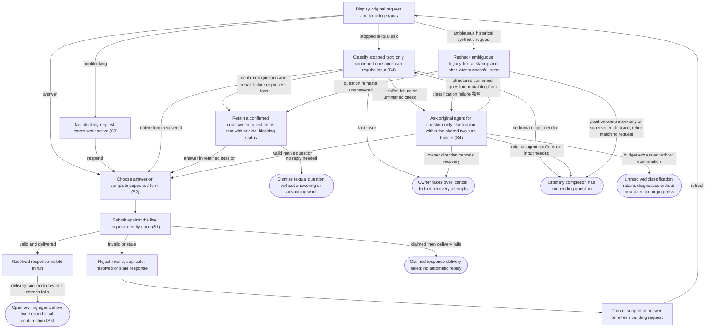

# Answer agent questions and approval requests

## Goal

The owner sees requests for attention and sends a valid response to the matching live task once.

## Preconditions

An agent has requested a question, approval, permission grant or supported form response.

## Main flow

1. Show the request, its original choices and whether it blocks progress.
2. Choose an answer or complete the supported form.
3. Submit the answer and observe its resolution in the run.

## Alternatives and recovery

Keyboard focus stays within the dialog through updates. Escape defers the answer and restores its connected opener; it does not submit a response.

Nonblocking requests do not stop the run. Invalid answers and grants beyond requested permissions are rejected. Duplicate, resolved or stale requests cannot be answered again. Delivery failure after a response is claimed is not automatically replayed. A failed or uncertain repair answer also prevents automatic task continuation when that repair turn completes. Unsupported host verification stays explicit.

A durable native answer claim remains final through process loss, including when recovery has not yet recorded the claim. It never becomes a new question or an automatic repeated answer.

Take over after a repair answer preserves that final claim and cancels pending automatic continuation, whether the repair has acknowledged the answer or is still completing.

Unclassified completion text and classifier/configuration/process failures never establish a question. Startup reconnects the retained thread only for constrained clarification when needed; ordinary task continuation requires owner direction or an answer to a genuine question. Exhausted unconfirmed recovery retains diagnostics and stops progress without adding attention. Owner takeover cancels recovery, including late callbacks.

Before reconnecting the retained agent, recovery durably claims the intended delivery attempt. Failed setup consumes that claim; successful setup reuses it for the first question-only turn. Only remaining shared budget permits an automatic retry, and unconfirmed recovery becomes unresolved after exhaustion. Restart never resets or replays a claimed attempt. Later successful owner-directed work still supplies evidence for rechecking an ambiguous request.

Ambiguous historical text requests are rechecked at startup and after later successful turns, even while they prevent new-question detection. A positive completion-only, resolved or superseded classification retires only the matching synthetic request and records its resolution with history intact. Idle status or turn completion alone never retires an unanswered question. Historical unfinished checks remain unconfirmed; native requests and attempted form repairs supply positive evidence.

Historical checks in one run do not delay question detection in another run. Within a run, historical requests are reconciled before checking its latest stopped response for a new question. Historical clarification keeps ownership until it completes or is explicitly stopped. When it finishes without a pending question, the latest stopped response is still checked using its original identity; an unfinished historical recovery cannot be displaced or leave permanent progress.

Takeover waiting for a busy recovery turn in one run does not delay another run's question detection.

Take over invalidates the whole queued completion check, including new-question detection after historical reconciliation. Retired recovery startup cannot overwrite a replacement task started by the owner after takeover.

Positive reclassification replaces ambiguous text with the actual confirmed question. If native clarification replaces an older text request before process loss, its confirmed unanswered question remains answerable as one text fallback with the original delivery status and shared attempt count. Changed or replaced requests receive a fresh identity so answers or dismissals from an older view cannot target the current question. Replacement history remains intact. Answered, dismissed and cancelled requests stay final.

Completion of a native clarification turn preserves its unanswered question as a fallback even when unrelated attention remains pending. Its original nonblocking delivery and consumed attempts stay intact.

A retained async question keeps its owning answer route across process loss and restart. Matching obsolete text duplicates retire with their payload and resolution history intact. A live repair answer completes that turn before continuation restores the original task policy. An answer claims the originating question before delivery, so sibling routes and stale request or recovery snapshots cannot repeat it, including after uncertain delivery. Unrelated requests retain their identities.

Cancelling automatic recovery does not establish that a genuine pending async question was answered or became obsolete. After restart, Take over can still clear its recovery progress while that question remains available for an explicit answer.

## Scenarios

- **S1** A blocking question is visible and answered exactly once, including concurrent submissions.
- **S2** Approval choices and form content are validated without broadening permissions.
- **S3** Nonblocking requests leave the run active; stale requests reject responses after recovery.

- **S4** Stopped text is classified before it can require input. Classifier failure asks the original agent for question-only clarification. Clarification and native-form repair share at most two automatic turns, including across restart; only a confirmed unanswered question can become a text fallback, with its original blocking status. The owner can inspect its technical transcript, answer, take over, or dismiss text with No reply needed. Original mode and authority are restored after the answer; dismissal never advances work.
- **S5** A successful answer opens its owning agent with ✓ Answer sent for five seconds; approval and other form responses use ✓ Response sent. Polling cannot prolong it and reopening cannot recreate it. Failed or uncertain calls never confirm or replay; refresh failure after successful delivery is separate feedback. Agent text remains unchanged.
<!-- flow-references -->
## Terminology and UI references

Glossary: [attention-request](../glossary/README.md#attention-request), [agent-run](../glossary/README.md#agent-run), [state-blocking](../glossary/README.md#state-blocking), [state-continuing](../glossary/README.md#state-continuing), [coverage-gap](../glossary/README.md#coverage-gap), [unverified-behavior](../glossary/README.md#unverified-behavior), [keyboard-focus](../glossary/README.md#keyboard-focus), [modal-dialog](../glossary/README.md#modal-dialog), [question-recovery](../glossary/README.md#question-recovery).
UI entities: [D-ATTENTION](../ui/README.md#D-ATTENTION), [P-ATTENTION-FRAME](../ui/README.md#P-ATTENTION-FRAME), [P-QUESTIONS](../ui/README.md#P-QUESTIONS), [P-APPROVAL](../ui/README.md#P-APPROVAL), [P-ELICITATION](../ui/README.md#P-ELICITATION), [W-DIALOG-FRAME](../ui/README.md#W-DIALOG-FRAME), [W-ATTENTION-NOTICE](../ui/README.md#W-ATTENTION-NOTICE), [W-QUESTIONS](../ui/README.md#W-QUESTIONS), [W-APPROVAL](../ui/README.md#W-APPROVAL), [W-ELICITATION](../ui/README.md#W-ELICITATION), [C-RUN-ATTENTION](../ui/README.md#C-RUN-ATTENTION), [C-ATTENTION-CHAT](../ui/README.md#C-ATTENTION-CHAT), [C-ANSWER](../ui/README.md#C-ANSWER), [C-EXTERNAL-AUTH](../ui/README.md#C-EXTERNAL-AUTH), [W-RUN-CONTROLS](../ui/README.md#W-RUN-CONTROLS), [W-TRANSCRIPT](../ui/README.md#W-TRANSCRIPT), [C-QUESTION-RECOVERY](../ui/README.md#C-QUESTION-RECOVERY), [C-DISMISS-QUESTION](../ui/README.md#C-DISMISS-QUESTION).

## Flow diagram

## Implementation references

- [internal/app/runs.go](../../internal/app/runs.go) — Durable claims and request-specific validation (`func (m *Manager) Answer(`)
- [web/src/main.tsx](../../web/src/main.tsx) — Question, approval and form dialogs (`function AttentionDialog(`)
- [internal/codex/client.go](../../internal/codex/client.go) — Process request-response transport
- [internal/domain/types.go](../../internal/domain/types.go) — Shared domain, persistence, transport or dependency contract
- [internal/store/store.go](../../internal/store/store.go) — Shared domain, persistence, transport or dependency contract
- [internal/transport/mcp.go](../../internal/transport/mcp.go) — Shared domain, persistence, transport or dependency contract
- [go.mod](../../go.mod) — Shared domain, persistence, transport or dependency contract
- [go.sum](../../go.sum) — Shared domain, persistence, transport or dependency contract
- [web/src/types.ts](../../web/src/types.ts) — Embedded UI build and host-fixture configuration
- [web/src/style.css](../../web/src/style.css) — Embedded UI build and host-fixture configuration
- [web/src/bridge.ts](../../web/src/bridge.ts) — Embedded UI build and host-fixture configuration
- [web/package.json](../../web/package.json) — Embedded UI build and host-fixture configuration
- [web/package-lock.json](../../web/package-lock.json) — Embedded UI build and host-fixture configuration
- [web/tsconfig.json](../../web/tsconfig.json) — Embedded UI build and host-fixture configuration
- [web/vite.config.ts](../../web/vite.config.ts) — Embedded UI build and host-fixture configuration
- [web/index.html](../../web/index.html) — Embedded UI build and host-fixture configuration
- [web/playwright.config.ts](../../web/playwright.config.ts) — Embedded UI build and host-fixture configuration
- [internal/testhost/main.go](../../internal/testhost/main.go) — Embedded UI build and host-fixture configuration
- [internal/testutil/fakecodex/main.go](../../internal/testutil/fakecodex/main.go) — Embedded UI build and host-fixture configuration
- [internal/testutil/testutil.go](../../internal/testutil/testutil.go) — Embedded UI build and host-fixture configuration
- [internal/web/embed.go](../../internal/web/embed.go) — Embedded UI build and host-fixture configuration
- [web/src/modal-focus.ts](../../web/src/modal-focus.ts) — Initial modal focus, visible-control Tab containment, Escape dismissal, focus preservation across updates and conditional opener restoration. (`export function useModalFocus(`)
- [internal/app/questions.go](../../internal/app/questions.go) — Bounded recovery and durable text/structured question answer claims; preserve authority and redaction. (`func (m *Manager) answerSynthetic(`)

## Test references

- [internal/app/app_test.go](../../internal/app/app_test.go) — `func TestAgentQuestionExactlyOnceAndRecovery(`; S1. Successful answer and duplicate rejection.
- [internal/app/app_test.go](../../internal/app/app_test.go) — `func TestConcurrentPollingSteeringAndAnswersThenDirtyCleanup(`; S1. Concurrent answers have one successful claimant.
- [internal/app/app_test.go](../../internal/app/app_test.go) — `func TestAttentionValidationPreservesPermissionAndFormBoundaries(`; S2. Permission subset and schema validation.
- [internal/app/app_test.go](../../internal/app/app_test.go) — `func TestNonblockingApprovalsCrashAndResume(`; S2, S3. Nonblocking status and approval choices.
- [internal/app/app_test.go](../../internal/app/app_test.go) — `func TestRecoveryStalesRequestsAndIdleRuns(`; S3. Recovery invalidates pending request identity.
- [web/tests/factory.spec.ts](../../web/tests/factory.spec.ts) — `test("MCP bridge drives the assembled daemon through launch, question, answer and follow-up"`; S1. Actual UI dialog through assembled fixture.
- [web/tests/factory.spec.ts](../../web/tests/factory.spec.ts) — `test("keyboard attention stays contained through updates and Escape restores the pending opener"`; S1. Keyboard question choices survive polling, Tab remains contained, Escape defers without answering and restores opener; later one answer reaches idle with polite run status.
- [internal/app/questions_test.go](../../internal/app/questions_test.go) — `func TestStoppedQuestionRecoveryNativeAndFallback(`; S4. First/second native repair, two-attempt fallback, original mode restoration and duplicate rejection.
- [internal/app/questions_test.go](../../internal/app/questions_test.go) — `func TestOrdinaryCompletionDoesNotCreateQuestion(`; S4. Ordinary completion resolves without creating attention.
- [internal/app/questions_test.go](../../internal/app/questions_test.go) — `func TestRecoveryRejectsMalformedForms(`; S4. Invalid native forms cannot satisfy question recovery.
- [internal/app/questions_test.go](../../internal/app/questions_test.go) — `func TestQuestionRepairUserTakeoverCancelsFurtherAttempts(`; S4. Owner takeover cancels further attempts and rejects the old form.
- [internal/app/questions_test.go](../../internal/app/questions_test.go) — `func TestTextQuestionDismissalCannotAnswerOrApproveNativeRequests(`; S4. Dismissal cannot answer an approval or start work.
- [web/tests/factory.spec.ts](../../web/tests/factory.spec.ts) — `test("answer confirmation expires despite polling, stays with its run and never alters transcript text"`; S5. Successful question answer opens the owner; five-second confirmation survives navigation, expires despite polling, disappears on reload, preserves per-run drafts and literal UI_ANSWER_OK agent text.
- [web/tests/factory.spec.ts](../../web/tests/factory.spec.ts) — ``${failure} answers retain error feedback without confirmation or replay``; S5. Failed and uncertain answer calls show feedback without confirmation or automatic replay.
- [web/tests/factory.spec.ts](../../web/tests/factory.spec.ts) — `test("successful answer keeps confirmation when the following refresh fails"`; S5. Successful delivery closes the dialog and confirms the owner even if refresh fails; the refresh error is separate.
- [web/tests/factory.spec.ts](../../web/tests/factory.spec.ts) — `test("approval responses use Response sent and keep other run attention"`; S5. An approval response uses Response sent and preserves another run request.
- [web/tests/factory.spec.ts](../../web/tests/factory.spec.ts) — ``recovery icons, fallback controls and keyboard navigation at narrow width in ${theme}``; S4. 390px light/dark fixtures assert clock and circular-arrow SVGs hidden from assistive technology, recovery label and attempt bound, takeover, recovery input label, draft preservation, fallback inspection/dismissal, keyboard controls and scoped WCAG scans.
- [web/tests/factory.spec.ts](../../web/tests/factory.spec.ts) — `test("text fallback submits its answer through the owning request"`; S4. Text fallback sends its form answer exactly through its owning attention identity and shows Answer sent.
- [internal/app/question_classification_test.go](../../internal/app/question_classification_test.go) — `func TestClassifierFailuresClarifyCompletionWithoutAttention(`; S4. Classifier startup, disconnect, timeout, invalid-result and configuration errors trigger original-agent clarification; completion creates no attention.
- [internal/app/question_classification_test.go](../../internal/app/question_classification_test.go) — `func TestClarificationSharesBudgetAndRequiresEvidence(`; S4. Native/structured clarification shares two turns with form repair; malformed, failed and disconnected replies exhaust into diagnostics. Observed restarted helper completion delivers no third recovery turn or attention.
- [internal/app/question_classification_test.go](../../internal/app/question_classification_test.go) — `func TestRestartCheckingAutomaticallyClarifiesRetainedThread(`; S4. Unfinished legacy checking reconnects only for constrained Plan-mode clarification, preserving thread/worktree/profile and never issuing ordinary Resume.
- [internal/app/question_classification_test.go](../../internal/app/question_classification_test.go) — `func TestRestartClarificationPreservesClaimedAttempt(`; S4. Repeated restart during clarification retains its claimed attempt and stops at two without inventing question evidence.
- [internal/app/question_classification_test.go](../../internal/app/question_classification_test.go) — `func TestLegacyCompletionRequestReconcilesWithoutDiscardingRealQuestion(`; S4. Startup and later successful turn events retire matching obsolete legacy text with resolution events while preserving a confirmed unanswered question.
- [internal/app/question_classification_test.go](../../internal/app/question_classification_test.go) — `func TestClarificationTakeoverAndAnswerRace(`; S4. Locally bounded concurrent owner takeover and native answer preserve the durable claim; cancellation stays reachable on stall and late recovery callbacks cannot recreate questions.
- [web/tests/factory.spec.ts](../../web/tests/factory.spec.ts) — `test("clarification progress has no attention badge and stops when unresolved"`; S4. Clarification shows shared attempts and takeover without attention badges; unresolved classification stops progress and permits owner messages.
- [web/tests/factory.spec.ts](../../web/tests/factory.spec.ts) — `test("nonblocking recovered text question keeps its continuing label"`; S4. Explicit nonblocking recovered text uses the continuing label without a waiting notice.
- [internal/app/question_classification_test.go](../../internal/app/question_classification_test.go) — `func TestUnconfirmedRecoveryNeverMaterializesText(`; S4. All unconfirmed stages refuse text materialization; legacy checking stays unconfirmed even with attempts while actual form repairs retain positive evidence.
- [internal/app/question_classification_test.go](../../internal/app/question_classification_test.go) — `func TestLegacyUnansweredTextQuestionSurvivesReclassification(`; S4. Positive legacy reclassification replaces unclassified pending text with the actual confirmed question under a fresh request identity without consuming attempts; old answers/dismissals reject, and dismissal of the current request stays final across restart.
- [internal/app/question_classification_test.go](../../internal/app/question_classification_test.go) — `func TestLegacyClarificationSupersedesOnlyMatchingSynthetic(`; S4. Native clarification atomically supersedes only matching legacy text; process loss creates one fresh answerable fallback with retained attempts, delivery and unrelated history, rejecting stale legacy answers and dismissals.
- [internal/app/question_classification_test.go](../../internal/app/question_classification_test.go) — `func TestRestartClaimedRecoveryAnswerDoesNotAskAgain(`; S4. Restart resolves an already claimed recovery answer without replay, repeated attention or automatic task continuation.
- [internal/app/question_classification_test.go](../../internal/app/question_classification_test.go) — `func TestTakeoverInvalidatesLegacyClassifierCallback(`; S4. An explicit provider gate holds legacy classification pending until takeover completes; the later callback cannot establish a question, with a bounded completion wait and reachable cleanup.
- [internal/app/question_classification_test.go](../../internal/app/question_classification_test.go) — `func TestRestartNativeEvidencePreservesNonblockingQuestion(`; S4. A pending native question supplies actual question text, original nonblocking delivery and retained attempts after restart; its superseded text remains historical and a fresh request becomes current.
- [internal/app/question_classification_test.go](../../internal/app/question_classification_test.go) — `func TestClarificationResultRejectsIncompleteOrTrailingDecisions(`; S4. Structured clarification rejects missing/null values, empty positive questions, wrong types, unknown fields and trailing content; complete positive and negative decisions remain valid.
- [internal/app/question_classification_test.go](../../internal/app/question_classification_test.go) — `func TestTextFallbackDoesNotReviveFinalOrUnrelatedRequests(`; S4. Stale materialization leaves answered/dismissed/resolved attention and identical pending requests unchanged; cancelled/answered/resolved/unconfirmed recovery, live native requests and unrelated identities emit no new events.
- [internal/app/question_classification_test.go](../../internal/app/question_classification_test.go) — `func TestNativeAnswerClaimSurvivesProcessLoss(`; S4. Durable native answer claims survive process disconnect and restart between attention claim and recovery write, preserving answered history and attempts without fallback, reconnect or replay.
- [internal/app/question_classification_test.go](../../internal/app/question_classification_test.go) — `func TestStartupTakeoverCancelsRecoveryBeforeSessionAttachment(`; S4. Provider-gated startup checking/clarifying classification remains pending until zero-attempt takeover commits before attachment; released callbacks cannot create attention or reconnect.
- [internal/app/question_classification_test.go](../../internal/app/question_classification_test.go) — `func TestStartupTakeoverCancelsAfterSessionAttachment(`; S4. An initialization gate proves one durable claimed attempt with no delivered turn; takeover suppresses late native/async setup callbacks and later explicit continuation can ask a fresh genuine question.
- [internal/app/question_classification_test.go](../../internal/app/question_classification_test.go) — `func TestHistoricalClassifierDoesNotBlockAnotherRunsQuestion(`; S4. A historical classifier remains stalled while another run independently classifies and presents its genuine unanswered question.
- [internal/app/question_classification_test.go](../../internal/app/question_classification_test.go) — `func TestHistoricalRetirementStillChecksLatestQuestion(`; S4. Within one run, positively retiring an older pending legacy request still leads to detection and presentation of its latest genuine stopped-text question.
- [internal/app/question_classification_test.go](../../internal/app/question_classification_test.go) — `func TestRetainedSetupFailureExhaustsSharedBudget(`; S4. Initialize/resume and missing-thread/worktree setup failures consume intended attempts durably before setup, retry only within the shared budget and remain unresolved after exhaustion across repeated startup.
- [internal/app/question_classification_test.go](../../internal/app/question_classification_test.go) — `func TestStalledRecoveryTakeoverDoesNotBlockAnotherRunsQuestion(`; S4. A blocked-goroutine stack proves takeover reached the session mutex held by gated recovery turn/start before another run starts and presents its genuine question; release lets takeover finish.
- [internal/app/question_classification_test.go](../../internal/app/question_classification_test.go) — `func TestSetupFailureStillRechecksLaterSuccessfulWork(`; S4. After retained setup becomes unavailable, later successful owner-directed work still supplies obsolescence evidence, retires the matching legacy request and preserves consumed attempts.
- [internal/app/question_classification_test.go](../../internal/app/question_classification_test.go) — `func TestAsyncRecoveryRetainsSingleRouteAcrossRestart(`; S4. An originating async question remains the one pending answer route across restart without a duplicate textual fallback.
- [internal/app/question_classification_test.go](../../internal/app/question_classification_test.go) — `func TestAsyncRecoveryUncertainClaimSurvivesStaleSnapshotAndRestart(`; S4. An async answer is claimed against its originating recovery before uncertain delivery; stale awaiting/fallback snapshots and restart cannot reopen the claim or reset attempts.
- [internal/app/question_classification_test.go](../../internal/app/question_classification_test.go) — `func TestAsyncRecoveryRetiresOnlyMatchingDuplicate(`; S4. Restart atomically retires only matching persisted duplicate text with payload/events intact, retains async identity/nonblocking delivery/attempts, and rejects stale attention snapshots and late sibling routes.
- [internal/app/question_classification_test.go](../../internal/app/question_classification_test.go) — `func TestOriginatingRecoveryClaimsExcludeSiblingAnswers(`; S4. Concurrent async/text sibling answers have one accepted originating claim; other siblings resolve before delivery and restart creates no new attention.
- [internal/app/question_classification_test.go](../../internal/app/question_classification_test.go) — `func TestRetainedSetupReusesClaimForLastPermittedTurn(`; S4. Successful retained setup reuses its preclaimed last permitted attempt for the actual native clarification turn without double counting or skipping delivery.
- [internal/app/question_classification_test.go](../../internal/app/question_classification_test.go) — `func TestRestartUnavailableSetupUsesRemainingBudget(`; S4. An older early-unresolved setup record uses only its one remaining durable attempt after restart; setup failure exhausts the budget without attention or another restart loop.
- [internal/app/question_classification_test.go](../../internal/app/question_classification_test.go) — `func TestAsyncRecoveryTakeoverPreservesGenuineQuestion(`; S4. A held live clarification receives an async notification injected through onMessage; takeover before or after restart cancels only automatic recovery, preserves the genuine nonblocking request and attempt count, and permits its explicit originating answer. This does not exercise provider async emission.
- [internal/app/question_classification_test.go](../../internal/app/question_classification_test.go) — `func TestAsyncRecoveryDisconnectRetainsOnlyAsyncRoute(`; S4. Actual retained-process closure preserves the nonblocking async request as the only pending route immediately before restart, with its attempt count intact.
- [internal/app/question_classification_test.go](../../internal/app/question_classification_test.go) — `func TestLiveAsyncRecoveryAnswerRestoresOriginalPolicy(`; S4. A live async repair-turn answer retires matching duplicate store/session routes, completes the repair and continues with original mode/model/effort/sandbox/approval policy while retaining the durable claim.
- [internal/app/question_classification_test.go](../../internal/app/question_classification_test.go) — `func TestTakeoverAfterClaimPreventsQueuedRepairContinuation(`; S4. A live async repair answer is durably claimed; takeover before acknowledgement or before a queued post-acknowledgement continuation finalises that claim and prevents automatic task resumption.
- [internal/app/question_classification_test.go](../../internal/app/question_classification_test.go) — `func TestCompletedNativeRecoveryPreservesQuestionBesideUnrelatedAttention(`; S4. When a nonblocking native clarification turn completes beside unrelated pending attention, its stale native handle becomes one answerable nonblocking fallback while unrelated requests and consumed attempts remain unchanged.
- [internal/app/question_classification_test.go](../../internal/app/question_classification_test.go) — `func TestRetiredResumeCannotOverwriteOwnerReplacement(`; S4. An actual successful retained thread/resume response is held at its session lock; a staged lock-owned retirement/replacement transition proves the retired launch cannot overwrite the replacement's running state, turn or identity.
- [internal/app/question_classification_test.go](../../internal/app/question_classification_test.go) — `func TestTakeoverInvalidatesEntireQueuedCompletion(`; S4. Takeover during provider-gated historical reconciliation invalidates the entire queued completion callback, preventing the subsequent stopped-turn classifier from creating fresh recovery or attention.
- [internal/app/question_classification_test.go](../../internal/app/question_classification_test.go) — `func TestRejectedAsyncRecoveryAnswerPreventsQueuedContinuation(`; S4. A held clarification receives an injected async question; a gated provider rejects its answer steer while a real completion callback waits on the session lock. No original-task continuation is sent, the originating claim remains final with its attempt count, and uncertain attention rejects replay.
- [internal/app/question_classification_test.go](../../internal/app/question_classification_test.go) — `func TestLatestDetectionPreservesActiveHistoricalClarification(`; S4. Stages the session boundary after failed historical recheck installs clarification and before queued repair runs; latest detection must retain that recovery pointer and create no competing recovery.
- [internal/app/question_classification_test.go](../../internal/app/question_classification_test.go) — `func TestHistoricalClarificationStillChecksLatestQuestion(`; S4. A real fixture process holds historical clarification after a failed helper check; its injected negative clarification result and completion resolve the historical recovery at one attempt before the latest genuine question becomes its own answerable fallback with the original turn identity.

## Verification and gaps

Local suites: `go`, `browser`.
Fixture success does not establish real-host acceptance.
- **S2** — `gap-flow-answer-attention-s2-01` · Unverified behavior · P1 · owner: specification-coordinator. External native user-verification and every supported approval/dialog variant lack real-host coverage. Next verification: Record actual-host native user-verification and supported approval/dialog variants using version-bound nonsecret observations; preserve fixture and real-host distinctions.

<!-- /flow-references -->
