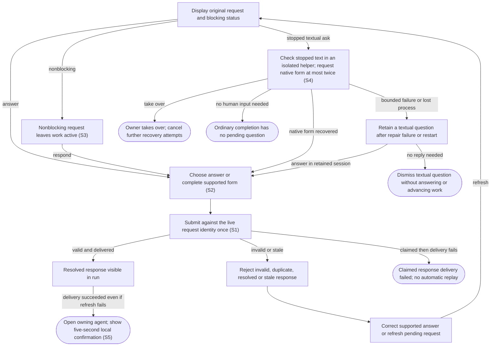

# Answer agent questions and approval requests

## Goal

The owner sees requests for attention and sends a valid response to the matching live task once.

## Preconditions

An agent has requested a question, approval, permission grant or supported form response.

## Main flow

1. Show the request, its original choices and whether it blocks progress.
2. Choose an answer or complete the supported form.
3. Submit the answer and observe its resolution in the run.

## Alternatives and recovery

Keyboard focus stays within the dialog through updates. Escape defers the answer and restores its connected opener; it does not submit a response.

Nonblocking requests do not stop the run. Invalid answers and grants beyond requested permissions are rejected. Duplicate, resolved or stale requests cannot be answered again. Delivery failure after a response is claimed is not automatically replayed. Unsupported host verification stays explicit.

## Scenarios

- **S1** A blocking question is visible and answered exactly once, including concurrent submissions.
- **S2** Approval choices and form content are validated without broadening permissions.
- **S3** Nonblocking requests leave the run active; stale requests reject responses after recovery.

- **S4** A stopped textual question is checked in an isolated read-only helper, recovered with at most two native-form attempts, or retained as text. The owner can inspect its technical transcript, answer, take over, or dismiss text with No reply needed. Original mode and authority are restored after the answer; dismissal never advances work.
- **S5** A successful answer opens its owning agent with ✓ Answer sent for five seconds; approval and other form responses use ✓ Response sent. Polling cannot prolong it and reopening cannot recreate it. Failed or uncertain calls never confirm or replay; refresh failure after successful delivery is separate feedback. Agent text remains unchanged.
<!-- flow-references -->
## Terminology and UI references

Glossary: [attention-request](../glossary/README.md#attention-request), [agent-run](../glossary/README.md#agent-run), [state-blocking](../glossary/README.md#state-blocking), [state-continuing](../glossary/README.md#state-continuing), [coverage-gap](../glossary/README.md#coverage-gap), [unverified-behavior](../glossary/README.md#unverified-behavior), [keyboard-focus](../glossary/README.md#keyboard-focus), [modal-dialog](../glossary/README.md#modal-dialog), [question-recovery](../glossary/README.md#question-recovery).
UI entities: [D-ATTENTION](../ui/README.md#D-ATTENTION), [P-ATTENTION-FRAME](../ui/README.md#P-ATTENTION-FRAME), [P-QUESTIONS](../ui/README.md#P-QUESTIONS), [P-APPROVAL](../ui/README.md#P-APPROVAL), [P-ELICITATION](../ui/README.md#P-ELICITATION), [W-DIALOG-FRAME](../ui/README.md#W-DIALOG-FRAME), [W-ATTENTION-NOTICE](../ui/README.md#W-ATTENTION-NOTICE), [W-QUESTIONS](../ui/README.md#W-QUESTIONS), [W-APPROVAL](../ui/README.md#W-APPROVAL), [W-ELICITATION](../ui/README.md#W-ELICITATION), [C-RUN-ATTENTION](../ui/README.md#C-RUN-ATTENTION), [C-ATTENTION-CHAT](../ui/README.md#C-ATTENTION-CHAT), [C-ANSWER](../ui/README.md#C-ANSWER), [C-EXTERNAL-AUTH](../ui/README.md#C-EXTERNAL-AUTH), [W-RUN-CONTROLS](../ui/README.md#W-RUN-CONTROLS), [W-TRANSCRIPT](../ui/README.md#W-TRANSCRIPT), [C-QUESTION-RECOVERY](../ui/README.md#C-QUESTION-RECOVERY), [C-DISMISS-QUESTION](../ui/README.md#C-DISMISS-QUESTION).

## Flow diagram

## Implementation references

- [internal/app/runs.go](../../internal/app/runs.go) — Durable claims and request-specific validation (`func (m *Manager) Answer(`)
- [web/src/main.tsx](../../web/src/main.tsx) — Question, approval and form dialogs (`function AttentionDialog(`)
- [internal/codex/client.go](../../internal/codex/client.go) — Process request-response transport
- [internal/domain/types.go](../../internal/domain/types.go) — Shared domain, persistence, transport or dependency contract
- [internal/store/store.go](../../internal/store/store.go) — Shared domain, persistence, transport or dependency contract
- [internal/transport/mcp.go](../../internal/transport/mcp.go) — Shared domain, persistence, transport or dependency contract
- [go.mod](../../go.mod) — Shared domain, persistence, transport or dependency contract
- [go.sum](../../go.sum) — Shared domain, persistence, transport or dependency contract
- [web/src/types.ts](../../web/src/types.ts) — Embedded UI build and host-fixture configuration
- [web/src/style.css](../../web/src/style.css) — Embedded UI build and host-fixture configuration
- [web/src/bridge.ts](../../web/src/bridge.ts) — Embedded UI build and host-fixture configuration
- [web/package.json](../../web/package.json) — Embedded UI build and host-fixture configuration
- [web/package-lock.json](../../web/package-lock.json) — Embedded UI build and host-fixture configuration
- [web/tsconfig.json](../../web/tsconfig.json) — Embedded UI build and host-fixture configuration
- [web/vite.config.ts](../../web/vite.config.ts) — Embedded UI build and host-fixture configuration
- [web/index.html](../../web/index.html) — Embedded UI build and host-fixture configuration
- [web/playwright.config.ts](../../web/playwright.config.ts) — Embedded UI build and host-fixture configuration
- [internal/testhost/main.go](../../internal/testhost/main.go) — Embedded UI build and host-fixture configuration
- [internal/testutil/fakecodex/main.go](../../internal/testutil/fakecodex/main.go) — Embedded UI build and host-fixture configuration
- [internal/testutil/testutil.go](../../internal/testutil/testutil.go) — Embedded UI build and host-fixture configuration
- [internal/web/embed.go](../../internal/web/embed.go) — Embedded UI build and host-fixture configuration
- [web/src/modal-focus.ts](../../web/src/modal-focus.ts) — Initial modal focus, visible-control Tab containment, Escape dismissal, focus preservation across updates and conditional opener restoration. (`export function useModalFocus(`)
- [internal/app/questions.go](../../internal/app/questions.go) — Bounded recovery and durable text/structured question answer claims; preserve authority and redaction. (`func (m *Manager) answerSynthetic(`)

## Test references

- [internal/app/app_test.go](../../internal/app/app_test.go) — `func TestAgentQuestionExactlyOnceAndRecovery(`; S1. Successful answer and duplicate rejection.
- [internal/app/app_test.go](../../internal/app/app_test.go) — `func TestConcurrentPollingSteeringAndAnswersThenDirtyCleanup(`; S1. Concurrent answers have one successful claimant.
- [internal/app/app_test.go](../../internal/app/app_test.go) — `func TestAttentionValidationPreservesPermissionAndFormBoundaries(`; S2. Permission subset and schema validation.
- [internal/app/app_test.go](../../internal/app/app_test.go) — `func TestNonblockingApprovalsCrashAndResume(`; S2, S3. Nonblocking status and approval choices.
- [internal/app/app_test.go](../../internal/app/app_test.go) — `func TestRecoveryStalesRequestsAndIdleRuns(`; S3. Recovery invalidates pending request identity.
- [web/tests/factory.spec.ts](../../web/tests/factory.spec.ts) — `test("MCP bridge drives the assembled daemon through launch, question, answer and follow-up"`; S1. Actual UI dialog through assembled fixture.
- [web/tests/factory.spec.ts](../../web/tests/factory.spec.ts) — `test("keyboard attention stays contained through updates and Escape restores the pending opener"`; S1. Keyboard question choices survive polling, Tab remains contained, Escape defers without answering and restores opener; later one answer reaches idle with polite run status.
- [internal/app/questions_test.go](../../internal/app/questions_test.go) — `func TestStoppedQuestionRecoveryNativeAndFallback(`; S4. First/second native repair, two-attempt fallback, original mode restoration and duplicate rejection.
- [internal/app/questions_test.go](../../internal/app/questions_test.go) — `func TestOrdinaryCompletionDoesNotCreateQuestion(`; S4. Ordinary completion resolves without creating attention.
- [internal/app/questions_test.go](../../internal/app/questions_test.go) — `func TestRecoveryRejectsMalformedForms(`; S4. Invalid native forms cannot satisfy question recovery.
- [internal/app/questions_test.go](../../internal/app/questions_test.go) — `func TestQuestionRepairUserTakeoverCancelsFurtherAttempts(`; S4. Owner takeover cancels further attempts and rejects the old form.
- [internal/app/questions_test.go](../../internal/app/questions_test.go) — `func TestTextQuestionDismissalCannotAnswerOrApproveNativeRequests(`; S4. Dismissal cannot answer an approval or start work.
- [web/tests/factory.spec.ts](../../web/tests/factory.spec.ts) — `test("answer confirmation expires despite polling, stays with its run and never alters transcript text"`; S5. Successful question answer opens the owner; five-second confirmation survives navigation, expires despite polling, disappears on reload, preserves per-run drafts and literal UI_ANSWER_OK agent text.
- [web/tests/factory.spec.ts](../../web/tests/factory.spec.ts) — ``${failure} answers retain error feedback without confirmation or replay``; S5. Failed and uncertain answer calls show feedback without confirmation or automatic replay.
- [web/tests/factory.spec.ts](../../web/tests/factory.spec.ts) — `test("successful answer keeps confirmation when the following refresh fails"`; S5. Successful delivery closes the dialog and confirms the owner even if refresh fails; the refresh error is separate.
- [web/tests/factory.spec.ts](../../web/tests/factory.spec.ts) — `test("approval responses use Response sent and keep other run attention"`; S5. An approval response uses Response sent and preserves another run request.
- [web/tests/factory.spec.ts](../../web/tests/factory.spec.ts) — ``recovery icons, fallback controls and keyboard navigation at narrow width in ${theme}``; S4. 390px light/dark fixtures assert clock and circular-arrow SVGs hidden from assistive technology, recovery label and attempt bound, takeover, recovery input label, draft preservation, fallback inspection/dismissal, keyboard controls and scoped WCAG scans.
- [web/tests/factory.spec.ts](../../web/tests/factory.spec.ts) — `test("text fallback submits its answer through the owning request"`; S4. Text fallback sends its form answer exactly through its owning attention identity and shows Answer sent.

## Verification and gaps

Local suites: `go`, `browser`.
Fixture success does not establish real-host acceptance.
- **S2** — `gap-flow-answer-attention-s2-01` · Unverified behavior · P1 · owner: specification-coordinator. External native user-verification and every supported approval/dialog variant lack real-host coverage. Next verification: Record actual-host native user-verification and supported approval/dialog variants using version-bound nonsecret observations; preserve fixture and real-host distinctions.

<!-- /flow-references -->
