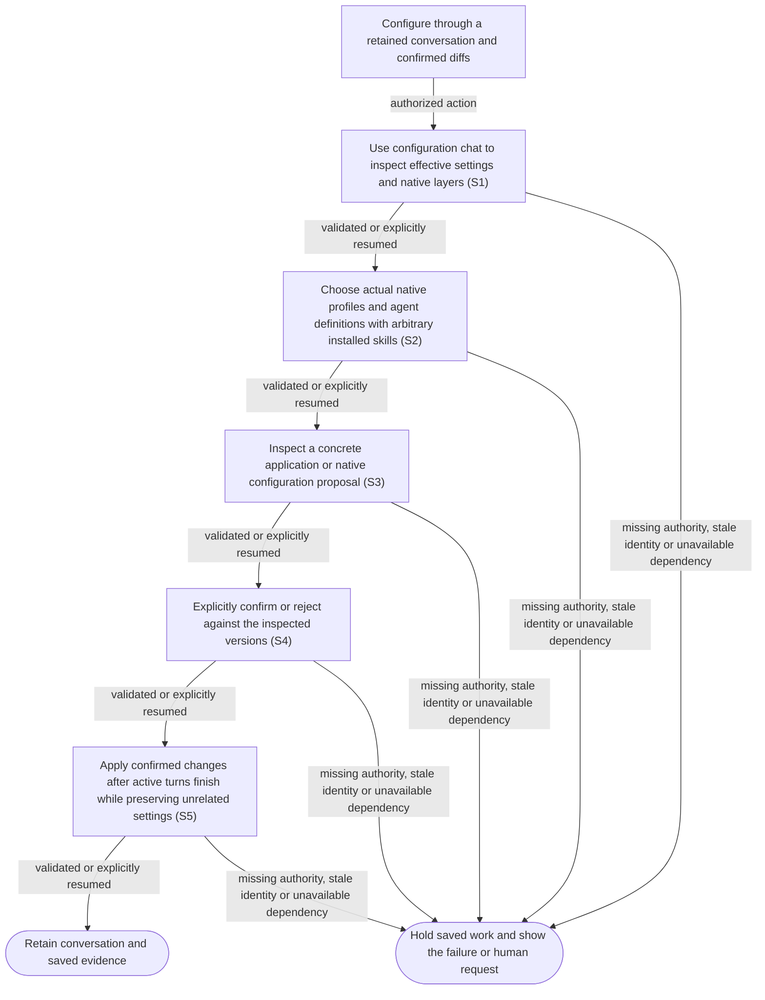

# Configure through a retained conversation and confirmed diffs

## Goal

Configure through a retained conversation and confirmed diffs.

## Preconditions

The private owner connection is established. Application data starts clean in the session-state database; native Codex authentication and configuration remain outside application state. GitHub source text is task data, not new authority.

## Main flow

1. Use configuration chat to inspect effective settings and native layers.

   Receive intentional results as structured messages. Clarification questions
   show answer forms with optional choices and free text; answering resumes the
   waiting agent once. Ordinary agent narration remains hidden.

2. Choose actual native profiles and agent definitions with arbitrary installed skills.

3. Inspect a concrete application or native configuration proposal.

   Application proposals show changed settings and their complete before/after
   values. Native inspection and proposals mask credential values. Credentials
   must be edited outside Code Factory; redacted placeholders cannot be submitted
   as native edits. Question answers do not confirm proposals.

   Named profile identifiers retain their exact spelling, including short
   token-like names. Ordinary credential-free URLs retain their spelling through
   inspection, proposal and confirmed native application. An unreadable query or
   parameter fragment is hidden and refused as an edit. Encoded credential values
   remain private. Quotes within URL credentials do not truncate redaction.
   Invalid URL components do not expose credentials copied from other components;
   edits containing those copied credentials are also refused.
   Whitespace within a URL value cannot expose part of a credential, and
   surrounding whitespace cannot hide one. Ordinary URL spelling stays editable.

4. Explicitly confirm or reject against the inspected versions.

   Changes to hidden native credentials also invalidate an older proposal.

5. Apply confirmed changes after active turns finish while preserving unrelated settings.

## Alternatives and recovery

Read-only inspection does not launch a model turn. Surface validation or provider errors and retain saved work. Human questions, explicit interruptions and uncertain deliveries hold automatic dispatch. Resume against current retained history; never replay an uncertain send or an answered RPC blindly. Explicit cleanup preserves dirty worktrees.

Show local submission feedback before waiting for the connection. Acceptance is
separate from delivery: keep queued and running work pending, and preserve the
owning conversation draft until delivery succeeds. Navigation and unrelated
conversations remain usable. Repeated request identities retrieve the original
work; connection recovery never submits the command again. After restart, effects
with retained intent are uncertain and memory-only work can be lost. Neither is
authority to replay a mutation or reuse an expired answer.

## Scenarios

- **S1** — Use configuration chat to inspect effective settings and native layers.
- **S2** — Choose actual native profiles and agent definitions with arbitrary installed skills.
- **S3** — Inspect a concrete application or native configuration proposal.
- **S4** — Explicitly confirm or reject against the inspected versions.
- **S5** — Apply confirmed changes after active turns finish while preserving unrelated settings.

## Verification scope

The assertion references below establish their fixture scope. Native installed-host, real-provider and assistive-technology acceptance require separate dated observations. The retired pipeline editor, review artifacts, AI question repair and built-in issue-report ledger have no compatibility path.

<!-- flow-references -->
## Terminology and UI references

Glossary: [configuration-proposal](../glossary/README.md#configuration-proposal), [profile](../glossary/README.md#profile), [skill](../glossary/README.md#skill).
UI entities: [PAGE-SETTINGS](../ui/README.md#PAGE-SETTINGS), [W-CONFIGURATION-CHAT](../ui/README.md#W-CONFIGURATION-CHAT), [W-CONFIGURATION-PROPOSAL](../ui/README.md#W-CONFIGURATION-PROPOSAL), [W-EFFECTIVE-SETTINGS](../ui/README.md#W-EFFECTIVE-SETTINGS).

## Flow diagram

## Implementation references

- [internal/factory/configuration.go](../../internal/factory/configuration.go) — Concrete application/native proposals, explicit confirmation and safe boundaries. (`func (s *Service) Confirm(`)
- [internal/factory/native.go](../../internal/factory/native.go) — Direct native app-server retained thread creation and resumption. (`func (s *Service) attach(`)
- [web/src/wrapper.tsx](../../web/src/wrapper.tsx) — Saved inbox, session conversation, human input and confirmed configuration. (`function Factory(`)
- [internal/transport/factory.go](../../internal/transport/factory.go) — Session, configuration, event and retained triage APIs. (`func NewFactory(`)
- [plugin/skills/code-factory-status/SKILL.md](../../plugin/skills/code-factory-status/SKILL.md) — Current configure-work implementation or fixture/build dependency.
- [plugin/skills/code-factory-report-issue/SKILL.md](../../plugin/skills/code-factory-report-issue/SKILL.md) — Current configure-work implementation or fixture/build dependency.
- [internal/factory/communication.go](../../internal/factory/communication.go) — Intentional structured configuration messages and questions; pending questions suspend until the exact owner answer. (`func (s *Service) communicate(`)
- [internal/factory/native_projection.go](../../internal/factory/native_projection.go) — Credential-redacted native inspection and stored proposal snapshots; raw fingerprints retain stale-version checks and credential edits are refused. (`func nativeSnapshot(`)
- [internal/store/proposal_migration.go](../../internal/store/proposal_migration.go) — Startup transaction sanitizes legacy native proposal event copies in bounded pages without changing event identities or replaying history. (`func (s *Store) RedactNativeProposalEvents(`)

## Test references

- [web/tests/wrapper.spec.ts](../../web/tests/wrapper.spec.ts) — `configuration chat and readable effective settings replace forms`; S1, S3. Configuration message addresses persistent chat; effective settings can be read.
- [internal/factory/service_test.go](../../internal/factory/service_test.go) — `func TestNativeAgentDefinitionUsesNativeTOMLAndProfile(`; S2. Native profile and agent config_file resolve without a separate agent format; effective native developer instructions remain in the actual thread request before wrapper guidance.
- [internal/factory/service_test.go](../../internal/factory/service_test.go) — `func TestNativeConfigurationLayerVersionsPreserveUnrelatedSettings(`; S1, S4, S5. Confirmed native edit sends the exact filePath, expectedVersion and one model-key replace edit with reloadUserConfig false; changed native layers reject stale proposals. Actual native editor/file execution remains unverified.
- [internal/factory/service_test.go](../../internal/factory/service_test.go) — `func TestConfigurationConfirmationStalenessAndSafeBoundary(`; S3, S4, S5. Explicit confirmation rejects stale app proposals and waits until active turns finish.
- [internal/factory/service_test.go](../../internal/factory/service_test.go) — `func TestMissingSkillsAndProfilesAreVisible(`; S2. Missing arbitrary installed skill or native profile fails visibly before a claimed send.
- [internal/factory/regressions_test.go](../../internal/factory/regressions_test.go) — `func TestDynamicToolSchemasUseArrayRequired(`; S3. Actual dynamic-tool schemas compile and every required member is an array, including empty proposal schemas.
- [internal/factory/regressions_test.go](../../internal/factory/regressions_test.go) — `func TestNativeConfigurationStartupFailureRemainsConfirmedAcrossRestart(`; S5. A confirmed native proposal survives known client startup failure before any write and applies once after restart; ambiguous write failure remains uncertain and is not replayed.
- [internal/factory/regressions_test.go](../../internal/factory/regressions_test.go) — `func TestConfigurationAppliedMarkerAndAllBindingsCommitAtomically(`; S5. Actual SQLite binding-write abort rolls back settings and applied marker without retiring the current client; restart applies item/configuration/priority bindings together.
- [internal/factory/regressions_test.go](../../internal/factory/regressions_test.go) — `func TestMultipleNativeProposalsNeverRestoreRetiredEpoch(`; S5. Two independent deferred native proposals both apply without restoring a retired epoch; delayed old disconnect leaves execution idle, unheld and detached.
- [internal/factory/regressions_test.go](../../internal/factory/regressions_test.go) — `func TestSchedulerSkipsHeldQueueDecodeAndBusyConfiguration(`; S5. Thirty intentionally undecodable histories cover 15 held, 14 due but paused, and one running session with runtime rows within 512 bytes; three ticks preserve deferred active configuration and start no native work.
- [internal/transport/operations_test.go](../../internal/transport/operations_test.go) — `func TestQueuedConfigurationRejectsStaleConfirmation(`; S4, S5. A queued confirmation runs after a newer proposal is applied, rejects its stale original identity and preserves current settings.
- [web/tests/wrapper.spec.ts](../../web/tests/wrapper.spec.ts) — `configuration renders explicit communication cards and hides agent narration`; S1. Configuration shows owner messages and titled plain-text communication cards, escapes HTML, and hides streamed/completed agent narration and internal status summaries.
- [web/tests/wrapper.spec.ts](../../web/tests/wrapper.spec.ts) — `configuration communication questions require an owner answer and never approve proposals`; S1, S3, S4. Configuration question form preserves title, body and optional choices, starts unselected, requires an explicit answer, blocks chat and sends the exact question identity; answering leaves the proposal unconfirmed.
- [internal/factory/communication_test.go](../../internal/factory/communication_test.go) — `func TestConfigurationCommunicationMessagesAndQuestions(`; S1, S3, S4. New configuration thread exposes communication; repeated native message IDs record one redacted card, questions suspend their replies, invalid/duplicate answers fail, and an exact successful tool response does not confirm a proposal.
- [internal/factory/communication_test.go](../../internal/factory/communication_test.go) — `func TestConfigurationCommunicationValidationAndExpiry(`; S1. Communication rejects invalid/bounded payloads and non-configuration sessions; expiring a blocked question rejects its answer.
- [internal/factory/communication_test.go](../../internal/factory/communication_test.go) — `func TestConfigurationLegacyCommunicationAndCompactDiff(`; S1, S3. Retained legacy configuration status results record intentional communication cards; settings diffs retain changed values and omit unchanged and absent fields.
- [internal/factory/communication_test.go](../../internal/factory/communication_test.go) — `func TestConfigurationCommunicationRetainsNativeCatalog(`; S1. New and legacy configuration conversations resume the same native thread once with compatible communication guidance and without re-registering or replacing their retained tool catalogs.
- [internal/factory/native_projection_test.go](../../internal/factory/native_projection_test.go) — `func TestNativeInspectionRedactsUnmanagedCredentials(`; S1, S3, S4. Native inspection and the configuration-agent tool redact unmanaged environment, header, argument, password/token, URL and copied credential values while preserving profile settings and layer identities.
- [internal/factory/native_projection_test.go](../../internal/factory/native_projection_test.go) — `func TestNativeProposalRetainsRedactedSnapshotAndRawFreshness(`; S1, S3, S4. Stored proposals contain redacted snapshots; an invisible credential rotation rejects confirmation, and a fresh confirmed profile edit sends exactly one scoped native write.
- [internal/factory/native_projection_test.go](../../internal/factory/native_projection_test.go) — `func TestNativeCredentialEditsAreRejectedWithoutPersistence(`; S1, S3, S4. Credential-bearing native edits, copied custom-header values, URL credentials, redacted placeholders and table-form key paths are rejected before proposal persistence or native writes.
- [internal/factory/native_projection_test.go](../../internal/factory/native_projection_test.go) — `func TestNativeLegacyProposalMigrationPreservesStaleness(`; S1, S3, S4. Startup sanitizes legacy proposal entities and more than one page of journal copies, including orphaned history; failure rolls back all journal updates, identities/states/unrelated events remain unchanged, unsafe pending edits stale without writes, and repeated migration is idempotent.
- [internal/factory/native_projection_test.go](../../internal/factory/native_projection_test.go) — `func TestNativeInspectionPreservesSelectorsAndRedactsURLCopies(`; S1, S3. Nonsecret MCP environment/argument values preserve exact layer file/type/version and profile values; copied URL password/query/fragment credentials are masked, and the displayed layer selector supports a safe proposal.
- [internal/factory/native_projection_test.go](../../internal/factory/native_projection_test.go) — `func TestNativeCredentialWordsInNamesRemainEditable(`; S1, S2, S3. Profile/plugin/project/server identifiers containing credential words or short token-like names preserve ordinary settings; quoted dotted profile/project paths and whole-profile replacements remain editable, while credential fields inside named entries still redact and reject edits.
- [internal/factory/native_projection_test.go](../../internal/factory/native_projection_test.go) — `func TestNativeNonsecretURLsRemainEditable(`; S1, S3, S4, S5. Each noncredential URL retains its exact query/anchor spelling, including semicolon anchors, escaped fragment values, literal quotes/angle brackets and literal/surrounding whitespace, in inspection, proposed edits and one confirmed native write per case; no write occurs before confirmation.
- [internal/factory/native_projection_test.go](../../internal/factory/native_projection_test.go) — `func TestNativeURLParameterBoundariesRejectCredentials(`; S1, S3, S4. Thirty isolated URL cases cover malformed parameters with ordinary semicolon prefixes, escaped credentials, quotes, angle brackets, whitespace/control characters and whole-URL parse failures without exposing raw or decoded credential copies in inspection, persisted proposals or legacy projections. Surrounding whitespace cannot hide credentials; an additional URL in the same value still redacts. URL and copied-value edits are refused before persistence or native writes; unrelated ordinary settings, values matching only a partial credential prefix and a remaining escaped fragment value are preserved.

## Verification and gaps

Local suites: `go`, `browser`.
Fixture success does not establish real-host acceptance.

<!-- /flow-references -->
