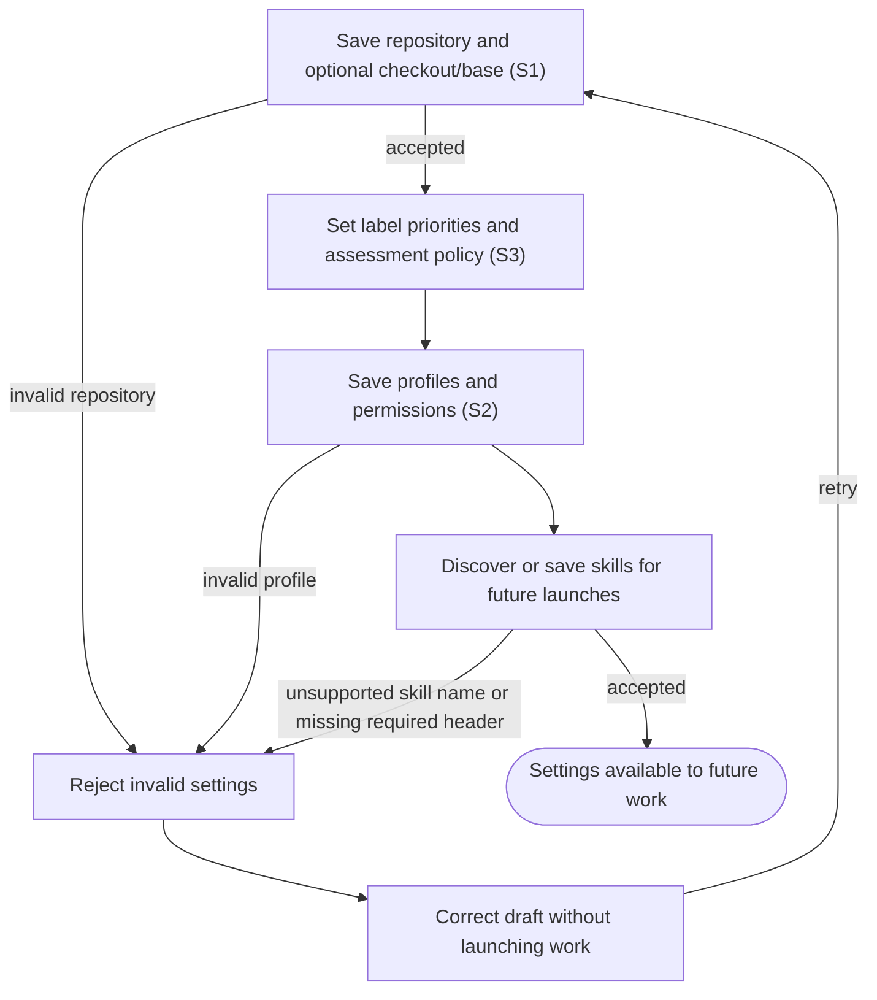

# Configure repositories, policies, profiles and skills

## Goal

The owner chooses the repositories and reusable work settings the application will use.

## Preconditions

The owner has opened the connected application. Repository access is granted through the existing provider account.

## Main flow

1. Save a repository identifier, optionally choosing an existing checkout and default base.
2. Set label priorities and the assessment policy.
3. Create or edit work profiles, including prompts, model settings, permissions and publishing authority.
4. Discover local skills or save managed skill content, then select skills for future launches.

## Alternatives and recovery

Invalid repository identifiers, unsupported permission choices and incomplete profiles are rejected. Unsupported skill names and a missing required skill header are rejected; saving a skill does not establish that its complete content is valid. Editing settings does not launch work or rewrite a previously prepared launch.

## Scenarios

- **S1** Repository settings are accepted and available to subsequent synchronization and launch.
- **S2** Profiles and skills can be saved and selected; unsupported profile choices, unsupported skill names and a missing required skill header are rejected.
- **S3** Changing assessment policy invalidates cached priority assessments.

<!-- flow-references -->
## Terminology and UI references

Glossary: [repository](../glossary/README.md#repository), [profile](../glossary/README.md#profile), [skill](../glossary/README.md#skill), [priority](../glossary/README.md#priority), [coverage-gap](../glossary/README.md#coverage-gap), [known-limitation](../glossary/README.md#known-limitation).
UI entities: [PAGE-SETTINGS](../ui/README.md#PAGE-SETTINGS), [P-REPOSITORIES](../ui/README.md#P-REPOSITORIES), [P-POLICIES](../ui/README.md#P-POLICIES), [P-PROFILES](../ui/README.md#P-PROFILES), [P-SKILLS](../ui/README.md#P-SKILLS), [W-REPOSITORY-SETTINGS](../ui/README.md#W-REPOSITORY-SETTINGS), [W-POLICY-SETTINGS](../ui/README.md#W-POLICY-SETTINGS), [W-PROFILE-SETTINGS](../ui/README.md#W-PROFILE-SETTINGS), [W-SKILL-SETTINGS](../ui/README.md#W-SKILL-SETTINGS), [C-REPOSITORY-SAVE](../ui/README.md#C-REPOSITORY-SAVE), [C-DISCOVER-SKILLS](../ui/README.md#C-DISCOVER-SKILLS), [C-POLICY-SAVE](../ui/README.md#C-POLICY-SAVE), [C-PROFILE-SAVE](../ui/README.md#C-PROFILE-SAVE), [C-SKILL-SAVE](../ui/README.md#C-SKILL-SAVE).

## Flow diagram

## Implementation references

- [internal/app/app.go](../../internal/app/app.go) — Settings and repository/profile validation (`func (a *App) SaveConfig(`)
- [internal/app/runs.go](../../internal/app/runs.go) — Skill discovery, snapshots and managed persistence; SaveSkill accepts nonempty names of at most 63 lowercase ASCII letters, digits or hyphens and content beginning with `---\n`, without parsing frontmatter or validating the remaining content. (`func (m *Manager) SaveSkill(`)
- [web/src/main.tsx](../../web/src/main.tsx) — Settings editor (`function Settings(`)
- [internal/domain/types.go](../../internal/domain/types.go) — Defaults and profile choices
- [internal/store/store.go](../../internal/store/store.go) — Shared domain, persistence, transport or dependency contract
- [internal/transport/mcp.go](../../internal/transport/mcp.go) — Shared domain, persistence, transport or dependency contract
- [go.mod](../../go.mod) — Shared domain, persistence, transport or dependency contract
- [go.sum](../../go.sum) — Shared domain, persistence, transport or dependency contract
- [web/src/types.ts](../../web/src/types.ts) — Embedded UI build and host-fixture configuration
- [web/src/style.css](../../web/src/style.css) — Embedded UI build and host-fixture configuration
- [web/src/bridge.ts](../../web/src/bridge.ts) — Embedded UI build and host-fixture configuration
- [web/package.json](../../web/package.json) — Embedded UI build and host-fixture configuration
- [web/package-lock.json](../../web/package-lock.json) — Embedded UI build and host-fixture configuration
- [web/tsconfig.json](../../web/tsconfig.json) — Embedded UI build and host-fixture configuration
- [web/vite.config.ts](../../web/vite.config.ts) — Embedded UI build and host-fixture configuration
- [web/index.html](../../web/index.html) — Embedded UI build and host-fixture configuration
- [web/playwright.config.ts](../../web/playwright.config.ts) — Embedded UI build and host-fixture configuration
- [internal/testhost/main.go](../../internal/testhost/main.go) — Embedded UI build and host-fixture configuration
- [internal/testutil/fakecodex/main.go](../../internal/testutil/fakecodex/main.go) — Embedded UI build and host-fixture configuration
- [internal/testutil/testutil.go](../../internal/testutil/testutil.go) — Embedded UI build and host-fixture configuration
- [internal/web/embed.go](../../internal/web/embed.go) — Embedded UI build and host-fixture configuration

## Test references

- [web/tests/factory.spec.ts](../../web/tests/factory.spec.ts) — `test("plugin settings accept repository and secure credential without echo"`; S1. UI saves a repository through the host fixture.
- [internal/app/app_test.go](../../internal/app/app_test.go) — `func TestAssessmentCacheAndInvalidation(`; S3. Policy changes rerun inference.
- [internal/app/real_codex_test.go](../../internal/app/real_codex_test.go) — `func TestRealCodexInteractiveLifecycle(`; S2. Opt-in real lifecycle saves a profile/skill and observes skill loading; skipped in default fixture verification.

## Verification and gaps

Local suites: `go`, `browser`.
Fixture success does not establish real-host acceptance.
- **S2** — `gap-flow-configure-work-s2-01` · Known limitation · P2 · owner: user-flow-maintainer. Full skill frontmatter/content validation and assertions for unsupported names, missing headers and malformed content remain gaps. Profile/skill editing and other invalid-input combinations also lack focused automated coverage. The opt-in real lifecycle exercises a saved profile and skill, but is not run by this gate. Next verification: Assert the existing name/header rejection boundary and malformed-content acceptance; separately decide and verify any stronger validation, then exercise profile/skill editing and invalid inputs in fixtures.

<!-- /flow-references -->
