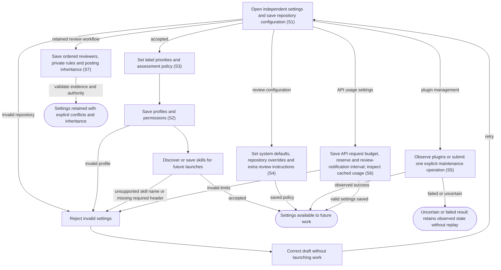

# Configure repositories, policies, profiles and skills

## Goal

The owner chooses the repositories and reusable work settings the application will use.

## Preconditions

The owner has opened the separate connected Settings view. Repository access is granted through the existing provider account.

## Main flow

1. Load the independent Settings view only when opened; its cached administration data follows the shared saved-state subscription. Open the independent Settings view and its initially expanded Repositories form, focused on the first repository when none is configured. Save its identifier and optional checkout/base; show feedback while remaining in Settings.
2. Expand Priorities & notifications to edit label/priority rows, the assessment policy and the optional question helper model.
3. Create or edit work profiles, including prompts, model settings, permissions and publishing authority.
4. Discover local skills or save managed skill content, then select skills for future launches. Selecting an existing managed skill loads its saved instructions on demand; Save waits for that selected read, and an earlier response cannot overwrite a later selection or editor draft.
5. In System defaults choose workflow execution or a single retained Codex session. For the single session, select the installed PR iteration skill; saving validates its availability. Changes apply to future prepared work and preserve existing proposals and sessions.
6. Inspect cached GitHub API usage and choose the application request budget, quota reserve and review-notification interval.

## Alternatives and recovery

Settings is independent of the task UI and has no Inbox/Agents navigation. Saving does not replace an already-open task view or reset its drafts. Settings is one compact column. Other relevant sections start collapsed. Each saving form disables its controls and shows saving, success or failure beside its retained values. Unused disabled integration forms are omitted; Jira remains disabled in the pilot backend. Empty or duplicate priority labels are rejected inline. Invalid repository identifiers, unsupported permission choices and incomplete profiles are rejected. Unsupported skill names and a missing required skill header are rejected; saving a skill does not establish that its complete content is valid. Editing settings does not immediately launch work or rewrite a prepared launch. An explicitly enabled automatic-review policy can launch eligible reviews on a later successful repository poll.

## Scenarios

- **S1** Repository settings are accepted and available to subsequent synchronization and launch.
- **S2** Profiles and skills can be saved and selected, including an explicit full-access/never/authorized choice for autonomous execution and publishing; unsupported profile choices, unsupported skill names and a missing required skill header are rejected.
- **S3** Changing assessment policy invalidates cached priority assessments.

- **S4** Session execution and the installed PR iteration skill are saved together. Unsupported modes and missing, disabled or unrelated iteration skills are rejected. Older cached forms preserve omitted mode/skill settings. Switching execution changes only future preparations. System defaults queue review requests. An explicitly configured full-access/never/authorized review pipeline is eligible alongside read-only/ask; selecting permissions does not itself enable automatic review. A repository inherits or overrides queue/automatic behavior and role pipelines, can pause monitoring, and adds owner review instructions to its generic prompt. Last poll, sync errors and review-policy errors remain visible. Older cached forms preserve omitted monitoring/default fields; explicit inheritance or empty extra prompt clears only the chosen value.
- **S5** Admin widget, plugin tools and bundled admin skill observe installed/available Codex plugins, enabled state, versions, update status and durable operations. The owner adds sources and explicitly installs, updates or removes plugins. Scheduled metadata checks never install updates. Uncertain operations retain observations and never replay. Discovered plugin/standalone skills remain selectable for future review and implementation profiles; unavailable skills cannot be newly prepared. Unknown remote-catalog version or authentication readiness remains explicit.

- **S6** The owner saves a bounded application GitHub request budget, reserve and notification interval without triggering a repository poll. Usage displays cached counts and observed quotas. Budget-only edits preserve priority assessments. Omitted fields from older forms retain their values; independent skill/agent GitHub usage is identified separately.

- **S7** Ordered reviewers, private rules and automatic posting can be configured globally or per repository. Posting defaults off; explicit false disables and null restores inheritance. Saved policy changes update the effective choice in an open PR without starting or publishing work. One-time DK import preserves Factory settings and reports conflicts.

<!-- flow-references -->
## Terminology and UI references

Glossary: [repository](../glossary/README.md#repository), [profile](../glossary/README.md#profile), [skill](../glossary/README.md#skill), [priority](../glossary/README.md#priority), [coverage-gap](../glossary/README.md#coverage-gap), [known-limitation](../glossary/README.md#known-limitation), [codex-plugin](../glossary/README.md#codex-plugin), [plugin-marketplace](../glossary/README.md#plugin-marketplace), [plugin-inventory](../glossary/README.md#plugin-inventory), [plugin-maintenance](../glossary/README.md#plugin-maintenance), [review-policy](../glossary/README.md#review-policy), [repository-review-prompt](../glossary/README.md#repository-review-prompt), [github-request-budget](../glossary/README.md#github-request-budget), [github-request-reserve](../glossary/README.md#github-request-reserve), [github-review-notification](../glossary/README.md#github-review-notification), [review-workflow](../glossary/README.md#review-workflow), [review-artifact](../glossary/README.md#review-artifact), [review-posting-policy](../glossary/README.md#review-posting-policy), [review-publication-operation](../glossary/README.md#review-publication-operation).
UI entities: [PAGE-SETTINGS](../ui/README.md#PAGE-SETTINGS), [P-REPOSITORIES](../ui/README.md#P-REPOSITORIES), [P-POLICIES](../ui/README.md#P-POLICIES), [P-PROFILES](../ui/README.md#P-PROFILES), [P-SKILLS](../ui/README.md#P-SKILLS), [W-REPOSITORY-SETTINGS](../ui/README.md#W-REPOSITORY-SETTINGS), [W-POLICY-SETTINGS](../ui/README.md#W-POLICY-SETTINGS), [W-PROFILE-SETTINGS](../ui/README.md#W-PROFILE-SETTINGS), [W-SKILL-SETTINGS](../ui/README.md#W-SKILL-SETTINGS), [C-REPOSITORY-SAVE](../ui/README.md#C-REPOSITORY-SAVE), [C-DISCOVER-SKILLS](../ui/README.md#C-DISCOVER-SKILLS), [C-POLICY-SAVE](../ui/README.md#C-POLICY-SAVE), [C-PROFILE-SAVE](../ui/README.md#C-PROFILE-SAVE), [C-SKILL-SAVE](../ui/README.md#C-SKILL-SAVE), [S-SETTINGS](../ui/README.md#S-SETTINGS), [C-OPEN-SETTINGS](../ui/README.md#C-OPEN-SETTINGS), [W-PLUGIN-ADMIN](../ui/README.md#W-PLUGIN-ADMIN), [P-PLUGIN-ADMIN](../ui/README.md#P-PLUGIN-ADMIN), [W-SYSTEM-DEFAULTS](../ui/README.md#W-SYSTEM-DEFAULTS), [P-SYSTEM-DEFAULTS](../ui/README.md#P-SYSTEM-DEFAULTS), [C-PLUGIN-MAINTENANCE](../ui/README.md#C-PLUGIN-MAINTENANCE), [C-REVIEW-POLICY](../ui/README.md#C-REVIEW-POLICY), [C-REPOSITORY-REVIEW-PROMPT](../ui/README.md#C-REPOSITORY-REVIEW-PROMPT), [W-GITHUB-USAGE](../ui/README.md#W-GITHUB-USAGE), [C-GITHUB-USAGE](../ui/README.md#C-GITHUB-USAGE), [C-SKILL-LOAD](../ui/README.md#C-SKILL-LOAD), [W-PR-REVIEW-POLICY](../ui/README.md#W-PR-REVIEW-POLICY), [W-RETAINED-REVIEW](../ui/README.md#W-RETAINED-REVIEW), [C-PR-POSTING-POLICY](../ui/README.md#C-PR-POSTING-POLICY), [C-REVIEW-PUBLISH](../ui/README.md#C-REVIEW-PUBLISH), [C-REVIEW-RECONCILE](../ui/README.md#C-REVIEW-RECONCILE).

## Flow diagram

## Implementation references

- [internal/app/app.go](../../internal/app/app.go) — Settings and repository/profile validation (`func (a *App) SaveConfig(`)
- [internal/app/runs.go](../../internal/app/runs.go) — Skill discovery, snapshots and managed persistence; SaveSkill accepts nonempty names of at most 63 lowercase ASCII letters, digits or hyphens and content beginning with `---\n`, without parsing frontmatter or validating the remaining content. (`func (m *Manager) SaveSkill(`)
- [web/src/settings.tsx](../../web/src/settings.tsx) — Settings editor (`function Settings(`)
- [internal/domain/types.go](../../internal/domain/types.go) — Defaults and profile choices
- [internal/store/store.go](../../internal/store/store.go) — Shared domain, persistence, transport or dependency contract
- [internal/transport/mcp.go](../../internal/transport/mcp.go) — Shared domain, persistence, transport or dependency contract
- [go.mod](../../go.mod) — Shared domain, persistence, transport or dependency contract
- [go.sum](../../go.sum) — Shared domain, persistence, transport or dependency contract
- [web/src/types.ts](../../web/src/types.ts) — Embedded UI build and host-fixture configuration
- [web/src/style.css](../../web/src/style.css) — Embedded UI build and host-fixture configuration
- [web/src/bridge.ts](../../web/src/bridge.ts) — Embedded UI build and host-fixture configuration
- [web/package.json](../../web/package.json) — Embedded UI build and host-fixture configuration
- [web/package-lock.json](../../web/package-lock.json) — Embedded UI build and host-fixture configuration
- [web/tsconfig.json](../../web/tsconfig.json) — Embedded UI build and host-fixture configuration
- [web/vite.config.ts](../../web/vite.config.ts) — Embedded UI build and host-fixture configuration
- [web/index.html](../../web/index.html) — Embedded UI build and host-fixture configuration
- [web/playwright.config.ts](../../web/playwright.config.ts) — Embedded UI build and host-fixture configuration
- [web/fixture-ports.ts](../../web/fixture-ports.ts) — Shared validated loopback fixture origins preserve default ports and allow isolated browser verification alongside another checkout. (`export const fixtureUIOrigin =`)
- [internal/testhost/main.go](../../internal/testhost/main.go) — Embedded UI build and host-fixture configuration
- [internal/testutil/fakecodex/main.go](../../internal/testutil/fakecodex/main.go) — Embedded UI build and host-fixture configuration
- [internal/testutil/testutil.go](../../internal/testutil/testutil.go) — Embedded UI build and host-fixture configuration
- [internal/web/embed.go](../../internal/web/embed.go) — Embedded UI build and host-fixture configuration
- [internal/web/embed.go](../../internal/web/embed.go) — Configuration opens through its own bridged document entry. (`func SettingsHTML(`)
- [internal/app/plugins.go](../../internal/app/plugins.go) — Durable pinned-CLI plugin lifecycle and exclusive runtime/maintenance boundary. (`func (m *Manager) PluginAction(`)
- [internal/domain/admin.go](../../internal/domain/admin.go) — Typed plugin operation and inventory persistence. (`type PluginOperation struct`)
- [internal/app/review_requests.go](../../internal/app/review_requests.go) — Resolve inherited review policies, fresh requests, durable claims and pinned automatic launches. (`func (a *App) ProcessReviewRequests(`)
- [web/src/admin.tsx](../../web/src/admin.tsx) — Repository/global review policy and plugin-admin settings. (`export function RepositoryAdmin(`)
- [plugin/skills/code-factory-admin/SKILL.md](../../plugin/skills/code-factory-admin/SKILL.md) — Bundled administration skill exposes the same owner tool controls. (`name: code-factory-admin`)
- [internal/app/github_usage.go](../../internal/app/github_usage.go) — Bind system budget settings to private durable accounting and carry over existing cooldowns. (`func (a *App) EnableGitHubUsage(`)
- [internal/app/skill_snapshots.go](../../internal/app/skill_snapshots.go) — Freeze a selected plugin package and its relative skill entrypoint; materialize bounded retained files with traversal confinement and standalone compatibility. (`func snapshotSkill(`)
- [web/src/ui-changes.ts](../../web/src/ui-changes.ts) — Plugin administration rereads saved state on shared invalidations; failed reads retry without replaying mutations. (`export function useUIVersion(`)
- [internal/providers/github_usage.go](../../internal/providers/github_usage.go) — Projection builds quota information from SQLite without provider effects. (`func SavedGitHubUsage(`)
- [internal/app/review_import.go](../../internal/app/review_import.go) — Ordered reviewer settings, private rules, posting inheritance and one-time conflict-preserving import.
- [internal/app/review_workflows.go](../../internal/app/review_workflows.go) — Ordered reviewer settings, private rules, posting inheritance and one-time conflict-preserving import.

## Test references

- [web/tests/factory.spec.ts](../../web/tests/factory.spec.ts) — `test("settings save repository and priority rows without unused integrations"`; S1. Independent settings keeps save feedback and configured summaries visible without task navigation; no unused integration form. Saves the optional question helper model.
- [internal/app/app_test.go](../../internal/app/app_test.go) — `func TestAssessmentCacheAndInvalidation(`; S3. Policy changes rerun inference.
- [internal/app/real_codex_test.go](../../internal/app/real_codex_test.go) — `func TestRealCodexInteractiveLifecycle(`; S2. Opt-in real lifecycle saves a profile/skill and observes skill loading; skipped in default fixture verification.
- [web/tests/factory.spec.ts](../../web/tests/factory.spec.ts) — `test("repository form shows saving and errors beside retained inputs"`; S1. Saving disables the form; exact inline failure preserves values.
- [web/tests/factory.spec.ts](../../web/tests/factory.spec.ts) — `test("collapsed settings editors preserve capabilities and show independent save results"`; S1, S2. Profile/mode and skill saves, discovery and diagnostics have independent local results; initial repository focus is asserted.
- [web/tests/factory.spec.ts](../../web/tests/factory.spec.ts) — `settings has a dedicated ${theme} view without inbox or agent navigation`; S1. Repository saves stay within independent configuration, with no task nav.
- [web/tests/factory.spec.ts](../../web/tests/factory.spec.ts) — `separate settings can save while the inbox view retains its item and agent drafts`; S1, S2. Independent documents preserve main task context/drafts while settings save shared data.
- [internal/transport/ui_resource_test.go](../../internal/transport/ui_resource_test.go) — `func TestSettingsResourceIsIndependentFromInboxAndLegacyAlias(`; S1. Settings/inbox identities, bindings, bodies and legacy aliases remain separate.
- [internal/web/embed_test.go](../../internal/web/embed_test.go) — `func TestSettingsDocumentHasIndependentEntry(`; S1. Settings document root selects only the configuration surface.
- [web/tests/factory.spec.ts](../../web/tests/factory.spec.ts) — `admin system and repository review policies retain inheritance and extra prompts`; S4. Both themes at 390px assert queue-only defaults, system opt-in, repo queue/inherit overrides, persisted extra review text, manual poll without explicit UI Start and scoped axe scans.
- [web/tests/factory.spec.ts](../../web/tests/factory.spec.ts) — `plugin admin tracks installs, versions and explicit updates`; S5. Both themes use memoized plugin reads with distinct freshness markers to observe check/install/update/remove completion, final inventory and enabled controls without replaying maintenance.
- [web/tests/factory.spec.ts](../../web/tests/factory.spec.ts) — `uncertain plugin mutations preserve drafts and never replay automatically`; S5. An uncertain management response displays feedback, retains the selector and submits only once after polling.
- [web/tests/factory.spec.ts](../../web/tests/factory.spec.ts) — `repository review pipeline overrides system defaults and plugin skills remain selectable`; S2. The requested-PR conversation selects its repository pipeline over the system default without launching; a discovered plugin skill is selectable in a profile and an unavailable skill is disabled.
- [internal/app/plugins_test.go](../../internal/app/plugins_test.go) — `func TestPluginInventoryInstallUpdateAndRemoval(`; S5. Pinned-provider fixture asserts discovery, actual installed version, metadata-only newer version detection, explicit update/removal and positional argument separation.
- [internal/app/plugins_test.go](../../internal/app/plugins_test.go) — `func TestPluginRestartAndMalformedInventoryRetainObservedState(`; S5. Malformed/null inventory preserves prior installed observations; interrupted operations become uncertain without replay.
- [internal/app/plugins_test.go](../../internal/app/plugins_test.go) — `func TestSelectedDiscoveredSkillKeepsItsBundleAndAutomaticChecksDoNotInstall(`; S5. Discovery and launch preserve skill text/support files/executable modes; scheduled checks refresh metadata without an install command.
- [internal/app/review_requests_test.go](../../internal/app/review_requests_test.go) — `func TestReviewPolicyInheritancePromptAndExactlyOnceAutomaticStart(`; S4. System defaults queue; enabled inherited policy starts one pinned read-only review with appended repo text, survives duplicate polls/restart and accepts a new request episode.
- [internal/app/review_requests_test.go](../../internal/app/review_requests_test.go) — `func TestRepositoryQueueOverridePauseDraftAndStaleRequestsDoNotStart(`; S4. Queue override, pause, draft, old sync, absent request, sync error and unsafe review profile cannot launch automatically.
- [web/tests/factory.spec.ts](../../web/tests/factory.spec.ts) — `GitHub usage settings show cached quota and save budget without polling`; S6. Both narrow themes save limits and display cached usage without polling GitHub.
- [internal/app/github_usage_test.go](../../internal/app/github_usage_test.go) — `func TestIndexPreservesHistoryInvalidatesChangedHeadAndBudgetEditsKeepAssessmentPolicy(`; S3, S6. Budget-only edits do not invalidate all priority assessments; cheap index retains history and invalidates old-head metadata.
- [internal/app/github_usage_test.go](../../internal/app/github_usage_test.go) — `func TestInvalidAPIBudgetCannotOverwriteSavedPolicy(`; S6. Rejected out-of-range limits cannot replace saved API or assessment policy.
- [internal/app/skill_snapshots_test.go](../../internal/app/skill_snapshots_test.go) — `func TestPluginSkillSnapshotKeepsPackageResourcesAndRetainedEntrypoint(`; S2. Package-level lifecycle/procedure resources and executable helpers retain relative paths and original content after installed source deletion and repeated materialization.
- [internal/app/skill_snapshots_test.go](../../internal/app/skill_snapshots_test.go) — `func TestSkillSnapshotRejectsEscapesLinksMissingEntryAndOversize(`; S2. Manifest escapes, wrong skills directory, symlinks, missing entrypoints and oversized bundles fail instead of producing incomplete snapshots.
- [internal/app/skill_snapshots_test.go](../../internal/app/skill_snapshots_test.go) — `func TestRetainedSkillRejectsTraversalAndPreservesStandaloneCompatibility(`; S2. Retained entry/file traversal and outbound symlinks cannot escape snapshot roots; legacy standalone SKILL.md remains usable.
- [internal/app/review_requests_test.go](../../internal/app/review_requests_test.go) — `func TestPreparePRReviewHonorsExplicitFullAccess(`; S2, S4. Explicit owner full-access/never/authorized authority is retained by manual preparation and accepted once by automatic policy without enabling that policy implicitly.
- [web/tests/factory.spec.ts](../../web/tests/factory.spec.ts) — `test("explicit full-access launch shows never approvals and authorized publishing"`; S2, S4. UI displays explicit full access, never approvals and authorized publishing; opens without Start, starts once on explicit action, and Settings describes selected authority.
- [internal/app/plugins_test.go](../../internal/app/plugins_test.go) — `func TestRemovedPluginSkillStaysUnavailableWhileCachedFilesRemain(`; S5. Successful removal/discovery omission disables cached-file skill for new Prepare while frozen Run is unchanged; failed discovery preserves known skill, managed content remains and rediscovery re-enables.
- [web/tests/factory.spec.ts](../../web/tests/factory.spec.ts) — `plugin status polling clears recovered read failures while retaining drafts`; S5. Failed plugin read recovers through a later successful poll, removes only its read alert, retains selector draft/inventory and issues no maintenance mutation.
- [web/tests/factory.spec.ts](../../web/tests/factory.spec.ts) — `system defaults display and retain a supported nonpreset plugin interval`; S5. Saved supported30-minute interval is displayed accurately and retained through an unrelated budget save.
- [internal/transport/mcp_test.go](../../internal/transport/mcp_test.go) — `func TestAuthenticatedMCPDiscoveryToolsAndUI(`; S5. MCP schema accepts distinct plugin-read freshness markers and sees a newly saved operation without changing the journal; existing auth/settings/selector guards remain.
- [internal/transport/ui_state_test.go](../../internal/transport/ui_state_test.go) — `TestUIManagedSkillEditorReadsOnlySelectedContent`; S2. Broad settings/launch projections omit skill content/files; the app-only managed editor returns only selected content with a read cursor, rejects unmanaged skills and excludes private files.
- [web/tests/factory.spec.ts](../../web/tests/factory.spec.ts) — `the managed skill editor loads selected saved instructions and saves an existing skill`; S2. Selecting an existing managed skill reads its saved instructions on demand and submits the edited full content.
- [web/tests/factory.spec.ts](../../web/tests/factory.spec.ts) — `a late managed skill read cannot overwrite a later selection or its editor draft`; S2. Save is disabled during the selected read; a late earlier response cannot replace the later skill name or locally edited instructions.
- [web/tests/factory.spec.ts](../../web/tests/factory.spec.ts) — `managed skill read failure blocks saving until an explicit read retry succeeds`; S2. Read failures gate the selected editor save until explicit reload succeeds; no save operation is submitted or replayed.
- [web/tests/factory.spec.ts](../../web/tests/factory.spec.ts) — `notification-only failures refresh saved Settings feedback`; S1. Saved credential-resolution notification feedback updates from its own invalidation bucket.
- [web/tests/factory.spec.ts](../../web/tests/factory.spec.ts) — `review workflow settings preserve ordered bindings and inherited posting overrides`; S7. Ordered binding persistence and inherited posting controls.
- [internal/app/retained_review_test.go](../../internal/app/retained_review_test.go) — `func TestOneTimeDKImportPreservesFactoryValuesAndReportsConflicts(`; S7. Import preservation, conflict feedback and once-only state.
- [internal/transport/review_workflow_test.go](../../internal/transport/review_workflow_test.go) — `func TestMCPReviewPolicyPresenceInheritanceAndDependencyDiagnostic(`; S7. Omitted and null settings preserve/reset posting overrides and reviewers correctly; a missing retained reviewer skill rejects Start before evidence or model execution.
- [web/tests/factory.spec.ts](../../web/tests/factory.spec.ts) — `saved review policy changes refresh an open PR without polling or starting work`; S7. A saved global posting-policy change refreshes the effective choice in an open PR through shared invalidations, without starting a run or posting a review.
- [internal/store/ui_journal_test.go](../../internal/store/ui_journal_test.go) — `TestUIJournalCommitsRollbackCASAndLegacyCursor`; S7. A saved PR posting-policy write publishes the owning item ID without stored policy payloads.
- [internal/app/retained_review_test.go](../../internal/app/retained_review_test.go) — `func TestOneTimeGlobalDKImportUsesUserRulesAndPreservesConflicts(`; S7. Supported global DK rule location, reviewer defaults, conflict/source preservation, Factory precedence and once-only import after original source removal.
- [internal/app/review_workflow_guards_test.go](../../internal/app/review_workflow_guards_test.go) — `func TestDirectCommandReviewerRetainsExecutablePackageAfterSourceRemoval(`; S7. Selected executable command bindings retain their supported package layout and sibling resources while excluding unrelated untracked owner files. Exact tracked sibling names with leading/trailing space and tab survive raw NUL inventory and are consumed by the retained command after source removal.
- [web/tests/factory.spec.ts](../../web/tests/factory.spec.ts) — `global DK review import preserves unrelated edits made while settings are loading`; S7. Delayed import replaces reported reviewer/rule fields while preserving concurrent unrelated draft edits through Save, with no start/post side effect.
- [internal/app/review_workflow_guards_test.go](../../internal/app/review_workflow_guards_test.go) — `func TestCommandCaptureRejectsOversizeSelectedExecutableAndPackage(`; S7. Oversized standalone/selected untracked executables and selected-plus-tracked package totals fail before unbounded retention.
- [web/tests/factory.spec.ts](../../web/tests/factory.spec.ts) — `absent global reviewers retain invalid draft and validity through unrelated settings edits`; S7. Unrelated renders preserve invalid reviewer draft/error/native validity when global reviewers are absent; invalid Save mutates nothing, while real import/inheritance reset still recovers.
- [web/tests/factory.spec.ts](../../web/tests/factory.spec.ts) — `repository DK import discards stale results when switching editors during ${delay}`; S7. Repository A import/snapshot delays cannot modify subsequently selected B draft or stale import status; Save retains B reviewers/rules/base, including320px layout.
- [web/tests/factory.spec.ts](../../web/tests/factory.spec.ts) — `a delayed policy save ${response} preserves a newer committed Off observation`; S7. Delayed success and failure responses from an earlier On save cannot replace a newer committed Off policy observation or restore an obsolete error; exactly one save occurs and no start/post runs.
- [web/tests/factory.spec.ts](../../web/tests/factory.spec.ts) — `single Codex execution settings retain the selected iteration skill without launching`; S4. Saves single Codex mode and the installed iteration skill, preserves both during unrelated budget edits, switches back to workflow and never launches or publishes.
- [internal/app/single_codex_test.go](../../internal/app/single_codex_test.go) — `func TestSingleCodexReviewRetainsSkillModeAndNativeSession(`; S4. Preparation freezes direct execution and a full iteration skill snapshot; changing settings prepares engine reviews without rerouting the existing native session or its follow-up.
- [internal/app/single_codex_test.go](../../internal/app/single_codex_test.go) — `func TestSingleCodexConfigurationRejectsMissingDisabledOrWrongSkill(`; S4. Missing, disabled and unrelated iteration skills and unknown modes cannot be saved.
- [internal/app/single_codex_test.go](../../internal/app/single_codex_test.go) — `func TestSingleCodexStartupRetainsNativeSessionAfterSettingsSwitch(`; S4. After settings switch to workflow and manager restart, the native review preserves mode, thread, workspace, authority, skill snapshot and saved progress; repeated recovery resumes once without original-task replay or YAML execution.
- [internal/app/single_codex_test.go](../../internal/app/single_codex_test.go) — `func TestAutomaticReviewPreservesProfileSkills(`; S4. Automatic native reviews with nil, empty, unrelated or already-selected profile skills and workflow reviews with empty skills start and complete under the unchanged selected profile. Derived skills are retained once; actual profile changes still block automatic validation.

## Verification and gaps

Local suites: `go`, `browser`.
Fixture success does not establish real-host acceptance.
- **S2** — `gap-flow-configure-work-s2-01` · Known limitation · P2 · owner: user-flow-maintainer. Full skill frontmatter/content validation and assertions for unsupported names, missing headers and malformed content remain gaps. Profile/skill editing and other invalid-input combinations also lack focused automated coverage. The opt-in real lifecycle exercises a saved profile and skill, but is not run by this gate. Next verification: Assert the existing name/header rejection boundary and malformed-content acceptance; separately decide and verify any stronger validation, then exercise profile/skill editing and invalid inputs in fixtures.

<!-- /flow-references -->
