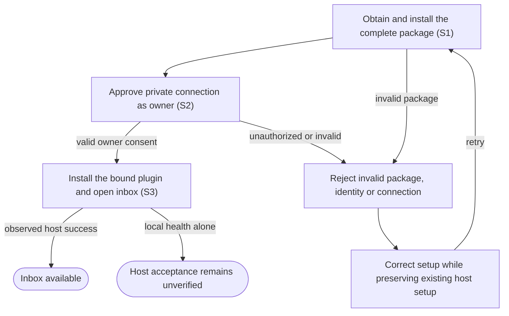

# Install and connect a private workspace

## Goal

The owner installs the application and connects a private host workspace so its inbox and agents are available.

## Preconditions

The owner controls the computer, has existing provider access, and can approve a private connection in the host.

## Main flow

1. Obtain the complete application package and install it for the current user. The hosted page promotes the browser package when a valid observed registration exists; otherwise it leads with connection steps. Portable packages, checksums and manifests are under Advanced.
2. Connect the private host to the application and approve access as the configured owner.
3. Link the observed connection to the complete plugin, install it, and open its inbox.

## Alternatives and recovery

Invalid packages, unrelated identities, invalid connection identifiers and unauthorized requests are rejected. Existing host setup is preserved. A locally healthy connection does not establish host acceptance.

## Scenarios

- **S1** A complete package contains the daily-use and setup capabilities with consistent connection details.
- **S2** Only the owner can approve a connection; revoked or expired access cannot call the application.
- **S3** The installed host plugin opens the real inbox after owner consent.

<!-- flow-references -->
## Terminology and UI references

Glossary: [owner](../glossary/README.md#owner), [host](../glossary/README.md#host), [credential](../glossary/README.md#credential), [coverage-gap](../glossary/README.md#coverage-gap), [unverified-behavior](../glossary/README.md#unverified-behavior).
UI entities: [PAGE-PACKAGE](../ui/README.md#PAGE-PACKAGE), [PAGE-OWNER-CONSENT](../ui/README.md#PAGE-OWNER-CONSENT), [P-PACKAGE-OVERVIEW](../ui/README.md#P-PACKAGE-OVERVIEW), [P-CONNECTION-GUIDE](../ui/README.md#P-CONNECTION-GUIDE), [P-OWNER-CONSENT](../ui/README.md#P-OWNER-CONSENT), [W-PACKAGE-OVERVIEW](../ui/README.md#W-PACKAGE-OVERVIEW), [W-CONNECTION-GUIDE](../ui/README.md#W-CONNECTION-GUIDE), [W-OWNER-CONSENT](../ui/README.md#W-OWNER-CONSENT), [C-PACKAGE](../ui/README.md#C-PACKAGE), [C-CONSENT](../ui/README.md#C-CONSENT), [PAGE-LOCAL-TUNNEL-SETUP](../ui/README.md#PAGE-LOCAL-TUNNEL-SETUP), [P-LOCAL-TUNNEL-KEY](../ui/README.md#P-LOCAL-TUNNEL-KEY), [W-LOCAL-TUNNEL-KEY](../ui/README.md#W-LOCAL-TUNNEL-KEY), [C-TUNNEL-KEY](../ui/README.md#C-TUNNEL-KEY), [S-SETTINGS](../ui/README.md#S-SETTINGS), [C-OPEN-SETTINGS](../ui/README.md#C-OPEN-SETTINGS).

## Flow diagram

## Implementation references

- [cmd/code-factory/main.go](../../cmd/code-factory/main.go) — CLI entry points
- [internal/setup/setup.go](../../internal/setup/setup.go) — User-level installation
- [internal/setup/dependencies.go](../../internal/setup/dependencies.go) — Prerequisite resolution
- [internal/setup/runtime.go](../../internal/setup/runtime.go) — Persistent executable configuration
- [internal/setup/plugin.go](../../internal/setup/plugin.go) — Plugin linking and catalog preservation
- [internal/gateway/gateway.go](../../internal/gateway/gateway.go) — Owner consent, token rotation and authenticated proxy
- [internal/pluginbundle/browser.go](../../internal/pluginbundle/browser.go) — Registered browser package binding
- [internal/pluginbundle/hosting.go](../../internal/pluginbundle/hosting.go) — Checksummed public package downloads
- [scripts/package_plugin.py](../../scripts/package_plugin.py) — Portable and browser package assembly
- [internal/domain/types.go](../../internal/domain/types.go) — Shared domain, persistence, transport or dependency contract
- [internal/store/store.go](../../internal/store/store.go) — Shared domain, persistence, transport or dependency contract
- [internal/transport/mcp.go](../../internal/transport/mcp.go) — Shared domain, persistence, transport or dependency contract
- [go.mod](../../go.mod) — Shared domain, persistence, transport or dependency contract
- [go.sum](../../go.sum) — Shared domain, persistence, transport or dependency contract
- [.agents/plugins/marketplace.json](../../.agents/plugins/marketplace.json) — Supporting install and connect a private workspace
- [plugin/.codex-plugin/plugin.json](../../plugin/.codex-plugin/plugin.json) — Supporting install and connect a private workspace
- [plugin/.mcp.json](../../plugin/.mcp.json) — Supporting install and connect a private workspace
- [plugin/README.md](../../plugin/README.md) — Supporting install and connect a private workspace
- [plugin/assets/icon.svg](../../plugin/assets/icon.svg) — Supporting install and connect a private workspace
- [plugin/assets/logo.svg](../../plugin/assets/logo.svg) — Supporting install and connect a private workspace
- [plugin/mcp.json](../../plugin/mcp.json) — Supporting install and connect a private workspace
- [plugin/plugin.json](../../plugin/plugin.json) — Supporting install and connect a private workspace
- [plugin/skills/code-factory/SKILL.md](../../plugin/skills/code-factory/SKILL.md) — Supporting install and connect a private workspace
- [plugin/skills/code-factory-setup/SKILL.md](../../plugin/skills/code-factory-setup/SKILL.md) — Supporting install and connect a private workspace
- [plugin/skills/code-factory-setup/scripts/link-connection.py](../../plugin/skills/code-factory-setup/scripts/link-connection.py) — Supporting install and connect a private workspace
- [scripts/schemas/plugin.schema.json](../../scripts/schemas/plugin.schema.json) — Supporting install and connect a private workspace
- [scripts/schemas/mcp.schema.json](../../scripts/schemas/mcp.schema.json) — Supporting install and connect a private workspace
- [scripts/requirements-dev.txt](../../scripts/requirements-dev.txt) — Supporting install and connect a private workspace
- [internal/testutil/testutil.go](../../internal/testutil/testutil.go) — Shared fake-provider verification input; changes require assertion reconciliation.
- [internal/testutil/fakecodex/main.go](../../internal/testutil/fakecodex/main.go) — Shared fake-provider verification input; changes require assertion reconciliation.
- [internal/transport/mcp.go](../../internal/transport/mcp.go) — Advertises the embedded UI under a full-content SHA256 URI and binds all tool/output-template references to it, retaining only an unadvertised exact legacy-read alias. (`func registerUIResource(`)
- [internal/web/embed.go](../../internal/web/embed.go) — Configuration opens through its own bridged document entry. (`func SettingsHTML(`)

## Test references

- [scripts/test_packaging.py](../../scripts/test_packaging.py) — `def test_zip_is_self_contained_deterministic_and_contains_no_host_state(`; S1. Deterministic complete portable package.
- [scripts/test_packaging.py](../../scripts/test_packaging.py) — `def test_registered_browser_package_has_no_local_mcp_launcher(`; S1. Browser package binds a real app mapping.
- [internal/gateway/gateway_test.go](../../internal/gateway/gateway_test.go) — `func TestOwnerConsentPKCERotationPersistenceAndAuthenticatedProxy(`; S2. Consent, rotation, persistence and revocation fixtures.
- [internal/gateway/native_browser_test.go](../../internal/gateway/native_browser_test.go) — `func TestNativeBrowserOwnerApprovalPreservesOriginWithoutRequestLeak(`; S2. Native form origin and redirect regression.
- [internal/pluginbundle/hosting_test.go](../../internal/pluginbundle/hosting_test.go) — `func TestBrowserPackageRequiresRealAppMappingAndOmitsBundledMCP(`; S1. Unbound browser downloads fail.
- [scripts/test_packaging.py](../../scripts/test_packaging.py) — `def test_registered_mapping_and_manifest_preserve_existing_fields(`; S1. Preserves unrelated app mappings.
- [scripts/test_plugin_host.py](../../scripts/test_plugin_host.py) — `def verify():`; S1. Opt-in isolated real plugin-host discovery/install; not run by default.
- [internal/setup/setup_test.go](../../internal/setup/setup_test.go) — `func TestDaemonLockAndOwnerToken(`; S2. Daemon owner and lock boundaries.
- [internal/pluginbundle/hosting_test.go](../../internal/pluginbundle/hosting_test.go) — `func TestHostedPackageIsCompleteBoundToHostAndChecksummed(`; S1. Host-bound complete checksummed archive.
- [internal/gateway/prefix_test.go](../../internal/gateway/prefix_test.go) — `func TestPrefixedGatewayOAuthAndProxy(`; S2. Prefixed OAuth routes and proxy fixture.
- [internal/transport/ui_resource_test.go](../../internal/transport/ui_resource_test.go) — `func TestUIResourceContentIdentityAndCompatibility(`; S1, S2. Actual SDK fixture asserts stable same-content and changed-content UI identity, matching current tool/resource metadata and exact HTML; only the original exact URI reads current content unadvertised, while unknown/previous hashes and query variants reject. CSP domains stay empty. This does not prove host refresh or installed UI acceptance.
- [internal/pluginbundle/hosting_test.go](../../internal/pluginbundle/hosting_test.go) — `func TestLandingPrioritizesOnlyValidRegisteredBrowserPackage(`; S1. Registration-aware primary browser download with portable artifacts collapsed; missing/invalid mappings show connection steps.

## Verification and gaps

Local suites: `go`, `packaging`.
Fixture success does not establish real-host acceptance.
- **S3** — `gap-flow-install-connect-s3-01` · Unverified behavior · P1 · owner: specification-coordinator. Current installed Work core and scoped connect-src enforcement are observed in ../acceptance.md, including restore of the owner-approved global setting. Other CSP directives, full host acceptance and manual/assistive-technology coverage remain incomplete; local package tests alone do not establish signed-in-host results. Next verification: Verify remaining declared CSP directive boundaries and incomplete manual/assistive-technology checks in the actual host. Preserve separate local package, scoped connect-src and current signed-in Work evidence without inferring complete host acceptance.

<!-- /flow-references -->
