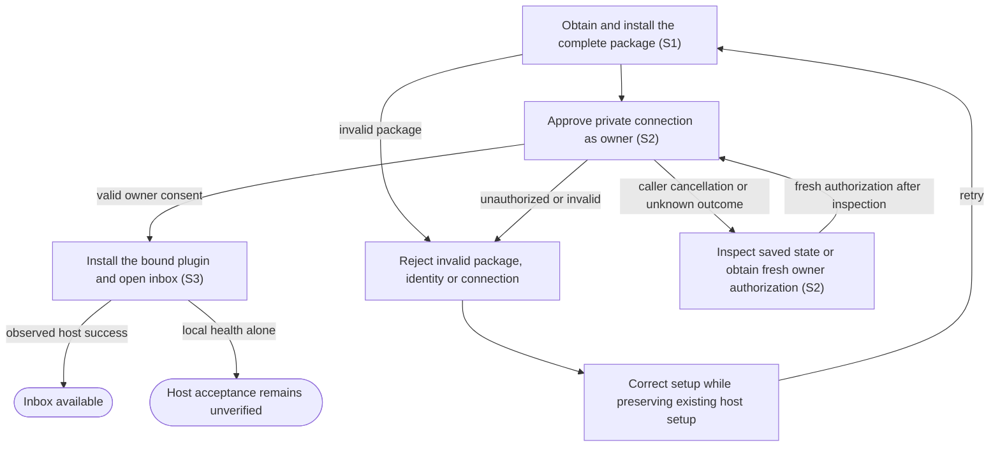

# Install and connect a private workspace

## Goal

The owner installs the application and connects a private host workspace so its inbox and agents are available.

## Preconditions

The owner controls the computer, has existing provider access, and can approve a private connection in the host.

## Main flow

1. Obtain the complete application package and install it for the current user. The hosted page promotes the browser package when a valid observed registration exists; otherwise it leads with connection steps. Portable packages, checksums and manifests are under Advanced.
2. Connect the private host to the application and approve access as the configured owner.
3. Link the observed connection to the complete plugin, install it, and open its inbox.

## Alternatives and recovery

Invalid packages, unrelated identities, invalid connection identifiers and unauthorized requests are rejected. Existing host setup is preserved. A locally healthy connection does not establish host acceptance. Slow setup and authorization continue to their actual result; latency alone does not reject them. If the caller cancels or the service stops after work starts, its outcome may be unknown. Inspect saved state or reconnect through fresh owner authorization before retrying; do not replay a consumed grant or a submitted credential. An interrupted request never establishes that setup or authorization completed.

## Scenarios

- **S1** A complete package contains the daily-use and setup capabilities with consistent connection details.
- **S2** Only the owner can approve a connection; revoked or expired access cannot call the application.
- **S3** The installed host plugin opens the real inbox after owner consent.

<!-- flow-references -->
## Terminology and UI references

Glossary: [owner](../glossary/README.md#owner), [host](../glossary/README.md#host), [credential](../glossary/README.md#credential), [coverage-gap](../glossary/README.md#coverage-gap), [unverified-behavior](../glossary/README.md#unverified-behavior).
UI entities: [PAGE-PACKAGE](../ui/README.md#PAGE-PACKAGE), [PAGE-OWNER-CONSENT](../ui/README.md#PAGE-OWNER-CONSENT), [P-PACKAGE-OVERVIEW](../ui/README.md#P-PACKAGE-OVERVIEW), [P-CONNECTION-GUIDE](../ui/README.md#P-CONNECTION-GUIDE), [P-OWNER-CONSENT](../ui/README.md#P-OWNER-CONSENT), [W-PACKAGE-OVERVIEW](../ui/README.md#W-PACKAGE-OVERVIEW), [W-CONNECTION-GUIDE](../ui/README.md#W-CONNECTION-GUIDE), [W-OWNER-CONSENT](../ui/README.md#W-OWNER-CONSENT), [C-PACKAGE](../ui/README.md#C-PACKAGE), [C-CONSENT](../ui/README.md#C-CONSENT), [PAGE-LOCAL-TUNNEL-SETUP](../ui/README.md#PAGE-LOCAL-TUNNEL-SETUP), [P-LOCAL-TUNNEL-KEY](../ui/README.md#P-LOCAL-TUNNEL-KEY), [W-LOCAL-TUNNEL-KEY](../ui/README.md#W-LOCAL-TUNNEL-KEY), [C-TUNNEL-KEY](../ui/README.md#C-TUNNEL-KEY), [S-SETTINGS](../ui/README.md#S-SETTINGS), [C-OPEN-SETTINGS](../ui/README.md#C-OPEN-SETTINGS).

## Flow diagram

## Implementation references

- [cmd/code-factory/main.go](../../cmd/code-factory/main.go) — CLI entry points
- [internal/setup/setup.go](../../internal/setup/setup.go) — User-level installation
- [internal/setup/dependencies.go](../../internal/setup/dependencies.go) — Prerequisite resolution
- [internal/setup/runtime.go](../../internal/setup/runtime.go) — Persistent executable configuration
- [internal/setup/plugin.go](../../internal/setup/plugin.go) — Plugin linking and catalog preservation
- [internal/gateway/gateway.go](../../internal/gateway/gateway.go) — Owner consent, token rotation and authenticated proxy
- [internal/pluginbundle/browser.go](../../internal/pluginbundle/browser.go) — Registered browser package binding
- [internal/pluginbundle/hosting.go](../../internal/pluginbundle/hosting.go) — Checksummed public package downloads
- [scripts/package_plugin.py](../../scripts/package_plugin.py) — Portable and browser package assembly
- [internal/domain/types.go](../../internal/domain/types.go) — Shared domain, persistence, transport or dependency contract
- [internal/store/store.go](../../internal/store/store.go) — Shared domain, persistence, transport or dependency contract
- [internal/transport/mcp.go](../../internal/transport/mcp.go) — Shared domain, persistence, transport or dependency contract
- [go.mod](../../go.mod) — Shared domain, persistence, transport or dependency contract
- [go.sum](../../go.sum) — Shared domain, persistence, transport or dependency contract
- [.agents/plugins/marketplace.json](../../.agents/plugins/marketplace.json) — Supporting install and connect a private workspace
- [plugin/.codex-plugin/plugin.json](../../plugin/.codex-plugin/plugin.json) — Supporting install and connect a private workspace
- [plugin/.mcp.json](../../plugin/.mcp.json) — Supporting install and connect a private workspace
- [plugin/README.md](../../plugin/README.md) — Supporting install and connect a private workspace
- [plugin/assets/icon.svg](../../plugin/assets/icon.svg) — Supporting install and connect a private workspace
- [plugin/assets/logo.svg](../../plugin/assets/logo.svg) — Supporting install and connect a private workspace
- [plugin/mcp.json](../../plugin/mcp.json) — Supporting install and connect a private workspace
- [plugin/plugin.json](../../plugin/plugin.json) — Supporting install and connect a private workspace
- [plugin/skills/code-factory/SKILL.md](../../plugin/skills/code-factory/SKILL.md) — Supporting install and connect a private workspace
- [plugin/skills/code-factory-setup/SKILL.md](../../plugin/skills/code-factory-setup/SKILL.md) — Supporting install and connect a private workspace
- [plugin/skills/code-factory-setup/scripts/link-connection.py](../../plugin/skills/code-factory-setup/scripts/link-connection.py) — Supporting install and connect a private workspace
- [scripts/schemas/plugin.schema.json](../../scripts/schemas/plugin.schema.json) — Supporting install and connect a private workspace
- [scripts/schemas/mcp.schema.json](../../scripts/schemas/mcp.schema.json) — Supporting install and connect a private workspace
- [scripts/requirements-dev.txt](../../scripts/requirements-dev.txt) — Supporting install and connect a private workspace
- [internal/testutil/testutil.go](../../internal/testutil/testutil.go) — Shared fake-provider verification input; changes require assertion reconciliation.
- [internal/testutil/fakecodex/main.go](../../internal/testutil/fakecodex/main.go) — Shared fake-provider verification input; changes require assertion reconciliation.
- [internal/transport/mcp.go](../../internal/transport/mcp.go) — Advertises the embedded UI under a full-content SHA256 URI and binds all tool/output-template references to it, rejecting unregistered and retired resource URIs. (`func registerUIResource(`)
- [internal/web/embed.go](../../internal/web/embed.go) — Configuration opens through its own bridged document entry. (`func SettingsHTML(`)
- [plugin/skills/code-factory-admin/SKILL.md](../../plugin/skills/code-factory-admin/SKILL.md) — Third packaged skill ships in portable and browser artifacts. (`name: code-factory-admin`)
- [internal/gateway/audit.go](../../internal/gateway/audit.go) — Current install-connect implementation or fixture/build dependency.
- [internal/httpbudget/budget.go](../../internal/httpbudget/budget.go) — Observe slow finite responses without latency cancellation; bound admission/body buffers and preserve caller/service cancellation and acknowledged SSE lifetime. (`func Wrap(`)
- [internal/setup/onboarding.go](../../internal/setup/onboarding.go) — Single-use local authorization distinguishes successful save from deadline uncertainty and locks ambiguous submissions. (`func (f *credentialForm) ServeHTTP(`)

## Test references

- [scripts/test_packaging.py](../../scripts/test_packaging.py) — `def test_zip_is_self_contained_deterministic_and_contains_no_host_state(`; S1. Deterministic complete portable package.
- [scripts/test_packaging.py](../../scripts/test_packaging.py) — `def test_registered_browser_package_has_no_local_mcp_launcher(`; S1. Browser package binds a real app mapping.
- [internal/gateway/gateway_test.go](../../internal/gateway/gateway_test.go) — `func TestOwnerConsentPKCERotationPersistenceAndAuthenticatedProxy(`; S2. Consent, rotation, persistence and revocation fixtures.
- [internal/gateway/native_browser_test.go](../../internal/gateway/native_browser_test.go) — `func TestNativeBrowserOwnerApprovalPreservesOriginWithoutRequestLeak(`; S2. Native form origin and redirect regression.
- [internal/pluginbundle/hosting_test.go](../../internal/pluginbundle/hosting_test.go) — `func TestBrowserPackageRequiresRealAppMappingAndOmitsBundledMCP(`; S1. Unbound browser downloads fail.
- [scripts/test_packaging.py](../../scripts/test_packaging.py) — `def test_registered_mapping_and_manifest_preserve_existing_fields(`; S1. Preserves unrelated app mappings.
- [scripts/test_plugin_host.py](../../scripts/test_plugin_host.py) — `def verify():`; S1. Opt-in isolated real plugin-host discovery/install; not run by default.
- [internal/setup/setup_test.go](../../internal/setup/setup_test.go) — `func TestDaemonLockAndOwnerToken(`; S2. Daemon owner and lock boundaries.
- [internal/pluginbundle/hosting_test.go](../../internal/pluginbundle/hosting_test.go) — `func TestHostedPackageIsCompleteBoundToHostAndChecksummed(`; S1. Host-bound complete checksummed archive.
- [internal/gateway/prefix_test.go](../../internal/gateway/prefix_test.go) — `func TestPrefixedGatewayOAuthAndProxy(`; S2. Prefixed OAuth routes and proxy fixture.
- [internal/pluginbundle/hosting_test.go](../../internal/pluginbundle/hosting_test.go) — `func TestLandingPrioritizesOnlyValidRegisteredBrowserPackage(`; S1. Only a valid observed registration promotes the browser download; absent/invalid mapping shows OAuth steps; portable artifacts are inside collapsed Advanced.
- [scripts/test_packaging.py](../../scripts/test_packaging.py) — `def test_zip_is_self_contained_deterministic_and_contains_no_host_state(`; S1. Archive includes admin, daily-use and setup skills with checksums while private host state remains excluded.
- [internal/gateway/audit_test.go](../../internal/gateway/audit_test.go) — `func TestRequestAuditExcludesCredentialsAndPreservesStreaming(`; S1. Current install-connect fixture assertion TestRequestAuditExcludesCredentialsAndPreservesStreaming. Inspect its exact assertion scope.
- [internal/gateway/audit_test.go](../../internal/gateway/audit_test.go) — `func TestRequestAuditIncludesUnknownRoutesWithoutRequestDetails(`; S1. Current install-connect fixture assertion TestRequestAuditIncludesUnknownRoutesWithoutRequestDetails. Inspect its exact assertion scope.
- [internal/setup/dependencies_test.go](../../internal/setup/dependencies_test.go) — `func TestTunnelReleaseDiscoveryUsesPublicGitHubCache(`; S1. Tunnel release discovery reuses the shared anonymous GET cache, validates live reads conditionally and rejects anonymous mutation before dispatch.
- [internal/gateway/api_performance_test.go](../../internal/gateway/api_performance_test.go) — `func TestGatewayAPILatency(`; S1. Public mux registrations and generated artifact routes are the completeness oracle. Local wire samples cover GET/HEAD at root and configured prefix, RFC metadata aliases and accepted webhook proxying, plus existing OAuth/private consent fixtures, with each finite response or real stream acknowledgement within100ms. Status/body/metadata identity assertions distinguish success, accepted response and rejection; no public-network/real-host claim.
- [internal/setup/onboarding_test.go](../../internal/setup/onboarding_test.go) — `func TestCredentialFormDeadlinePreservesSingleSubmissionAndUncertainty(`; S2. An explicit caller deadline interrupts a held credential save, preserves its single-submission identity, reports uncertainty and never echoes the private input.
- [internal/setup/api_performance_test.go](../../internal/setup/api_performance_test.go) — `func TestOnboardingAPILatency(`; S2. Twenty isolated successful local form/reachability/save sequences each satisfy the75ms verification gate; deliberately slow and canceled saves have separate correctness fixtures.
- [internal/gateway/response_budget_test.go](../../internal/gateway/response_budget_test.go) — `func TestGatewayFiniteResponseContentionAndDelayedProxy(`; S2. Gateway authorization and token routes retain actual protocol results during 125 ms mutex contention; a slow finite upstream returns its entire response.
- [internal/gateway/response_budget_test.go](../../internal/gateway/response_budget_test.go) — `func TestGatewayDelayedRegistrationMappingRemainsFinite(`; S1. A registration mapping held for 125 ms still returns the requested package or browser archive.
- [internal/gateway/response_budget_test.go](../../internal/gateway/response_budget_test.go) — `func TestOAuthDeadlineDoesNotReplayConsumedRefresh(`; S2. A completed but lost token exchange is reported unknown, and a consumed refresh cannot authorize another exchange.
- [internal/gateway/response_budget_test.go](../../internal/gateway/response_budget_test.go) — `func TestGatewaySSERequiresFirstDataAndKeepsAcknowledgedStream(`; S2. Immediate and 125 ms delayed real proxy acknowledgements succeed; later stream frames remain live and caller body close cancels upstream.
- [internal/setup/onboarding_test.go](../../internal/setup/onboarding_test.go) — `func TestCredentialFormSlowSaveCompletesOnce(`; S2. A125ms private credential save completes successfully once without echoing its input; a repeated submission cannot save again.

## Verification and gaps

Local suites: `go`, `packaging`.
Fixture success does not establish real-host acceptance.
- **S3** — `gap-flow-install-connect-s3-01` · Unverified behavior · P1 · owner: specification-coordinator. No installed-host, real-provider or CSP acceptance is established by this development port. Local package and connection fixtures do not establish signed-in-host results; full host and manual/assistive-technology coverage remain incomplete. Next verification: Verify the complete installed plugin, declared CSP directive boundaries and incomplete manual/assistive-technology checks in the actual host for this port version. Keep local package and connection fixtures separate from signed-in-host evidence.

<!-- /flow-references -->
