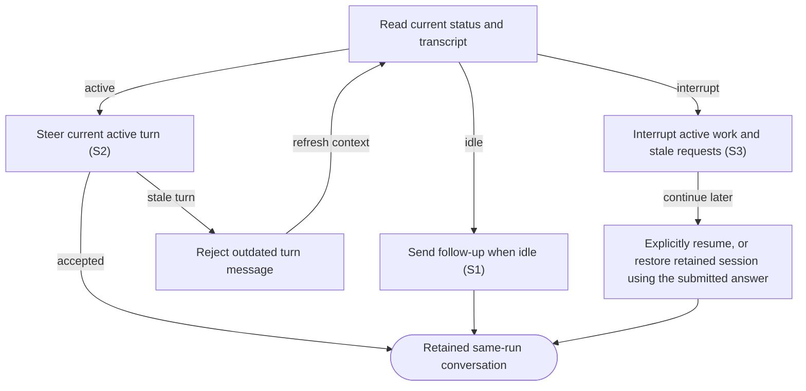

# Follow up, steer and interrupt agent work

## Goal

The owner continues an existing task or stops its active turn while retaining the work.

## Preconditions

A previously launched run has a live agent session.

## Main flow

1. Read the current agent status and transcript.
2. Send a follow-up after a turn completes to begin the next turn.
3. Send a clarification during active work to steer the displayed turn.
4. Interrupt active work when requested, preserving workspace and history.

## Alternatives and recovery

A message for an outdated active turn is rejected. Interrupted or failed sessions require explicit resume. Sending a message does not create a second run.

## Scenarios

- **S1** Follow-up after idle completes through the same run.
- **S2** Active steering requires the current turn identity and rejects stale steering.
- **S3** Interrupt preserves the run and invalidates outstanding requests.

Recovery progress shows readable labels and decorative icons. Take over cancels repair before manual continuation. Automatic inputs are labelled Question recovery in the technical transcript; real replies retain their author. Drafts stay with their run across navigation and clear only if unchanged after a successful send. A recovered text answer can restore an interrupted retained session using the answer as its continuation, without a generic resume turn.
<!-- flow-references -->
## Terminology and UI references

Glossary: [agent-run](../glossary/README.md#agent-run), [transcript](../glossary/README.md#transcript), [state-idle](../glossary/README.md#state-idle), [state-running](../glossary/README.md#state-running), [coverage-gap](../glossary/README.md#coverage-gap), [unverified-behavior](../glossary/README.md#unverified-behavior), [question-recovery](../glossary/README.md#question-recovery).
UI entities: [PAGE-AGENTS](../ui/README.md#PAGE-AGENTS), [P-RUN-LIST](../ui/README.md#P-RUN-LIST), [P-RUN-DETAIL](../ui/README.md#P-RUN-DETAIL), [W-RUN-ROW](../ui/README.md#W-RUN-ROW), [W-RUN-EMPTY](../ui/README.md#W-RUN-EMPTY), [W-RUN-CONTROLS](../ui/README.md#W-RUN-CONTROLS), [C-SELECT-RUN](../ui/README.md#C-SELECT-RUN), [C-RUN-ACTION](../ui/README.md#C-RUN-ACTION), [W-TRANSCRIPT](../ui/README.md#W-TRANSCRIPT), [W-MESSAGE](../ui/README.md#W-MESSAGE), [C-TRANSCRIPT](../ui/README.md#C-TRANSCRIPT), [C-FOLLOW-UP](../ui/README.md#C-FOLLOW-UP).

## Flow diagram

## Implementation references

- [internal/app/runs.go](../../internal/app/runs.go) — Message routing and interrupt (`func (m *Manager) Message(`)
- [web/src/main.tsx](../../web/src/main.tsx) — Agent chat and interrupt controls (`function Agent(`)
- [internal/codex/client.go](../../internal/codex/client.go) — Turn RPC requests and notifications
- [internal/domain/types.go](../../internal/domain/types.go) — Shared domain, persistence, transport or dependency contract
- [internal/store/store.go](../../internal/store/store.go) — Shared domain, persistence, transport or dependency contract
- [internal/transport/mcp.go](../../internal/transport/mcp.go) — Shared domain, persistence, transport or dependency contract
- [go.mod](../../go.mod) — Shared domain, persistence, transport or dependency contract
- [go.sum](../../go.sum) — Shared domain, persistence, transport or dependency contract
- [web/src/types.ts](../../web/src/types.ts) — Embedded UI build and host-fixture configuration
- [web/src/style.css](../../web/src/style.css) — Embedded UI build and host-fixture configuration
- [web/src/bridge.ts](../../web/src/bridge.ts) — Embedded UI build and host-fixture configuration
- [web/package.json](../../web/package.json) — Embedded UI build and host-fixture configuration
- [web/package-lock.json](../../web/package-lock.json) — Embedded UI build and host-fixture configuration
- [web/tsconfig.json](../../web/tsconfig.json) — Embedded UI build and host-fixture configuration
- [web/vite.config.ts](../../web/vite.config.ts) — Embedded UI build and host-fixture configuration
- [web/index.html](../../web/index.html) — Embedded UI build and host-fixture configuration
- [web/playwright.config.ts](../../web/playwright.config.ts) — Embedded UI build and host-fixture configuration
- [internal/testhost/main.go](../../internal/testhost/main.go) — Embedded UI build and host-fixture configuration
- [internal/testutil/fakecodex/main.go](../../internal/testutil/fakecodex/main.go) — Embedded UI build and host-fixture configuration
- [internal/testutil/testutil.go](../../internal/testutil/testutil.go) — Embedded UI build and host-fixture configuration
- [internal/web/embed.go](../../internal/web/embed.go) — Embedded UI build and host-fixture configuration
- [internal/app/questions.go](../../internal/app/questions.go) — Bounded recovery and durable text/structured question answer claims; preserve authority and redaction. (`func (m *Manager) answerSynthetic(`)

## Test references

- [web/tests/factory.spec.ts](../../web/tests/factory.spec.ts) — `test("MCP bridge drives the assembled daemon through launch, question, answer and follow-up"`; S1. Assembled UI sends follow-up on the original run.
- [internal/app/app_test.go](../../internal/app/app_test.go) — `func TestAgentQuestionExactlyOnceAndRecovery(`; S2. Stale steering is rejected; matching steering succeeds.
- [internal/app/questions_test.go](../../internal/app/questions_test.go) — `func TestQuestionRepairUserTakeoverCancelsFurtherAttempts(`; S3. Takeover interrupts recovery, restores the retained session and rejects old form answers.
- [internal/app/questions_test.go](../../internal/app/questions_test.go) — `func TestHumanReplyInRepairTurnKeepsItsConversationRole(`; S1. Exact automatic input text is distinguished from a human reply in the same turn.
- [web/tests/factory.spec.ts](../../web/tests/factory.spec.ts) — `test("answer confirmation expires despite polling, stays with its run and never alters transcript text"`; S1. Per-run drafts and literal transcript survive answer navigation and polling.

## Verification and gaps

Local suites: `go`, `browser`.
Fixture success does not establish real-host acceptance.
- **S3** — `gap-flow-interact-agent-s3-01` · Unverified behavior · P2 · owner: user-flow-maintainer. The recovery takeover fixture asserts interruption and old-form rejection. General non-recovery interrupt and request invalidation still need their own default fixture; opt-in real-provider lifecycle evidence is separate. Next verification: Add a default fake-provider fixture that directly interrupts active work and asserts the resulting run status and pending-request invalidation without invoking a real model.

<!-- /flow-references -->
