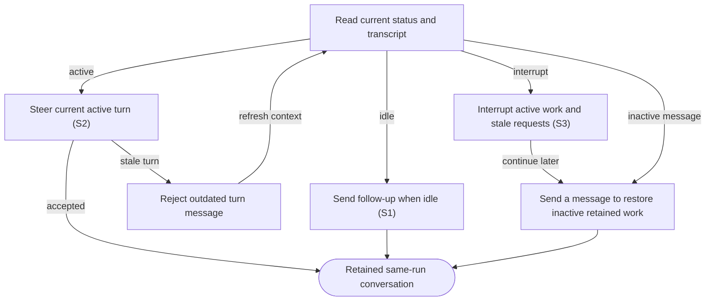

# Follow up, steer and interrupt agent work

## Goal

The owner continues an existing task or stops its active turn while retaining the work.

## Preconditions

A previously launched run has a live agent session.

## Main flow

1. Select an item to open its conversation directly, or choose a retained conversation under that item’s Work history; read its task and human-facing messages.
2. Send a follow-up after a turn completes to begin the next turn.
3. Send a clarification during active work to steer the displayed turn.
4. Send to inactive retained work to continue the same conversation and workspace. Interrupt active work from secondary details when requested, preserving workspace and history.

## Alternatives and recovery

A message for an outdated active turn is rejected. Sending a message to interrupted or failed retained work restores its existing session and starts exactly that submitted message, with no original-task or generic-resume turn replay. Concurrent wake attempts cannot start multiple turns. Failed wake retains the draft. Back returns to the originating work queue or Messages. The list is absent while the conversation is open; Messages shows only live pending blocking questions and approvals; retained conversations remain scoped to their item under Work history. Sending a message does not create a second run. Message drafts stay with each run across tabs and run selection for the lifetime of the open app. Successful sends clear only unchanged submitted text; failures keep the draft. Workspace paths and cleanup are secondary details; technical commands, plans, diffs and internal summaries are under Details; progress messages, final replies, questions and readable errors remain visible.

## Scenarios

- **S1** Follow-up after idle completes through the same run.
- **S2** Active steering requires the current turn identity and rejects stale steering.
- **S3** Interrupt preserves the run and invalidates outstanding requests.

Conversation rendering keeps human-facing agent messages and your replies visible. Technical activity remains under Details, with structured error data there and the readable error message visible. Streaming updates preserve that distinction; a technical-only active stream shows a concise waiting status. Pending questions and approvals remain actionable outside Details.

<!-- flow-references -->
## Terminology and UI references

Glossary: [agent-run](../glossary/README.md#agent-run), [transcript](../glossary/README.md#transcript), [state-idle](../glossary/README.md#state-idle), [state-running](../glossary/README.md#state-running), [coverage-gap](../glossary/README.md#coverage-gap), [unverified-behavior](../glossary/README.md#unverified-behavior).
UI entities: [PAGE-AGENTS](../ui/README.md#PAGE-AGENTS), [P-RUN-LIST](../ui/README.md#P-RUN-LIST), [P-RUN-DETAIL](../ui/README.md#P-RUN-DETAIL), [W-RUN-ROW](../ui/README.md#W-RUN-ROW), [W-RUN-EMPTY](../ui/README.md#W-RUN-EMPTY), [W-RUN-CONTROLS](../ui/README.md#W-RUN-CONTROLS), [C-SELECT-RUN](../ui/README.md#C-SELECT-RUN), [C-RUN-ACTION](../ui/README.md#C-RUN-ACTION), [W-TRANSCRIPT](../ui/README.md#W-TRANSCRIPT), [W-MESSAGE](../ui/README.md#W-MESSAGE), [C-TRANSCRIPT](../ui/README.md#C-TRANSCRIPT), [C-FOLLOW-UP](../ui/README.md#C-FOLLOW-UP), [PAGE-AGENT](../ui/README.md#PAGE-AGENT), [C-BACK](../ui/README.md#C-BACK), [W-WORK-STATUS](../ui/README.md#W-WORK-STATUS).

## Flow diagram

## Implementation references

- [internal/app/runs.go](../../internal/app/runs.go) — Message routing and interrupt (`func (m *Manager) Message(`)
- [web/src/main.tsx](../../web/src/main.tsx) — Agent chat and interrupt controls (`function Agent(`)
- [internal/codex/client.go](../../internal/codex/client.go) — Turn RPC requests and notifications
- [internal/domain/types.go](../../internal/domain/types.go) — Shared domain, persistence, transport or dependency contract
- [internal/store/store.go](../../internal/store/store.go) — Shared domain, persistence, transport or dependency contract
- [internal/transport/mcp.go](../../internal/transport/mcp.go) — Shared domain, persistence, transport or dependency contract
- [go.mod](../../go.mod) — Shared domain, persistence, transport or dependency contract
- [go.sum](../../go.sum) — Shared domain, persistence, transport or dependency contract
- [web/src/types.ts](../../web/src/types.ts) — Embedded UI build and host-fixture configuration
- [web/src/style.css](../../web/src/style.css) — Embedded UI build and host-fixture configuration
- [web/src/bridge.ts](../../web/src/bridge.ts) — Embedded UI build and host-fixture configuration
- [web/package.json](../../web/package.json) — Embedded UI build and host-fixture configuration
- [web/package-lock.json](../../web/package-lock.json) — Embedded UI build and host-fixture configuration
- [web/tsconfig.json](../../web/tsconfig.json) — Embedded UI build and host-fixture configuration
- [web/vite.config.ts](../../web/vite.config.ts) — Embedded UI build and host-fixture configuration
- [web/index.html](../../web/index.html) — Embedded UI build and host-fixture configuration
- [web/playwright.config.ts](../../web/playwright.config.ts) — Embedded UI build and host-fixture configuration
- [internal/testhost/main.go](../../internal/testhost/main.go) — Embedded UI build and host-fixture configuration
- [internal/testutil/fakecodex/main.go](../../internal/testutil/fakecodex/main.go) — Embedded UI build and host-fixture configuration
- [internal/testutil/testutil.go](../../internal/testutil/testutil.go) — Embedded UI build and host-fixture configuration
- [internal/web/embed.go](../../internal/web/embed.go) — Embedded UI build and host-fixture configuration

## Test references

- [web/tests/factory.spec.ts](../../web/tests/factory.spec.ts) — `test("MCP bridge drives the assembled daemon through launch, question, answer and follow-up"`; S1. Assembled UI sends follow-up on the original run.
- [internal/app/app_test.go](../../internal/app/app_test.go) — `func TestAgentQuestionExactlyOnceAndRecovery(`; S2. Stale steering is rejected; matching steering succeeds.
- [web/tests/factory.spec.ts](../../web/tests/factory.spec.ts) — `test("Open agent targets the newest retained run and keeps message drafts across tabs and runs"`; S1. Item shortcut chooses newest retained work; per-run drafts survive navigation without implicit send/start.
- [web/tests/factory.spec.ts](../../web/tests/factory.spec.ts) — `agent conversation shows human messages and keeps technical activity under Details`; S1. Human progress/final/user/error messages stay visible; technical activity is one secondary disclosure, live updates preserve the distinction and questions remain actionable.
- [web/tests/factory.spec.ts](../../web/tests/factory.spec.ts) — `single-page navigation preserves list context and drafts at`; S1. Both themes and 1280px/390px widths assert exclusive list/item/agent pages, Back focus/scroll/query restoration and per-record draft preservation.
- [web/tests/factory.spec.ts](../../web/tests/factory.spec.ts) — `transcript recovery keeps output and draft while removing only its own read error`; S1. After transcript transport failures, previous output and follow-up draft remain and only the local read error disappears on recovery.
- [web/tests/factory.spec.ts](../../web/tests/factory.spec.ts) — `mutation connection failure is not replayed and later polling does not dismiss it`; S1. An uncertain Send is attempted once; subsequent healthy polls do not clear its error or submitted draft.
- [web/tests/factory.spec.ts](../../web/tests/factory.spec.ts) — `exact host-wrapped MCP connection error retries a read without exposing its framework text`; S1. Known host-wrapped transport failures recover on reads without framework banners, and mutations remain one attempt.
- [web/tests/factory.spec.ts](../../web/tests/factory.spec.ts) — `exact host-wrapped connection failure never replays a mutation`; S1. Known host-wrapped transport failures recover on reads without framework banners, and mutations remain one attempt.
- [web/tests/factory.spec.ts](../../web/tests/factory.spec.ts) — `technical-only activity leaves a concise waiting state in the conversation`; S1. Technical-only work does not flood the normal conversation; status and pending attention remain available.
- [internal/app/app_test.go](../../internal/app/app_test.go) — `func TestMessageRestoresRetainedSessionWithOneSubmittedTurn(`; S1. Cold daemon recovery preserves run/thread/worktree/authority and delivers exactly the submitted message; eight simultaneous sends accept one wake only.
- [internal/app/app_test.go](../../internal/app/app_test.go) — `func TestWakeMessageFailureKeepsRetainedRecordAndRejectsCleanedWork(`; S1. Missing retained worktree returns wake failure without losing the retained record; prepared and cleaned work cannot accept a message.
- [web/tests/factory.spec.ts](../../web/tests/factory.spec.ts) — `inactive work status and sending a message restore the retained session`; S1. Both themes verify work-item activity and message-triggered continuation, no Resume control, one submit and retained failure draft.
- [internal/app/app_test.go](../../internal/app/app_test.go) — `func TestInterruptThenMessageStalesOldQuestionAndRestoresSameSession(`; S3. Interrupting a waiting fake provider stales its question and clears the turn; message wake restores the same thread/worktree, rejects the old request and answers only the new one.

## Verification and gaps

Local suites: `go`, `browser`.
Fixture success does not establish real-host acceptance.
- **S3** — `gap-flow-interact-agent-s3-01` · Unverified behavior · P2 · owner: user-flow-maintainer. The default fake-provider fixture now directly interrupts waiting work, asserts stale requests and verifies same-session message wake. Current installed-host real-provider interruption and assistive-technology behavior remain unverified. Next verification: Verify the same interruption, stale-question exclusion and message wake against the installed provider/host without replaying old answers; retain version-bound evidence.

<!-- /flow-references -->
