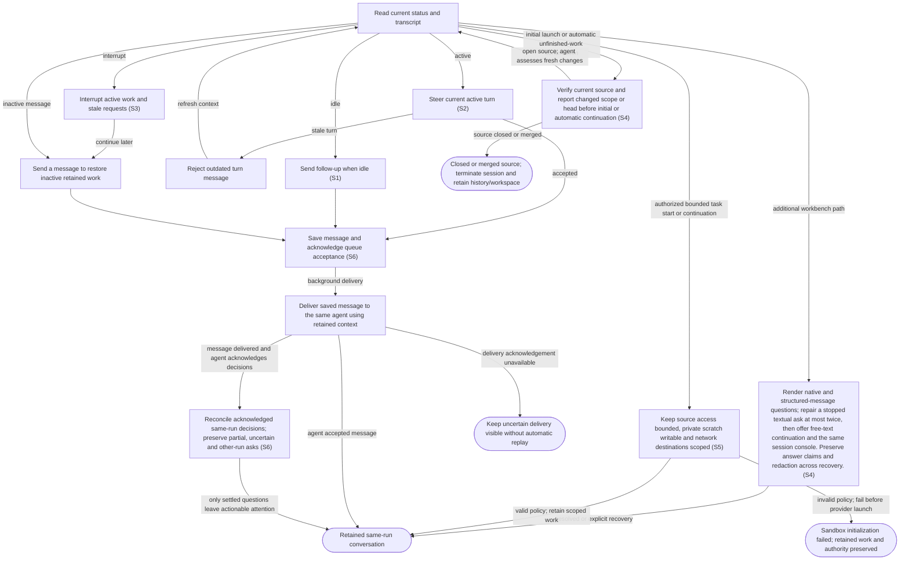

# Follow up, steer and interrupt agent work

## Goal

The owner continues an existing task or stops its active turn while retaining the work.

## Preconditions

A previously launched run has a live or retained agent session.

## Main flow

1. Select an item to open its conversation directly, or choose a retained conversation under that item’s Work history; read its task and human-facing messages.
2. Send a follow-up after a turn completes to begin the next turn.
3. Send a clarification during active work to steer the displayed turn.
4. Send to inactive retained work to continue the same conversation and workspace. Interrupt active work from secondary details when requested, preserving workspace and history.

## Alternatives and recovery

Daemon startup automatically continues unfinished work in the same retained session using saved progress. Completed idle sessions remain idle and accept a follow-up without a new task. Explicit interrupts remain stopped until the owner continues them; startup does not undo an interrupt.

A message for an outdated active turn is rejected. Sending a message to interrupted or failed retained work restores its existing session and starts exactly that submitted message, with no original-task or generic-resume turn replay. Concurrent wake attempts cannot start multiple turns. Failed acceptance retains the draft; accepted messages remain saved even if later delivery fails. Back returns to the originating work queue or Messages. The list is absent while the conversation is open; Messages shows only live pending blocking questions and approvals; retained conversations remain scoped to their item under Work history. Sending a message does not create a second run. Message drafts stay with each run across tabs and run selection for the lifetime of the open app. Queue acceptance clears only unchanged submitted text; rejected acceptance keeps the draft. Workspace paths and cleanup are secondary details; technical commands, plans, diffs and internal summaries are under Details; progress messages, final replies, questions and readable errors remain visible.

Delivered messages and completed turns reconcile retained questions against explicit same-run owner decisions and later agent acknowledgements. Progress, idle status or publication alone cannot clear an ask. Partial answers remove only their acknowledged questions; other requests and other runs remain independent.

## Scenarios

- **S4** Terminated source work displays Stopped, its reason and retained history. Send and resume are unavailable even after source reopening. Clean-workspace cleanup remains available, and a dirty refusal preserves terminal status and files.

- **S1** Follow-up after idle completes through the same run.
- **S2** Active steering requires the current turn identity and rejects stale steering.
- **S3** Interrupt preserves the run and invalidates outstanding requests.

Conversation rendering keeps human-facing agent messages and your replies visible. Technical activity remains under Details, with structured error data there and the readable error message visible. Streaming updates preserve that distinction; a technical-only active stream shows a concise waiting status. Pending questions and approvals remain actionable outside Details.

- **S4** Render native and structured-message questions; repair a stopped textual ask at most twice, then offer free-text continuation and the same session console. Preserve answer claims and redaction across recovery.

Automatic recovery exchanges appear as technical activity under Details or in the session console. Your responses keep their ordinary conversation role.

During explicit plugin maintenance, a new Start, message or answer is temporarily refused rather than delivered against changing plugin state. The caller retains its draft and receives the maintenance error. Maintenance is itself refused while agent work is active; question repair and continuation share the same boundary.

- **S5** Restoring an inactive bounded task reapplies its invocation-local filesystem and network profile before the submitted turn. It preserves the same workspace, scratch, private indexes and original approval/publishing authority. A legacy sandbox override cannot discard the scoped policy; invalid initialization fails without starting an unrestricted replacement.

Conversational follow-up normally uses one saved-state tracking read to identify the retained run and expected active turn, then one message operation. Its response includes durable queue acceptance, a message ID and pending attention for that same run; acceptance does not establish agent delivery or task completion.

- **S6** Save a follow-up durably before contacting its agent and return queue acceptance immediately. A blocked agent or unavailable GitHub cannot delay acceptance. Deliver in the background to the same retained session using explicitly unverified saved source context; the agent performs GitHub reads when required by the task. Show queued, delivering, delivered or uncertain status in the conversation and tracking. Recover saved queued messages after restart, but never automatically replay a delivery whose acknowledgement is uncertain or replace it with a generic continuation.

<!-- flow-references -->
## Terminology and UI references

Glossary: [agent-run](../glossary/README.md#agent-run), [transcript](../glossary/README.md#transcript), [state-idle](../glossary/README.md#state-idle), [state-running](../glossary/README.md#state-running), [coverage-gap](../glossary/README.md#coverage-gap), [unverified-behavior](../glossary/README.md#unverified-behavior), [question-recovery](../glossary/README.md#question-recovery), [session-console](../glossary/README.md#session-console), [state-terminated](../glossary/README.md#state-terminated).
UI entities: [PAGE-AGENTS](../ui/README.md#PAGE-AGENTS), [P-RUN-LIST](../ui/README.md#P-RUN-LIST), [P-RUN-DETAIL](../ui/README.md#P-RUN-DETAIL), [W-RUN-ROW](../ui/README.md#W-RUN-ROW), [W-RUN-EMPTY](../ui/README.md#W-RUN-EMPTY), [W-RUN-CONTROLS](../ui/README.md#W-RUN-CONTROLS), [C-SELECT-RUN](../ui/README.md#C-SELECT-RUN), [C-RUN-ACTION](../ui/README.md#C-RUN-ACTION), [W-TRANSCRIPT](../ui/README.md#W-TRANSCRIPT), [W-MESSAGE](../ui/README.md#W-MESSAGE), [C-TRANSCRIPT](../ui/README.md#C-TRANSCRIPT), [C-FOLLOW-UP](../ui/README.md#C-FOLLOW-UP), [PAGE-AGENT](../ui/README.md#PAGE-AGENT), [C-BACK](../ui/README.md#C-BACK), [W-WORK-STATUS](../ui/README.md#W-WORK-STATUS), [W-QUESTION-RECOVERY](../ui/README.md#W-QUESTION-RECOVERY), [W-SESSION-CONSOLE](../ui/README.md#W-SESSION-CONSOLE).

## Flow diagram

## Implementation references

- [internal/app/runs.go](../../internal/app/runs.go) — Message routing and interrupt (`func (m *Manager) Message(`)
- [web/src/main.tsx](../../web/src/main.tsx) — Agent chat and interrupt controls (`function Agent(`)
- [internal/codex/client.go](../../internal/codex/client.go) — Turn RPC requests and notifications
- [internal/domain/types.go](../../internal/domain/types.go) — Shared domain, persistence, transport or dependency contract
- [internal/store/store.go](../../internal/store/store.go) — Shared domain, persistence, transport or dependency contract
- [internal/transport/mcp.go](../../internal/transport/mcp.go) — Shared domain, persistence, transport or dependency contract
- [go.mod](../../go.mod) — Shared domain, persistence, transport or dependency contract
- [go.sum](../../go.sum) — Shared domain, persistence, transport or dependency contract
- [web/src/types.ts](../../web/src/types.ts) — Embedded UI build and host-fixture configuration
- [web/src/style.css](../../web/src/style.css) — Embedded UI build and host-fixture configuration
- [web/src/bridge.ts](../../web/src/bridge.ts) — Embedded UI build and host-fixture configuration
- [web/package.json](../../web/package.json) — Embedded UI build and host-fixture configuration
- [web/package-lock.json](../../web/package-lock.json) — Embedded UI build and host-fixture configuration
- [web/tsconfig.json](../../web/tsconfig.json) — Embedded UI build and host-fixture configuration
- [web/vite.config.ts](../../web/vite.config.ts) — Embedded UI build and host-fixture configuration
- [web/index.html](../../web/index.html) — Embedded UI build and host-fixture configuration
- [web/playwright.config.ts](../../web/playwright.config.ts) — Embedded UI build and host-fixture configuration
- [internal/testhost/main.go](../../internal/testhost/main.go) — Embedded UI build and host-fixture configuration
- [internal/testutil/fakecodex/main.go](../../internal/testutil/fakecodex/main.go) — Embedded UI build and host-fixture configuration
- [internal/testutil/testutil.go](../../internal/testutil/testutil.go) — Embedded UI build and host-fixture configuration
- [internal/web/embed.go](../../internal/web/embed.go) — Embedded UI build and host-fixture configuration
- [internal/app/questions.go](../../internal/app/questions.go) — Durable native/message/text question routing, bounded form repair, redaction and retained continuation. (`func (m *Manager) answerSynthetic(`)
- [internal/app/plugins.go](../../internal/app/plugins.go) — Durable pinned-CLI plugin lifecycle and exclusive runtime/maintenance boundary. (`func (m *Manager) PluginAction(`)
- [internal/domain/admin.go](../../internal/domain/admin.go) — Typed plugin operation and inventory persistence. (`type PluginOperation struct`)
- [internal/app/sandbox.go](../../internal/app/sandbox.go) — Invocation-local native filesystem and destination policy; isolated writable scratch and private skill indexes without global configuration changes.
- [internal/codex/sandbox.go](../../internal/codex/sandbox.go) — Invocation-local native filesystem and destination policy; isolated writable scratch and private skill indexes without global configuration changes.
- [internal/app/continuation.go](../../internal/app/continuation.go) — Verify fresh source for initial/automatic continuation; message-triggered restoration supplies saved context and lets the agent perform task-required GitHub reads. (`func (m *Manager) continuationContext(`)
- [internal/providers/continuation.go](../../internal/providers/continuation.go) — Targeted conditional GitHub source read bypasses local TTL while retaining shared budget and cooldown enforcement. (`func (g *GitHub) CurrentWorkItem(`)
- [internal/app/tracking.go](../../internal/app/tracking.go) — Targeted saved-state reads, compact tracking, durable progress or asynchronous observation without delaying status. (`func (a *App) TrackWork(`)
- [internal/transport/tracking.go](../../internal/transport/tracking.go) — Targeted saved-state reads, compact tracking, durable progress or asynchronous observation without delaying status. (`func (s *Server) dashboard(`)
- [internal/app/messages.go](../../internal/app/messages.go) — Durably save encrypted messages before asynchronous same-session delivery; recover queued messages and retain uncertainty without replay. (`func (m *Manager) QueueMessage(`)
- [internal/app/attention_reconciliation.go](../../internal/app/attention_reconciliation.go) — Background same-run per-question reconciliation after delivery, completion and startup. Requires exact owner decision and subsequent agent acknowledgement; uncertainty preserves attention, native approvals are excluded. (`func (m *Manager) reconcileAttention(`)
- [internal/store/conversation.go](../../internal/store/conversation.go) — Bounded same-run redacted conversation evidence excludes tools, internal recovery input, old source messages and other runs. (`func (s *Store) ConversationEvidence(`)

## Test references

- [web/tests/factory.spec.ts](../../web/tests/factory.spec.ts) — `test("MCP bridge drives the assembled daemon through launch, question, answer and follow-up"`; S1. Assembled UI sends follow-up on the original run.
- [internal/app/app_test.go](../../internal/app/app_test.go) — `func TestAgentQuestionExactlyOnceAndRecovery(`; S2. Stale steering is rejected; matching steering succeeds.
- [web/tests/factory.spec.ts](../../web/tests/factory.spec.ts) — `test("Open agent targets the newest retained run and keeps message drafts across tabs and runs"`; S1. Item shortcut chooses newest retained work; per-run drafts survive navigation without implicit send/start.
- [web/tests/factory.spec.ts](../../web/tests/factory.spec.ts) — `agent conversation shows human messages and keeps technical activity under Details`; S1. Human progress/final/user/error messages stay visible; technical activity is one secondary disclosure, live updates preserve the distinction and questions remain actionable.
- [web/tests/factory.spec.ts](../../web/tests/factory.spec.ts) — `single-page navigation preserves list context and drafts at`; S1. Both themes and 1280px/390px widths assert exclusive list/item/agent pages, Back focus/scroll/query restoration and per-record draft preservation.
- [web/tests/factory.spec.ts](../../web/tests/factory.spec.ts) — `transcript recovery keeps output and draft while removing only its own read error`; S1. After transcript transport failures, previous output and follow-up draft remain and only the local read error disappears on recovery.
- [web/tests/factory.spec.ts](../../web/tests/factory.spec.ts) — `mutation connection failure is not replayed and later polling does not dismiss it`; S1. An uncertain Send is attempted once; subsequent healthy polls do not clear its error or submitted draft.
- [web/tests/factory.spec.ts](../../web/tests/factory.spec.ts) — `exact host-wrapped MCP connection error retries a read without exposing its framework text`; S1. Known host-wrapped transport failures recover on reads without framework banners, and mutations remain one attempt.
- [web/tests/factory.spec.ts](../../web/tests/factory.spec.ts) — `exact host-wrapped connection failure never replays a mutation`; S1. Known host-wrapped transport failures recover on reads without framework banners, and mutations remain one attempt.
- [web/tests/factory.spec.ts](../../web/tests/factory.spec.ts) — `technical-only activity leaves a concise waiting state in the conversation`; S1. Technical-only work does not flood the normal conversation; status and pending attention remain available.
- [internal/app/app_test.go](../../internal/app/app_test.go) — `func TestMessageRestoresRetainedSessionWithOneSubmittedTurn(`; S1. An explicitly interrupted session remains stopped across startup; a follow-up retains run/thread/worktree/authority and eight concurrent messages accept exactly one submitted turn.
- [internal/app/app_test.go](../../internal/app/app_test.go) — `func TestWakeMessageFailureKeepsRetainedRecordAndRejectsCleanedWork(`; S1. Missing retained worktree returns wake failure without losing the retained record; prepared and cleaned work cannot accept a message.
- [web/tests/factory.spec.ts](../../web/tests/factory.spec.ts) — `inactive work status and sending a message restore the retained session`; S1. Both themes verify work-item activity and message-triggered continuation, no Resume control, one submit and retained failure draft.
- [internal/app/app_test.go](../../internal/app/app_test.go) — `func TestInterruptThenMessageStalesOldQuestionAndRestoresSameSession(`; S3. Interrupting a waiting fake provider stales its question and clears the turn; message wake restores the same thread/worktree, rejects the old request and answers only the new one.
- [internal/app/questions_test.go](../../internal/app/questions_test.go) — `func TestStoppedQuestionRecoveryNativeAndFallback(`; S4. Same-session bounded question repair, at-most-once answers and original-mode restoration.
- [internal/app/questions_test.go](../../internal/app/questions_test.go) — `func TestStructuredMessageQuestionSurvivesRestartAndClaimsAnswerOnce(`; S4. Async questions survive restart and concurrent answers have one claimant.
- [web/tests/factory.spec.ts](../../web/tests/factory.spec.ts) — `text fallback opens the same session console`; S4. Fallback routes the exact answer to its request and console mode retains the reply draft without a new launch.
- [internal/app/plugins_test.go](../../internal/app/plugins_test.go) — `func TestPluginMaintenanceCannotRaceStartsOrAcceptInjectedArguments(`; S1, S2. Start, message and answer are refused during maintenance, preserving unsubmitted input semantics and worktree absence.
- [internal/app/sandbox_test.go](../../internal/app/sandbox_test.go) — `func TestTaskSandboxRetainsIsolationAcrossSessionWake(`; S5. Start and automatic startup continuation retain the same bounded process profile and thread without a legacy policy override; explicit cleanup removes private scratch.
- [internal/app/sandbox_test.go](../../internal/app/sandbox_test.go) — `func TestSandboxSkillDataIsPrivateBoundedAndRetained(`; S5. Refreshing private skill indexes cannot alter the owner source; resume keeps run caches and rejects symlink sources.
- [internal/app/sandbox_test.go](../../internal/app/sandbox_test.go) — `func TestInvalidTaskSandboxFailsWithoutProviderFallback(`; S5. Invalid sandbox fails before app-server launch without an unrestricted fallback.
- [internal/codex/sandbox_test.go](../../internal/codex/sandbox_test.go) — `func TestTaskSandboxPolicyAndInvalidRoots(`; S5. Independent workspace/scratch filesystem and network permissions reject invalid or global roots; proxy allowlist excludes arbitrary hosts.
- [internal/app/continuation_test.go](../../internal/app/continuation_test.go) — `func TestContinuationProvidesFreshChangesWithoutReplacingSession(`; S4. Fresh title/body/update/assignment changes reach the retained agent in structured source context while thread, workspace and original task remain unchanged.
- [internal/app/continuation_test.go](../../internal/app/continuation_test.go) — `func TestClosedOrMergedSourcePermanentlyTerminatesContinuation(`; S4. Closed issue, closed PR and merged PR prevent another provider invocation; messages/resume are refused and dirty cleanup preserves terminal state and unsaved files.
- [internal/app/continuation_test.go](../../internal/app/continuation_test.go) — `func TestUnverifiedSourceNeverStartsProviderOrReplaysTask(`; S4. Failed fresh source reads fail visibly before provider or workspace creation with no stale fallback.
- [internal/app/continuation_test.go](../../internal/app/continuation_test.go) — `func TestSyncedClosureStopsActiveWorkAndRetiresQuestions(`; S4. Synced source closure retires active provider work, stales pending questions, survives restart without resurrecting asks and remains terminal after source reopening.
- [web/tests/factory.spec.ts](../../web/tests/factory.spec.ts) — `terminated work retains history and cleanup without allowing continuation`; S4. Both themes show Stopped and terminal reason, retain cleanup and history, disable Send and expose no Interrupt or launch action.
- [internal/transport/tracking_test.go](../../internal/transport/tracking_test.go) — `func TestMCPDailyWorkflowsUseOneOrTwoCallsAndReturnDeliveryState(`; S5. Asserts saved-state target resolution, exact question/receipt pagination, bounded projection or daily one/two-call delivery behavior.
- [internal/app/messages_test.go](../../internal/app/messages_test.go) — `func TestMessageQueueCommitsBeforeBlockedAgentAndSurvivesCallerCancellation(`; S6. Blocked session cannot delay queue acceptance; committed encrypted payload survives caller cancellation, rejects duplicate pending sends and becomes delivered.
- [internal/app/messages_test.go](../../internal/app/messages_test.go) — `func TestQueuedFollowUpRecoversSameThreadWithoutAnyGitHubPreflight(`; S6. Offline queue recovery restores the retained thread exactly once with saved context and zero GitHub requests.
- [internal/app/messages_test.go](../../internal/app/messages_test.go) — `func TestInterruptedMessageDeliveryIsUncertainAndNeverReplayed(`; S6. Interrupted delivery is marked uncertain and prevents automatic message or generic-continuation replay.
- [internal/app/messages_test.go](../../internal/app/messages_test.go) — `func TestQueueMessageRejectsStaleAndUnstartedTargetsBeforeAcceptance(`; S6. Prepared and stale-turn messages reject before any accepted message record exists.
- [web/tests/factory.spec.ts](../../web/tests/factory.spec.ts) — `saved message clears its draft before agent delivery and shows uncertainty without replay`; S6. Accepted queue receipt clears its submitted draft before agent activation; transcript replaces queue feedback with uncertainty and never replays send or starts a substitute run.
- [internal/app/messages_test.go](../../internal/app/messages_test.go) — `func TestAcceptedMessageRemainsSavedWhenAgentRestorationFails(`; S6. A nonexistent retained workspace does not prevent queue acceptance; failed restoration preserves encrypted accepted text and reports uncertainty on the same thread.
- [internal/app/attention_reconciliation_test.go](../../internal/app/attention_reconciliation_test.go) — `func TestDeliveredMessageReconcilesOnlyAcknowledgedQuestions(`; S6. Partial acknowledgement retires only Q1, retains actionable Q2 and permits its answer; full same-run acknowledged completion clears the group; unrelated continuation preserves both.
- [internal/app/attention_reconciliation_test.go](../../internal/app/attention_reconciliation_test.go) — `func TestAttentionReconciliationPreservesUnprovenOrOtherRunRequests(`; S6. Other-run review completion, forged quotes/IDs, reversed evidence order and an intervening run turn cannot retire the original requests.
- [internal/app/attention_reconciliation_test.go](../../internal/app/attention_reconciliation_test.go) — `func TestAttentionReconciliationHelperFailureRetainsQuestions(`; S6. An invalid helper decision leaves both original requests pending after delivery and continuation.

## Verification and gaps

Local suites: `go`, `browser`.
Fixture success does not establish real-host acceptance.
- **S3** — `gap-flow-interact-agent-s3-01` · Unverified behavior · P2 · owner: user-flow-maintainer. The default fake-provider fixture now directly interrupts waiting work, asserts stale requests and verifies same-session message wake. Current installed-host real-provider interruption and assistive-technology behavior remain unverified. Next verification: Verify the same interruption, stale-question exclusion and message wake against the installed provider/host without replaying old answers; retain version-bound evidence.

<!-- /flow-references -->
