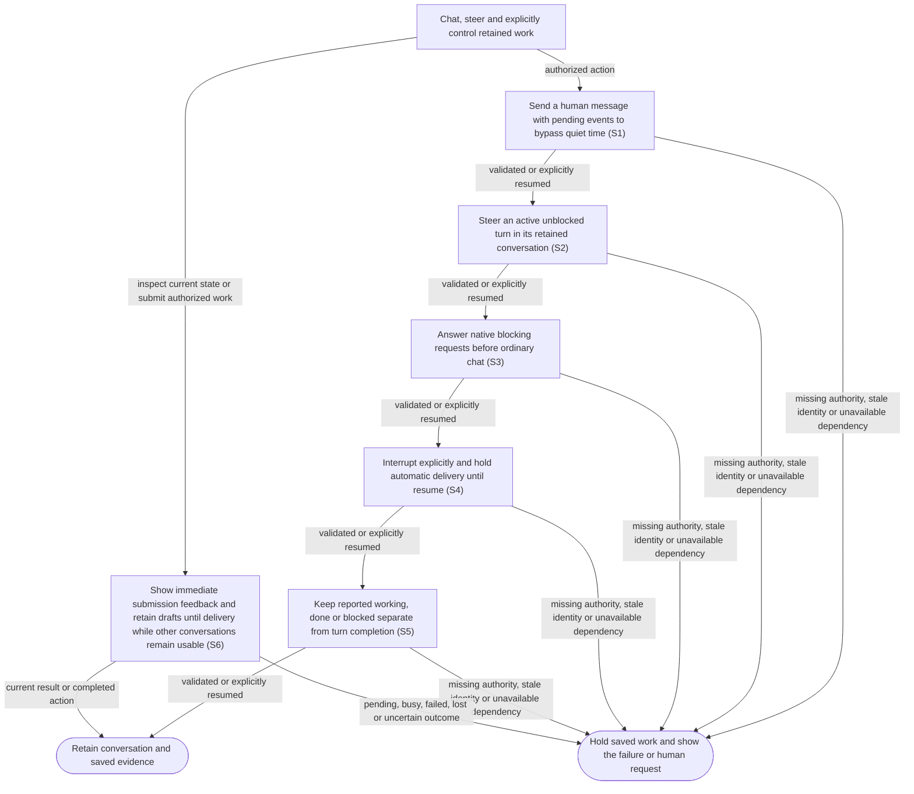

# Chat, steer and explicitly control retained work

## Goal

Chat, steer and explicitly control retained work.

## Preconditions

The private owner connection is established. Application data starts clean in the session-state database; native Codex authentication and configuration remain outside application state. GitHub source text is task data, not new authority.

## Main flow

1. Send a human message with pending events to bypass quiet time.

2. Steer an active unblocked turn in its retained conversation.

3. Answer native blocking requests before ordinary chat.

4. Interrupt explicitly and hold automatic delivery until resume.

5. Keep reported working, done or blocked separate from turn completion.

## Alternatives and recovery

Read-only inspection does not launch a model turn. Surface validation or provider errors and retain saved work. Human questions, explicit interruptions and uncertain deliveries hold automatic dispatch. Resume against current retained history; never replay an uncertain send or an answered RPC blindly. Explicit cleanup preserves dirty worktrees.

Show local submission feedback before waiting for the connection. Acceptance is
separate from delivery: keep queued and running work pending, and preserve the
owning conversation draft until delivery succeeds. Navigation and unrelated
conversations remain usable. Repeated request identities retrieve the original
work; connection recovery never submits the command again. After restart, effects
with retained intent are uncertain and memory-only work can be lost. Neither is
authority to replay a mutation or reuse an expired answer.

## Scenarios

- **S1** — Send a human message with pending events to bypass quiet time.
- **S2** — Steer an active unblocked turn in its retained conversation.
- **S3** — Answer native blocking requests before ordinary chat.
- **S4** — Interrupt explicitly and hold automatic delivery until resume.
- **S5** — Keep reported working, done or blocked separate from turn completion.

- **S6** — Show immediate submission feedback and retain drafts until delivery while other conversations remain usable.

## Verification scope

The assertion references below establish their fixture scope. Native installed-host, real-provider and assistive-technology acceptance require separate dated observations. The retired pipeline editor, review artifacts, AI question repair and built-in issue-report ledger have no compatibility path.

<!-- flow-references -->
## Terminology and UI references

Glossary: [retained-session](../glossary/README.md#retained-session), [execution-state](../glossary/README.md#execution-state), [reported-work-status](../glossary/README.md#reported-work-status), [event-batch](../glossary/README.md#event-batch), [operation-receipt](../glossary/README.md#operation-receipt), [daemon-instance](../glossary/README.md#daemon-instance), [read-projection](../glossary/README.md#read-projection), [document-chunk](../glossary/README.md#document-chunk).
UI entities: [W-MESSAGE](../ui/README.md#W-MESSAGE), [W-TRANSCRIPT](../ui/README.md#W-TRANSCRIPT), [W-RUN-CONTROLS](../ui/README.md#W-RUN-CONTROLS), [W-WORK-STATUS](../ui/README.md#W-WORK-STATUS).

## Flow diagram

## Implementation references

- [internal/factory/service.go](../../internal/factory/service.go) — Durable canonical sessions, event queue, quiet clock and delivery claims. (`func (s *Service) Chat(`)
- [internal/factory/native.go](../../internal/factory/native.go) — Direct native app-server retained thread creation and resumption. (`func (s *Service) attach(`)
- [internal/factory/requests.go](../../internal/factory/requests.go) — Exact session-bound native requests and explicit status, without classifiers. (`func (s *Service) Answer(`)
- [web/src/wrapper.tsx](../../web/src/wrapper.tsx) — Saved inbox, session conversation, human input and confirmed configuration. (`function Factory(`)
- [internal/transport/factory.go](../../internal/transport/factory.go) — Session, configuration, event and retained triage APIs. (`func NewFactory(`)
- [internal/transport/operations.go](../../internal/transport/operations.go) — Immediate memory admission with explicit operation state and original daemon/request identity; metadata durability precedes effects. (`func (q *operationQueue) submit(`)

## Test references

- [internal/factory/service_test.go](../../internal/factory/service_test.go) — `func TestChatFlushBusySteerHoldAndRetainedReuse(`; S1, S2, S4. Human chat flushes queued events, steers unblocked active work and respects holds while retaining thread.
- [web/tests/wrapper.spec.ts](../../web/tests/wrapper.spec.ts) — `blocked status asks a human and suspends ordinary chat`; S3. Blocked tool question is visible and ordinary chat waits for its answer.
- [internal/factory/service_test.go](../../internal/factory/service_test.go) — `func TestStatusToolBlockingAndNativeAnswers(`; S3, S5. Explicit status, suspended blocked tool and exact native answers separate work status from execution.
- [web/tests/wrapper.spec.ts](../../web/tests/wrapper.spec.ts) — `execution reported status and pending events stay separate`; S5. Execution idle, reported done and pending event count render independently.
- [web/tests/assembled.spec.ts](../../web/tests/assembled.spec.ts) — `assembled native session retains thread across question answer and follow-up`; S1, S3. Real MCP daemon and fake native subprocess carry exact native answer and follow-up in retained conversation.
- [web/tests/wrapper.spec.ts](../../web/tests/wrapper.spec.ts) — `a pending send does not disable another session's native answer`; S3. A delayed send for A leaves B native free-text answer enabled and delivers the exact request key and value.
- [internal/factory/regressions_test.go](../../internal/factory/regressions_test.go) — `func TestSlowAttachLeavesOtherSessionRequestsResponsive(`; S3, S4. A delayed native attachment does not block another session request callback, answer or interrupt.
- [web/tests/wrapper.spec.ts](../../web/tests/wrapper.spec.ts) — `session controls preserve the selected target and require explicit clicks`; S4. Viewing sends no control; explicit Interrupt, Resume and Clean worktree each target the selected session and render cleaned status.
- [internal/factory/regressions_test.go](../../internal/factory/regressions_test.go) — `func TestPausedRepositoryRetainsQueueAndAllowsExplicitChat(`; S1. Repository pause retains an authorized queue without automatic send; explicit chat flushes it, and unpause plus a new event automatically reuses the retained thread.
- [web/tests/wrapper.spec.ts](../../web/tests/wrapper.spec.ts) — `submitting feedback precedes the bridge and queued delivery preserves drafts across navigation`; S6. Submitting feedback is present in the DOM at actual bridge entry within 100 ms; queued/running work keeps its draft and scope disabled while navigation remains usable; only success clears the draft.
- [web/tests/wrapper.spec.ts](../../web/tests/wrapper.spec.ts) — `preserves its classification and draft beside raw errors`; S6. Uncertain and lost outcomes keep their classification, inspection warning, exact timeout error and draft; navigating afterward creates no second mutation.

## Verification and gaps

Local suites: `go`, `browser`.
Fixture success does not establish real-host acceptance.
- **S3** — `gap-flow-interact-agent-s3-01` · Unverified behavior · P2 · owner: user-flow-maintainer. The default fake-provider fixture now directly interrupts waiting work, asserts stale requests and verifies same-session message wake. Current installed-host real-provider interruption and assistive-technology behavior remain unverified. Next verification: Verify the same interruption, stale-question exclusion and message wake against the installed provider/host without replaying old answers; retain version-bound evidence.

<!-- /flow-references -->
