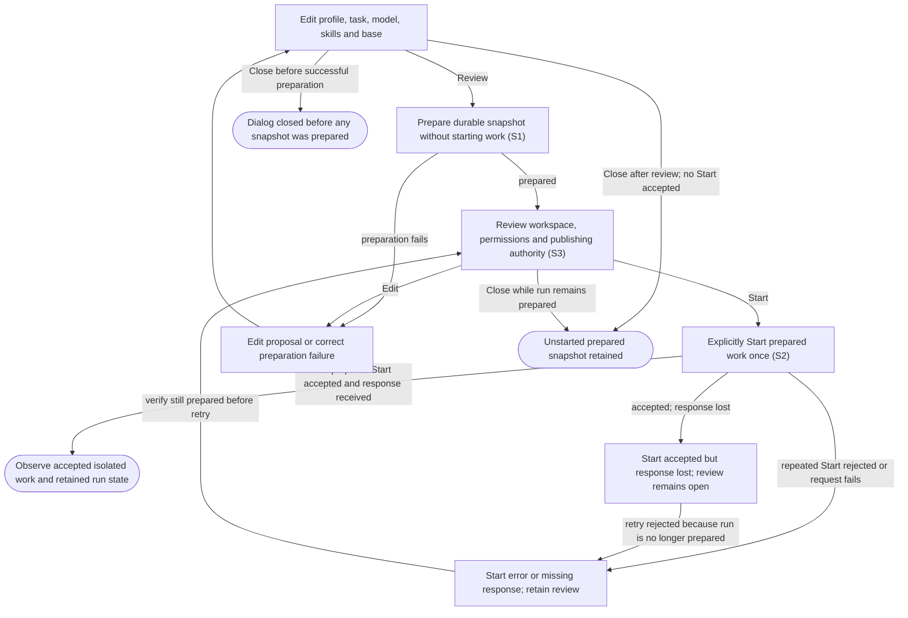

# Review and explicitly launch isolated agent work

## Goal

The owner reviews a durable work proposal and explicitly starts an agent in an isolated workspace.

## Preconditions

An item, repository and valid profile exist; the compatible agent provider is available.

## Main flow

1. Select a profile and edit the task prompt, model settings, skills and base.
2. Prepare a durable snapshot and review its workspace, permissions and publishing authority.
3. Explicitly start the prepared work.
4. Observe queued/start progress while the application prepares an isolated branch and workspace.

## Alternatives and recovery

Closing before a successful preparation only dismisses the proposal. Closing a prepared review, including after returning to edit it, retains the durable prepared snapshot without starting work. Preparing or inspecting does not create a running agent or workspace. Only prepared work can be started. Once the first Start queues the run, repeated Start requests are rejected rather than acknowledged as successful; they cannot create duplicate work. If the first response is lost, the run may already be active while the review remains open, and retrying Start reports an error. Inspect the retained run before deciding what to do next. Preparation and Start failures remain visible inside the dialog without losing edited work. Keyboard focus stays in the active dialog; Escape dismisses without starting and restores its connected opener. Existing checkouts are preserved. Publishing instructions describe agent authority; execution permissions remain enforced by the agent provider.

## Scenarios

- **S1** Prepare captures chosen work settings without starting an agent or creating a workspace.
- **S2** Explicit Start queues prepared work once and returns before completion; subsequent Start requests for that run are rejected.
- **S3** Selected skill contents and profile choices remain fixed in the prepared snapshot.

<!-- flow-references -->
## Terminology and UI references

Glossary: [prepared-launch](../glossary/README.md#prepared-launch), [profile](../glossary/README.md#profile), [skill](../glossary/README.md#skill), [workspace](../glossary/README.md#workspace), [agent-run](../glossary/README.md#agent-run), [coverage-gap](../glossary/README.md#coverage-gap), [unverified-behavior](../glossary/README.md#unverified-behavior), [keyboard-focus](../glossary/README.md#keyboard-focus), [modal-dialog](../glossary/README.md#modal-dialog).
UI entities: [D-LAUNCH](../ui/README.md#D-LAUNCH), [P-LAUNCH-FRAME](../ui/README.md#P-LAUNCH-FRAME), [P-LAUNCH-EDITOR](../ui/README.md#P-LAUNCH-EDITOR), [P-LAUNCH-REVIEW](../ui/README.md#P-LAUNCH-REVIEW), [W-DIALOG-FRAME](../ui/README.md#W-DIALOG-FRAME), [W-LAUNCH-EDITOR](../ui/README.md#W-LAUNCH-EDITOR), [W-LAUNCH-REVIEW](../ui/README.md#W-LAUNCH-REVIEW), [C-LAUNCH-OPEN](../ui/README.md#C-LAUNCH-OPEN), [C-LAUNCH-PROFILE](../ui/README.md#C-LAUNCH-PROFILE), [C-PREPARE](../ui/README.md#C-PREPARE), [C-LAUNCH-EDIT](../ui/README.md#C-LAUNCH-EDIT), [C-START](../ui/README.md#C-START), [C-DISMISS](../ui/README.md#C-DISMISS).

## Flow diagram

## Implementation references

- [internal/app/runs.go](../../internal/app/runs.go) — Durable preparation and isolated workspaces; Start atomically changes only prepared runs to queued and rejects later non-resume Start requests rather than returning an idempotent success. (`func (m *Manager) Prepare(`)
- [internal/codex/client.go](../../internal/codex/client.go) — Pinned provider protocol and process lifecycle
- [web/src/main.tsx](../../web/src/main.tsx) — Launch review UI; received success closes/selects the run, while preparation, rejected Start or lost response retains edited review with a dialog-local alert. (`function Launch(`)
- [internal/domain/types.go](../../internal/domain/types.go) — Shared domain, persistence, transport or dependency contract
- [internal/store/store.go](../../internal/store/store.go) — Shared domain, persistence, transport or dependency contract
- [internal/transport/mcp.go](../../internal/transport/mcp.go) — Shared domain, persistence, transport or dependency contract
- [go.mod](../../go.mod) — Shared domain, persistence, transport or dependency contract
- [go.sum](../../go.sum) — Shared domain, persistence, transport or dependency contract
- [web/src/types.ts](../../web/src/types.ts) — Embedded UI build and host-fixture configuration
- [web/src/style.css](../../web/src/style.css) — Embedded UI build and host-fixture configuration
- [web/src/bridge.ts](../../web/src/bridge.ts) — Embedded UI build and host-fixture configuration
- [web/package.json](../../web/package.json) — Embedded UI build and host-fixture configuration
- [web/package-lock.json](../../web/package-lock.json) — Embedded UI build and host-fixture configuration
- [web/tsconfig.json](../../web/tsconfig.json) — Embedded UI build and host-fixture configuration
- [web/vite.config.ts](../../web/vite.config.ts) — Embedded UI build and host-fixture configuration
- [web/index.html](../../web/index.html) — Embedded UI build and host-fixture configuration
- [web/playwright.config.ts](../../web/playwright.config.ts) — Embedded UI build and host-fixture configuration
- [internal/testhost/main.go](../../internal/testhost/main.go) — Embedded UI build and host-fixture configuration
- [internal/testutil/fakecodex/main.go](../../internal/testutil/fakecodex/main.go) — Embedded UI build and host-fixture configuration
- [internal/testutil/testutil.go](../../internal/testutil/testutil.go) — Embedded UI build and host-fixture configuration
- [internal/web/embed.go](../../internal/web/embed.go) — Embedded UI build and host-fixture configuration
- [web/src/modal-focus.ts](../../web/src/modal-focus.ts) — Initial modal focus, visible-control Tab containment, Escape dismissal, focus preservation across updates and conditional opener restoration. (`export function useModalFocus(`)

## Test references

- [internal/app/app_test.go](../../internal/app/app_test.go) — `func TestAgentQuestionExactlyOnceAndRecovery(`; S1, S2. Preparation helper checks no worktree before start; one accepted Start reaches attention. Exactly-once assertions cover answers, not repeated Start requests.
- [web/tests/factory.spec.ts](../../web/tests/factory.spec.ts) — `test("triage does not launch, launch edits and attention answer survive reopening"`; S1, S2. Edited prompt and model reach prepare; UI starts once.
- [web/tests/factory.spec.ts](../../web/tests/factory.spec.ts) — `test("MCP bridge drives the assembled daemon through launch, question, answer and follow-up"`; S2. Assembled MCP-to-worktree-to-agent fixture.
- [internal/app/real_codex_test.go](../../internal/app/real_codex_test.go) — `func TestRealCodexInteractiveLifecycle(`; S3. Opt-in real provider lifecycle and skill load; skipped by default.
- [internal/codex/client_test.go](../../internal/codex/client_test.go) — `func TestProcessProtocolAndDisconnect(`; S2. Provider protocol regression.
- [web/tests/factory.spec.ts](../../web/tests/factory.spec.ts) — `test("keyboard launch review traps focus, preserves edits and restores its opener on Escape"`; S1. Keyboard-only opening, forward/reverse Tab containment, visible focus, draft retention through polling/review, Escape/opener restoration, one prepare and no Start; polite connection status.
- [web/tests/factory.spec.ts](../../web/tests/factory.spec.ts) — `test("launch preparation failure is announced inside the dialog without losing keyboard edits"`; S1. Preparation error is a dialog-local alert, edited prompt remains, retry enables and no Start occurs; Escape restores opener.
- [web/tests/factory.spec.ts](../../web/tests/factory.spec.ts) — `test("repeated Start after a lost first response reports rejection and retains exactly one daemon run"`; S2. Assembled daemon accepts one Start; busy double-click sends once, lost response retains review/local alert, retry rejects and original run remains inspectable without another prepare.

## Verification and gaps

Local suites: `go`, `browser`.
Fixture success does not establish real-host acceptance.
- **S2** — `gap-flow-launch-agent-s2-01` · Unverified behavior · P2 · owner: user-flow-maintainer. Assembled lost-response retry/busy-click assertions retain exactly one daemon run. Concurrent Start requests from independent clients still lack a dedicated race assertion. Next verification: Send independent concurrent Start requests for one prepared run; assert exactly one accepted transition, rejection of others and no duplicate workspace/process.
- **S3** — `gap-flow-launch-agent-s3-01` · Unverified behavior · P2 · owner: user-flow-maintainer. Immutable skill-bundle edit-after-prepare coverage is missing; skill loading is exercised only in the opt-in real-provider test. Next verification: Prepare a run, edit its source profile and skill files, and assert that prepared values and copied skill content remain unchanged; distinguish this fixture from opt-in provider loading.
- **S1** — `gap-flow-launch-agent-s1-01` · Unverified behavior · P2 · owner: user-flow-maintainer. Closing before preparation and closing after a prepared review or Edit are source-derived alternatives without focused browser assertions. Next verification: Exercise Close before preparation and after prepared review/Edit; assert retained prepared records, no implicit Start and no created worktree before explicit Start.

<!-- /flow-references -->
