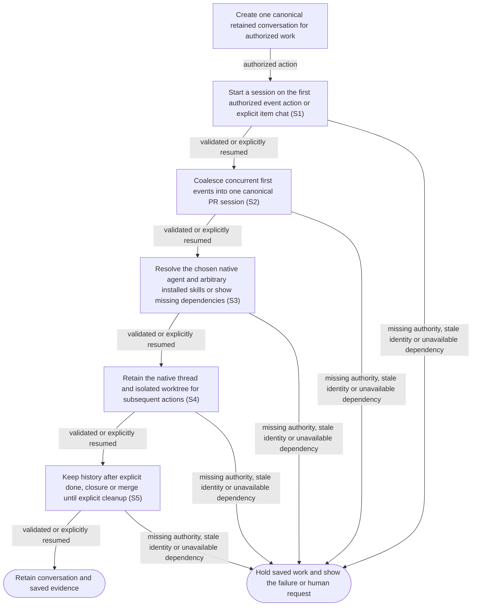

# Create one canonical retained conversation for authorized work

## Goal

Create one canonical retained conversation for authorized work.

## Preconditions

The private owner connection is established. Application data starts clean in the session-state database; native Codex authentication and configuration remain outside application state. GitHub source text is task data, not new authority.

## Main flow

1. Start a session on the first authorized event action or explicit item chat.

2. Coalesce concurrent first events into one canonical PR session.

3. Resolve the chosen native agent and arbitrary installed skills or show missing dependencies.

4. Retain the native thread and isolated worktree for subsequent actions.

5. Keep history after explicit done, closure or merge until explicit cleanup.

## Alternatives and recovery

Read-only inspection does not launch a model turn. Surface validation or provider errors and retain saved work. Human questions, explicit interruptions and uncertain deliveries hold automatic dispatch. Resume against current retained history; never replay an uncertain send or an answered RPC blindly. Explicit cleanup preserves dirty worktrees.

## Scenarios

- **S1** — Start a session on the first authorized event action or explicit item chat.
- **S2** — Coalesce concurrent first events into one canonical PR session.
- **S3** — Resolve the chosen native agent and arbitrary installed skills or show missing dependencies.
- **S4** — Retain the native thread and isolated worktree for subsequent actions.
- **S5** — Keep history after explicit done, closure or merge until explicit cleanup.

## Verification scope

The assertion references below establish their fixture scope. Native installed-host, real-provider and assistive-technology acceptance require separate dated observations. The retired pipeline editor, review artifacts, AI question repair and built-in issue-report ledger have no compatibility path.

<!-- flow-references -->
## Terminology and UI references

Glossary: [retained-session](../glossary/README.md#retained-session), [profile](../glossary/README.md#profile), [skill](../glossary/README.md#skill), [workspace](../glossary/README.md#workspace).
UI entities: [PAGE-AGENT](../ui/README.md#PAGE-AGENT), [W-MESSAGE](../ui/README.md#W-MESSAGE), [W-RUN-CONTROLS](../ui/README.md#W-RUN-CONTROLS), [W-WORK-STATUS](../ui/README.md#W-WORK-STATUS).

## Flow diagram

## Implementation references

- [internal/factory/service.go](../../internal/factory/service.go) — Durable canonical sessions, event queue, quiet clock and delivery claims. (`func (s *Service) Chat(`)
- [internal/factory/native.go](../../internal/factory/native.go) — Direct native app-server retained thread creation and resumption. (`func (s *Service) attach(`)
- [internal/factory/requests.go](../../internal/factory/requests.go) — Exact session-bound native requests and explicit status, without classifiers. (`func (s *Service) Answer(`)
- [web/src/wrapper.tsx](../../web/src/wrapper.tsx) — Saved inbox, session conversation, human input and confirmed configuration. (`function Factory(`)
- [internal/transport/factory.go](../../internal/transport/factory.go) — Session, configuration, event and retained triage APIs. (`func NewFactory(`)
- [internal/factory/types.go](../../internal/factory/types.go) — Session wrapper protocol, fixture build or bundled guidance input.
- [internal/transport/mcp.go](../../internal/transport/mcp.go) — Session wrapper protocol, fixture build or bundled guidance input.
- [web/src/bridge.ts](../../web/src/bridge.ts) — Session wrapper protocol, fixture build or bundled guidance input.
- [web/src/wrapper.css](../../web/src/wrapper.css) — Session wrapper protocol, fixture build or bundled guidance input.
- [web/index.html](../../web/index.html) — Session wrapper protocol, fixture build or bundled guidance input.
- [web/defer-ui.mjs](../../web/defer-ui.mjs) — Session wrapper protocol, fixture build or bundled guidance input.
- [internal/codex/dynamic_tools.go](../../internal/codex/dynamic_tools.go) — Current launch-agent implementation or fixture/build dependency.

## Test references

- [web/tests/wrapper.spec.ts](../../web/tests/wrapper.spec.ts) — `chat starts one canonical session and preserves draft on failure`; S1. First chat targets the item canonical session; rejected messages retain draft.
- [internal/factory/service_test.go](../../internal/factory/service_test.go) — `func TestConcurrentFirstEventsOneCanonicalSession(`; S2. Concurrent first matching events create exactly one item session.
- [internal/factory/service_test.go](../../internal/factory/service_test.go) — `func TestMissingSkillsAndProfilesAreVisible(`; S3. Missing arbitrary installed skill or native profile fails visibly before a claimed send.
- [internal/factory/service_test.go](../../internal/factory/service_test.go) — `func TestNativeAgentDefinitionUsesNativeTOMLAndProfile(`; S3. Native profile and agent config_file resolve without a separate agent format; effective native developer instructions remain in the actual thread request before wrapper guidance.
- [internal/factory/service_test.go](../../internal/factory/service_test.go) — `func TestChatFlushBusySteerHoldAndRetainedReuse(`; S4. Human chat flushes queued events, steers unblocked active work and respects holds while retaining thread.
- [internal/factory/service_test.go](../../internal/factory/service_test.go) — `func TestRepositoryQuietOverrideAndIdleWithoutStatus(`; S5. Repository quiet override, completion without report, and source closure retain history.
- [internal/codex/client_test.go](../../internal/codex/client_test.go) — `func TestProcessProtocolAndDisconnect(`; S1. Current launch-agent fixture assertion TestProcessProtocolAndDisconnect. Inspect its exact assertion scope.
- [internal/codex/client_test.go](../../internal/codex/client_test.go) — `func TestInstalledCodexHandshake(`; S1. Current launch-agent fixture assertion TestInstalledCodexHandshake. Inspect its exact assertion scope.
- [internal/codex/client_test.go](../../internal/codex/client_test.go) — `func TestOutputBurstDoesNotBlockResponses(`; S1. Current launch-agent fixture assertion TestOutputBurstDoesNotBlockResponses. Inspect its exact assertion scope.
- [internal/codex/client_test.go](../../internal/codex/client_test.go) — `func TestLateRPCResponseDoesNotSatisfyNextRequest(`; S1. Current launch-agent fixture assertion TestLateRPCResponseDoesNotSatisfyNextRequest. Inspect its exact assertion scope.
- [internal/codex/compatibility_test.go](../../internal/codex/compatibility_test.go) — `func TestExperimentalToolSchemaBoundary(`; S3. Schema boundary rejects missing dynamicTools in both execution preflight and diagnostics without model calls.
- [internal/factory/regressions_test.go](../../internal/factory/regressions_test.go) — `func TestSlowAttachLeavesOtherSessionRequestsResponsive(`; S1. A delayed native attachment does not block another session request callback, answer or interrupt.
- [internal/factory/regressions_test.go](../../internal/factory/regressions_test.go) — `func TestNativeProtocolFixtureCancelsBlockedStartup(`; S1. An entered-file barrier proves fake native initialization is blocked before cancellation; startup returns an error within one second without reaching later polling.
- [internal/factory/regressions_test.go](../../internal/factory/regressions_test.go) — `func TestAutomaticBatchBypassesBusyAndSlowPeerAttachments(`; S1. Actual B turn/start occurs before A is released for both slow human attachment with empty queue and slow automatic due attachment; B running state has no pending events afterward.

## Verification and gaps

Local suites: `go`, `browser`.
Fixture success does not establish real-host acceptance.
- **S3** — `gap-flow-native-agent-skill-acceptance` · Unverified behavior · P2 · owner: user-flow-maintainer. Fixture native profiles and arbitrary skill resolution do not establish actual-provider agent/skill loading in the installed host. Next verification: With explicit real-provider permission, load the selected native agent and installed skill in the approved private pilot and retain dated evidence.

<!-- /flow-references -->
