# Review and explicitly launch isolated agent work

## Goal

The owner reviews a durable work proposal and explicitly starts an agent in an isolated workspace.

## Preconditions

An item, repository and valid profile exist; the compatible agent provider is available.

## Main flow

1. Open an item directly in its conversation and inspect the prefilled first message, profile, mode, permissions and publishing authority.
2. Edit the message as needed and explicitly choose Start agent. Prepare the visible choices and start that proposal once. If resolved authority changes, review the updated values and choose Start again.
3. Alternatively, use New run under Item details to open a prepared review, customize through Edit and Advanced, then explicitly Start.
4. Observe progress in the same conversation while isolated work begins.

## Alternatives and recovery

Leaving the initial conversation retains its message and busy/uncertain state per item. A late result does not select a different item. Opening the initial conversation does not prepare or start work. Preparation failure retains the message with a local error. Closing the optional review before successful preparation only dismisses that proposal. Closing a prepared review, including after returning to edit it, retains the durable prepared snapshot without starting work. Prepared proposals created from another connected view become available to the open dashboard without starting work. A collapsed Draft launches group lists prepared snapshots newest first; reopening displays the same reviewed values without preparing again. Preparing or inspecting does not create a running agent or workspace. Only prepared work can be started. Once the first Start queues the run, repeated Start requests are rejected rather than acknowledged as successful; they cannot create duplicate work. If Start fails or its response is lost, verify that same retained run before offering another Start. Accepted work opens in its conversation; a confirmed prepared run permits an explicit retry. Unavailable status disables Start and Edit until Check start status succeeds. Preparation and Start failures remain visible inside the dialog without losing edited work. Keyboard focus stays in the active dialog; Escape dismisses without starting and restores its connected opener. Existing checkouts are preserved. Publishing instructions describe agent authority; execution permissions remain enforced by the agent provider.

## Scenarios

- **S8** Revalidate the current source before execution. Changed scope/head is supplied as untrusted context for the agent to assess against saved checkpoints. Unavailable source data prevents execution. For accepted work, temporary request-budget, quota-reserve or rate-limit unavailability before agent startup retains a deferred launch with its reason and retry deadline. The interface shows Waiting for GitHub. Scheduler ticks and daemon restart honor that deadline, then verify live source state, pinned head and automatic policy before starting the same accepted run once. Accepted retry authority survives shutdown during source, workspace and sandbox preparation even when repository synchronization remains stale or failed. Before creating the provider process, recovery intent is durably stopped; an uncertain provider startup requires inspection instead of automatic replay. Other source or agent failures retain their ordinary explicit recovery behavior. A closed issue or closed/merged PR terminates the session without starting provider work.

- **S1** Item selection opens a prefilled conversation without preparing or starting. Optional New run opens a prepared review; customization and reopening retained drafts never start an agent or create a workspace.
- **S2** Explicit Start queues prepared work once and returns before completion; subsequent Start requests for that run are rejected. An uncertain response locates the accepted run before another action is offered.
- **S3** Selected skill contents and profile choices remain fixed in the prepared snapshot. A plugin skill retains its package resources, executable helpers and relative entrypoint layout across later installation changes and retained continuation. Missing, oversized or escaping bundle content rejects preparation; restored snapshot paths cannot write outside their own root. Standalone skills retain their existing entrypoint.

- **S4** Select a pipeline before explicit Start, retaining an edited first message and reviewing the selected authority.

- **S5** A fresh requested PR can launch automatically only under an owner-enabled inherited/repository policy. It uses the configured review pipeline, honors its explicit execution and publishing authority, pins the current head, appends owner repository instructions and claims the request/head once. Queue-only, paused/stale/failed polls, drafts, other active agent work, unsafe profiles and changed policy do not launch. Restart never creates a second claim or agent for a claimed request; a deferred pre-agent launch can retry that same accepted claim after its deadline. A newly observed request episode or new head can receive a new review; an older accepted request cannot inherit the new episode’s authority. Fresh automatic acceptance and deferred recovery share the single active-agent slot, and waiting accepted work can start after that slot becomes free. Manual launches keep their explicit Start behavior.

- **S6** The owner can request a manual PR review through the assistant using a synchronized run/item ID, GitHub URL or repository shorthand directly, without a preliminary discovery call. Ambiguous identifiers return candidates and prepare nothing. Preparation resolves repository, system and built-in review defaults in that order and retains the selected model, skills, pinned head and repository instructions. The assistant inspects the configured authority and starts the matching proposal under the owner's review request. Both read-only/ask and an explicitly selected full-access/never/authorized profile are supported. Proposal-only requests retain unstarted work. Reviews of the signed-in GitHub account’s own PR are rejected, comparing account names without case sensitivity. Missing author or identity data must be refreshed before review. These checks apply to dedicated and generic review launches. Preparation and atomic Start check saved identity and retained intent. Asynchronous execution checks the current authenticated account against the fresh source under the same credentials before creating a workspace or provider. Missing, unavailable or changed identity evidence stops that execution; Start still returns queued without waiting for network reads. Prepared review intent survives later default-profile changes; older standard review proposals also receive the check. Investigation and implementation of the owner’s PR remain available. Invalid targets, missing heads, unavailable profiles/skills or unsafe review authority return errors without preparing work. The accepted PR head remains pinned independently of an explicit checkout base such as main. Preparation uses synchronized state without provider requests or workspace creation. An uncertain Start is checked against the same retained run before an explicit retry; manual review does not require enabling automatic monitoring.

Review/implementation defaults resolve repository overrides before system defaults. Plugin maintenance excludes concurrent agent start, message/answer delivery and automatic question/inference work; rejected submissions retain their ordinary drafts. Prepared skills retain content/support files and executable modes across later plugin changes.

- **S7** Bounded tasks use independent source and network permissions. Reviews keep the source and Git metadata read-only; implementation can write its own checkout. Private scratch permits temporary review checkouts and artifacts. Workflow lifecycle state persists across separate commands and retained continuation within the same private scratch. Native child delegation retains its own task-private session state; existing authentication and configuration remain read-only references. Commands use the selected provider executables; an older system copy cannot silently replace a recorded choice. Nested command-launched review providers retain the existing login and verified installed-plugin inventory while ambient MCP connections and apps are disabled for those child processes; global provider settings are unchanged. Inventory is retained once per run outside writable scratch and cannot silently fall back to changed live metadata. Supported nested review commands reuse the enforced outer read-only boundary; they cannot write source, read unrelated files or access local/private endpoints. Other task types keep their original permissions, and no command is retried outside that boundary. Network commands use a destination allowlist for GitHub, Codex services (including the nested client feature service) and required official OpenAI documentation, with other hosts and local/private endpoints blocked. Only required tools, selected-repository metadata, skills, registered marketplace manifest files, native provider registry metadata and existing authentication configuration are readable; unrelated owner files are unavailable. Sandbox initialization failure stops the run without broadening authority. Explicit full-access profiles remain an owner choice, never a fallback. An owner-selected full-access profile has no bounded filesystem/network gate; it retains private scratch and selected tools. Both full-access and bounded launches initialize private review rules and Decisions from the existing owner settings; continuation preserves run-local updates without changing owner settings. With command approvals disabled and publishing authorized, the agent proceeds autonomously and asks only for material decisions or missing information it cannot reasonably resolve.

<!-- flow-references -->
## Terminology and UI references

Glossary: [prepared-launch](../glossary/README.md#prepared-launch), [profile](../glossary/README.md#profile), [skill](../glossary/README.md#skill), [workspace](../glossary/README.md#workspace), [agent-run](../glossary/README.md#agent-run), [coverage-gap](../glossary/README.md#coverage-gap), [unverified-behavior](../glossary/README.md#unverified-behavior), [keyboard-focus](../glossary/README.md#keyboard-focus), [modal-dialog](../glossary/README.md#modal-dialog), [agent-pipeline](../glossary/README.md#agent-pipeline), [review-policy](../glossary/README.md#review-policy), [review-request-claim](../glossary/README.md#review-request-claim), [repository-review-prompt](../glossary/README.md#repository-review-prompt), [state-terminated](../glossary/README.md#state-terminated), [state-deferred](../glossary/README.md#state-deferred).
UI entities: [D-LAUNCH](../ui/README.md#D-LAUNCH), [P-LAUNCH-FRAME](../ui/README.md#P-LAUNCH-FRAME), [P-LAUNCH-EDITOR](../ui/README.md#P-LAUNCH-EDITOR), [P-LAUNCH-REVIEW](../ui/README.md#P-LAUNCH-REVIEW), [W-DIALOG-FRAME](../ui/README.md#W-DIALOG-FRAME), [W-LAUNCH-EDITOR](../ui/README.md#W-LAUNCH-EDITOR), [W-LAUNCH-REVIEW](../ui/README.md#W-LAUNCH-REVIEW), [C-LAUNCH-OPEN](../ui/README.md#C-LAUNCH-OPEN), [C-LAUNCH-PROFILE](../ui/README.md#C-LAUNCH-PROFILE), [C-PREPARE](../ui/README.md#C-PREPARE), [C-LAUNCH-EDIT](../ui/README.md#C-LAUNCH-EDIT), [C-START](../ui/README.md#C-START), [C-DISMISS](../ui/README.md#C-DISMISS), [W-NEW-CHAT](../ui/README.md#W-NEW-CHAT), [P-NEW-CHAT](../ui/README.md#P-NEW-CHAT), [C-START-CHAT](../ui/README.md#C-START-CHAT), [C-PIPELINE-SELECT](../ui/README.md#C-PIPELINE-SELECT), [W-REPOSITORY-SETTINGS](../ui/README.md#W-REPOSITORY-SETTINGS), [W-SYSTEM-DEFAULTS](../ui/README.md#W-SYSTEM-DEFAULTS), [C-REVIEW-POLICY](../ui/README.md#C-REVIEW-POLICY), [C-REPOSITORY-REVIEW-PROMPT](../ui/README.md#C-REPOSITORY-REVIEW-PROMPT), [W-WORK-STATUS](../ui/README.md#W-WORK-STATUS), [W-SESSION-CONSOLE](../ui/README.md#W-SESSION-CONSOLE).

## Flow diagram

```mermaid
flowchart TD
    N0["Review the prefilled first message, mode, permissions and publishing authority #40;S1#41;"]
    N1["Explicit Start agent #40;S2#41;"]
    N2["Prepare the visible message and fixed profile/skill choices #40;S3#41;"]
    N3(["Observe the accepted isolated run in the same conversation"])
    N4["Verify the same retained run before permitting retry"]
    N5["Optional New run prepares a durable review with Edit and Advanced"]
    N6(["Unstarted draft or prepared review retained"])
    N7["Select a pipeline before explicit Start, retaining an edited first message and reviewing the selected authority. #40;S4#41;"]
    N8["Fresh eligible request uses opted-in policy and one durable head/request claim #40;S5#41;"]
    N9(["Queue only or changed/stale/paused policy#59; no automatic launch"])
    N10["Resolve the configured PR review pipeline and inspect its pinned proposal #40;S6#41;"]
    N11(["Own PR, unknown author/identity or invalid review pipeline#59; no prepared work"])
    N12["Keep source access bounded, private scratch writable and network destinations scoped #40;S7#41;"]
    N13(["Sandbox initialization failed#59; retained work and authority preserved"])
    N14["Honor explicit full access, never command approvals and authorized task publishing #40;S7#41;"]
    N15["Verify current source and report changed scope or head before initial or automatic continuation #40;S8#41;"]
    N16(["Closed or merged source#59; terminate session and retain history/workspace"])
    N17["Retain accepted launch, reason and retry deadline#59; show Waiting for GitHub #40;S8#41;"]
    N0 --> N1
    N0 -->|"customize a separate proposal"| N5
    N5 -->|"reviewed Start"| N1
    N5 -->|"close"| N6
    N0 -->|"leave without Start"| N6
    N1 --> N2
    N2 -->|"unchanged authority#59; Start accepted"| N3
    N2 -->|"changed authority or preparation failed#59; review again"| N0
    N2 -->|"Start response unavailable"| N4
    N4 -->|"accepted work located"| N3
    N4 -->|"confirmed still prepared#59; explicit retry"| N1
    N4 -->|"unknown status#59; retain disabled Start and Check status"| N6
    N0 -->|"additional workbench path"| N7
    N7 -->|"resolved or explicit recovery"| N3
    N0 -->|"repository poll"| N8
    N8 -->|"valid configured review claim"| N3
    N8 -->|"not eligible, already claimed or policy changed"| N9
    N0 -->|"owner requests PR review through assistant"| N10
    N10 -->|"inspect snapshot#59; request authorizes review"| N1
    N10 -->|"proposal only#59; no start requested"| N6
    N10 -->|"own PR, unverifiable author or invalid target/pipeline"| N11
    N0 -->|"authorized bounded task start or continuation"| N12
    N12 -->|"valid policy#59; retain scoped work"| N3
    N12 -->|"invalid policy#59; fail before provider launch"| N13
    N2 -->|"owner selected full-access profile"| N14
    N14 -->|"same retained task#59; ask only for unresolved material decisions"| N3
    N0 -->|"start or continue retained work"| N15
    N15 -->|"source closed or merged"| N16
    N15 -->|"open source#59; agent assesses fresh changes"| N0
    N1 -->|"review author now matches the signed-in account"| N11
    N15 -->|"fresh review author matches the signed-in account or cannot be verified"| N11
    N15 -->|"pre-agent budget, quota reserve or rate limit"| N17
    N17 -->|"deadline reached after tick or restart#59; recheck current source and automatic policy"| N15
    N17 -->|"explicit cancellation#59; no agent launch"| N6
```

## Implementation references

- [internal/app/runs.go](../../internal/app/runs.go) — Durable preparation and isolated workspaces; Start atomically changes only prepared runs to queued and rejects later non-resume Start requests rather than returning an idempotent success. (`func (m *Manager) Prepare(`)
- [internal/codex/client.go](../../internal/codex/client.go) — Pinned provider protocol and process lifecycle
- [web/src/main.tsx](../../web/src/main.tsx) — Default review-first preparation, optional Edit/Advanced, durable draft reopening and explicit Start; uncertain responses verify the same run before retry. (`function Launch(`)
- [internal/domain/types.go](../../internal/domain/types.go) — Shared domain, persistence, transport or dependency contract
- [internal/store/store.go](../../internal/store/store.go) — Shared domain, persistence, transport or dependency contract
- [internal/transport/mcp.go](../../internal/transport/mcp.go) — Shared domain, persistence, transport or dependency contract
- [go.mod](../../go.mod) — Shared domain, persistence, transport or dependency contract
- [go.sum](../../go.sum) — Shared domain, persistence, transport or dependency contract
- [web/src/types.ts](../../web/src/types.ts) — Embedded UI build and host-fixture configuration
- [web/src/style.css](../../web/src/style.css) — Embedded UI build and host-fixture configuration
- [web/src/bridge.ts](../../web/src/bridge.ts) — Embedded UI build and host-fixture configuration
- [web/package.json](../../web/package.json) — Embedded UI build and host-fixture configuration
- [web/package-lock.json](../../web/package-lock.json) — Embedded UI build and host-fixture configuration
- [web/tsconfig.json](../../web/tsconfig.json) — Embedded UI build and host-fixture configuration
- [web/vite.config.ts](../../web/vite.config.ts) — Embedded UI build and host-fixture configuration
- [web/index.html](../../web/index.html) — Embedded UI build and host-fixture configuration
- [web/playwright.config.ts](../../web/playwright.config.ts) — Embedded UI build and host-fixture configuration
- [web/fixture-ports.ts](../../web/fixture-ports.ts) — Shared validated loopback fixture origins preserve default ports and allow isolated browser verification alongside another checkout. (`export const fixtureUIOrigin =`)
- [internal/testhost/main.go](../../internal/testhost/main.go) — Embedded UI build and host-fixture configuration
- [internal/testutil/fakecodex/main.go](../../internal/testutil/fakecodex/main.go) — Embedded UI build and host-fixture configuration
- [internal/testutil/testutil.go](../../internal/testutil/testutil.go) — Embedded UI build and host-fixture configuration
- [internal/web/embed.go](../../internal/web/embed.go) — Embedded UI build and host-fixture configuration
- [web/src/modal-focus.ts](../../web/src/modal-focus.ts) — Initial modal focus, visible-control Tab containment, Escape dismissal, focus preservation across updates and conditional opener restoration. (`export function useModalFocus(`)
- [web/src/main.tsx](../../web/src/main.tsx) — Explicit first-message launch and durable uncertainty. (`function NewChat(`)
- [internal/app/plugins.go](../../internal/app/plugins.go) — Durable pinned-CLI plugin lifecycle and exclusive runtime/maintenance boundary. (`func (m *Manager) PluginAction(`)
- [internal/domain/admin.go](../../internal/domain/admin.go) — Typed plugin operation and inventory persistence. (`type PluginOperation struct`)
- [internal/app/review_requests.go](../../internal/app/review_requests.go) — Resolve inherited review policies, fresh requests, durable claims and pinned automatic launches. (`func (a *App) ProcessReviewRequests(`)
- [web/src/admin.tsx](../../web/src/admin.tsx) — Repository/global review policy and plugin-admin settings. (`export function RepositoryAdmin(`)
- [internal/app/runs.go](../../internal/app/runs.go) — Prepare the effective PR review pipeline through shared preparation, retaining pinned target and authority without starting work. (`func (m *Manager) PreparePRReview(`)
- [plugin/skills/code-factory/SKILL.md](../../plugin/skills/code-factory/SKILL.md) — Explicit conversational PR review recipe, generic-launch compatibility and uncertain-start recovery.
- [internal/app/sandbox.go](../../internal/app/sandbox.go) — Invocation-local native filesystem and destination policy; isolated writable scratch and private skill indexes without global configuration changes.
- [internal/codex/sandbox.go](../../internal/codex/sandbox.go) — Invocation-local native filesystem and destination policy; isolated writable scratch and private skill indexes without global configuration changes.
- [internal/app/skill_snapshots.go](../../internal/app/skill_snapshots.go) — Freeze a selected plugin package and its relative skill entrypoint; materialize bounded retained files with traversal confinement and standalone compatibility. (`func snapshotSkill(`)
- [internal/commandenv/providers.go](../../internal/commandenv/providers.go) — Generate private versioned command launchers for exactly the recorded provider executables, quote paths literally and preserve prior launcher sets for rollback. (`func Prepare(`)
- [internal/commandenv/providers.go](../../internal/commandenv/providers.go) — Retain an invocation-local child Codex launcher with literal configuration arguments, exact executable selection and confinement against escaping symlinks. (`func PrepareCodex(`)
- [internal/app/sandbox.go](../../internal/app/sandbox.go) — Read effective native server identities without model work and disable ambient MCP connections and apps only for command-launched nested Codex providers. (`func (m *Manager) childProviderOverrides(`)
- [internal/app/sandbox.go](../../internal/app/sandbox.go) — Capture authoritative native installed-plugin metadata outside writable task scratch once; retain it across continuation and reject malformed or linked snapshots. (`func (m *Manager) nativeRegistrySnapshot(`)
- [internal/commandenv/providers.go](../../internal/commandenv/providers.go) — Expose only the regular executable companion from the selected pinned Codex distribution; a different installation cannot substitute its code execution host. (`func CodexCompanion(`)
- [internal/app/native_context.go](../../internal/app/native_context.go) — Keep durable native child sessions, writer locks and nonsecret installation state in task-private storage, with read-only references to existing owner authentication/configuration and no owner-history access. (`func prepareNativeContext(`)
- [internal/app/continuation.go](../../internal/app/continuation.go) — Verify fresh source for initial/automatic continuation; message-triggered restoration supplies saved context and lets the agent perform task-required GitHub reads. (`func (m *Manager) continuationContext(`)
- [internal/providers/continuation.go](../../internal/providers/continuation.go) — Targeted conditional GitHub source read bypasses local TTL while retaining shared budget and cooldown enforcement. (`func (g *GitHub) CurrentWorkItem(`)
- [internal/app/tracking.go](../../internal/app/tracking.go) — Targeted saved-state reads, compact tracking, durable progress or asynchronous observation without delaying status. (`func (a *App) TrackWork(`)
- [internal/app/review_eligibility.go](../../internal/app/review_eligibility.go) — Reject own-author PR reviews and unknown author/identity before preparation, atomic Start and fresh source execution; retain review intent across profile-default changes. (`func validatePRReviewAuthor(`)
- [internal/app/launch_retry.go](../../internal/app/launch_retry.go) — Persist deadline-based pre-agent launch deferral, conservative legacy PR-review recovery and automatic-policy revalidation without duplicate claims. (`func (m *Manager) RetryDeferredLaunches(`)

## Test references

- [internal/app/app_test.go](../../internal/app/app_test.go) — `func TestAgentQuestionExactlyOnceAndRecovery(`; S1, S2. Preparation helper checks no worktree before start; one accepted Start reaches attention. Exactly-once assertions cover answers, not repeated Start requests.
- [web/tests/factory.spec.ts](../../web/tests/factory.spec.ts) — `test("triage does not launch, launch edits and attention answer survive reopening"`; S1, S2. Edited prompt and model reach prepare; UI starts once.
- [web/tests/factory.spec.ts](../../web/tests/factory.spec.ts) — `test("MCP bridge drives the assembled daemon through launch, question, answer and follow-up"`; S2. Assembled MCP-to-worktree-to-agent fixture.
- [internal/app/real_codex_test.go](../../internal/app/real_codex_test.go) — `func TestRealCodexInteractiveLifecycle(`; S3. Opt-in real provider lifecycle and skill load; skipped by default.
- [internal/codex/client_test.go](../../internal/codex/client_test.go) — `func TestProcessProtocolAndDisconnect(`; S2. Provider protocol regression.
- [web/tests/factory.spec.ts](../../web/tests/factory.spec.ts) — `test("keyboard launch review traps focus, preserves edits and restores its opener on Escape"`; S1. Keyboard-only opening, forward/reverse Tab containment, visible focus, draft retention through polling/review, Escape/opener restoration, default prepare plus explicit reprepare and no Start; polite connection status.
- [web/tests/factory.spec.ts](../../web/tests/factory.spec.ts) — `test("launch preparation failure is announced inside the dialog without losing keyboard edits"`; S1. Preparation error is a dialog-local alert, edited prompt remains, retry enables and no Start occurs; Escape restores opener.
- [web/tests/factory.spec.ts](../../web/tests/factory.spec.ts) — `test("lost Start response locates the accepted daemon run without another Start"`; S2. Busy double-click sends once; lost response locates accepted daemon work with read_run without another Start or prepare.
- [web/tests/factory.spec.ts](../../web/tests/factory.spec.ts) — `test("default launch opens review directly and Draft launches reopens its immutable snapshot newest first"`; S1, S3. Default review includes mode and policy; reopening retains original snapshot despite changed source profile.
- [web/tests/factory.spec.ts](../../web/tests/factory.spec.ts) — `test("unverifiable Start disables retry and Edit until read_run locates accepted work"`; S2. Uncertain Start gates duplicate actions until same-run status lookup recovers accepted work.
- [web/tests/factory.spec.ts](../../web/tests/factory.spec.ts) — `test("confirmed unaccepted Start allows an explicit retry of the same snapshot"`; S2. Status-confirmed unaccepted Start permits explicit retry without reprepare.
- [web/tests/factory.spec.ts](../../web/tests/factory.spec.ts) — `item opens a prefilled conversation and first-message Start stays explicit`; S1, S2. Item opens Agent with summary, prefilled prompt and closed details; no intermediate item-only page or Open agent control, no work before Start, retained item draft, exact prepare/start payload and conversation afterward.
- [web/tests/factory.spec.ts](../../web/tests/factory.spec.ts) — `first-message launch uncertainty survives leaving and reopening its item`; S1, S2. Uncertain first-message Start remains disabled across Back/reopen; Check reads the same prepared record with no additional Start/preparation.
- [web/tests/factory.spec.ts](../../web/tests/factory.spec.ts) — `first-message pipeline selection preserves an edited prompt`; S4. Selected profile reaches preparation only after Start and edited text remains intact.
- [internal/app/review_requests_test.go](../../internal/app/review_requests_test.go) — `func TestReviewPolicyInheritancePromptAndExactlyOnceAutomaticStart(`; S5. System defaults queue; enabled inherited policy starts one pinned read-only review with appended repo text, survives duplicate polls/restart and accepts a new request episode.
- [internal/app/review_requests_test.go](../../internal/app/review_requests_test.go) — `func TestRepositoryQueueOverridePauseDraftAndStaleRequestsDoNotStart(`; S5. Queue override, pause, draft, old sync, absent request, sync error and unsafe review profile cannot launch automatically.
- [internal/app/review_requests_test.go](../../internal/app/review_requests_test.go) — `func TestAutomaticStartRevalidatesPolicyAndMonitoringPreservesCheckpoint(`; S5. Automatic Start revalidates changed policy in its claim transaction and refuses a stale prepared launch; monitoring edits keep sync checkpoints.
- [internal/app/plugins_test.go](../../internal/app/plugins_test.go) — `func TestSelectedDiscoveredSkillKeepsItsBundleAndAutomaticChecksDoNotInstall(`; S3. Selected discovered skill retains its full bundle and executable modes.
- [web/tests/factory.spec.ts](../../web/tests/factory.spec.ts) — `repository review pipeline overrides system defaults and plugin skills remain selectable`; S4. Repository role choice overrides the system; plugin skills can be selected and missing skills are disabled.
- [internal/app/review_requests_test.go](../../internal/app/review_requests_test.go) — `func TestNewPRHeadGetsOneNewReviewAndExtraPromptIsNotDuplicated(`; S5. A changed head receives one new review, while repeated preparation does not duplicate repository instruction blocks.
- [internal/app/clone_test.go](../../internal/app/clone_test.go) — `func TestManagedCloneUsesGitTransportAndCredentialHelperWithoutAPILookup(`; S2. Authenticated local smart-HTTP clone uses the credential helper and succeeds while any gh repository/API lookup is disabled.
- [internal/app/review_requests_test.go](../../internal/app/review_requests_test.go) — `func TestPreparePRReviewResolvesDefaultsAndStartsOnlyExplicitly(`; S6. Repository/system/built-in resolution retains model, mode, pinned head and repository prompt; no workspace before explicit Start, and repeated Start rejected.
- [internal/app/review_requests_test.go](../../internal/app/review_requests_test.go) — `func TestPreparePRReviewRejectsInvalidTargetsAndUnsafePipelines(`; S6. Invalid item, missing head/profile, write/publishing authority and unavailable skills reject without persisting work.
- [internal/transport/mcp_test.go](../../internal/transport/mcp_test.go) — `func TestAuthenticatedMCPDiscoveryToolsAndUI(`; S6. MCP catalog exposes model-visible PR review preparation with only itemId required and follow-on start_run guidance; wire call returns pinned prepared run.
- [internal/app/sandbox_test.go](../../internal/app/sandbox_test.go) — `func TestTaskSandboxRetainsIsolationAcrossSessionWake(`; S7. Start and automatic startup continuation retain the same bounded process profile and thread without a legacy policy override; explicit cleanup removes private scratch.
- [internal/app/sandbox_test.go](../../internal/app/sandbox_test.go) — `func TestSandboxSkillDataIsPrivateBoundedAndRetained(`; S7. Refreshing private skill indexes cannot alter the owner source; resume keeps run caches and rejects symlink sources.
- [internal/app/sandbox_test.go](../../internal/app/sandbox_test.go) — `func TestInvalidTaskSandboxFailsWithoutProviderFallback(`; S7. Invalid sandbox fails before app-server launch without an unrestricted fallback.
- [internal/codex/sandbox_test.go](../../internal/codex/sandbox_test.go) — `func TestTaskSandboxPolicyAndInvalidRoots(`; S7. Independent workspace/scratch filesystem and network permissions reject invalid or global roots; proxy allowlist excludes arbitrary hosts.
- [internal/app/skill_snapshots_test.go](../../internal/app/skill_snapshots_test.go) — `func TestPluginSkillSnapshotKeepsPackageResourcesAndRetainedEntrypoint(`; S3. Package-level lifecycle/procedure resources and executable helpers retain relative paths and original content after installed source deletion and repeated materialization.
- [internal/app/skill_snapshots_test.go](../../internal/app/skill_snapshots_test.go) — `func TestSkillSnapshotRejectsEscapesLinksMissingEntryAndOversize(`; S3. Manifest escapes, wrong skills directory, symlinks, missing entrypoints and oversized bundles fail instead of producing incomplete snapshots.
- [internal/app/skill_snapshots_test.go](../../internal/app/skill_snapshots_test.go) — `func TestRetainedSkillRejectsTraversalAndPreservesStandaloneCompatibility(`; S3. Retained entry/file traversal and outbound symlinks cannot escape snapshot roots; legacy standalone SKILL.md remains usable.
- [internal/app/sandbox_test.go](../../internal/app/sandbox_test.go) — `func TestPinnedWorkflowLifecyclePersistsAcrossSandboxCommands(`; S7. Opt-in real pinned-provider command check: actual DK entry retains its router/runtime into private state, a separate command reads/completes it and host state persists. No model calls; skipped by fixture gate.
- [internal/app/sandbox_test.go](../../internal/app/sandbox_test.go) — `func TestMarketplaceMetadataDoesNotGrantOwnerDirectories(`; S7. Configured local/home marketplace roots yield only their manifest files; malformed/relative roots fail and no containing owner directory becomes readable.
- [internal/commandenv/providers_test.go](../../internal/commandenv/providers_test.go) — `func TestSelectedProvidersWinWithoutGlobalReplacement(`; S7. Selected executables win over conflicting fallback commands, unusual paths and literal arguments are preserved, and previous launcher versions remain unchanged.
- [internal/commandenv/providers_test.go](../../internal/commandenv/providers_test.go) — `func TestUnavailableProvidersNeverFallBack(`; S7. Missing or relative selected providers fail instead of invoking an older system fallback.
- [internal/commandenv/providers_test.go](../../internal/commandenv/providers_test.go) — `func TestProviderDirectoryRejectsEscapingSymlinks(`; S7. A replaced launcher symlink cannot overwrite an outside owner file.
- [internal/commandenv/providers_test.go](../../internal/commandenv/providers_test.go) — `func TestChildCodexOverridesRemainLiteralAndVersioned(`; S7. Literal unusual server names cannot execute shell code; changed child configuration retains prior launchers; escaping launcher symlinks cannot alter outside files.
- [internal/app/sandbox_test.go](../../internal/app/sandbox_test.go) — `func TestNativePluginInventoryRetainsValidatedPrivateSnapshot(`; S7. Registry metadata has private permissions, survives provider unavailability without requery, and rejects malformed data and symlinks.
- [internal/commandenv/providers_test.go](../../internal/commandenv/providers_test.go) — `func TestChildCodexUsesOnlyItsDistributionCompanion(`; S7. Selected executable companion receives literal arguments; non-executable files and symlinks are rejected.
- [internal/commandenv/providers_test.go](../../internal/commandenv/providers_test.go) — `func TestChildProviderUsesVerifiedInventoryAndRequiresOuterRestrictions(`; S7. Native inventory requires its exact digest with no live fallback; supported child invocation requires enforced process restrictions, other argument shapes keep their original sandbox.
- [internal/app/native_context_test.go](../../internal/app/native_context_test.go) — `func TestNativeContextReferencesOwnerWithoutCopyingAuthentication(`; S7. Authentication/configuration remain reference links rather than copies; restored context retains sessions, rejects changed references and preserves owner fixture bytes.
- [internal/app/native_context_test.go](../../internal/app/native_context_test.go) — `func TestNativeContextRejectsEscapingStateAndSharedWritableFile(`; S7. Escaping state links cannot create owner directories, and a hard-linked writable installation-state file cannot modify another owner file.
- [internal/codex/sandbox_test.go](../../internal/codex/sandbox_test.go) — `func TestPrivateNativeContextCannotBroadenWritableScope(`; S7. Context references stay read-only, native session directories stay writable and source stays read-only; extra writable roots outside private scratch are rejected.
- [internal/commandenv/providers_test.go](../../internal/commandenv/providers_test.go) — `func TestChildAuditRetainsOnlyNativeExecutionMetadata(`; S7. Optional native traces retain IDs/status/known roles with private permissions while excluding prompt/message/command/URL content.
- [internal/commandenv/providers_test.go](../../internal/commandenv/providers_test.go) — `func TestChildAuditProjectsOnlyItsOwnCompletedDelegates(`; S7. V2 metadata projection identifies the actual provider and completed descendant roles, rejects unrelated root contexts and excludes creator/account/content fields.
- [internal/app/review_requests_test.go](../../internal/app/review_requests_test.go) — `func TestPreparePRReviewHonorsExplicitFullAccess(`; S5, S6. Explicit owner full-access/never/authorized authority is retained by manual preparation and accepted once by automatic policy without enabling that policy implicitly.
- [internal/app/sandbox_test.go](../../internal/app/sandbox_test.go) — `func TestExplicitFullAccessKeepsScratchAndDisablesTechnicalApprovals(`; S7. Native startup receives danger-full-access and approval never, autonomous publishing/decision instructions, private scratch and disabled bounded proxy; no default bounded permission profile leaks into this explicit choice. Existing owner rules and Decisions seed private data even in full-access mode; repeated setup preserves run updates and leaves owner stores unchanged.
- [web/tests/factory.spec.ts](../../web/tests/factory.spec.ts) — `test("explicit full-access launch shows never approvals and authorized publishing"`; S4, S6, S7. UI displays explicit full access, never approvals and authorized publishing; opens without Start, starts once on explicit action, and Settings describes selected authority.
- [internal/app/continuation_test.go](../../internal/app/continuation_test.go) — `func TestContinuationProvidesFreshChangesWithoutReplacingSession(`; S8. Fresh title/body/update/assignment changes reach the retained agent in structured source context while thread, workspace and original task remain unchanged.
- [internal/app/continuation_test.go](../../internal/app/continuation_test.go) — `func TestClosedOrMergedSourcePermanentlyTerminatesContinuation(`; S8. Closed issue, closed PR and merged PR prevent another provider invocation; messages/resume are refused and dirty cleanup preserves terminal state and unsaved files.
- [internal/app/continuation_test.go](../../internal/app/continuation_test.go) — `func TestUnverifiedSourceNeverStartsProviderOrReplaysTask(`; S8. Failed fresh source reads fail visibly before provider or workspace creation with no stale fallback.
- [internal/app/continuation_test.go](../../internal/app/continuation_test.go) — `func TestSyncedClosureStopsActiveWorkAndRetiresQuestions(`; S8. Synced source closure retires active provider work, stales pending questions, survives restart without resurrecting asks and remains terminal after source reopening.
- [web/tests/factory.spec.ts](../../web/tests/factory.spec.ts) — `terminated work retains history and cleanup without allowing continuation`; S8. Both themes show Stopped and terminal reason, retain cleanup and history, disable Send and expose no Interrupt or launch action.
- [internal/app/tracking_test.go](../../internal/app/tracking_test.go) — `func TestTrackingResolvesTargetsPaginatesHistoryAndSeparatesReceiptHeads(`; S6. Asserts saved-state target resolution, exact question/receipt pagination, bounded projection or daily one/two-call delivery behavior.
- [internal/transport/tracking_test.go](../../internal/transport/tracking_test.go) — `func TestMCPDailyWorkflowsUseOneOrTwoCallsAndReturnDeliveryState(`; S6. Asserts saved-state target resolution, exact question/receipt pagination, bounded projection or daily one/two-call delivery behavior.
- [internal/app/review_eligibility_test.go](../../internal/app/review_eligibility_test.go) — `func TestManualPRReviewRejectsOwnPullRequests(`; S6. Dedicated and generic/configured review preparation reject case-insensitive own authors and unavailable identity/author without persisting work; investigation stays available.
- [internal/app/review_eligibility_test.go](../../internal/app/review_eligibility_test.go) — `func TestManualPRReviewRechecksAuthorBeforeStart(`; S6. Atomic Start rechecks current identity for prepared and legacy reviews without events, workspace or provider start.
- [internal/app/review_eligibility_test.go](../../internal/app/review_eligibility_test.go) — `func TestManualPRReviewRetainsEligibilityAfterDefaultChanges(`; S6. Prepared custom review remains subject to author checks after the configured default changes.
- [internal/app/review_eligibility_test.go](../../internal/app/review_eligibility_test.go) — `func TestNonReviewRunRetainsIntentAfterReviewDefaultChanges(`; S6, S8. System and repository review-default changes preserve retained nonreview Start and fresh-source continuation on the owner's PR, with the same thread, workspace, prompt and profile authority.
- [internal/app/review_eligibility_test.go](../../internal/app/review_eligibility_test.go) — `func TestPRReviewIntentJSONCompatibility(`; S6. Actual Run JSON preserves missing legacy intent and explicit true/false boolean presence; legacy boolean consumers remain compatible while configured/standard/automatic reviews retain self-review rejection.
- [internal/app/review_eligibility_test.go](../../internal/app/review_eligibility_test.go) — `func TestManualPRReviewChecksFreshAuthorBeforeProvider(`; S6. Fresh provider source author supersedes cached author and stops self review before workspace/thread creation.
- [web/tests/factory.spec.ts](../../web/tests/factory.spec.ts) — `own PR review rejection preserves the first message without starting`; S6. Light/dark first-message UI exposes author rejection without losing the draft, issuing Start or creating a run.
- [internal/app/continuation_test.go](../../internal/app/continuation_test.go) — `func TestContinuationUsesLiveSourceDespiteWarmGitHubCache(`; S8. Execution preflight bypasses a warm query cache and stops a newly closed source before provider/workspace creation.
- [internal/app/continuation_test.go](../../internal/app/continuation_test.go) — `func TestTerminatedLaunchCannotPublishLateProviderResult(`; S8. Termination while thread/start or turn/start is withheld rejects late provider results and completed callbacks without reviving terminal work.
- [internal/app/review_eligibility_test.go](../../internal/app/review_eligibility_test.go) — `func TestReviewStartUsesActiveGitHubPrincipal(`; S6, S8. A review prepared under a different account cannot execute after switching to its author's active account, including warm caches; failed identity/scope checks leave no workspace or provider.
- [internal/app/review_eligibility_test.go](../../internal/app/review_eligibility_test.go) — `func TestReviewExecutionRechecksPrincipalAfterStart(`; S6, S8. Active-account changes during source and principal validation fail before provider creation rather than trusting the saved singleton login.
- [internal/app/review_eligibility_test.go](../../internal/app/review_eligibility_test.go) — `func TestReviewExecutionReadsFreshPrincipalWithoutSavedLogin(`; S6, S8. Managed execution uses the active principal even without a saved login and never falls back to old singleton evidence.
- [internal/app/review_eligibility_test.go](../../internal/app/review_eligibility_test.go) — `func TestReviewStartReturnsWhileActiveIdentityReadIsBlocked(`; S2, S6. Start returns queued while a controlled User request is blocked; no workspace exists until asynchronous current-principal validation completes.
- [internal/app/review_eligibility_test.go](../../internal/app/review_eligibility_test.go) — `func TestNonReviewPreparationAndStartDoNotReadPrincipal(`; S6. Preparation remains saved-state only and explicit nonreview Start makes no User call while retaining its existing source check.
- [internal/app/plugins_test.go](../../internal/app/plugins_test.go) — `func TestRemovedPluginSkillStaysUnavailableWhileCachedFilesRemain(`; S3. Successful removal/discovery omission disables cached-file skill for new Prepare while frozen Run is unchanged; failed discovery preserves known skill, managed content remains and rediscovery re-enables.
- [web/tests/factory.spec.ts](../../web/tests/factory.spec.ts) — `a late first-message Start cannot replace another item's draft`; S1, S2. With a delayed immutable accepted Start response and lagging saved reads, the Messages badge proves React processed the response before asserting another item and exact draft remain selected; private guard removal fails after this barrier.
- [internal/app/review_requests_test.go](../../internal/app/review_requests_test.go) — `func TestAutomaticReviewBusyGuardReadsOnlyOwningRunMetadata(`; S5. Repeated automatic eligibility reads only owning-run metadata: all four persisted busy states prevent claims and pipeline validation despite unrelated/private frozen payloads; idle ownership reaches normal pipeline validation without provider work.
- [web/tests/factory.spec.ts](../../web/tests/factory.spec.ts) — `GitHub-deferred review shows its retry reason and deadline and can cancel before a thread starts`; S8. Working list and focused conversation show Waiting for GitHub, retained reason and localized deadline with exact datetime; no alert or owner question appears. A threadless run cannot send messages; Cancel retry sends one interrupt_run and leaves it inactive without Start/message mutations.
- [internal/app/launch_retry_test.go](../../internal/app/launch_retry_test.go) — `func TestDeferredReviewLaunchRespectsDeadlineAndRetriesExactlyOnce(`; S5, S8. Persist reason/deadline before workspace or agent startup; twelve concurrent due retries produce exactly one run, one automatic claim and one thread/turn start.
- [internal/app/launch_retry_test.go](../../internal/app/launch_retry_test.go) — `func TestDeferredReviewLaunchRecoversBeforeAndAfterDeadline(`; S8. Restart before deadline makes no source request or agent call; due manual and automatic reviews start once and clear retry metadata.
- [internal/app/launch_retry_test.go](../../internal/app/launch_retry_test.go) — `func TestDeferredReviewLaunchRevalidatesLiveTargetAndPolicy(`; S5, S8. Changed head, closure, draft, withdrawn request, author, profile and permanent source errors start no agent; disabled or paused policy holds without HTTP; claim count stays one.
- [internal/app/launch_retry_test.go](../../internal/app/launch_retry_test.go) — `func TestDeferredLaunchRepeatedBudgetDenialKeepsAcceptedRun(`; S5, S8. Repeated due budget denial retains the same accepted run/claim and renewed deadline without HTTP or agent invocation.
- [internal/app/launch_retry_test.go](../../internal/app/launch_retry_test.go) — `func TestManualDeferredReviewRevalidatesPinnedHeadAndClosedSource(`; S6, S8. Due manual PR review rejects a changed pinned head or closed source before agent invocation and clears retry authority.
- [internal/app/launch_retry_test.go](../../internal/app/launch_retry_test.go) — `func TestDeferredLaunchCancelAndCloseDuringSourceVerification(`; S5, S8. Interrupt, manager close, policy disable and repository pause during blocked live verification prevent provider start; interrupt/close create no workspace.
- [internal/app/launch_retry_test.go](../../internal/app/launch_retry_test.go) — `func TestDeferredLaunchDoesNotRetryProviderExecutionFailures(`; S8. A typed rate-limit error after provider startup remains failed with no retry metadata and exactly the original two provider requests.
- [internal/app/launch_retry_test.go](../../internal/app/launch_retry_test.go) — `func TestDeferredAutomaticLaunchRejectsSupersededRequestEpisode(`; S5, S8. Withdrawal and re-request before the deadline retain distinct claims; restart preserves waiting, only the current request episode starts, and the superseded run stays terminal without agent authority.
- [internal/app/launch_retry_test.go](../../internal/app/launch_retry_test.go) — `func TestFreshAutomaticStartAndDeferredRetryShareIdleSlot(`; S5, S8. A fresh accepted automatic claim and due retry share the idle slot; source barriers and real startup calls prove no concurrent agents, no stranded accepted claim and eventual single startup of both.
- [internal/app/launch_retry_test.go](../../internal/app/launch_retry_test.go) — `func TestAutomaticRequestPollSharesAcceptanceCriticalSection(`; S5. The actual request poll updates the persisted request episode only inside the same acceptance section as deferred recovery and creates no duplicate claim.
- [internal/app/launch_retry_test.go](../../internal/app/launch_retry_test.go) — `func TestDeferredLaunchPollDoesNotDecodeUnusedRetainedPayloads(`; S3, S8. Wrong-shaped unused retained payloads cannot break polling because SQLite omits them before decoding; due candidates are reread with complete profile, skills, prompt and source retained.
- [internal/app/review_eligibility_test.go](../../internal/app/review_eligibility_test.go) — `func TestManualPRReviewExplicitBaseKeepsAcceptedHead(`; S6, S8. An explicit main checkout base starts an unchanged accepted PR head, retains the selected base and rejects a changed actual head.
- [internal/app/review_eligibility_test.go](../../internal/app/review_eligibility_test.go) — `func TestLegacyReviewHeadStillUsesPinnedBase(`; S6, S8. Absent or empty legacy accepted-head snapshots retain the existing Base pin and reject a changed head.
- [internal/app/launch_retry_test.go](../../internal/app/launch_retry_test.go) — `func TestAcceptedRetrySurvivesRestartBeforeProviderHandoff(`; S5, S8. Real manager shutdown and replacement during blocked source verification or after live verification preserve accepted retry authority despite stale or failed repository synchronization; capacity blocks startup until release, then the same run and claim start once.
- [internal/app/launch_retry_test.go](../../internal/app/launch_retry_test.go) — `func TestAcceptedRetryStopsAcrossUncertainProviderCreation(`; S5, S8. Provider process creation occurs only after durable retry cancellation; manager restart and process-closed notification never restore uncertain pre-thread startup authority or repeat provider creation.
- [internal/app/launch_retry_test.go](../../internal/app/launch_retry_test.go) — `func TestDueAutomaticRetryRejectsBusyBeforeBundleDecode(`; S5, S8. A due automatic retry rejects occupied capacity before decoding a large wrong-shaped saved bundle, never overwrites projected payloads and later preserves the complete accepted snapshot when admitted.

## Verification and gaps

Local suites: `go`, `browser`.
Fixture success does not establish real-host acceptance.
- **S2** — `gap-flow-launch-agent-s2-01` · Unverified behavior · P2 · owner: user-flow-maintainer. Assembled lost-response recovery/busy-click assertions retain exactly one daemon run. Concurrent Start requests from independent clients still lack a dedicated race assertion. Next verification: Send independent concurrent Start requests for one prepared run; assert exactly one accepted transition, rejection of others and no duplicate workspace/process.
- **S3** — `gap-flow-launch-agent-s3-01` · Unverified behavior · P2 · owner: user-flow-maintainer. Immutable skill-bundle edit-after-prepare coverage is missing; skill loading is exercised only in the opt-in real-provider test. Next verification: Prepare a run, edit its source profile and skill files, and assert that prepared values and copied skill content remain unchanged; distinguish this fixture from opt-in provider loading.
- **S1** — `gap-flow-launch-agent-s1-01` · Unverified behavior · P2 · owner: user-flow-maintainer. Default review and Close after preparation plus durable draft reopening are covered. Close during in-flight preparation and after unreviewed Edit remain unverified. Next verification: Gate preparation, close during its response and after unreviewed Edit; assert no implicit Start, retained prepared records and unchanged reviewed snapshots.
- **S7** — `gap-flow-launch-agent-s7-01` · Unverified behavior · P2 · owner: user-flow-maintainer. Pinned-provider command-only filesystem, TLS and credential/helper probes are recorded separately. A full model-led review using every third-party reviewer skill, nested CLI and connector transport is not established by fixture/native command checks. Next verification: Run an owner-selected review skill end to end against the dedicated private pilot and separately verify each nested runtime or connector boundary without changing production repositories.

<!-- /flow-references -->
