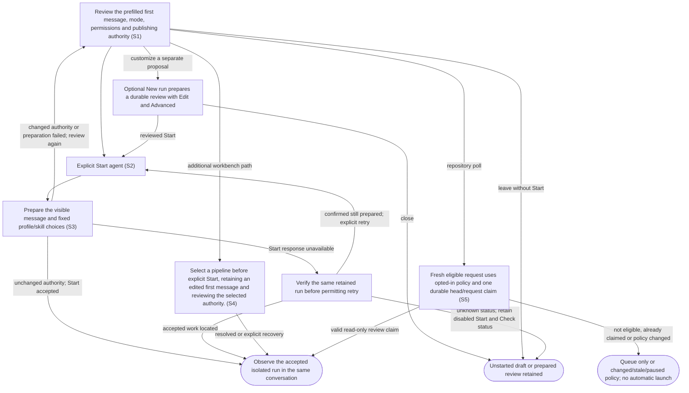

# Review and explicitly launch isolated agent work

## Goal

The owner reviews a durable work proposal and explicitly starts an agent in an isolated workspace.

## Preconditions

An item, repository and valid profile exist; the compatible agent provider is available.

## Main flow

1. Open an item directly in its conversation and inspect the prefilled first message, profile, mode, permissions and publishing authority.
2. Edit the message as needed and explicitly choose Start agent. Prepare the visible choices and start that proposal once. If resolved authority changes, review the updated values and choose Start again.
3. Alternatively, use New run under Item details to open a prepared review, customize through Edit and Advanced, then explicitly Start.
4. Observe progress in the same conversation while isolated work begins.

## Alternatives and recovery

Leaving the initial conversation retains its message and busy/uncertain state per item. A late result does not select a different item. Opening the initial conversation does not prepare or start work. Preparation failure retains the message with a local error. Closing the optional review before successful preparation only dismisses that proposal. Closing a prepared review, including after returning to edit it, retains the durable prepared snapshot without starting work. A collapsed Draft launches group lists prepared snapshots newest first; reopening displays the same reviewed values without preparing again. Preparing or inspecting does not create a running agent or workspace. Only prepared work can be started. Once the first Start queues the run, repeated Start requests are rejected rather than acknowledged as successful; they cannot create duplicate work. If Start fails or its response is lost, verify that same retained run before offering another Start. Accepted work opens in its conversation; a confirmed prepared run permits an explicit retry. Unavailable status disables Start and Edit until Check start status succeeds. Preparation and Start failures remain visible inside the dialog without losing edited work. Keyboard focus stays in the active dialog; Escape dismisses without starting and restores its connected opener. Existing checkouts are preserved. Publishing instructions describe agent authority; execution permissions remain enforced by the agent provider.

## Scenarios

- **S1** Item selection opens a prefilled conversation without preparing or starting. Optional New run opens a prepared review; customization and reopening retained drafts never start an agent or create a workspace.
- **S2** Explicit Start queues prepared work once and returns before completion; subsequent Start requests for that run are rejected. An uncertain response locates the accepted run before another action is offered.
- **S3** Selected skill contents and profile choices remain fixed in the prepared snapshot.

- **S4** Select a pipeline before explicit Start, retaining an edited first message and reviewing the selected authority.

- **S5** A fresh requested PR can launch automatically only under an owner-enabled inherited/repository policy. It uses the configured read-only review pipeline, asks before publishing, pins the current head, appends owner repository instructions and claims the request/head once. Queue-only, paused/stale/failed polls, drafts, other active agent work, unsafe profiles and changed policy do not launch. Restart never replays a claimed request. A newly observed request episode or new head can receive a new review. Manual launches keep their explicit Start behavior.

Review/implementation defaults resolve repository overrides before system defaults. Plugin maintenance excludes concurrent agent start, message/answer delivery and automatic question/inference work; rejected submissions retain their ordinary drafts. Prepared skills retain content/support files and executable modes across later plugin changes.

<!-- flow-references -->
## Terminology and UI references

Glossary: [prepared-launch](../glossary/README.md#prepared-launch), [profile](../glossary/README.md#profile), [skill](../glossary/README.md#skill), [workspace](../glossary/README.md#workspace), [agent-run](../glossary/README.md#agent-run), [coverage-gap](../glossary/README.md#coverage-gap), [unverified-behavior](../glossary/README.md#unverified-behavior), [keyboard-focus](../glossary/README.md#keyboard-focus), [modal-dialog](../glossary/README.md#modal-dialog), [agent-pipeline](../glossary/README.md#agent-pipeline), [review-policy](../glossary/README.md#review-policy), [review-request-claim](../glossary/README.md#review-request-claim), [repository-review-prompt](../glossary/README.md#repository-review-prompt).
UI entities: [D-LAUNCH](../ui/README.md#D-LAUNCH), [P-LAUNCH-FRAME](../ui/README.md#P-LAUNCH-FRAME), [P-LAUNCH-EDITOR](../ui/README.md#P-LAUNCH-EDITOR), [P-LAUNCH-REVIEW](../ui/README.md#P-LAUNCH-REVIEW), [W-DIALOG-FRAME](../ui/README.md#W-DIALOG-FRAME), [W-LAUNCH-EDITOR](../ui/README.md#W-LAUNCH-EDITOR), [W-LAUNCH-REVIEW](../ui/README.md#W-LAUNCH-REVIEW), [C-LAUNCH-OPEN](../ui/README.md#C-LAUNCH-OPEN), [C-LAUNCH-PROFILE](../ui/README.md#C-LAUNCH-PROFILE), [C-PREPARE](../ui/README.md#C-PREPARE), [C-LAUNCH-EDIT](../ui/README.md#C-LAUNCH-EDIT), [C-START](../ui/README.md#C-START), [C-DISMISS](../ui/README.md#C-DISMISS), [W-NEW-CHAT](../ui/README.md#W-NEW-CHAT), [P-NEW-CHAT](../ui/README.md#P-NEW-CHAT), [C-START-CHAT](../ui/README.md#C-START-CHAT), [C-PIPELINE-SELECT](../ui/README.md#C-PIPELINE-SELECT), [W-REPOSITORY-SETTINGS](../ui/README.md#W-REPOSITORY-SETTINGS), [W-SYSTEM-DEFAULTS](../ui/README.md#W-SYSTEM-DEFAULTS), [C-REVIEW-POLICY](../ui/README.md#C-REVIEW-POLICY), [C-REPOSITORY-REVIEW-PROMPT](../ui/README.md#C-REPOSITORY-REVIEW-PROMPT).

## Flow diagram

## Implementation references

- [internal/app/runs.go](../../internal/app/runs.go) — Durable preparation and isolated workspaces; Start atomically changes only prepared runs to queued and rejects later non-resume Start requests rather than returning an idempotent success. (`func (m *Manager) Prepare(`)
- [internal/codex/client.go](../../internal/codex/client.go) — Pinned provider protocol and process lifecycle
- [web/src/main.tsx](../../web/src/main.tsx) — Default review-first preparation, optional Edit/Advanced, durable draft reopening and explicit Start; uncertain responses verify the same run before retry. (`function Launch(`)
- [internal/domain/types.go](../../internal/domain/types.go) — Shared domain, persistence, transport or dependency contract
- [internal/store/store.go](../../internal/store/store.go) — Shared domain, persistence, transport or dependency contract
- [internal/transport/mcp.go](../../internal/transport/mcp.go) — Shared domain, persistence, transport or dependency contract
- [go.mod](../../go.mod) — Shared domain, persistence, transport or dependency contract
- [go.sum](../../go.sum) — Shared domain, persistence, transport or dependency contract
- [web/src/types.ts](../../web/src/types.ts) — Embedded UI build and host-fixture configuration
- [web/src/style.css](../../web/src/style.css) — Embedded UI build and host-fixture configuration
- [web/src/bridge.ts](../../web/src/bridge.ts) — Embedded UI build and host-fixture configuration
- [web/package.json](../../web/package.json) — Embedded UI build and host-fixture configuration
- [web/package-lock.json](../../web/package-lock.json) — Embedded UI build and host-fixture configuration
- [web/tsconfig.json](../../web/tsconfig.json) — Embedded UI build and host-fixture configuration
- [web/vite.config.ts](../../web/vite.config.ts) — Embedded UI build and host-fixture configuration
- [web/index.html](../../web/index.html) — Embedded UI build and host-fixture configuration
- [web/playwright.config.ts](../../web/playwright.config.ts) — Embedded UI build and host-fixture configuration
- [internal/testhost/main.go](../../internal/testhost/main.go) — Embedded UI build and host-fixture configuration
- [internal/testutil/fakecodex/main.go](../../internal/testutil/fakecodex/main.go) — Embedded UI build and host-fixture configuration
- [internal/testutil/testutil.go](../../internal/testutil/testutil.go) — Embedded UI build and host-fixture configuration
- [internal/web/embed.go](../../internal/web/embed.go) — Embedded UI build and host-fixture configuration
- [web/src/modal-focus.ts](../../web/src/modal-focus.ts) — Initial modal focus, visible-control Tab containment, Escape dismissal, focus preservation across updates and conditional opener restoration. (`export function useModalFocus(`)
- [web/src/main.tsx](../../web/src/main.tsx) — Explicit first-message launch and durable uncertainty. (`function NewChat(`)
- [internal/app/plugins.go](../../internal/app/plugins.go) — Durable pinned-CLI plugin lifecycle and exclusive runtime/maintenance boundary. (`func (m *Manager) PluginAction(`)
- [internal/domain/admin.go](../../internal/domain/admin.go) — Typed plugin operation and inventory persistence. (`type PluginOperation struct`)
- [internal/app/review_requests.go](../../internal/app/review_requests.go) — Resolve inherited review policies, fresh requests, durable claims and pinned automatic launches. (`func (a *App) ProcessReviewRequests(`)
- [web/src/admin.tsx](../../web/src/admin.tsx) — Repository/global review policy and plugin-admin settings. (`export function RepositoryAdmin(`)

## Test references

- [internal/app/app_test.go](../../internal/app/app_test.go) — `func TestAgentQuestionExactlyOnceAndRecovery(`; S1, S2. Preparation helper checks no worktree before start; one accepted Start reaches attention. Exactly-once assertions cover answers, not repeated Start requests.
- [web/tests/factory.spec.ts](../../web/tests/factory.spec.ts) — `test("triage does not launch, launch edits and attention answer survive reopening"`; S1, S2. Edited prompt and model reach prepare; UI starts once.
- [web/tests/factory.spec.ts](../../web/tests/factory.spec.ts) — `test("MCP bridge drives the assembled daemon through launch, question, answer and follow-up"`; S2. Assembled MCP-to-worktree-to-agent fixture.
- [internal/app/real_codex_test.go](../../internal/app/real_codex_test.go) — `func TestRealCodexInteractiveLifecycle(`; S3. Opt-in real provider lifecycle and skill load; skipped by default.
- [internal/codex/client_test.go](../../internal/codex/client_test.go) — `func TestProcessProtocolAndDisconnect(`; S2. Provider protocol regression.
- [web/tests/factory.spec.ts](../../web/tests/factory.spec.ts) — `test("keyboard launch review traps focus, preserves edits and restores its opener on Escape"`; S1. Keyboard-only opening, forward/reverse Tab containment, visible focus, draft retention through polling/review, Escape/opener restoration, default prepare plus explicit reprepare and no Start; polite connection status.
- [web/tests/factory.spec.ts](../../web/tests/factory.spec.ts) — `test("launch preparation failure is announced inside the dialog without losing keyboard edits"`; S1. Preparation error is a dialog-local alert, edited prompt remains, retry enables and no Start occurs; Escape restores opener.
- [web/tests/factory.spec.ts](../../web/tests/factory.spec.ts) — `test("lost Start response locates the accepted daemon run without another Start"`; S2. Busy double-click sends once; lost response locates accepted daemon work with read_run without another Start or prepare.
- [web/tests/factory.spec.ts](../../web/tests/factory.spec.ts) — `test("default launch opens review directly and Draft launches reopens its immutable snapshot newest first"`; S1, S3. Default review includes mode and policy; reopening retains original snapshot despite changed source profile.
- [web/tests/factory.spec.ts](../../web/tests/factory.spec.ts) — `test("unverifiable Start disables retry and Edit until read_run locates accepted work"`; S2. Uncertain Start gates duplicate actions until same-run status lookup recovers accepted work.
- [web/tests/factory.spec.ts](../../web/tests/factory.spec.ts) — `test("confirmed unaccepted Start allows an explicit retry of the same snapshot"`; S2. Status-confirmed unaccepted Start permits explicit retry without reprepare.
- [web/tests/factory.spec.ts](../../web/tests/factory.spec.ts) — `item opens a prefilled conversation and first-message Start stays explicit`; S1, S2. Item opens Agent with summary, prefilled prompt and closed details; no intermediate item-only page or Open agent control, no work before Start, retained item draft, exact prepare/start payload and conversation afterward.
- [web/tests/factory.spec.ts](../../web/tests/factory.spec.ts) — `first-message launch uncertainty survives leaving and reopening its item`; S1, S2. Uncertain first-message Start remains disabled across Back/reopen; Check reads the same prepared record with no additional Start/preparation.
- [web/tests/factory.spec.ts](../../web/tests/factory.spec.ts) — `first-message pipeline selection preserves an edited prompt`; S4. Selected profile reaches preparation only after Start and edited text remains intact.
- [internal/app/review_requests_test.go](../../internal/app/review_requests_test.go) — `func TestReviewPolicyInheritancePromptAndExactlyOnceAutomaticStart(`; S5. System defaults queue; enabled inherited policy starts one pinned read-only review with appended repo text, survives duplicate polls/restart and accepts a new request episode.
- [internal/app/review_requests_test.go](../../internal/app/review_requests_test.go) — `func TestRepositoryQueueOverridePauseDraftAndStaleRequestsDoNotStart(`; S5. Queue override, pause, draft, old sync, absent request, sync error and unsafe review profile cannot launch automatically.
- [internal/app/review_requests_test.go](../../internal/app/review_requests_test.go) — `func TestAutomaticStartRevalidatesPolicyAndMonitoringPreservesCheckpoint(`; S5. Automatic Start revalidates changed policy in its claim transaction and refuses a stale prepared launch; monitoring edits keep sync checkpoints.
- [internal/app/plugins_test.go](../../internal/app/plugins_test.go) — `func TestSelectedDiscoveredSkillKeepsItsBundleAndAutomaticChecksDoNotInstall(`; S3. Selected discovered skill retains its full bundle and executable modes.
- [web/tests/factory.spec.ts](../../web/tests/factory.spec.ts) — `repository review pipeline overrides system defaults and plugin skills remain selectable`; S4. Repository role choice overrides the system; plugin skills can be selected and missing skills are disabled.
- [internal/app/review_requests_test.go](../../internal/app/review_requests_test.go) — `func TestNewPRHeadGetsOneNewReviewAndExtraPromptIsNotDuplicated(`; S5. A changed head receives one new review, while repeated preparation does not duplicate repository instruction blocks.

## Verification and gaps

Local suites: `go`, `browser`.
Fixture success does not establish real-host acceptance.
- **S2** — `gap-flow-launch-agent-s2-01` · Unverified behavior · P2 · owner: user-flow-maintainer. Assembled lost-response recovery/busy-click assertions retain exactly one daemon run. Concurrent Start requests from independent clients still lack a dedicated race assertion. Next verification: Send independent concurrent Start requests for one prepared run; assert exactly one accepted transition, rejection of others and no duplicate workspace/process.
- **S3** — `gap-flow-launch-agent-s3-01` · Unverified behavior · P2 · owner: user-flow-maintainer. Immutable skill-bundle edit-after-prepare coverage is missing; skill loading is exercised only in the opt-in real-provider test. Next verification: Prepare a run, edit its source profile and skill files, and assert that prepared values and copied skill content remain unchanged; distinguish this fixture from opt-in provider loading.
- **S1** — `gap-flow-launch-agent-s1-01` · Unverified behavior · P2 · owner: user-flow-maintainer. Default review and Close after preparation plus durable draft reopening are covered. Close during in-flight preparation and after unreviewed Edit remain unverified. Next verification: Gate preparation, close during its response and after unreviewed Edit; assert no implicit Start, retained prepared records and unchanged reviewed snapshots.

<!-- /flow-references -->
