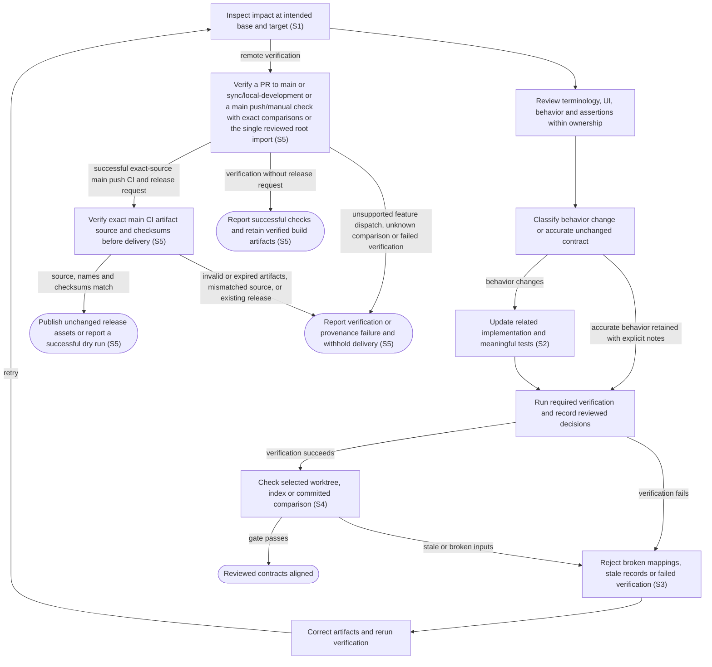

# Reconcile flow contracts with implementation and tests

## Goal

A contributor keeps terminology, interface structure, user-visible behavior, implementation and tests aligned as a change evolves.

## Preconditions

The contributor has the source checkout, an available comparison base and the local verification prerequisites.

## Main flow

1. Inspect changed artifacts, affected terms/interface entities/flows, actual source/assertion references and required next steps.
2. Review each affected meaning, interface definition, behavior description and assertion against the intended outcome within its maintenance ownership.
3. When the described behavior changes, update related implementation and tests in the same change.
4. Keep open gaps typed with stable identity, ownership, severity and the next verification; run required suites and record subject-specific decisions.
5. Run the local gate against the intended working tree, index or committed branch comparison. Each local verification invocation prepares locked dependencies, the frontend and shared fixture artifacts once; standalone build and test commands prepare their own prerequisites. Independent invocations rebuild from current inputs, including changed build tooling and deleted outputs. Verification phases remain ordered under parallel execution flags, with performance after heavy suites. Reconciliation and subsequent local CI remain separate required runs. Retain allowlisted, versioned phase timing evidence with source/comparison identity, monotonic intervals and outcomes; unstarted work has no fabricated duration. Failures and cancellation preserve partial evidence and command status; overlapping durations remain distinct from wall time.
6. A pull request to main or sync/local-development, a push to main or a manual check on main selects exact comparison commits, installs locked prerequisites and runs the same fixture suites without model credentials. The production embedded UI launch gate runs after heavy suites with one worker, zero retries and all timing samples retained. Feature branches receive remote verification through a PR to main or sync/local-development; without one they receive no automatic checks or package artifacts. Manual verification on a feature branch fails before source checks or verified-build/package artifact creation; partial timing summaries may remain. A narrowly pinned, reviewed first public root has no predecessor; it receives full source checks without a fabricated Git comparison. Hosted setup and verification retain the same bounded phase journal, finalized before artifact transfers with an always-attempted upload.
7. Package delivery promotes unchanged checksummed artifacts only from successful main-branch push verification for the exact tagged source; dry-run delivery verifies without publishing or installing. Component versions come from those exact package bytes; explicit fixed-issue references require ancestor fix commits with matching fixing or closing references.

## Alternatives and recovery

New unmapped source files and broken references fail validation. Code or test changes may retain a description only with an explicit reviewed explanation and fresh successful verification. Explicit behavior reviews require related code and meaningful test changes even when the description already matches. New or retired interface contracts require their own related changes, rather than borrowing unrelated entity changes. Indirectly affected unchanged consumers still need review without independent code and test edits. Refactors, terminology corrections and structural-reference updates can retain accurate behavior with substantive review and verification. Foundational definitions never link back to their consumers. Escaped link spellings and resolved shortcuts inside nested containers remain references, while indented code and ordinary escaped brackets do not create shortcut links. Required maintenance definitions retain their own validation policy without imposing it on unrelated agent configurations. Unsupported embedded repositories fail worktree inspection rather than hiding their contents; staged and committed selections remain independent, including executable-mode changes. Stale evidence, failed verification and unknown comparisons fail the gate. Unowned assertion inventories cannot supply coverage. Removing older ownerless inventory still requires review of existing interface consumers, or existing flows when no interface entities remain; its historical definitions and inputs remain freshness evidence without becoming behavioral ownership. Equivalent same-scope names and aliases remain ambiguous after Unicode normalization, while separate scopes preserve their display spelling. Displayed instance identity and context require the declared nonempty text fields. Schema versions and successful verification statuses require exact supported integer values. Ambiguous duplicate JSON members and object- or string-shaped collection declarations are rejected; false-valued object keys cannot create membership or coverage. Invalid collection declarations leave generated outputs unchanged, and ambiguous review input is rejected before verification or prior-record removal. Rendering rejects malformed recipes and overlapping owned blocks before writing outputs, preserving independently authored content. Obsolete generated references inside registered owned blocks can be replaced; authored references, current definitions and the complete replacement output still undergo validation. A timed-out or cancelled verification removes selected prior success and stops its owned verification work before another attempt; successful verification also cleans up remaining owned work. Cancellation received during timeout cleanup retains its cancellation outcome after cleanup. Changes to verification runners and declared source/build inputs invalidate previous verification. Ordinary verification forces fixture mode; real provider checks use a separate explicit command. Initial documentation of existing behavior is a one-time adoption pinned to the initial project commit.

Read-only reports suggest work without executing it or claiming success. Historical
gap reasons stay untyped until explicitly migrated; narrowing a gap preserves its
identity and needs matching assertions. Initial interface adoption and new behavior
may receive separate explicit contract decisions without waiving behavior tests.

## Scenarios

- **S1** Code and test changes both identify affected flows and require fresh reconciliation.
- **S2** Behavior changes, including flow addition/removal, require changed implementation and tests; reviewed corrections preserve accurate outcomes.
- **S3** Broken references, unmapped files, unknown comparisons and stale or failed verification fail closed.
- **S4** The same checker evaluates working changes, the staged index, and explicit committed branch/PR comparisons. Each verification invocation shares preparation once, while independent verification and standalone build/test invocations prepare their required current inputs and deleted outputs. Failed verification phases stop downstream work even when keep-going flags are requested; standalone goals retain their requested keep-going behavior. Explicit MAKEFLAGS assignment forwards caller variables with their existing expansion flavor and literal dollars. Parallel execution flags preserve phase order and isolated performance checks. Phase summaries preserve outcomes and incomplete work without recording environment or command contents. Default verification uses fixtures; provider execution requires a separate explicit opt-in.
- **S5** Remote verification covers PRs to main or sync/local-development and main pushes or manual checks, preserving exact comparisons and a single reviewed public-root bootstrap. Feature branches without a PR receive no automatic checks or artifacts; feature-branch manual verification is rejected. Release delivery requires successful main push verification, exact artifact provenance, packaged component versions, commit-backed fixed-issue references and checksums. Unknown comparisons, failed checks, changed artifacts or existing releases stop delivery.

Browser correctness comparison keeps independently owned mock sessions concurrent
and shared daemon scenarios ordered. Repeated serial and bounded-worker samples
retain outcomes and resource evidence without retrying failed assertions. A failed
sample stops comparison and retains partial evidence; comparison never replaces
full verification, isolated launch-performance acceptance or release provenance.

<!-- flow-references -->
## Terminology and UI references

Glossary: [reconciliation](../glossary/README.md#reconciliation), [verification](../glossary/README.md#verification), [glossary](../glossary/README.md#glossary), [entity](../glossary/README.md#entity), [coverage-gap](../glossary/README.md#coverage-gap), [known-limitation](../glossary/README.md#known-limitation), [unverified-behavior](../glossary/README.md#unverified-behavior).
UI entities: none (operational contract).

## Flow diagram

## Implementation references

- [scripts/user_flows.py](../../scripts/user_flows.py) — Compatible legacy CLI and unified-dispatch/public callback facade
- [Makefile](../../Makefile) — One worker dependency graph shares phony preparation per invocation, prepares standalone prerequisites and orders phases under parallel flags; public verification wrappers enforce stopping after failure. Allowlisted timing wrappers observe actual commands and the graph boundary without recreating scheduling.
- [scripts/verify.sh](../../scripts/verify.sh) — Direct fixture-only entry point into the single Make verification graph Caller arguments retain native Make forwarding.
- [.agents/skills/reconcile-user-flows/SKILL.md](../../.agents/skills/reconcile-user-flows/SKILL.md) — Contributor reconciliation workflow
- [AGENTS.md](../../AGENTS.md) — Repository routing to flow maintenance
- [scripts/specs.py](../../scripts/specs.py) — Compatible unified CLI including read-only report and gap inventory commands
- [.codex/agents/glossary-maintainer.toml](../../.codex/agents/glossary-maintainer.toml) — Maintained specification registries, deterministic gates and scoped maintenance ownership
- [.codex/agents/specification-coordinator.toml](../../.codex/agents/specification-coordinator.toml) — Maintained specification registries, deterministic gates and scoped maintenance ownership
- [.codex/agents/specification-reviewer.toml](../../.codex/agents/specification-reviewer.toml) — Maintained specification registries, deterministic gates and scoped maintenance ownership
- [.codex/agents/ui-specification-maintainer.toml](../../.codex/agents/ui-specification-maintainer.toml) — Maintained specification registries, deterministic gates and scoped maintenance ownership
- [.codex/agents/user-flow-maintainer.toml](../../.codex/agents/user-flow-maintainer.toml) — Maintained specification registries, deterministic gates and scoped maintenance ownership
- [.agents/skills/maintain-glossary/SKILL.md](../../.agents/skills/maintain-glossary/SKILL.md) — Maintained specification registries, deterministic gates and scoped maintenance ownership
- [.agents/skills/maintain-ui-specs/SKILL.md](../../.agents/skills/maintain-ui-specs/SKILL.md) — Maintained specification registries, deterministic gates and scoped maintenance ownership
- [.agents/skills/reconcile-specs/SKILL.md](../../.agents/skills/reconcile-specs/SKILL.md) — Maintained specification registries, deterministic gates and scoped maintenance ownership
- [scripts/specs_lib/__init__.py](../../scripts/specs_lib/__init__.py) — Shared specification-tooling package boundary
- [scripts/specs_lib/core.py](../../scripts/specs_lib/core.py) — Shared operational module scope and canonical identities (`def module_paths(`)
- [scripts/specs_lib/flow_impact.py](../../scripts/specs_lib/flow_impact.py) — Legacy comparison impact and source/test obligations (`def analyze(`)
- [scripts/specs_lib/flow_receipts.py](../../scripts/specs_lib/flow_receipts.py) — Legacy receipt versions and successful verification evidence (`def receipt_errors(`)
- [scripts/specs_lib/flow_rendering.py](../../scripts/specs_lib/flow_rendering.py) — Behavior graph/reference blocks and gap display (`def references(`)
- [scripts/specs_lib/flow_schema.py](../../scripts/specs_lib/flow_schema.py) — Legacy/versioned flow and scenario validation (`def validate(`)
- [scripts/specs_lib/gap_inventory.py](../../scripts/specs_lib/gap_inventory.py) — Versioned/legacy inventory compatibility and readable gap presentation (`def inventory(`)
- [scripts/specs_lib/gaps.py](../../scripts/specs_lib/gaps.py) — Pure structured gap validation, explicit migration and inventory (`def validate(`)
- [scripts/specs_lib/git_snapshots.py](../../scripts/specs_lib/git_snapshots.py) — Exact Git snapshots, file modes and selected comparisons (`def snapshot(`)
- [scripts/specs_lib/impact.py](../../scripts/specs_lib/impact.py) — Layered consumer impact, current suites and dependency fingerprints (`def analyze(`)
- [scripts/specs_lib/json_schema.py](../../scripts/specs_lib/json_schema.py) — Duplicate-member JSON and typed collection boundaries (`def decode_json(`)
- [scripts/specs_lib/maintenance.py](../../scripts/specs_lib/maintenance.py) — Required agent and skill metadata policy (`def validate_agents(`)
- [scripts/specs_lib/processes.py](../../scripts/specs_lib/processes.py) — Owned verifier execution and receipt-writing lifecycle (`def run_verification(`)
- [scripts/specs_lib/receipts.py](../../scripts/specs_lib/receipts.py) — Layered reviewed classifications and receipt validity (`def constraints(`)
- [scripts/specs_lib/references.py](../../scripts/specs_lib/references.py) — Foundation link direction and Markdown reference context (`def dependency_errors(`)
- [scripts/specs_lib/rendering.py](../../scripts/specs_lib/rendering.py) — Owned UI/glossary blocks, tables and Mermaid rendering (`def generated(`)
- [scripts/specs_lib/reporting.py](../../scripts/specs_lib/reporting.py) — Pure deduplicated impact report and exact next argv presentation (`def build_report(`)
- [scripts/specs_lib/schema.py](../../scripts/specs_lib/schema.py) — Layered registry, graph and coverage validation (`def validate(`)
- [scripts/browser_control.mjs](../../scripts/browser_control.mjs) — Local stdio controller selects approved native/pilot/explicit loopback attachment without launching or exporting a browser profile. (`const options = parseBrowserOptions(`)
- [scripts/browser_options.mjs](../../scripts/browser_options.mjs) — Pure explicit attachment options retain privacy flags, reject unsafe/ambiguous endpoints and never echo rejected credential-bearing URL values. (`export function parseBrowserOptions(`)
- [scripts/ci.py](../../scripts/ci.py) — Select exact event comparisons and restricted reviewed-root bootstrap before entering hosted preparation and verification; preserve artifact provenance (`def comparison(`)
- [scripts/release.py](../../scripts/release.py) — Require successful push CI for exact main-history source, and deliver the same checked artifacts or perform a nonpublishing dry run. (`def resolve(`)
- [.github/workflows/ci.yml](../../.github/workflows/ci.yml) — Hosted full verification on pushes and PRs with read-only permissions and pinned prerequisites/actions. (`name: CI`)
- [.github/workflows/release.yml](../../.github/workflows/release.yml) — Version-tag and manual dry-run package promotion; scoped publisher permission, no live-machine deployment. (`name: Release`)
- [release/fixed-issues.json](../../release/fixed-issues.json) — Explicit fixed issues backed by ancestor source commits and exact promoted package versions.
- [docs/ci.md](../../docs/ci.md) — Contributor completion procedure linking existing reconciliation, fixture verification and authorized PR workflow gates. (`## Final verification and PR handoff`)
- [scripts/test_specs_timing.py](../../scripts/test_specs_timing.py) — `def test_manual_setup_failure_retains_existing_parent_comparison(`; S4, S5. A supported manual main dispatch records the exact existing HEAD-parent comparison before setup; failed setup retains this identity with unstarted verification phases.
- [scripts/test_specs_timing.py](../../scripts/test_specs_timing.py) — `def test_manual_root_metadata_preserves_existing_bootstrap_guard(`; S4, S5. Initial manual metadata reuses the verifier main/root policy: only the pinned reviewed main root omits a parent, and neither an unreviewed root nor a feature ref gains a fabricated comparison.
- [scripts/test_specs_timing.py](../../scripts/test_specs_timing.py) — `def test_hosted_manual_metadata_errors_are_private_and_unavailable(`; S4, S5. Malformed manual event metadata yields unavailable comparison without logging its private content.
- [scripts/test_specs_timing.py](../../scripts/test_specs_timing.py) — `def test_rejected_manual_feature_retains_only_partial_timing_evidence(`; S4, S5. Actual manual feature rejection invokes neither source verification nor package-manifest creation, while the startup/finalization path retains a failed partial timing journal.
- [scripts/test_specs_timing.py](../../scripts/test_specs_timing.py) — `def test_local_metadata_signals_finalize_before_worker_starts(`; S4, S5. Real SIGINT and SIGTERM during tool-version collection preserve shell signal status, finalize interrupted partial journals with wall time, leave verification phases unstarted and never launch the worker.
- [scripts/test_specs_timing.py](../../scripts/test_specs_timing.py) — `def test_identity_hashes_exact_whitespace_prefixed_tracked_and_untracked_names(`; S4, S5. Space-, tab- and newline-prefixed first Git filenames retain exact NUL-delimited bytes. Tracked and untracked content edits change the digest at unchanged HEAD and dirty state; ignored journals preserve identity and export no filenames, private paths or contents.
- [scripts/test_specs_timing.py](../../scripts/test_specs_timing.py) — `def test_git_text_identities_and_comparisons_remain_normalized(`; S4, S5. Returning raw Git bytes preserves normalized head/comparison SHAs, clean status and exact committed or merge-base comparison metadata for text callers.
- [scripts/test_specs_timing.py](../../scripts/test_specs_timing.py) — `def test_identity_frames_binary_contents_and_record_boundaries(`; S4, S5. Two different real-Git states at identical HEAD and dirty status cannot share the former ambiguous digest when binary file content imitates another path/mode/content record; journal source identity stays immutable.
- [scripts/test_specs_timing.py](../../scripts/test_specs_timing.py) — `def test_identity_distinguishes_file_link_absence_and_executable_mode(`; S4, S5. Identity keeps regular-file content, symbolic-link target, tracked absence and executable-mode distinctions while the same inputs hash identically before or after staging.

## Verification and gaps

Local suites: `tooling`.
Fixture success does not establish real-host acceptance.

<!-- /flow-references -->
