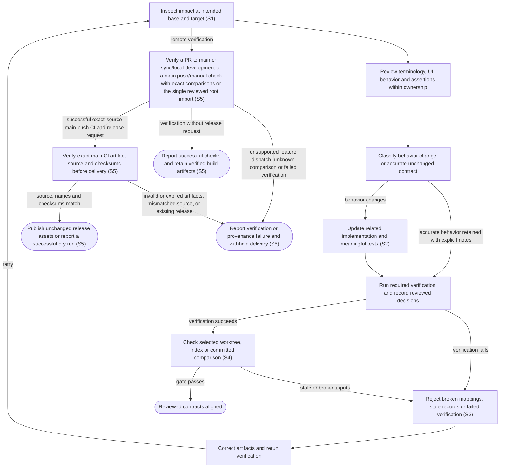

# Reconcile flow contracts with implementation and tests

## Goal

A contributor keeps terminology, interface structure, user-visible behavior, implementation and tests aligned as a change evolves.

## Preconditions

The contributor has the source checkout, an available comparison base and the local verification prerequisites.

## Main flow

1. Inspect changed artifacts, affected terms/interface entities/flows, actual source/assertion references and required next steps.
2. Review each affected meaning, interface definition, behavior description and assertion against the intended outcome within its maintenance ownership.
3. When the described behavior changes, update related implementation and tests in the same change.
4. Keep open gaps typed with stable identity, ownership, severity and the next verification; run required suites and record subject-specific decisions.
5. Run the local gate against the intended working tree, index or committed branch comparison. Each local verification invocation prepares locked dependencies, the frontend and shared fixture artifacts once; standalone build and test commands prepare their own prerequisites. Independent invocations rebuild from current inputs, including changed build tooling and deleted outputs. Verification phases remain ordered under parallel execution flags, with performance after heavy suites. Reconciliation and subsequent local CI remain separate required runs. Retain allowlisted, versioned phase timing evidence with source/comparison identity, monotonic intervals and outcomes; unstarted work has no fabricated duration. Collect source identity early and derive local comparison from the specification check's actual arguments immediately before it executes; earlier failures and comparison-free bootstrap retain an unavailable comparison. Preserve the hosted event-pinned comparison and native prerequisite variable inheritance. Successful native dry runs create no timing file. An attempt that fails or is interrupted before native context is observed retains an unknown partial at its reserved identity and monotonic origin, even when that attempt was dry. Direct helper calls and supplied or hosted journals retain immediate startup behavior. Failures and cancellation preserve partial evidence and command status; overlapping durations remain distinct from wall time.
6. A pull request to main or sync/local-development, a push to main or a manual check on main selects exact comparison commits, installs locked prerequisites and runs the same fixture suites without model credentials. The production embedded UI launch gate runs after heavy suites with one worker, zero retries and all timing samples retained. Feature branches receive remote verification through a PR to main or sync/local-development; without one they receive no automatic checks or package artifacts. Manual verification on a feature branch fails before source checks or verified-build/package artifact creation; partial timing summaries may remain. A narrowly pinned, reviewed first public root has no predecessor; it receives full source checks without a fabricated Git comparison. Hosted setup and verification retain the same bounded phase journal, finalized before artifact transfers with an always-attempted upload.
7. Package delivery promotes unchanged checksummed artifacts only from successful main-branch push verification for the exact tagged source; dry-run delivery verifies without publishing or installing. Component versions come from those exact package bytes; explicit fixed-issue references require ancestor fix commits with matching fixing or closing references.

Python CI and specification phases discover their full ordinary unittest
inventories and execute unique test IDs in two isolated worker processes, with
an explicit maximum of four. Failed workers, incomplete reports and missing or
duplicate executions fail the phase. Worker-global patches and environment
changes do not cross processes. The coordinator and workers share one owned
process group, reusing an authenticated enclosing verifier or creating one for
direct use, so abrupt coordinator exit still triggers ordinary descendant
cleanup. Private child entry requires ownership and group admission before
discovery or report mutation. Preserve ordinary method, import and fixture skip
semantics: explicit fixture skips account only for their actual assigned scope,
while omitted non-skipped cases fail. Repeated legitimate fixture-skip events
retain their event counts and account for each affected case once. Retain per-test durations, individually
completed counts, explicit fixture skips and exact inventory/accounting counts;
persisted summaries never supply verification reuse. Heavy-phase ordering and
the one-worker production performance gates remain intact.

Verification owns one checkout before preparing mutable artifacts. Separate
worktrees can run concurrently with distinct configured fixture listener ports. Each invocation propagates private temporary state
and confines fixture repository discovery to that state. Nested verification
shares authenticated ownership; a competing invocation fails before preparation.
Provided verification entrypoints apply the private discovery boundary to the
caller's actual exported values and restore borrowed caller state on exit.
Raw supplemental recipes retain native export decisions and use a managed
entrypoint when they need automatic fixture discovery bounds. Explicit provider
acceptance retains its opt-in within that managed boundary; service-only
connection probes keep their native installed-service interaction.
Reserved hidden verifier directories stay outside specification inputs even when
the temporary parent is inside the checkout; unrelated untracked source stays visible.
Caller-selected Makefiles keep their order, includes and command-line overrides.
Their recipes, shared prerequisites and file-defined default execute in the native
caller graph. Native re-execution retains the same invocation and ownership.
Managed commands finish cleanup and timing before releasing the checkout. Supplemental recipes keep
native Make shell and cancellation semantics; arbitrary background descendants are
outside managed cleanup. Stdin-selected configuration remains private and available
to nested verification until the invocation ends; an ambiguous required replay
fails before verification. Managed commands retain cleanup responsibility when
they replace a process. Direct hosted cancellation or abrupt Make death retains
ownership through managed cleanup and nested timing finalization. Ordinary Make
failure waits for foreground managed helpers; normal completion keeps the short
cleanup path. Malformed inherited ownership
fails before cross-checkout work. Pending entry commits its lease only while the
original caller is observed alive after the identity handshake; a committed lease
remains owned through later caller exit, including delayed acknowledgement. Literal
temporary-parent values retain their bytes across caller settings, and command
execution retains its selected working directory.
Fresh browser listeners retain kernel-assigned loopback ports and communicate
their actual origins before assertions. An explicit adjacent port pair remains
supported; an occupied requested listener fails at startup without assertion
retries or reuse of an unknown server. Completion and cooperative cancellation
remove owned work only. Fixture-mode selection uses the installed Playwright
test command's option parser, including consumed values and the `--` positional
boundary. Browser fixtures preserve caller signal listeners and
retain cancellation status through bounded child cleanup and private-state
removal. Cancellation starts the child escalation deadline even during build
startup; repeated signals and finalization retain that first deadline, and no
later child starts. Go compilation and daemon readiness share a 60-second
correctness or 120-second performance startup budget. Correctness then starts an
owned UI child under a separate 60-second readiness guard; performance has no UI.
The UI publishes its actual origin or startup error atomically, closes on signals
and remains monitored during browser execution. Imports do not start its CLI.
Expiry reports failure and drains retained children before private-state removal. Browser listener regression requests and server lifecycle
waits have local failure deadlines. A timed-out Vite creation retains its pending
result for eventual server and cache cleanup, including late rejection or close
failure; repeated teardown shares that cleanup operation. Subprocess regression
checks retain their unreaped leader through bounded original-group cleanup, including early leader exit,
then reap adopted descendants before completing. Browser cancellation assertions
use a short raw-runner-exit deadline and check child disappearance and private-state
removal before supervisor safety cleanup. A bounded observation
hold succeeds only on explicit acknowledgment. Observer EOF, interruption or a
missing acknowledgment fails and still cleans owned work; partial control lines
cannot block the deadline. Stale ownership fails, while an abandoned lock file
alone does not block a fresh invocation.

The callable phase-journal helper records bounded, allowlisted command outcomes,
monotonic intervals and immutable input/comparison identities. Staged selections
identify the selected index independently of working changes without exposing
private names or content. Intent-to-add entries remain outside that selected
index until staged. Unmerged indexes and conflicting committed-head and staged
selections leave the comparison unavailable without modifying index bytes.
Complete journal metadata collection also preserves those bytes after stat-only
changes to tracked files. Initial pushes follow the existing reviewed-root or
merge-base policy; unavailable comparisons stay explicit even when setup fails.
Reserved phases can still record execution at the journal capacity limit, while
additional rows remain bounded. Missing work has no invented duration; failures
and cancellation retain partial evidence. Real owned-signal and nonowned-capacity
assertion probes run behind independent finite deadlines with registered cleanup.
Local-verifier probes use an isolated subreaper supervisor so a timed-out
coordinator cannot abandon detached verifier descendants before fixture disposal.
Signal handlers record cancellation without throwing across child assignment or
the first cleanup instruction. Cleanup then ignores repeated signals, terminates
and reaps the owned descendants, and preserves the recorded signal status.
A deterministic cleanup-entry SIGINT probe asserts both exit130 and no survivors.
Its child acknowledges both descendant PIDs through a pipe before the inner
cleanup deadline starts, with a separate bounded readiness wait.
Its owned runner passes only explicit descriptor capabilities. Optional diagnostic
write failures preserve worker execution and authoritative process outcomes through
interpreter shutdown; available diagnostics retain fixed nonsensitive messages
and the destination text stream's encoding and error policy. Repeated messages
retain destination encoding state; failed optional writes leave it reusable.
Automatic local entry-point integration observes the native Make graph. Hosted setup and verification retain the same journal through artifact upload.

Hosted startup retains recoverable evidence before collecting metadata. Interrupted
initial publication cannot expose an incomplete summary. Surviving finalization can
recover missing evidence from its matching reservation, preserving hosted identity,
the original clock and unknown metadata. Reconstruction requires a valid matching
reservation and does not replace an existing path, including a broken symlink.
Work that never started retains unavailable durations, and optional evidence
failures preserve the verification or cancellation outcome.

An explicit `scripts/verify_local.py` invocation accepts the intended comparison
and complete substantive review decisions. It plans the standard native Make
graph, prepares build/package inputs and Vite dependency bundles once, executes every required check and writes
CLI-generated receipts before the final specification check. Exact argv and
working-directory matches share execution only while source, prepared artifacts,
resolved executables, environment, comparison and decisions stay unchanged.
Preparation keeps first occurrences in the same environment/owner session;
actual execution, reconciliation reuse and final input guards remain mandatory.
Within each helper-identity traversal, stable opened-file metadata permits one
content digest per device/inode while retaining every alias/lookup/mode row.
Fresh reads and memo hits check metadata/bindings; every later checkpoint reads
afresh. Replacement and nonregular targets fail, and descriptor cleanup preserves
an earlier error or cancellation.
Artifact symlink chains must remain inside admitted checkout inputs; Git metadata,
report/cache/owner outputs and external lookup paths reject. Worktree source
snapshots, regular artifacts, resolved executables, ELF discovery prefixes and review decision files
use nonblocking, no-follow descriptor opens with type, metadata and pathname
binding checks before and after consumption. Descriptor cleanup retains the original
failure or cancellation.
Review lookup watches precede initial consumption. Reconciliation decodes the
admitted immutable review bytes; later checkpoints use typed reads and reject
replacement without waiting on a FIFO. Failure or cancellation after required work
or receipt creation removes success and releases checkout ownership.
Initial analysis, source identity and the reconciliation refresh reject present
nonregular worktree files through typed reads; committed snapshots retain exact
Git blobs. Makefile and supported browser, npm, loader and Git discovery payloads
also use typed reads, preserving cancellation during those file accesses.
Npm launcher discovery and earlier-candidate watches share the same per-directory
ancestor `.bin` and node-gyp prefix inventory.
Source monitoring starts before the initial snapshot and native planning and
continues through required verification. A restored planning-time input change
rejects before required checks can use its captured plan.
Checkout pathname ancestry is bound before the initial watched tree traversal.
Restoring a substituted ancestor directory cannot make an incomplete captured
plan eligible, even when the original checkout and Makefile inodes are preserved.
Planner executable and earlier PATH-candidate monitoring also precede native
planning. Relative or empty entries in nonempty Python import-root selectors
reject before ownership, avoiding working-directory-dependent helper imports.
The public CLI performs bootstrap admission before application imports and
argument parsing. Interpreter startup/hooks precede that preflight; admitted
absolute roots retain normal Python behavior.
Linux mutation monitoring rejects changed-and-restored inputs, including external
hard-link writes and shared writable mappings. Existing writable descriptors or
mappings reject when their input is admitted: source, review and planner inputs
are admitted before planning, external dependencies before preparation, and
generated artifacts after preparation before checked execution. Later write
attempts invalidate
the invocation even if bytes are restored and the writer remains open. The
invocation requires supported read leases and an available signal reservation.
The host administrator and kernel remain trusted; root-owned, group/other
nonwritable installed tools on maintained local filesystems retain inode and
metadata checks without requiring an unprivileged caller to lease them. Toolchain
installation must not overlap verification. Uncertain admission, replaced directory
trees and lost event coverage fail the invocation; no persisted summary authorizes
reuse. Make build/performance suite commands use their inspected native graphs.
Different npm invocation forms remain distinct checks. Nonempty ESBUILD_BINARY_PATH
rejects before ownership or discovery; esbuild uses the locked bundled package.
Go module build-list sources/metadata and the Python interpreter's admitted import
search roots and package data are monitored, including directory aliases. Selected
Python search paths intersecting omitted runtime or __pycache__ trees reject,
including original, resolved and intermediate alias spellings. Unused tagged automatic
cache files beneath ordinary search roots remain excluded; nested __pycache__
directories can contain importable source or legacy bytecode and stay monitored.
Git revision/status inputs
include watched worktree selection, refs, objects, index, configuration and default
ignore/attribute files, including system attributes and linked-worktree private
refs/worktree, refs/bisect and refs/rewritten; restored writes reject.
Git metadata has no Python-cache exclusion. Selected tracked-file clean/process
filters reject before required work; unused filter definitions remain supported.
Configured clean/process drivers named set, unset or unspecified reject because
Git's attribute query cannot distinguish those names from its special states.
Go's VCS stamping remains enabled.
The combined invocation suppresses optional index refresh writes and restores the
caller setting. Custom Git selectors, config includes/fsmonitor/external ignore
paths, alternate object stores, grafts and nonstandard ref storage reject. Custom
effective Go flags (including overlays), workspaces and nonempty effective
GOCACHEPROG selections fail before module discovery, including GOENV selections.
Each combined invocation overrides environment and GOENV cache selections with
a private Go cache in the authenticated owner's temporary namespace. Each required
command starts with an empty cache; an earlier command's compilation outputs do
not supply later checks. Cache files remain mutable temporary outputs within one
command, while exact completed command results still share under stable source,
toolchain, environment and comparison guards. Fresh compilation across distinct
commands adds overhead. Cache-directory selection and lookup/inode binding remain
guarded through summary publication and close before owner teardown. Failed
disposal rejects successful publications while preserving earlier errors or
cancellation, and caller cache selection is restored.
Nonempty LD_PRELOAD, LD_AUDIT and LD_LIBRARY_PATH select unsupported external
loader code or library search inputs and reject before ownership, planning or
helper discovery; empty values are admitted. Nonempty NODE_OPTIONS and custom
effective cgo flags are unsupported.
Effective npm node-options configuration is also rejected in both repository and
web contexts, including environment and npmrc selections for lifecycle children.
Cgo admission reads both environment and GOENV selections and allows only the standard
empty preprocessor flags and `-O2 -g` compiler/linker defaults. External startup
modules, forced headers and custom library inputs cannot bypass the guards.
GCC's default C/C++ header search roots, absent and duplicate lookup candidates participate
in identity and mutation monitoring, with alias targets covered. Custom GCC
include, library and helper search environment overrides are unsupported.

The combined command supports the maintained x86-64 glibc ABI. It inventories the
canonical system native-library tree, direct files in built-in and cached lookup
directories, hardware-capability candidates, selected cache entries, loader/cache
configuration and absent preload/search paths. This includes native modules loaded
by Python, Node and Chromium as well as startup dependencies. The native ABI tree
also covers ordinary system plugin and dlopen modules; unrelated SDK trees are not
recursively selected. The full helper/package inventories resolve nested directory
aliases before scanning bundled native modules, so extensions beneath aliased
packages receive the same loader admission and monitored dependency coverage.
The maintained executable inventory includes the pinned Playwright registry's
`chrome-headless-shell`, alongside the older `headless_shell` spelling.
ELF search admission checks original and resolved ORIGIN parent
spellings. Interpreter and RPATH/RUNPATH admission rejects alternate
loaders, relative searches, unsupported tokens and existing search directories
outside these inventories. Path-qualified dependencies and ELF audit/filter
indirection are unsupported. Absent search directories are watched; creation fails
rather than broadening an active invocation. Nonempty LD_* or GLIBC_TUNABLES
contexts and system preloads are unsupported. ldconfig and readelf, their aliases
and selected library inputs participate in repeated discovery and identity checks.
PATH entries must be nonempty absolute directories. Nonempty case-insensitive
PATH carriers with a spelling other than `PATH` reject
before ownership or discovery, since npm merges those variables into its search.
Empty alternate carriers are admitted. The maintained graph's selected
launchers, fixed compiler/shell lookup names and discovered helper filenames have
lookup watches, including earlier unselected candidates. Go fixture runs also
bind their selected privilege helper and earlier lookup candidates. The maintained
npm launcher also binds its shebang interpreter. Browser npm scripts enter Python
ownership, run the Node fixture launcher and compile the Go fixture host. Their
helper lookups include npm's ancestor node_modules/.bin prefixes, node-gyp prefix
and inherited PATH, with candidates watched even when absent. Aliases to the
inventoried tools require matching Python import roots; adjacent virtual
environment configuration remains watched. A different selected launcher rejects
before work so resource discovery cannot describe another executable.
This inventory supports the maintained scripts and admitted tool contexts; it does
not infer the dependencies of arbitrary subprocess scripts. Recursive watches
are installed before enumerating each directory, so a newly admitted child cannot
escape the observation interval. Nonempty BASH_ENV is rejected before ownership,
planning or helper discovery; ordinary Bash and Make behavior is unchanged.

Python verification prepares a fresh invocation-local checked-hash bytecode cache
from inventoried sources without importing the packages. It then disables automatic
writes in subprocesses and the current interpreter. The cache is an explicit
hashed and watched generated input despite general owner-output exclusions;
poisoning, metadata changes and writes followed by restoration reject evidence
before work/reuse. Cache misses compile inventoried source without writing, and
unused default caches do not participate. No cache survives across invocations.
Cache entry replacement rejects without waiting for a writer. Identity reads
validate opened regular objects and pathname bindings before and after hashing;
acquired files close on success, error and cancellation without replacing an
earlier failure with a secondary cleanup error.
The pinned noninherited directory descriptor and independent watch remain live
through summary/owner cleanup and final success checks. A temporary parent outside
the checkout preserves this lifetime beyond owner namespace cleanup. Caller
environment and interpreter settings are restored afterward. Preparation time,
entry count and byte volume are retained as a command phase.
The CI guide defines bounded execution deadlines for the exact maintained serial
and sharded commands for both long suites; unrelated vectors and shorter explicit deadlines
retain their bounds. Independent reconciliation uses the same bounded allowance
for those exact root suite commands, while supplied executors own their deadlines.
Ordinary Make verification keeps its existing policy.
Regression fixtures release their owned patches and temporary state when setup
or assertions fail, preserving caller-owned patches.
Selected npm and Go installation trees, GCC helper/resource files and Go environment
configuration, selected Chromium/headless-shell/FFmpeg installations, actual npm
user/global configs in root and web contexts, and the default script shell
participate in tool identity and mutation monitoring. External lookup edges include
intermediate symlinks and selected targets, preserving admitted Go/GCC root,
compiler and reported-resource spellings before monitoring. Complete helper
discovery repeats under installed selector and alias watches; changed selected
paths fail before the identity baseline is recorded.
Only the reviewed standard Chromium config file identities are accepted; config
edits require an explicit inventory-binding review. Unsupported browser overrides, unknown
registry layouts and custom npm script shells fail before required work; Git is also an
indirect executable input. Missing helper
coverage fails before required work. Coordinator cancellation between subprocesses
also invalidates selected receipts. Outer handlers record signals from entry; checkpoints reject pending work/reuse.
Cleanup attempts every watch close and receipt removal without replacing handlers; close failures invalidate otherwise successful
receipts as well. Checkpoints drain all source/helper/artifact monitors before
and after digest traversal. Cleanup attempts every final drain and close, even
on error or cancellation. Each monitor's final empty read ends its observation
interval before descriptor release; later changes fall outside that monitor's
completed evidence. Cache digests likewise end with a watch drain, and independent
cache-watch drain/close failures roll back successful publications. Cleanup-time
cache validation and disposal preserve an already-raised verification error or
runner-owned cancellation. A new cleanup failure rejects an otherwise successful
invocation; it cannot replace that earlier outcome. Optional summaries use a duration frozen after required cleanup
and before summary preparation/writing, preserve cancellation status, and the
invocation restores the caller's signal handlers.
Rollback covers summary publication and enclosing owner teardown. An outer
checked signal scope covers final owner handler restoration, cache validation and
cache disposal, then checks pending cancellation while output descriptors remain
open. An outer record-only scope protects exception handoff and the complete
rollback body. The outcome commits after these checks; caller-handler restoration
and publication-descriptor release are subsequent bookkeeping, without a further
verification check. After caller-handler restoration, signals use that disposition;
post-outcome signals leave completed verification evidence intact. Descriptors
capture this invocation's receipt objects while ownership is held, and summaries
publish atomically with their descriptor retained. Late cancellation invalidates
those exact objects, preserving a subsequent owner's replacements. An unchanged
path may contain empty rejected JSON after late rollback. Final success requires
owner teardown and cache disposal; the recorded duration excludes those steps and
optional summary work. Descriptor release after the outcome is diagnostic bookkeeping.

The combined invocation retains the existing managed checkout owner across preparation,
reconciliation and every verification command. Nested managed commands share its authenticated
temporary environment. Planning binds the reviewed native ownership prologue and entry
recipes, omitting only that ownership plumbing from its private dry-run copy while
the enclosing owner remains held. Changed bindings fail before Make execution. Only
the authenticated owner namespace is omitted from generated-input monitoring.

## Alternatives and recovery

The combined local command supports the standard repository graph. Supplemental
Make inputs, inherited Make overrides, executable Make expansions, forced or
recursive selected recipes and unfamiliar recipe syntax fail before execution.
Failure or cancellation after required work begins invalidates selected receipts,
including receipts written before a later final-check failure. Independent local
and hosted verification remain fresh, including uncached Go race assertions.

New unmapped source files and broken references fail validation. Code or test changes may retain a description only with an explicit reviewed explanation and fresh successful verification. Explicit behavior reviews require related code and meaningful test changes even when the description already matches. New or retired interface contracts require their own related changes, rather than borrowing unrelated entity changes. Indirectly affected unchanged consumers still need review without independent code and test edits. Refactors, terminology corrections and structural-reference updates can retain accurate behavior with substantive review and verification. Foundational definitions never link back to their consumers. Escaped link spellings and resolved shortcuts inside nested containers remain references, while indented code and ordinary escaped brackets do not create shortcut links. Required maintenance definitions retain their own validation policy without imposing it on unrelated agent configurations. Unsupported embedded repositories fail worktree inspection rather than hiding their contents; staged and committed selections remain independent, including executable-mode changes. Stale evidence, failed verification and unknown comparisons fail the gate. Unowned assertion inventories cannot supply coverage. Removing older ownerless inventory still requires review of existing interface consumers, or existing flows when no interface entities remain; its historical definitions and inputs remain freshness evidence without becoming behavioral ownership. Equivalent same-scope names and aliases remain ambiguous after Unicode normalization, while separate scopes preserve their display spelling. Displayed instance identity and context require the declared nonempty text fields. Schema versions and successful verification statuses require exact supported integer values. Ambiguous duplicate JSON members and object- or string-shaped collection declarations are rejected; false-valued object keys cannot create membership or coverage. Invalid collection declarations leave generated outputs unchanged, and ambiguous review input is rejected before verification or prior-record removal. Rendering rejects malformed recipes and overlapping owned blocks before writing outputs, preserving independently authored content. Obsolete generated references inside registered owned blocks can be replaced; authored references, current definitions and the complete replacement output still undergo validation. A timed-out or cancelled verification removes selected prior success and stops its owned verification work before another attempt; successful verification also cleans up remaining owned work. Cancellation received during timeout cleanup retains its cancellation outcome after cleanup. Changes to verification runners and declared source/build inputs invalidate previous verification. Ordinary verification forces fixture mode; real provider checks use a separate explicit command. Initial documentation of existing behavior is a one-time adoption pinned to the initial project commit.

Read-only reports suggest work without executing it or claiming success. Historical
gap reasons stay untyped until explicitly migrated; narrowing a gap preserves its
identity and needs matching assertions. Initial interface adoption and new behavior
may receive separate explicit contract decisions without waiving behavior tests.

## Scenarios

- **S1** Code and test changes both identify affected flows and require fresh reconciliation.
- **S2** Behavior changes, including flow addition/removal, require changed implementation and tests; reviewed corrections preserve accurate outcomes.
- **S3** Broken references, unmapped files, unknown comparisons and stale or failed verification fail closed.
- **S4** The same checker evaluates working changes, the staged index, and explicit committed branch/PR comparisons. Each verification invocation shares preparation once, while independent verification and standalone build/test invocations prepare their required current inputs and deleted outputs. Failed verification phases stop downstream work even when keep-going flags are requested; standalone goals retain their requested keep-going behavior. Explicit MAKEFLAGS assignment forwards caller variables with their existing expansion flavor and literal dollars. Parallel execution flags preserve phase order and isolated performance checks. Default verification uses fixtures; provider execution requires a separate explicit opt-in.

  With distinct configured fixture listener ports, concurrent worktrees keep
  fixture connections, temporary state and mutable outputs separate. Independent
  contention in one checkout rejects before artifact preparation while the
  initiating process is live. After native Make exits, a new Make can wait up to
  35 seconds for its draining guardian before attempting fresh ownership and may
  succeed after cleanup releases the lock. Nested ownership, stale state,
  unrelated ancestor repositories and cancellation retain these boundaries.
- **S5** Remote verification covers PRs to main or sync/local-development and main pushes or manual checks, preserving exact comparisons and a single reviewed public-root bootstrap. Feature branches without a PR receive no automatic checks or artifacts; feature-branch manual verification is rejected. Release delivery requires successful main push verification, exact artifact provenance, packaged component versions, commit-backed fixed-issue references and checksums. Unknown comparisons, failed checks, changed artifacts or existing releases stop delivery.

Browser correctness comparison keeps independently owned mock sessions concurrent
and shared daemon scenarios ordered. Repeated serial and bounded-worker samples
retain outcomes and resource evidence without retrying failed assertions. A failed
sample stops comparison and retains partial evidence; comparison never replaces
full verification, isolated launch-performance acceptance or release provenance.
Qualification validates the complete discovered inventory, requires each scenario
to pass once without skips or retries, and retains discovery failure diagnostics.

Sampled concurrent workload memory is reported separately from the largest
process with its measurement limits. Missing memory coverage or safe cleanup
targeting fails qualification. Cancellation bounds owned-workload cleanup,
preserves unrelated processes and retains an interrupted nonzero result.

<!-- flow-references -->
## Terminology and UI references

Glossary: [reconciliation](../glossary/README.md#reconciliation), [verification](../glossary/README.md#verification), [glossary](../glossary/README.md#glossary), [entity](../glossary/README.md#entity), [coverage-gap](../glossary/README.md#coverage-gap), [known-limitation](../glossary/README.md#known-limitation), [unverified-behavior](../glossary/README.md#unverified-behavior).
UI entities: none (operational contract).

## Flow diagram

## Implementation references

- [scripts/user_flows.py](../../scripts/user_flows.py) — Compatible legacy CLI and unified-dispatch/public callback facade
- [Makefile](../../Makefile) — One worker dependency graph shares phony preparation per invocation, prepares standalone prerequisites and orders phases under parallel flags; public verification wrappers enforce stopping after failure. Allowlisted timing wrappers observe actual commands and the graph boundary without recreating scheduling. Native caller Git values and export decisions remain untouched; fixture-bearing provided entrypoints compose private bounds, including the named explicit real-provider child opt-in.
- [scripts/verify.sh](../../scripts/verify.sh) — Direct fixture-only entry point into the single Make verification graph Caller arguments retain native Make forwarding.
- [.agents/skills/reconcile-user-flows/SKILL.md](../../.agents/skills/reconcile-user-flows/SKILL.md) — Contributor reconciliation workflow
- [AGENTS.md](../../AGENTS.md) — Repository routing to flow maintenance
- [scripts/specs.py](../../scripts/specs.py) — Compatible unified CLI including read-only report and gap inventory commands
- [.codex/agents/glossary-maintainer.toml](../../.codex/agents/glossary-maintainer.toml) — Maintained specification registries, deterministic gates and scoped maintenance ownership
- [.codex/agents/specification-coordinator.toml](../../.codex/agents/specification-coordinator.toml) — Maintained specification registries, deterministic gates and scoped maintenance ownership
- [.codex/agents/specification-reviewer.toml](../../.codex/agents/specification-reviewer.toml) — Maintained specification registries, deterministic gates and scoped maintenance ownership
- [.codex/agents/ui-specification-maintainer.toml](../../.codex/agents/ui-specification-maintainer.toml) — Maintained specification registries, deterministic gates and scoped maintenance ownership
- [.codex/agents/user-flow-maintainer.toml](../../.codex/agents/user-flow-maintainer.toml) — Maintained specification registries, deterministic gates and scoped maintenance ownership
- [.agents/skills/maintain-glossary/SKILL.md](../../.agents/skills/maintain-glossary/SKILL.md) — Maintained specification registries, deterministic gates and scoped maintenance ownership
- [.agents/skills/maintain-ui-specs/SKILL.md](../../.agents/skills/maintain-ui-specs/SKILL.md) — Maintained specification registries, deterministic gates and scoped maintenance ownership
- [.agents/skills/reconcile-specs/SKILL.md](../../.agents/skills/reconcile-specs/SKILL.md) — Maintained specification registries, deterministic gates and scoped maintenance ownership
- [scripts/specs_lib/__init__.py](../../scripts/specs_lib/__init__.py) — Shared specification-tooling package boundary
- [scripts/specs_lib/arguments.py](../../scripts/specs_lib/arguments.py) — Shared authoritative unified CLI argument definitions keep actual command observation compatible with supported flags without invoking validation, snapshots or index writes. (`def argument_parser(`)
- [scripts/specs_lib/core.py](../../scripts/specs_lib/core.py) — Shared operational module scope and canonical identities (`def module_paths(`)
- [scripts/specs_lib/flow_impact.py](../../scripts/specs_lib/flow_impact.py) — Legacy comparison impact and source/test obligations (`def analyze(`)
- [scripts/specs_lib/flow_receipts.py](../../scripts/specs_lib/flow_receipts.py) — Legacy receipt versions and successful verification evidence (`def receipt_errors(`)
- [scripts/specs_lib/flow_rendering.py](../../scripts/specs_lib/flow_rendering.py) — Behavior graph/reference blocks and gap display (`def references(`)
- [scripts/specs_lib/flow_schema.py](../../scripts/specs_lib/flow_schema.py) — Legacy/versioned flow and scenario validation (`def validate(`)
- [scripts/specs_lib/gap_inventory.py](../../scripts/specs_lib/gap_inventory.py) — Versioned/legacy inventory compatibility and readable gap presentation (`def inventory(`)
- [scripts/specs_lib/gaps.py](../../scripts/specs_lib/gaps.py) — Pure structured gap validation, explicit migration and inventory (`def validate(`)
- [scripts/specs_lib/git_snapshots.py](../../scripts/specs_lib/git_snapshots.py) — Exact Git snapshots, file modes and selected comparisons (`def snapshot(`)
- [scripts/specs_lib/impact.py](../../scripts/specs_lib/impact.py) — Layered consumer impact, current suites and dependency fingerprints (`def analyze(`)
- [scripts/specs_lib/json_schema.py](../../scripts/specs_lib/json_schema.py) — Duplicate-member JSON and typed collection boundaries (`def decode_json(`)
- [scripts/specs_lib/maintenance.py](../../scripts/specs_lib/maintenance.py) — Required agent and skill metadata policy (`def validate_agents(`)
- [scripts/specs_lib/processes.py](../../scripts/specs_lib/processes.py) — Owned verifier execution and receipt-writing lifecycle Optional explicit descriptor pass-through preserves native pipe jobservers; default callers retain closed unrelated descriptors and unchanged owned cleanup. (`def run_verification(`)
- [scripts/specs_lib/receipts.py](../../scripts/specs_lib/receipts.py) — Layered reviewed classifications and receipt validity (`def constraints(`)
- [scripts/specs_lib/references.py](../../scripts/specs_lib/references.py) — Foundation link direction and Markdown reference context (`def dependency_errors(`)
- [scripts/specs_lib/rendering.py](../../scripts/specs_lib/rendering.py) — Owned UI/glossary blocks, tables and Mermaid rendering (`def generated(`)
- [scripts/specs_lib/reporting.py](../../scripts/specs_lib/reporting.py) — Pure deduplicated impact report and exact next argv presentation (`def build_report(`)
- [scripts/specs_lib/schema.py](../../scripts/specs_lib/schema.py) — Layered registry, graph and coverage validation (`def validate(`)
- [scripts/browser_control.mjs](../../scripts/browser_control.mjs) — Local stdio controller selects approved native/pilot/explicit loopback attachment without launching or exporting a browser profile. (`const options = parseBrowserOptions(`)
- [scripts/browser_options.mjs](../../scripts/browser_options.mjs) — Pure explicit attachment options retain privacy flags, reject unsafe/ambiguous endpoints and never echo rejected credential-bearing URL values. (`export function parseBrowserOptions(`)
- [scripts/ci.py](../../scripts/ci.py) — Select exact event comparisons and restricted reviewed-root bootstrap before entering hosted preparation and verification; preserve artifact provenance (`def comparison(`)
- [scripts/release.py](../../scripts/release.py) — Require successful push CI for exact main-history source, and deliver the same checked artifacts or perform a nonpublishing dry run. (`def resolve(`)
- [.github/workflows/ci.yml](../../.github/workflows/ci.yml) — Hosted full verification on pushes and PRs with read-only permissions and pinned prerequisites/actions. (`name: CI`)
- [.github/workflows/release.yml](../../.github/workflows/release.yml) — Version-tag and manual dry-run package promotion; scoped publisher permission, no live-machine deployment. (`name: Release`)
- [release/fixed-issues.json](../../release/fixed-issues.json) — Explicit fixed issues backed by ancestor source commits and exact promoted package versions.
- [docs/ci.md](../../docs/ci.md) — Contributor completion procedure linking existing reconciliation, fixture verification and authorized PR workflow gates. (`## Final verification and PR handoff`)
- [.github/workflows/browser-benchmark.yml](../../.github/workflows/browser-benchmark.yml) — Read-only fixture-only hosted serial/two-worker correctness comparison with repeated zero-retry samples and retained timing/resource evidence. (`name: Browser correctness benchmark`)
- [scripts/verification_timing.py](../../scripts/verification_timing.py) — Allowlisted monotonic verification phase journals, owned command execution and partial local/hosted evidence. Startup journals precede metadata collection; local source identity is collected early and comparison remains unavailable until the actual specification command argv is known. Capture at that command boundary preserves target-specific expansion and shell quoting without evaluating Make variables in Python or changing prerequisite inheritance. Hosted event-pinned plans retain their setup source/comparison identity; comparison-free bootstrap remains unavailable. Newly automatic local runs reserve identity and monotonic origin, materialize at native worker initialization, and retain unknown early-failure/interruption fallback even for dry attempts; successful native dry runs create no file. Direct/supplied startup remains unchanged. Hosted startup exports reserved file selection before materialization, starts setup before metadata collection, and resolves setup completion from running journal records so startup interruption preserves selectable partial evidence without a separately exported phase ID. Initial snapshots publish by atomic replacement from owned staging. Hosted reservation export lets either surviving finalizer materialize a missing selected journal with its original clock, hosted origin and unstarted phases; reconstruction requires a valid matching reservation and does not replace an existing path, including a broken symlink.
- [scripts/benchmark_browser.py](../../scripts/benchmark_browser.py) — Compare complete correctness inventories and successful single executions across serial and bounded-parallel qualification runs.
- [scripts/specs_lib/isolation.py](../../scripts/specs_lib/isolation.py) — Per-checkout advisory ownership, authenticated nested-run state, private temporary roots and exact Git discovery boundaries, using the live directory-descriptor alias for colon-containing parents; authenticated borrowed entries idempotently compose the caller-exported Git ceiling and restore missing, empty or literal caller state on exit (`def isolated(`)
- [scripts/verification_run.py](../../scripts/verification_run.py) — Shared isolated command boundary preserving fixture-only process and Make jobserver ownership (`def main(`)
- [scripts/specs_lib/make_owner.py](../../scripts/specs_lib/make_owner.py) — Bind ownership to native Make PID lifetime, reuse its guardian across re-exec, and drain authenticated managed-helper leases before private-state removal and lock release. Independent contention rejects while the initiating process is live; after native Make exits, a new Make can wait up to 35 seconds for its draining guardian before attempting fresh ownership and may succeed after release. Framed value files through the live owner directory descriptor preserve literal exported pathname bytes without Make-source parsing or shell newline normalization. Admission commits at the final live-Make pidfd observation after identity verification; committed leases drain even when Make exits before acknowledgement. (`def retain(`)
- [scripts/verify_local.py](../../scripts/verify_local.py) — Explicit single-invocation entrypoint rejects unsupported Python selectors before application imports, then performs owned reconciliation and complete branch verification.
- [scripts/specs_lib/local_verification.py](../../scripts/specs_lib/local_verification.py) — Constrained native Make planning, invocation-local exact command sharing, selector-bound helper discovery and input admission, with cancellation rollback through owner teardown and final cache validation (`def verify(`)
- [scripts/specs_lib/input_watch.py](../../scripts/specs_lib/input_watch.py) — Invocation-bound inode/directory mutation watches and shared read leases bind root pathname ancestry before initial tree traversal, detect restored ancestor, hard-link and mapped changes, refuse existing writers, reject lost coverage and restore signal/descriptor ownership on teardown. (`class InputWatch:`)
- [scripts/specs_lib/local_verification.py](../../scripts/specs_lib/local_verification.py) — Bounded owned-command deadlines for the maintained serial and sharded commands for both long suites without extending lookalikes, other working directories or shorter explicit session limits (`def command_timeout(`)
- [scripts/specs_lib/local_verification.py](../../scripts/specs_lib/local_verification.py) — Invocation-local source-derived bytecode preparation, automatic-write suppression and complete independent cache identity/mutation guards through outer cleanup; nonblocking typed regular-file reads retain metadata/path bindings and primary-error cleanup. (`class PythonCache:`)
- [scripts/specs_lib/local_verification.py](../../scripts/specs_lib/local_verification.py) — Bounded GCC default header search discovery preserves existing and absent selected lookup spellings for identity and mutation coverage (`def gcc_include_inputs(`)
- [scripts/specs_lib/local_verification.py](../../scripts/specs_lib/local_verification.py) — Reject nonempty ELF preload, audit and library-search selectors before ownership, planning or subprocess-helper discovery; empty selectors preserve standard execution. (`def validate_loader_environment(`)
- [scripts/specs_lib/local_verification.py](../../scripts/specs_lib/local_verification.py) — Check every source/helper/artifact monitor before and after digest traversal and at final release; attempt all drains and closes while preserving an existing verification failure or cancellation. (`class Session:`)
- [scripts/specs_lib/local_verification.py](../../scripts/specs_lib/local_verification.py) — Bind Go VCS revision/time/status inputs to watched file-backed Git selection, refs, objects, index and configuration; reject unsupported contexts and rediscover under watches. (`def git_inputs(`)
- [scripts/specs_lib/local_verification.py](../../scripts/specs_lib/local_verification.py) — Suppress optional Git index refresh writes within the combined invocation while retaining status/stamping and restoring caller policy on every outcome. (`def git_readonly(`)
- [scripts/specs_lib/local_verification.py](../../scripts/specs_lib/local_verification.py) — Keep exact preparation first occurrences within one captured environment/checkout-owner session without repeating scans for pure duplicate schedule entries; retain actual-command, reuse and final guards. (`def prepare_once(`)
- [scripts/specs_lib/local_verification.py](../../scripts/specs_lib/local_verification.py) — Retain all alias/lookup/mode rows while stable opened regular-file identity shares one content read inside a single traversal; before/after metadata and lookup checks, mandatory descriptor cleanup and fresh next-checkpoint reads preserve mutation/error/cancellation protection. (`def helper_identity(`)
- [scripts/specs_lib/local_verification.py](../../scripts/specs_lib/local_verification.py) — Consume review decisions through stable nonblocking regular-file descriptors with alias checks; initial watches and immutable reconciliation bytes prevent later pathname reads from blocking cancellation. (`def review_content(`)
- [scripts/specs_lib/local_verification.py](../../scripts/specs_lib/local_verification.py) — One per-working-directory npm ancestor .bin and node-gyp prefix inventory supplies both selected launcher discovery and earlier-candidate mutation watches. (`def npm_script_prefixes(`)
- [scripts/specs_lib/local_verification.py](../../scripts/specs_lib/local_verification.py) — Keep exact committed Git blobs while requiring typed nonblocking regular-file admission for present worktree inputs in initial analysis, identity and reconciliation refresh. (`def source_snapshot(`)
- [scripts/specs_lib/local_verification.py](../../scripts/specs_lib/local_verification.py) — Use one typed stable regular-file primitive for alias-bound review decisions, Makefile reads and maintained browser/npm/loader/Git discovery payloads. Text discovery retains native decoding and universal newline conversion after admission. (`def input_content(`)
- [scripts/specs_lib/processes.py](../../scripts/specs_lib/processes.py) — Ordinary reconciliation gives only the four exact maintained serial and sharded root suite vectors bounded 900-second deadlines, retains default budgets for other commands and preserves caller-supplied executor ownership, deduplicated execution and failed-rerun invalidation. (`def reconcile(`)
- [scripts/specs_lib/local_verification.py](../../scripts/specs_lib/local_verification.py) — Resolve the complete nested directory-alias closure before bundled native-module ELF admission, so aliased Python extensions reject outside RUNPATH inputs and admitted dependencies remain monitored through execution and reuse. Admit the actual pinned chrome-headless-shell executable through the same loader checks. (`def native_library_inputs(`)
- [scripts/specs_lib/local_verification.py](../../scripts/specs_lib/local_verification.py) — Bind the private cache directory and empty it before each required command so retained or previous-command archives cannot influence later checks; mutable compiler index/output files remain command-owned temporary state. (`class GoCache:`)
- [scripts/specs_lib/local_verification.py](../../scripts/specs_lib/local_verification.py) — Override environment/GOENV Go cache selection with authenticated-owner temporary output, restore caller selection and preserve primary errors while rejecting failed disposal. (`def go_build_cache(`)
- [web/fixture-runner.mjs](../../web/fixture-runner.mjs) — Kernel-allocated owned loopback fixtures publish actual origins before Playwright; explicit ports fail strictly and cancellation retains status through bounded child/private-state cleanup (`async function ready(`)
- [web/fixture-runner.mjs](../../web/fixture-runner.mjs) — Start owned-child escalation when cancellation arrives, including pending build startup; repeated signals and finalization share the first cleanup deadline and cannot admit later children. (`function stopChildren(`)
- [web/fixture-runner.mjs](../../web/fixture-runner.mjs) — Share the original correctness 60-second or performance 120-second Go startup budget across compilation and daemon readiness, then apply a separate correctness UI 60-second readiness guard. Timeout reports failure and drains retained child handles without changing cancellation status. (`async function beforeStartupDeadline(`)
- [web/fixture-runner.mjs](../../web/fixture-runner.mjs) — Use the installed Playwright test command's option model to select matching owned fixtures, including consumed values and the -- positional boundary. (`testCommand.parseOptions(args)`)
- [internal/testhost/listener.go](../../internal/testhost/listener.go) — Retain the real loopback listener before atomically publishing its actual address (`func serveFixture(`)
- [web/fixture-listener.mjs](../../web/fixture-listener.mjs) — Bind the owned HTTP listener on loopback, bypassing Vite default-port substitution for port zero (`export async function listenFixture(`)
- [web/fixture-listener.mjs](../../web/fixture-listener.mjs) — Use Vite middleware with the owned HTTP/HMR listener, leaving caller signal listeners and process exit under invocation ownership (`export async function createFixtureServer(`)
- [scripts/fixture_test_process.py](../../scripts/fixture_test_process.py) — Supervise Node fixture test commands with bounded shutdown, retain the unreaped leader through original-group cleanup to prevent PID/PGID reuse, and reap orphaned fixture descendants before reporting completion. An optional raw leader-exit observation holds safety cleanup for explicit observer acknowledgment. EOF, interruption and a five-second deadline fail while still cleaning owned work; partial control lines cannot block the deadline. (`def main():`)
- [web/fixture-listener.mjs](../../web/fixture-listener.mjs) — Run Vite in an owned child with atomic actual-origin/error readiness and signal-driven close; imports remain passive through typed exact real-path main identity. Parent ownership can terminate an initializer that never settles. (`async function main(`)
- [scripts/python_suites.py](../../scripts/python_suites.py) — Bounded Python process shards retain checkout ownership, preserve complete discovered inventories and propagate failed or incomplete worker outcomes.

## Test references

- [scripts/test_user_flows.py](../../scripts/test_user_flows.py) — `def test_code_and_test_changes_require_reconciliation(`; S1. Both directions of code/test impact detection.
- [scripts/test_user_flows.py](../../scripts/test_user_flows.py) — `def test_description_changes_require_both_code_and_tests(`; S2. Description-only and missing-test changes fail.
- [scripts/test_user_flows.py](../../scripts/test_user_flows.py) — `def test_removed_flow_needs_implementation_and_test_changes(`; S2. Retiring behavior cannot bypass reconciliation.
- [scripts/test_user_flows.py](../../scripts/test_user_flows.py) — `def test_stale_base_input_and_suite_receipts_fail(`; S3. Freshness, base, required commands and notes.
- [scripts/test_user_flows.py](../../scripts/test_user_flows.py) — `def test_unmapped_files_and_broken_anchors_fail(`; S3. Unmapped paths and deleted test anchors.
- [scripts/test_user_flows.py](../../scripts/test_user_flows.py) — `def test_failure_and_input_mutation_write_no_receipt(`; S3. Failed checks and input mutation cannot yield receipts.
- [scripts/test_user_flows.py](../../scripts/test_user_flows.py) — `def test_reconcile_executes_tests_and_head_index_worktree_are_distinct(`; S4. Temporary Git repository exercises worktree, index, head and merge-base paths.
- [scripts/test_user_flows.py](../../scripts/test_user_flows.py) — `def test_failed_rerun_invalidates_previous_success(`; S3. A failed rerun invalidates an older successful receipt even when source inputs are unchanged.
- [scripts/test_specs.py](../../scripts/test_specs.py) — `def test_dependency_direction(`; S3. Rejects behavior references in foundations and UI references/backlinks in the glossary.
- [scripts/test_specs.py](../../scripts/test_specs.py) — `def test_reverse_impact_and_flow_only_direction(`; S1. Changed terminology reaches UI/flow consumers; flow-only prose changes leave foundations unaffected.
- [scripts/test_specs.py](../../scripts/test_specs.py) — `def test_behavior_cochanges_and_classified_corrections(`; S2. Explicit behavior needs cochanges; classified structural corrections can retain accurate outcomes; lifecycle changes cannot bypass requirements.
- [scripts/test_specs.py](../../scripts/test_specs.py) — `def test_records_require_review_and_dependency_freshness(`; S3. Missing records, wrong bases and changed terminology dependencies reject previous verification.
- [scripts/test_specs.py](../../scripts/test_specs.py) — `def test_git_targets_exact_and_merge_base_and_failed_rerun(`; S3, S4. Isolated Git comparisons distinguish exact base, merge-base, worktree, index and committed targets; unknown refs and failed reruns fail.
- [scripts/test_specs.py](../../scripts/test_specs.py) — `def test_assertion_and_source_anchors(`; S3. Missing UI assertion and implementation anchors fail validation.
- [scripts/test_specs.py](../../scripts/test_specs.py) — `def test_render_is_deterministic_and_preserves_prose(`; S3. Rendering is repeatable, preserves authored prose and rejects stale generated markers.
- [scripts/test_specs_policy.py](../../scripts/test_specs_policy.py) — `def test_behavior_without_description_edit_requires_test_cochange(`; S2. Unchanged prose does not waive explicit behavior cochanges; reviewed refactor, terminology and structure exceptions remain.
- [scripts/test_specs_policy.py](../../scripts/test_specs_policy.py) — `def test_behavior_receipt_cannot_bypass_missing_test_cochange(`; S2, S3. An otherwise fresh successful receipt cannot waive required behavior test changes.
- [scripts/test_specs_policy.py](../../scripts/test_specs_policy.py) — `def test_new_ui_contract_cannot_borrow_unrelated_cochanges(`; S2. A new widget contract needs its related implementation and tests despite unrelated edits elsewhere.
- [scripts/test_specs_policy.py](../../scripts/test_specs_policy.py) — `def test_direct_ui_behavior_cannot_borrow_unrelated_cochanges(`; S2. A direct UI behavior review checks related changes per entity; a structural correction retains its explicit exception.
- [scripts/test_specs_policy.py](../../scripts/test_specs_policy.py) — `def test_indirect_unchanged_ui_contract_needs_no_independent_cochanges(`; S2. Indirectly affected unchanged page contracts need review without acquiring independent code/test change requirements.
- [scripts/test_specs_policy.py](../../scripts/test_specs_policy.py) — `def test_flow_counts_consumed_ui_implementation_and_assertion_changes(`; S1, S2. Consumed UI implementation/assertion changes count as flow cochanges without redundant direct mappings.
- [scripts/test_specs_policy.py](../../scripts/test_specs_policy.py) — `def test_retired_ui_contract_checks_old_related_mappings(`; S2. Retired UI contracts retain old mapping evidence; unrelated edits cannot supply cochanges, while deleting their own old code/tests counts.
- [scripts/test_specs_ci.py](../../scripts/test_specs_ci.py) — `def test_adoption_is_pinned_to_production_base_and_flow_list(`; S2, S3. Rejects repinned bases, broadened/duplicate product-flow adoption sets and unlisted contributor adoption.
- [scripts/test_specs_ci.py](../../scripts/test_specs_ci.py) — `def test_graph_schema_rejects_nonboolean_terminal_and_malformed_types(`; S3. Rejects nonboolean terminal values and malformed graph/node/edge/scenario types; explicit false remains nonterminal.
- [scripts/test_specs_ci.py](../../scripts/test_specs_ci.py) — `def test_validation_rejects_graph_schema_without_crashing(`; S3. Malformed graph schemas report a validation failure.
- [scripts/test_specs_ci.py](../../scripts/test_specs_ci.py) — `def test_required_tooling_suite_and_explicit_inputs_fail_closed(`; S3. Missing/invalid tooling suites and unsafe, absent or malformed suite input paths fail validation.
- [scripts/test_specs_ci.py](../../scripts/test_specs_ci.py) — `def test_maintenance_inputs_select_foundations_and_stale_fingerprints(`; S1, S3. Makefile, verification entry point, agent instructions and guide changes select all layers and invalidate earlier fingerprints.
- [scripts/test_specs_ci.py](../../scripts/test_specs_ci.py) — `def test_runner_changes_select_consumers_outside_source_mapping(`; S1, S3. Repository paths in suite argv select and stale UI/flow consumers despite missing direct source mappings.
- [scripts/test_specs_ci.py](../../scripts/test_specs_ci.py) — `def test_explicit_directory_inputs_track_deleted_dependencies(`; S1, S3. Deleted indirect directory inputs remain impactful through old suite mappings.
- [scripts/test_specs_ci.py](../../scripts/test_specs_ci.py) — `def test_ci_overrides_environment_and_command_line_real_provider_opt_ins(`; S4. CI forces fixture mode despite inherited and command-line real-provider opt-ins.
- [scripts/test_specs_ci.py](../../scripts/test_specs_ci.py) — `def test_verify_script_forces_fixture_submakes_and_direct_commands(`; S4. Direct verification forces fixture mode when entering Make, including inherited command-line opt-ins.
- [scripts/test_specs_ci.py](../../scripts/test_specs_ci.py) — `def test_real_provider_target_remains_explicit(`; S4. Only the explicit provider target enables the real-provider environment in a stubbed executable fixture.
- [scripts/test_specs_adoption.py](../../scripts/test_specs_adoption.py) — `def test_eligible_adoption_behavior_review_and_receipt_require_test_cochange(`; S2, S3. Initial adoption eligibility does not waive explicit behavior test cochanges, including otherwise successful fresh receipts.
- [scripts/test_specs_adoption.py](../../scripts/test_specs_adoption.py) — `def test_only_adoption_classification_waives_initial_contract_cochanges(`; S2, S3. Only the eligible adoption classification waives initial lifecycle cochanges; behavior, refactor, terminology and structure reviews still fail.
- [scripts/test_specs_adoption.py](../../scripts/test_specs_adoption.py) — `def test_eligible_ui_adoption_behavior_checks_each_direct_contract(`; S2. Direct new UI behavior contracts cannot borrow unrelated implementation/test changes even at an eligible adoption baseline.
- [scripts/test_specs_adoption.py](../../scripts/test_specs_adoption.py) — `def test_adoption_review_still_requires_baseline_eligibility(`; S2, S3. An adoption review at the wrong source baseline fails eligibility and lifecycle cochange constraints.
- [scripts/test_specs_suite_policy.py](../../scripts/test_specs_suite_policy.py) — `def test_unit_executable_change_selects_ui_without_glossary(`; S1. A unit suite executable change selects its UI and flow consumers while leaving glossary meanings unaffected.
- [scripts/test_specs_suite_policy.py](../../scripts/test_specs_suite_policy.py) — `def test_tooling_executable_change_selects_every_subject(`; S1. Changing the mandatory tooling suite selects glossary, UI and consuming flows with explicit suite-change reasons.
- [scripts/test_specs_suite_policy.py](../../scripts/test_specs_suite_policy.py) — `def test_command_addition_deletion_and_replacement_stale_ui_receipts(`; S1, S3. Added, removed and replaced command requirements retain UI impact; changed argv stales previously valid receipt fingerprints and dependencies.
- [scripts/test_specs_suite_policy.py](../../scripts/test_specs_suite_policy.py) — `def test_input_addition_and_removal_stale_glossary_receipts(`; S1, S3. Adding and removing declared suite inputs stales glossary evidence and retains affected consumers across both snapshots.
- [scripts/test_specs_suite_policy.py](../../scripts/test_specs_suite_policy.py) — `def test_replaced_suite_retains_history_but_executes_current_requirements(`; S1, S3. Renamed suites retain old definitions and input history for freshness while affected UI/flow consumers execute only current tooling and replacement requirements.
- [scripts/test_specs_suite_policy.py](../../scripts/test_specs_suite_policy.py) — `def test_unused_suite_change_leaves_consumers_and_existing_evidence_alone(`; S1, S3. Changing an unused suite selects no subjects and preserves otherwise valid glossary evidence.
- [scripts/test_specs_suite_policy.py](../../scripts/test_specs_suite_policy.py) — `def test_flow_suite_change_does_not_select_unrelated_flow_or_foundations(`; S1. A suite used by one independent flow selects that flow without unrelated flows or foundations.
- [scripts/test_specs_suite_policy.py](../../scripts/test_specs_suite_policy.py) — `def test_ui_suite_change_selects_only_its_actual_consumers(`; S1. A suite assigned only to an independent page selects that UI contract without unrelated widget flows or glossary terms.
- [scripts/test_specs_foundations.py](../../scripts/test_specs_foundations.py) — `def test_unowned_markers_require_review_and_fresh_fingerprints(`; S1, S3. Unowned generated-looking blocks remain authored input, select UI/flow review and change fingerprints when their text changes.
- [scripts/test_specs_foundations.py](../../scripts/test_specs_foundations.py) — `def test_generated_exclusion_requires_ownership_at_the_document_path(`; S1, S3. Only registry-owned blocks at their registered document path are excluded from authored comparisons; foreign markers retain review impact.
- [scripts/test_specs_foundations.py](../../scripts/test_specs_foundations.py) — `def test_normalized_backlinks_are_rejected_in_every_link_form(`; S3. Normalized decoded inline, reference-style, HTML and raw paths cannot hide forbidden foundational UI/flow backlinks.
- [scripts/test_specs_foundations.py](../../scripts/test_specs_foundations.py) — `def test_short_ui_ids_use_the_accepted_entity_grammar(`; S3. Foundation dependency checks reject every accepted UI ID shape, including valid shortest W-X IDs.
- [scripts/test_specs_foundations.py](../../scripts/test_specs_foundations.py) — `def test_explicit_flow_references_survive_renames_and_deletion(`; S3. Explicit flow:ID references remain forbidden without relying on current catalog membership, including renamed and undefined IDs.
- [scripts/test_specs_foundations.py](../../scripts/test_specs_foundations.py) — `def test_comparisons_retain_old_flow_reference_mappings(`; S3. Comparison validation retains prior flow filenames, identifiers and anchors when a flow is renamed.
- [scripts/test_specs_foundations.py](../../scripts/test_specs_foundations.py) — `def test_scopes_are_nonempty_known_term_ids(`; S3. Scopes must be nonempty exact known term IDs; valid scoped repeated names pass and same-scope alias collisions fail.
- [scripts/test_specs_foundations.py](../../scripts/test_specs_foundations.py) — `def test_definitions_reject_links_resolved_by_the_glossary(`; S3. Glossary definitions reject resolved full, collapsed and shortcut references, decoded HTML links and raw destinations.
- [scripts/test_specs_foundations.py](../../scripts/test_specs_foundations.py) — `def test_definitions_allow_ordinary_punctuation(`; S3. Ordinary brackets, quotes and comparison punctuation remain valid definitions and render deterministically.
- [scripts/test_specs_dispatch.py](../../scripts/test_specs_dispatch.py) — `def test_staged_invalid_glossary_cannot_downgrade_after_worktree_deletion(`; S3, S4. Actual CLI validates the staged invalid glossary even after its worktree file is removed; no legacy fallback bypasses glossary errors.
- [scripts/test_specs_dispatch.py](../../scripts/test_specs_dispatch.py) — `def test_staged_unified_validation_ignores_broken_worktree_foundations(`; S4. Staged unified validation reads valid index registries despite missing or broken worktree foundations; worktree validation still fails.
- [scripts/test_specs_dispatch.py](../../scripts/test_specs_dispatch.py) — `def test_committed_unified_validation_ignores_missing_worktree_glossary(`; S4. Explicit committed validation reads valid committed registry contents even when the worktree glossary is missing.
- [scripts/test_specs_dispatch.py](../../scripts/test_specs_dispatch.py) — `def test_committed_invalid_registry_ignores_valid_worktree_replacement(`; S3, S4. An invalid committed glossary fails despite a valid worktree replacement; the worktree selection independently passes.
- [scripts/test_specs_dispatch.py](../../scripts/test_specs_dispatch.py) — `def test_legacy_snapshots_ignore_untracked_worktree_registries(`; S4. Committed and staged legacy snapshots retain legacy validation despite unrelated untracked worktree registries.
- [scripts/test_specs_dispatch.py](../../scripts/test_specs_dispatch.py) — `def test_incomplete_worktree_registries_fail_closed(`; S3. Missing one or both foundational registries in a unified worktree fails without downgrading to legacy validation.
- [scripts/test_specs_dispatch.py](../../scripts/test_specs_dispatch.py) — `def test_structural_flow_fields_prevent_downgrade_without_foundation_files(`; S3, S4. Unified flow metadata prevents legacy fallback when foundation files are missing in worktree, staged and committed selections.
- [scripts/test_specs_dispatch.py](../../scripts/test_specs_dispatch.py) — `def test_legacy_fixture_without_unified_metadata_remains_supported(`; S3. The compatibility CLI still validates a genuine legacy fixture with no unified registry metadata.
- [scripts/test_specs_dispatch.py](../../scripts/test_specs_dispatch.py) — `def test_invalid_comparison_modes_fail_for_both_dispatch_targets(`; S3, S4. Both legacy and unified dispatch reject staged/head conflicts and attempts to render or reconcile non-worktree snapshots.
- [scripts/test_specs_dispatch.py](../../scripts/test_specs_dispatch.py) — `def test_missing_refs_fail_for_both_dispatch_targets(`; S3, S4. Missing base/head refs fail for both validators across committed, staged and merge-base comparisons.
- [scripts/test_specs_dispatch.py](../../scripts/test_specs_dispatch.py) — `def test_invalid_flags_and_missing_flag_values_remain_cli_errors(`; S3. Unknown flags and missing argument values return argparse errors without traceback or snapshot fallback.
- [scripts/test_specs_retirement.py](../../scripts/test_specs_retirement.py) — `def test_retired_contract_uses_current_definition_of_surviving_suite(`; S1, S3. A retired contract executes the current definition of its surviving suite while retaining deleted related assertions as historical input.
- [scripts/test_specs_retirement.py](../../scripts/test_specs_retirement.py) — `def test_retired_contract_cannot_borrow_unrelated_suite_or_shared_terms(`; S3. A retired suite without a related current replacement fails explicitly; unrelated suites or shared glossary terms cannot supply verification.
- [scripts/test_specs_retirement.py](../../scripts/test_specs_retirement.py) — `def test_history_definitions_and_deleted_inputs_still_invalidate_evidence(`; S1, S3. Current execution omits retired suites while changed historical definitions and restored deleted runner files still change fingerprints and dependencies.
- [scripts/test_specs_retirement.py](../../scripts/test_specs_retirement.py) — `def test_real_reconcile_check_renamed_suite_runner_and_flow_preserve_freshness(`; S1, S3. Actual isolated reconcile/check succeeds after suite/runner and optional flow-ID renames, stales old receipts, executes current mandatory/replacement runners only, and rejects later runner-input changes.
- [scripts/test_specs_baseline_dispatch.py](../../scripts/test_specs_baseline_dispatch.py) — `def test_complete_worktree_downgrade_cannot_reconcile_away_foundations_or_tooling(`; S3. A complete unified-to-legacy worktree downgrade fails impact/check/reconcile, writes no receipts, and still requires mandatory tooling after foundational files are restored.
- [scripts/test_specs_baseline_dispatch.py](../../scripts/test_specs_baseline_dispatch.py) — `def test_committed_and_staged_downgrades_use_baseline_despite_unified_worktree(`; S3, S4. Committed and staged downgrades cannot discard unified baseline obligations even beside a unified worktree; standalone historical legacy validation remains supported.
- [scripts/test_specs_baseline_dispatch.py](../../scripts/test_specs_baseline_dispatch.py) — `def test_unified_to_unified_comparisons_ignore_removed_worktree_registries(`; S3, S4. Unified comparisons read both intended committed/index snapshots and ignore removed physical worktree registries.
- [scripts/test_specs_baseline_dispatch.py](../../scripts/test_specs_baseline_dispatch.py) — `def test_legacy_to_legacy_comparisons_and_reconciliation_remain_supported(`; S3, S4. Actual legacy reconcile/check remains supported; committed/index legacy comparisons ignore untracked unified worktree files.
- [scripts/test_specs_baseline_dispatch.py](../../scripts/test_specs_baseline_dispatch.py) — `def test_exact_unified_base_and_legacy_merge_base_select_different_policies(`; S3, S4. Exact unified bases enforce unified policy while explicit resolved legacy merge ancestors select legacy policy; selected head controls ancestry.
- [scripts/test_specs_baseline_dispatch.py](../../scripts/test_specs_baseline_dispatch.py) — `def test_legacy_tips_cannot_hide_unified_resolved_merge_base(`; S3, S4. Legacy comparison tips cannot hide a unified resolved merge ancestor; exact legacy baselines independently retain legacy policy.
- [scripts/test_specs_baseline_dispatch.py](../../scripts/test_specs_baseline_dispatch.py) — `def test_comparison_without_catalog_in_pre_adoption_base_still_dispatches(`; S3. A pre-adoption comparison base without any flow catalog still dispatches and reports new-contract description obligations.
- [scripts/test_specs_baseline_dispatch.py](../../scripts/test_specs_baseline_dispatch.py) — `def test_invalid_modes_and_unknown_refs_still_return_nonzero_json(`; S3, S4. Invalid comparison modes and unavailable base/head refs fail with nonzero structured errors during downgrade attempts.
- [scripts/test_specs_go_cache.py](../../scripts/test_specs_go_cache.py) — `def test_make_and_catalog_disable_go_test_result_cache(`; S3. Both ordinary Make and catalog Go commands declare race checking, fresh execution with -count=1, and all package selection.
- [scripts/test_specs_go_cache.py](../../scripts/test_specs_go_cache.py) — `def test_configured_verifiers_reject_changed_subprocess_helper_after_warm_cache(`; S3. An isolated offline copy of real provider tests demonstrates a cached false success after only fakecodex helper mutation, then configured uncached commands expose the exact protocol failure.
- [scripts/test_specs_historical_inputs.py](../../scripts/test_specs_historical_inputs.py) — `def test_removed_directory_scopes_cover_new_files_for_declared_argv_and_retired_suites(`; S1, S3. Removed declared/argv directory selectors and renamed/retired suites still cover newly added files in historical scopes, changing impact/freshness without executing obsolete commands.
- [scripts/test_specs_historical_inputs.py](../../scripts/test_specs_historical_inputs.py) — `def test_current_directory_scope_also_retains_deleted_baseline_paths(`; S1, S3. New current directory selectors include deleted baseline paths and retain their absent current content in dependency fingerprints.
- [scripts/test_specs_historical_inputs.py](../../scripts/test_specs_historical_inputs.py) — `def test_renamed_directory_keeps_old_and_current_scopes_but_isolates_unrelated_paths(`; S1, S3. Both historical and current renamed directory scopes include additions while unrelated directory additions leave fingerprints and dependencies unchanged.
- [scripts/test_specs_historical_inputs.py](../../scripts/test_specs_historical_inputs.py) — `def test_real_reconcile_then_addition_stales_receipt_even_after_selector_retirement(`; S1, S3. Actual worktree receipts stale after a new historical-directory file makes the current runner fail; rerun reconciliation fails across declared/argv/renamed/retired selector variants without replaying obsolete commands.
- [scripts/test_specs_historical_inputs.py](../../scripts/test_specs_historical_inputs.py) — `def test_real_receipt_stales_for_deletion_rename_and_mode_of_new_historical_input(`; S1, S3. Actual worktree receipts reject later deletion, rename and executable-mode changes of files first introduced under a removed historical directory selector.
- [scripts/test_specs_rendering.py](../../scripts/test_specs_rendering.py) — `def test_render_preflight_rejects_unowned_ui_path_without_any_writes(`; S3. Both CLI entry points reject UI ownership of source files and leave every repository byte unchanged.
- [scripts/test_specs_rendering.py](../../scripts/test_specs_rendering.py) — `def test_invalid_later_flow_and_incomplete_legacy_metadata_leave_all_files_unchanged(`; S3. Unified and legacy rendering reject a later invalid flow recipe or incomplete reference metadata before writing an earlier valid output.
- [scripts/test_specs_rendering.py](../../scripts/test_specs_rendering.py) — `def test_json_registry_cannot_be_a_render_target_even_with_matching_markers(`; S3. A JSON registry cannot become a UI render destination even when it contains matching owned markers.
- [scripts/test_specs_rendering.py](../../scripts/test_specs_rendering.py) — `def test_overlapping_owned_blocks_cannot_remove_authored_text(`; S3. Nested owned blocks fail preflight without removing authored text or writing other outputs.
- [scripts/test_specs_rendering.py](../../scripts/test_specs_rendering.py) — `def test_stale_owned_blocks_render_idempotently_and_preserve_authored_content(`; S3. Both renderers refresh stale generated references, preserve source and independently authored prose, then produce identical second-render bytes.
- [scripts/test_specs_rendering.py](../../scripts/test_specs_rendering.py) — `def test_mermaid_uses_safe_aliases_for_reserved_registry_ids_and_preserves_edges(`; S3. Reserved and alias-like registry node IDs render through deterministic internal aliases with escaped labels and every branch/retry edge preserved.
- [scripts/test_specs_rendering.py](../../scripts/test_specs_rendering.py) — `def test_every_table_recipe_rejects_wrong_header_width_and_invalid_header_values(`; S3. Every table recipe rejects wrong-width or invalid headers through validation and no-write CLI preflight.
- [scripts/test_specs_rendering.py](../../scripts/test_specs_rendering.py) — `def test_varied_entity_tables_and_inventory_tables_render_all_columns(`; S3. Empty and varied entity field lists plus all inventory table recipes preserve every declared column and validate the rendered result.
- [scripts/test_specs_rendering.py](../../scripts/test_specs_rendering.py) — `def test_table_defensive_width_check_and_header_escaping(`; S3. The table helper rejects mismatched row/header widths and invalid headers, while escaping pipe and newline header content.
- [scripts/test_specs_rendering.py](../../scripts/test_specs_rendering.py) — `def test_production_table_recipe_shapes_accept_varied_headers_and_fields(`; S3. Maintained widget, pane, page, dialog and inventory table recipe shapes render rows with the exact declared column count.
- [scripts/test_specs_ui_schema.py](../../scripts/test_specs_ui_schema.py) — `def test_reusable_widget_elements_resolve_in_connections_and_dependencies(`; S3. Declared widget elements resolve as connection endpoints across displayed instances and retain widget, connection and containing-pane dependencies.
- [scripts/test_specs_ui_schema.py](../../scripts/test_specs_ui_schema.py) — `def test_elements_belong_only_to_widgets(`; S3. Pane, page, dialog, shell and connection entities cannot own named elements or expose those elements as endpoints.
- [scripts/test_specs_ui_schema.py](../../scripts/test_specs_ui_schema.py) — `def test_element_names_are_scoped_single_nonempty_local_ids(`; S3. Widget element IDs reject empty, nested, foreign, spaced, uppercase and underscore local names.
- [scripts/test_specs_ui_schema.py](../../scripts/test_specs_ui_schema.py) — `def test_malformed_element_records_are_validation_errors(`; S3. Malformed element arrays and records, including unknown record fields, fail as controlled validation errors.
- [scripts/test_specs_ui_schema.py](../../scripts/test_specs_ui_schema.py) — `def test_endpoints_require_known_entities_or_declared_widget_elements(`; S3. Endpoints reject unknown, undeclared, wrong-kind and padded IDs while allowing existing page, pane and widget IDs.
- [scripts/test_specs_ui_schema.py](../../scripts/test_specs_ui_schema.py) — `def test_endpoint_arrays_and_connection_metadata_are_typed(`; S3. Connection endpoint arrays reject malformed or duplicate members; metadata rejects invalid types, empty triggers and unknown entity fields.
- [scripts/test_specs_ui_schema.py](../../scripts/test_specs_ui_schema.py) — `def test_connection_fields_are_rejected_on_every_other_kind(`; S3. Each connection-only field is rejected on widget, pane, page, dialog and shell entities.
- [scripts/test_specs_ui_schema.py](../../scripts/test_specs_ui_schema.py) — `def test_interaction_prose_remains_valid_on_widgets(`; S3. Widget interaction, element and state prose remain valid without connection-only fields.
- [scripts/test_specs_ui_schema.py](../../scripts/test_specs_ui_schema.py) — `def test_wrong_kind_fields_cannot_create_model_or_diagram_edges(`; S3. Invalid connection fields on widgets fail validation and create no false model dependencies or generated connection edges, including historical model inputs.
- [scripts/test_specs_runner.py](../../scripts/test_specs_runner.py) — `def test_timeout_kills_owned_descendants_and_invalidates_prior_success(`; S3. A real timeout terminates the owned verifier process group, escalates for TERM-ignoring descendants, removes prior success and preserves verifier output.
- [scripts/test_specs_runner.py](../../scripts/test_specs_runner.py) — `def test_keyboard_interrupt_cleans_owned_descendants_and_writes_no_success(`; S3. SIGINT cleans the owned verifier group, reaps the leader, restores handlers, removes prior success and retains interrupt exit semantics.
- [scripts/test_specs_runner.py](../../scripts/test_specs_runner.py) — `def test_sigterm_cleans_owned_descendants_and_preserves_cli_exit_status(`; S3. SIGTERM cleans the owned verifier group, removes prior success, restores handlers and preserves CLI exit status 143.
- [scripts/test_specs_runner.py](../../scripts/test_specs_runner.py) — `def test_nonzero_exit_cleans_descendants_and_invalidates_prior_success(`; S3. A nonzero verifier exit still cleans its TERM-ignoring descendants and invalidates the selected prior success.
- [scripts/test_specs_runner.py](../../scripts/test_specs_runner.py) — `def test_success_cleans_descendants_and_records_exact_argv_fixture_env_and_dedup(`; S3. Successful verification also cleans remaining group descendants; the real reconcile probe records exact literal argv, forces fixture environment, deduplicates execution and writes only successful required command results.
- [scripts/test_specs_render_repair.py](../../scripts/test_specs_render_repair.py) — `def test_render_repairs_forbidden_dependencies_only_in_stale_owned_bodies(`; S3. Both unified and compatibility CLIs repair forbidden references confined to obsolete owned glossary/UI bodies, preserve authored bytes and render idempotently.
- [scripts/test_specs_render_repair.py](../../scripts/test_specs_render_repair.py) — `def test_stale_owned_reference_labels_do_not_turn_current_brackets_into_links(`; S3. Obsolete owned reference-label definitions cannot make current plain bracket text fail glossary preflight; replacement output fully validates.
- [scripts/test_specs_render_repair.py](../../scripts/test_specs_render_repair.py) — `def test_authored_and_unregistered_marker_dependencies_fail_without_writes(`; S3. Authored, unregistered and wrong-path generated-looking bad references still fail both render CLIs without any repository writes.
- [scripts/test_specs_render_repair.py](../../scripts/test_specs_render_repair.py) — `def test_authored_reference_labels_and_current_definition_links_fail_without_writes(`; S3. Authored reference definitions and current full or reference-style glossary links fail rendering without writes, including unregistered marker content.
- [scripts/test_specs_render_repair.py](../../scripts/test_specs_render_repair.py) — `def test_current_registry_dependencies_fail_without_writes(`; S3. Current term names and UI registry prose containing forbidden consumer references remain rejected before outputs are written.
- [scripts/test_specs_render_repair.py](../../scripts/test_specs_render_repair.py) — `def test_malformed_owned_markers_fail_without_writes(`; S3. Missing, duplicated and reversed owned markers fail both render entry points without modifying any repository bytes.
- [scripts/test_specs_render_repair.py](../../scripts/test_specs_render_repair.py) — `def test_current_generated_reference_context_is_validated_before_any_write(`; S3. A current generated reference label that turns a definition shortcut into a link is rejected during complete candidate validation before any output write.
- [scripts/test_specs_cleanup_cancel.py](../../scripts/test_specs_cleanup_cancel.py) — `def test_sigint_during_timeout_cleanup_preserves_cancellation(`; S3. A real SIGINT delivered after verifier timeout cleanup begins supersedes the pending timeout, preserves CLI exit status 130 or signal termination, restores handlers, reaps the owned group and leaves no selected success records.
- [scripts/test_specs_cleanup_cancel.py](../../scripts/test_specs_cleanup_cancel.py) — `def test_sigterm_during_timeout_cleanup_preserves_cancellation(`; S3. A real SIGTERM delivered after verifier timeout cleanup begins supersedes the pending timeout, preserves CLI exit status 143, restores handlers, reaps the owned group and leaves no selected success records.
- [scripts/test_specs_json_types.py](../../scripts/test_specs_json_types.py) — `def test_raw_duplicate_members_reject_zero_impact_changes(`; S3. Raw duplicate state members fail validation, analysis in both directions and actual validate/impact/check/render CLI calls; a previously zero-impact mutation cannot hide, and rejected operations leave the complete tree unchanged.
- [scripts/test_specs_json_types.py](../../scripts/test_specs_json_types.py) — `def test_duplicate_members_at_each_layer_and_escaped_names(`; S3. Duplicate object members fail in glossary, UI, catalog and supporting foundation JSON, including escaped spellings; repeated names in separate objects and valid unified/legacy arrays remain accepted.
- [scripts/test_specs_json_types.py](../../scripts/test_specs_json_types.py) — `def test_false_membership_and_string_gaps_reject_before_render_or_analysis(`; S3. False-valued objects cannot become containment, assertion or scenario membership; string gaps cannot supply coverage, and unified bidirectional analysis plus legacy scenario validation reject those shapes.
- [scripts/test_specs_json_types.py](../../scripts/test_specs_json_types.py) — `def test_collection_shapes_across_registry_recipes_and_suites(`; S3. Top-level and nested registry collections, document recipes, flow mappings and suite argv/input declarations reject objects, strings, nulls, numbers and booleans before iteration.
- [scripts/test_specs_json_types.py](../../scripts/test_specs_json_types.py) — `def test_optional_inventory_arrays_and_entry_types(`; S3. Valid optional inventory arrays and table recipes render and validate; object-shaped optional arrays and wrong state, implementation or scenario item types fail validation.
- [scripts/test_specs_json_types.py](../../scripts/test_specs_json_types.py) — `def test_invalid_collection_cli_render_preserves_every_file(`; S3. Actual render/check CLI calls reject object-shaped containment and leave every repository byte unchanged, including an earlier stale glossary output.
- [scripts/test_specs_json_types.py](../../scripts/test_specs_json_types.py) — `def test_duplicate_receipts_and_reviews_cannot_override_rejected_evidence(`; S3. Duplicate receipt version/exit-code members reject evidence in both gates; duplicate review subjects/kinds fail before verification and preserve the prior receipt.
- [scripts/test_specs_markdown_refs.py](../../scripts/test_specs_markdown_refs.py) — `def test_escaped_flow_destinations_fail_in_both_foundation_documents(`; S3. Markdown-escaped punctuation and path separators cannot hide flow destinations in glossary/UI foundation documents.
- [scripts/test_specs_markdown_refs.py](../../scripts/test_specs_markdown_refs.py) — `def test_json_string_escapes_do_not_hide_markdown_destinations(`; S3. Decoded glossary/UI registry strings retain forbidden Markdown destinations despite JSON and Markdown escaping.
- [scripts/test_specs_markdown_refs.py](../../scripts/test_specs_markdown_refs.py) — `def test_shortcut_links_resolve_reference_definitions_inside_containers(`; S3. Shortcut labels resolve case/space-normalized definitions inside supported quote/list container combinations.
- [scripts/test_specs_markdown_refs.py](../../scripts/test_specs_markdown_refs.py) — `def test_container_reference_destination_may_follow_on_the_next_line(`; S3. A reference destination on the following quoted line resolves the glossary shortcut and fails link-free definition validation.
- [scripts/test_specs_markdown_refs.py](../../scripts/test_specs_markdown_refs.py) — `def test_shortcut_labels_resolve_on_nested_list_continuation_lines(`; S3. Nested list and quote continuation definitions, including next-line destinations, cannot hide resolved shortcut links.
- [scripts/test_specs_markdown_refs.py](../../scripts/test_specs_markdown_refs.py) — `def test_indented_code_labels_do_not_resolve_shortcuts(`; S3. Ordinary and list/quote-relative indented code definitions do not falsely resolve glossary shortcut labels.
- [scripts/test_specs_markdown_refs.py](../../scripts/test_specs_markdown_refs.py) — `def test_ordinary_prose_and_permitted_destinations_remain_valid(`; S3. Ordinary brackets, escaped label punctuation, numeric comparisons and permitted escaped glossary links remain accepted.
- [scripts/test_specs_maintenance_metadata.py](../../scripts/test_specs_maintenance_metadata.py) — `def test_unrelated_agent_can_declare_its_own_configuration_and_paths(`; S3. An unrelated agent may declare independent model/sandbox/ownership paths without inheriting the five specification roles policy.
- [scripts/test_specs_maintenance_metadata.py](../../scripts/test_specs_maintenance_metadata.py) — `def test_required_agents_still_require_inheritance_and_declared_ownership(`; S3. Missing required roles, overriding settings, mismatched names and missing ownership paths still fail the required specification-agent policy.
- [scripts/test_specs_maintenance_metadata.py](../../scripts/test_specs_maintenance_metadata.py) — `def test_required_skill_rejects_nonstring_ambiguous_and_malformed_scalars(`; S3. Required skill descriptions reject nonstring/ambiguous YAML scalars, unsupported constructs, malformed quoting, invalid controls and surrogates.
- [scripts/test_specs_maintenance_metadata.py](../../scripts/test_specs_maintenance_metadata.py) — `def test_empty_quoted_descriptions_are_rejected(`; S3. Empty or whitespace-only decoded quoted skill descriptions fail maintenance metadata validation.
- [scripts/test_specs_maintenance_metadata.py](../../scripts/test_specs_maintenance_metadata.py) — `def test_description_policy_applies_to_decoded_content_and_scalar_boundaries(`; S3. Decoded/trimmed length, angle-bracket and TODO limits reject invalid descriptions; quoted tabs and permitted comment tabs retain supported scalar boundaries.
- [scripts/test_specs_maintenance_metadata.py](../../scripts/test_specs_maintenance_metadata.py) — `def test_plain_and_quoted_string_descriptions_remain_valid(`; S3. Supported plain, YAML single-quoted and JSON double-quoted string descriptions retain Unicode, punctuation, URLs and trailing comments.
- [scripts/test_specs_maintenance_metadata.py](../../scripts/test_specs_maintenance_metadata.py) — `def test_metadata_validation_retains_sections_and_known_command_checks(`; S3. Required skill sections and known unified command paths remain enforced alongside metadata scalar checks.
- [scripts/test_specs_snapshot_edges.py](../../scripts/test_specs_snapshot_edges.py) — `def test_worktree_mode_uses_owner_execute_bit_only(`; S4. Across eight filesystem permission combinations, worktree canonical mode/content identity matches the staged Git tree using only the owner execute bit.
- [scripts/test_specs_snapshot_edges.py](../../scripts/test_specs_snapshot_edges.py) — `def test_mode_changes_separate_worktree_index_and_committed_selection(`; S1, S4. Actual CLI checks detect mode-only mapped implementation changes while isolating worktree, staged index and selected commits in both execute-bit directions.
- [scripts/test_specs_snapshot_edges.py](../../scripts/test_specs_snapshot_edges.py) — `def test_untracked_embedded_repository_fails_closed_only_in_worktree(`; S3, S4. An untracked embedded repository collapsed by Git rejects actual worktree check/impact/render; staged and selected committed snapshots remain unaffected.
- [scripts/test_specs_snapshot_edges.py](../../scripts/test_specs_snapshot_edges.py) — `def test_ordinary_untracked_files_and_git_ignores_keep_their_scope(`; S3. Ordinary untracked files stay visible and unmapped source fails; Git ignores exclude ordinary directories and ignored embedded repositories without false rejection.
- [scripts/test_specs_snapshot_edges.py](../../scripts/test_specs_snapshot_edges.py) — `def test_tracked_gitlinks_retain_regular_file_snapshot_rejection(`; S3, S4. Actual staged and committed gitlinks retain controlled regular-file-only rejection without tracebacks.
- [scripts/test_specs_registry_invariants.py](../../scripts/test_specs_registry_invariants.py) — `def test_orphan_assertion_cannot_cover_a_new_test_even_with_an_inventory_row(`; S3. An assertion inventory row cannot cover a new test unless an entity owns the assertion; validation and analysis reject the orphan.
- [scripts/test_specs_registry_invariants.py](../../scripts/test_specs_registry_invariants.py) — `def test_actual_validate_and_impact_cli_reject_orphan_coverage(`; S3. Actual validate/impact CLI calls reject orphan assertion coverage with structured errors and no traceback.
- [scripts/test_specs_registry_invariants.py](../../scripts/test_specs_registry_invariants.py) — `def test_entity_owned_assertion_restores_impact_and_receipt_freshness(`; S1, S3. Entity-owned assertion metadata enters UI/consumer-flow test impact and later edits stale receipts; glossary and unrelated prose remain unaffected. This fixture does not execute the declared hidden test.
- [scripts/test_specs_registry_invariants.py](../../scripts/test_specs_registry_invariants.py) — `def test_nfc_equivalent_same_scope_names_and_aliases_collide(`; S3. NFC-equivalent, case-folded same-scope names and aliases, including a term own alias, fail uniqueness checks.
- [scripts/test_specs_registry_invariants.py](../../scripts/test_specs_registry_invariants.py) — `def test_equivalent_names_in_separate_scopes_preserve_display_spelling(`; S3. Equivalent names in different scopes remain valid and rendering preserves their original composed/decomposed spelling.
- [scripts/test_specs_registry_invariants.py](../../scripts/test_specs_registry_invariants.py) — `def test_instance_fields_require_meaningful_text_and_supported_shape(`; S3. Displayed instance id/type/pane/repeat reject empty or nontext values, missing fields and unknown fields.
- [scripts/test_specs_registry_invariants.py](../../scripts/test_specs_registry_invariants.py) — `def test_stable_instance_id_with_pane_and_widget_separator_remains_valid(`; S3. A stable pane/widget slash-separated instance ID and nonempty repetition context remain accepted.
- [scripts/test_specs_registry_invariants.py](../../scripts/test_specs_registry_invariants.py) — `def test_foundation_versions_require_exact_integer_one(`; S3. Glossary/UI schema versions reject booleans, floats, strings, null and unsupported integers while the valid integer-one baseline passes.
- [scripts/test_specs_receipt_scalars.py](../../scripts/test_specs_receipt_scalars.py) — `def test_fresh_receipt_helpers_reject_coerced_versions_and_success_statuses(`; S3. Actual generated legacy/unified receipts contain integer-one versions and integer-zero success statuses; mutated coercible or invalid values are rejected read-only.
- [scripts/test_specs_receipt_scalars.py](../../scripts/test_specs_receipt_scalars.py) — `def test_cli_rejects_boolean_and_float_receipts_without_rewriting_evidence(`; S3. Actual legacy/unified check CLIs reject boolean/float versions or success statuses without rewriting evidence; restored generated receipts pass.
- [scripts/test_specs_receipt_scalars.py](../../scripts/test_specs_receipt_scalars.py) — `def test_catalog_version_requires_integer_one_in_legacy_and_unified_checks(`; S3. Legacy/unified validation and actual validate CLIs reject noninteger/unsupported catalog versions while preserving receipts; restored integer-one catalogs check successfully.
- [scripts/test_specs_registry_invariants.py](../../scripts/test_specs_registry_invariants.py) — `def test_historical_orphan_cleanup_requires_actual_cli_reconciliation(`; S1, S3. Actual worktree check requires UI/consumer-flow reconciliation after deleting historical orphan inventory/test inputs; committing cleanup does not erase comparison obligations against the old base.
- [scripts/test_specs_registry_invariants.py](../../scripts/test_specs_registry_invariants.py) — `def test_historical_orphan_inputs_retain_freshness_without_behavior_cochanges(`; S1, S2, S3. Historical ownerless definitions/content and old paths retain receipt freshness across cleanup, but cannot supply behavior test cochanges; reviewed structural cleanup and unrelated-prose isolation remain supported.
- [scripts/test_specs_registry_invariants.py](../../scripts/test_specs_registry_invariants.py) — `def test_owned_assertion_changes_leave_independent_entities_unaffected(`; S1. An ordinary newly owned assertion selects its real UI/flow consumers without selecting independent page/pane/widget entities.
- [scripts/test_specs_registry_invariants.py](../../scripts/test_specs_registry_invariants.py) — `def test_historical_ownerless_inventory_without_entities_requires_flow_review(`; S1, S3. When no UI entities remain, historical ownerless inventory selects existing flow review subjects and retains old content freshness without claiming behavioral test ownership.
- [scripts/test_specs_modules.py](../../scripts/test_specs_modules.py) — `def test_modules_import_before_facades_without_initialization_cycles(`; S3. Modules import independently and facades retain public function identity.
- [scripts/test_specs_modules.py](../../scripts/test_specs_modules.py) — `def test_public_helpers_still_resolve_patches_across_module_boundaries(`; S3. Public graph/Git helper patches still control cross-module behavior.
- [scripts/test_specs_modules.py](../../scripts/test_specs_modules.py) — `def test_reconcile_keeps_bound_callbacks_and_public_verifier_patch_point(`; S3. Legacy bound callback defaults and public verifier patching preserve exact argv, fixture environment and deduplicated execution.
- [scripts/test_specs_modules.py](../../scripts/test_specs_modules.py) — `def test_module_additions_changes_and_removals_stale_both_runner_fingerprints(`; S1, S3. Added, changed and removed operational modules select/stale real subjects in legacy and layered runners.
- [scripts/test_specs_modules.py](../../scripts/test_specs_modules.py) — `def test_operational_module_scope_does_not_cover_undeclared_data_files(`; S3. Undeclared non-Python files under the library directory remain unmapped.
- [scripts/test_specs_cli.py](../../scripts/test_specs_cli.py) — `def test_version_two_renders_metadata_and_reports_typed_inventory_read_only(`; S3. Actual v2 gaps CLI preserves IDs/metadata/counts without writes; generated flow references include next verification.
- [scripts/test_specs_cli.py](../../scripts/test_specs_cli.py) — `def test_strict_gap_errors_and_global_duplicate_identity_fail_closed(`; S3. Missing metadata, wrong-layer owners and cross-registry ID collisions fail validation/CLI without writes.
- [scripts/test_specs_cli.py](../../scripts/test_specs_cli.py) — `def test_legacy_gap_inventory_preserves_reasons_without_invented_metadata(`; S3. Actual legacy inventory retains untyped reasons without inventing owners, severities or next-step claims.
- [scripts/test_specs_cli.py](../../scripts/test_specs_cli.py) — `def test_report_preserves_selected_snapshot_and_existing_impact_stdout(`; S4. Actual report CLI preserves selected committed comparison and read-only output, omits writes, and retains existing impact stdout. Public committed check output is identical with or without the accepted unused review path.
- [scripts/test_specs_generated_cases.py](../../scripts/test_specs_generated_cases.py) — `def test_combined_renames_retirements_unicode_rendering_impact_and_staleness(`; S1, S3. Fixed-seed combinations preserve authored Unicode/prose and old/current source impact; later source edits stale receipts.
- [scripts/test_specs_generated_cases.py](../../scripts/test_specs_generated_cases.py) — `def test_combined_renames_do_not_hide_escaped_foundation_links(`; S3. Generated rename/retirement combinations retain encoded/escaped foundation-link rejection.
- [scripts/test_specs_generated_cases.py](../../scripts/test_specs_generated_cases.py) — `def test_seeded_unicode_collisions_are_normalized_without_rewriting_valid_display(`; S3. Seeded equivalent aliases collide while canonical display spelling remains unchanged.
- [scripts/test_specs_generated_cases.py](../../scripts/test_specs_generated_cases.py) — `def test_fixed_seed_git_selections_keep_combined_index_and_worktree_edits_separate(`; S4. Real Git index/commit selections remain valid and separate from combined invalid unstaged changes.
- [scripts/test_specs_gaps.py](../../scripts/test_specs_gaps.py) — `def test_types_distinguish_observed_limitation_from_missing_verification(`; S3. Known limitations and unverified behavior remain distinct open-gap types.
- [scripts/test_specs_gaps.py](../../scripts/test_specs_gaps.py) — `def test_rejects_incomplete_or_untyped_records_without_coercion(`; S3. Incomplete, malformed, unsupported and untyped gap records reject without mutation.
- [scripts/test_specs_gaps.py](../../scripts/test_specs_gaps.py) — `def test_flow_scenarios_are_required_known_and_forbidden_on_ui(`; S3. Flow gap scenarios are required/known while UI gaps cannot claim scenario fields.
- [scripts/test_specs_gaps.py](../../scripts/test_specs_gaps.py) — `def test_normalization_requires_explicit_metadata_and_preserves_reason(`; S3. Legacy migration requires explicit metadata and preserves exact reasons/stored stable IDs.
- [scripts/test_specs_gaps.py](../../scripts/test_specs_gaps.py) — `def test_legacy_flow_normalization_cannot_drop_or_invent_scenario(`; S3. Legacy scenario/reason conversion rejects unknown fields and invalid/missing scenario.
- [scripts/test_specs_gaps.py](../../scripts/test_specs_gaps.py) — `def test_render_keeps_reason_identity_owner_priority_and_next_step(`; S3. Gap rendering includes identity, reason, owner, severity and next verification deterministically.
- [scripts/test_specs_gaps.py](../../scripts/test_specs_gaps.py) — `def test_no_loss_across_ui_flow_and_coverage_migration(`; S3. Repeated UI reasons, coverage summary and flow scenario survive explicit migration with unique IDs.
- [scripts/test_specs_gaps.py](../../scripts/test_specs_gaps.py) — `def test_report_rejects_global_id_collision_and_wrong_layer_owner(`; S3. Inventory rejects duplicate global IDs and owners from the wrong maintenance layer.
- [scripts/test_specs_gaps.py](../../scripts/test_specs_gaps.py) — `def test_report_and_normalize_are_deterministic_and_do_not_mutate(`; S3. Inventory ordering/counts and normalization are deterministic and preserve inputs.
- [scripts/test_specs_reporting.py](../../scripts/test_specs_reporting.py) — `def test_report_deduplicates_reasons_and_shared_actual_assertion_anchors(`; S1. Actual impacted source/assertion references and reasons deduplicate across UI and flow consumers.
- [scripts/test_specs_reporting.py](../../scripts/test_specs_reporting.py) — `def test_renamed_source_retains_old_and_current_mappings_and_coverage_limits(`; S1. Reports retain old/current source anchors and explicit coverage reasons across renames.
- [scripts/test_specs_reporting.py](../../scripts/test_specs_reporting.py) — `def test_selected_snapshots_preserve_comparison_and_omit_worktree_writes(`; S4. Selected head/index report commands preserve comparison flags and omit worktree mutations.
- [scripts/test_specs_reporting.py](../../scripts/test_specs_reporting.py) — `def test_worktree_next_commands_are_exact_argv_with_review_prerequisite(`; S3. Working-tree next steps retain literal argv and substantive-review prerequisites without execution.
- [scripts/test_specs_reporting.py](../../scripts/test_specs_reporting.py) — `def test_snapshot_modes_and_output_bounds_are_deterministic_without_mutation(`; S3. Machine/human presentation is deterministic, bounded and read-only; mode-only changes remain visible.
- [scripts/test_specs_reporting.py](../../scripts/test_specs_reporting.py) — `def test_flow_report_excludes_independent_assertions_and_preserves_gap_reasons(`; S1. Flow-only report excludes unrelated widget assertions while retaining real-host gaps.
- [scripts/test_specs_reporting.py](../../scripts/test_specs_reporting.py) — `def test_presentation_accepts_structured_and_legacy_ui_gap_reasons(`; S3. Pure presentation keeps structured and legacy reason text; caller owns schema validation.
- [scripts/test_specs_cli.py](../../scripts/test_specs_cli.py) — `def test_version_two_gap_metadata_stales_consumers_without_rewriting_history(`; S1, S3. Typed gap metadata changes stale UI/consumer fingerprints while preserving stored ID and unmodified version-one history.
- [scripts/test_specs_reporting.py](../../scripts/test_specs_reporting.py) — `def test_coverage_group_only_gap_reaches_reviews_and_unique_human_inventory(`; S1. Coverage-only limits reach scoped reviews/human inventory in both schemas, retaining metadata and avoiding duplicate human rows.
- [scripts/test_specs_reporting.py](../../scripts/test_specs_reporting.py) — `def test_coverage_group_scope_follows_selected_ui_closure_and_adds_its_actual_anchors(`; S1. Coverage groups follow selected UI closure, exclude unrelated groups and include their actual old/current assertion anchors.
- [scripts/test_specs_reporting.py](../../scripts/test_specs_reporting.py) — `def test_coverage_group_only_gap_survives_actual_machine_and_human_cli_reports(`; S1. Actual v1/v2 report CLI output retains coverage-only gap reasons and scoped reviews in machine/human views.
- [scripts/test_specs_reporting.py](../../scripts/test_specs_reporting.py) — `def test_changed_coverage_group_preserves_old_and_current_gap_and_assertion_evidence(`; S1. Changed coverage membership/reason retains old/current gap definitions and assertion references with stable typed identity.
- [scripts/test_specs_mixed_reviews.py](../../scripts/test_specs_mixed_reviews.py) — `def test_initial_ui_can_mix_baseline_adoption_with_owned_new_behavior(`; S2, S3. A mixed UI review preserves eligible initial adoption and requires real owned helper behavior; nested decisions persist and revalidate in receipts.
- [scripts/test_specs_mixed_reviews.py](../../scripts/test_specs_mixed_reviews.py) — `def test_mixed_behavior_cannot_borrow_unrelated_or_historical_orphan_tests(`; S2, S3. Mixed child behavior cannot borrow unrelated changed tests or historical ownerless inventory.
- [scripts/test_specs_mixed_reviews.py](../../scripts/test_specs_mixed_reviews.py) — `def test_mixed_behavior_requires_its_own_implementation_change(`; S2, S3. A behavior child needs its related changed implementation even when a different source changed.
- [scripts/test_specs_mixed_reviews.py](../../scripts/test_specs_mixed_reviews.py) — `def test_adoption_is_pinned_per_contract_to_baseline_paths_and_anchors(`; S2, S3. Per-contract adoption remains pinned to the exact baseline and owned paths/anchors; invalid adoption receipts fail.
- [scripts/test_specs_mixed_reviews.py](../../scripts/test_specs_mixed_reviews.py) — `def test_mixed_decisions_require_exact_contract_coverage_and_nested_shapes(`; S3. Missing/extra contracts, fields, nested mixed kinds, nontext/short notes and invalid shapes fail directly and through receipts.
- [scripts/test_specs_mixed_reviews.py](../../scripts/test_specs_mixed_reviews.py) — `def test_mixed_is_ui_only_and_plain_kinds_cannot_hide_scoped_decisions(`; S3. Mixed is UI-only and plain review kinds cannot smuggle scoped contract payloads.
- [scripts/test_specs_mixed_reviews.py](../../scripts/test_specs_mixed_reviews.py) — `def test_plain_adoption_reviews_and_retirement_cochanges_remain_compatible(`; S2, S3. Eligible plain adoption remains compatible; retirement still requires related code/test cochanges under mixed decisions.
- [scripts/test_browser_control.mjs](../../scripts/test_browser_control.mjs) — `test('no arguments preserve owner-approved auto-connect and all privacy flags'`; S3. Default controller transport retains native auto-connect and every privacy flag. Pure argument fixtures do not attach Chrome, read profiles or establish host acceptance.
- [scripts/test_browser_control.mjs](../../scripts/test_browser_control.mjs) — `test('pilot mode attaches only to the dedicated existing loopback browser'`; S3. Explicit pilot configuration selects existing loopback9224 without launch/profile/cookie arguments. Pure argument fixtures do not attach Chrome, read profiles or establish host acceptance.
- [scripts/test_browser_control.mjs](../../scripts/test_browser_control.mjs) — `test('explicit endpoint accepts split and equals options and exact IPv4 or IPv6 loopback literals'`; S3. Explicit split/equals URL options accept only supported literal loopback endpoints and canonical ports. Pure argument fixtures do not attach Chrome, read profiles or establish host acceptance.
- [scripts/test_browser_control.mjs](../../scripts/test_browser_control.mjs) — `test('every supported mode retains statistics, CrUX and header protections exactly once'`; S3. Every supported option mode keeps statistics, CrUX and header-redaction protections exactly once. Pure argument fixtures do not attach Chrome, read profiles or establish host acceptance.
- [scripts/test_browser_control.mjs](../../scripts/test_browser_control.mjs) — `test('conflicting, repeated, missing and unknown options fail closed'`; S3. Conflicting/repeated/missing/nontext/unknown attachment options reject before transport creation. Pure argument fixtures do not attach Chrome, read profiles or establish host acceptance.
- [scripts/test_browser_control.mjs](../../scripts/test_browser_control.mjs) — `test('endpoint validation rejects remote hosts, normalized aliases and URL metadata'`; S3. Remote/alias/credential/path/query/fragment/invalid-port endpoint spellings reject without echoing the supplied secret value. Pure argument fixtures do not attach Chrome, read profiles or establish host acceptance.
- [scripts/test_browser_control.mjs](../../scripts/test_browser_control.mjs) — `test('argument parsing is deterministic and cannot mutate inputs or later calls'`; S3. Option parsing is deterministic, read-only and isolated from prior result mutation. Pure argument fixtures do not attach Chrome, read profiles or establish host acceptance.
- [scripts/test_ci.py](../../scripts/test_ci.py) — `class HostedCITests(`; S5. Temporary Git histories preserve exact main-push/PR/manual comparisons and pinned root bootstrap; unsupported feature routes reject before source verification or package-manifest creation; rejected jobs may retain partial timing summaries; fixture mode, artifact identities and main-push-only release proof fail closed.
- [scripts/test_ci.py](../../scripts/test_ci.py) — `def test_workflow_routes_features_through_pull_requests(`; S5. The checked workflow admits PRs to main and sync/local-development only, retains main-only pushes and keeps manual dispatch available under its main guard.
- [scripts/test_ci.py](../../scripts/test_ci.py) — `def test_feature_push_and_dispatch_reject_before_verification(`; S5. CLI feature/tag push and manual attempts exit nonzero with a PR/main explanation before invoking verification or artifact-manifest creation.
- [scripts/test_ci.py](../../scripts/test_ci.py) — `def test_local_hosted_and_direct_entrypoints_share_preparation_once(`; S4, S5. Real Make commands record one locked npm install, frontend build, plugin embed and shared helper build in clean and prepared local, hosted, bootstrap and direct invocations; hosted setup and bootstrap comparison boundaries remain explicit. The existing browser benchmark assertions execute exactly once before performance in every complete native graph.
- [scripts/test_ci.py](../../scripts/test_ci.py) — `def test_standalone_commands_prepare_their_dependencies(`; S4. Standalone UI/build/test/performance/package/plugin commands prepare their required current artifacts. The check fixture asserts npm installation; Go vet still requires existing embedded frontend and plugin outputs.
- [scripts/test_ci.py](../../scripts/test_ci.py) — `def test_independent_invocations_rebuild_changed_inputs_and_missing_outputs(`; S4. Every independent invocation reruns preparation after manifest, lockfile, build configuration, tooling, frontend, plugin, fake-provider or module changes and after deleting dependency or artifact outputs; fixture consumers reject stale contents.
- [scripts/test_ci.py](../../scripts/test_ci.py) — `def test_parallel_flags_serialize_verification_phases(`; S4. Command events under explicit and inherited -j8 prove verification phases never overlap and performance follows heavy suites before packaging.
- [scripts/test_ci.py](../../scripts/test_ci.py) — `def test_failures_stop_downstream_work_and_propagate_nonzero_status(`; S4. Failures at every hosted phase propagate nonzero status and record no downstream commands even with -k -j8; direct-entry dependency failure also stops the graph.
- [scripts/test_ci.py](../../scripts/test_ci.py) — `def test_keep_going_flags_stop_all_verification_entrypoints(`; S4, S5. Six public verification entrypoints stop at Go vet failure under explicit/inherited -k or --keep-going, including a MAKEFLAGS assignment and -j8; no later test, performance or packaging command runs.
- [scripts/test_ci.py](../../scripts/test_ci.py) — `def test_keep_going_preserves_shared_preparation_and_comparison_arguments(`; S4, S5. Successful explicit/inherited/assigned keep-going runs retain one shared preparation and exact FLOW_BASE/FLOW_ARGS selection; a command-line marker keeps its precedence and literal apostrophes, spaces and equals sign through verification wrappers.
- [scripts/test_ci.py](../../scripts/test_ci.py) — `def test_assigned_makeflags_preserve_variable_flavor_and_literal_dollars(`; S4, S5. All six verification entrypoints retain simple and recursive caller flavors, quoted literal dollars and references under an explicit MAKEFLAGS assignment; the dollar-named TMPDIR remains the existing directory and shared preparation still runs once.
- [scripts/test_ci.py](../../scripts/test_ci.py) — `def test_parallel_flags_preserve_native_variable_flavors(`; S4, S5. Explicit and inherited -k/-j8 retain native simple quoted values and recursive references/literal dollars, variable flavor and an existing recursive dollar-named TMPDIR across all six entrypoints with one preparation graph.
- [scripts/test_ci.py](../../scripts/test_ci.py) — `def test_standalone_goals_retain_requested_keep_going(`; S4. Serial standalone check/ui goals retain requested -k behavior: Go vet failure returns nonzero and the later independent UI build still completes.
- [scripts/test_ci.py](../../scripts/test_ci.py) — `def test_verification_policy_preserves_dry_run_options(`; S4, S5. All six verification entrypoints preserve -n with explicit/inherited/assigned keep-going flags: no verification tool executes, while planned npm and Go check commands remain visible.
- [scripts/test_ci.py](../../scripts/test_ci.py) — `def test_ci_requires_comparison_before_preparation(`; S4. Missing local CI comparison fails before executing any preparation or verification tool.
- [scripts/test_ci.py](../../scripts/test_ci.py) — `def test_hosted_dispatch_passes_exact_comparison_through_real_graph(`; S4, S5. Hosted dispatcher passes exact base/head SHAs unchanged through the real Make graph while sharing preparation once.
- [scripts/test_ci.py](../../scripts/test_ci.py) — `def test_workflow_does_not_prepare_npm_outside_graph(`; S4, S5. Hosted workflow delegates verification to ci.py without a separate npm or browser installation.
- [scripts/test_ci.py](../../scripts/test_ci.py) — `def test_browser_benchmark_retains_samples_and_stops_on_failure(`; S4, S5. Execute the hosted qualifier command with a stub: preserve the configured evidence path and partial diagnostics, propagate nonzero exit status, retain unconditional artifact upload and cover relevant input triggers. Require full-history checkout for local PR-base metadata collection.
- [scripts/test_specs_timing.py](../../scripts/test_specs_timing.py) — `def test_success_and_failure_leave_distinct_unstarted_phases(`; S4, S5. Success and nonzero command status retain distinct unstarted phases with null durations.
- [scripts/test_specs_timing.py](../../scripts/test_specs_timing.py) — `def test_injected_clock_records_overlap_parentage_and_wall_time(`; S4, S5. Injected monotonic clock verifies overlapping child intervals, parent identity and separate wall duration.
- [scripts/test_specs_timing.py](../../scripts/test_specs_timing.py) — `def test_processes_do_not_lose_concurrent_updates(`; S4, S5. Concurrent processes retain every nested phase update without lost records or reused identities.
- [scripts/test_specs_timing.py](../../scripts/test_specs_timing.py) — `def test_partial_evidence_precedes_owned_runner_cancellation(`; S4, S5. SIGTERM preserves partial timing evidence and cancellation status while cleaning up the owned child.
- [scripts/test_specs_timing.py](../../scripts/test_specs_timing.py) — `def test_owned_runner_normalizes_child_signal_without_losing_raw_status(`; S4, S5. An independently bounded external probe exercises the default owned runner and preserves raw signal status in evidence and shell-compatible exit status; immediate cleanup registration prevents a stalled probe from blocking local unittest indefinitely.
- [scripts/test_specs_timing.py](../../scripts/test_specs_timing.py) — `def test_artifact_contains_allowlisted_metadata_and_is_bounded(`; S4, S5. Allowlisted metadata excludes private paths, command arguments and environment secrets and bounds artifact size.
- [scripts/test_specs_timing.py](../../scripts/test_specs_timing.py) — `def test_instrumentation_failure_preserves_owned_runner_status_and_privacy(`; S4, S5. Phase and specification-comparison instrumentation failures retain command status and process ownership with fixed nonsensitive warnings; private paths, argv and credential canaries stay out of diagnostics.
- [scripts/test_specs_timing.py](../../scripts/test_specs_timing.py) — `def test_optional_diagnostic_sinks_preserve_real_process_outcomes(`; S4, S5. Real helper processes preserve successful, nonzero and interrupted worker exits through full-device and closed-pipe optional diagnostic failures before and after execution, with finite probe deadlines, unchanged worker argv/output destinations, readable normal diagnostics and private-text exclusion through interpreter shutdown.
- [scripts/test_specs_timing.py](../../scripts/test_specs_timing.py) — `def test_diagnostic_fd_writes_preserve_stream_encoding_and_errors(`; S4, S5. Actual helper processes retain Latin-1 filename bytes and explicit ASCII backslash-replacement policy for a valid non-ASCII selected journal basename; strict encoding failure remains optional, preserving real worker execution and status through interpreter shutdown.
- [scripts/test_specs_timing.py](../../scripts/test_specs_timing.py) — `def test_diagnostic_encoder_state_tracks_destination_and_failed_writes(`; S4, S5. Bounded real processes retain one BOM across repeated warnings, restore encoder state after kernel write failure, encoding failure and actual SIGTERM, respect encoding/error changes and append position, and tie state to destination lifetime despite reused descriptor numbers; worker and cancellation exits remain authoritative.
- [scripts/test_specs_timing.py](../../scripts/test_specs_timing.py) — `def test_local_orchestration_keeps_order_and_stops_at_failure(`; S4, S5. The timing boundary delegates one worker graph unchanged, enforces fixture mode and preserves successful or failed owned-runner status; real recorder assertions establish ordering.
- [scripts/test_specs_timing.py](../../scripts/test_specs_timing.py) — `def test_hosted_initial_write_signals_recover_reserved_snapshot(`; S4, S5. Bounded actual partial-file writes and pre-creation startup deliver SIGINT/SIGTERM, preserve exit130/143, expose no malformed final file or staging remnants, and let setup or overall finalization recover the exact hosted reservation, clock and unknown unstarted/null phases.
- [scripts/test_specs_timing.py](../../scripts/test_specs_timing.py) — `def test_hosted_recovery_rejects_unknown_reservations_and_preserves_existing_files(`; S4, S5. Missing, malformed, mismatched or invalid reservations cannot materialize absent evidence; the tested empty and invalid-JSON files and broken symlink remain untouched by surviving finalizers.
- [scripts/test_specs_timing.py](../../scripts/test_specs_timing.py) — `def test_initial_publication_failure_cleans_staging_and_remains_optional(`; S4, S5. An actual partial write followed by ordinary I/O failure cleans owned staging, emits only a fixed optional warning and preserves helper success; surviving finalization recovers truthful failed unstarted evidence at the reserved origin.
- [scripts/test_specs_timing.py](../../scripts/test_specs_timing.py) — `def test_hosted_startup_signals_keep_exported_partial_for_finalization(`; S4, S5. Bounded real hosted-start probes deliver SIGINT/SIGTERM during source metadata collection, preserve exit130/143 and an exported existing partial file with running setup, then select and finalize it as interrupted while later phases remain unstarted.
- [scripts/test_specs_timing.py](../../scripts/test_specs_timing.py) — `def test_hosted_selection_precedes_creation_and_missing_setup_is_finalizable(`; S4, S5. Hosted creation observes an already exported reserved path; interruption before setup starts still leaves a selectable partial file, and surviving finalization preserves its clock origin and unstarted phases without a separate setup ID.
- [scripts/test_specs_timing.py](../../scripts/test_specs_timing.py) — `def test_hosted_setup_failure_keeps_initial_event_identity(`; S4, S5. Hosted toolchain setup failure retains initial source/comparison identity and unstarted verification phases; real graph assertions cover locked prerequisite failures.
- [scripts/test_specs_timing.py](../../scripts/test_specs_timing.py) — `def test_working_identity_tracks_inputs_and_ignores_journal_outputs(`; S4, S5. Tracked and untracked input content changes affect source digest while ignored timing outputs do not; captured source identity stays immutable.
- [scripts/test_specs_timing.py](../../scripts/test_specs_timing.py) — `def test_malformed_comparison_metadata_cannot_stop_bootstrap_worker(`; S4, S5. Malformed optional comparison metadata remains unavailable without exposing its private argument or terminating a valid bootstrap worker; the actual worker status remains authoritative.
- [scripts/test_specs_timing.py](../../scripts/test_specs_timing.py) — `def test_failed_cancellation_probe_assertion_and_stopped_wrapper_are_cleaned(`; S4, S5. A forced assertion failure and a deliberately stopped timing wrapper exercise graceful cancellation and bounded fallback against pinned owned descendants, with interrupted journal evidence and no surviving command.
- [scripts/test_specs_timing.py](../../scripts/test_specs_timing.py) — `def test_writer_cleanup_reaps_after_an_early_assertion_failure(`; S4, S5. An early writer-probe assertion failure still terminates, communicates with and reaps the owned Popen process; concurrent writers register cleanup immediately after creation.
- [scripts/test_specs_timing.py](../../scripts/test_specs_timing.py) — `def test_manual_setup_failure_retains_existing_parent_comparison(`; S4, S5. A supported manual main dispatch records the exact existing HEAD-parent comparison before setup; failed setup retains this identity with unstarted verification phases.
- [scripts/test_specs_timing.py](../../scripts/test_specs_timing.py) — `def test_manual_root_metadata_preserves_existing_bootstrap_guard(`; S4, S5. Initial manual metadata reuses the verifier main/root policy: only the pinned reviewed main root omits a parent, and neither an unreviewed root nor a feature ref gains a fabricated comparison.
- [scripts/test_specs_timing.py](../../scripts/test_specs_timing.py) — `def test_hosted_manual_metadata_errors_are_private_and_unavailable(`; S4, S5. Malformed manual event metadata yields unavailable comparison without logging its private content.
- [scripts/test_specs_timing.py](../../scripts/test_specs_timing.py) — `def test_rejected_manual_feature_retains_only_partial_timing_evidence(`; S4, S5. Actual manual feature rejection invokes neither source verification nor package-manifest creation, while the startup/finalization path retains a failed partial timing journal.
- [scripts/test_specs_timing.py](../../scripts/test_specs_timing.py) — `def test_local_metadata_signals_finalize_before_worker_starts(`; S4, S5. Real SIGINT/SIGTERM during toolchain metadata retain the actual argv-selected comparison on diverged main for fresh and preselected journals and last assignments, with status130/143, interrupted wall time, null unstarted phases and no worker.
- [scripts/test_specs_timing.py](../../scripts/test_specs_timing.py) — `def test_identity_hashes_exact_whitespace_prefixed_tracked_and_untracked_names(`; S4, S5. Space-, tab- and newline-prefixed first Git filenames retain exact NUL-delimited bytes. Tracked and untracked content edits change the digest at unchanged HEAD and dirty state; ignored journals preserve identity and export no filenames, private paths or contents.
- [scripts/test_specs_timing.py](../../scripts/test_specs_timing.py) — `def test_git_text_identities_and_comparisons_remain_normalized(`; S4, S5. Returning raw Git bytes preserves normalized head/comparison SHAs, clean status and exact committed or merge-base comparison metadata for text callers.
- [scripts/test_specs_timing.py](../../scripts/test_specs_timing.py) — `def test_identity_frames_binary_contents_and_record_boundaries(`; S4, S5. Two different real-Git states at identical HEAD and dirty status cannot share the former ambiguous digest when binary file content imitates another path/mode/content record; journal source identity stays immutable.
- [scripts/test_specs_timing.py](../../scripts/test_specs_timing.py) — `def test_identity_distinguishes_file_link_absence_and_executable_mode(`; S4, S5. Identity keeps regular-file content, symbolic-link target, tracked absence and executable-mode distinctions while the same inputs hash identically before or after staging.
- [scripts/test_specs_timing.py](../../scripts/test_specs_timing.py) — `def test_jobserver_selection_keeps_only_valid_advertised_pipe_descriptors(`; S4, S5. Only open matching pipe read/write descriptors advertised as jobserver capabilities are selected; closed, invalid, non-pipe, mismatched, stdio, duplicate and overflow values are rejected, FIFO needs no numeric pass-through and variable payloads cannot substitute unrelated descriptors.
- [scripts/test_specs_runner.py](../../scripts/test_specs_runner.py) — `def test_descriptor_passthrough_is_explicit_and_preserves_default_calls(`; S4, S5. Real child probes preserve only explicit descriptors, close other inheritable pipes, force fixture mode, retain nonzero command status and restored signal handlers, and keep the legacy default Popen call unchanged.
- [scripts/test_specs_timing.py](../../scripts/test_specs_timing.py) — `def test_startup_metadata_exceptions_keep_truthful_partial_journals(`; S4, S5. Injected KeyboardInterrupt/SystemExit143 at source and comparison collection require already-persisted fresh/preselected journals, truthful null/unavailable fields, finalized interrupted wall time and no worker or private argument export.
- [scripts/test_specs_timing.py](../../scripts/test_specs_timing.py) — `def test_startup_metadata_real_signals_finalize_persisted_unknown_fields(`; S4, S5. Real SIGINT/SIGTERM while source or comparison metadata blocks preserve fresh/preselected partial journals, status130/143, unknown or completed source fields, unstarted null-duration phases and no worker start; bounded harness cleanup remains registered.
- [scripts/test_specs_timing.py](../../scripts/test_specs_timing.py) — `def test_reserved_phase_executes_at_capacity_without_allocating_rows(`; S4, S5. An independently bounded external probe exercises real nonowned execution at the 256-row limit: a reserved build retains command status and exact monotonic duration without allocating a row; additional rows and closed-run starts remain rejected, with cleanup registered before waiting.
- [scripts/test_specs_timing.py](../../scripts/test_specs_timing.py) — `def test_staged_comparison_identifies_index_independently_of_worktree(`; S4. Real Git index A and B yield distinct private comparison digests with identical HEAD and worktree identity; unstaged-only edits preserve the index digest, collection leaves the index unchanged and journals export no private names or contents. Output-only --json preserves the exact selected index digest. Shared parsing of unused review and same-root options retains the same index digest.
- [scripts/test_specs_timing.py](../../scripts/test_specs_timing.py) — `def test_full_staged_journal_preserves_index_after_stat_only_change(`; S4. Full staged journal metadata collection uses the actual source identity and comparison helpers after a tracked stat-only change; exact index bytes, clean source identity, selected comparison and private-input exclusion remain intact even when optional Git locks are enabled in the environment.
- [scripts/test_specs_timing.py](../../scripts/test_specs_timing.py) — `def test_initial_push_setup_failure_preserves_root_policy(`; S5. A zero-before push records only the approved main root bootstrap; unapproved roots and feature refs remain unavailable, and setup failure preserves this truthful initial identity with unstarted verification phases.
- [scripts/test_specs_timing.py](../../scripts/test_specs_timing.py) — `def test_initial_nonroot_push_uses_existing_merge_base_policy(`; S5. A supported zero-before non-root main push records the existing origin/main merge-base policy instead of the zero sentinel; a mismatched checkout head remains unavailable.
- [scripts/test_specs_timing.py](../../scripts/test_specs_timing.py) — `def test_conflicting_commit_and_index_selection_is_unavailable(`; S4. Conflicting committed-head and staged-index options leave comparison identity unavailable, matching verifier rejection and avoiding a resolved identity in the persisted journal.
- [scripts/test_specs_timing.py](../../scripts/test_specs_timing.py) — `def test_unmerged_index_comparison_is_unavailable_without_index_mutation(`; S4. A real unmerged Git index permits a raw cached diff but fails verifier tree selection; comparison and persisted journal metadata stay unavailable without changing index bytes or exposing private inputs.
- [scripts/test_specs_timing.py](../../scripts/test_specs_timing.py) — `def test_staged_identity_distinguishes_intent_to_add_without_index_mutation(`; S4. Real Git intent-to-add and fully staged empty files have identical stage listings and worktree identities but different verifier-selected trees and private staged digests; collection leaves the index unchanged and unstaged content remains excluded.
- [scripts/test_specs_timing.py](../../scripts/test_specs_timing.py) — `def test_staged_identity_ignores_diff_presentation_configuration(`; S4. Staged identity remains stable under custom diff ordering, rename detection, external commands, relative paths, color and abbreviation settings; reading it leaves index bytes unchanged and exports no private text.
- [scripts/test_browser_benchmark.py](../../scripts/test_browser_benchmark.py) — `def test_file_move_preserves_inventory_and_duplicates_count(`; S3. File movement preserves scenario identity while missing or duplicated scenarios fail qualification.
- [scripts/test_browser_benchmark.py](../../scripts/test_browser_benchmark.py) — `def test_failure_skip_retry_and_missing_test_cannot_pass(`; S3. Failure, skip, interruption, retry and incomplete discovery cannot be accepted as equivalent passing execution.
- [scripts/test_browser_benchmark.py](../../scripts/test_browser_benchmark.py) — `def test_nonzero_discovery_retains_both_diagnostics(`; S3. Nonzero discovery retains both diagnostic streams and reports their paths.
- [scripts/test_browser_benchmark.py](../../scripts/test_browser_benchmark.py) — `def test_main_runs_complete_worker_order_and_accepts_zero_metrics(`; S3. Run the complete qualifier main path with stub subprocess outputs: preserve 1/2/2/1 ordering, accepted zero elapsed/RSS and all successful report artifacts.
- [scripts/test_browser_benchmark.py](../../scripts/test_browser_benchmark.py) — `def test_main_stops_on_execution_report_or_metric_failure_and_retains_evidence(`; S3. The main path stops at the second sample on nonzero execution, invalid report or malformed/nonfinite/negative metrics, retaining failed status, prior success and raw diagnostics without another invocation.
- [scripts/test_browser_benchmark.py](../../scripts/test_browser_benchmark.py) — `def test_report_requires_one_project_and_result_and_expected_status(`; S3. With unchanged title inventory, reject zero/multiple project executions, zero/multiple results and unexpected expected/result status.
- [scripts/test_browser_benchmark.py](../../scripts/test_browser_benchmark.py) — `def test_report_rejects_extra_distinct_title(`; S3. An extra distinct scenario title cannot qualify against the discovered inventory.
- [scripts/test_browser_benchmark.py](../../scripts/test_browser_benchmark.py) — `def test_main_accepts_matching_baseline_inventory(`; S3. Equivalent baseline title multisets allow all four samples even when suite nesting changes.
- [scripts/test_browser_benchmark.py](../../scripts/test_browser_benchmark.py) — `def test_main_rejects_discovery_and_baseline_before_any_sample(`; S3. Empty/error/malformed/nonzero discovery and mismatched/invalid baselines stop before every sample while retaining both discovery diagnostic streams.
- [scripts/test_browser_benchmark.py](../../scripts/test_browser_benchmark.py) — `def test_concurrent_process_hierarchy_memory_includes_new_sessions(`; S3. A real short-lived process hierarchy with simultaneous allocations and an escaping session establishes sampled concurrent workload memory.
- [scripts/test_browser_benchmark.py](../../scripts/test_browser_benchmark.py) — `def test_memory_requires_root_children_and_positive_rss(`; S3. Missing root/child coverage, zero RSS and empty or malformed process data cannot supply accepted memory evidence.
- [scripts/test_browser_benchmark.py](../../scripts/test_browser_benchmark.py) — `def test_memory_read_failure_rejects_partial_measurement(`; S3. A pipe keeps the spawned child alive until the injected second-sample read failure, deterministically rejecting partial evidence without a scheduler-dependent lifetime.
- [scripts/test_browser_benchmark.py](../../scripts/test_browser_benchmark.py) — `def test_real_signals_clean_owned_hierarchy_and_retain_interruption(`; S3. Real SIGINT/SIGTERM during launch, measurement and cleanup terminate owned groups and new-session children, preserve unrelated/stale-PID sentinels, restore handlers and retain interrupted summaries.
- [scripts/test_browser_benchmark.py](../../scripts/test_browser_benchmark.py) — `def test_cleanup_targeting_failure_is_not_accepted(`; S3. Unavailable safe descendant targeting fails qualification while still terminating and boundedly reaping the pinned original group.
- [scripts/test_browser_benchmark.py](../../scripts/test_browser_benchmark.py) — `def test_unavailable_safe_targeting_fails_before_launch(`; S3. Unavailable pidfd support fails before launching a workload that could not be safely cleaned up.
- [scripts/test_browser_benchmark.py](../../scripts/test_browser_benchmark.py) — `def test_stalled_probe_fallback_kills_and_reaps_only_owned_children(`; S3. A forced noncooperative cancellation probe survives both cooperative waits, then an independent subreaper controller boundedly kills and reaps its owned hierarchy across sessions while preserving an unrelated sibling.
- [scripts/test_browser_benchmark.py](../../scripts/test_browser_benchmark.py) — `def test_main_stops_on_memory_failure_and_retains_diagnostics(`; S3. Missing memory coverage and read failures stop main after prior success, retain raw report/stderr/time and failed error status, and never serialize partial workload metrics.
- [scripts/test_browser_benchmark.py](../../scripts/test_browser_benchmark.py) — `def test_cleanup_deadline_failures_stop_main_and_close_owned_handles(`; S3. Deterministic descendant deadline and direct-child wait timeout reach main failure, preserve TERM/KILL targeting and bounded waits, close pidfds and prevent accepted qualification.
- [scripts/test_browser_benchmark.py](../../scripts/test_browser_benchmark.py) — `def test_reused_or_exited_parent_never_adopts_or_signals_unrelated_children(`; S3. Deterministic non-atomic proc scans reject replaced or exited session/remembered parents before and during ancestry verification; unrelated children never enter known ownership or receive cleanup signals.
- [scripts/test_browser_benchmark.py](../../scripts/test_browser_benchmark.py) — `def test_verified_cross_session_child_stays_known_after_reparenting(`; S3. A verified live parent establishes a cross-session child once; its retained identity remains owned after reparenting without trusting the replaced parent.
- [scripts/test_browser_benchmark.py](../../scripts/test_browser_benchmark.py) — `def test_missing_sampling_callback_is_bounded_and_reaps_pipe_child(`; S3. An isolated controller bounds a missing sampling callback independently, kills and reaps the probe and pipe-blocked child, retains timeout diagnostics and preserves an unrelated sibling.
- [scripts/test_ci.py](../../scripts/test_ci.py) — `def test_real_graph_cancellation_keeps_partial_journal_and_cleans_owned_command(`; S4, S5. The real timing CLI and local/hosted Make graphs retain running/partial/unstarted phase evidence, preserve SIGTERM status and remove the owned blocked command. Cancellation during hosted setup leaves specification unstarted and comparison unavailable; source/phase truth remains explicit. This recording-tools graph fixture scales only copied inner/outer cleanup budgets to 0.5/1.5 seconds; permanent native and direct-hosted death controls retain production budgets.
- [scripts/test_ci.py](../../scripts/test_ci.py) — `def test_option_arguments_do_not_disable_timing_or_execute_dry_runs(`; S4, S5. Actual graph runs with include directories and output modes containing n retain complete timing journals under direct, inherited and assigned Make flags; adding -n still executes no tools and creates no journal. Native MAKE include-option operands containing -n still execute normally and retain complete timing.
- [scripts/test_ci.py](../../scripts/test_ci.py) — `def test_graph_probe_assertion_failure_cleans_its_owned_worker_group(`; S4, S5. A forced graph readiness assertion failure still terminates and reaps the timing wrapper through its runner, removes the owned Make and blocked command, and finalizes interrupted evidence. This recording-tools graph fixture scales only copied inner/outer cleanup budgets to 0.5/1.5 seconds; permanent native and direct-hosted death controls retain production budgets.
- [scripts/test_ci.py](../../scripts/test_ci.py) — `def test_native_pipe_and_fifo_jobservers_survive_the_timing_boundary(`; S4, S5. Actual GNU Make retains valid pipe/FIFO authentication and -j2 across the timing worker under native direct, inherited and assigned flags, without unavailable-jobserver fallback, duplicate preparation or fixture opt-in.
- [scripts/test_ci.py](../../scripts/test_ci.py) — `def test_native_expanded_comparison_matches_the_worker_under_variable_overrides(`; S4, S5. Distinct main and HEAD verify default recursive FLOW_BASE, recursive/simple FLOW_ARGS, MAKELEVEL, actual specs-check automatic/target-specific context, literal-dollar refs and ci override against the journal. Startup retains source identity and unavailable local comparison; actual specification argv resolves it before execution. Bootstrap and pre-specification hosted-goal failure retain unavailable comparison, and hosted setup keeps its original variable scope. Output-only --json reaches the actual specification command while preserving the same resolved comparison. Same-root and unused-review options reach the actual specification command while preserving its selected comparison. The parent fixture requires per-invocation started/passed startup observations from each optional fake version query. A private copied-helper mutation resolves comparison prematurely: ordinary commands and final comparison still succeed, but the parent oracle rejects missing passes; the helper is restored in finally and trace files are ignored by fixture Git identity.
- [scripts/test_ci.py](../../scripts/test_ci.py) — `def test_mflags_override_does_not_replace_native_dry_run_state(`; S4, S5. Six public entrypoints preserve native dry-run state despite MFLAGS-only overrides: actual dry workers execute no tools or timing journal; active verification retains its complete journal without replacing caller MFLAGS.
- [scripts/test_specs_timing.py](../../scripts/test_specs_timing.py) — `def test_specification_phase_observes_literal_argv_and_preserves_hosted_identity(`; S4, S5. The specification phase resolves literal quote/dollar/hash ref argv without reparsing, rejects an unrecognized command prefix as unavailable, preserves pre-pinned hosted comparison and retains command status. Supported output-only --json preserves the selected commit comparison; unknown flags remain unavailable. Shared CLI parsing accepts unused --review and equivalent --root selections; different roots, help, malformed and unknown argv stay unavailable without exporting diagnostics or private paths. Actual parser help and ambiguous-option exits remain quiet/unavailable at the parse boundary.
- [scripts/test_specs_timing.py](../../scripts/test_specs_timing.py) — `def test_reserved_journal_preserves_origin_without_creating_files(`; S4, S5. Reservation creates no directory or file; materialization retains its run ID and injected monotonic origin, with final wall time including the reserved interval.
- [scripts/test_specs_timing.py](../../scripts/test_specs_timing.py) — `def test_automatic_journal_materializes_only_at_context_or_early_failure(`; S4, S5. The automatic worker materializes before source metadata; successful unobserved dry execution creates no file, while nonzero, missing-child and interruption preserve reserved identity/origin and truthful unknown partial fields.
- [scripts/test_specs_timing.py](../../scripts/test_specs_timing.py) — `def test_automatic_context_preserves_supplied_and_hosted_journals(`; S4, S5. Supplied local and hosted journals retain identity, origin, source, comparison and planned phases without another reservation; local finalization and hosted retained running status stay unchanged.
- [scripts/test_ci.py](../../scripts/test_ci.py) — `def test_recursive_make_dry_forms_leave_no_automatic_journal(`; S4, S5. Native recursive Make short, grouped, long-alias and abbreviated dry options execute no tools and create no automatic timing file for local and hosted-goal graphs.
- [scripts/test_ci.py](../../scripts/test_ci.py) — `def test_before_context_failure_retains_unknown_automatic_journal(`; S4, S5. Native early nonzero, missing Makefile under dry mode and missing executable retain failed unknown partials with null unstarted durations, no command arguments and truthful wall time.
- [scripts/test_ci.py](../../scripts/test_ci.py) — `def test_before_context_signals_retain_unknown_partial_even_for_dry_attempts(`; S4, S5. Actual SIGINT/SIGTERM during native Make parsing before worker context, including dry attempts, finalize unknown partials at reserved identity/origin and remove the owned helper and Make group under finite waits with immediately registered cleanup. This recording-tools graph fixture scales only copied inner/outer cleanup budgets to 0.5/1.5 seconds; permanent native and direct-hosted death controls retain production budgets.
- [scripts/test_specs_timing.py](../../scripts/test_specs_timing.py) — `def test_actual_comparison_metadata_systemexit_stops_before_owned_runner(`; S4, S5. Direct fresh/supplied journals execute the actual comparison parser and inject SystemExit0/2/130/143 from subsequent Git metadata. All propagate without starting owned work, retain early source/unknown comparison and finalize interrupted null-phase partials without private paths. Only ordinary parser exits are treated as unavailable.
- [scripts/test_specs_isolation.py](../../scripts/test_specs_isolation.py) — `class IsolationTests(`; S4. Nested ownership, checkout contention, stale state, unrelated Git ancestors, concurrent linked worktrees and owned cancellation
- [scripts/test_specs_isolation.py](../../scripts/test_specs_isolation.py) — `def test_malformed_owner_roots_cannot_enter_another_checkout(`; S4. Missing, null, empty, relative and collection-valued owner roots reject cross-checkout work before its mutation sentinel; valid cross-checkout nesting remains covered separately.
- [scripts/test_specs_isolation.py](../../scripts/test_specs_isolation.py) — `def test_probe_timeout_reaps_detached_workers_before_fixture_removal(`; S4. S4. Fault-injected probe timeouts under reconciliation, Make and hosted ownership reap detached TERM-ignoring workers before fixture removal and preserve an unrelated child.
- [scripts/test_specs_isolation.py](../../scripts/test_specs_isolation.py) — `def test_probe_supervisor_preserves_normal_and_nonzero_status(`; S4. S4. Independent supervision retains normal zero and ordinary nonzero probe statuses after exact-owned descendants drain.
- [scripts/test_specs_isolation.py](../../scripts/test_specs_isolation.py) — `def test_probe_supervisor_drains_after_parent_interrupt_and_wait_timeout(`; S4. S4. Parent SIGINT, SIGTERM and wait timeout request supervisor cleanup, reap a detached TERM-ignoring child and restore handlers before propagating cancellation.
- [scripts/test_specs_isolation.py](../../scripts/test_specs_isolation.py) — `def test_probe_supervisor_missing_acknowledgement_retains_fixture(`; S4. S4. Missing drain acknowledgement reports the exact supervisor PID and retains the fixture rather than killing the cleanup owner or claiming cleanup.
- [scripts/test_specs_isolation.py](../../scripts/test_specs_isolation.py) — `def test_reconciliation_npm_wrapper_cancellation_reaps_term_ignoring_group(`; S4. The process helper runs the real npm ownership wrapper and a narrow fixture launcher that preserves authenticated lease sockets and group identity while forwarding signals to the controlled TERM-ignoring workload; cancellation removes workload members and private state within local deadlines.
- [scripts/test_specs_isolation.py](../../scripts/test_specs_isolation.py) — `def test_make_npm_wrapper_cancellation_reaps_group_and_finalizes_timing(`; S4, S5. Real Make ownership and timing dispatch reaches the real npm wrapper; cancellation reaps TERM-ignoring group members, removes private state and finalizes interrupted timing.
- [scripts/test_specs_isolation.py](../../scripts/test_specs_isolation.py) — `def test_direct_hosted_owner_cancellation_reaps_group_and_finalizes_timing(`; S4, S5. SIGTERM delivered only to the real ci.py verify owner propagates through Make/timing/npm cleanup before private-state removal and checkout-lock release; TERM-ignoring members are reaped and timing finalized.
- [scripts/test_specs_isolation.py](../../scripts/test_specs_isolation.py) — `def test_direct_hosted_make_death_retains_owner_through_worker_cleanup(`; S4, S5. SIGKILL targets only direct hosted Make while ci.py remains the checkout owner; a distinct-session TERM-ignoring worker stays owned during cleanup, a real contender is rejected, private state and directory descriptor remain live, then workers disappear and timing finalizes before fresh ownership.
- [scripts/test_specs_isolation.py](../../scripts/test_specs_isolation.py) — `def test_normal_make_failure_waits_for_foreground_cleanup_and_timing(`; S4, S5. Actual GNU Make waits its foreground managed helper through separate-worker reaping and a controlled timing-finalization barrier after sibling failure or fatal expansion. Serial cases preserve the production directive; concurrent fixture stress removes its serialization and covers default, explicit, alias and keep-going variants.
- [scripts/test_specs_runner.py](../../scripts/test_specs_runner.py) — `def test_failure_and_cleanup_cancellation_retain_grace_after_leader_exit(`; S4, S5. Real killed-leader, timeout, controlled wait-error and cleanup-time SIGINT/SIGTERM probes preserve delayed cleanup completion, original command or cancellation outcomes and restored signal handlers.
- [scripts/test_specs_runner.py](../../scripts/test_specs_runner.py) — `def test_normal_exit_does_not_wait_for_cancellation_grace(`; S4, S5. Real status-zero and ordinary status-seven no-work commands complete before the two-second cancellation grace instead of paying that full window.
- [scripts/test_ci.py](../../scripts/test_ci.py) — `def test_checkout_contention_stops_every_mutating_entrypoint_before_preparation(`; S4, S5. Real Make entrypoints reject a competing checkout owner before recording commands, allocating timing journals or changing retained timing/build outputs.
- [scripts/test_specs_isolation.py](../../scripts/test_specs_isolation.py) — `def test_owner_death_rejects_stale_inheritance_and_fresh_run_reclaims_lock(`; S4. A killed owner releases the kernel lock; stale inherited state fails, a fresh invocation gets a distinct private root and the abandoned directory remains untouched.
- [scripts/test_specs_isolation.py](../../scripts/test_specs_isolation.py) — `def test_unreaped_dead_owner_cannot_join_replacement_checkout_owner(`; S4. An unreaped dead predecessor cannot authenticate into the replacement live checkout owner; stale state cannot execute the mutation sentinel.
- [scripts/test_specs_isolation.py](../../scripts/test_specs_isolation.py) — `def test_inherited_root_is_required_and_must_match_its_owner(`; S4. Missing and mismatched inherited checkout roots fail before nested work.
- [scripts/test_specs_isolation.py](../../scripts/test_specs_isolation.py) — `def test_absent_and_partial_readiness_are_bounded_and_failure_reaps_child(`; S4. Absent and partial readiness have finite local deadlines; failed readiness terminates and reaps the owned child.
- [scripts/test_ci.py](../../scripts/test_ci.py) — `def test_missing_or_mismatched_inherited_make_root_fails_before_preparation(`; S4. The real Make boundary rejects malformed root metadata before preparation or wrapper recursion, while the existing cross-checkout test preserves explicit temporary parents.
- [scripts/test_ci.py](../../scripts/test_ci.py) — `def test_standard_outer_owner_cancellation_finalizes_running_and_reserved_timing(`; S4, S5. Standard Make/outer ownership cancellation lets the nested writer finalize running or reserved partial timing before owned cleanup completes. This recording-tools graph fixture scales only copied inner/outer cleanup budgets to 0.5/1.5 seconds; permanent native and direct-hosted death controls retain production budgets.
- [scripts/test_ci.py](../../scripts/test_ci.py) — `def test_workflow_finalizes_timing_before_every_artifact_transfer(`; S4, S5. The production workflow always attempts timing finalization immediately after exact verification/provenance and before every artifact transfer; timing upload remains last with bounded retention and fail-open publication.
- [scripts/test_ci.py](../../scripts/test_ci.py) — `def test_verify_closes_manifest_timing_on_success_and_validation_failure(`; S4, S5. Actual ci.main verify dispatch uses real Git comparison, package provenance and a selected journal while only heavy verification is replaced. Manifest success writes valid provenance; an unexpected artifact fails with unchanged nonzero status. Both paths close exactly one manifest phase with truthful outcome, exit code and non-null monotonic interval.
- [scripts/test_ci.py](../../scripts/test_ci.py) — `def test_verify_preserves_manifest_cancellation_status(`; S4, S5. KeyboardInterrupt and SystemExit143 during actual ci.main manifest observation propagate the same exception, close the selected journal phase as interrupted with status130/143 and retain a completed monotonic interval. Real package validation executes before cancellation at the manifest boundary.
- [scripts/test_specs_timing.py](../../scripts/test_specs_timing.py) — `def test_hosted_dispatch_retains_resolved_identity_through_success_and_failure(`; S4, S5. Actual ci.run_verification invokes real selected-journal refresh for push, PR, manual main and pinned root on worker success/failure. The fixture explicitly invokes hosted finalization after dispatch. Exact comparison and initial source survive, source/text parsing are not repeated, fixture0 and actual nonzero status remain authoritative, and no timing warning is emitted.
- [scripts/test_specs_timing.py](../../scripts/test_specs_timing.py) — `def test_hosted_dispatch_persists_plan_before_interrupted_version_collection(`; S4, S5. Ordinary and reviewed-root hosted comparisons are already durable when version collection raises KeyboardInterrupt/SystemExit143. The normal phase inventory omits specifications only for the root before version collection and after finalization; the real dispatcher starts no worker, propagates the same cancellation and retains source identity. The fixture explicitly finalizes the interrupted partial journal.
- [scripts/test_specs_isolation.py](../../scripts/test_specs_isolation.py) — `def test_selected_makefiles_preserve_comparison_order_includes_and_overrides(`; S4, S5. S4, S5. The real checker rejects a committed source change against main through ordered supplemental Makefiles and a single included file; explicit command-line comparison overrides still apply.
- [scripts/test_specs_isolation.py](../../scripts/test_specs_isolation.py) — `def test_stdin_makefile_and_relative_directory_preserve_real_comparison(`; S4, S5. S4, S5. Real GNU Make stdin in both file-order positions, relative directory selection and an included file preserve main comparison; command-line overrides remain authoritative.
- [scripts/test_specs_isolation.py](../../scripts/test_specs_isolation.py) — `def test_inside_checkout_parent_runs_real_gate_and_preserves_untracked_inputs(`; S4, S5. S4, S5. Actual ownership/timing/specification CI gate accepts checkout-local temporary parents while unrelated untracked source remains visible and survives failure cleanup.
- [scripts/test_specs_isolation.py](../../scripts/test_specs_isolation.py) — `def test_external_temporary_parent_runs_real_gate(`; S4, S5. S4, S5. Actual CI specification gate accepts an external temporary parent and removes only its owned runtime directory.
- [scripts/test_specs_isolation.py](../../scripts/test_specs_isolation.py) — `def test_standalone_stdin_uses_native_source_without_capture(`; S4, S5. Even when optional replay capture is ambiguous, standalone stdin reaches the actual checker through native Make without a retained copy; unrelated candidate files remain untouched.
- [scripts/test_specs_isolation.py](../../scripts/test_specs_isolation.py) — `def test_stdin_dry_run_exposes_no_source_and_creates_no_journal(`; S4, S5. S4, S5. A real native dry run with stdin-selected configuration exposes no source sentinel, creates no timing journal and removes owned runtime state.
- [scripts/test_specs_isolation.py](../../scripts/test_specs_isolation.py) — `def test_large_stdin_has_no_new_size_cap_and_retained_source_is_private(`; S4, S5. S4, S5. A stdin Makefile with 256 KiB of comment payload (262,147 bytes total) passes the actual CI specification gate without putting source bytes into command output or adding a transport size cap.
- [scripts/test_specs_isolation.py](../../scripts/test_specs_isolation.py) — `def test_stdin_capture_is_private_and_owner_exit_removes_it(`; S4. S4. Active captured source uses the exact caller-selected external temporary parent, with directory mode0700 and file mode0600; Make owner cancellation removes retained state within a local deadline and preserves the observation file.
- [scripts/test_specs_isolation.py](../../scripts/test_specs_isolation.py) — `def test_stdin_survives_native_makefile_remake(`; S4, S5. A missing included file forces native GNU Make re-exec; the same live owner is reused and the actual checker still rejects the committed main-comparison change.
- [scripts/test_specs_isolation.py](../../scripts/test_specs_isolation.py) — `def test_checkout_contained_stdin_parent_uses_private_external_fallback(`; S4. S4. A caller temporary parent inside the checkout uses private external stdin storage with mode0700/0600 and owned cleanup after Make exit.
- [scripts/test_specs_isolation.py](../../scripts/test_specs_isolation.py) — `def test_cancellation_during_stdin_copy_removes_pre_guardian_state(`; S4. S4. A controlled partial-copy barrier proves SIGTERM reaches the actual Make/capture group before guardian readiness; the private source directory disappears within a local deadline while the observation file remains.
- [scripts/test_specs_isolation.py](../../scripts/test_specs_isolation.py) — `def test_literal_external_temporary_parent_preserves_stdin_path(`; S4, S5. Native-legal external temporary parents with spaces, dollars, hashes, backslashes, leading/trailing whitespace, tabs, newlines and Unicode pass the actual stdin-selected CI checker; owned state is removed and unrelated caller state remains.
- [scripts/test_specs_isolation.py](../../scripts/test_specs_isolation.py) — `def test_supplemental_recipes_and_prerequisites_execute_once_under_ownership(`; S4, S5. Native supplemental recipes and shared prerequisites execute once across five selected source identities and serial, parallel and keep-going modes. Raw caller Git values remain native, explicitly borrowed contexts compose exact private bounds and restore caller values, and real ancestor-discovery controls distinguish both scopes.
- [scripts/test_specs_isolation.py](../../scripts/test_specs_isolation.py) — `def test_supplemental_default_goal_preserves_real_checker_comparison(`; S4, S5. A file-defined default specs-check goal reaches the real checker without explicit goals, rejects a main-comparison source change, and accepts a command-line HEAD override.
- [scripts/test_specs_isolation.py](../../scripts/test_specs_isolation.py) — `def test_native_make_death_drains_managed_cleanup_and_timing(`; S4, S5. Killing only native Make drains managed TERM-ignoring workloads, preserves the lock/private root during delayed journal finalization, and then permits ownership reacquisition; actual authenticated exec retains a lease socket. The owner directory descriptor stays live through delayed finalization. Bounded cleanup observation distinguishes worker PID reaping from the remaining managed lease and private-state/lock release.
- [scripts/test_specs_isolation.py](../../scripts/test_specs_isolation.py) — `def test_native_make_direct_managed_helper_owns_its_command_group(`; S4. A managed wrapper launched by native Make creates its own command session rather than assuming ownership of the caller process group; cancellation reaps TERM-ignoring members before private-state removal.
- [scripts/test_specs_isolation.py](../../scripts/test_specs_isolation.py) — `def test_native_make_completion_drains_background_managed_helper(`; S4. Normal native Make completion drains a registered background managed command, reaps its TERM-ignoring workload within the owned deadline, then removes private state and permits checkout reacquisition.
- [scripts/test_specs_isolation.py](../../scripts/test_specs_isolation.py) — `def test_stdin_alias_reaches_existing_timed_worker_with_real_comparison(`; S4, S5. A file-defined default alias reaches ci and its existing timed worker using stdin configuration; the real checker rejects a committed main-comparison change without losing replay state.
- [scripts/test_specs_isolation.py](../../scripts/test_specs_isolation.py) — `def test_partial_make_owner_readiness_fails_before_work_and_cleans_state(`; S4, S5. A partial actual guardian startup response reaches a local readiness deadline, reaps the failed owner, removes private state and releases the lock before checker work.
- [scripts/test_specs_isolation.py](../../scripts/test_specs_isolation.py) — `def test_make_death_and_pending_admission_in_same_ready_batch_still_drain(`; S4, S5. A real pending lease connection and Make exit are delivered in one ready batch; stale listener readiness cannot abort draining, accepted timing cleanup retains lock/private state/directory descriptor, and the pending helper performs no work.
- [scripts/test_specs_isolation.py](../../scripts/test_specs_isolation.py) — `def test_make_death_drains_imported_owned_runner_lease(`; S4, S5. A directly imported managed process runner retains its lease; killing only native Make still drains TERM-ignoring npm workload and private state before fresh ownership.
- [scripts/test_specs_isolation.py](../../scripts/test_specs_isolation.py) — `def test_phase_sharing_requires_live_group_and_matching_ownership_origin(`; S4, S5. Actual child commands reuse a proved live worker group, while detached, forged-marker and different-owner contexts create owned sessions; marker text alone grants no sharing.
- [scripts/test_specs_isolation.py](../../scripts/test_specs_isolation.py) — `def test_term_ignoring_worker_finishes_before_enclosing_cleanup_deadline(`; S4, S5. A real TERM-ignoring replacement worker is killed and reaped under the inner budget, then the delayed reserved-journal fallback finishes before enclosing cleanup can kill its writer; private state and process groups are removed.
- [scripts/test_specs_isolation.py](../../scripts/test_specs_isolation.py) — `def test_admitted_cleanup_keeps_group_after_make_death_without_new_admission(`; S4, S5. An already-admitted helper retains its owner-bound group grant after Make death, executes actual cleanup in that group while the directory FD remains live, and rejects a new helper before its mutation sentinel.
- [scripts/test_specs_timing.py](../../scripts/test_specs_timing.py) — `def test_hosted_cli_owns_writes_and_reuses_authenticated_parent(`; S4, S5. Actual hosted-start/setup-finish/hosted-finish entrypoints run with a live owner directory FD and the expected private TMPDIR; fresh owners and authenticated parent reuse both preserve the selected hosted journal and final outcome.
- [scripts/test_specs_timing.py](../../scripts/test_specs_timing.py) — `def test_hosted_cli_contention_precedes_selection_or_journal_mutation(`; S4, S5. A competing checkout owner rejects all hosted timing entrypoints before GITHUB_ENV selection or absent reserved-journal materialization; ownership admission remains authoritative while owned journal I/O stays optional.
- [scripts/test_specs_isolation.py](../../scripts/test_specs_isolation.py) — `def test_make_death_listener_first_rejects_pending_admission_and_still_drains(`; S4, S5. Listener readiness delivered before Make-death readiness rejects pending helper work while accepted cleanup retains ownership and finishes.
- [scripts/test_specs_isolation.py](../../scripts/test_specs_isolation.py) — `def test_make_death_during_identity_handshake_rejects_pending_admission(`; S4, S5. Make exits while the guardian is waiting for a connecting helper identity; the delayed identity cannot enter its body or mutate, and existing cleanup still drains.
- [scripts/test_specs_isolation.py](../../scripts/test_specs_isolation.py) — `def test_make_death_after_admission_before_acknowledgement_still_drains(`; S4, S5. A final live-owner observation commits a helper lease before Make exits; delayed acknowledgement permits that admitted body and the guardian still drains existing cleanup and releases state.
- [scripts/test_specs_isolation.py](../../scripts/test_specs_isolation.py) — `def test_unrelated_ancestor_git_marker_is_not_discovered(`; S4, S5. Real Git can discover the unrelated ancestor without the boundary, rejects it under ordinary, colon and Unicode/LF caller parents, and still discovers initialized fixture repositories from nested directories and the ordinary source repository.
- [scripts/test_specs_isolation.py](../../scripts/test_specs_isolation.py) — `def test_interruption_releases_checkout_and_removes_only_owned_state(`; S4, S5. A completed PID file is atomically published before actual SIGTERM; cancellation reaps the real verifier, removes only private temporary state, preserves source and permits fresh checkout ownership.
- [scripts/test_specs_isolation.py](../../scripts/test_specs_isolation.py) — `def test_colon_temporary_parent_preserves_native_git_discovery_boundary(`; S4, S5. The actual native Make invocation selects the provided managed command wrapper, which confines real Git under a colon/Unicode parent, preserves the exact caller parent, and retains valid nested fixture and ordinary source discovery through the real checker.
- [scripts/test_specs_isolation.py](../../scripts/test_specs_isolation.py) — `def test_standalone_dependency_install_keeps_recipe_working_directory(`; S4, S5. Actual standalone npm-deps runs real npm ci and a dependency-free Node preinstall assertion in web. The preinstall retains fixture mode and the managed private Git ceiling, rejects a real unrelated ancestor and proves that ancestor discoverable without the bound; no registry access occurs.
- [scripts/test_specs_isolation.py](../../scripts/test_specs_isolation.py) — `def test_malformed_temporary_parent_transport_fails_before_ownership(`; S4, S5. Actual allocation-helper CLI rejects invalid and incomplete backslash escapes before creating a checkout owner lock.
- [scripts/test_specs_isolation.py](../../scripts/test_specs_isolation.py) — `def test_temporary_parent_origins_preserve_literal_values_and_real_checker(`; S4, S5. Environment, file and command-line temporary-parent origins retain exact whitespace, dollar, hash, backslash, CR/LF, Unicode, colon and apostrophe values; the explicitly selected managed helper exports the exact private boundary and the real checker executes.
- [scripts/test_ci.py](../../scripts/test_ci.py) — `def test_standalone_benchmark_preparation_keeps_recipe_working_directories(`; S4, S5. The actual hosted benchmark preparation Make goals run each npm/Vite/Playwright command in web and Go/embed commands at the checkout root, with exact dependency execution counts and fixture mode.
- [scripts/test_specs_isolation.py](../../scripts/test_specs_isolation.py) — `def test_authenticated_borrowed_context_bounds_git_and_restores_native_choice(`; S4, S5. Authenticated borrowed contexts restore missing, empty and literal caller Git values after success and failure, compose the private boundary before real fixture discovery, and keep repeated nesting idempotent.
- [scripts/test_specs_isolation.py](../../scripts/test_specs_isolation.py) — `def test_git_ceiling_origins_preserve_native_exports_and_real_discovery(`; S4, S5. Actual native command, environment, exported recursive/simple file, unexported file and explicit-unexport choices retain exact Git list bytes and caller discovery outcomes. Provided managed entrypoints add the private boundary while preserving empty components, symlink semantics, CR/LF and a valid large list; current caller source/output recipes are not forced.
- [scripts/test_specs_isolation.py](../../scripts/test_specs_isolation.py) — `def test_git_ceiling_reexec_and_nested_clients_keep_separate_native_boundaries(`; S4, S5. Same-PID native remake retains checkout ownership; two simultaneous authenticated child clients retain distinct actual Git boundaries and managed fixture rejection, and a subsequent parent recipe retains its original choice.
- [scripts/test_specs_isolation.py](../../scripts/test_specs_isolation.py) — `def test_included_make_source_alias_keeps_native_shell_and_git_boundary(`; S4, S5. Native default audit retains Bash semantics for absolute, relative and external symlink-with-space included source aliases; the explicitly selected managed helper bounds actual fixture Git and preserves the exported caller boundary.
- [scripts/test_specs_isolation.py](../../scripts/test_specs_isolation.py) — `def test_caller_extra_prerequisites_keep_native_order_and_managed_entry_bounds(`; S4, S5. Caller global extras before or after the selected source, target-specific extras and command-line nonempty/empty extras retain native order under serial, parallel and keep-going flags while the Makefile ownership hook stays active.
- [scripts/test_specs_isolation.py](../../scripts/test_specs_isolation.py) — `def test_command_line_extra_prerequisites_cannot_prepare_a_contended_checkout(`; S4, S5. An empty command-line .EXTRA_PREREQS cannot bypass native startup admission: a contended fake-provider target fails before creating its bin preparation directory.
- [scripts/test_specs_isolation.py](../../scripts/test_specs_isolation.py) — `def test_checker_timeout_drains_guardian_and_helper_before_fixture_removal(`; S4. A real checker Make timeout allows admitted helper cleanup and guardian drain before acknowledgement and fixture deletion; owned processes disappear, private state is removed and an unrelated child survives.
- [scripts/test_specs_isolation.py](../../scripts/test_specs_isolation.py) — `def test_checker_case_failure_drains_direct_make_before_fixture_removal(`; S4. Whole checker-test supervision protects direct and interactive subprocess paths: a direct Make timeout is reported only after admitted helper cleanup, guardian/worker reaping and drain acknowledgement; fixture removal waits and unrelated children survive.
- [scripts/test_specs_isolation.py](../../scripts/test_specs_isolation.py) — `def test_opt_in_targets_preserve_provider_policy_without_services(`; S4, S5. Recording-only Go, Python and Node stand-ins retain exact opt-in argv and cwd without contacting providers or services. The named real-provider target preserves child opt-in1 and managed Git bounds; ordinary direct helper forces0. Service-only connection probes retain their native caller Git choice.
- [scripts/test_specs_local_verification.py](../../scripts/test_specs_local_verification.py) — `def test_identical_commands_execute_once_per_invocation_and_real_receipts_check(`; S3, S4. Identical commands execute once per invocation and real receipts check.
- [scripts/test_specs_local_verification.py](../../scripts/test_specs_local_verification.py) — `def test_source_helper_untracked_environment_and_review_mutations_fail(`; S3, S4. Source helper untracked environment and review mutations fail.
- [scripts/test_specs_local_verification.py](../../scripts/test_specs_local_verification.py) — `def test_failed_and_cancelled_reruns_remove_previous_success_and_late_receipts(`; S3, S4. Failed and cancelled reruns remove previous success and late receipts.
- [scripts/test_specs_local_verification.py](../../scripts/test_specs_local_verification.py) — `def test_review_validation_precedes_make_and_does_not_destroy_prior_success(`; S3, S4. Review validation precedes make and does not destroy prior success.
- [scripts/test_specs_local_verification.py](../../scripts/test_specs_local_verification.py) — `def test_real_verifier_subprocess_runs_once_and_observes_fixture_environment(`; S3, S4. Real verifier subprocess runs once and observes fixture environment.
- [scripts/test_specs_local_verification.py](../../scripts/test_specs_local_verification.py) — `def test_same_command_in_different_directory_is_not_reused(`; S3, S4. Same command in different directory is not reused.
- [scripts/test_specs_local_verification.py](../../scripts/test_specs_local_verification.py) — `def test_native_current_graph_and_aggregate_required_targets(`; S3, S4. Native current graph and aggregate required targets.
- [scripts/test_specs_local_verification.py](../../scripts/test_specs_local_verification.py) — `def test_unknown_new_make_command_is_rejected_before_execution(`; S3, S4. Unknown new make command is rejected before execution.
- [scripts/test_specs_local_verification.py](../../scripts/test_specs_local_verification.py) — `def test_unsafe_make_constructs_fail_before_native_make(`; S3, S4. Unsafe make constructs fail before native make.
- [scripts/test_specs_local_verification.py](../../scripts/test_specs_local_verification.py) — `def test_generated_asset_changes_invalidate_before_reuse(`; S3, S4. Generated helper mutations reject execution reuse before a command reruns.
- [scripts/test_specs_local_verification.py](../../scripts/test_specs_local_verification.py) — `def test_real_subprocess_source_and_helper_mutations_invalidate_receipts(`; S3, S4. Real successful verifier subprocesses that mutate source or an ignored helper invalidate receipts instead of supplying reusable evidence.
- [scripts/test_specs_local_verification.py](../../scripts/test_specs_local_verification.py) — `def test_real_mutate_restore_and_directory_replacement_are_rejected(`; S3, S4. Real mutate restore and directory replacement are rejected.
- [scripts/test_specs_local_verification.py](../../scripts/test_specs_local_verification.py) — `def test_mutation_monitor_overflow_fails_closed(`; S3, S4. Mutation monitor overflow rejects immediately and permanently; draining the failed evidence does not make a later unchanged-input check eligible again.
- [scripts/test_specs_local_verification.py](../../scripts/test_specs_local_verification.py) — `def test_summary_cannot_overwrite_decisions_or_a_reconciliation_receipt(`; S3, S4. Summary cannot overwrite decisions or a reconciliation receipt.
- [scripts/test_specs_local_verification.py](../../scripts/test_specs_local_verification.py) — `def test_continuous_ignored_mutation_events_have_a_local_drain_bound(`; S3. A continuous valid stream of ignored output events fails within a local read bound rather than keeping the coordinator in an unbounded drain.
- [scripts/test_specs_local_verification.py](../../scripts/test_specs_local_verification.py) — `def test_moving_comparison_is_rejected_without_changing_head_or_inputs(`; S3, S4. Moving the selected symbolic comparison while HEAD and source stay unchanged rejects the invocation and removes selected receipts.
- [scripts/test_specs_local_verification.py](../../scripts/test_specs_local_verification.py) — `def test_toolchain_identity_change_is_rejected_without_other_mutations(`; S3, S4. An isolated executable-identity change reaches the toolchain comparison and rejects reuse without filesystem mutations or rerunning the command.
- [scripts/test_specs_local_verification.py](../../scripts/test_specs_local_verification.py) — `def test_external_compiler_helper_mutation_and_restoration_invalidate_reuse(`; S3, S4. Real subprocess writes to an external compiler helper, including restored writes with unchanged final digest, reject reuse through monitored helper inputs.
- [scripts/test_specs_local_verification.py](../../scripts/test_specs_local_verification.py) — `def test_selected_go_and_gcc_helper_inventory_is_complete_or_fails(`; S3, S4. Discovery includes the actual selected Go compiler tree and GCC subprocess resources, and unavailable compilers fail before execution.
- [scripts/test_specs_local_verification.py](../../scripts/test_specs_local_verification.py) — `def test_real_signals_after_reconciliation_invalidate_receipts_and_preserve_status(`; S3, S4. Bounded real Python subprocesses receive SIGINT and SIGTERM after CLI reconciliation wrote receipts; both invalidate those receipts and preserve exit130/143.
- [scripts/test_specs_local_verification.py](../../scripts/test_specs_local_verification.py) — `def test_real_summary_write_failure_preserves_success_and_cancellation_status(`; S3, S4. An actual unwritable summary path preserves success0 or real SIGINT/SIGTERM exit130/143, while cancelled verification removes selected receipts.
- [scripts/test_specs_local_verification.py](../../scripts/test_specs_local_verification.py) — `def test_invocation_restores_callers_signal_handlers(`; S3, S4. Successful and failed owned verification restore the caller SIGINT and SIGTERM handlers.
- [scripts/test_specs_local_verification.py](../../scripts/test_specs_local_verification.py) — `def test_absent_tool_config_creation_is_watched_without_telemetry_outputs(`; S3, S4. An absent Go environment configuration remains a watched input: unrelated telemetry counters permit reuse, but creating the configuration rejects reuse before rerunning the command.
- [scripts/test_specs_local_verification.py](../../scripts/test_specs_local_verification.py) — `def test_selected_browser_inventory_and_unsupported_overrides(`; S3, S4. Admit the exact maintained browser configuration identities and installed Chromium/headless-shell/FFmpeg roots; in-package storage and custom browser selection fail closed.
- [scripts/test_specs_local_verification.py](../../scripts/test_specs_local_verification.py) — `def test_actual_npm_configuration_context_and_restored_change(`; S3, S4. Actual npm config discovery covers root/web user/global paths; custom web shell rejects. A real npm subprocess observes a temporarily changed user config while restored-input monitoring rejects reuse.
- [scripts/test_specs_local_verification.py](../../scripts/test_specs_local_verification.py) — `def test_browser_root_mutation_restore_and_alias_retarget_reject_reuse(`; S3, S4. Real subprocess restores a browser resource or installation alias with unchanged final identity; the watcher rejects reuse before another command runs.
- [scripts/test_specs_local_verification.py](../../scripts/test_specs_local_verification.py) — `def test_intermediate_executable_symlink_switch_and_restore_is_watched(`; S3, S4. Real subprocess runs a second installation through an intermediate executable symlink then restores the link; unchanged final tool identity cannot authorize reuse.
- [scripts/test_specs_local_verification.py](../../scripts/test_specs_local_verification.py) — `def test_real_cleanup_signals_and_close_failure_remove_receipts(`; S3, S4. Bounded real subprocesses deliver SIGINT/SIGTERM or raise close failure during cleanup after real receipts exist, for both final-check success and failure; receipts are removed and cancellation status retained.
- [scripts/test_specs_local_verification.py](../../scripts/test_specs_local_verification.py) — `def test_summary_uses_frozen_wall_boundary_before_optional_work(`; S3, S4. Summary preparation and writing cannot resample elapsed time after the required-cleanup boundary.
- [scripts/test_specs_local_verification.py](../../scripts/test_specs_local_verification.py) — `def test_real_signals_at_prior_cleanup_handler_installation_window(`; S3, S4. Bounded actual subprocesses inject SIGINT/SIGTERM at the first cleanup line where handlers previously changed, after failed final checks and real receipt creation; all watches close, receipts disappear and130/143 survive.
- [scripts/test_specs_local_verification.py](../../scripts/test_specs_local_verification.py) — `def test_pending_outer_cancellation_prevents_new_work_and_reuse(`; S3, S4. An actual pending outer SIGINT rejects both a new required command and an already completed command before either result can be accepted.
- [scripts/test_specs_local_verification.py](../../scripts/test_specs_local_verification.py) — `def test_selected_go_compiler_helper_and_resource_aliases_are_preserved(`; S3, S4. Actual Go/GCC discovery preserves admitted GOROOT/GOTOOLDIR, configured compiler, compiler-reported helper and library spellings through external aliases while content identity resolves their targets.
- [scripts/test_specs_local_verification.py](../../scripts/test_specs_local_verification.py) — `def test_watch_close_failure_still_closes_remaining_real_descriptors(`; S3, S4. A real invalid first watch descriptor raises OSError, but remaining helper and artifact descriptors are closed before the failure propagates.
- [scripts/test_specs_local_verification.py](../../scripts/test_specs_local_verification.py) — `def test_native_owner_plumbing_requires_exact_reviewed_binding_before_make(`; S3, S4. The existing native ownership prologue is bound by reviewed identity; changed ownership plumbing and new executable expansions fail before Make can execute.
- [scripts/test_specs_local_verification.py](../../scripts/test_specs_local_verification.py) — `def test_owned_entry_shares_stable_owner_and_rejects_competitor_before_work(`; S3, S4. Real nested managed subprocesses share the enclosing owner and stable temporary environment under an external parent, while an independent same-checkout invocation fails before required work.
- [scripts/test_specs_local_verification.py](../../scripts/test_specs_local_verification.py) — `def test_only_authenticated_owner_namespace_is_omitted_from_input_guards(`; S3, S4. Runtime writes under the authenticated exact owner namespace permit sharing; a different ignored verifier-shaped directory remains guarded and rejects reuse.
- [scripts/test_specs_local_verification.py](../../scripts/test_specs_local_verification.py) — `def test_go_overlay_and_workspace_configuration_reject_before_module_discovery(`; S3, S4. Effective Go flags and custom workspaces reject before module discovery, including external overlays.
- [scripts/test_specs_local_verification.py](../../scripts/test_specs_local_verification.py) — `def test_selected_python_search_covers_installed_dependencies_and_alias_data(`; S3, S4. Actual interpreter search roots include jsonschema and yaml sources; directory aliases retain package-data identity.
- [scripts/test_specs_local_verification.py](../../scripts/test_specs_local_verification.py) — `def test_real_go_and_python_dependency_source_restoration_rejects_evidence(`; S3, S4. Actual selected Go module and Python package source writes, including restored content, reject evidence and leave no successful receipts.
- [scripts/test_specs_local_verification.py](../../scripts/test_specs_local_verification.py) — `def test_real_late_summary_and_owner_signals_invalidate_exact_publications(`; S3, S4. Bounded real SIGINT/SIGTERM injections during summary publication and enclosing owner teardown invalidate exact receipt and summary objects.
- [scripts/test_specs_local_verification.py](../../scripts/test_specs_local_verification.py) — `def test_late_rollback_preserves_subsequent_owner_atomic_receipts(`; S3, S4. Real subsequent-owner CLI receipt replacements survive rollback of earlier exact publication objects after late cancellation or cache mutation; current receipt validation succeeds.
- [scripts/test_specs_local_verification.py](../../scripts/test_specs_local_verification.py) — `def test_publication_capture_failure_rolls_back_and_release_attempts_all_descriptors(`; S3, S4. Capture failure invalidates selected receipts and closes captured descriptors; a failed descriptor release still attempts remaining descriptors.
- [scripts/test_specs_local_verification.py](../../scripts/test_specs_local_verification.py) — `def test_partial_receipt_publication_failure_removes_all_selected_success(`; S3, S4. A real first atomic receipt publication followed by the second publication failing removes every selected success while ownership is held.
- [scripts/test_specs_local_verification.py](../../scripts/test_specs_local_verification.py) — `def test_cold_module_cache_rejects_before_execution_without_source_changes(`; S3, S4. An actual isolated cold Go module cache rejects before runner execution with the setup diagnostic and byte-for-byte unchanged module and checksum files.
- [scripts/test_specs_local_verification.py](../../scripts/test_specs_local_verification.py) — `def test_private_python_bytecode_ignores_default_cache_and_uses_source(`; S3, S4. Fresh checked-hash invocation bytecode ignores unchecked stale default caches; real normal and optimized cache-miss imports use current source without automatic cache writes.
- [scripts/test_specs_local_verification.py](../../scripts/test_specs_local_verification.py) — `def test_python_cache_descriptor_loss_rejects_and_restores_context(`; S3, S4. A noninherited cache directory descriptor rejects replacement or closure, preserves replacement descriptors, invalidates evidence and restores caller state.
- [scripts/test_specs_local_verification.py](../../scripts/test_specs_local_verification.py) — `def test_only_exact_maintained_long_suites_receive_bounded_local_deadlines(`; S3, S4. All four exact maintained serial and sharded root vectors receive900seconds, while lookalikes, unrelated commands and other directories retain600 and shorter explicit session deadlines reach the runner unchanged.
- [scripts/test_specs_local_verification.py](../../scripts/test_specs_local_verification.py) — `def test_prepared_python_cache_poison_and_restore_reject_before_reuse(`; S3, S4. Actual subprocess cache poisoning and write followed by restoration reject before command reuse and retain no successful receipts.
- [scripts/test_specs_local_verification.py](../../scripts/test_specs_local_verification.py) — `def test_python_cache_late_summary_and_owner_teardown_mutations_reject_success(`; S3, S4. Cache write followed by restoration during summary publication or after owner teardown invalidates exact owned receipts and summary.
- [scripts/test_specs_local_verification.py](../../scripts/test_specs_local_verification.py) — `def test_python_cache_preparation_failure_restores_policy_and_closes_binding(`; S3, S4. Preparation timeout restores environment and interpreter write policy, closes the held descriptor and removes the private cache.
- [scripts/test_specs_local_verification.py](../../scripts/test_specs_local_verification.py) — `def test_checkout_temporary_parent_rejects_before_owned_work(`; S3, S4. An in-checkout temporary parent is rejected before owned work because cache binding must survive owner namespace cleanup.
- [scripts/test_specs_local_verification.py](../../scripts/test_specs_local_verification.py) — `def test_helper_rediscovery_rejects_real_goenv_switch_before_watches(`; S3, S4. Actual GOENV compiler selection changes in the prewatch interval reject before required execution; all installed real watch descriptors close.
- [scripts/test_specs_local_verification.py](../../scripts/test_specs_local_verification.py) — `def test_node_startup_source_rejects_before_discovery_or_required_work(`; S3, S4. A real external NODE_OPTIONS preload cannot execute during discovery or required work; no new receipts are created.
- [scripts/test_specs_local_verification.py](../../scripts/test_specs_local_verification.py) — `def test_effective_cgo_flags_reject_environment_and_goenv_external_inputs(`; S3, S4. Actual effective cgo overrides from environment and GOENV reject before module discovery or required work across preprocessor, compiler and linker flags.
- [scripts/test_specs_local_verification.py](../../scripts/test_specs_local_verification.py) — `def test_alias_runner_timeout_reaps_child_and_closes_session(`; S3, S4. The same executable-alias runner forwards the shorter deadline to a real sleeping child; timeout leaves no completed evidence and closes both session watches.
- [scripts/test_specs_local_verification.py](../../scripts/test_specs_local_verification.py) — `def test_default_sigterm_after_owner_restoration_and_final_cache_check_rolls_back(`; S3, S4. Real default-SIGTERM injections after isolated restores handlers and at final cache validation invalidate exact publications; fresh subsequent-owner CLI replacements remain valid.
- [scripts/test_specs_local_verification.py](../../scripts/test_specs_local_verification.py) — `def test_gcc_search_overrides_reject_before_compiler_discovery(`; S3, S4. Every unsupported GCC include, library and helper search environment carrier rejects before compiler discovery.
- [scripts/test_specs_local_verification.py](../../scripts/test_specs_local_verification.py) — `def test_gcc_header_search_roots_preserve_aliases_and_guard_restoration_and_creation(`; S3, S4. Actual GCC default headers are selected; real aliased, initially duplicate and absent search candidates retain guards against restored header writes, duplicate-alias retarget/restoration and directory creation.
- [scripts/test_specs_local_verification.py](../../scripts/test_specs_local_verification.py) — `def test_effective_npm_node_options_reject_environment_and_config_preloads(`; S3, S4. Actual npm node-options selected through environment or npmrc cannot preload external code in lifecycle children; admission rejects before required work.
- [scripts/test_specs_local_verification.py](../../scripts/test_specs_local_verification.py) — `def test_default_sigterm_at_exception_handoff_and_rollback_keeps_outputs_invalid(`; S3, S4. Real late cache failure followed by default-SIGTERM at exception entry, rollback call and rollback body invalidates publications and preserves143 status before restoring caller handlers.
- [scripts/test_specs_local_verification.py](../../scripts/test_specs_local_verification.py) — `def test_checked_signal_exit_and_cache_disposal_precede_publication_release(`; S3, S4. Real SIGTERM at checked-scope exit or cache disposal and a real post-removal cleanup error roll back with live publication descriptors; after commitment caller SIGTERM at descriptor release preserves validated completed evidence.
- [scripts/test_specs_local_verification.py](../../scripts/test_specs_local_verification.py) — `def test_elf_loader_selectors_reject_before_discovery_and_allow_empty_values(`; S3, S4. Actual preload, audit and library-search environment selectors reject before discovery/ownership/planning without child execution; empty selections complete an owned invocation.
- [scripts/test_specs_local_verification.py](../../scripts/test_specs_local_verification.py) — `def test_terminal_digest_restored_source_helper_and_artifact_writes_invalidate(`; S3, S4. Real restored source, external helper and generated-artifact writes after terminal digest reads leave equal hashes but invalidate actual owned-run receipts and summary.
- [scripts/test_specs_local_verification.py](../../scripts/test_specs_local_verification.py) — `def test_final_watch_drain_invalidates_success_and_preserves_error_and_cancellation(`; S3, S4. Pending real helper events at session cleanup invalidate selected success, close every monitor and preserve original required-command failure or cancellation.
- [scripts/test_specs_local_verification.py](../../scripts/test_specs_local_verification.py) — `def test_independent_cache_watch_close_failure_and_pending_event_roll_back_publications(`; S3, S4. A real invalid cache-watch descriptor and restored pending cache write at independent disposal roll back captured publications with live exact descriptors; existing failure/cancellation and complete namespace/descriptor cleanup are asserted.
- [scripts/test_specs_local_verification.py](../../scripts/test_specs_local_verification.py) — `def test_watch_installation_covers_child_created_at_parent_watch_boundary(`; S3, S4. A real child package created at parent watch installation is monitored before its contents are consumed and restored; accepted shared evidence is rejected.
- [scripts/test_specs_local_verification.py](../../scripts/test_specs_local_verification.py) — `def test_runner_cancellation_survives_cleanup_cache_guard_event(`; S3, S4. Actual runner-owned SIGINT and SIGTERM with a pending restored cache write preserve130/143 through the cleanup guard and invalidate publications.
- [scripts/test_specs_local_verification.py](../../scripts/test_specs_local_verification.py) — `def test_earlier_path_shadow_creation_and_removal_rejects_zero_result(`; S3, S4. A real earlier PATH executable returns zero and removes itself; installed lookup watches reject its result, while relative and empty PATH contexts fail admission.
- [scripts/test_specs_local_verification.py](../../scripts/test_specs_local_verification.py) — `def test_bash_startup_source_rejects_before_owned_work_and_empty_is_admitted(`; S3, S4. A real noninteractive Bash consumes BASH_ENV; the combined command rejects that source before ownership or discovery and admits empty values.
- [scripts/test_specs_local_verification.py](../../scripts/test_specs_local_verification.py) — `def test_cleanup_cache_guard_preserves_original_error_and_rejects_success(`; S3, S4. Late Python cache-file and restored Go cache-directory binding mutations after session teardown reject successful publications and preserve an existing required-check error.
- [scripts/test_specs_local_verification.py](../../scripts/test_specs_local_verification.py) — `def test_native_library_inventory_real_abi_and_unsupported_loader_contexts(`; S3, S4. An actual loader resolves and executes a probe against a byte-identical distro libc copy in an isolated ABI inventory derived from real ldconfig output. Real readelf discovery retains loader/cache/libc inputs; an unrelated cached ELF with an unrepresented RUNPATH still rejects, as do unsupported loader environment contexts.
- [scripts/test_specs_local_verification.py](../../scripts/test_specs_local_verification.py) — `def test_native_library_real_load_restoration_uncached_creation_and_custom_elf_reject(`; S3, S4. Real compiled dlopen by bare name consumes changed values before restored library writes, uncached creation and dangling-target creation reject evidence; compiled custom RUNPATH, alternate interpreters and aliased ORIGIN search contexts outside inventories fail admission. Explicit C-probe inventories isolate this control from unrelated host Python RUNPATH selections, so the positive mutation probes execute and each negative admission targets its own compiled input.
- [scripts/test_specs_local_verification.py](../../scripts/test_specs_local_verification.py) — `def test_restored_git_revision_consumed_by_real_go_build_rejects_evidence(`; S3, S4. A real Go build embeds the original Git revision; a changed-and-restored HEAD embeds the alternate revision and invalidates evidence. Build failures retain actual stdout/stderr without weakening stamping, restoration or receipt assertions.
- [scripts/test_specs_local_verification.py](../../scripts/test_specs_local_verification.py) — `def test_git_status_inputs_and_unsupported_contexts_have_bounded_coverage(`; S3, S4. Restored Git status metadata and valid refs containing __pycache__ reject independently of Python-cache exclusions. Native status consumes an actually selected external clean filter before admission rejects it; unused definitions remain supported. Unsupported config/selectors fail closed, and optional-lock policy restores after success, error and cancellation. Native status distinguishes literal set/unset/unspecified driver execution from identically rendered special states; configured reserved clean/process names reject conservatively.
- [scripts/test_specs_local_verification.py](../../scripts/test_specs_local_verification.py) — `def test_esbuild_override_consumes_external_binary_but_rejects_before_ownership(`; S3, S4. Actual esbuild consumes a compatible external binary; the owned entrypoint rejects the nonempty override before ownership/discovery and accepts empty selection.
- [scripts/test_specs_local_verification.py](../../scripts/test_specs_local_verification.py) — `def test_used_transitive_python_sources_in_excluded_search_paths_reject_with_aliases(`; S3, S4. Real jsonschema imports a compatible transitive referencing source beneath excluded cache paths; direct and alias-selected paths reject, while ordinary source roots and unused automatic caches remain admitted.
- [scripts/test_specs_local_verification.py](../../scripts/test_specs_local_verification.py) — `def test_preparation_schedule_preserves_native_order_and_bound_context_without_duplicate_scans(`; S3, S4. Actual Session execute/assert methods keep the same eight native preparation command calls/order while identity scans drop from 35 to 16; distinct captured contexts remain fresh and changed effective environment rejects.
- [scripts/test_specs_local_verification.py](../../scripts/test_specs_local_verification.py) — `def test_helper_identity_memo_is_single_traversal_preserves_rows_and_closes_opened_files(`; S3, S4. Digest rows/output stay identical for three aliases sharing one read; distinct inodes and later traversals read anew. Actual restored writes, memo-hit changes, regular/FIFO/symlink substitution, stat/read/hash/close failures and pending SIGINT assert metadata rejection, bounded FIFO handling and descriptor/error/cancellation cleanup.
- [scripts/test_specs_local_verification.py](../../scripts/test_specs_local_verification.py) — `def test_effective_go_cache_program_rejects_environment_and_goenv_before_modules(`; S3, S4. Actual go env selects external GOCACHEPROG through environment and GOENV; both reject before module discovery, while empty selections retain normal helper discovery.
- [scripts/test_specs_local_verification.py](../../scripts/test_specs_local_verification.py) — `def test_planning_rejects_restored_checkout_ancestor_substitution(`; S3, S4. Real native Make captures a graph omitting vet through a temporarily substituted checkout ancestor, with original root/Makefile inodes and final source preserved. Substitution during initial watch construction is also covered. Both schedules reject before required runner calls or receipts; direct genuine-plan, Makefile-write and planner-shadow controls remain.
- [scripts/test_specs_local_verification.py](../../scripts/test_specs_local_verification.py) — `def test_planning_rejects_a_restored_makefile_before_required_execution(`; S3, S4. Native Make captures a temporary graph without the required static check, then its original bytes are restored; source monitoring rejects before any runner execution or new receipts. The unchanged graph includes the static check.
- [scripts/test_specs_local_verification.py](../../scripts/test_specs_local_verification.py) — `def test_cache_disposal_preserves_runner_errors_and_exceptional_command_timings(`; S3, S4. Runner KeyboardInterrupt, SIGTERM exit, verification failure and timeout retain their exact exception despite an additional real temporary-cache disposal failure. Failed summaries count the attempted check, retain its elapsed seconds and report unavailable exit code as null; no receipts survive. Python and Go cache disposal failures invalidate otherwise successful publications; required failures, cancellation and timeout retain their original exception and timing records.
- [scripts/test_specs_local_verification.py](../../scripts/test_specs_local_verification.py) — `def test_npm_shebang_interpreter_content_changes_reject_results(`; S3, S4. An isolated npm-like launcher actually executes through its selected shebang interpreter; changing that interpreter after zero exit rejects the verification result and leaves no reusable success.
- [scripts/test_specs_local_verification.py](../../scripts/test_specs_local_verification.py) — `def test_indirect_setpriv_shadow_rejects_successful_go_fixture_results(`; S3, S4. A real setpriv invocation succeeds normally; a transient earlier-PATH delegating wrapper executes and removes itself, then the Go verification session rejects the zero exit without a reusable result.
- [scripts/test_specs_local_verification.py](../../scripts/test_specs_local_verification.py) — `def test_executable_fifo_substitution_rejects_without_blocking(`; S3, S4. A five-second-bounded child substitutes a no-writer FIFO after selected-executable metadata inspection; identity hashing rejects promptly and closes every acquired descriptor.
- [scripts/test_specs_local_verification.py](../../scripts/test_specs_local_verification.py) — `def test_indirect_npm_helpers_inherited_and_ancestor_shadows_reject_zero_results(`; S3, S4. Both maintained npm scripts consume transient Python, Node and Go helpers in inherited PATH, npm-added external ancestors and checkout-root/web .bin directories; zero exit followed by removal rejects evidence. Actual npm consumes Path/path/pAtH selectors before owned admission rejects them. Ordinary npm ci and empty alternate carriers retain stable helper-alias execution and reuse.
- [scripts/test_specs_local_verification.py](../../scripts/test_specs_local_verification.py) — `def test_artifact_symlink_chains_reject_every_excluded_target_and_keep_internal_aliases(`; S3, S4. Real Node imports consume excluded symlink targets before artifact admission rejects direct and redirected Git/cache/report/owner targets. Ordinary internal aliases remain admitted and target content changes alter identity.
- [scripts/test_specs_local_verification.py](../../scripts/test_specs_local_verification.py) — `def test_artifact_typed_open_rejects_fifo_replacement_and_preserves_cleanup_errors(`; S3, S4. A bounded child substitutes a FIFO after artifact type inspection; nonblocking descriptor admission rejects and closes every opened file. Regular replacement, primary error and real SIGINT controls assert binding checks, descriptor cleanup and signal restoration.
- [scripts/test_specs_local_verification.py](../../scripts/test_specs_local_verification.py) — `def test_watch_fixture_setup_failures_close_every_acquired_descriptor(`; S3, S4. Actual extra/artifact watch installation fails at separate fixture setup boundaries; every previously acquired descriptor is closed before propagation, while the original close-failure regression still checks later watches.
- [scripts/test_specs_local_verification.py](../../scripts/test_specs_local_verification.py) — `def test_independent_fixture_cleans_setup_failure_body_failure_and_success(`; S3, S4. Injected filesystem setup failure after the environment patch starts executes and unregisters the nested owned cleanup, restores the exact caller environment and retains unrelated active patches; normal and assertion-failure acquisition paths also release their state.
- [scripts/test_specs_local_verification.py](../../scripts/test_specs_local_verification.py) — `def test_python_cache_typed_reads_reject_replacements_and_close_on_failure(`; S3, S4. Cache identity rows retain their normal digest; existing special entries and regular/symlink replacements reject. Restored writes, primary read/cancellation failures, secondary close errors and real SIGINT verify descriptor cleanup, unchanged error precedence and handler restoration.
- [scripts/test_specs_local_verification.py](../../scripts/test_specs_local_verification.py) — `def test_python_cache_fifo_after_type_checks_rejects_without_blocking(`; S3, S4. A five-second-bounded child replaces the cache entry with a real no-writer FIFO after pathname type inspection and before its open; consumption rejects promptly and closes the acquired descriptor.
- [scripts/test_specs_local_verification.py](../../scripts/test_specs_local_verification.py) — `def test_python_cache_late_fifo_rejects_outputs_and_preserves_new_owner_replacements(`; S3, S4. A bounded child injects FIFO replacement during independent cache reads after summary publication and owner teardown. Existing outputs roll back, while a subsequent real reconciliation and atomic summary replacement survive exact-object invalidation.
- [scripts/test_specs_local_verification.py](../../scripts/test_specs_local_verification.py) — `def test_probe_timeout_reaps_detached_verifier_descendants_before_fixture_cleanup(`; S3, S4. A two-second probe deadline terminates a coordinator and reaps verifier and grandchild processes that start separate sessions before the fixture is removed.
- [scripts/test_specs_local_verification.py](../../scripts/test_specs_local_verification.py) — `def test_probe_cleanup_entry_interrupt_reaps_detached_descendants(`; S3, S4. An explicit pipe acknowledgement after child/grandchild PID creation precedes the inner cleanup deadline. A deterministic SIGINT at the first cleanup instruction preserves exit130 and reaps both descendants; the outer subreaper protects failure cleanup.
- [scripts/test_specs_local_verification.py](../../scripts/test_specs_local_verification.py) — `def test_nested_python_cache_name_source_and_legacy_modules_are_monitored(`; S3, S4. Real source and legacy bytecode imports beneath nested __pycache__ names consume a temporary changed value at external and checkout package roots; restoration still rejects success before reuse.
- [scripts/test_specs_local_verification.py](../../scripts/test_specs_local_verification.py) — `def test_linked_worktree_private_refs_reject_restored_vcs_revision_changes(`; S3, S4. A linked-worktree symbolic HEAD consumes a temporarily changed private ref through git log, then restoration rejects the successful command without a reusable result.
- [scripts/test_specs_local_verification.py](../../scripts/test_specs_local_verification.py) — `def test_elf_discovery_fifo_substitution_rejects_without_blocking(`; S3, S4. An isolated discovery probe substitutes a no-writer FIFO between metadata inspection and opening; the typed nonblocking descriptor rejects promptly and closes.
- [scripts/test_specs_local_verification.py](../../scripts/test_specs_local_verification.py) — `def test_review_typed_reads_reject_fifo_substitution_and_preserve_aliases(`; S3, S4. A five-second-bounded child preserves ordinary review aliases, substitutes a no-writer FIFO after regular-file metadata inspection, rejects promptly and closes every acquired descriptor. A native text-reader comparison preserves CRLF/CR/LF newline handling.
- [scripts/test_specs_local_verification.py](../../scripts/test_specs_local_verification.py) — `def test_review_fifo_replacements_reject_after_work_and_leave_no_success(`; S3, S4. A bounded supervised child replaces review JSON before reconciliation consumption, after actual receipts and during the final check. Ordinary failure and real SIGINT/SIGTERM leave no successful outputs, preserve cancellation status and permit fresh checkout ownership.
- [scripts/test_specs_local_verification.py](../../scripts/test_specs_local_verification.py) — `def test_review_watch_rejects_restored_change_before_initial_consumption(`; S3, S4. Review bytes change and restore immediately before their first typed read. The early lookup watch rejects before any required command or new summary/receipt, even though the admitted bytes match the original.
- [scripts/test_specs_local_verification.py](../../scripts/test_specs_local_verification.py) — `def test_source_fifo_between_metadata_and_open_invalidates_receipts(`; S3, S4. A bounded supervised probe replaces a tracked source file with a no-writer FIFO after metadata inspection during the final checkpoint, after real receipts exist. Typed admission rejects, closes acquired descriptors, preserves SIGINT/SIGTERM outcomes, removes success and releases ownership.
- [scripts/test_specs_local_verification.py](../../scripts/test_specs_local_verification.py) — `def test_external_hardlink_restoration_rejects_consumed_temporary_source(`; S3, S4. A required subprocess consumes temporary source written through an external hard link, restores the exact bytes and still produces no successful receipts; checkout ownership can be reacquired.
- [scripts/test_specs_local_verification.py](../../scripts/test_specs_local_verification.py) — `def test_prefaulted_writable_mapping_rejects_before_required_commands(`; S3, S4. Prefaulted shared writable mappings retained after descriptor close reject admission on checkout storage and tmpfs; actual verification rejects before native planning or required commands.
- [scripts/test_specs_local_verification.py](../../scripts/test_specs_local_verification.py) — `def test_late_shared_mapping_restoration_rejects_while_writer_remains_open(`; S3, S4. A same-process writer creates a shared mapping after admission, consumes changed source and restores bytes while both writer and mapping remain open. Success rejects and SIGIO ownership restores.
- [scripts/test_specs_local_verification.py](../../scripts/test_specs_local_verification.py) — `def test_read_leases_share_aliases_and_admit_readonly_and_private_mappings(`; S3, S4. Two overlapping watches and hard-link aliases share one held lease; readonly/private-copy mappings remain usable, the last watch retains coverage and final cleanup restores descriptors and signal mask/handler. Fork-child cleanup preserves the parent lease; an unexpectedly removed lease invalidates the watch and disposes cleanly even when unlocking an absent lease returns EAGAIN. A real duplicate-descriptor close followed by failure refuses the second owner without increasing the retained reference count or disturbing the first owner.
- [scripts/test_specs_local_verification.py](../../scripts/test_specs_local_verification.py) — `def test_unavailable_read_lease_and_reserved_signal_fail_closed_without_leaks(`; S3, S4. Existing writable descriptors, unsupported leases, a custom SIGIO handler and blocked SIGIO reject conservatively without retained leases or signal changes. A secondary actual descriptor close error preserves the original unsupported-admission failure.
- [scripts/test_specs_local_verification.py](../../scripts/test_specs_local_verification.py) — `def test_read_lease_release_rejects_late_writer_and_restores_signal_after_close_error(`; S3, S4. Late write attempts before and during lease release reject; pending SIGIO drains before restoring the default handler. An actual descriptor close followed by failure still releases every lease.
- [scripts/test_specs_local_verification.py](../../scripts/test_specs_local_verification.py) — `def test_read_lease_acquisition_cancellation_releases_ownership_and_preserves_signal(`; S3, S4. Actual SIGINT queued immediately after kernel lease acquisition preserves KeyboardInterrupt and releases every lease/descriptor before restoring caller signal handlers.
- [scripts/test_specs_local_verification.py](../../scripts/test_specs_local_verification.py) — `def test_relative_python_search_paths_reject_before_ownership_and_browser_startup(`; S3, S4. A relative secrets.py actually exits0 before a browser body. The public CLI rejects relative/empty selector entries before application imports without consuming that module; direct APIs reject before ownership/planning. Admitted absolute roots and empty selectors retain their positive controls.
- [scripts/test_specs_local_verification.py](../../scripts/test_specs_local_verification.py) — `def test_planning_rejects_a_removed_external_make_shadow_before_required_execution(`; S3, S4. An actual external PATH Make wrapper omits native vet output and removes itself. Planning monitoring rejects the captured incomplete graph before runner execution or receipts; the unchanged genuine graph includes vet.
- [scripts/test_specs_local_verification.py](../../scripts/test_specs_local_verification.py) — `def test_hosted_marker_rejects_entrypoint_before_required_execution(`; S3, S4. Fixture tests isolate the caller hosted marker; explicitly restoring GITHUB_ACTIONS still rejects the local-only entrypoint before required execution and leaves no reconciliation receipts. The fixture suite also runs under an inherited hosted marker without bypassing this production restriction.
- [scripts/test_specs_modules.py](../../scripts/test_specs_modules.py) — `def test_ordinary_reconcile_bounds_long_suites_and_preserves_custom_executors(`; S3, S4. Real reconciliation dispatch gives all four exact serial and sharded long suite vectors 900 seconds, keeps lookalikes on default budgets, deduplicates argv, preserves custom executor deadlines and removes prior receipts when the owned deadline fails.
- [scripts/test_specs_local_verification.py](../../scripts/test_specs_local_verification.py) — `def test_python_native_directory_aliases_admit_loader_inputs_before_execution(`; S3, S4. A real Python package loads value7 through two nested directory aliases from a header-free native library built with -nostdinc; outside private RUNPATH rejects before required work/receipts, while an explicitly inventoried library consuming9 and restoring bytes invalidates evidence. No Python development headers are required.
- [scripts/test_specs_local_verification.py](../../scripts/test_specs_local_verification.py) — `def test_owned_go_cache_isolates_archives_and_empties_between_commands(`; S3, S4. Real same-size cached Go archive edits preserve the actual build ID and change consumed value7 to9. Environment/GOENV-selected external caches are ignored by independent owned invocations, which consume7. Before the next required command the earlier cache is empty; changing its retained hard-link alias to9 cannot influence the fresh compilation, which still consumes7. Caller environment, successful receipts and final cache cleanup are asserted.
- [scripts/test_specs_local_verification.py](../../scripts/test_specs_local_verification.py) — `def test_selected_headless_browser_rejects_external_loader_inputs_before_checks(`; S3, S4. The pinned registry supplies chrome-headless-shell. Real header-free ELF controls under that selected name and the older headless_shell spelling reject outside RUNPATH and alternate interpreters before any runner calls or receipts.
- [internal/testhost/listener_test.go](../../internal/testhost/listener_test.go) — `func TestFixtureListenerOwnsEphemeralLoopbackBeforePublishing(`; S4. Published loopback port stays owned by the actual HTTP fixture; HTTP requests and fixture teardown have local failure deadlines.
- [internal/testhost/listener_test.go](../../internal/testhost/listener_test.go) — `func TestFixtureListenerCollisionDoesNotPublishOrReuseUnknownServer(`; S4. Occupied requested ports fail without readiness or unknown-server reuse
- [internal/testhost/listener_test.go](../../internal/testhost/listener_test.go) — `func TestFixtureDaemonPortValidation(`; S4. Daemon dynamic port validation and explicit adjacent base-port compatibility
- [scripts/test_fixture_listener.mjs](../../scripts/test_fixture_listener.mjs) — `test("concurrent Vite fixtures retain distinct kernel allocations"`; S4. Two actual Vite instances own distinct live loopback origins; requests and server lifecycle waits have local deadlines.
- [scripts/test_fixture_listener.mjs](../../scripts/test_fixture_listener.mjs) — `test("occupied explicit Vite port rejects instead of selecting or reusing a server"`; S4. Occupied explicit Vite ports reject with EADDRINUSE while the first owned server remains reachable; requests and server lifecycle waits have local deadlines.
- [scripts/test_fixture_listener.mjs](../../scripts/test_fixture_listener.mjs) — `test("performance configuration spellings select the owned performance fixture"`; S4. Actual fixture startup with bare, relative, absolute, separate and supported equals/attached config arguments selects the performance daemon before Playwright discovery; all invocations remain fixture-only. A retained unreaped leader protects bounded original-group cleanup even after leader exit.
- [scripts/test_fixture_listener.mjs](../../scripts/test_fixture_listener.mjs) — `test("config-like option values and positional arguments retain owned correctness fixtures"`; S4. Actual Playwright CLI parsing of long/short option values and the -- positional boundary retains matching owned correctness fixtures. A reporter requests the live Vite client and daemon health endpoint, distinguishing the correctness daemon from performance mode even when --list succeeds. A retained unreaped leader protects bounded original-group cleanup even after leader exit.
- [scripts/test_fixture_listener.mjs](../../scripts/test_fixture_listener.mjs) — `test("owned Vite fixtures preserve caller signal listeners"`; S4. Actual fixture startup and close retain the caller SIGTERM listeners without installing a Vite process-exit handler
- [scripts/test_fixture_listener.mjs](../../scripts/test_fixture_listener.mjs) — `test("runner SIGTERM retains cancellation status and cleans owned children and state"`; S4. SIGTERM targets the real correctness runner with actual owned UI/daemon and an unresponsive Playwright child. Raw runner exit must preserve status 143 within a 7.5-second cancellation bound. All three retained UI/daemon/browser children must be absent and private state removed before supervisor safety cleanup is acknowledged; final supervisor status must also succeed.
- [scripts/test_fixture_listener.mjs](../../scripts/test_fixture_listener.mjs) — `test("runner SIGTERM during an unresponsive build uses one bounded cleanup window"`; S4. A controlled inherited-PATH Go build ignores TERM before any daemon exists. Runner-only repeated SIGTERM must complete within the first cleanup window with status 143, no surviving owned build and no private fixture state.
- [scripts/test_specs_local_verification.py](../../scripts/test_specs_local_verification.py) — `def test_npm_fixture_python_content_changes_reject_results(`; S3, S4. An npm-only verification step executes its indirect Python fixture helper; changing the selected interpreter after zero exit rejects the result and leaves no reusable success
- [scripts/test_specs_local_verification.py](../../scripts/test_specs_local_verification.py) — `def test_npm_helper_inventory_admits_aliases_and_rejects_different_launchers(`; S3, S4. Npm discovery inventories Python/Node/Go aliases to canonical tools. Actual npm consumes a different delegating launcher, but owned admission rejects that unrepresented selection before work instead of using another executable resource inventory.
- [scripts/test_specs_local_verification.py](../../scripts/test_specs_local_verification.py) — `def test_npm_python_alias_virtualenv_selection_and_config_mutations_reject(`; S3, S4. A Python alias resolving to the same binary rejects when adjacent pyvenv.cfg changes its actual import inventory; transient creation/removal during a real successful npm run selects the alternate prefix but invalidates evidence instead of retaining success.
- [scripts/test_fixture_listener.mjs](../../scripts/test_fixture_listener.mjs) — `test("fixture requests abort stalled response headers and bodies"`; S4. Real loopback HTTP fixtures withhold response headers or body completion; the same request helper used by live Vite assertions aborts locally after acceptance, and bounded teardown closes owned connections.
- [scripts/test_fixture_listener.mjs](../../scripts/test_fixture_listener.mjs) — `test("fixture supervisor cleans descendants after normal and abrupt leader exit"`; S4. A real command leader exits normally or is killed while its TERM-resistant descendant retains inherited pipes. Raw exit observation must leave that descendant present until explicit acknowledgment releases safety cleanup. Missing acknowledgment, EOF, interruption and a partial control line must fail within local bounds and still kill/reap descendants, preserving an unrelated concurrent command.
- [scripts/test_fixture_listener.mjs](../../scripts/test_fixture_listener.mjs) — `test("runner bounds Go startup by its maintained mode"`; S4. Run the whole real runner with a controlled TERM-resistant Go build in both modes. A private frozen clock preserves exact requested 60000/120000ms timers while shortening their firing delay; raw exit 1, diagnostic, build disappearance and private-state removal precede supervisor safety cleanup.
- [scripts/test_fixture_listener.mjs](../../scripts/test_fixture_listener.mjs) — `test("late Vite creation retains cleanup after its local deadline"`; S4. Delay the maintained Vite private-cache metadata read while shortening only local test deadlines in a subprocess. Its raw natural failure exit must occur with zero tracked filesystem watchers and no cache directory before supervisor fallback; the original helper fails this probe.
- [scripts/test_fixture_listener.mjs](../../scripts/test_fixture_listener.mjs) — `test("Vite fixture cleanup preserves creation and close failures"`; S4. Controlled constructor rejection and close failure retain their errors, remove the private cache and share one cleanup operation across repeated teardown calls.
- [scripts/test_fixture_listener.mjs](../../scripts/test_fixture_listener.mjs) — `test("runner bounds owned UI startup before supervisor fallback"`; S4. Stall the maintained Vite cache metadata read in the retained UI child. A private frozen parent clock checks the exact UI 60000ms timer with shortened firing. Raw failure exit, UI/daemon disappearance and private-state removal must precede supervisor safety cleanup; the old in-process runner fails this probe.
- [scripts/test_fixture_listener.mjs](../../scripts/test_fixture_listener.mjs) — `test("owned UI module imports and CLI aliases preserve lifecycle identity"`; S4. Importing the listener with absent or flag-like argv leaves no CLI lifecycle; executing a symlink alias starts the actual retained loopback UI, serves a real client and closes naturally on SIGTERM before safety cleanup.
- [scripts/test_fixture_listener.mjs](../../scripts/test_fixture_listener.mjs) — `test("owned UI exit fails active browser verification and drains retained children"`; S4. Kill the captured owned UI handle after actual browser-child startup. The runner must report failure and remove all three retained UI/daemon/browser children plus private state before supervisor cleanup is released.
- [scripts/test_specs_timing.py](../../scripts/test_specs_timing.py) — `def test_api_phase_records_exact_make_command_and_serial_package_scope(`; S1. The actual Make API command, all five serial Go packages, timing phase identity and successful emitted journal row must match exactly; command metadata cannot understate executed scope.
- [scripts/test_specs_parallel.py](../../scripts/test_specs_parallel.py) — `def test_workers_execute_complete_inventory_with_independent_module_globals(`; S3. Independent Python worker globals and exact discovered/completed inventories are checked; a serial control proves the assertions execute.
- [scripts/test_specs_parallel.py](../../scripts/test_specs_parallel.py) — `def test_failed_subtests_and_missing_worker_reports_cannot_supply_success(`; S3, S4. Real failed subtests and an abruptly exiting worker cannot produce successful complete-inventory evidence.
- [scripts/test_specs_parallel.py](../../scripts/test_specs_parallel.py) — `def test_import_errors_and_empty_inventories_invalidate_previous_summary(`; S3, S4. Broken discovery and empty inventories reject before execution and remove an old successful diagnostic summary.
- [scripts/test_specs_parallel.py](../../scripts/test_specs_parallel.py) — `def test_enclosing_timeout_and_cancellation_drain_same_group(`; S3, S4. Real enclosing timeout, SIGINT and coordinator death keep TERM-ignoring ordinary workers and descendants in the authenticated group through final cleanup; pinned descriptors verify exit before safety drain.
- [scripts/test_specs_parallel.py](../../scripts/test_specs_parallel.py) — `def test_direct_coordinator_death_retains_supervisor_cleanup(`; S3, S4. Direct CLI coordinator death retains its existing verifier supervisor, which drains TERM-ignoring worker descendants.
- [scripts/test_specs_parallel.py](../../scripts/test_specs_parallel.py) — `def test_helper_timeout_drains_term_ignoring_descendants(`; S3, S4. The test execution timeout owns and drains its exact descendant tree with acknowledged cleanup while preserving an unrelated process.
- [scripts/test_specs_parallel.py](../../scripts/test_specs_parallel.py) — `def test_internal_cli_modes_and_unadmitted_bootstraps_reject_before_discovery(`; S3, S4. Under a healthy independent managed checkout owner, ordinary contenders and private bootstraps reject before discovery or report mutation; former internal CLI modes reject in argparse. Without a competing owner, private entry still requires group admission. Coordinator-death cleanup is asserted separately.
- [scripts/test_specs_parallel.py](../../scripts/test_specs_parallel.py) — `def test_fixture_import_and_method_skips_preserve_unittest_success(`; S3, S4. Ordinary unittest class, module, import and method skips plus expected failures retain successful outcomes with one or two workers. Repeated same-scope setup/cleanup SkipTest events preserve ordinary skip-event counts while each assigned fixture-skipped ID is accounted once.
- [scripts/test_specs_parallel.py](../../scripts/test_specs_parallel.py) — `def test_non_skipped_omissions_and_duplicate_execution_fail_real_workers(`; S3, S4. Real custom TestCase runs that omit or duplicate non-skipped execution fail completeness even alongside a valid fixture whose setup and cleanup emit repeated skip events.
- [scripts/test_specs_parallel.py](../../scripts/test_specs_parallel.py) — `def test_completeness_rejects_omitted_duplicate_and_unrelated_skip_ids(`; S3, S4. Exact report accounting rejects missing, duplicate, overlapping or unrelated skipped IDs and unmatched start/stop events.

## Verification and gaps

Local suites: `tooling`.
Fixture success does not establish real-host acceptance.

<!-- /flow-references -->
