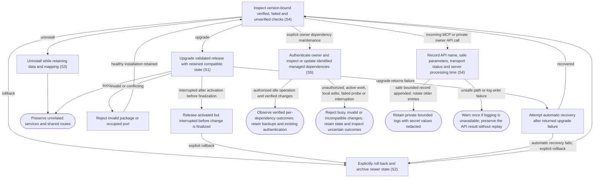

# Inspect health, upgrade, roll back and uninstall

## Goal

The owner can diagnose the installation and change releases while preserving private state and unrelated computer services.

## Preconditions

The owner has a local installation and, for a release change, a validated package.

## Main flow

1. Inspect health and distinguish verified, failed and unverified checks.
2. Upgrade to a validated release after preserving compatible private state.
3. If necessary, explicitly roll back using the retained compatible snapshot.
4. Uninstall application services and launchers while retaining application data and connection mapping.
5. Use the private owner dependency API to inspect versions, check managed updates and start an identified update operation while agent work is inactive. Inspect each result before starting work with updated dependencies.

## Alternatives and recovery

Invalid packages or occupied ports fail without replacing a healthy installation. Failed upgrades attempt automatic recovery. If interruption occurs after a release is activated but before the change is finalized, explicit rollback can restore the retained compatible snapshot. Rollback preserves newer state in an archive. Shared network routes and login policy are preserved. Browser inspection uses an explicitly owner-approved attachment mode. A dedicated persistent pilot profile requires its own initial manual sign-in without copying authentication; inspection pauses during that sign-in. Local debugger readiness alone does not establish application or host acceptance. Upgrading changed embedded UI content also changes its advertised resource identity; hosts may still require a metadata refresh or fresh view. Verify the actual rendered revision rather than inferring it from healthy service or local resource reads. Operator evidence is version-bound and never inferred from fixture success.

The owner can inspect private rotating diagnostics for incoming MCP and owner API calls, with UTC start time, API name, bounded safe parameters, transport status and server processing duration. The duration does not measure client latency or background agent completion. Logs survive restart, rotate within fixed bounds and never broaden request authority. Rejected calls are recorded; unsafe paths and write failures produce a generic warning while preserving API behavior. Existing earlier calls are not reconstructed.

## Scenarios

- **S1** Fresh/rerun installation and failed upgrade preserve private state. Application and task commands use the recorded provider programs without replacing global programs; prior provider command selections remain available for compatible rollback. Explicit rollback recovers an interruption after release activation but before the change is finalized, restoring the compatible snapshot and archiving newer state.
- **S2** Rollback restores compatible state and transport profile while archiving newer state.
- **S3** Uninstall/reinstall retain data and mapping; shared routes and unrelated services are preserved.
- **S4** Diagnostics expose version-bound verified/failed/unverified evidence, including outstanding host acceptance.
- **S5** Owner-authenticated dependency maintenance checks and updates Codex, installed native plugins and standalone skills with known GitHub provenance. Active work prevents acceptance; repeated operation IDs return the same result. Codex candidates pass compatibility checks before recorded-provider activation; failures preserve the working provider. Skill updates preserve local edits and backups. Explicit legacy DK migration selects current native skills while retaining old files and frozen run snapshots. Interrupted or unconfirmed changes remain uncertain and are not replayed. Externally managed host dependencies remain explicit.

<!-- flow-references -->
## Terminology and UI references

Glossary: [owner](../glossary/README.md#owner), [verification](../glossary/README.md#verification), [coverage-gap](../glossary/README.md#coverage-gap), [unverified-behavior](../glossary/README.md#unverified-behavior), [dependency-operation](../glossary/README.md#dependency-operation), [github-skill-source](../glossary/README.md#github-skill-source).
UI entities: [P-DIAGNOSTICS](../ui/README.md#P-DIAGNOSTICS), [W-DIAGNOSTICS](../ui/README.md#W-DIAGNOSTICS), [C-DIAGNOSE](../ui/README.md#C-DIAGNOSE), [PAGE-BROWSER-LAB](../ui/README.md#PAGE-BROWSER-LAB), [P-BROWSER-LAB](../ui/README.md#P-BROWSER-LAB), [W-BROWSER-LAB](../ui/README.md#W-BROWSER-LAB), [C-BROWSER-LAB](../ui/README.md#C-BROWSER-LAB).

## Flow diagram

## Implementation references

- [internal/setup/lifecycle.go](../../internal/setup/lifecycle.go) — Install, snapshots, deferred automatic recovery from returned upgrade errors, explicit rollback using retained pending.json operation state, and uninstall.
- [internal/setup/tailscale.go](../../internal/setup/tailscale.go) — Scoped transport configuration
- [internal/setup/tailscale_routes.go](../../internal/setup/tailscale_routes.go) — Route ownership and conflict checks
- [internal/setup/diagnostics.go](../../internal/setup/diagnostics.go) — Shared typed health diagnostics
- [internal/setup/checkpoints.go](../../internal/setup/checkpoints.go) — Operator setup checkpoints
- [internal/setup/evidence.go](../../internal/setup/evidence.go) — Version-bound acceptance evidence
- [scripts/package.py](../../scripts/package.py) — Content-addressed release archives
- [internal/domain/types.go](../../internal/domain/types.go) — Shared domain, persistence, transport or dependency contract
- [internal/store/store.go](../../internal/store/store.go) — Shared domain, persistence, transport or dependency contract
- [internal/transport/mcp.go](../../internal/transport/mcp.go) — Shared domain, persistence, transport or dependency contract
- [go.mod](../../go.mod) — Shared domain, persistence, transport or dependency contract
- [go.sum](../../go.sum) — Shared domain, persistence, transport or dependency contract
- [scripts/Containerfile.systemd](../../scripts/Containerfile.systemd) — Supporting inspect health, upgrade, roll back and uninstall
- [scripts/browser_control.mjs](../../scripts/browser_control.mjs) — Local stdio controller chooses approved native/pilot/explicit loopback attachment without launching Chrome, copying profiles or exporting authentication. (`const options = parseBrowserOptions(`)
- [scripts/browser_lab.mjs](../../scripts/browser_lab.mjs) — Supporting inspect health, upgrade, roll back and uninstall
- [scripts/connection_probe.py](../../scripts/connection_probe.py) — Supporting inspect health, upgrade, roll back and uninstall
- [scripts/smoke.py](../../scripts/smoke.py) — Supporting inspect health, upgrade, roll back and uninstall
- [internal/buildinfo/version.go](../../internal/buildinfo/version.go) — Supporting inspect health, upgrade, roll back and uninstall
- [internal/testutil/testutil.go](../../internal/testutil/testutil.go) — Shared fake-provider verification input; changes require assertion reconciliation.
- [internal/testutil/fakecodex/main.go](../../internal/testutil/fakecodex/main.go) — Shared fake-provider verification input; changes require assertion reconciliation.
- [scripts/browser_options.mjs](../../scripts/browser_options.mjs) — Pure explicit attachment options retain privacy flags, reject unsafe/ambiguous endpoints and never echo rejected credential-bearing URL values. (`export function parseBrowserOptions(`)
- [internal/transport/mcp.go](../../internal/transport/mcp.go) — Advertises the embedded UI under a full-content SHA256 URI and binds all tool/output-template references to it, retaining only an unadvertised exact legacy-read alias. (`func registerUIResource(`)
- [internal/gateway/proxy_diagnostics.go](../../internal/gateway/proxy_diagnostics.go) — Fixed safe upstream failure classes, preserving request secrecy and HTTP behavior. (`func proxyError(`)
- [internal/commandenv/providers.go](../../internal/commandenv/providers.go) — Generate private versioned command launchers for exactly the recorded provider executables, quote paths literally and preserve prior launcher sets for rollback. (`func Prepare(`)
- [internal/app/dependencies.go](../../internal/app/dependencies.go) — Serialize identified dependency jobs; stage and probe Codex before activation, update registered plugins and retain uncertain outcomes. (`func (m *Manager) UpdateDependencies(`)
- [internal/app/dependency_skills.go](../../internal/app/dependency_skills.go) — Register known GitHub origins; pin downloads, detect local edits, retain backups and atomically exchange skill directories. (`func (m *Manager) RegisterGitHubSkill(`)
- [internal/app/dependency_migration.go](../../internal/app/dependency_migration.go) — Explicitly migrate canonical legacy DK skill duplicates, rebind profiles and recover archived referenced paths after interruption. (`func (m *Manager) migrateLegacyDKSkills(`)
- [internal/dependencies/codex.go](../../internal/dependencies/codex.go) — Verify stable dkropachev/codex fork release asset SHA256 and retain full CLI/companion package layout before probing. (`func StageCodex(`)
- [internal/dependencies/files.go](../../internal/dependencies/files.go) — Bound archives and reject traversal, links, duplicate files and special entries; fingerprint installed content. (`func Extract(`)
- [internal/transport/dependencies.go](../../internal/transport/dependencies.go) — Private bearer-authenticated owner REST API outside MCP/public/browser routing, with strict JSON input and durable status. (`func (s *Server) DependencyHandler(`)
- [internal/codex/client.go](../../internal/codex/client.go) — No-model compatibility probe covering initialize, current account, skills, config and native plugin inventory. (`func Probe(`)
- [docs/dependency-admin.md](../../docs/dependency-admin.md) — Owner dependency API request, recovery, provenance and supported dependency boundaries.
- [internal/transport/api_log.go](../../internal/transport/api_log.go) — Record incoming MCP/owner API call names, safe parameters, UTC start time, HTTP status and handler duration in a private bounded rotating JSONL log without changing request processing. (`func (s *Server) LogAPI(`)
- [internal/transport/api_log_parameters.go](../../internal/transport/api_log_parameters.go) — Redact credentials, answer/free-text payloads and metadata; mask URL userinfo/query/fragment and bound remaining parameters before persistence. (`func privateAPIParameter(`)

## Test references

- [scripts/test_installer.py](../../scripts/test_installer.py) — `def test_install_rerun_paths_backup_failed_upgrade_rollback_uninstall(`; S1, S2, S3. Packaged process-backed install/rerun, returned upgrade failure with deferred automatic recovery, explicit rollback, successful upgrade and uninstall/reinstall. It does not interrupt the installer process or establish recovery from a durable pending operation left by interruption.
- [scripts/test_installer.py](../../scripts/test_installer.py) — `def test_interrupted_upgrade_pending_state_restores_database_and_archives_new_state(`; S1. Process-backed fixture hard-kills the upgrade after release activation at the service-restart gate, before installation.json commit, with pending.json and a compatible backup retained. Fresh rollback must select pending state because the committed installation has no previous release; asserts old release health, restoration of the pre-upgrade database sentinel, archiving of a post-kill mutation, unchanged owner token and removal of pending state. Covers this single interruption boundary only.
- [internal/setup/gateway_profile_backup_test.go](../../internal/setup/gateway_profile_backup_test.go) — `func TestRollbackRestoresGatewayProfileAndArchivesCurrent(`; S2. Gateway profile snapshot, restore and archive.
- [internal/setup/tailscale_prefix_test.go](../../internal/setup/tailscale_prefix_test.go) — `func TestConfigureTailscaleMigratesRerunsAndRemovesOnlyOwnedRoutes(`; S3. Scoped route migration and ownership.
- [internal/setup/checkpoints_test.go](../../internal/setup/checkpoints_test.go) — `func TestOwnershipRequiredAndVersionBoundEvidence(`; S4. Ownership checkpoint and version-bound evidence.
- [internal/setup/lifecycle_test.go](../../internal/setup/lifecycle_test.go) — `func TestSnapshotIncludesCommittedWALAndPreservesSource(`; S1. Consistent WAL snapshot.
- [scripts/test_systemd.py](../../scripts/test_systemd.py) — `def run(`; S3. Opt-in isolated rootless systemd lifecycle; not run by default.
- [scripts/test_live_connection_test.py](../../scripts/test_live_connection_test.py) — `def test_private_dns_success_cannot_mask_public_tls_failure(`; S4. Offline probe regression; tailnet is not public ingress.
- [scripts/test_connection_probe.py](../../scripts/test_connection_probe.py) — `def test_discovery_and_non_authorization(`; S4. Discovery-only probe cannot grant authorization.
- [scripts/test_browser_lab.mjs](../../scripts/test_browser_lab.mjs) — `test('owner, Host, session, Origin and CSRF protect every browser action'`; S4. Private browser-controller fixture access boundaries.
- [scripts/test_mcp_sdk.mjs](../../scripts/test_mcp_sdk.mjs) — `async function sdkFetch(`; S4. Opt-in independent deployed OAuth/MCP test; not real host acceptance.
- [scripts/test_live_connection.py](../../scripts/test_live_connection.py) — `class ConnectionTest:`; S4. Opt-in deployed public TLS/OAuth/MCP probe; not run by reconciliation and not real host acceptance.
- [scripts/test_browser_control.mjs](../../scripts/test_browser_control.mjs) — `test('no arguments preserve owner-approved auto-connect and all privacy flags'`; S4. Default controller transport retains native auto-connect and every privacy flag. Pure argument fixtures do not attach Chrome, read profiles or establish host acceptance.
- [scripts/test_browser_control.mjs](../../scripts/test_browser_control.mjs) — `test('pilot mode attaches only to the dedicated existing loopback browser'`; S4. Explicit pilot configuration selects existing loopback9224 without launch/profile/cookie arguments. Pure argument fixtures do not attach Chrome, read profiles or establish host acceptance.
- [scripts/test_browser_control.mjs](../../scripts/test_browser_control.mjs) — `test('explicit endpoint accepts split and equals options and exact IPv4 or IPv6 loopback literals'`; S4. Explicit split/equals URL options accept only supported literal loopback endpoints and canonical ports. Pure argument fixtures do not attach Chrome, read profiles or establish host acceptance.
- [scripts/test_browser_control.mjs](../../scripts/test_browser_control.mjs) — `test('every supported mode retains statistics, CrUX and header protections exactly once'`; S4. Every supported option mode keeps statistics, CrUX and header-redaction protections exactly once. Pure argument fixtures do not attach Chrome, read profiles or establish host acceptance.
- [scripts/test_browser_control.mjs](../../scripts/test_browser_control.mjs) — `test('conflicting, repeated, missing and unknown options fail closed'`; S4. Conflicting/repeated/missing/nontext/unknown attachment options reject before transport creation. Pure argument fixtures do not attach Chrome, read profiles or establish host acceptance.
- [scripts/test_browser_control.mjs](../../scripts/test_browser_control.mjs) — `test('endpoint validation rejects remote hosts, normalized aliases and URL metadata'`; S4. Remote/alias/credential/path/query/fragment/invalid-port endpoint spellings reject without echoing the supplied secret value. Pure argument fixtures do not attach Chrome, read profiles or establish host acceptance.
- [scripts/test_browser_control.mjs](../../scripts/test_browser_control.mjs) — `test('argument parsing is deterministic and cannot mutate inputs or later calls'`; S4. Option parsing is deterministic, read-only and isolated from prior result mutation. Pure argument fixtures do not attach Chrome, read profiles or establish host acceptance.
- [internal/transport/ui_resource_test.go](../../internal/transport/ui_resource_test.go) — `func TestUIResourceContentIdentityAndCompatibility(`; S1. Actual SDK fixture asserts stable same-content and changed-content UI identity, matching current tool/resource metadata and exact HTML; only the original exact URI reads current content unadvertised, while unknown/previous hashes and query variants reject. CSP domains stay empty. This does not prove host refresh or installed UI acceptance.
- [internal/gateway/proxy_diagnostics_test.go](../../internal/gateway/proxy_diagnostics_test.go) — `func TestProxyDiagnosticsClassifyWithoutLeakingRequestOrError(`; S1. Failure categories contain no raw request/error details and preserve 502 behavior.
- [internal/setup/github_diagnostics_test.go](../../internal/setup/github_diagnostics_test.go) — `func TestDiagnosticsUseLocalGitHubCredentialAndRespectReconciliationCadence(`; S1. Diagnostics use local credentials without a GitHub API probe and align freshness/paused/deferred status with periodic reconciliation.
- [internal/commandenv/providers_test.go](../../internal/commandenv/providers_test.go) — `func TestSelectedProvidersWinWithoutGlobalReplacement(`; S1. Selected executables win over conflicting fallback commands, unusual paths and literal arguments are preserved, and previous launcher versions remain unchanged.
- [internal/commandenv/providers_test.go](../../internal/commandenv/providers_test.go) — `func TestUnavailableProvidersNeverFallBack(`; S1. Missing or relative selected providers fail instead of invoking an older system fallback.
- [internal/commandenv/providers_test.go](../../internal/commandenv/providers_test.go) — `func TestProviderDirectoryRejectsEscapingSymlinks(`; S1. A replaced launcher symlink cannot overwrite an outside owner file.
- [internal/app/dependencies_test.go](../../internal/app/dependencies_test.go) — `func TestDependencyUpdateIsIdempotentAndKeepsUncertainOutcomes(`; S5. Duplicate deliveries do not repeat native changes; partial mutations and restart recovery retain uncertain observations without secret stderr.
- [internal/app/dependencies_test.go](../../internal/app/dependencies_test.go) — `func TestDependencyMaintenanceRejectsActiveWorkAndBlocksNewLaunches(`; S5. Active work prevents acceptance; maintenance blocks task Start and competing plugin changes.
- [internal/app/dependencies_test.go](../../internal/app/dependencies_test.go) — `func TestGitHubSkillUpgradePreservesBackupRejectsEditsAndUnsafeSource(`; S5. Pinned GitHub replacement retains original files and provenance; later local edits and unsafe source paths are rejected.
- [internal/app/dependencies_test.go](../../internal/app/dependencies_test.go) — `func TestCodexActivationUpdatesRecordedProviderAndKeepsPriorRuntime(`; S5. Provider switching retains prior runtime and executable while updating recorded and current provider selections.
- [internal/app/dependencies_test.go](../../internal/app/dependencies_test.go) — `func TestCodexUpdateProbesBeforeSwitchAndRetainsProviderOnFailure(`; S5. Verified staged candidate must pass protocol/auth/skills/plugins; an incompatible later candidate cannot replace the working provider.
- [internal/app/dependencies_test.go](../../internal/app/dependencies_test.go) — `func TestLegacyDKSkillMigrationRebindsProfilesAndRecoversMissingReferences(`; S5. Opt-in legacy migration retains backups, selects current native skills and restores old paths after a crash before profile migration.
- [internal/app/dependencies_test.go](../../internal/app/dependencies_test.go) — `func TestUpdatedPluginProfilesDeduplicateDiscoveryAndKeepPreparedSnapshots(`; S5. Repeated discovery roots do not create false ambiguity; new skill IDs update profiles while prepared snapshots remain unchanged.
- [internal/dependencies/files_test.go](../../internal/dependencies/files_test.go) — `func TestDependencyArchivesRejectTraversalLinksDuplicatesAndBudget(`; S5. Invalid archive paths, links, duplicates and per-entry or cumulative over-budget content are rejected; exact-limit content survives extraction.
- [internal/dependencies/files_test.go](../../internal/dependencies/files_test.go) — `func TestDependencyArchiveRejectsCumulativeSizeOverflowBeforeWriting(`; S5. After accepting one byte, a MaxInt64 declared entry is rejected before its path is created; the prior accepted file remains intact.
- [internal/dependencies/files_test.go](../../internal/dependencies/files_test.go) — `func TestSkillFingerprintSurvivesPrivateCopyAndDetectsEdits(`; S5. Owner-private copy permissions keep fingerprints stable; modified content and links invalidate update eligibility.
- [internal/dependencies/files_test.go](../../internal/dependencies/files_test.go) — `func TestCodexDownloadVerifiesDigestAndRetainsCompanions(`; S5. The selected fork package digest and origin are required; companion binaries retain their distribution layout.
- [internal/transport/dependencies_test.go](../../internal/transport/dependencies_test.go) — `func TestDependencyAdminRequiresOwnerAndRejectsAmbiguousRequests(`; S5. Owner bearer/origin checks and strict JSON protect the API; identified updates are pollable and deduplicated.
- [internal/gateway/dependencies_test.go](../../internal/gateway/dependencies_test.go) — `func TestDependencyAdminIsAbsentFromPublicGateway(`; S5. Plain and prefixed dependency routes remain unavailable through the public OAuth gateway.
- [internal/codex/compatibility_test.go](../../internal/codex/compatibility_test.go) — `func TestStableCodexVersionBoundary(`; S5. Stable minimum and numeric ordering accept upgrade candidates while rejecting older/prerelease CLI versions.
- [internal/app/dependencies_test.go](../../internal/app/dependencies_test.go) — `func TestDependencyMarketplaceFailureDoesNotBlockIndependentPlugins(`; S5. A failed renamed/unavailable Git marketplace remains an isolated result while independent plugins still update; failure output stays private.
- [internal/app/dependencies_test.go](../../internal/app/dependencies_test.go) — `func TestDependencyInventoryExcludesSkillContents(`; S5. Cached owner inventory exposes installed plugin/skill metadata while excluding skill contents and uninstalled catalog entries.
- [internal/transport/api_log_test.go](../../internal/transport/api_log_test.go) — `func TestAPILogRecordsMCPParametersMethodsFailuresAndRedactsSecrets(`; S4. Actual MCP tool/resource and rejected requests retain call names, safe parameters and durations while omitting owner credentials, stored secrets, answers, message text and URL secrets; files and directory are private.
- [internal/transport/api_log_test.go](../../internal/transport/api_log_test.go) — `func TestAPILogOwnerParametersTimingAndUnchangedRequestBody(`; S4. Owner request parameters and processing duration are recorded while the downstream handler sees unchanged request bytes and status.
- [internal/transport/api_log_test.go](../../internal/transport/api_log_test.go) — `func TestAPILogActualOwnerHandlerRecordsRejectedInput(`; S4. The actual private owner handler logs rejected dependency parameters and HTTP status without executing maintenance.
- [internal/transport/api_log_test.go](../../internal/transport/api_log_test.go) — `func TestAPILogRotationConcurrencyAndFailurePreserveAPI(`; S4. Concurrent records remain valid JSONL under bounded private rotation; an unsafe log path cannot alter unrelated files or change the API response.
- [internal/transport/api_log_test.go](../../internal/transport/api_log_test.go) — `func TestAPILogBoundsMalformedBodiesAndPreservesPanic(`; S4. Malformed/oversized data and panic text never enter records; actual body consumption and panic propagation are preserved with bounded log records.

## Verification and gaps

Local suites: `go`, `release`.
Fixture success does not establish real-host acceptance.
- **S3** — `gap-flow-operate-installation-s3-01` · Unverified behavior · P1 · owner: specification-coordinator. A coordinated real desktop logout/login is still open. Isolated systemd tests and process fixtures cannot prove the current user login cycle. Next verification: Coordinate a real desktop logout/login for the installed version and record service, browser-session and connection continuity observations; isolated process/systemd fixtures cannot close that check.
- **S4** — `gap-flow-operate-installation-s4-01` · Unverified behavior · P1 · owner: specification-coordinator. Controller option fixtures establish only configured local attachment arguments, not sign-in or actual browser/app acceptance. This development port establishes no installed-host callback, soak, login or CSP acceptance; outstanding checks remain unverified in ../acceptance.md. Next verification: Inspect actual-host callback receipt and CSP behavior and complete a connected one-hour soak for the installed port version; update dated acceptance evidence while retaining unobserved checks as unverified.
- **S1** — `gap-flow-operate-installation-s1-01` · Unverified behavior · P2 · owner: user-flow-maintainer. The hard-kill fixture covers only the boundary after release activation and before installation commit at the process-backed service-restart gate. Other interruption stages, power-loss or storage-durability failures and recovery through real user systemd remain unverified. The separate returned-failure fixture completes deferred automatic recovery before rollback and does not establish interruption coverage at additional stages. Next verification: Extend interruption tests to additional durable-operation boundaries and storage/power-loss failure models; separately verify recovery through real user systemd without broadening the existing single-boundary fixture claim.

<!-- /flow-references -->
