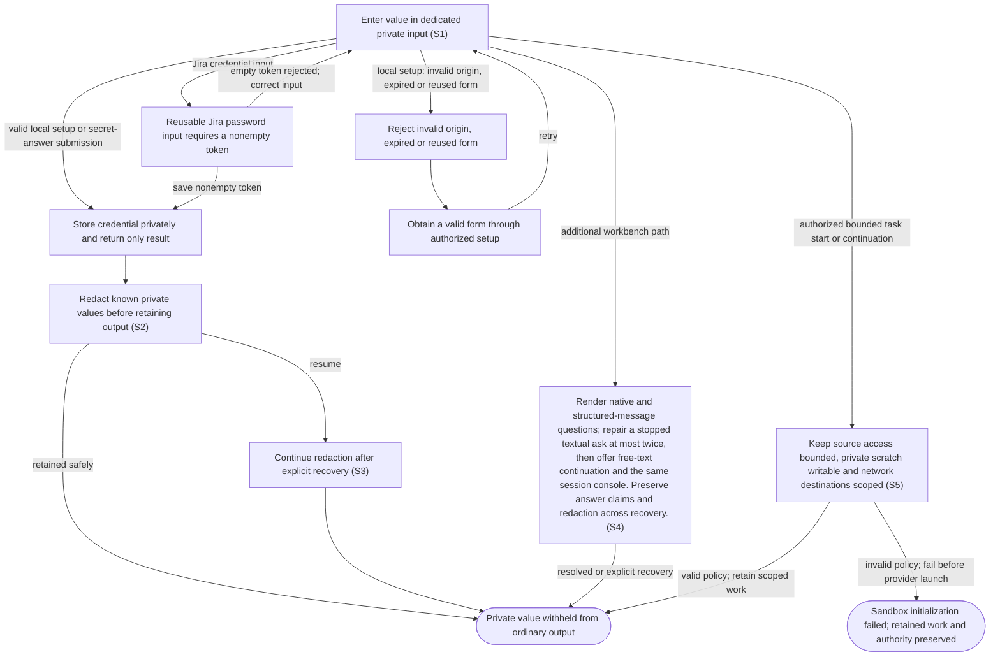

# Enter private credentials and answer secret questions

## Goal

The owner supplies private values through dedicated inputs while keeping them out of ordinary application output and history.

## Preconditions

The owner intentionally enables a feature needing a credential or an agent requests a secret answer.

## Main flow

1. Enter the private value in the dedicated credential or secret-answer input.
2. Store credentials privately and return only success or failure.
3. Redact known credentials and secret answers from incoming agent output before retaining it.
4. Continue redacting known secret answers after explicit recovery.

## Alternatives and recovery

The temporary local tunnel setup form requires verified reachability and valid origin, expires, and accepts one submission. The pilot exposes no unused Jira configuration or credential form; no such credential submission is offered from Settings. The authenticated backend credential capability is separate from the temporary form and has no single-use session. Ordinary settings and tools never echo credentials. A claimed secret answer is not replayed automatically. Jira and the alternate tunnel remain disabled in this pilot.

## Scenarios

- **S1** Temporary local tunnel credential input is origin-bound, expiry-bound and single-use. Settings has no Jira credential input or submission; private values are absent from ordinary UI results.
- **S2** Private values are encrypted at rest and known secrets are redacted before journaling, including split output chunks.
- **S3** Secret-answer redaction survives message-triggered session restoration without journaling the answer body.

- **S4** Render native and structured-message questions; repair a stopped textual ask at most twice, then offer free-text continuation and the same session console. Preserve answer claims and redaction across recovery.

Codex plugin management uses literal CLI arguments, bounded output and process-group cancellation. Credential-bearing marketplace URLs and selector/option injection are rejected. Arbitrary provider stdout/stderr is never copied into operation errors or journal entries; generic status preserves uncertain outcomes without replay. Existing Codex/GitHub authentication is reused without readback.

- **S5** Bounded command execution cannot read unrelated owner files or change shared authentication and skill settings. Existing GitHub authentication is readable only where needed. Refreshable private review indexes use isolated per-run copies; scratch paths and native permission configuration contain no exported credentials. Network permission is independent of filesystem writes. Existing publishing and approval authority remains in effect.

<!-- flow-references -->
## Terminology and UI references

Glossary: [credential](../glossary/README.md#credential), [attention-request](../glossary/README.md#attention-request), [coverage-gap](../glossary/README.md#coverage-gap), [unverified-behavior](../glossary/README.md#unverified-behavior), [question-recovery](../glossary/README.md#question-recovery), [session-console](../glossary/README.md#session-console).
UI entities: [D-ATTENTION](../ui/README.md#D-ATTENTION), [P-ATTENTION-FRAME](../ui/README.md#P-ATTENTION-FRAME), [P-QUESTIONS](../ui/README.md#P-QUESTIONS), [P-APPROVAL](../ui/README.md#P-APPROVAL), [P-ELICITATION](../ui/README.md#P-ELICITATION), [W-DIALOG-FRAME](../ui/README.md#W-DIALOG-FRAME), [W-ATTENTION-NOTICE](../ui/README.md#W-ATTENTION-NOTICE), [W-QUESTIONS](../ui/README.md#W-QUESTIONS), [W-APPROVAL](../ui/README.md#W-APPROVAL), [W-ELICITATION](../ui/README.md#W-ELICITATION), [C-RUN-ATTENTION](../ui/README.md#C-RUN-ATTENTION), [C-ATTENTION-CHAT](../ui/README.md#C-ATTENTION-CHAT), [C-ANSWER](../ui/README.md#C-ANSWER), [C-EXTERNAL-AUTH](../ui/README.md#C-EXTERNAL-AUTH), [PAGE-LOCAL-TUNNEL-SETUP](../ui/README.md#PAGE-LOCAL-TUNNEL-SETUP), [P-LOCAL-TUNNEL-KEY](../ui/README.md#P-LOCAL-TUNNEL-KEY), [W-LOCAL-TUNNEL-KEY](../ui/README.md#W-LOCAL-TUNNEL-KEY), [C-TUNNEL-KEY](../ui/README.md#C-TUNNEL-KEY), [S-SETTINGS](../ui/README.md#S-SETTINGS), [C-OPEN-SETTINGS](../ui/README.md#C-OPEN-SETTINGS), [W-QUESTION-RECOVERY](../ui/README.md#W-QUESTION-RECOVERY), [W-SESSION-CONSOLE](../ui/README.md#W-SESSION-CONSOLE).

## Flow diagram

## Implementation references

- [internal/store/vault.go](../../internal/store/vault.go) — Encrypted named credential storage
- [internal/store/redactor.go](../../internal/store/redactor.go) — Stream redaction across chunk boundaries
- [internal/setup/onboarding.go](../../internal/setup/onboarding.go) — Temporary local alternate-tunnel credential form only: verified reachability, origin/session checks, expiry and single submission; not the reusable Jira widget.
- [internal/app/runs.go](../../internal/app/runs.go) — Secret answer handling and recovery redactions (`func (m *Manager) saveAttention(`)
- [internal/gateway/audit.go](../../internal/gateway/audit.go) — Request logging without credential-bearing details
- [web/src/main.tsx](../../web/src/main.tsx) — Reusable Jira password input clears on successful save; secret-answer controls are separate. Jira has no per-form expiry or single-use session.
- [internal/domain/types.go](../../internal/domain/types.go) — Shared domain, persistence, transport or dependency contract
- [internal/store/store.go](../../internal/store/store.go) — Shared domain, persistence, transport or dependency contract
- [internal/transport/mcp.go](../../internal/transport/mcp.go) — Authenticated application tool boundaries; set_jira_credential requires a nonempty token, writes it to the vault and returns no credential.
- [go.mod](../../go.mod) — Shared domain, persistence, transport or dependency contract
- [go.sum](../../go.sum) — Shared domain, persistence, transport or dependency contract
- [web/src/types.ts](../../web/src/types.ts) — Embedded UI build and host-fixture configuration
- [web/src/style.css](../../web/src/style.css) — Embedded UI build and host-fixture configuration
- [web/src/bridge.ts](../../web/src/bridge.ts) — Embedded UI build and host-fixture configuration
- [web/package.json](../../web/package.json) — Embedded UI build and host-fixture configuration
- [web/package-lock.json](../../web/package-lock.json) — Embedded UI build and host-fixture configuration
- [web/tsconfig.json](../../web/tsconfig.json) — Embedded UI build and host-fixture configuration
- [web/vite.config.ts](../../web/vite.config.ts) — Embedded UI build and host-fixture configuration
- [web/index.html](../../web/index.html) — Embedded UI build and host-fixture configuration
- [web/playwright.config.ts](../../web/playwright.config.ts) — Embedded UI build and host-fixture configuration
- [internal/testhost/main.go](../../internal/testhost/main.go) — Embedded UI build and host-fixture configuration
- [internal/testutil/fakecodex/main.go](../../internal/testutil/fakecodex/main.go) — Embedded UI build and host-fixture configuration
- [internal/testutil/testutil.go](../../internal/testutil/testutil.go) — Embedded UI build and host-fixture configuration
- [internal/web/embed.go](../../internal/web/embed.go) — Embedded UI build and host-fixture configuration
- [internal/web/embed.go](../../internal/web/embed.go) — Configuration opens through its own bridged document entry. (`func SettingsHTML(`)
- [internal/gateway/proxy_diagnostics.go](../../internal/gateway/proxy_diagnostics.go) — Fixed safe upstream failure classes, preserving request secrecy and HTTP behavior. (`func proxyError(`)
- [internal/app/questions.go](../../internal/app/questions.go) — Durable native/message/text question routing, bounded form repair, redaction and retained continuation. (`func (m *Manager) answerSynthetic(`)
- [internal/app/plugins.go](../../internal/app/plugins.go) — Durable pinned-CLI plugin lifecycle and exclusive runtime/maintenance boundary. (`func (m *Manager) PluginAction(`)
- [internal/domain/admin.go](../../internal/domain/admin.go) — Typed plugin operation and inventory persistence. (`type PluginOperation struct`)
- [internal/app/sandbox.go](../../internal/app/sandbox.go) — Invocation-local native filesystem and destination policy; isolated writable scratch and private skill indexes without global configuration changes.
- [internal/codex/sandbox.go](../../internal/codex/sandbox.go) — Invocation-local native filesystem and destination policy; isolated writable scratch and private skill indexes without global configuration changes.

## Test references

- [internal/setup/onboarding_test.go](../../internal/setup/onboarding_test.go) — `func TestCredentialFormReachabilityOriginExpiryAndSingleSubmission(`; S1. Temporary local tunnel setup form only: origin, reachability, expiry and concurrent single-submission fixture.
- [web/tests/factory.spec.ts](../../web/tests/factory.spec.ts) — `test("settings save repository and priority rows without unused integrations"`; S1. Independent settings keeps save feedback and configured summaries visible without task navigation; no unused integration form.
- [internal/store/store_test.go](../../internal/store/store_test.go) — `func TestTransactionsAndVault(`; S2. Encrypted credential storage and transactional journal.
- [internal/store/redactor_test.go](../../internal/store/redactor_test.go) — `func TestRedactionAtEverySplit(`; S2. All split positions preserve redaction.
- [internal/app/app_test.go](../../internal/app/app_test.go) — `func TestStreamingServiceAndSecretAnswerRedactionBeforeJournal(`; S2. Service/answer secrets removed before journal.
- [internal/app/app_test.go](../../internal/app/app_test.go) — `func TestSecretAnswerRedactionSurvivesMessageWake(`; S3. Encrypted redaction state and explicit resume.
- [internal/gateway/audit_test.go](../../internal/gateway/audit_test.go) — `func TestRequestAuditExcludesCredentialsAndPreservesStreaming(`; S2. Audit logs omit credential-bearing request details.
- [internal/gateway/proxy_diagnostics_test.go](../../internal/gateway/proxy_diagnostics_test.go) — `func TestProxyDiagnosticsClassifyWithoutLeakingRequestOrError(`; S1. Failure categories contain no raw request/error details and preserve 502 behavior.
- [internal/app/questions_test.go](../../internal/app/questions_test.go) — `func TestStoppedQuestionRecoveryNativeAndFallback(`; S4. Same-session bounded question repair, at-most-once answers and original-mode restoration.
- [internal/app/questions_test.go](../../internal/app/questions_test.go) — `func TestStructuredMessageQuestionSurvivesRestartAndClaimsAnswerOnce(`; S4. Async questions survive restart and concurrent answers have one claimant.
- [web/tests/factory.spec.ts](../../web/tests/factory.spec.ts) — `text fallback opens the same session console`; S4. Fallback routes the exact answer to its request and console mode retains the reply draft without a new launch.
- [internal/app/questions_test.go](../../internal/app/questions_test.go) — `func TestLostNativeQuestionsRemainAnswerableWithoutConvertingApprovals(`; S4. Lost question IDs are stale but retained textual continuation remains; lost approvals never become textual authorization.
- [internal/app/plugins_test.go](../../internal/app/plugins_test.go) — `func TestPluginUncertainDeliveryIsObservedWithoutReplay(`; S2. A command may install and then fail; state is observed without replay and private provider stderr never enters operation errors or journal.
- [internal/providers/github_usage_test.go](../../internal/providers/github_usage_test.go) — `func TestGitHubPersistentConditionalCacheAuthIsolationAnd304RateObservation(`; S1. Credential scopes do not share cached data/limits; raw tokens and cookies are excluded from persisted cache.
- [internal/providers/github_usage_test.go](../../internal/providers/github_usage_test.go) — `func TestEmptyLocalCredentialCannotFallBackToAnonymousAPI(`; S1. Empty local credential output fails before any anonymous API request.
- [internal/app/sandbox_test.go](../../internal/app/sandbox_test.go) — `func TestTaskSandboxRetainsIsolationAcrossSessionWake(`; S5. Start and wake retain the same bounded process profile without a legacy policy override; explicit clean cleanup removes scratch.
- [internal/app/sandbox_test.go](../../internal/app/sandbox_test.go) — `func TestSandboxSkillDataIsPrivateBoundedAndRetained(`; S5. Refreshing private skill indexes cannot alter the owner source; resume keeps run caches and rejects symlink sources.
- [internal/app/sandbox_test.go](../../internal/app/sandbox_test.go) — `func TestInvalidTaskSandboxFailsWithoutProviderFallback(`; S5. Invalid sandbox fails before app-server launch without an unrestricted fallback.
- [internal/codex/sandbox_test.go](../../internal/codex/sandbox_test.go) — `func TestTaskSandboxPolicyAndInvalidRoots(`; S5. Independent workspace/scratch filesystem and network permissions reject invalid or global roots; proxy allowlist excludes arbitrary hosts.

## Verification and gaps

Local suites: `go`, `browser`.
Fixture success does not establish real-host acceptance.
- **S1** — `gap-flow-protect-secrets-s1-01` · Unverified behavior · P2 · owner: user-flow-maintainer. Jira controls are disabled in the pilot and cannot submit credentials. The authenticated backend path remains separate; enabled credential UI behavior is unverified. Next verification: Assert reusable Jira repeated saves, empty rejection and failure-preserved inputs using fixture values; keep local-form boundary evidence separate and both disabled integrations out of live acceptance claims.

<!-- /flow-references -->
