# Preserve private credentials and redact native session answers

## Goal

Preserve private credentials and redact native session answers.

## Preconditions

The private owner connection is established. Application data starts clean in the session-state database; native Codex authentication and configuration remain outside application state. GitHub source text is task data, not new authority.

## Main flow

1. Reuse native Codex and GitHub authentication without importing credentials into app settings.

   Native inspection and proposal history mask credential values, including
   credentials managed outside the app. Old native proposals are sanitized before
   they are displayed after restart, including retained event-journal copies.
   Historical event identities and decisions remain unchanged, without replay.
   Credential edits stay outside Code Factory;
   hidden credential changes still invalidate stale proposals.

   Custom header values are collected for redaction in ordinary copied-value
   fields even when their names do not identify authentication. URL userinfo and
   credential-bearing query or fragment parameters are removed. Within readable
   query or parameter-fragment components, noncredential values are preserved.
   Ordinary anchors retain their spelling. Encoded credential values and their
   copied forms remain private. An unreadable query or parameter fragment is
   hidden as a whole and cannot be edited through Code Factory.
   Quotes and angle brackets within URL values do not end credential detection.
   Raw credential components are collected independently, so an invalid path or
   fragment does not expose a valid query credential or password copied elsewhere.
   Ambiguous semicolon separators cannot hide a later credential parameter behind
   an ordinary parameter. Native edits containing these copied values are refused
   before persistence.

2. Encrypt secret answers for retained redaction before native delivery.

3. Redact secrets across split streaming and completed output after resumption.

4. Expire live request identities on disconnect instead of replaying secret answers.

## Alternatives and recovery

Read-only inspection does not launch a model turn. Surface validation or provider errors and retain saved work. Human questions, explicit interruptions and uncertain deliveries hold automatic dispatch. Resume against current retained history; never replay an uncertain send or an answered RPC blindly. Explicit cleanup preserves dirty worktrees.

Operation receipts retain safe identities and completion metadata. Their journal
never stores answer bodies or command payloads; API disk logs omit tool arguments.

## Scenarios

- **S1** — Reuse native Codex and GitHub authentication without importing credentials into app settings.
- **S2** — Encrypt secret answers for retained redaction before native delivery.
- **S3** — Redact secrets across split streaming and completed output after resumption.
- **S4** — Expire live request identities on disconnect instead of replaying secret answers.

- **S5** — Persist operation intent without retaining command payloads or answer bodies.

## Verification scope

The assertion references below establish their fixture scope. Native installed-host, real-provider and assistive-technology acceptance require separate dated observations. The retired pipeline editor, review artifacts, AI question repair and built-in issue-report ledger have no compatibility path.

<!-- flow-references -->
## Terminology and UI references

Glossary: [retained-session](../glossary/README.md#retained-session), [operation-receipt](../glossary/README.md#operation-receipt), [daemon-instance](../glossary/README.md#daemon-instance), [read-projection](../glossary/README.md#read-projection), [document-chunk](../glossary/README.md#document-chunk).
UI entities: [W-QUESTIONS](../ui/README.md#W-QUESTIONS), [W-TRANSCRIPT](../ui/README.md#W-TRANSCRIPT).

## Flow diagram

```mermaid
flowchart TD
    N0["Preserve private credentials and redact native session answers"]
    N1["Reuse native Codex and GitHub authentication without importing credentials into app settings #40;S1#41;"]
    N2["Encrypt secret answers for retained redaction before native delivery #40;S2#41;"]
    N3["Redact secrets across split streaming and completed output after resumption #40;S3#41;"]
    N4["Expire live request identities on disconnect instead of replaying secret answers #40;S4#41;"]
    N5(["Hold saved work and show the failure or human request"])
    N6(["Retain conversation and saved evidence"])
    N7["Persist operation intent without retaining command payloads or answer bodies #40;S5#41;"]
    N0 -->|"authorized action"| N1
    N1 -->|"validated or explicitly resumed"| N2
    N1 -->|"missing authority, stale identity or unavailable dependency"| N5
    N2 -->|"validated or explicitly resumed"| N3
    N2 -->|"missing authority, stale identity or unavailable dependency"| N5
    N3 -->|"validated or explicitly resumed"| N4
    N3 -->|"missing authority, stale identity or unavailable dependency"| N5
    N4 -->|"validated or explicitly resumed"| N6
    N4 -->|"missing authority, stale identity or unavailable dependency"| N5
    N0 -->|"inspect current state or submit authorized work"| N7
    N7 -->|"current result or completed action"| N6
    N7 -->|"pending, busy, failed, lost or uncertain outcome"| N5
```

## Implementation references

- [internal/factory/requests.go](../../internal/factory/requests.go) — Exact session-bound native requests and explicit status, without classifiers. (`func (s *Service) Answer(`)
- [internal/factory/secrets.go](../../internal/factory/secrets.go) — Encrypted persistent redaction values and split-stream redaction. (`func (s *Service) retainSecretAnswer(`)
- [internal/factory/native.go](../../internal/factory/native.go) — Direct native app-server retained thread creation and resumption. (`func (s *Service) attach(`)
- [internal/transport/factory.go](../../internal/transport/factory.go) — Session, configuration, event and retained triage APIs. (`func NewFactory(`)
- [internal/store/snapshot.go](../../internal/store/snapshot.go) — Current protect-secrets implementation or fixture/build dependency.
- [internal/store/reads.go](../../internal/store/reads.go) — Current protect-secrets implementation or fixture/build dependency.
- [internal/store/vault.go](../../internal/store/vault.go) — Current protect-secrets implementation or fixture/build dependency.
- [internal/store/redactor.go](../../internal/store/redactor.go) — Current protect-secrets implementation or fixture/build dependency.
- [cmd/code-factory/main.go](../../cmd/code-factory/main.go) — Serve opens the retained connection vault solely as a redaction source while fresh application state remains separate. (`func run(`)
- [internal/transport/operations.go](../../internal/transport/operations.go) — Immediate memory admission with explicit operation state and original daemon/request identity; metadata durability precedes effects. (`func (q *operationQueue) submit(`)
- [internal/httpbudget/budget.go](../../internal/httpbudget/budget.go) — Observe slow finite responses without latency cancellation; bound admission/body buffers and preserve caller/service cancellation and acknowledged SSE lifetime. (`func Wrap(`)
- [internal/transport/operations.go](../../internal/transport/operations.go) — Immediate memory admission with explicit operation state and original daemon/request identity; metadata durability precedes effects. (`func (q *operationQueue) submit(`)
- [internal/httpbudget/latency.go](../../internal/httpbudget/latency.go) — Bounded asynchronous sanitized latency signals retain process-local request identity, actual status and exact slow/drop counters without canceling business work. (`func observeLatency(`)
- [internal/factory/native_projection.go](../../internal/factory/native_projection.go) — Credential-redacted native inspection and stored proposal snapshots; raw fingerprints retain stale-version checks and credential edits are refused. (`func nativeSnapshot(`)
- [internal/store/proposal_migration.go](../../internal/store/proposal_migration.go) — Startup transaction sanitizes legacy native proposal event copies in bounded pages without changing event identities or replaying history. (`func (s *Store) RedactNativeProposalEvents(`)

## Test references

- [internal/factory/service_test.go](../../internal/factory/service_test.go) — `func TestSecretAnswerRedactsSplitStreamingAndRetainedOutput(`; S2, S3. Secret answers redact split deltas, completed output and echoed native request options in persisted records; fresh-service retained-thread resume reloads vault redactions for new completed output.
- [internal/factory/service_test.go](../../internal/factory/service_test.go) — `func TestRestartExpiresIdentitiesAndNeverReplaysUncertainBatch(`; S4. Restart expires RPC identities and holds uncertain delivery without blind replay.
- [internal/store/store_test.go](../../internal/store/store_test.go) — `func TestTransactionsAndVault(`; S1, S2. Private authenticated encrypted vault storage and transactional persistence.
- [internal/store/redactor_test.go](../../internal/store/redactor_test.go) — `func TestRedactionAtEverySplit(`; S1. Current protect-secrets fixture assertion TestRedactionAtEverySplit. Inspect its exact assertion scope.
- [internal/store/ui_journal_test.go](../../internal/store/ui_journal_test.go) — `func TestUIJournalCommitsRollbackCASAndLegacyCursor(`; S1. Current protect-secrets fixture assertion TestUIJournalCommitsRollbackCASAndLegacyCursor. Inspect its exact assertion scope.
- [internal/store/ui_journal_test.go](../../internal/store/ui_journal_test.go) — `func TestReadViewPinsDataAndCursorAcrossConcurrentConnection(`; S1. Current protect-secrets fixture assertion TestReadViewPinsDataAndCursorAcrossConcurrentConnection. Inspect its exact assertion scope.
- [web/tests/wrapper.spec.ts](../../web/tests/wrapper.spec.ts) — `native secret inputs retain rejected answers without rendering secret text`; S2. Secret question uses a password input, preserves a rejected draft without visible plaintext, and sends the exact answer only on explicit resend.
- [internal/factory/regressions_test.go](../../internal/factory/regressions_test.go) — `func TestSecretVaultFailureCannotBecomeUnpersistedRetry(`; S2, S3. A real readonly-vault write failure leaves the question pending with no reply or in-memory commitment; identical retry persists before answering and resumed output stays redacted.
- [internal/factory/regressions_test.go](../../internal/factory/regressions_test.go) — `func TestRetainedConnectionVaultRedactsWithoutImportingLegacyApplicationState(`; S1, S3. A separate retained connection vault supplies split/completed/native-request/audit redactions without exposing its credential through fresh application lookups or importing legacy items.
- [internal/factory/regressions_test.go](../../internal/factory/regressions_test.go) — `func TestSecretAnswerWithRedactedQuestionIDSurvivesResume(`; S2, S3. A masked secret question ID restores the original native answer key and exact value, durably retains the new secret, and redacts split/completed/fresh-service resumed output.
- [internal/transport/operations_test.go](../../internal/transport/operations_test.go) — `func TestOperationPanicRetainsOwnerDiagnosticsWithoutPrivatePayload(`; S1. Owner diagnostics retain the failure stack/type/identity while credential and body sentinels appear in neither diagnostics nor the MCP error.
- [internal/httpbudget/budget_test.go](../../internal/httpbudget/budget_test.go) — `func TestLateHandlerPanicRetainsSanitizedOwnerDiagnostic(`; S1. Late panic diagnostics retain type/request identity/stack without raw private panic or query values.
- [cmd/code-factory/proxy_budget_test.go](../../cmd/code-factory/proxy_budget_test.go) — `func TestProxyUnknownOutcomeDoesNotReplayMutation(`; S1. Actual stdio caller reports unknown outcome after503 and sends the original mutation once.
- [internal/transport/operations_test.go](../../internal/transport/operations_test.go) — `func TestOperationJournalPrecedesEffectsAndNeverStoresAnswers(`; S5. The effect observes its durable running intent; the operation journal contains neither answer bodies nor results.
- [internal/transport/operations_test.go](../../internal/transport/operations_test.go) — `func TestCompletedOperationQueueClearsObsoleteInputClosures(`; S5. Decreasing bursts of 8, 5 and 3 payload-capturing operations execute once, drain all live byte/scope accounting and leave every obsolete pending backing slot zero, releasing completed input closures.
- [internal/httpbudget/latency_test.go](../../internal/httpbudget/latency_test.go) — `func TestSlowRequestSignalsBeforeCompletionAndCorrelatesOutcome(`; S1. Observe one threshold warning before completion and a matching final successful outcome; raw paths, queries, bodies and custom methods are excluded.
- [internal/httpbudget/latency_test.go](../../internal/httpbudget/latency_test.go) — `func TestLatencyMetadataDoesNotRetainCallerRequestLines(`; S1. Behind a blocked sink,32parsed megabyte request lines retain only fixed methods, owned bounded endpoint labels and exact numeric identities; live heap stays below8MiB over baseline. Oversized metadata becomes other rather than retaining caller allocations.
- [internal/factory/native_projection_test.go](../../internal/factory/native_projection_test.go) — `func TestNativeInspectionRedactsUnmanagedCredentials(`; S1. Native inspection and the configuration-agent tool redact unmanaged environment, header, argument, password/token, URL and copied credential values while preserving profile settings and layer identities.
- [internal/factory/native_projection_test.go](../../internal/factory/native_projection_test.go) — `func TestNativeProposalRetainsRedactedSnapshotAndRawFreshness(`; S1. Stored proposals contain redacted snapshots; an invisible credential rotation rejects confirmation, and a fresh confirmed profile edit sends exactly one scoped native write.
- [internal/factory/native_projection_test.go](../../internal/factory/native_projection_test.go) — `func TestNativeCredentialEditsAreRejectedWithoutPersistence(`; S1. Credential-bearing native edits, copied custom-header values, URL credentials, redacted placeholders and table-form key paths are rejected before proposal persistence or native writes.
- [internal/factory/native_projection_test.go](../../internal/factory/native_projection_test.go) — `func TestNativeLegacyProposalMigrationPreservesStaleness(`; S1. Startup sanitizes legacy proposal entities and more than one page of journal copies, including orphaned history; failure rolls back all journal updates, identities/states/unrelated events remain unchanged, unsafe pending edits stale without writes, and repeated migration is idempotent.
- [internal/factory/native_projection_test.go](../../internal/factory/native_projection_test.go) — `func TestNativeInspectionPreservesSelectorsAndRedactsURLCopies(`; S1. Nonsecret MCP environment/argument values preserve exact layer file/type/version and profile values; copied URL password/query/fragment credentials are masked, and the displayed layer selector supports a safe proposal.
- [internal/factory/native_projection_test.go](../../internal/factory/native_projection_test.go) — `func TestNativeCredentialWordsInNamesRemainEditable(`; S1. Profile/plugin/project/server identifiers containing credential words or short token-like names preserve ordinary settings; quoted dotted profile/project paths and whole-profile replacements remain editable, while credential fields inside named entries still redact and reject edits.
- [internal/factory/native_projection_test.go](../../internal/factory/native_projection_test.go) — `func TestNativeURLParameterBoundariesRejectCredentials(`; S1. Malformed parameter components and escaped URL credentials, including userinfo, are hidden in inspection, persisted proposals and legacy proposal/event projections, including encoded and decoded copies. Credential URL edits are refused without persistence or native writes; a remaining noncredential fragment value keeps its escaped ampersand.

## Verification and gaps

Local suites: `go`, `browser`.
Fixture success does not establish real-host acceptance.

<!-- /flow-references -->
