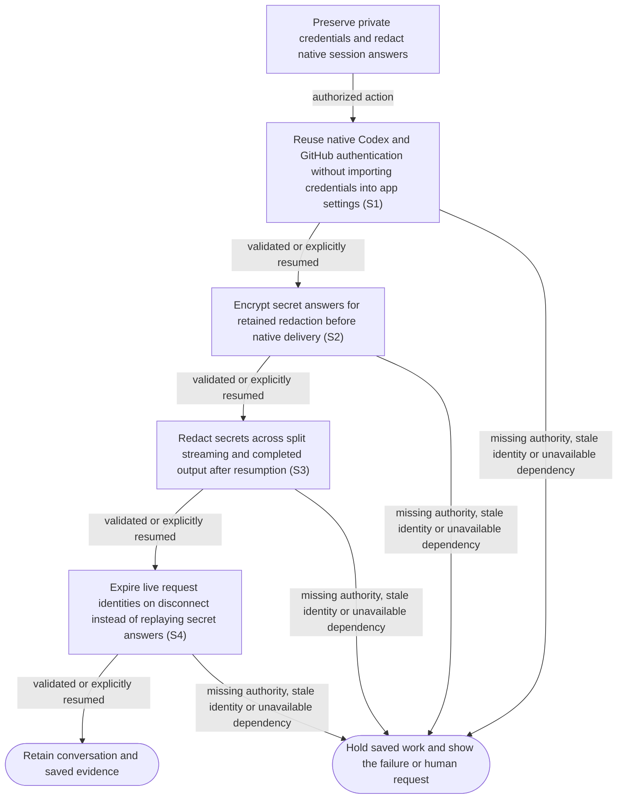

# Preserve private credentials and redact native session answers

## Goal

Preserve private credentials and redact native session answers.

## Preconditions

The private owner connection is established. Application data starts clean in the session-state database; native Codex authentication and configuration remain outside application state. GitHub source text is task data, not new authority.

## Main flow

1. Reuse native Codex and GitHub authentication without importing credentials into app settings.

2. Encrypt secret answers for retained redaction before native delivery.

3. Redact secrets across split streaming and completed output after resumption.

4. Expire live request identities on disconnect instead of replaying secret answers.

## Alternatives and recovery

Read-only inspection does not launch a model turn. Surface validation or provider errors and retain saved work. Human questions, explicit interruptions and uncertain deliveries hold automatic dispatch. Resume against current retained history; never replay an uncertain send or an answered RPC blindly. Explicit cleanup preserves dirty worktrees.

## Scenarios

- **S1** — Reuse native Codex and GitHub authentication without importing credentials into app settings.
- **S2** — Encrypt secret answers for retained redaction before native delivery.
- **S3** — Redact secrets across split streaming and completed output after resumption.
- **S4** — Expire live request identities on disconnect instead of replaying secret answers.

## Verification scope

The assertion references below establish their fixture scope. Native installed-host, real-provider and assistive-technology acceptance require separate dated observations. The retired pipeline editor, review artifacts, AI question repair and built-in issue-report ledger have no compatibility path.

<!-- flow-references -->
## Terminology and UI references

Glossary: [retained-session](../glossary/README.md#retained-session).
UI entities: [W-QUESTIONS](../ui/README.md#W-QUESTIONS), [W-TRANSCRIPT](../ui/README.md#W-TRANSCRIPT).

## Flow diagram

## Implementation references

- [internal/factory/requests.go](../../internal/factory/requests.go) — Exact session-bound native requests and explicit status, without classifiers. (`func (s *Service) Answer(`)
- [internal/factory/secrets.go](../../internal/factory/secrets.go) — Encrypted persistent redaction values and split-stream redaction. (`func (s *Service) retainSecretAnswer(`)
- [internal/factory/native.go](../../internal/factory/native.go) — Direct native app-server retained thread creation and resumption. (`func (s *Service) attach(`)
- [internal/transport/factory.go](../../internal/transport/factory.go) — Session, configuration, event and retained triage APIs. (`func NewFactory(`)
- [internal/store/snapshot.go](../../internal/store/snapshot.go) — Current protect-secrets implementation or fixture/build dependency.
- [internal/store/reads.go](../../internal/store/reads.go) — Current protect-secrets implementation or fixture/build dependency.
- [internal/store/vault.go](../../internal/store/vault.go) — Current protect-secrets implementation or fixture/build dependency.
- [internal/store/redactor.go](../../internal/store/redactor.go) — Current protect-secrets implementation or fixture/build dependency.
- [cmd/code-factory/main.go](../../cmd/code-factory/main.go) — Serve opens the retained connection vault solely as a redaction source while fresh application state remains separate. (`func run(`)
- [internal/transport/operations.go](../../internal/transport/operations.go) — Retain a tool/operation identity, panic type and stack in owner diagnostics without formatting private panic values or leaking them into tool responses. (`func (o *operations) run(`)
- [internal/httpbudget/budget.go](../../internal/httpbudget/budget.go) — Finite response deadlines, bounded admission/body buffer and explicit response outcome; acknowledged SSE retains its cancellation lifetime. (`func Wrap(`)

## Test references

- [internal/factory/service_test.go](../../internal/factory/service_test.go) — `func TestSecretAnswerRedactsSplitStreamingAndRetainedOutput(`; S2, S3. Secret answers redact split deltas, completed output and echoed native request options in persisted records; fresh-service retained-thread resume reloads vault redactions for new completed output.
- [internal/factory/service_test.go](../../internal/factory/service_test.go) — `func TestRestartExpiresIdentitiesAndNeverReplaysUncertainBatch(`; S4. Restart expires RPC identities and holds uncertain delivery without blind replay.
- [internal/store/store_test.go](../../internal/store/store_test.go) — `func TestTransactionsAndVault(`; S1, S2. Private authenticated encrypted vault storage and transactional persistence.
- [internal/store/redactor_test.go](../../internal/store/redactor_test.go) — `func TestRedactionAtEverySplit(`; S1. Current protect-secrets fixture assertion TestRedactionAtEverySplit. Inspect its exact assertion scope.
- [internal/store/ui_journal_test.go](../../internal/store/ui_journal_test.go) — `func TestUIJournalCommitsRollbackCASAndLegacyCursor(`; S1. Current protect-secrets fixture assertion TestUIJournalCommitsRollbackCASAndLegacyCursor. Inspect its exact assertion scope.
- [internal/store/ui_journal_test.go](../../internal/store/ui_journal_test.go) — `func TestReadViewPinsDataAndCursorAcrossConcurrentConnection(`; S1. Current protect-secrets fixture assertion TestReadViewPinsDataAndCursorAcrossConcurrentConnection. Inspect its exact assertion scope.
- [web/tests/wrapper.spec.ts](../../web/tests/wrapper.spec.ts) — `native secret inputs retain rejected answers without rendering secret text`; S2. Secret question uses a password input, preserves a rejected draft without visible plaintext, and sends the exact answer only on explicit resend.
- [internal/factory/regressions_test.go](../../internal/factory/regressions_test.go) — `func TestSecretVaultFailureCannotBecomeUnpersistedRetry(`; S2, S3. A real readonly-vault write failure leaves the question pending with no reply or in-memory commitment; identical retry persists before answering and resumed output stays redacted.
- [internal/factory/regressions_test.go](../../internal/factory/regressions_test.go) — `func TestRetainedConnectionVaultRedactsWithoutImportingLegacyApplicationState(`; S1, S3. A separate retained connection vault supplies split/completed/native-request/audit redactions without exposing its credential through fresh application lookups or importing legacy items.
- [internal/factory/regressions_test.go](../../internal/factory/regressions_test.go) — `func TestSecretAnswerWithRedactedQuestionIDSurvivesResume(`; S2, S3. A masked secret question ID restores the original native answer key and exact value, durably retains the new secret, and redacts split/completed/fresh-service resumed output.
- [internal/transport/operations_test.go](../../internal/transport/operations_test.go) — `func TestOperationPanicRetainsOwnerDiagnosticsWithoutPrivatePayload(`; S1. Owner diagnostics retain the failure stack/type/identity while credential and body sentinels appear in neither diagnostics nor the MCP error.
- [internal/httpbudget/budget_test.go](../../internal/httpbudget/budget_test.go) — `func TestLateHandlerPanicRetainsSanitizedOwnerDiagnostic(`; S1. Late panic diagnostics retain type/request identity/stack without raw private panic or query values.
- [cmd/code-factory/proxy_budget_test.go](../../cmd/code-factory/proxy_budget_test.go) — `func TestProxyUnknownOutcomeDoesNotReplayMutation(`; S1. Actual stdio caller reports unknown outcome after503 and sends the original mutation once.

## Verification and gaps

Local suites: `go`, `browser`.
Fixture success does not establish real-host acceptance.

<!-- /flow-references -->
