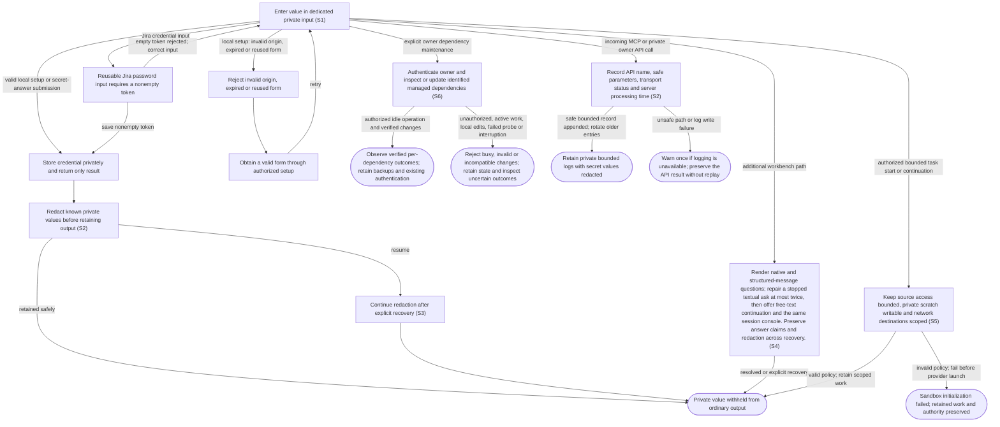

# Enter private credentials and answer secret questions

## Goal

The owner supplies private values through dedicated inputs while keeping them out of ordinary application output and history.

## Preconditions

The owner intentionally enables a feature needing a credential or an agent requests a secret answer.

## Main flow

1. Enter the private value in the dedicated credential or secret-answer input.
2. Store credentials privately and return only success or failure.
3. Redact known credentials and secret answers from incoming agent output before retaining it.
4. Continue redacting known secret answers after explicit recovery.

## Alternatives and recovery

The temporary local tunnel setup form requires verified reachability and valid origin, expires, and accepts one submission. The pilot exposes no unused Jira configuration or credential form; no such credential submission is offered from Settings. The authenticated backend credential capability is separate from the temporary form and has no single-use session. Ordinary settings and tools never echo credentials. A claimed secret answer is not replayed automatically. Jira and the alternate tunnel remain disabled in this pilot.

Question, approval and form replies are retained encrypted with their one-time
answer claims before delivery. The exact response stays private across restart
and uncertain delivery; queue results and answer-status events omit its payload.
A rejected or rolled-back submission cannot overwrite the retained response.

Incoming API diagnostics record call names, bounded safe parameters and processing time in private rotating logs. Credential fields, secret-answer payloads, free-form message/prompt/content and metadata are redacted; URL credentials, queries and fragments are masked. Headers, raw bodies, response payloads and exception text are excluded. Invalid or oversized input receives a safe marker. Logging cannot change authentication, request limits or replay an operation, and a failed log write leaves the original response intact.

## Scenarios

- **S1** Temporary local tunnel credential input is origin-bound, expiry-bound and single-use. Settings has no Jira credential input or submission; private values are absent from ordinary UI results.
- **S2** Private values are encrypted at rest and known secrets are redacted before journaling, including split output chunks.
- **S3** Secret-answer redaction survives message-triggered session restoration without journaling the answer body.

- **S4** Render native and structured-message questions; repair a stopped textual ask at most twice, then offer free-text continuation and the same session console. Preserve answer claims and redaction across recovery.

Codex plugin management uses literal CLI arguments, bounded output and process-group cancellation. Credential-bearing marketplace URLs and selector/option injection are rejected. Arbitrary provider stdout/stderr is never copied into operation errors or journal entries; generic status preserves uncertain outcomes without replay. Existing Codex/GitHub authentication is reused without readback.

- **S6** The private owner dependency API requires the owner bearer credential and is absent from the public connection and embedded browser access. It rejects browser origins, ambiguous or unknown request fields and unsafe GitHub skill sources. Upgrades retain authentication and exclude credentials or arbitrary command output from status. Download verification, private backups and local-edit checks constrain replacement; interrupted maintenance never supplies successful evidence or automatically repeats external changes.

- **S5** Bounded command execution cannot read unrelated owner files or change shared authentication and skill settings. Existing GitHub and native Codex authentication and host registry metadata are readable only where needed. Shared credential stores remain read-only and are not copied into scratch or logs. Refreshable private review indexes use isolated per-run copies; scratch paths and native permission configuration contain no exported credentials. Network permission is independent of filesystem writes. Existing publishing and approval authority remains in effect. An explicit owner full-access profile intentionally omits those bounded execution gates; browser transport authentication and credential handling remain unchanged.

<!-- flow-references -->
## Terminology and UI references

Glossary: [credential](../glossary/README.md#credential), [attention-request](../glossary/README.md#attention-request), [coverage-gap](../glossary/README.md#coverage-gap), [unverified-behavior](../glossary/README.md#unverified-behavior), [question-recovery](../glossary/README.md#question-recovery), [session-console](../glossary/README.md#session-console), [dependency-operation](../glossary/README.md#dependency-operation), [github-skill-source](../glossary/README.md#github-skill-source).
UI entities: [D-ATTENTION](../ui/README.md#D-ATTENTION), [P-ATTENTION-FRAME](../ui/README.md#P-ATTENTION-FRAME), [P-QUESTIONS](../ui/README.md#P-QUESTIONS), [P-APPROVAL](../ui/README.md#P-APPROVAL), [P-ELICITATION](../ui/README.md#P-ELICITATION), [W-DIALOG-FRAME](../ui/README.md#W-DIALOG-FRAME), [W-ATTENTION-NOTICE](../ui/README.md#W-ATTENTION-NOTICE), [W-QUESTIONS](../ui/README.md#W-QUESTIONS), [W-APPROVAL](../ui/README.md#W-APPROVAL), [W-ELICITATION](../ui/README.md#W-ELICITATION), [C-RUN-ATTENTION](../ui/README.md#C-RUN-ATTENTION), [C-ATTENTION-CHAT](../ui/README.md#C-ATTENTION-CHAT), [C-ANSWER](../ui/README.md#C-ANSWER), [C-EXTERNAL-AUTH](../ui/README.md#C-EXTERNAL-AUTH), [PAGE-LOCAL-TUNNEL-SETUP](../ui/README.md#PAGE-LOCAL-TUNNEL-SETUP), [P-LOCAL-TUNNEL-KEY](../ui/README.md#P-LOCAL-TUNNEL-KEY), [W-LOCAL-TUNNEL-KEY](../ui/README.md#W-LOCAL-TUNNEL-KEY), [C-TUNNEL-KEY](../ui/README.md#C-TUNNEL-KEY), [S-SETTINGS](../ui/README.md#S-SETTINGS), [C-OPEN-SETTINGS](../ui/README.md#C-OPEN-SETTINGS), [W-QUESTION-RECOVERY](../ui/README.md#W-QUESTION-RECOVERY), [W-SESSION-CONSOLE](../ui/README.md#W-SESSION-CONSOLE).

## Flow diagram

## Implementation references

- [internal/store/vault.go](../../internal/store/vault.go) — Encrypted named credential storage
- [internal/store/redactor.go](../../internal/store/redactor.go) — Stream redaction across chunk boundaries
- [internal/setup/onboarding.go](../../internal/setup/onboarding.go) — Temporary local alternate-tunnel credential form only: verified reachability, origin/session checks, expiry and single submission; not the reusable Jira widget.
- [internal/app/runs.go](../../internal/app/runs.go) — Secret answer handling and recovery redactions (`func (m *Manager) saveAttention(`)
- [internal/gateway/audit.go](../../internal/gateway/audit.go) — Request logging without credential-bearing details
- [web/src/main.tsx](../../web/src/main.tsx) — Reusable Jira password input clears on successful save; secret-answer controls are separate. Jira has no per-form expiry or single-use session.
- [internal/domain/types.go](../../internal/domain/types.go) — Shared domain, persistence, transport or dependency contract
- [internal/store/store.go](../../internal/store/store.go) — Shared domain, persistence, transport or dependency contract
- [internal/transport/mcp.go](../../internal/transport/mcp.go) — Authenticated application tool boundaries; set_jira_credential requires a nonempty token, writes it to the vault and returns no credential.
- [go.mod](../../go.mod) — Shared domain, persistence, transport or dependency contract
- [go.sum](../../go.sum) — Shared domain, persistence, transport or dependency contract
- [web/src/types.ts](../../web/src/types.ts) — Embedded UI build and host-fixture configuration
- [web/src/style.css](../../web/src/style.css) — Embedded UI build and host-fixture configuration
- [web/src/bridge.ts](../../web/src/bridge.ts) — Embedded UI build and host-fixture configuration
- [web/package.json](../../web/package.json) — Embedded UI build and host-fixture configuration
- [web/package-lock.json](../../web/package-lock.json) — Embedded UI build and host-fixture configuration
- [web/tsconfig.json](../../web/tsconfig.json) — Embedded UI build and host-fixture configuration
- [web/vite.config.ts](../../web/vite.config.ts) — Embedded UI build and host-fixture configuration
- [web/index.html](../../web/index.html) — Embedded UI build and host-fixture configuration
- [web/playwright.config.ts](../../web/playwright.config.ts) — Embedded UI build and host-fixture configuration
- [internal/testhost/main.go](../../internal/testhost/main.go) — Embedded UI build and host-fixture configuration
- [internal/testutil/fakecodex/main.go](../../internal/testutil/fakecodex/main.go) — Embedded UI build and host-fixture configuration
- [internal/testutil/testutil.go](../../internal/testutil/testutil.go) — Embedded UI build and host-fixture configuration
- [internal/web/embed.go](../../internal/web/embed.go) — Embedded UI build and host-fixture configuration
- [internal/web/embed.go](../../internal/web/embed.go) — Configuration opens through its own bridged document entry. (`func SettingsHTML(`)
- [internal/gateway/proxy_diagnostics.go](../../internal/gateway/proxy_diagnostics.go) — Fixed safe upstream failure classes, preserving request secrecy and HTTP behavior. (`func proxyError(`)
- [internal/app/questions.go](../../internal/app/questions.go) — Durable native/message/text question routing, bounded form repair, redaction and retained continuation. (`func (m *Manager) answerSynthetic(`)
- [internal/app/plugins.go](../../internal/app/plugins.go) — Durable pinned-CLI plugin lifecycle and exclusive runtime/maintenance boundary. (`func (m *Manager) PluginAction(`)
- [internal/domain/admin.go](../../internal/domain/admin.go) — Typed plugin operation and inventory persistence. (`type PluginOperation struct`)
- [internal/app/sandbox.go](../../internal/app/sandbox.go) — Invocation-local native filesystem and destination policy; isolated writable scratch and private skill indexes without global configuration changes.
- [internal/codex/sandbox.go](../../internal/codex/sandbox.go) — Invocation-local native filesystem and destination policy; isolated writable scratch and private skill indexes without global configuration changes.
- [internal/app/dependencies.go](../../internal/app/dependencies.go) — Serialize identified dependency jobs; stage and probe Codex before activation, update registered plugins and retain uncertain outcomes. (`func (m *Manager) UpdateDependencies(`)
- [internal/app/dependency_skills.go](../../internal/app/dependency_skills.go) — Register known GitHub origins; pin downloads, detect local edits, retain backups and atomically exchange skill directories. (`func (m *Manager) RegisterGitHubSkill(`)
- [internal/app/dependency_migration.go](../../internal/app/dependency_migration.go) — Explicitly migrate canonical legacy DK skill duplicates, rebind profiles and recover archived referenced paths after interruption. (`func (m *Manager) migrateLegacyDKSkills(`)
- [internal/dependencies/codex.go](../../internal/dependencies/codex.go) — Verify stable dkropachev/codex fork release asset SHA256 and retain full CLI/companion package layout before probing. (`func StageCodex(`)
- [internal/dependencies/files.go](../../internal/dependencies/files.go) — Bound archives and reject traversal, links, duplicate files and special entries; fingerprint installed content. (`func Extract(`)
- [internal/transport/dependencies.go](../../internal/transport/dependencies.go) — Private bearer-authenticated owner REST API outside MCP/public/browser routing, with strict JSON input and durable status. (`func (s *Server) DependencyHandler(`)
- [internal/codex/client.go](../../internal/codex/client.go) — No-model compatibility probe covering initialize, current account, skills, config and native plugin inventory. (`func Probe(`)
- [docs/dependency-admin.md](../../docs/dependency-admin.md) — Owner dependency API request, recovery, provenance and supported dependency boundaries.
- [internal/transport/api_log.go](../../internal/transport/api_log.go) — Record incoming MCP/owner API call names, safe parameters, UTC start time, HTTP status and handler duration in a private bounded rotating JSONL log without changing request processing. (`func (s *Server) LogAPI(`)
- [internal/transport/api_log_parameters.go](../../internal/transport/api_log_parameters.go) — Redact credentials, answer/free-text payloads and metadata; mask URL userinfo/query/fragment and bound remaining parameters before persistence. (`func privateAPIParameter(`)

## Test references

- [internal/setup/onboarding_test.go](../../internal/setup/onboarding_test.go) — `func TestCredentialFormReachabilityOriginExpiryAndSingleSubmission(`; S1. Temporary local tunnel setup form only: origin, reachability, expiry and concurrent single-submission fixture.
- [web/tests/factory.spec.ts](../../web/tests/factory.spec.ts) — `test("settings save repository and priority rows without unused integrations"`; S1. Independent settings keeps save feedback and configured summaries visible without task navigation; no unused integration form.
- [internal/store/store_test.go](../../internal/store/store_test.go) — `func TestTransactionsAndVault(`; S2. Encrypted credential storage and transactional journal; rolled-back encrypted reply writes leave no saved payload.
- [internal/store/redactor_test.go](../../internal/store/redactor_test.go) — `func TestRedactionAtEverySplit(`; S2. All split positions preserve redaction.
- [internal/app/app_test.go](../../internal/app/app_test.go) — `func TestStreamingServiceAndSecretAnswerRedactionBeforeJournal(`; S2. Service/answer secrets removed before journal.
- [internal/app/app_test.go](../../internal/app/app_test.go) — `func TestSecretAnswerRedactionSurvivesMessageWake(`; S3. Encrypted redaction state and explicit resume.
- [internal/gateway/audit_test.go](../../internal/gateway/audit_test.go) — `func TestRequestAuditExcludesCredentialsAndPreservesStreaming(`; S2. Audit logs omit credential-bearing request details.
- [internal/gateway/proxy_diagnostics_test.go](../../internal/gateway/proxy_diagnostics_test.go) — `func TestProxyDiagnosticsClassifyWithoutLeakingRequestOrError(`; S1. Failure categories contain no raw request/error details and preserve 502 behavior.
- [internal/app/questions_test.go](../../internal/app/questions_test.go) — `func TestStoppedQuestionRecoveryNativeAndFallback(`; S4. Same-session bounded question repair, at-most-once answers and original-mode restoration.
- [internal/app/questions_test.go](../../internal/app/questions_test.go) — `func TestStructuredMessageQuestionSurvivesRestartAndClaimsAnswerOnce(`; S4. Async questions survive restart and concurrent answers have one claimant.
- [web/tests/factory.spec.ts](../../web/tests/factory.spec.ts) — `text fallback opens the same session console`; S4. Fallback routes the exact answer to its request and console mode retains the reply draft without a new launch.
- [internal/app/questions_test.go](../../internal/app/questions_test.go) — `func TestLostNativeQuestionsRemainAnswerableWithoutConvertingApprovals(`; S4. Lost question IDs are stale but retained textual continuation remains; lost approvals never become textual authorization.
- [internal/app/plugins_test.go](../../internal/app/plugins_test.go) — `func TestPluginUncertainDeliveryIsObservedWithoutReplay(`; S2. A command may install and then fail; state is observed without replay and private provider stderr never enters operation errors or journal.
- [internal/providers/github_usage_test.go](../../internal/providers/github_usage_test.go) — `func TestGitHubPersistentConditionalCacheAuthIsolationAnd304RateObservation(`; S1. Credential scopes do not share cached data/limits; raw tokens and cookies are excluded from persisted cache.
- [internal/providers/github_usage_test.go](../../internal/providers/github_usage_test.go) — `func TestEmptyLocalCredentialCannotFallBackToAnonymousAPI(`; S1. Empty local credential output fails before any anonymous API request.
- [internal/app/sandbox_test.go](../../internal/app/sandbox_test.go) — `func TestTaskSandboxRetainsIsolationAcrossSessionWake(`; S5. Start and automatic startup continuation retain the same bounded process profile and thread without a legacy policy override; explicit cleanup removes private scratch.
- [internal/app/sandbox_test.go](../../internal/app/sandbox_test.go) — `func TestSandboxSkillDataIsPrivateBoundedAndRetained(`; S5. Refreshing private skill indexes cannot alter the owner source; resume keeps run caches and rejects symlink sources.
- [internal/app/sandbox_test.go](../../internal/app/sandbox_test.go) — `func TestInvalidTaskSandboxFailsWithoutProviderFallback(`; S5. Invalid sandbox fails before app-server launch without an unrestricted fallback.
- [internal/codex/sandbox_test.go](../../internal/codex/sandbox_test.go) — `func TestTaskSandboxPolicyAndInvalidRoots(`; S5. Independent workspace/scratch filesystem and network permissions reject invalid or global roots; proxy allowlist excludes arbitrary hosts.
- [internal/app/sandbox_test.go](../../internal/app/sandbox_test.go) — `func TestPinnedWorkflowLifecyclePersistsAcrossSandboxCommands(`; S5. Opt-in pinned-provider commands resolve real installed reviewer identities and check existing Codex authentication without emitting credentials, while DK lifecycle/router state persists privately across commands.
- [internal/app/sandbox_test.go](../../internal/app/sandbox_test.go) — `func TestMarketplaceMetadataDoesNotGrantOwnerDirectories(`; S5. Configured local/home marketplace roots yield only their manifest files; malformed/relative roots fail and no containing owner directory becomes readable.
- [internal/app/sandbox_test.go](../../internal/app/sandbox_test.go) — `func TestExplicitFullAccessKeepsScratchAndDisablesTechnicalApprovals(`; S5. Explicit full-access owner choice disables bounded proxy and forwards full/never/authorized instructions while retaining private scratch; no fallback weakens an invalid bounded profile.
- [internal/app/dependencies_test.go](../../internal/app/dependencies_test.go) — `func TestDependencyUpdateIsIdempotentAndKeepsUncertainOutcomes(`; S6. Duplicate deliveries do not repeat native changes; partial mutations and restart recovery retain uncertain observations without secret stderr.
- [internal/app/dependencies_test.go](../../internal/app/dependencies_test.go) — `func TestDependencyMaintenanceRejectsActiveWorkAndBlocksNewLaunches(`; S6. Active work prevents acceptance; maintenance blocks task Start and competing plugin changes.
- [internal/app/dependencies_test.go](../../internal/app/dependencies_test.go) — `func TestGitHubSkillUpgradePreservesBackupRejectsEditsAndUnsafeSource(`; S6. Pinned GitHub replacement retains original files and provenance; later local edits and unsafe source paths are rejected.
- [internal/app/dependencies_test.go](../../internal/app/dependencies_test.go) — `func TestCodexActivationUpdatesRecordedProviderAndKeepsPriorRuntime(`; S6. Provider switching retains prior runtime and executable while updating recorded and current provider selections.
- [internal/app/dependencies_test.go](../../internal/app/dependencies_test.go) — `func TestCodexUpdateProbesBeforeSwitchAndRetainsProviderOnFailure(`; S6. Verified staged candidate must pass protocol/auth/skills/plugins; an incompatible later candidate cannot replace the working provider.
- [internal/app/dependencies_test.go](../../internal/app/dependencies_test.go) — `func TestLegacyDKSkillMigrationRebindsProfilesAndRecoversMissingReferences(`; S6. Opt-in legacy migration retains backups, selects current native skills and restores old paths after a crash before profile migration.
- [internal/app/dependencies_test.go](../../internal/app/dependencies_test.go) — `func TestUpdatedPluginProfilesDeduplicateDiscoveryAndKeepPreparedSnapshots(`; S6. Repeated discovery roots do not create false ambiguity; new skill IDs update profiles while prepared snapshots remain unchanged.
- [internal/dependencies/files_test.go](../../internal/dependencies/files_test.go) — `func TestDependencyArchivesRejectTraversalLinksDuplicatesAndBudget(`; S6. Invalid archive paths, links, duplicates and oversized content are rejected; valid content survives extraction.
- [internal/dependencies/files_test.go](../../internal/dependencies/files_test.go) — `func TestSkillFingerprintSurvivesPrivateCopyAndDetectsEdits(`; S6. Owner-private copy permissions keep fingerprints stable; modified content and links invalidate update eligibility.
- [internal/dependencies/files_test.go](../../internal/dependencies/files_test.go) — `func TestCodexDownloadVerifiesDigestAndRetainsCompanions(`; S6. The selected fork package digest and origin are required; companion binaries retain their distribution layout.
- [internal/transport/dependencies_test.go](../../internal/transport/dependencies_test.go) — `func TestDependencyAdminRequiresOwnerAndRejectsAmbiguousRequests(`; S6. Owner bearer/origin checks and strict JSON protect the API; identified updates are pollable and deduplicated.
- [internal/gateway/dependencies_test.go](../../internal/gateway/dependencies_test.go) — `func TestDependencyAdminIsAbsentFromPublicGateway(`; S6. Plain and prefixed dependency routes remain unavailable through the public OAuth gateway.
- [internal/codex/compatibility_test.go](../../internal/codex/compatibility_test.go) — `func TestStableCodexVersionBoundary(`; S6. Stable minimum and numeric ordering accept upgrade candidates while rejecting older/prerelease CLI versions.
- [internal/app/dependencies_test.go](../../internal/app/dependencies_test.go) — `func TestDependencyMarketplaceFailureDoesNotBlockIndependentPlugins(`; S6. A failed renamed/unavailable Git marketplace remains an isolated result while independent plugins still update; failure output stays private.
- [internal/app/dependencies_test.go](../../internal/app/dependencies_test.go) — `func TestDependencyInventoryExcludesSkillContents(`; S6. Cached owner inventory exposes installed plugin/skill metadata while excluding skill contents and uninstalled catalog entries.
- [internal/transport/api_log_test.go](../../internal/transport/api_log_test.go) — `func TestAPILogRecordsMCPParametersMethodsFailuresAndRedactsSecrets(`; S2. Actual MCP tool/resource and rejected requests retain call names, safe parameters and durations while omitting owner credentials, stored secrets, answers, message text and URL secrets; files and directory are private.
- [internal/transport/api_log_test.go](../../internal/transport/api_log_test.go) — `func TestAPILogOwnerParametersTimingAndUnchangedRequestBody(`; S2. Owner request parameters and processing duration are recorded while the downstream handler sees unchanged request bytes and status.
- [internal/transport/api_log_test.go](../../internal/transport/api_log_test.go) — `func TestAPILogActualOwnerHandlerRecordsRejectedInput(`; S2. The actual private owner handler logs rejected dependency parameters and HTTP status without executing maintenance.
- [internal/transport/api_log_test.go](../../internal/transport/api_log_test.go) — `func TestAPILogRotationConcurrencyAndFailurePreserveAPI(`; S2. Concurrent records remain valid JSONL under bounded private rotation; an unsafe log path cannot alter unrelated files or change the API response.
- [internal/transport/api_log_test.go](../../internal/transport/api_log_test.go) — `func TestAPILogBoundsMalformedBodiesAndPreservesPanic(`; S2. Malformed/oversized data and panic text never enter records; actual body consumption and panic propagation are preserved with bounded log records.
- [internal/app/attention_answers_test.go](../../internal/app/attention_answers_test.go) — `func TestAttentionRepliesPersistEncryptedAndStayOutOfQueue(`; S2, S4. Native, nonblocking, approval, message and text replies survive a new database/vault connection exactly; invalid/duplicate submissions cannot overwrite them and repeated restart keeps the queue empty.
- [internal/app/attention_answers_test.go](../../internal/app/attention_answers_test.go) — `func TestUncertainAttentionReplyIsRetainedWithoutReopening(`; S2, S4. Unavailable session leaves an encrypted exact reply and uncertain status, no plaintext journal, no reopened request and no duplicate replay.
- [internal/app/attention_answers_test.go](../../internal/app/attention_answers_test.go) — `func TestNativeAnswerRollsBackWhenRecoveryCannotBeSaved(`; S2, S4. A missing recovery record rolls back both the encrypted answer and native answer claim, leaving the unanswered request visible and answerable.

## Verification and gaps

Local suites: `go`, `browser`.
Fixture success does not establish real-host acceptance.
- **S1** — `gap-flow-protect-secrets-s1-01` · Unverified behavior · P2 · owner: user-flow-maintainer. Jira controls are disabled in the pilot and cannot submit credentials. The authenticated backend path remains separate; enabled credential UI behavior is unverified. Next verification: Assert reusable Jira repeated saves, empty rejection and failure-preserved inputs using fixture values; keep local-form boundary evidence separate and both disabled integrations out of live acceptance claims.

<!-- /flow-references -->
