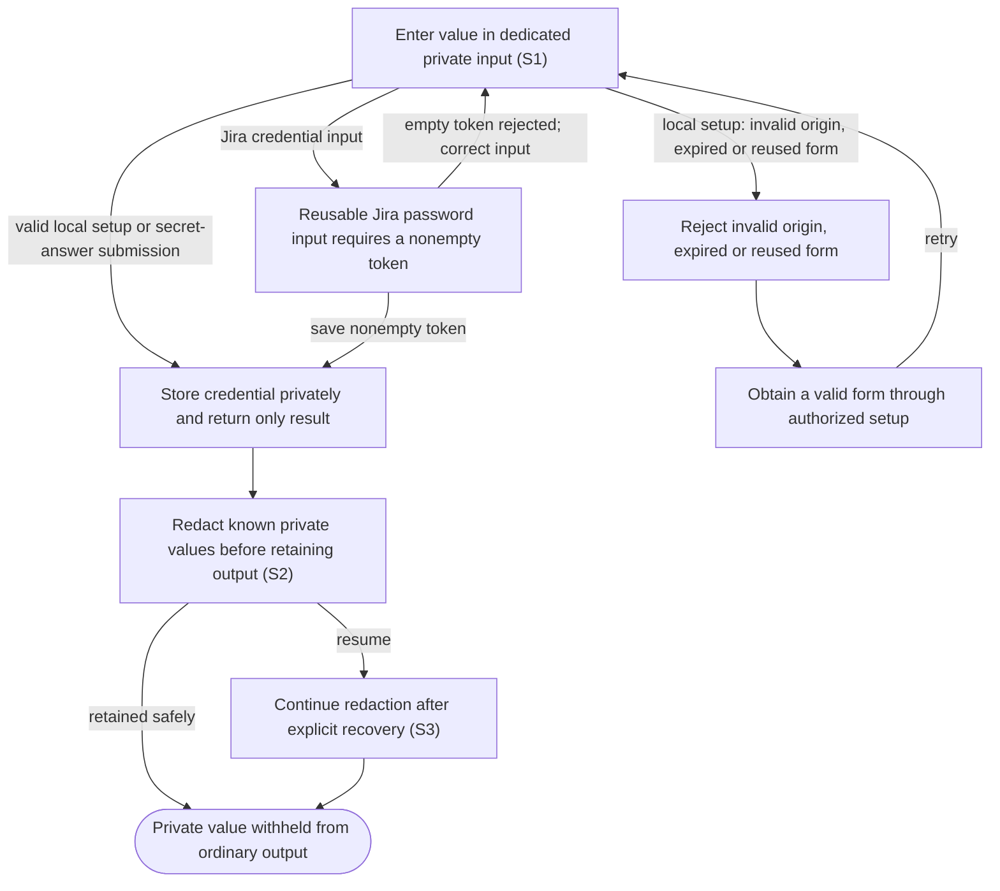

# Enter private credentials and answer secret questions

## Goal

The owner supplies private values through dedicated inputs while keeping them out of ordinary application output and history.

## Preconditions

The owner intentionally enables a feature needing a credential or an agent requests a secret answer.

## Main flow

1. Enter the private value in the dedicated credential or secret-answer input.
2. Store credentials privately and return only success or failure.
3. Redact known credentials and secret answers from incoming agent output before retaining it.
4. Continue redacting known secret answers after explicit recovery.

## Alternatives and recovery

The temporary local tunnel setup form requires verified reachability and valid origin, expires, and accepts one submission. The reusable Jira password input accepts a nonempty token through the connected application and clears it after a successful save; it has no separate form expiry or single-use session. Ordinary settings and tools never echo credentials. A claimed secret answer is not replayed automatically. Jira and the alternate tunnel remain disabled in this pilot.

## Scenarios

- **S1** Temporary local tunnel credential input is origin-bound, expiry-bound and single-use. The reusable Jira password input clears on success; neither input echoes credentials in ordinary UI results.
- **S2** Private values are encrypted at rest and known secrets are redacted before journaling, including split output chunks.
- **S3** Secret-answer redaction survives explicit resume without journaling the answer body.

<!-- flow-references -->
## Terminology and UI references

Glossary: [credential](../glossary/README.md#credential), [attention-request](../glossary/README.md#attention-request), [coverage-gap](../glossary/README.md#coverage-gap), [unverified-behavior](../glossary/README.md#unverified-behavior).
UI entities: [D-ATTENTION](../ui/README.md#D-ATTENTION), [P-ATTENTION-FRAME](../ui/README.md#P-ATTENTION-FRAME), [P-QUESTIONS](../ui/README.md#P-QUESTIONS), [P-APPROVAL](../ui/README.md#P-APPROVAL), [P-ELICITATION](../ui/README.md#P-ELICITATION), [W-DIALOG-FRAME](../ui/README.md#W-DIALOG-FRAME), [W-ATTENTION-NOTICE](../ui/README.md#W-ATTENTION-NOTICE), [W-QUESTIONS](../ui/README.md#W-QUESTIONS), [W-APPROVAL](../ui/README.md#W-APPROVAL), [W-ELICITATION](../ui/README.md#W-ELICITATION), [C-RUN-ATTENTION](../ui/README.md#C-RUN-ATTENTION), [C-ATTENTION-CHAT](../ui/README.md#C-ATTENTION-CHAT), [C-ANSWER](../ui/README.md#C-ANSWER), [C-EXTERNAL-AUTH](../ui/README.md#C-EXTERNAL-AUTH), [W-JIRA-CREDENTIAL](../ui/README.md#W-JIRA-CREDENTIAL), [C-CREDENTIAL-SAVE](../ui/README.md#C-CREDENTIAL-SAVE), [PAGE-LOCAL-TUNNEL-SETUP](../ui/README.md#PAGE-LOCAL-TUNNEL-SETUP), [P-LOCAL-TUNNEL-KEY](../ui/README.md#P-LOCAL-TUNNEL-KEY), [W-LOCAL-TUNNEL-KEY](../ui/README.md#W-LOCAL-TUNNEL-KEY), [C-TUNNEL-KEY](../ui/README.md#C-TUNNEL-KEY).

## Flow diagram

## Implementation references

- [internal/store/vault.go](../../internal/store/vault.go) — Encrypted named credential storage
- [internal/store/redactor.go](../../internal/store/redactor.go) — Stream redaction across chunk boundaries
- [internal/setup/onboarding.go](../../internal/setup/onboarding.go) — Temporary local alternate-tunnel credential form only: verified reachability, origin/session checks, expiry and single submission; not the reusable Jira widget.
- [internal/app/runs.go](../../internal/app/runs.go) — Secret answer handling and recovery redactions (`func (m *Manager) saveAttention(`)
- [internal/gateway/audit.go](../../internal/gateway/audit.go) — Request logging without credential-bearing details
- [web/src/main.tsx](../../web/src/main.tsx) — Reusable Jira password input clears on successful save; secret-answer controls are separate. Jira has no per-form expiry or single-use session.
- [internal/domain/types.go](../../internal/domain/types.go) — Shared domain, persistence, transport or dependency contract
- [internal/store/store.go](../../internal/store/store.go) — Shared domain, persistence, transport or dependency contract
- [internal/transport/mcp.go](../../internal/transport/mcp.go) — Authenticated application tool boundaries; set_jira_credential requires a nonempty token, writes it to the vault and returns no credential.
- [go.mod](../../go.mod) — Shared domain, persistence, transport or dependency contract
- [go.sum](../../go.sum) — Shared domain, persistence, transport or dependency contract
- [web/src/types.ts](../../web/src/types.ts) — Embedded UI build and host-fixture configuration
- [web/src/style.css](../../web/src/style.css) — Embedded UI build and host-fixture configuration
- [web/src/bridge.ts](../../web/src/bridge.ts) — Embedded UI build and host-fixture configuration
- [web/package.json](../../web/package.json) — Embedded UI build and host-fixture configuration
- [web/package-lock.json](../../web/package-lock.json) — Embedded UI build and host-fixture configuration
- [web/tsconfig.json](../../web/tsconfig.json) — Embedded UI build and host-fixture configuration
- [web/vite.config.ts](../../web/vite.config.ts) — Embedded UI build and host-fixture configuration
- [web/index.html](../../web/index.html) — Embedded UI build and host-fixture configuration
- [web/playwright.config.ts](../../web/playwright.config.ts) — Embedded UI build and host-fixture configuration
- [internal/testhost/main.go](../../internal/testhost/main.go) — Embedded UI build and host-fixture configuration
- [internal/testutil/fakecodex/main.go](../../internal/testutil/fakecodex/main.go) — Embedded UI build and host-fixture configuration
- [internal/testutil/testutil.go](../../internal/testutil/testutil.go) — Embedded UI build and host-fixture configuration
- [internal/web/embed.go](../../internal/web/embed.go) — Embedded UI build and host-fixture configuration

## Test references

- [internal/setup/onboarding_test.go](../../internal/setup/onboarding_test.go) — `func TestCredentialFormReachabilityOriginExpiryAndSingleSubmission(`; S1. Temporary local tunnel setup form only: origin, reachability, expiry and concurrent single-submission fixture.
- [web/tests/factory.spec.ts](../../web/tests/factory.spec.ts) — `test("plugin settings accept repository and secure credential without echo"`; S1. Reusable Jira input is a password field, clears after one successful save, and does not echo its value in body text; no expiry, reachability or single-use assertion applies.
- [internal/store/store_test.go](../../internal/store/store_test.go) — `func TestTransactionsAndVault(`; S2. Encrypted credential storage and transactional journal.
- [internal/store/redactor_test.go](../../internal/store/redactor_test.go) — `func TestRedactionAtEverySplit(`; S2. All split positions preserve redaction.
- [internal/app/app_test.go](../../internal/app/app_test.go) — `func TestStreamingServiceAndSecretAnswerRedactionBeforeJournal(`; S2. Service/answer secrets removed before journal.
- [internal/app/app_test.go](../../internal/app/app_test.go) — `func TestSecretAnswerRedactionSurvivesExplicitResume(`; S3. Encrypted redaction state and explicit resume.
- [internal/gateway/audit_test.go](../../internal/gateway/audit_test.go) — `func TestRequestAuditExcludesCredentialsAndPreservesStreaming(`; S2. Audit logs omit credential-bearing request details.

## Verification and gaps

Local suites: `go`, `browser`.
Fixture success does not establish real-host acceptance.
- **S1** — `gap-flow-protect-secrets-s1-01` · Unverified behavior · P2 · owner: user-flow-maintainer. Jira repeated saves, empty-token rejection and save failures lack focused browser assertions. The existing Jira browser fixture establishes password type, successful clearing and no body-text echo only. Local alternate-tunnel form fixtures do not establish real setup acceptance; Jira and the alternate tunnel remain disabled in this pilot. Next verification: Assert reusable Jira repeated saves, empty rejection and failure-preserved inputs using fixture values; keep local-form boundary evidence separate and both disabled integrations out of live acceptance claims.

<!-- /flow-references -->
