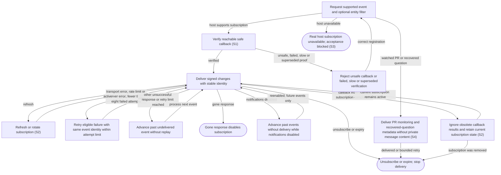

# Subscribe to host notifications and manage delivery

## Goal

The owner can receive host alerts for inbox, session state and attention changes when the host supports subscriptions.

## Preconditions

The connected host supports event subscriptions and supplies a reachable verification callback and signing configuration. Delivery additionally requires Background notifications to be enabled; subscriptions can exist while delivery is disabled.

## Main flow

1. Subscribe to a supported event, optionally filtering to a specific entity.
2. Verify the host callback before activating delivery.
3. Deliver matching state changes with stable delivery identities and authenticated signatures.
4. Refresh or rotate a subscription, then unsubscribe or allow it to expire.

## Alternatives and recovery

Unavailable host subscriptions remain an explicit blocker. Unsafe callbacks and failed or slow verification are rejected before activation. A late verification result cannot activate a canceled or replaced request. Slow callback delivery does not prevent inspecting, refreshing or removing subscriptions. Delivery results from an older subscription cannot overwrite a replacement or recreate a removed subscription. Transport failures, rate-limit responses and server errors retry with the same event identity while fewer than eight failed attempts have accumulated. A gone response disables the subscription; other unsuccessful responses and exhausted retries advance past the undelivered event. While notifications are disabled, processing also advances past events without delivery; enabling notifications later does not replay those events. Restart retains subscription progress; expiry and unsubscribe stop delivery. Host alert timing is controlled by the host. Changed webhook source and its inbox notification commit together even without a matching agent rule. Redelivery and a new delivery containing unchanged source do not repeat that notification; private source bodies remain absent.

Slow subscription management remains pending and completes after contention clears. A latency threshold alone does not cancel it; explicit caller or service cancellation still prevents late subscription changes.

## Scenarios

- **S1** Verification, duplicate creation and entity filtering identify the correct subscription.
- **S2** Eligible retries preserve event identity within the attempt limit; other delivery failures advance or disable the subscription. Disabled notifications skip processed events without later replay. Refresh rotates signing material, and expiry/unsubscribe stop delivery.
- **S3** The real host receives signed alerts and responds to matching attention after reconnect.

- **S4** PR observations, retained session changes and native questions use existing metadata-only notifications, preserving private message content and acknowledged-delivery deduplication.

<!-- flow-references -->
## Terminology and UI references

Glossary: [subscription](../glossary/README.md#subscription), [host](../glossary/README.md#host), [attention-request](../glossary/README.md#attention-request), [coverage-gap](../glossary/README.md#coverage-gap), [known-limitation](../glossary/README.md#known-limitation), [unverified-behavior](../glossary/README.md#unverified-behavior).
UI entities: none (operational contract).

## Flow diagram

## Implementation references

- [internal/events/events.go](../../internal/events/events.go) — Durable subscriptions and delivery cursor; Tick retries transport errors, HTTP 429 and HTTP 5xx only below eight failed attempts, disables on HTTP 410, advances past other failed deliveries, and consumes events without delivery when notifications are disabled.
- [internal/transport/mcp.go](../../internal/transport/mcp.go) — Event discovery and extension registration (`func registerEvents(`)
- [internal/domain/types.go](../../internal/domain/types.go) — Event envelopes, run state and the persisted Notifications delivery setting.
- [internal/store/store.go](../../internal/store/store.go) — Shared domain, persistence, transport or dependency contract
- [go.mod](../../go.mod) — Shared domain, persistence, transport or dependency contract
- [go.sum](../../go.sum) — Shared domain, persistence, transport or dependency contract
- [internal/testutil/testutil.go](../../internal/testutil/testutil.go) — Shared fake-provider verification input; changes require assertion reconciliation.
- [internal/testutil/fakecodex/main.go](../../internal/testutil/fakecodex/main.go) — Shared fake-provider verification input; changes require assertion reconciliation.
- [internal/httpbudget/budget.go](../../internal/httpbudget/budget.go) — Observe slow finite responses without latency cancellation; bound admission/body buffers and preserve caller/service cancellation and acknowledged SSE lifetime. (`func Wrap(`)
- [internal/transport/mcp.go](../../internal/transport/mcp.go) — Capture originating HTTP cancellation for custom event methods across SDK detached contexts; accepted tool lifetime and live stream behavior retain their separate ownership. (`func (s *Server) Handler(`)

## Test references

- [internal/events/events_test.go](../../internal/events/events_test.go) — `func TestSubscriptionVerificationRetryDedupRefreshAndExpiry(`; S1, S2. Signature verification, duplicate creation, entity filtering, stable identity across a 503 retry, expiry and idempotent unsubscribe fixtures; other failure classes and notification disabling are not asserted.
- [internal/events/events_test.go](../../internal/events/events_test.go) — `func TestCallbackSafetyAndFailedChallenge(`; S1. Callback destination and challenge safety.
- [internal/events/events_test.go](../../internal/events/events_test.go) — `func TestPRMonitoringAndSessionQuestionsUseMetadataOnlyNotifications(`; S4. PR watcher changes and recovered question attention use existing signed event names with metadata only and no duplicate acknowledged delivery.
- [internal/factory/review7_test.go](../../internal/factory/review7_test.go) — `func TestSignedWebhookCommitsInboxNotificationWithoutProviderRead(`; S4. A signed webhook persists changed PR source and emits one metadata-only inbox.changed subscription for matching and absent rules, without private body/native turn. Redelivery and same-source new delivery emit no extra notification.
- [internal/events/events_test.go](../../internal/events/events_test.go) — `func TestVerificationDeadlineCoversUncooperativeHeadersAndBody(`; S1. 125ms noncooperative callback headers/body yield bounded failed proof and no late activation.
- [internal/events/events_test.go](../../internal/events/events_test.go) — `func TestPendingVerificationDoesNotBlockOrResurrect(`; S1, S2. Unrelated subscribe/unsubscribe proceeds while proof is blocked; replaced or canceled verification cannot activate late.
- [internal/events/events_test.go](../../internal/events/events_test.go) — `func TestVerificationAdmissionRemainsBoundedUntilActualExit(`; S1. Proof admission remains capped until ignored-cancellation callback work actually exits.
- [internal/events/events_test.go](../../internal/events/events_test.go) — `func TestInFlightDeliveryCannotOverwriteReplacementOrResurrect(`; S2. Stale delivery200/503/410 responses cannot overwrite refreshed generation or resurrect a removed subscription.
- [internal/events/events_test.go](../../internal/events/events_test.go) — `func TestRefreshRetainsConcurrentProgressAndRotatedSignatures(`; S2. Refresh preserves concurrent acknowledged cursor/retry progress and deliveries carry current and previous signing keys; rotation expiry is not covered.
- [internal/events/events_test.go](../../internal/events/events_test.go) — `func TestConcurrentTicksSerializeDeliveryWithoutForegroundLock(`; S2. Tick delivery is serialized while foreground subscribe/unsubscribe remains available; concurrent ticks do not repeat an acknowledged callback.
- [internal/events/events_test.go](../../internal/events/events_test.go) — `func TestFailedRefreshKeepsActiveStateAndRetryProgress(`; S1, S2. A failed ownership refresh leaves the original active subscription, cursor and retry state intact.
- [internal/events/events_test.go](../../internal/events/events_test.go) — `func TestCanceledQueuedRequestCannotDisruptPendingVerification(`; S1. A canceled queued management request cannot cancel or replace a newer pending verification.
- [internal/transport/api_performance_test.go](../../internal/transport/api_performance_test.go) — `func TestEventCallbackAPILatency(`; S1, S2. Actual custom methods distinguish successful management and first stream acknowledgement from rejected callback proof during controlled verification/delivery delays, with a 75 ms verification gate.
- [internal/transport/api_performance_test.go](../../internal/transport/api_performance_test.go) — `func TestEventStoreAdmissionPreservesRequestCancellation(`; S1, S2. Both 2025 and 2026 custom subscribe/unsubscribe calls succeed through 125 ms store contention; deliberate caller cancellation instead prevents late subscription activation or deletion.
- [internal/events/events_test.go](../../internal/events/events_test.go) — `func TestIgnoredEventPagesCommitOnceWithoutSigningMaterial(`; S2. Actual SQLite triggers count one cursor commit for each100-event ignored page across unrelated, filtered and notifications-disabled events; nil vault forbids secret access, no callback is sent and empty re-ticks do not write.
- [internal/events/events_test.go](../../internal/events/events_test.go) — `func TestIgnoredPageCommitRejectsChangedGenerationAndDeletion(`; S2. A held real store writer races an ignored-page commit with replacement or deletion; the generation guard preserves replacement state and cannot resurrect a removed subscription.

## Verification and gaps

Local suites: `go`.
Fixture success does not establish real-host acceptance.
- **S2** — `gap-flow-receive-notifications-s2-01` · Unverified behavior · P2 · owner: user-flow-maintainer. Transport errors, HTTP429, permanent unsuccessful responses, ordinary HTTP410 disabling and retry exhaustion lack dedicated assertions; stale410 suppression is covered separately. Notification-disabled cursor advancement is covered; no replay after re-enabling notifications and restart recovery remain unasserted. Rotation assertions cover both signing keys and preserved progress, but not five-minute key expiry. Next verification: Assert ordinary transport/429/permanent/410 failure classes, retry exhaustion, no replay after re-enabling notifications, five-minute rotated-key expiry and restart progress without broadening controlled fixture evidence to real-host callbacks.
- **S3** — `gap-flow-receive-notifications-s3-01` · Known limitation · P1 · owner: specification-coordinator. Blocked: the real host has not created subscriptions. No signed callback receipt, response, filtering, renewal or unsubscribe acceptance is claimed; see ../acceptance.md. Next verification: Recheck subscription capability in the actual host; when supported, record signed callback receipt, entity filtering, response, reconnect, renewal and unsubscribe evidence rather than assuming the current absence is permanent.

<!-- /flow-references -->
