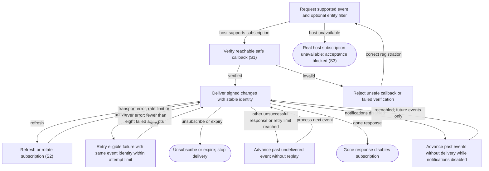

# Subscribe to host notifications and manage delivery

## Goal

The owner can receive host alerts for inbox, run state and attention changes when the host supports subscriptions.

## Preconditions

The connected host supports event subscriptions and supplies a reachable verification callback and signing configuration. Delivery additionally requires Background notifications to be enabled; subscriptions can exist while delivery is disabled.

## Main flow

1. Subscribe to a supported event, optionally filtering to a specific entity.
2. Verify the host callback before activating delivery.
3. Deliver matching state changes with stable delivery identities and authenticated signatures.
4. Refresh or rotate a subscription, then unsubscribe or allow it to expire.

## Alternatives and recovery

Unavailable host subscriptions remain an explicit blocker. Unsafe callbacks and failed verification are rejected. Transport failures, rate-limit responses and server errors retry with the same event identity while fewer than eight failed attempts have accumulated. A gone response disables the subscription; other unsuccessful responses and exhausted retries advance past the undelivered event. While notifications are disabled, processing also advances past events without delivery; enabling notifications later does not replay those events. Restart retains subscription progress; expiry and unsubscribe stop delivery. Host alert timing is controlled by the host.

## Scenarios

- **S1** Verification, duplicate creation and entity filtering identify the correct subscription.
- **S2** Eligible retries preserve event identity within the attempt limit; other delivery failures advance or disable the subscription. Disabled notifications skip processed events without later replay. Refresh rotates signing material, and expiry/unsubscribe stop delivery.
- **S3** The real host receives signed alerts and responds to matching attention after reconnect.

<!-- flow-references -->
## Terminology and UI references

Glossary: [subscription](../glossary/README.md#subscription), [host](../glossary/README.md#host), [attention-request](../glossary/README.md#attention-request), [coverage-gap](../glossary/README.md#coverage-gap), [known-limitation](../glossary/README.md#known-limitation), [unverified-behavior](../glossary/README.md#unverified-behavior).
UI entities: none (operational contract).

## Flow diagram

## Implementation references

- [internal/events/events.go](../../internal/events/events.go) — Durable subscriptions and delivery cursor; Tick retries transport errors, HTTP 429 and HTTP 5xx only below eight failed attempts, disables on HTTP 410, advances past other failed deliveries, and consumes events without delivery when notifications are disabled.
- [internal/transport/mcp.go](../../internal/transport/mcp.go) — Event discovery and extension registration (`func registerEvents(`)
- [internal/domain/types.go](../../internal/domain/types.go) — Event envelopes, run state and the persisted Notifications delivery setting.
- [internal/store/store.go](../../internal/store/store.go) — Shared domain, persistence, transport or dependency contract
- [go.mod](../../go.mod) — Shared domain, persistence, transport or dependency contract
- [go.sum](../../go.sum) — Shared domain, persistence, transport or dependency contract
- [internal/testutil/testutil.go](../../internal/testutil/testutil.go) — Shared fake-provider verification input; changes require assertion reconciliation.
- [internal/testutil/fakecodex/main.go](../../internal/testutil/fakecodex/main.go) — Shared fake-provider verification input; changes require assertion reconciliation.

## Test references

- [internal/events/events_test.go](../../internal/events/events_test.go) — `func TestSubscriptionVerificationRetryDedupRefreshAndExpiry(`; S1, S2. Signature verification, duplicate creation, entity filtering, stable identity across a 503 retry, expiry and idempotent unsubscribe fixtures; other failure classes and notification disabling are not asserted.
- [internal/events/events_test.go](../../internal/events/events_test.go) — `func TestCallbackSafetyAndFailedChallenge(`; S1. Callback destination and challenge safety.

## Verification and gaps

Local suites: `go`.
Fixture success does not establish real-host acceptance.
- **S2** — `gap-flow-receive-notifications-s2-01` · Unverified behavior · P2 · owner: user-flow-maintainer. Transport errors, HTTP 429, permanent unsuccessful responses, HTTP 410 disabling and retry exhaustion lack dedicated assertions; the existing retry fixture exercises HTTP 503 only. Notification-disabled cursor advancement and no replay after reenabling also lack assertions. Refresh with changed signing material, restart recovery and absence of delivery after explicit unsubscribe remain unasserted. Next verification: Assert transport/429/permanent/410 failure classes, retry exhaustion, disabled-setting cursor advancement/no replay, rotated signing material, restart progress and no delivery after unsubscribe.
- **S3** — `gap-flow-receive-notifications-s3-01` · Known limitation · P1 · owner: specification-coordinator. Blocked: the real host has not created subscriptions. No signed callback receipt, response, filtering, renewal or unsubscribe acceptance is claimed; see ../acceptance.md. Next verification: Recheck subscription capability in the actual host; when supported, record signed callback receipt, entity filtering, response, reconnect, renewal and unsubscribe evidence rather than assuming the current absence is permanent.

<!-- /flow-references -->
