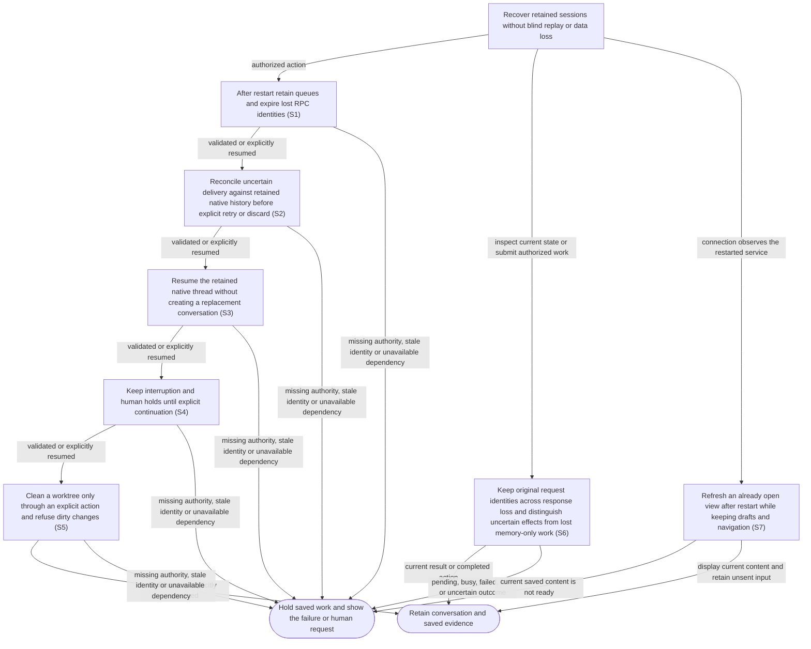

# Recover retained sessions without blind replay or data loss

## Goal

Recover retained sessions without blind replay or data loss.

## Preconditions

The private owner connection is established. Application data starts clean in the session-state database; native Codex authentication and configuration remain outside application state. GitHub source text is task data, not new authority.

## Main flow

1. After restart retain queues and expire lost RPC identities.

2. Reconcile uncertain delivery against retained native history before explicit retry or discard.

3. Resume the retained native thread without creating a replacement conversation.

4. Keep interruption and human holds until explicit continuation.

5. Clean a worktree only through an explicit action and refuse dirty changes.

## Alternatives and recovery

Read-only inspection does not launch a model turn. Surface validation or provider errors and retain saved work. Human questions, explicit interruptions and uncertain deliveries hold automatic dispatch. Resume against current retained history; never replay an uncertain send or an answered RPC blindly. Explicit cleanup preserves dirty worktrees. If workspace creation was interrupted, retain its planned location and recover only the registered workspace belonging to the expected repository and branch. Preserve dirty content during reuse. Refuse foreign directories, wrong branches and an existing branch without its workspace; expose the failure for explicit action. Explicit cleanup can retire a missing-workspace intent while preserving its existing branch and retained conversation.

Show local submission feedback before waiting for the connection. Acceptance is
separate from delivery: keep queued and running work pending, and preserve the
owning conversation draft until delivery succeeds. Navigation and unrelated
conversations remain usable. Repeated request identities retrieve the original
work; connection recovery never submits the command again. After restart, effects
with retained intent are uncertain and memory-only work can be lost. Neither is
authority to replay a mutation or reuse an expired answer.

Uncertain and lost outcomes retain their explicit classification and inspect-before-retry guidance even when a provider supplies an error detail. Preserve the original draft and never convert those outcomes into an automatic retry.

When an old result or error detail is unavailable after retention eviction or restart, retain its original terminal identity and state. Show that details are unavailable, preserve the draft and require saved-state inspection before another delivery. Missing details never authorize automatic resubmission.

An already open view refreshes from the restarted service even when its saved-state
version is lower or equal to the previously displayed version. Retire earlier
displayed-content ownership and discard late obsolete responses. Acknowledge only
current displayed content, while keeping drafts, navigation and the original
identity of any pending command.

## Scenarios

- **S1** — After restart retain queues and expire lost RPC identities.
- **S2** — Reconcile uncertain delivery against retained native history before explicit retry or discard.
- **S3** — Resume the retained native thread without creating a replacement conversation.
- **S4** — Keep interruption and human holds until explicit continuation.
- **S5** — Clean a worktree only through an explicit action and refuse dirty changes.

- **S6** — Keep original request identities across response loss and distinguish uncertain effects from lost memory-only work.
- **S7** — Refresh an already open view after restart while keeping drafts and navigation.

## Verification scope

The assertion references below establish their fixture scope. Native installed-host, real-provider and assistive-technology acceptance require separate dated observations. The retired pipeline editor, review artifacts, AI question repair and built-in issue-report ledger have no compatibility path.

<!-- flow-references -->
## Terminology and UI references

Glossary: [retained-session](../glossary/README.md#retained-session), [event-batch](../glossary/README.md#event-batch), [workspace](../glossary/README.md#workspace), [operation-receipt](../glossary/README.md#operation-receipt), [daemon-instance](../glossary/README.md#daemon-instance), [read-projection](../glossary/README.md#read-projection), [document-chunk](../glossary/README.md#document-chunk).
UI entities: [W-RUN-CONTROLS](../ui/README.md#W-RUN-CONTROLS), [W-WORK-STATUS](../ui/README.md#W-WORK-STATUS), [W-EVENT-BATCHES](../ui/README.md#W-EVENT-BATCHES).

## Flow diagram

## Implementation references

- [internal/factory/service.go](../../internal/factory/service.go) — Durable canonical sessions, event queue, quiet clock and delivery claims. (`func (s *Service) Chat(`)
- [internal/factory/native.go](../../internal/factory/native.go) — Direct native app-server retained thread creation and resumption. (`func (s *Service) attach(`)
- [internal/factory/requests.go](../../internal/factory/requests.go) — Exact session-bound native requests and explicit status, without classifiers. (`func (s *Service) Answer(`)
- [web/src/wrapper.tsx](../../web/src/wrapper.tsx) — Saved inbox, session conversation, human input and confirmed configuration. (`function Factory(`)
- [internal/transport/factory.go](../../internal/transport/factory.go) — Session, configuration, event and retained triage APIs. (`func NewFactory(`)
- [internal/factory/native.go](../../internal/factory/native.go) — Persist planned workspace before Git creation, verify registered ownership for recovery, and retain dirty content/explicit cleanup boundaries. (`func (s *Service) workspace(`)
- [internal/transport/operations.go](../../internal/transport/operations.go) — Immediate memory admission with explicit operation state and original daemon/request identity; metadata durability precedes effects. (`func (q *operationQueue) submit(`)
- [internal/transport/operations.go](../../internal/transport/operations.go) — Account every serialized terminal functional body independently of retained identity metadata. (`func operationPayloadBytes(`)
- [internal/transport/operations.go](../../internal/transport/operations.go) — Evict oldest terminal results/errors under the retained-body ceiling while preserving original state and explicit unavailable-detail markers. (`func (q *operationQueue) pruneResultsLocked(`)
- [web/src/bridge.ts](../../web/src/bridge.ts) — Retire obsolete instance-scoped read ownership without repeating accepted commands. (`export function onInstanceChange(`)

## Test references

- [internal/factory/service_test.go](../../internal/factory/service_test.go) — `func TestRestartExpiresIdentitiesAndNeverReplaysUncertainBatch(`; S1, S2. Restart expires RPC identities and holds uncertain delivery without blind replay.
- [internal/factory/service_test.go](../../internal/factory/service_test.go) — `func TestChatFlushBusySteerHoldAndRetainedReuse(`; S3, S4. Human chat flushes queued events, steers unblocked active work and respects holds while retaining thread.
- [internal/factory/service_test.go](../../internal/factory/service_test.go) — `func TestRetainedWorktreeCleanupRefusesDirtyChanges(`; S5. Explicit cleanup rejects dirty worktrees, expires pending requests, preserves history and keeps the session cleaned after delayed completion/disconnect callbacks; removed worktrees cannot resume.
- [web/tests/wrapper.spec.ts](../../web/tests/wrapper.spec.ts) — `uncertain mutation response is not retried`; S2. A transport failure after sending is visible and the mutation is sent once.
- [internal/factory/service_test.go](../../internal/factory/service_test.go) — `func TestExplicitRetryRequiresSuccessfulHistoryReconciliation(`; S2. Explicit retry refuses unavailable history or confirmed delivery and requeues only after a successful lookup proves absence; resolution itself sends no work.
- [web/tests/wrapper.spec.ts](../../web/tests/wrapper.spec.ts) — `uncertainty recovery uses durable delivery state rather than error text`; S1, S2. Uncertain batch recovery controls follow persisted deliveryState independently of error wording; pending thread recovery offers retry without batch discard.
- [web/tests/wrapper.spec.ts](../../web/tests/wrapper.spec.ts) — `session controls preserve the selected target and require explicit clicks`; S3, S4, S5. Viewing sends no control; explicit Interrupt, Resume and Clean worktree each target the selected session and render cleaned status.
- [internal/factory/regressions_test.go](../../internal/factory/regressions_test.go) — `func TestConfigurationAppliedMarkerAndAllBindingsCommitAtomically(`; S1. Actual SQLite binding-write abort rolls back settings and applied marker without retiring the current client; restart applies item/configuration/priority bindings together.
- [internal/factory/review7_test.go](../../internal/factory/review7_test.go) — `func TestInterruptedRealWorktreeCreationResumesRegisteredDirtyWorkspace(`; S1, S3, S5. Actual Git before/after-add callbacks verify durable canonical workspace path and chosen Git repository identity before filesystem creation, then successful registration before injected command failure. A fresh service reuses the single dirty registered workspace despite unavailable origin and changed configured checkout, retains content and starts one fake-native turn. Explicit cleanup refuses dirty changes, then removes the clean workspace while retaining its conversation.
- [internal/factory/review7_test.go](../../internal/factory/review7_test.go) — `func TestWorkspaceRecoveryRefusesForeignPathsAndAllowsMissingIntentCleanup(`; S3, S5. Persisted workspace intents for a foreign directory, wrong registered branch and foreign repository with the expected branch are refused for both adoption and explicit cleanup, preserving their paths/content. A branch-only missing-workspace intent is refused for adoption but explicit cleanup retires the session while preserving its existing branch.
- [internal/transport/operations_test.go](../../internal/transport/operations_test.go) — `func TestOperationRestartReportsUncertainAndLostWithoutReplay(`; S6. Unfinished retained intent recovers as uncertain and old-instance memory-only work is lost; neither identity can replay the original mutation.
- [internal/transport/operation_restart_test.go](../../internal/transport/operation_restart_test.go) — `func TestActualProcessRestartNeverReplaysMemoryOrRunningWork(`; S6. Kill a separate fixture process before persistence and during its effect, then assert lost/uncertain original identities and no replay.
- [web/tests/wrapper.spec.ts](../../web/tests/wrapper.spec.ts) — `preserves its classification and draft beside raw errors`; S6. Uncertain and lost outcomes keep their classification, inspection warning, exact timeout error and draft; navigating afterward creates no second mutation.
- [internal/transport/operations_test.go](../../internal/transport/operations_test.go) — `func TestOperationFailurePayloadsUseRetentionBudget(`; S6. An authenticated invalid configuration produces the exact40KB error. Short/inline/chunked terminal payloads all enter accounting; oldest-first eviction preserves state/identity, explicitly reports unavailable details and duplicate IDs do not execute again.
- [web/tests/wrapper.spec.ts](../../web/tests/wrapper.spec.ts) — `reports unavailable error details without replay`; S6. Failed, uncertain and lost outcomes keep classification, inspection warning and draft when error bodies are unavailable; later navigation cannot replay the mutation.
- [internal/transport/factory_test.go](../../internal/transport/factory_test.go) — `func TestFactoryStateReopenScopesVersionToDaemonInstance(`; S7. Reopening the same saved database creates a distinct daemon identity; lower and equal serials from the prior instance return current saved data, absent namespaces cannot claim unchanged, and the current namespace retains its unchanged optimization.
- [web/tests/wrapper.spec.ts](../../web/tests/wrapper.spec.ts) — `for (const restartedVersion of [1, 1000]) {`; S7. An open view accepts lower and equal counters after the daemon identity changes, displays the new source, acknowledges only its new-instance revision, preserves the message draft and returns to the saved inbox without submitting chat.
- [web/tests/wrapper.spec.ts](../../web/tests/wrapper.spec.ts) — `a superseded daemon detail cannot display or acknowledge old content`; S7. A held old-instance detail resolves only after current new-instance detail is displayed; actual bridge completion cannot replace or acknowledge old content, and the following action still uses the new identity.
- [web/tests/wrapper.spec.ts](../../web/tests/wrapper.spec.ts) — `a late old-daemon command response resolves its original identity without replay`; S6. Navigation and the saved draft survive a held command across daemon replacement; its late response is reconciled by the original instance/request pair as uncertain, with explicit inspection guidance and exactly one submission.
- [web/tests/wrapper.spec.ts](../../web/tests/wrapper.spec.ts) — `an open archive retires its page and selection when the daemon changes`; S7. Loaded archive replacement observes daemon identity, hides old page/selection while pending, then displays current records without manual refresh, preserving query controls and navigation without chat.
- [internal/transport/operations_test.go](../../internal/transport/operations_test.go) — `func TestDuplicateOperationReceiptsReflectIndependentDocumentEviction(`; S6. Actual document-cache eviction removes terminal success/error chunks; authenticated duplicate submissions preserve original identity/tool/state, explicitly report unavailable details with no dead descriptors, and execute no additional work.
- [web/tests/wrapper.spec.ts](../../web/tests/wrapper.spec.ts) — `the first accepted daemon retires concurrent initial replies from an obsolete instance`; S7. The first accepted daemon retires concurrent unknown-identity replies: an old initial state completes after the new query, cannot broadcast obsolete ownership, and the next read-state action uses the new daemon.

## Verification and gaps

Local suites: `go`, `browser`.
Fixture success does not establish real-host acceptance.
- **S1** — `gap-flow-recover-cleanup-s1-01` · Unverified behavior · P2 · owner: user-flow-maintainer. Installed-daemon restart with real native retained progress and queued event claims remains unverified. Fixture restart assertions establish no installed-host acceptance. Next verification: In the approved private pilot, restart the installed daemon with retained native work and pending events; verify conversation continuity and claim reconciliation without replay.
- **S2** — `gap-flow-recover-cleanup-s2-01` · Unverified behavior · P2 · owner: user-flow-maintainer. Fake-provider message restoration does not prove current installed real-provider conversation or workspace history preservation. No installed-host or real-provider recovery acceptance is established by this development port. Next verification: Verify message restoration against the installed port version and record retained conversation/workspace history without task or answer replay; fixture success alone is insufficient.

<!-- /flow-references -->
