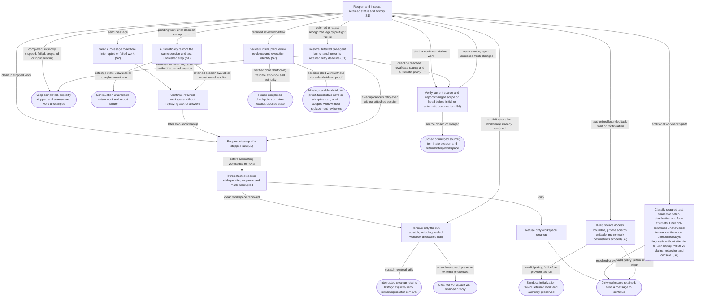

# Recover retained work and clean up safely

## Goal

Pending work continues automatically after daemon startup from its retained progress. The owner can explicitly continue stopped work and deliberately remove a clean stopped workspace.

## Preconditions

At least one run has been prepared or launched and its local state is retained.

## Main flow

1. Reopen the application and inspect retained run status and history.
2. On daemon startup, automatically continue previously active work from its last unfinished step in the same retained session. Previously accepted work that had not yet begun starts once; prepared drafts remain unstarted.
3. Preserve the workspace, conversation, authority, saved results and reviewer checkpoints. Reconcile a saved completion before continuing, and inspect uncertain actions before acting again.
4. Open the secondary agent details, review that cleanup retires the session and removes a clean workspace, then explicitly clean up a stopped run with no uncommitted changes.

## Alternatives and recovery

Closing the view or transport does not stop work. Startup leaves completed idle sessions idle, honors explicit interrupts even when their acknowledgment was lost, and preserves unanswered questions without answering for the owner. Process loss makes live RPC IDs stale. Structured-message questions remain retained; lost native questions become textual continuations, while approvals must be requested again through their native authorization path. Automatic continuation reuses the retained session and saved workflow progress, never its original task as a fresh launch. Unavailable retained state fails visibly without substituting a new task or preventing other sessions from continuing. Sending to inactive work restores its retained session and uses the submitted message as the only new turn. It must not replay the original task, a generic resume prompt or old answers. Failed acceptance retains the draft; accepted messages remain durably saved even if delivery later fails. A queued message resumes its own delivery after restart; an uncertain delivery is never replayed or replaced with a generic continuation. Cleanup first retires any retained session, makes its pending requests stale and marks the run interrupted. If workspace removal is then refused because it is dirty, the workspace remains but continuation happens by sending a message. Cleanup retains snapshots and history.

## Scenarios

- **S6** Before an initial start or automatic unfinished-work restoration, verify the current source item and report changed title, description, head, state and assignment context to the agent for assessment. Explicit message-driven restoration instead uses saved source context without a GitHub preflight; its agent performs task-required GitHub reads. Failed preflight reads keep automatic work stopped. A closed issue or closed/merged PR permanently terminates its sessions, retires questions and preserves history and workspaces; reopening the source does not revive them. Dirty cleanup cannot make terminal work resumable.

- **S1** Startup continues pending work from retained progress, preserves prepared and completed work, honors explicit interrupts and unanswered questions, stales expired native requests and isolates unavailable sessions. An interrupted question clarification resumes only through its bounded recovery path; an accepted recovery answer does not trigger automatic task continuation. Older unresolved diagnostics do not prevent newer owner-directed work from continuing. Deferred launches retain their reason and retry deadline across restart and wait until due before a live source/head and automatic-policy check. A shutdown during pre-provider verification or workspace preparation retains that accepted retry even when repository synchronization is stale or failed. Once provider creation may have begun without a retained thread, startup stays stopped for inspection and cannot regain automatic retry authority. Recovery also recognizes only the exact known legacy pre-agent GitHub budget/reserve/rate-limit failures; unrelated failed runs and failures after agent startup are not retried automatically. Recognizable historical custom review pipelines retain their accepted review intent and permissions when defaults change; ambiguous legacy tasks remain stopped.
- **S2** Sending a message restores retained work and starts exactly that message instead of replaying its original task.
- **S3** Dirty cleanup retains the workspace after interrupting the retained session; continuation happens by sending a message. Clean stopped workspace cleanup retains history. Cleanup or interrupt of a deferred launch cancels its pending retry even without an attached agent session; later ticks and restart cannot resurrect it.

- **S4** Render native and structured-message questions; classify stopped text and share at most two setup/clarification/form attempts, then offer only confirmed unanswered textual continuation and the same session console. Preserve answer claims and redaction across recovery. A restart between saving a fallback episode and presenting its question restores the unanswered question once, without replaying repair attempts or reopening a claimed answer.

Plugin maintenance also survives view closure. Startup marks queued/running operations uncertain without replay; a failed/null inventory response retains the previous observations. Refreshing actual provider state precedes any user-chosen retry. Existing run recovery and cleanup do not remove plugin installation history.

- **S5** Private scratch and refreshed review indexes remain scoped to the retained run across recovery. Successful explicit cleanup removes that scratch, including sealed workflow directories, along with its clean workspace; dirty cleanup preserves both. If scratch removal fails after the workspace is removed, the interrupted record and history remain, and an explicit cleanup retry finishes the remaining removal without requiring the absent workspace. External references and shared file permissions remain intact. The owner’s original private settings and retained conversation history remain intact.

A native clarification that replaced an older text request remains answerable after its process is lost. Recovery retains one fallback with the actual question, delivery status and consumed attempts, while preserving unrelated questions and earlier replacement events. The replacement has a fresh request identity; older answers and dismissals cannot affect it. Answered, dismissed and cancelled requests do not return.

A durable native answer claim stays final even if process loss occurs before recovery records the answer. Startup takeover durably cancels checking and clarification before reconnection, and cancellation remains effective across session attachment.

If startup finishes reconnecting after its session has been retired, it cannot overwrite the current state or active turn of a replacement started by the owner.

An unanswered native clarification remains available as a fallback after its turn completes, including when unrelated requests remain pending. Its delivery status, consumed attempts and unrelated requests are preserved.

Retained recovery claims its intended delivery attempt before agent setup. Setup failure consumes that claim and permits a retry only within the shared budget; successful setup reuses the claim for its first question-only turn. Exhausted unconfirmed recovery stays unresolved across restart. Successful owner-directed work can still supply new evidence to resolve an older ambiguous request.
A durable async question retains one current answer route immediately after process loss and across restart. Matching duplicate text retires atomically with history preserved. An originating answer claim remains final through uncertain delivery, stale snapshots and restart, and cannot leave a sibling route answerable.
Cancelling automatic recovery does not establish that a genuine pending async question was answered or became obsolete. After restart, Take over can still clear its recovery progress while that question remains available for an explicit answer.

- **S7** Interrupted retained reviews resume only after child shutdown is verified and current evidence, action implementation and reviewer bindings validate. If a child may have started but durable shutdown proof is missing, Resume and continuation remain blocked across failed state saves and abrupt restart. Later workers remain stopped if recording verified shutdown fails. Completed orchestration alone cannot clear this uncertainty. Questions with no active child and saved finished reviews remain recoverable. Completed checkpoints are reused; changed engineering inputs require a fresh review, and publication uncertainty never authorizes replay. If completion was saved before its parent settled, explicit recovery preserves that completed result without repeating review or publication. A later posting-policy change does not authorize automatic publication during that recovery. A submitted review matching the retained publication intent can be recognized during finished or uncertain-publication recovery without repeating the mutation; unrelated review or governing-scope changes still block reuse. Assessment or result-saving failures preserve incomplete status; only failures after a validated result is saved preserve established completion.

<!-- flow-references -->
## Terminology and UI references

Glossary: [agent-run](../glossary/README.md#agent-run), [workspace](../glossary/README.md#workspace), [state-interrupted](../glossary/README.md#state-interrupted), [state-cleaned](../glossary/README.md#state-cleaned), [coverage-gap](../glossary/README.md#coverage-gap), [unverified-behavior](../glossary/README.md#unverified-behavior), [question-recovery](../glossary/README.md#question-recovery), [session-console](../glossary/README.md#session-console), [state-terminated](../glossary/README.md#state-terminated), [state-deferred](../glossary/README.md#state-deferred), [review-workflow](../glossary/README.md#review-workflow), [review-artifact](../glossary/README.md#review-artifact), [review-posting-policy](../glossary/README.md#review-posting-policy), [review-publication-operation](../glossary/README.md#review-publication-operation).
UI entities: [PAGE-AGENTS](../ui/README.md#PAGE-AGENTS), [P-RUN-LIST](../ui/README.md#P-RUN-LIST), [P-RUN-DETAIL](../ui/README.md#P-RUN-DETAIL), [W-RUN-ROW](../ui/README.md#W-RUN-ROW), [W-RUN-EMPTY](../ui/README.md#W-RUN-EMPTY), [W-RUN-CONTROLS](../ui/README.md#W-RUN-CONTROLS), [C-SELECT-RUN](../ui/README.md#C-SELECT-RUN), [C-RUN-ACTION](../ui/README.md#C-RUN-ACTION), [PAGE-AGENT](../ui/README.md#PAGE-AGENT), [W-WORK-STATUS](../ui/README.md#W-WORK-STATUS), [W-QUESTION-RECOVERY](../ui/README.md#W-QUESTION-RECOVERY), [W-SESSION-CONSOLE](../ui/README.md#W-SESSION-CONSOLE), [W-PR-REVIEW-POLICY](../ui/README.md#W-PR-REVIEW-POLICY), [W-RETAINED-REVIEW](../ui/README.md#W-RETAINED-REVIEW), [C-PR-POSTING-POLICY](../ui/README.md#C-PR-POSTING-POLICY), [C-REVIEW-PUBLISH](../ui/README.md#C-REVIEW-PUBLISH), [C-REVIEW-RECONCILE](../ui/README.md#C-REVIEW-RECONCILE).

## Flow diagram

## Implementation references

- [internal/app/runs.go](../../internal/app/runs.go) — Startup continues pending work in its retained thread and workspace with saved progress and reviewer checkpoints. Completed idle work, explicit interrupts and unanswered questions are preserved without automatic task replay. Cleanup retains the clean-workspace boundary and dirty refusal permits message continuation. (`func (m *Manager) Recover(`)
- [internal/store/store.go](../../internal/store/store.go) — Durable local run and journal storage
- [web/src/main.tsx](../../web/src/main.tsx) — Retained runs, resume and cleanup controls
- [internal/domain/types.go](../../internal/domain/types.go) — Shared domain, persistence, transport or dependency contract
- [internal/transport/mcp.go](../../internal/transport/mcp.go) — Shared domain, persistence, transport or dependency contract
- [go.mod](../../go.mod) — Shared domain, persistence, transport or dependency contract
- [go.sum](../../go.sum) — Shared domain, persistence, transport or dependency contract
- [internal/testutil/testutil.go](../../internal/testutil/testutil.go) — Shared fake-provider verification input; changes require assertion reconciliation.
- [internal/testutil/fakecodex/main.go](../../internal/testutil/fakecodex/main.go) — Shared fake-provider verification input; changes require assertion reconciliation.
- [internal/app/questions.go](../../internal/app/questions.go) — Durable native/message/text question routing, bounded form repair, redaction and retained continuation. (`func (m *Manager) answerSynthetic(`)
- [internal/app/plugins.go](../../internal/app/plugins.go) — Durable pinned-CLI plugin lifecycle and exclusive runtime/maintenance boundary. (`func (m *Manager) PluginAction(`)
- [internal/domain/admin.go](../../internal/domain/admin.go) — Typed plugin operation and inventory persistence. (`type PluginOperation struct`)
- [internal/app/sandbox.go](../../internal/app/sandbox.go) — Invocation-local native filesystem and destination policy; isolated writable scratch and private skill indexes without global configuration changes.
- [internal/codex/sandbox.go](../../internal/codex/sandbox.go) — Invocation-local native filesystem and destination policy; isolated writable scratch and private skill indexes without global configuration changes.
- [internal/app/cleanup.go](../../internal/app/cleanup.go) — Confine removal to one run; make sealed scratch directories removable without chmod of files or following owner references. Missing worktree permits an explicit retry after partial cleanup. (`func removeRunScratch(`)
- [internal/app/continuation.go](../../internal/app/continuation.go) — Verify fresh source for initial/automatic continuation; message-triggered restoration supplies saved context and lets the agent perform task-required GitHub reads. (`func (m *Manager) continuationContext(`)
- [internal/providers/continuation.go](../../internal/providers/continuation.go) — Targeted conditional GitHub source read bypasses local TTL while retaining shared budget and cooldown enforcement. (`func (g *GitHub) CurrentWorkItem(`)
- [internal/app/messages.go](../../internal/app/messages.go) — Recover queued follow-ups using encrypted saved text; retain uncertain delivery without replay or generic startup continuation. (`func (m *Manager) QueueMessage(`)
- [internal/app/attention_reconciliation.go](../../internal/app/attention_reconciliation.go) — Background same-run per-question reconciliation after delivery, completion and startup. Requires exact owner decision and subsequent agent acknowledgement; uncertainty preserves attention, native approvals are excluded. (`func (m *Manager) reconcileAttention(`)
- [internal/store/conversation.go](../../internal/store/conversation.go) — Bounded same-run redacted conversation evidence excludes tools, internal recovery input, old source messages and other runs. (`func (s *Store) ConversationEvidence(`)
- [internal/store/conversation.go](../../internal/store/conversation.go) — Transaction guard counts ordinary owner/agent completions and opaque same-run completion chunks as possible conversation changes without importing omitted content as evidence. (`func (t *Tx) ConversationVersion(`)
- [internal/app/tracking.go](../../internal/app/tracking.go) — Saved bounded tracking returns only active running/waiting concurrency tokens for follow-up; inactive retained turns remain historical identity in currentRun, with no remote read required. (`func (a *App) TrackWork(`)
- [internal/store/progress.go](../../internal/store/progress.go) — Read the complete same-turn redacted final agent response from paged retained journal, reusing legacy chunk framing and excluding excerpts or unrelated sources. (`func (s *Store) TurnFinalText(`)
- [internal/app/questions.go](../../internal/app/questions.go) — Restore successful provider-completed turn source outside lifecycle locks, revalidate current owner revision and run the existing guarded stopped-question policy without ordinary task replay. (`func (m *Manager) restoreStoppedTurn(`)
- [internal/app/launch_retry.go](../../internal/app/launch_retry.go) — Persist deadline-based pre-agent launch deferral, conservative legacy PR-review recovery and automatic-policy revalidation without duplicate claims. (`func (m *Manager) RetryDeferredLaunches(`)
- [internal/aiworkflows/client.go](../../internal/aiworkflows/client.go) — YAML workflow execution retains native session policy, questions, interrupts and application-owned recovery. (`func (c *Client) CallWorkflow(`)
- [internal/aiworkflows/workflows/question-repair.yml](../../internal/aiworkflows/workflows/question-repair.yml) — Embedded model-turn workflow definition and native structured-output contract where applicable. (`name:`)
- [internal/aiworkflows/workflows/review.yml](../../internal/aiworkflows/workflows/review.yml) — Embedded model-turn workflow definition and native structured-output contract where applicable. (`name:`)
- [internal/aiworkflows/workflows/task.yml](../../internal/aiworkflows/workflows/task.yml) — Embedded model-turn workflow definition and native structured-output contract where applicable. (`name:`)
- [internal/prreview/workflow.go](../../internal/prreview/workflow.go) — Validate a completed retained artifact and governing identity, then recover saved finished completion without reopening posting policy or replaying publication. (`func (w *Workflow) resumePublication(`)
- [internal/prreview/evidence.go](../../internal/prreview/evidence.go) — Validate actual committed tracked bytes/types/owner-execute modes independently of index flags before retained review recovery and checkpoint reuse. (`func (e Evidence) ValidateCheckout(`)
- [internal/prreview/git.go](../../internal/prreview/git.go) — Recognize only the exact submitted review proven by its durable approved publication intent while retaining current governing evidence validation during recovery. (`func (g GitCollector) ValidateCurrentAfterPublication(`)
- [internal/app/review_worker_admission.go](../../internal/app/review_worker_admission.go) — Commit execution-bound protection before actual worker dispatch; release only matching verified return proof and retain uncertainty on failed persistence or unjoined child work. (`func admittedReviewCall[`)

## Test references

- [internal/app/app_test.go](../../internal/app/app_test.go) — `func TestRecoveryStalesRequestsAndPreservesIdleRuns(`; S1. Completed idle sessions retain their status and workspace; expired native requests become stale and reject answers.
- [internal/app/app_test.go](../../internal/app/app_test.go) — `func TestNonblockingApprovalsCrashAndResume(`; S2. Crashed fake process can explicitly resume.
- [internal/app/app_test.go](../../internal/app/app_test.go) — `func TestConcurrentPollingSteeringAndAnswersThenDirtyCleanup(`; S3. Dirty cleanup returns an error and retains the unsaved file; the assertion does not verify session retirement, interrupted status, stale requests or subsequent explicit resume.
- [web/tests/assembled.spec.ts](../../web/tests/assembled.spec.ts) — `test("sending a message restores the dirty retained daemon session without a Resume action"`; S2, S3. Assembled cleanup refuses dirty removal, preserves history/workspace/thread and restores that session by sending the draft, without separate Resume.
- [internal/app/app_test.go](../../internal/app/app_test.go) — `func TestMessageRestoresRetainedSessionWithOneSubmittedTurn(`; S2. An explicitly interrupted session remains stopped across startup; a follow-up retains run/thread/worktree/authority and eight concurrent messages accept exactly one submitted turn.
- [internal/app/app_test.go](../../internal/app/app_test.go) — `func TestWakeMessageFailureKeepsRetainedRecordAndRejectsCleanedWork(`; S2, S3. Missing retained worktree returns wake failure without losing the retained record; prepared and cleaned work cannot accept a message.
- [web/tests/sessions.spec.ts](../../web/tests/sessions.spec.ts) — `inactive work status and sending a message restore the retained session`; S2. Both themes verify work-item activity and message-triggered continuation, no Resume control, one submit and retained failure draft.
- [internal/app/questions_test.go](../../internal/app/questions_test.go) — `func TestStoppedQuestionRecoveryNativeAndFallback(`; S4. Same-session bounded question repair, at-most-once answers and original-mode restoration.
- [internal/app/questions_test.go](../../internal/app/questions_test.go) — `func TestStructuredMessageQuestionSurvivesRestartAndClaimsAnswerOnce(`; S4. Async questions survive restart and concurrent answers have one claimant.
- [web/tests/inbox.spec.ts](../../web/tests/inbox.spec.ts) — `text fallback opens the same session console`; S4. Fallback routes the exact answer to its request and console mode retains the reply draft without a new launch.
- [internal/app/questions_test.go](../../internal/app/questions_test.go) — `func TestLostNativeQuestionsRemainAnswerableWithoutConvertingApprovals(`; S4. Lost question IDs are stale but retained textual continuation remains; lost approvals never become textual authorization.
- [internal/app/plugins_test.go](../../internal/app/plugins_test.go) — `func TestPluginRestartAndMalformedInventoryRetainObservedState(`; S1. Startup marks in-flight plugin operations uncertain; malformed inventory retains prior observations without replay.
- [internal/app/sandbox_test.go](../../internal/app/sandbox_test.go) — `func TestTaskSandboxRetainsIsolationAcrossSessionWake(`; S5. Start and automatic startup continuation retain the same bounded process profile and thread without a legacy policy override; explicit cleanup removes private scratch.
- [internal/app/sandbox_test.go](../../internal/app/sandbox_test.go) — `func TestSandboxSkillDataIsPrivateBoundedAndRetained(`; S5. Refreshing private skill indexes cannot alter the owner source; resume keeps run caches and rejects symlink sources.
- [internal/app/sandbox_test.go](../../internal/app/sandbox_test.go) — `func TestInvalidTaskSandboxFailsWithoutProviderFallback(`; S5. Invalid sandbox fails before app-server launch without an unrestricted fallback.
- [internal/codex/sandbox_test.go](../../internal/codex/sandbox_test.go) — `func TestTaskSandboxPolicyAndInvalidRoots(`; S5. Independent workspace/scratch filesystem and network permissions reject invalid or global roots; proxy allowlist excludes arbitrary hosts.
- [internal/app/cleanup_test.go](../../internal/app/cleanup_test.go) — `func TestRunScratchCleanupSealedDirectoriesPreservesExternalReferences(`; S5. Sealed directories are removed; symlink targets and shared hard-linked file contents/modes stay intact; missing scratch is idempotent and escaping ID rejected.
- [internal/app/cleanup_test.go](../../internal/app/cleanup_test.go) — `func TestCleanupRetriesScratchFailureAfterWorktreeWasRemoved(`; S3, S5. Injected scratch failure leaves interrupted record after worktree removal; explicit retry removes remaining sealed scratch, marks cleaned and retains original thread.
- [internal/app/recovery_test.go](../../internal/app/recovery_test.go) — `func TestStartupContinuesPendingSessionFromRetainedProgress(`; S1, S2. Running/queued/starting and process-interrupted work resumes the identical thread/workspace/profile, retains a completed-reviewer artifact, and repeated recovery cannot create a duplicate session or replay the original task.
- [internal/app/recovery_test.go](../../internal/app/recovery_test.go) — `func TestStartupLeavesFinishedStoppedAndUnstartedWorkAlone(`; S1. Idle, explicitly interrupted, failed, prepared and cleaned snapshots remain unchanged; no provider invocation or new workspace occurs.
- [internal/app/recovery_test.go](../../internal/app/recovery_test.go) — `func TestStartupRetainsQuestionsAndNeverReplaysApprovalAnswers(`; S1, S4. Lost native questions remain unanswered text; expired native approvals become stale and continuation requests fresh native approval without textual authorization.
- [internal/app/recovery_test.go](../../internal/app/recovery_test.go) — `func TestStartupReconcilesProviderCompletionWithoutAnotherTurn(`; S1, S2. A durably completed retained turn becomes idle after thread resume with no additional model turn.
- [internal/app/recovery_test.go](../../internal/app/recovery_test.go) — `func TestStartupHonorsInterruptBeforeProviderAcknowledges(`; S1. A persisted interrupt request prevents automatic continuation even before the provider acknowledges stopping.
- [internal/app/recovery_test.go](../../internal/app/recovery_test.go) — `func TestStartupIsolatesUnavailableWorkAndContinuesOtherSessions(`; S1, S2. Unavailable retained workspace fails visibly without creating a replacement task; another pending session continues independently.
- [internal/app/recovery_test.go](../../internal/app/recovery_test.go) — `func TestStartupStartsOnlyPreviouslyAcceptedUnstartedWork(`; S1. Previously accepted queued work with no provider thread is launched once before or after workspace creation; prepared drafts are independently excluded.
- [internal/app/recovery_test.go](../../internal/app/recovery_test.go) — `func TestStartupNeverReplacesAnUnavailableRetainedThread(`; S1, S2. An unavailable retained provider thread produces a visible failure while preserving its identity; neither a fresh thread nor another task turn is created.
- [internal/app/recovery_test.go](../../internal/app/recovery_test.go) — `func TestStartupHonorsCleanupEvenWhenDirtyRemovalFails(`; S1, S3. Explicit cleanup clears pending continuation before dirty removal fails; startup leaves the interrupted run stopped with its unsaved file intact.
- [internal/app/continuation_test.go](../../internal/app/continuation_test.go) — `func TestContinuationProvidesFreshChangesWithoutReplacingSession(`; S6. Fresh title/body/update/assignment changes reach the retained agent in structured source context while thread, workspace and original task remain unchanged.
- [internal/app/continuation_test.go](../../internal/app/continuation_test.go) — `func TestChangedPRHeadInvalidatesCheckpointsWithoutRetargetingWorkspace(`; S6. Changed PR head and previous/current identities reach the agent for checkpoint validity decisions without silently changing workspace, base or thread.
- [internal/app/continuation_test.go](../../internal/app/continuation_test.go) — `func TestClosedOrMergedSourcePermanentlyTerminatesContinuation(`; S6. Closed issue, closed PR and merged PR prevent another provider invocation; messages/resume are refused and dirty cleanup preserves terminal state and unsaved files.
- [internal/app/continuation_test.go](../../internal/app/continuation_test.go) — `func TestUnverifiedSourceNeverStartsProviderOrReplaysTask(`; S6. Failed fresh source reads fail visibly before provider or workspace creation with no stale fallback.
- [internal/app/continuation_test.go](../../internal/app/continuation_test.go) — `func TestSyncedClosureStopsActiveWorkAndRetiresQuestions(`; S6. Synced source closure retires active provider work, stales pending questions, survives restart without resurrecting asks and remains terminal after source reopening.
- [internal/app/work_tracking_test.go](../../internal/app/work_tracking_test.go) — `func TestRefreshPullRequestsTerminatesOnlyClosedSourceSessions(`; S6. Accepted targeted closed/merged PR refresh terminates only that source session, retires its question and retains history and dirty workspace; a linked open issue keeps its session and question, and reopening cannot resume the terminated run.
- [internal/app/continuation_test.go](../../internal/app/continuation_test.go) — `func TestStartupTerminatesClosedWorkEvenWithPendingQuestion(`; S6. Startup checks source closure even for a session awaiting input and terminates it without leaving an actionable question.
- [internal/providers/continuation_test.go](../../internal/providers/continuation_test.go) — `func TestCurrentWorkItemRevalidatesCachedLifecycleAndFailsClosed(`; S6. Targeted lifecycle revalidation bypasses a cached open state and never falls back after a failed fresh read.
- [web/tests/sessions.spec.ts](../../web/tests/sessions.spec.ts) — `terminated work retains history and cleanup without allowing continuation`; S6. Both themes show Stopped and terminal reason, retain cleanup and history, disable Send and expose no Interrupt or launch action.
- [internal/app/messages_test.go](../../internal/app/messages_test.go) — `func TestQueuedFollowUpRecoversSameThreadWithoutAnyGitHubPreflight(`; S2, S6. Queued recovery preserves the submitted follow-up and retained thread without a GitHub preflight; uncertain or failed delivery is retained without automatic replay.
- [internal/app/messages_test.go](../../internal/app/messages_test.go) — `func TestInterruptedMessageDeliveryIsUncertainAndNeverReplayed(`; S2, S6. Queued recovery preserves the submitted follow-up and retained thread without a GitHub preflight; uncertain or failed delivery is retained without automatic replay.
- [internal/app/messages_test.go](../../internal/app/messages_test.go) — `func TestAcceptedMessageRemainsSavedWhenAgentRestorationFails(`; S2, S6. Queued recovery preserves the submitted follow-up and retained thread without a GitHub preflight; uncertain or failed delivery is retained without automatic replay.
- [internal/app/attention_reconciliation_test.go](../../internal/app/attention_reconciliation_test.go) — `func TestDeliveredMessageReconcilesOnlyAcknowledgedQuestions(`; S1. Partial acknowledgement retires only Q1, retains actionable Q2 and permits its answer; full same-run acknowledged completion clears the group; unrelated continuation preserves both.
- [internal/app/attention_reconciliation_test.go](../../internal/app/attention_reconciliation_test.go) — `func TestAttentionReconciliationPreservesUnprovenOrOtherRunRequests(`; S1. Other-run review completion, forged quotes/IDs, reversed evidence order and an intervening run turn cannot retire the original requests.
- [internal/app/attention_reconciliation_test.go](../../internal/app/attention_reconciliation_test.go) — `func TestAttentionReconciliationHelperFailureRetainsQuestions(`; S1. An invalid helper decision leaves both original requests pending after delivery and continuation.
- [internal/app/continuation_test.go](../../internal/app/continuation_test.go) — `func TestClientlessCleanupSerializesWakeWithoutBlockingManager(`; S2, S3. A real-store blocked cleanup serializes the same run's wake without blocking independent manager lookup; invalid IDs create no bookkeeping owner and disconnected attachment semantics remain.
- [internal/app/continuation_test.go](../../internal/app/continuation_test.go) — `func TestSourceTerminationUnblocksProviderAndIndependentOperations(`; S6. An unanswered provider RPC and earlier Start/busy/Cleanup waiter cannot block source termination or independent run lookup; accepted message delivery becomes uncertain without replay, and retired work remains terminal.
- [internal/app/questions_test.go](../../internal/app/questions_test.go) — `func TestRestartMaterializesAlreadyPersistedFallback(`; S1, S4. A stored fallback checkpoint without attention is materialized once across repeated restarts, preserving original question/episode IDs and attempt count without provider invocation.
- [internal/app/messages_test.go](../../internal/app/messages_test.go) — `func TestDisconnectedQuestionFollowupRestoresOneSubmittedTurn(`; S2. Actual provider-loss follow-up uses the returned TrackWork continuation fields, preserves historical turn/thread/workspace/authority and encrypted claim, and resumes exactly the submitted response without original-task or generic replay.
- [internal/app/attention_reconciliation_test.go](../../internal/app/attention_reconciliation_test.go) — `func TestAttentionReconciliationRejectsChunkedConversationChanges(`; S1. Actual oversized completion producer changes journal version while run status/turn stay fixed; stale inference preserves the exact pending request. Unchanged/other-run/ordinary-tool controls still settle; opaque tool chunks conservatively preserve uncertainty.
- [internal/app/tracking_test.go](../../internal/app/tracking_test.go) — `func TestTrackingContinuationUsesOnlyActiveTurnTokens(`; S2. Idle/interrupted/failed continuations return empty expectedTurn while preserving historical turnId; running/waiting retain the real token and reject stale active submissions.
- [internal/app/question_classification_test.go](../../internal/app/question_classification_test.go) — `func TestRestartCheckingAutomaticallyClarifiesRetainedThread(`; S1. Unfinished legacy checking reconnects only for constrained Plan-mode clarification, preserving thread/worktree/profile and never issuing ordinary Resume.
- [internal/app/question_classification_test.go](../../internal/app/question_classification_test.go) — `func TestRestartClarificationPreservesClaimedAttempt(`; S1. Restart from running clarification or its queued/starting pre-turn setup preserves the durable shared attempt count and submits only question-only turns; original recovery-owned acceptance cannot become ordinary unfinished-task continuation after state normalization.
- [internal/app/question_classification_test.go](../../internal/app/question_classification_test.go) — `func TestRestartClaimedRecoveryAnswerDoesNotAskAgain(`; S1. Restart from a running claimed repair resolves the final answer, preserves its attempt count, creates no attention and leaves the original task interrupted without ordinary continuation.
- [internal/app/question_classification_test.go](../../internal/app/question_classification_test.go) — `func TestLegacyClarificationSupersedesOnlyMatchingSynthetic(`; S1. Native clarification atomically supersedes only matching legacy text; process loss creates one fresh answerable fallback with retained attempts, delivery and unrelated history, rejecting stale legacy answers and dismissals.
- [internal/app/question_classification_test.go](../../internal/app/question_classification_test.go) — `func TestNativeAnswerClaimSurvivesProcessLoss(`; S1. Durable native answer claims survive process disconnect and restart between attention claim and recovery write, preserving answered history and attempts without fallback, reconnect or replay.
- [internal/app/question_classification_test.go](../../internal/app/question_classification_test.go) — `func TestStartupTakeoverCancelsRecoveryBeforeSessionAttachment(`; S1. Provider-gated startup checking/clarifying classification remains pending until zero-attempt takeover commits before attachment; released callbacks cannot create attention or reconnect.
- [internal/app/question_classification_test.go](../../internal/app/question_classification_test.go) — `func TestStartupTakeoverCancelsAfterSessionAttachment(`; S1. An initialization gate proves one durable claimed attempt with no delivered turn; takeover suppresses late native/async setup callbacks and later explicit continuation can ask a fresh genuine question.
- [internal/app/question_classification_test.go](../../internal/app/question_classification_test.go) — `func TestRetainedSetupFailureExhaustsSharedBudget(`; S1. Initialize/resume and missing-thread/worktree setup failures consume intended attempts durably before setup, retry only within the shared budget and remain unresolved after exhaustion across repeated startup.
- [internal/app/question_classification_test.go](../../internal/app/question_classification_test.go) — `func TestSetupFailureStillRechecksLaterSuccessfulWork(`; S1. After retained setup becomes unavailable, later successful owner-directed work still supplies obsolescence evidence, retires the matching legacy request and preserves consumed attempts.
- [internal/app/question_classification_test.go](../../internal/app/question_classification_test.go) — `func TestAsyncRecoveryRetainsSingleRouteAcrossRestart(`; S1. An originating async question remains the one pending answer route across restart without a duplicate textual fallback.
- [internal/app/question_classification_test.go](../../internal/app/question_classification_test.go) — `func TestAsyncRecoveryUncertainClaimSurvivesStaleSnapshotAndRestart(`; S1. An async answer is claimed against its originating recovery before uncertain delivery; stale awaiting/fallback snapshots and restart cannot reopen the claim or reset attempts.
- [internal/app/question_classification_test.go](../../internal/app/question_classification_test.go) — `func TestAsyncRecoveryRetiresOnlyMatchingDuplicate(`; S1. Restart atomically retires only matching persisted duplicate text with payload/events intact, retains async identity/nonblocking delivery/attempts, and rejects stale attention snapshots and late sibling routes.
- [internal/app/question_classification_test.go](../../internal/app/question_classification_test.go) — `func TestOriginatingRecoveryClaimsExcludeSiblingAnswers(`; S1. Concurrent async/text sibling answers have one accepted originating claim; other siblings resolve before delivery and restart creates no new attention.
- [internal/app/question_classification_test.go](../../internal/app/question_classification_test.go) — `func TestRetainedSetupReusesClaimForLastPermittedTurn(`; S1. Successful retained setup reuses its preclaimed last permitted attempt for the actual native clarification turn without double counting or skipping delivery.
- [internal/app/question_classification_test.go](../../internal/app/question_classification_test.go) — `func TestRestartUnavailableSetupUsesRemainingBudget(`; S1. An older early-unresolved setup record uses only its one remaining durable attempt after restart; setup failure exhausts the budget without attention or another restart loop.
- [internal/app/question_classification_test.go](../../internal/app/question_classification_test.go) — `func TestAsyncRecoveryTakeoverPreservesGenuineQuestion(`; S1. A held live clarification receives an async notification injected through onMessage; takeover before or after restart cancels only automatic recovery, preserves the genuine nonblocking request and attempt count, and permits its explicit originating answer. This does not exercise provider async emission.
- [internal/app/question_classification_test.go](../../internal/app/question_classification_test.go) — `func TestAsyncRecoveryDisconnectRetainsOnlyAsyncRoute(`; S1. Actual retained-process closure preserves the nonblocking async request as the only pending route immediately before restart, with its attempt count intact.
- [internal/app/question_classification_test.go](../../internal/app/question_classification_test.go) — `func TestCompletedNativeRecoveryPreservesQuestionBesideUnrelatedAttention(`; S1. When a nonblocking native clarification turn completes beside unrelated pending attention, its stale native handle becomes one answerable nonblocking fallback while unrelated requests and consumed attempts remain unchanged.
- [internal/app/question_classification_test.go](../../internal/app/question_classification_test.go) — `func TestRetiredResumeCannotOverwriteOwnerReplacement(`; S1. An actual successful retained thread/resume response is held at its session lock; a staged lock-owned retirement/replacement transition proves the retired launch cannot overwrite the replacement's running state, turn or identity.
- [internal/app/question_classification_test.go](../../internal/app/question_classification_test.go) — `func TestStartupStillContinuesNewerOwnerWorkBesideOldRecoveryDiagnostics(`; S1. Old exhausted diagnostics with different source/repair turns cannot block newer unfinished owner work: startup resumes the retained thread and submits exactly one ordinary continuation, with no question-only replacement.
- [internal/app/question_classification_test.go](../../internal/app/question_classification_test.go) — `func TestStartupRestoresAcceptedOwnerResumeBesideOldRecoveryDiagnostics(`; S1. Restore the exact public accepted queued Resume checkpoint beside older exhausted diagnostics into one same-thread/workspace ordinary continuation with retained authority, no task or answer replay and unchanged diagnostics; a genuine pending question still blocks provider work.
- [internal/app/recovery_test.go](../../internal/app/recovery_test.go) — `func TestStartupClassifiesJournaledFinalOfRestoredCompletedTurn(`; S1. Actual final-message journal production before lost turn/completed restores a large owning textual question into one confirmed Messages route; ordinary completed text actually resolves with no attention or repair, same retained authority and no ordinary task replay across repeated recovery.
- [internal/app/recovery_test.go](../../internal/app/recovery_test.go) — `func TestTakeoverCancelsRestoredCompletedTurnClassification(`; S1. Interrupt completes while restored completion classification is gated; releasing and joining that callback before daemon shutdown preserves cancelled recovery with no attention or question-only repair.
- [internal/store/progress_test.go](../../internal/store/progress_test.go) — `func TestTurnFinalTextRestoresFullOwningResponseAcrossPages(`; S1. The full redacted owning agent response survives Unicode/escaped chunk framing across journal pages with explicit or started-boundary turn identity; other runs, older/newer turns, user/tool output and missing turn identity cannot replace it.
- [internal/store/progress_test.go](../../internal/store/progress_test.go) — `func TestTurnFinalTextRejectsIncompleteAndNonAgentSources(`; S1. Incomplete or malformed completion chunks and complete user/tool payloads supply no stopped-question source; partial text cannot establish a question.
- [web/tests/launch.spec.ts](../../web/tests/launch.spec.ts) — `GitHub-deferred review shows its retry reason and deadline and can cancel before a thread starts`; S1, S3. Working list and focused conversation show Waiting for GitHub, retained reason and localized deadline with exact datetime; no alert or owner question appears. A threadless run cannot send messages; Cancel retry sends one interrupt_run and leaves it inactive without Start/message mutations.
- [internal/app/launch_retry_test.go](../../internal/app/launch_retry_test.go) — `func TestDeferredReviewLaunchRecoversBeforeAndAfterDeadline(`; S1. Restart before deadline makes no source request or agent call; due manual and automatic reviews start once and clear retry metadata.
- [internal/app/launch_retry_test.go](../../internal/app/launch_retry_test.go) — `func TestDeferredReviewLaunchRevalidatesLiveTargetAndPolicy(`; S1, S6. Changed head, closure, draft, withdrawn request, author, profile and permanent source errors start no agent; disabled or paused policy holds without HTTP; claim count stays one.
- [internal/app/launch_retry_test.go](../../internal/app/launch_retry_test.go) — `func TestDeferredLaunchInterruptAndCleanupCancelAttachedAndDetachedRuns(`; S1, S3. Interrupt and cleanup clear retry deadline/pending authority for attached and detached launches; restart and later ticks start no agent.
- [internal/app/launch_retry_test.go](../../internal/app/launch_retry_test.go) — `func TestLegacyBudgetReviewFailureRecoveryIsExactAndPreAgentOnly(`; S1. Only the three exact legacy PR-review preflight budget/reserve/rate messages recover and launch once; thread/turn, interrupted, non-review, permanent and lookalike agent errors remain failed.
- [internal/app/launch_retry_test.go](../../internal/app/launch_retry_test.go) — `func TestManualDeferredReviewRevalidatesPinnedHeadAndClosedSource(`; S1, S6. Due manual PR review rejects a changed pinned head or closed source before agent invocation and clears retry authority.
- [internal/app/launch_retry_test.go](../../internal/app/launch_retry_test.go) — `func TestDeferredLaunchCancelAndCloseDuringSourceVerification(`; S1. Interrupt, manager close, policy disable and repository pause during blocked live verification prevent provider start; interrupt/close create no workspace.
- [internal/app/launch_retry_test.go](../../internal/app/launch_retry_test.go) — `func TestDeferredLaunchDoesNotRetryProviderExecutionFailures(`; S1. A typed rate-limit error after provider startup remains failed with no retry metadata and exactly the original two provider requests.
- [internal/app/launch_retry_test.go](../../internal/app/launch_retry_test.go) — `func TestDeferredAutomaticLaunchRejectsSupersededRequestEpisode(`; S1, S6. Withdrawal and re-request before the deadline retain distinct claims; restart preserves waiting, only the current request episode starts, and the superseded run stays terminal without agent authority.
- [internal/app/review_eligibility_test.go](../../internal/app/review_eligibility_test.go) — `func TestLegacyReviewHeadStillUsesPinnedBase(`; S1, S6. Absent or empty legacy accepted-head snapshots retain the existing Base pin and reject a changed head.
- [internal/app/launch_retry_test.go](../../internal/app/launch_retry_test.go) — `func TestAcceptedRetrySurvivesRestartBeforeProviderHandoff(`; S1, S6. Real manager shutdown and replacement during blocked source verification or after live verification preserve accepted retry authority despite stale or failed repository synchronization; capacity blocks startup until release, then the same run and claim start once. Restart retains an informative waiting reason and the same deadline under occupied capacity and paused policy; real tracking projects both before eventual startup clears retry metadata.
- [internal/app/launch_retry_test.go](../../internal/app/launch_retry_test.go) — `func TestAcceptedRetryStopsAcrossUncertainProviderCreation(`; S1, S6. Provider process creation occurs only after durable retry cancellation; manager restart and process-closed notification never restore uncertain pre-thread startup authority or repeat provider creation.
- [internal/app/launch_retry_test.go](../../internal/app/launch_retry_test.go) — `func TestDueAutomaticRetryRejectsBusyBeforeBundleDecode(`; S1, S6. A due automatic retry rejects occupied capacity before decoding a large wrong-shaped saved bundle, never overwrites projected payloads and later preserves the complete accepted snapshot when admitted.
- [internal/app/launch_retry_test.go](../../internal/app/launch_retry_test.go) — `func TestLegacyCustomReviewRecoversIntentAcrossChangedDefaults(`; S1, S6. Real dedicated and generic workspace-write custom preparations are serialized without the historical review-intent field, recover after current defaults change with durable verified intent and the saved deadline, then start the original run once without adding a manual claim or changing authority.
- [internal/app/launch_retry_test.go](../../internal/app/launch_retry_test.go) — `func TestLegacyCustomReviewRequiresWholeHistoricalPrompt(`; S1, S6. Whole historical writer bytes preserve repeated-token one-pass expansion, repository-instruction deduplication and explicit full authority; embedded markers, mismatched snapshot/template/override, explicit false, unsupported authority and unexpected suffixes cannot authorize recovery.
- [internal/app/launch_retry_test.go](../../internal/app/launch_retry_test.go) — `func TestRecoveredLegacyCustomReviewStillChecksLiveEligibility(`; S1, S6. Persisted historical custom-review intent keeps live head and own/unknown author checks after defaults change; mismatched cached source identity remains stopped without promotion or a new claim.
- [internal/app/launch_retry_test.go](../../internal/app/launch_retry_test.go) — `func TestSlowInterruptLeavesOtherRunsAndDeferredAdmissionResponsive(`; S3. A real fake-provider interrupt stays blocked behind a controlled process barrier while deferred polling, unrelated Start, Answer and Interrupt complete; cancellation intent and exact original RPC IDs persist, then the same accepted deferred claim starts after capacity clears.
- [internal/app/launch_retry_test.go](../../internal/app/launch_retry_test.go) — `func TestSlowInterruptCannotChangeReplacementOrCleanedSession(`; S3. A completed old turn can be replaced or deliberately cleaned while its interrupt response is blocked; the old RPC reports disconnect and stale old-session events cannot overwrite replacement authority or resurrect cleaned work.
- [internal/app/launch_retry_test.go](../../internal/app/launch_retry_test.go) — `func TestDeferredReviewRevalidatesActivePrincipal(`; S1. Due accepted manual retry reads the actual active principal under current credentials, permits eligible execution without synchronized identity and rejects self-review before workspace/provider creation without restoring saved identity.
- [internal/app/launch_retry_test.go](../../internal/app/launch_retry_test.go) — `func TestDeferredReviewRetainsRetryWhenActivePrincipalBudgetIsDenied(`; S1. Actual managed identity HTTP preflight uses the shared budget after the source read; denial preserves the same automatic claim, retry deadline and no-agent state across restart, then revalidates source and identity before one launch.
- [internal/aiworkflows/client_test.go](../../internal/aiworkflows/client_test.go) — `func TestInterruptAndFollowUpUseRetainedSessionWithoutReplay(`; S1. YAML execution regression; assertions preserve provider completion, admission, authority or private checkpoint boundaries.
- [internal/aiworkflows/client_test.go](../../internal/aiworkflows/client_test.go) — `func TestWorkflowCheckpointsOmitPrivateContentAndCloseJoinsExecution(`; S1. YAML execution regression; assertions preserve provider completion, admission, authority or private checkpoint boundaries.
- [internal/app/workflows_test.go](../../internal/app/workflows_test.go) — `func TestWorkflowAdmissionPreservesStartingStateAndRecoveryClaim(`; S1. Blocked native admission stays starting; answered recovery is claimed before its sole continuation is sent.
- [internal/aiworkflows/client_test.go](../../internal/aiworkflows/client_test.go) — `func TestInteractiveCompletionDoesNotWaitForCheckpointFlush(`; S1. Blocked workflow checkpoint cannot delay native completion/answer routing; closing drains the successful checkpoint.
- [internal/app/workflows_test.go](../../internal/app/workflows_test.go) — `func TestAnsweredContinuationPreservesStateOnStorageFailure(`; S4. Storage faults before dispatch preserve idle and an answered unclaimed recovery; a fault after acknowledgement preserves the active turn and diagnostic, with no erroneous idle event or repeated continuation after storage recovers.
- [internal/aiworkflows/client_test.go](../../internal/aiworkflows/client_test.go) — `func TestAdmissionCancellationWinsBeforeAcknowledgementTransfer(`; S1. A queued acknowledgement cannot report successful admission after cancellation takes ownership; output remains undecoded and workflow cancellation is synchronous.
- [internal/aiworkflows/client_test.go](../../internal/aiworkflows/client_test.go) — `func TestSuccessfulAdmissionOutlivesCallerUntilClientShutdown(`; S1. After successful admission, caller cancellation preserves observation until native interruption, client cancellation or Close; provider work starts only once.
- [internal/aiworkflows/client_test.go](../../internal/aiworkflows/client_test.go) — `func TestAcknowledgementTransferRejectsCanceledClient(`; S1. A canceled client lifetime cannot accept or decode a queued native acknowledgement as successful admission.
- [internal/prreview/workflow_test.go](../../internal/prreview/workflow_test.go) — `func TestGuardFailuresStopLaterReviewersAndResume(`; S7. Checkout, source, package and checkpoint changes block reuse.
- [internal/prreview/publication_test.go](../../internal/prreview/publication_test.go) — `func TestUncertainPublicationOnlyReconciles(`; S7. Lost responses and durable-intent recovery never resubmit.
- [internal/app/retained_review_test.go](../../internal/app/retained_review_test.go) — `func TestReviewRestartResumesCompletedPublicationTail(`; S7. Explicit restart recovery resumes a completed review publication tail without rerunning preparation or producing duplicate review results or submissions.
- [internal/prreview/workflow_test.go](../../internal/prreview/workflow_test.go) — `func TestFinishedReviewRecoversValidatedResultWithoutReplay(`; S7. A finished saved result is returned unchanged without callbacks, session saves or reviewer replay; remote, binding, instructions, artifact, identity and checkout drift reject before reuse.
- [internal/app/retained_review_test.go](../../internal/app/retained_review_test.go) — `func TestReviewRestartFinalizesSavedFinishedSessionWithoutReplay(`; S7. A lost parent finalization after saved completion survives manager restart and explicit Resume with the same artifact, one preparation/result and no automatic publication despite later enabled policy; the recovered artifact remains explicitly postable. Worker shutdown proof predates the lost finalization, whose error remains available on the live owner.
- [internal/prreview/evidence_integrity_test.go](../../internal/prreview/evidence_integrity_test.go) — `func TestCheckoutValidatesTrackedBytesAndModesDespiteIndexFlags(`; S7. Committed tracked bytes and owner-execute mode are verified despite assume-unchanged/skip-worktree; unchanged files and other-execute-only changes remain valid while missing, substituted symlink and FIFO files reject without blocking.
- [internal/prreview/evidence_integrity_test.go](../../internal/prreview/evidence_integrity_test.go) — `func TestHiddenCheckoutEditsStopReviewersAndCheckpointReuse(`; S7. Hidden tracked edits stop a subsequent reviewer and reject completed checkpoint reuse with no additional worker calls.
- [internal/prreview/evidence_integrity_test.go](../../internal/prreview/evidence_integrity_test.go) — `func TestCheckoutValidationHonorsCancellation(`; S7. An already cancelled checkout validation returns context.Canceled.
- [internal/prreview/publication_test.go](../../internal/prreview/publication_test.go) — `func TestCurrentEvidenceAllowsOnlyExactDurablePublicationDelta(`; S7. Current evidence validation accepts only the exact submitted review matching durable approved payload, identity and receipt; external/ambiguous/edited reviews, changed body/head, altered authority and unsubmitted intents reject.
- [internal/app/retained_review_test.go](../../internal/app/retained_review_test.go) — `func TestReviewRestartAcceptsOwnPublicationInCurrentScope(`; S7. Real GitCollector scope validation accepts the workflow own submitted review after finished, uncertain-tail or submitting-tail restart, preserving one artifact and one mutation; the private artifact retains full findings while the saved run carries only its truthful count.
- [internal/prreview/workflow_test.go](../../internal/prreview/workflow_test.go) — `func TestCompletionRequiresAssessmentAndSavedArtifactBinding(`; S7. Aggregate save/cancellation, engineering assessment/retention, result retention corruption and result binding-save faults remain incomplete, cannot promote an older incomplete artifact and allow a later retry to reuse reviewer checkpoints.
- [internal/prreview/workflow_test.go](../../internal/prreview/workflow_test.go) — `func TestCompletionNotificationFailurePreservesSavedArtifact(`; S7. A progress failure after durable result binding preserves validated complete state and a valid artifact; retry does not repeat engineering assessment or reviewers.
- [internal/app/retained_review_test.go](../../internal/app/retained_review_test.go) — `func TestReviewRestartDoesNotPromoteOlderArtifactBeforeEngineeringCompletion(`; S7. A restarted incomplete review whose aggregate checkpoint SQL write fails retains the same incomplete summary/artifact and rejects posting; later successful retry reuses reviewers and assesses exactly once before replacing the artifact.
- [internal/app/single_codex_test.go](../../internal/app/single_codex_test.go) — `func TestSingleCodexStartupRetainsNativeSessionAfterSettingsSwitch(`; S1, S2. After settings switch to workflow and manager restart, the native review preserves mode, thread, workspace, authority, skill snapshot and saved progress; repeated recovery resumes once without original-task replay or YAML execution.
- [internal/app/review_workers_test.go](../../internal/app/review_workers_test.go) — `func TestReviewInterruptReportsUnverifiedChildCleanup(`; S7. Unverified child cleanup durably blocks repeated Resume, continue/resume messages and automatic continuation before and after manager restart, preserving the same execution, error, stop intent and checkpoints without additional child work.
- [internal/app/review_workers_test.go](../../internal/app/review_workers_test.go) — `func TestReviewVerifiedChildCleanupAllowsResume(`; S7. Verified child cleanup permits explicit Resume with and without manager restart; completed reviewer checkpoints are reused, preparation runs once and only one completion assessment occurs.
- [internal/app/review_worker_admission_test.go](../../internal/app/review_worker_admission_test.go) — `func TestReviewWorkerAdmissionAndVerifiedReturn(`; S7. All four worker operations enter only after an execution/attempt/stage-bound admission is committed. Success, joined provider failure and verified cancellation clear it before return; ErrWorkerCleanup retains it.
- [internal/app/review_worker_admission_test.go](../../internal/app/review_worker_admission_test.go) — `func TestReviewWorkerAdmissionWriteFailureStartsNoWorkers(`; S7. A failed pre-dispatch admission transaction invokes no worker. Later operations in that execution remain stopped; rollback leaves no invented admission.
- [internal/app/review_worker_admission_test.go](../../internal/app/review_worker_admission_test.go) — `func TestReviewWorkerProofWriteFailureStopsLaterDispatch(`; S7. A failed shutdown-proof write for each worker operation retains the matching admission and prevents every later worker operation even after storage becomes writable.
- [internal/app/review_worker_admission_test.go](../../internal/app/review_worker_admission_test.go) — `func TestReviewCleanupFinalizationFailureBlocksRestart(`; S7. Cleanup retention failure before the finalizer callback, at retained-state/event/UI-change writes or at deferred-constraint commit returns a typed cleanup/persistence error from Interrupt. Earlier admission survives rollback, disk reopen and restart; repeated replacement routes preserve state and dispatch no workers.
- [internal/app/review_worker_admission_test.go](../../internal/app/review_worker_admission_test.go) — `func TestReviewAbruptWorkerLossRetainsAdmission(`; S7. A real helper process enters a wrapped fake worker only after its admission commits, then is killed without a worker return. Disk reopen/recovery preserves that exact unmatched admission and refuses Resume, operational messages and automatic answer continuation with zero replacement worker calls. This fixture does not exercise real-provider crash survival.
- [internal/app/review_worker_admission_test.go](../../internal/app/review_worker_admission_test.go) — `func TestReviewSessionSavePreservesWorkerAdmission(`; S7. A Session save during admitted work updates its checkpoint while preserving the current stored worker admission and cleanup diagnostic; later finalization cannot erase that protection.
- [internal/app/review_worker_admission_test.go](../../internal/app/review_worker_admission_test.go) — `func TestReviewVerifiedReturnWriteFailureStopsPreparation(`; S7. Preparation whose verified-return proof cannot be persisted retains its admission and incomplete Session. No material check, reviewer or completion worker starts, and Interrupt/continuation report the missing proof.
- [internal/app/review_worker_admission_test.go](../../internal/app/review_worker_admission_test.go) — `func TestReviewWorkerProofCannotClearAnotherAdmission(`; S7. A worker return whose attempt identity no longer matches cannot clear a different retained admission.
- [internal/app/review_worker_admission_test.go](../../internal/app/review_worker_admission_test.go) — `func TestReviewCommandDelegationRetainsWorkerAdmission(`; S7. CommandWorkers delegates a command reviewer while its single outer execution-bound worker admission is present.
- [internal/app/review_worker_admission_test.go](../../internal/app/review_worker_admission_test.go) — `func TestReviewHistoricalWorkerIdentityRequiresFreshPreparation(`; S7. An old unwrapped worker identity cannot accept an answer or dispatch resumed workers. Historical gate/checkpoint/artifact metadata remains unchanged and fresh preparation is required.
- [internal/app/review_worker_admission_test.go](../../internal/app/review_worker_admission_test.go) — `func TestReviewOrchestratorExitCannotAcknowledgeAdmittedWorker(`; S7. An adapter that exits without waiting for an admitted worker cannot acknowledge verified shutdown: the finalizer checks the durable pending admission, Interrupt returns cleanup uncertainty, and replacement routes preserve the barrier.
- [internal/app/review_worker_edges_test.go](../../internal/app/review_worker_edges_test.go) — `func TestProductionCommandBlockedSendHasBoundedCleanup(`; S7. A fake provider stops reading after initialization while a valid 64 KiB command argument blocks request transmission. Interrupt returns within the bounded cleanup margin with ErrWorkerCleanup, reaps the provider and joins local RPC goroutines; durable admission/stop intent blocks Resume, continuation and all later worker dispatch without claiming native shutdown proof.
- [internal/app/review_interrupt_result_test.go](../../internal/app/review_interrupt_result_test.go) — `func TestReviewInterruptRetainsJoinedExecutionOutcome(`; S7. After verified worker return, a failed parent-finalization write remains bound to its original execution. The shared interrupt wait pauses before consuming that result while explicit Resume completes a replacement; the old waiter still returns the same typed persistence error and cannot alter replacement state or replay work.

## Verification and gaps

Local suites: `go`.
Fixture success does not establish real-host acceptance.
- **S1** — `gap-flow-recover-cleanup-s1-01` · Unverified behavior · P2 · owner: user-flow-maintainer. Prepared snapshots, automatic same-thread fixture continuation, saved reviewer artifacts and excluded inactive states are asserted. Installed-daemon restart with real-provider progress and workflow-checkpoint reuse remains unverified for this change. Next verification: Observe a dedicated pilot session through an installed-daemon restart, verify identical thread/workspace and retained reviewer checkpoint reuse, and verify no duplicate task, answer or publication; fixtures alone do not establish real-provider continuation.
- **S2** — `gap-flow-recover-cleanup-s2-01` · Unverified behavior · P2 · owner: user-flow-maintainer. Fake-provider message restoration does not prove current installed real-provider conversation or workspace history preservation. No installed-host or real-provider recovery acceptance is established by this development port. Next verification: Verify message restoration against the installed port version and record retained conversation/workspace history without task or answer replay; fixture success alone is insufficient.
- **S3** — `gap-flow-recover-cleanup-s3-01` · Unverified behavior · P2 · owner: user-flow-maintainer. Assembled dirty refusal asserts interrupted status, retained file/history/draft and same-run/thread Resume. Pending-request staleness, session-retirement races and clean cleanup/history retention still need dedicated assertions. Next verification: Exercise pending requests/concurrent clients during cleanup, then separately assert clean removal and retained snapshots/history.

<!-- /flow-references -->
