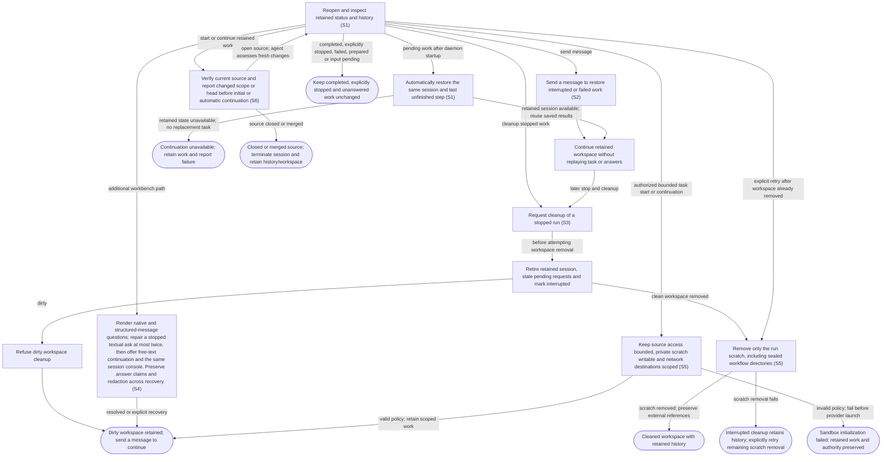

# Recover retained work and clean up safely

## Goal

Pending work continues automatically after daemon startup from its retained progress. The owner can explicitly continue stopped work and deliberately remove a clean stopped workspace.

## Preconditions

At least one run has been prepared or launched and its local state is retained.

## Main flow

1. Reopen the application and inspect retained run status and history.
2. On daemon startup, automatically continue previously active work from its last unfinished step in the same retained session. Previously accepted work that had not yet begun starts once; prepared drafts remain unstarted.
3. Preserve the workspace, conversation, authority, saved results and reviewer checkpoints. Reconcile a saved completion before continuing, and inspect uncertain actions before acting again.
4. Open the secondary agent details, review that cleanup retires the session and removes a clean workspace, then explicitly clean up a stopped run with no uncommitted changes.

## Alternatives and recovery

Closing the view or transport does not stop work. Startup leaves completed idle sessions idle, honors explicit interrupts even when their acknowledgment was lost, and preserves unanswered questions without answering for the owner. Process loss makes live RPC IDs stale. Structured-message questions remain retained; lost native questions become textual continuations, while approvals must be requested again through their native authorization path. Automatic continuation reuses the retained session and saved workflow progress, never its original task as a fresh launch. Unavailable retained state fails visibly without substituting a new task or preventing other sessions from continuing. Sending to inactive work restores its retained session and uses the submitted message as the only new turn. It must not replay the original task, a generic resume prompt or old answers. Failed acceptance retains the draft; accepted messages remain durably saved even if delivery later fails. A queued message resumes its own delivery after restart; an uncertain delivery is never replayed or replaced with a generic continuation. Cleanup first retires any retained session, makes its pending requests stale and marks the run interrupted. If workspace removal is then refused because it is dirty, the workspace remains but continuation happens by sending a message. Cleanup retains snapshots and history.

## Scenarios

- **S6** Before an initial start or automatic unfinished-work restoration, verify the current source item and report changed title, description, head, state and assignment context to the agent for assessment. Explicit message-driven restoration instead uses saved source context without a GitHub preflight; its agent performs task-required GitHub reads. Failed preflight reads keep automatic work stopped. A closed issue or closed/merged PR permanently terminates its sessions, retires questions and preserves history and workspaces; reopening the source does not revive them. Dirty cleanup cannot make terminal work resumable.

- **S1** Startup continues pending work from retained progress, preserves prepared and completed work, honors explicit interrupts and unanswered questions, stales expired native requests and isolates unavailable sessions.
- **S2** Sending a message restores retained work and starts exactly that message instead of replaying its original task.
- **S3** Dirty cleanup retains the workspace after interrupting the retained session; continuation happens by sending a message. Clean stopped workspace cleanup retains history.

- **S4** Render native and structured-message questions; repair a stopped textual ask at most twice, then offer free-text continuation and the same session console. Preserve answer claims and redaction across recovery.

Plugin maintenance also survives view closure. Startup marks queued/running operations uncertain without replay; a failed/null inventory response retains the previous observations. Refreshing actual provider state precedes any user-chosen retry. Existing run recovery and cleanup do not remove plugin installation history.

- **S5** Private scratch and refreshed review indexes remain scoped to the retained run across recovery. Successful explicit cleanup removes that scratch, including sealed workflow directories, along with its clean workspace; dirty cleanup preserves both. If scratch removal fails after the workspace is removed, the interrupted record and history remain, and an explicit cleanup retry finishes the remaining removal without requiring the absent workspace. External references and shared file permissions remain intact. The owner’s original private settings and retained conversation history remain intact.

Native request IDs become stale after process loss. Structured message questions retain durable identity; confirmed unanswered native questions and interrupted form repairs retain a textual fallback and original blocking status on the original run. Unfinished classification and clarification records never independently create a question: the retained thread reconnects only for question-only clarification, preserving the shared two-attempt budget. Exhausted unconfirmed cases stop at diagnostics without new attention. Lost approvals never become textual authorization. Answering a fallback restores the retained session without replaying repair attempts or prior answers; explicit Resume remains available for ordinary interrupted work.

A native clarification that replaced an older text request remains answerable after its process is lost. Recovery retains one fallback with the actual question, delivery status and consumed attempts, while preserving unrelated questions and earlier replacement events. The replacement has a fresh request identity; older answers and dismissals cannot affect it. Answered, dismissed and cancelled requests do not return.

A durable native answer claim stays final even if process loss occurs before recovery records the answer. Startup takeover durably cancels checking and clarification before reconnection, and cancellation remains effective across session attachment.

If startup finishes reconnecting after its session has been retired, it cannot overwrite the current state or active turn of a replacement started by the owner.

An unanswered native clarification remains available as a fallback after its turn completes, including when unrelated requests remain pending. Its delivery status, consumed attempts and unrelated requests are preserved.

Retained recovery claims its intended delivery attempt before agent setup. Setup failure consumes that claim and permits a retry only within the shared budget; successful setup reuses the claim for its first question-only turn. Exhausted unconfirmed recovery stays unresolved across restart. Successful owner-directed work can still supply new evidence to resolve an older ambiguous request.
A durable async question retains one current answer route immediately after process loss and across restart. Matching duplicate text retires atomically with history preserved. An originating answer claim remains final through uncertain delivery, stale snapshots and restart, and cannot leave a sibling route answerable.
Cancelling automatic recovery does not establish that a genuine pending async question was answered or became obsolete. After restart, Take over can still clear its recovery progress while that question remains available for an explicit answer.

<!-- flow-references -->
## Terminology and UI references

Glossary: [agent-run](../glossary/README.md#agent-run), [workspace](../glossary/README.md#workspace), [state-interrupted](../glossary/README.md#state-interrupted), [state-cleaned](../glossary/README.md#state-cleaned), [coverage-gap](../glossary/README.md#coverage-gap), [unverified-behavior](../glossary/README.md#unverified-behavior), [question-recovery](../glossary/README.md#question-recovery), [session-console](../glossary/README.md#session-console), [state-terminated](../glossary/README.md#state-terminated).
UI entities: [PAGE-AGENTS](../ui/README.md#PAGE-AGENTS), [P-RUN-LIST](../ui/README.md#P-RUN-LIST), [P-RUN-DETAIL](../ui/README.md#P-RUN-DETAIL), [W-RUN-ROW](../ui/README.md#W-RUN-ROW), [W-RUN-EMPTY](../ui/README.md#W-RUN-EMPTY), [W-RUN-CONTROLS](../ui/README.md#W-RUN-CONTROLS), [C-SELECT-RUN](../ui/README.md#C-SELECT-RUN), [C-RUN-ACTION](../ui/README.md#C-RUN-ACTION), [PAGE-AGENT](../ui/README.md#PAGE-AGENT), [W-WORK-STATUS](../ui/README.md#W-WORK-STATUS), [W-QUESTION-RECOVERY](../ui/README.md#W-QUESTION-RECOVERY), [W-SESSION-CONSOLE](../ui/README.md#W-SESSION-CONSOLE).

## Flow diagram

## Implementation references

- [internal/app/runs.go](../../internal/app/runs.go) — Startup continues pending work in its retained thread and workspace with saved progress and reviewer checkpoints. Completed idle work, explicit interrupts and unanswered questions are preserved without automatic task replay. Cleanup retains the clean-workspace boundary and dirty refusal permits message continuation. (`func (m *Manager) Recover(`)
- [internal/store/store.go](../../internal/store/store.go) — Durable local run and journal storage
- [web/src/main.tsx](../../web/src/main.tsx) — Retained runs, resume and cleanup controls
- [internal/domain/types.go](../../internal/domain/types.go) — Shared domain, persistence, transport or dependency contract
- [internal/transport/mcp.go](../../internal/transport/mcp.go) — Shared domain, persistence, transport or dependency contract
- [go.mod](../../go.mod) — Shared domain, persistence, transport or dependency contract
- [go.sum](../../go.sum) — Shared domain, persistence, transport or dependency contract
- [internal/testutil/testutil.go](../../internal/testutil/testutil.go) — Shared fake-provider verification input; changes require assertion reconciliation.
- [internal/testutil/fakecodex/main.go](../../internal/testutil/fakecodex/main.go) — Shared fake-provider verification input; changes require assertion reconciliation.
- [internal/app/questions.go](../../internal/app/questions.go) — Durable native/message/text question routing, bounded form repair, redaction and retained continuation. (`func (m *Manager) answerSynthetic(`)
- [internal/app/plugins.go](../../internal/app/plugins.go) — Durable pinned-CLI plugin lifecycle and exclusive runtime/maintenance boundary. (`func (m *Manager) PluginAction(`)
- [internal/domain/admin.go](../../internal/domain/admin.go) — Typed plugin operation and inventory persistence. (`type PluginOperation struct`)
- [internal/app/sandbox.go](../../internal/app/sandbox.go) — Invocation-local native filesystem and destination policy; isolated writable scratch and private skill indexes without global configuration changes.
- [internal/codex/sandbox.go](../../internal/codex/sandbox.go) — Invocation-local native filesystem and destination policy; isolated writable scratch and private skill indexes without global configuration changes.
- [internal/app/cleanup.go](../../internal/app/cleanup.go) — Confine removal to one run; make sealed scratch directories removable without chmod of files or following owner references. Missing worktree permits an explicit retry after partial cleanup. (`func removeRunScratch(`)
- [internal/app/continuation.go](../../internal/app/continuation.go) — Verify fresh source for initial/automatic continuation; message-triggered restoration supplies saved context and lets the agent perform task-required GitHub reads. (`func (m *Manager) continuationContext(`)
- [internal/providers/continuation.go](../../internal/providers/continuation.go) — Targeted conditional GitHub source read bypasses local TTL while retaining shared budget and cooldown enforcement. (`func (g *GitHub) CurrentWorkItem(`)
- [internal/app/messages.go](../../internal/app/messages.go) — Recover queued follow-ups using encrypted saved text; retain uncertain delivery without replay or generic startup continuation. (`func (m *Manager) QueueMessage(`)
- [internal/app/attention_reconciliation.go](../../internal/app/attention_reconciliation.go) — Background same-run per-question reconciliation after delivery, completion and startup. Requires exact owner decision and subsequent agent acknowledgement; uncertainty preserves attention, native approvals are excluded. (`func (m *Manager) reconcileAttention(`)
- [internal/store/conversation.go](../../internal/store/conversation.go) — Bounded same-run redacted conversation evidence excludes tools, internal recovery input, old source messages and other runs. (`func (s *Store) ConversationEvidence(`)

## Test references

- [internal/app/app_test.go](../../internal/app/app_test.go) — `func TestRecoveryStalesRequestsAndPreservesIdleRuns(`; S1. Completed idle sessions retain their status and workspace; expired native requests become stale and reject answers.
- [internal/app/app_test.go](../../internal/app/app_test.go) — `func TestNonblockingApprovalsCrashAndResume(`; S2. Crashed fake process can explicitly resume.
- [internal/app/app_test.go](../../internal/app/app_test.go) — `func TestConcurrentPollingSteeringAndAnswersThenDirtyCleanup(`; S3. Dirty cleanup returns an error and retains the unsaved file; the assertion does not verify session retirement, interrupted status, stale requests or subsequent explicit resume.
- [web/tests/factory.spec.ts](../../web/tests/factory.spec.ts) — `test("sending a message restores the dirty retained daemon session without a Resume action"`; S2, S3. Assembled cleanup refuses dirty removal, preserves history/workspace/thread and restores that session by sending the draft, without separate Resume.
- [internal/app/app_test.go](../../internal/app/app_test.go) — `func TestMessageRestoresRetainedSessionWithOneSubmittedTurn(`; S2. An explicitly interrupted session remains stopped across startup; a follow-up retains run/thread/worktree/authority and eight concurrent messages accept exactly one submitted turn.
- [internal/app/app_test.go](../../internal/app/app_test.go) — `func TestWakeMessageFailureKeepsRetainedRecordAndRejectsCleanedWork(`; S2, S3. Missing retained worktree returns wake failure without losing the retained record; prepared and cleaned work cannot accept a message.
- [web/tests/factory.spec.ts](../../web/tests/factory.spec.ts) — `inactive work status and sending a message restore the retained session`; S2. Both themes verify work-item activity and message-triggered continuation, no Resume control, one submit and retained failure draft.
- [internal/app/questions_test.go](../../internal/app/questions_test.go) — `func TestStoppedQuestionRecoveryNativeAndFallback(`; S4. Same-session bounded question repair, at-most-once answers and original-mode restoration.
- [internal/app/questions_test.go](../../internal/app/questions_test.go) — `func TestStructuredMessageQuestionSurvivesRestartAndClaimsAnswerOnce(`; S4. Async questions survive restart and concurrent answers have one claimant.
- [web/tests/factory.spec.ts](../../web/tests/factory.spec.ts) — `text fallback opens the same session console`; S4. Fallback routes the exact answer to its request and console mode retains the reply draft without a new launch.
- [internal/app/questions_test.go](../../internal/app/questions_test.go) — `func TestLostNativeQuestionsRemainAnswerableWithoutConvertingApprovals(`; S4. Lost question IDs are stale but retained textual continuation remains; lost approvals never become textual authorization.
- [internal/app/plugins_test.go](../../internal/app/plugins_test.go) — `func TestPluginRestartAndMalformedInventoryRetainObservedState(`; S1. Startup marks in-flight plugin operations uncertain; malformed inventory retains prior observations without replay.
- [internal/app/sandbox_test.go](../../internal/app/sandbox_test.go) — `func TestTaskSandboxRetainsIsolationAcrossSessionWake(`; S5. Start and automatic startup continuation retain the same bounded process profile and thread without a legacy policy override; explicit cleanup removes private scratch.
- [internal/app/sandbox_test.go](../../internal/app/sandbox_test.go) — `func TestSandboxSkillDataIsPrivateBoundedAndRetained(`; S5. Refreshing private skill indexes cannot alter the owner source; resume keeps run caches and rejects symlink sources.
- [internal/app/sandbox_test.go](../../internal/app/sandbox_test.go) — `func TestInvalidTaskSandboxFailsWithoutProviderFallback(`; S5. Invalid sandbox fails before app-server launch without an unrestricted fallback.
- [internal/codex/sandbox_test.go](../../internal/codex/sandbox_test.go) — `func TestTaskSandboxPolicyAndInvalidRoots(`; S5. Independent workspace/scratch filesystem and network permissions reject invalid or global roots; proxy allowlist excludes arbitrary hosts.
- [internal/app/cleanup_test.go](../../internal/app/cleanup_test.go) — `func TestRunScratchCleanupSealedDirectoriesPreservesExternalReferences(`; S5. Sealed directories are removed; symlink targets and shared hard-linked file contents/modes stay intact; missing scratch is idempotent and escaping ID rejected.
- [internal/app/cleanup_test.go](../../internal/app/cleanup_test.go) — `func TestCleanupRetriesScratchFailureAfterWorktreeWasRemoved(`; S3, S5. Injected scratch failure leaves interrupted record after worktree removal; explicit retry removes remaining sealed scratch, marks cleaned and retains original thread.
- [internal/app/recovery_test.go](../../internal/app/recovery_test.go) — `func TestStartupContinuesPendingSessionFromRetainedProgress(`; S1, S2. Running/queued/starting and process-interrupted work resumes the identical thread/workspace/profile, retains a completed-reviewer artifact, and repeated recovery cannot create a duplicate session or replay the original task.
- [internal/app/recovery_test.go](../../internal/app/recovery_test.go) — `func TestStartupLeavesFinishedStoppedAndUnstartedWorkAlone(`; S1. Idle, explicitly interrupted, failed, prepared and cleaned snapshots remain unchanged; no provider invocation or new workspace occurs.
- [internal/app/recovery_test.go](../../internal/app/recovery_test.go) — `func TestStartupRetainsQuestionsAndNeverReplaysApprovalAnswers(`; S1, S4. Lost native questions remain unanswered text; expired native approvals become stale and continuation requests fresh native approval without textual authorization.
- [internal/app/recovery_test.go](../../internal/app/recovery_test.go) — `func TestStartupReconcilesProviderCompletionWithoutAnotherTurn(`; S1, S2. A durably completed retained turn becomes idle after thread resume with no additional model turn.
- [internal/app/recovery_test.go](../../internal/app/recovery_test.go) — `func TestStartupHonorsInterruptBeforeProviderAcknowledges(`; S1. A persisted interrupt request prevents automatic continuation even before the provider acknowledges stopping.
- [internal/app/recovery_test.go](../../internal/app/recovery_test.go) — `func TestStartupIsolatesUnavailableWorkAndContinuesOtherSessions(`; S1, S2. Unavailable retained workspace fails visibly without creating a replacement task; another pending session continues independently.
- [internal/app/recovery_test.go](../../internal/app/recovery_test.go) — `func TestStartupStartsOnlyPreviouslyAcceptedUnstartedWork(`; S1. Previously accepted queued work with no provider thread is launched once before or after workspace creation; prepared drafts are independently excluded.
- [internal/app/recovery_test.go](../../internal/app/recovery_test.go) — `func TestStartupNeverReplacesAnUnavailableRetainedThread(`; S1, S2. An unavailable retained provider thread produces a visible failure while preserving its identity; neither a fresh thread nor another task turn is created.
- [internal/app/recovery_test.go](../../internal/app/recovery_test.go) — `func TestStartupHonorsCleanupEvenWhenDirtyRemovalFails(`; S1, S3. Explicit cleanup clears pending continuation before dirty removal fails; startup leaves the interrupted run stopped with its unsaved file intact.
- [internal/app/continuation_test.go](../../internal/app/continuation_test.go) — `func TestContinuationProvidesFreshChangesWithoutReplacingSession(`; S6. Fresh title/body/update/assignment changes reach the retained agent in structured source context while thread, workspace and original task remain unchanged.
- [internal/app/continuation_test.go](../../internal/app/continuation_test.go) — `func TestChangedPRHeadInvalidatesCheckpointsWithoutRetargetingWorkspace(`; S6. Changed PR head and previous/current identities reach the agent for checkpoint validity decisions without silently changing workspace, base or thread.
- [internal/app/continuation_test.go](../../internal/app/continuation_test.go) — `func TestClosedOrMergedSourcePermanentlyTerminatesContinuation(`; S6. Closed issue, closed PR and merged PR prevent another provider invocation; messages/resume are refused and dirty cleanup preserves terminal state and unsaved files.
- [internal/app/continuation_test.go](../../internal/app/continuation_test.go) — `func TestUnverifiedSourceNeverStartsProviderOrReplaysTask(`; S6. Failed fresh source reads fail visibly before provider or workspace creation with no stale fallback.
- [internal/app/continuation_test.go](../../internal/app/continuation_test.go) — `func TestSyncedClosureStopsActiveWorkAndRetiresQuestions(`; S6. Synced source closure retires active provider work, stales pending questions, survives restart without resurrecting asks and remains terminal after source reopening.
- [internal/app/work_tracking_test.go](../../internal/app/work_tracking_test.go) — `func TestRefreshPullRequestsTerminatesOnlyClosedSourceSessions(`; S6. Accepted targeted closed/merged PR refresh terminates only that source session, retires its question and retains history and dirty workspace; a linked open issue keeps its session and question, and reopening cannot resume the terminated run.
- [internal/app/continuation_test.go](../../internal/app/continuation_test.go) — `func TestStartupTerminatesClosedWorkEvenWithPendingQuestion(`; S6. Startup checks source closure even for a session awaiting input and terminates it without leaving an actionable question.
- [internal/providers/continuation_test.go](../../internal/providers/continuation_test.go) — `func TestCurrentWorkItemRevalidatesCachedLifecycleAndFailsClosed(`; S6. Targeted lifecycle revalidation bypasses a cached open state and never falls back after a failed fresh read.
- [web/tests/factory.spec.ts](../../web/tests/factory.spec.ts) — `terminated work retains history and cleanup without allowing continuation`; S6. Both themes show Stopped and terminal reason, retain cleanup and history, disable Send and expose no Interrupt or launch action.
- [internal/app/messages_test.go](../../internal/app/messages_test.go) — `func TestQueuedFollowUpRecoversSameThreadWithoutAnyGitHubPreflight(`; S2, S6. Queued recovery preserves the submitted follow-up and retained thread without a GitHub preflight; uncertain or failed delivery is retained without automatic replay.
- [internal/app/messages_test.go](../../internal/app/messages_test.go) — `func TestInterruptedMessageDeliveryIsUncertainAndNeverReplayed(`; S2, S6. Queued recovery preserves the submitted follow-up and retained thread without a GitHub preflight; uncertain or failed delivery is retained without automatic replay.
- [internal/app/messages_test.go](../../internal/app/messages_test.go) — `func TestAcceptedMessageRemainsSavedWhenAgentRestorationFails(`; S2, S6. Queued recovery preserves the submitted follow-up and retained thread without a GitHub preflight; uncertain or failed delivery is retained without automatic replay.
- [internal/app/attention_reconciliation_test.go](../../internal/app/attention_reconciliation_test.go) — `func TestDeliveredMessageReconcilesOnlyAcknowledgedQuestions(`; S1. Partial acknowledgement retires only Q1, retains actionable Q2 and permits its answer; full same-run acknowledged completion clears the group; unrelated continuation preserves both.
- [internal/app/attention_reconciliation_test.go](../../internal/app/attention_reconciliation_test.go) — `func TestAttentionReconciliationPreservesUnprovenOrOtherRunRequests(`; S1. Other-run review completion, forged quotes/IDs, reversed evidence order and an intervening run turn cannot retire the original requests.
- [internal/app/attention_reconciliation_test.go](../../internal/app/attention_reconciliation_test.go) — `func TestAttentionReconciliationHelperFailureRetainsQuestions(`; S1. An invalid helper decision leaves both original requests pending after delivery and continuation.
- [internal/app/continuation_test.go](../../internal/app/continuation_test.go) — `func TestClientlessCleanupSerializesWakeWithoutBlockingManager(`; S2, S3. A real-store blocked cleanup serializes the same run's wake without blocking independent manager lookup; invalid IDs create no bookkeeping owner and disconnected attachment semantics remain.
- [internal/app/continuation_test.go](../../internal/app/continuation_test.go) — `func TestSourceTerminationUnblocksProviderAndIndependentOperations(`; S6. An unanswered provider RPC and earlier Start/busy/Cleanup waiter cannot block source termination or independent run lookup; accepted message delivery becomes uncertain without replay, and retired work remains terminal.

## Verification and gaps

Local suites: `go`.
Fixture success does not establish real-host acceptance.
- **S1** — `gap-flow-recover-cleanup-s1-01` · Unverified behavior · P2 · owner: user-flow-maintainer. Prepared snapshots, automatic same-thread fixture continuation, saved reviewer artifacts and excluded inactive states are asserted. Installed-daemon restart with real-provider progress and workflow-checkpoint reuse remains unverified for this change. Next verification: Observe a dedicated pilot session through an installed-daemon restart, verify identical thread/workspace and retained reviewer checkpoint reuse, and verify no duplicate task, answer or publication; fixtures alone do not establish real-provider continuation.
- **S2** — `gap-flow-recover-cleanup-s2-01` · Unverified behavior · P2 · owner: user-flow-maintainer. Fake-provider message restoration does not prove current installed real-provider conversation or workspace history preservation. No installed-host or real-provider recovery acceptance is established by this development port. Next verification: Verify message restoration against the installed port version and record retained conversation/workspace history without task or answer replay; fixture success alone is insufficient.
- **S3** — `gap-flow-recover-cleanup-s3-01` · Unverified behavior · P2 · owner: user-flow-maintainer. Assembled dirty refusal asserts interrupted status, retained file/history/draft and same-run/thread Resume. Pending-request staleness, session-retirement races and clean cleanup/history retention still need dedicated assertions. Next verification: Exercise pending requests/concurrent clients during cleanup, then separately assert clean removal and retained snapshots/history.

<!-- /flow-references -->
