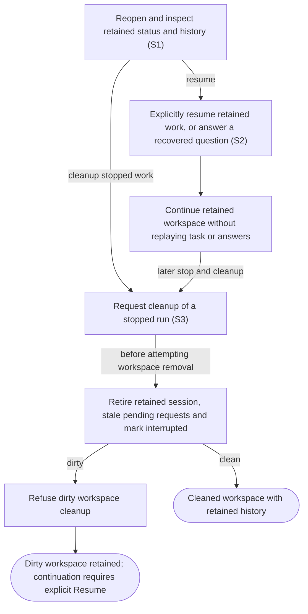

# Recover retained work and clean up safely

## Goal

The owner can recover interrupted work after a process or connection loss and deliberately remove a clean stopped workspace.

## Preconditions

At least one run has been prepared or launched and its local state is retained.

## Main flow

1. Reopen the application and inspect retained run status and history.
2. After process loss, explicitly resume an interrupted or failed run.
3. Continue in the retained workspace and conversation history.
4. Explicitly clean up a stopped run when its workspace has no uncommitted changes.

## Alternatives and recovery

Closing the view or transport does not stop work. Process loss makes old requests stale. Resume must not replay the original task or old answers. Cleanup first retires any retained session, makes its pending requests stale and marks the run interrupted. If workspace removal is then refused because it is dirty, the workspace remains but continuation requires explicit Resume. Cleanup retains snapshots and history.

## Scenarios

- **S1** Restart recovery preserves prepared candidates and interrupts dead sessions while staling pending requests.
- **S2** Explicit resume reconnects retained work instead of replaying its original task.
- **S3** Dirty cleanup retains the workspace after interrupting the retained session; continuation requires explicit Resume. Clean stopped workspace cleanup retains history.

Native request IDs become stale after process loss. Structured message questions retain durable identity; confirmed unanswered native questions and interrupted form repairs retain a textual fallback and original blocking status on the original run. Unfinished classification and clarification records never independently create a question: the retained thread reconnects only for question-only clarification, preserving the shared two-attempt budget. Exhausted unconfirmed cases stop at diagnostics without new attention. Lost approvals never become textual authorization. Answering a fallback restores the retained session without replaying repair attempts or prior answers; explicit Resume remains available for ordinary interrupted work.

A native clarification that replaced an older text request remains answerable after its process is lost. Recovery retains one fallback with the actual question, delivery status and consumed attempts, while preserving unrelated questions and earlier replacement events. The replacement has a fresh request identity; older answers and dismissals cannot affect it. Answered, dismissed and cancelled requests do not return.

A durable native answer claim stays final even if process loss occurs before recovery records the answer. Startup takeover durably cancels checking and clarification before reconnection, and cancellation remains effective across session attachment.

If startup finishes reconnecting after its session has been retired, it cannot overwrite the current state or active turn of a replacement started by the owner.

An unanswered native clarification remains available as a fallback after its turn completes, including when unrelated requests remain pending. Its delivery status, consumed attempts and unrelated requests are preserved.

Retained recovery claims its intended delivery attempt before agent setup. Setup failure consumes that claim and permits a retry only within the shared budget; successful setup reuses the claim for its first question-only turn. Exhausted unconfirmed recovery stays unresolved across restart. Successful owner-directed work can still supply new evidence to resolve an older ambiguous request.
A durable async question retains one current answer route immediately after process loss and across restart. Matching duplicate text retires atomically with history preserved. An originating answer claim remains final through uncertain delivery, stale snapshots and restart, and cannot leave a sibling route answerable.
Cancelling automatic recovery does not establish that a genuine pending async question was answered or became obsolete. After restart, Take over can still clear its recovery progress while that question remains available for an explicit answer.

<!-- flow-references -->
## Terminology and UI references

Glossary: [agent-run](../glossary/README.md#agent-run), [workspace](../glossary/README.md#workspace), [state-interrupted](../glossary/README.md#state-interrupted), [state-cleaned](../glossary/README.md#state-cleaned), [coverage-gap](../glossary/README.md#coverage-gap), [unverified-behavior](../glossary/README.md#unverified-behavior), [question-recovery](../glossary/README.md#question-recovery).
UI entities: [PAGE-AGENTS](../ui/README.md#PAGE-AGENTS), [P-RUN-LIST](../ui/README.md#P-RUN-LIST), [P-RUN-DETAIL](../ui/README.md#P-RUN-DETAIL), [W-RUN-ROW](../ui/README.md#W-RUN-ROW), [W-RUN-EMPTY](../ui/README.md#W-RUN-EMPTY), [W-RUN-CONTROLS](../ui/README.md#W-RUN-CONTROLS), [C-SELECT-RUN](../ui/README.md#C-SELECT-RUN), [C-RUN-ACTION](../ui/README.md#C-RUN-ACTION).

## Flow diagram

## Implementation references

- [internal/app/runs.go](../../internal/app/runs.go) — Recovery and explicit resume; Cleanup retires any retained session, closes its provider process, stales pending requests and persists interrupted before attempting worktree removal. Dirty removal failure retains the workspace but requires explicit Resume to continue. (`func (m *Manager) Recover(`)
- [internal/store/store.go](../../internal/store/store.go) — Durable local run and journal storage
- [web/src/main.tsx](../../web/src/main.tsx) — Retained runs, resume and cleanup controls
- [internal/domain/types.go](../../internal/domain/types.go) — Shared domain, persistence, transport or dependency contract
- [internal/transport/mcp.go](../../internal/transport/mcp.go) — Shared domain, persistence, transport or dependency contract
- [go.mod](../../go.mod) — Shared domain, persistence, transport or dependency contract
- [go.sum](../../go.sum) — Shared domain, persistence, transport or dependency contract
- [internal/testutil/testutil.go](../../internal/testutil/testutil.go) — Shared fake-provider verification input; changes require assertion reconciliation.
- [internal/testutil/fakecodex/main.go](../../internal/testutil/fakecodex/main.go) — Shared fake-provider verification input; changes require assertion reconciliation.
- [internal/app/questions.go](../../internal/app/questions.go) — Bounded recovery and durable text/structured question answer claims; preserve authority and redaction. (`func (m *Manager) answerSynthetic(`)

## Test references

- [internal/app/app_test.go](../../internal/app/app_test.go) — `func TestRecoveryStalesRequestsAndIdleRuns(`; S1. Stored dead session and attention become interrupted/stale.
- [internal/app/app_test.go](../../internal/app/app_test.go) — `func TestNonblockingApprovalsCrashAndResume(`; S2. Crashed fake process can explicitly resume.
- [internal/app/app_test.go](../../internal/app/app_test.go) — `func TestConcurrentPollingSteeringAndAnswersThenDirtyCleanup(`; S3. Dirty cleanup returns an error and retains the unsaved file; the assertion does not verify session retirement, interrupted status, stale requests or subsequent explicit resume.
- [web/tests/factory.spec.ts](../../web/tests/factory.spec.ts) — `test("dirty cleanup retains the daemon workspace and history until explicit Resume"`; S2, S3. Assembled dirty cleanup shows interrupted state/refusal, retains file/history/draft, disables Send, then resumes the same run/thread/workspace explicitly.
- [internal/app/questions_test.go](../../internal/app/questions_test.go) — `func TestStructuredMessageQuestionSurvivesRestartAndClaimsAnswerOnce(`; S1, S2. Structured question retains identity across restart; concurrent responses accept only once.
- [internal/app/questions_test.go](../../internal/app/questions_test.go) — `func TestLostNativeQuestionsRemainAnswerableWithoutConvertingApprovals(`; S1. Lost native question becomes text; approvals remain stale.
- [internal/app/questions_test.go](../../internal/app/questions_test.go) — `func TestRestartDuringRepairRetainsOneFallbackWithoutReplayingAttempts(`; S1. In-flight repair restart produces one durable fallback without replaying attempts.
- [internal/app/questions_test.go](../../internal/app/questions_test.go) — `func TestRestartMaterializesAlreadyPersistedFallback(`; S1. Crash between persisted fallback stage and attention creation is repaired idempotently.
- [internal/app/question_classification_test.go](../../internal/app/question_classification_test.go) — `func TestRestartCheckingAutomaticallyClarifiesRetainedThread(`; S1. Unfinished legacy checking reconnects only for constrained Plan-mode clarification, preserving thread/worktree/profile and never issuing ordinary Resume.
- [internal/app/question_classification_test.go](../../internal/app/question_classification_test.go) — `func TestRestartClarificationPreservesClaimedAttempt(`; S1. Repeated restart during clarification retains its claimed attempt and stops at two without inventing question evidence.
- [internal/app/question_classification_test.go](../../internal/app/question_classification_test.go) — `func TestRestartClaimedRecoveryAnswerDoesNotAskAgain(`; S1. Restart resolves an already claimed recovery answer without replay, repeated attention or automatic task continuation.
- [internal/app/question_classification_test.go](../../internal/app/question_classification_test.go) — `func TestLegacyClarificationSupersedesOnlyMatchingSynthetic(`; S1. Native clarification atomically supersedes only matching legacy text; process loss creates one fresh answerable fallback with retained attempts, delivery and unrelated history, rejecting stale legacy answers and dismissals.
- [internal/app/question_classification_test.go](../../internal/app/question_classification_test.go) — `func TestNativeAnswerClaimSurvivesProcessLoss(`; S1. Durable native answer claims survive process disconnect and restart between attention claim and recovery write, preserving answered history and attempts without fallback, reconnect or replay.
- [internal/app/question_classification_test.go](../../internal/app/question_classification_test.go) — `func TestStartupTakeoverCancelsRecoveryBeforeSessionAttachment(`; S1. Provider-gated startup checking/clarifying classification remains pending until zero-attempt takeover commits before attachment; released callbacks cannot create attention or reconnect.
- [internal/app/question_classification_test.go](../../internal/app/question_classification_test.go) — `func TestStartupTakeoverCancelsAfterSessionAttachment(`; S1. An initialization gate proves one durable claimed attempt with no delivered turn; takeover suppresses late native/async setup callbacks and later explicit continuation can ask a fresh genuine question.
- [internal/app/question_classification_test.go](../../internal/app/question_classification_test.go) — `func TestRetainedSetupFailureExhaustsSharedBudget(`; S1. Initialize/resume and missing-thread/worktree setup failures consume intended attempts durably before setup, retry only within the shared budget and remain unresolved after exhaustion across repeated startup.
- [internal/app/question_classification_test.go](../../internal/app/question_classification_test.go) — `func TestSetupFailureStillRechecksLaterSuccessfulWork(`; S1. After retained setup becomes unavailable, later successful owner-directed work still supplies obsolescence evidence, retires the matching legacy request and preserves consumed attempts.
- [internal/app/question_classification_test.go](../../internal/app/question_classification_test.go) — `func TestAsyncRecoveryRetainsSingleRouteAcrossRestart(`; S1. An originating async question remains the one pending answer route across restart without a duplicate textual fallback.
- [internal/app/question_classification_test.go](../../internal/app/question_classification_test.go) — `func TestAsyncRecoveryUncertainClaimSurvivesStaleSnapshotAndRestart(`; S1. An async answer is claimed against its originating recovery before uncertain delivery; stale awaiting/fallback snapshots and restart cannot reopen the claim or reset attempts.
- [internal/app/question_classification_test.go](../../internal/app/question_classification_test.go) — `func TestAsyncRecoveryRetiresOnlyMatchingDuplicate(`; S1. Restart atomically retires only matching persisted duplicate text with payload/events intact, retains async identity/nonblocking delivery/attempts, and rejects stale attention snapshots and late sibling routes.
- [internal/app/question_classification_test.go](../../internal/app/question_classification_test.go) — `func TestOriginatingRecoveryClaimsExcludeSiblingAnswers(`; S1. Concurrent async/text sibling answers have one accepted originating claim; other siblings resolve before delivery and restart creates no new attention.
- [internal/app/question_classification_test.go](../../internal/app/question_classification_test.go) — `func TestRetainedSetupReusesClaimForLastPermittedTurn(`; S1. Successful retained setup reuses its preclaimed last permitted attempt for the actual native clarification turn without double counting or skipping delivery.
- [internal/app/question_classification_test.go](../../internal/app/question_classification_test.go) — `func TestRestartUnavailableSetupUsesRemainingBudget(`; S1. An older early-unresolved setup record uses only its one remaining durable attempt after restart; setup failure exhausts the budget without attention or another restart loop.
- [internal/app/question_classification_test.go](../../internal/app/question_classification_test.go) — `func TestAsyncRecoveryTakeoverPreservesGenuineQuestion(`; S1. A held live clarification receives an async notification injected through onMessage; takeover before or after restart cancels only automatic recovery, preserves the genuine nonblocking request and attempt count, and permits its explicit originating answer. This does not exercise provider async emission.
- [internal/app/question_classification_test.go](../../internal/app/question_classification_test.go) — `func TestAsyncRecoveryDisconnectRetainsOnlyAsyncRoute(`; S1. Actual retained-process closure preserves the nonblocking async request as the only pending route immediately before restart, with its attempt count intact.
- [internal/app/question_classification_test.go](../../internal/app/question_classification_test.go) — `func TestCompletedNativeRecoveryPreservesQuestionBesideUnrelatedAttention(`; S1. When a nonblocking native clarification turn completes beside unrelated pending attention, its stale native handle becomes one answerable nonblocking fallback while unrelated requests and consumed attempts remain unchanged.
- [internal/app/question_classification_test.go](../../internal/app/question_classification_test.go) — `func TestRetiredResumeCannotOverwriteOwnerReplacement(`; S1. An actual successful retained thread/resume response is held at its session lock; a staged lock-owned retirement/replacement transition proves the retired launch cannot overwrite the replacement's running state, turn or identity.

## Verification and gaps

Local suites: `go`, `browser`.
Fixture success does not establish real-host acceptance.
- **S1** — `gap-flow-recover-cleanup-s1-01` · Unverified behavior · P2 · owner: user-flow-maintainer. Prepared-run recovery persistence is implemented but lacks a targeted assertion. Next verification: Persist a prepared run, reconstruct recovery state, and assert that its prepared snapshot survives without launching or creating a workspace.
- **S2** — `gap-flow-recover-cleanup-s2-01` · Unverified behavior · P2 · owner: user-flow-maintainer. Fake resume success does not prove full real-provider history preservation; dated real acceptance is in ../acceptance.md. Next verification: Check existing dated provider acceptance against the current binary and retain explicit evidence of resumed conversation/workspace history without task or answer replay; fixture success alone is insufficient.
- **S3** — `gap-flow-recover-cleanup-s3-01` · Unverified behavior · P2 · owner: user-flow-maintainer. Assembled dirty refusal asserts interrupted status, retained file/history/draft and same-run/thread Resume. Pending-request staleness, session-retirement races and clean cleanup/history retention still need dedicated assertions. Next verification: Exercise pending requests/concurrent clients during cleanup, then separately assert clean removal and retained snapshots/history.

<!-- /flow-references -->
