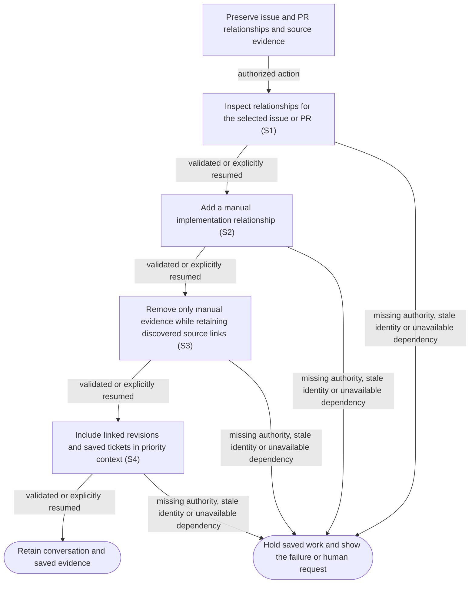

# Preserve issue and PR relationships and source evidence

## Goal

Preserve issue and PR relationships and source evidence.

## Preconditions

The private owner connection is established. Application data starts clean in the session-state database; native Codex authentication and configuration remain outside application state. GitHub source text is task data, not new authority.

## Main flow

1. Inspect relationships for the selected issue or PR.

2. Add a manual implementation relationship.

3. Remove only manual evidence while retaining discovered source links.

4. Include linked revisions and saved tickets in priority context.

## Alternatives and recovery

Read-only inspection does not launch a model turn. Surface validation or provider errors and retain saved work. Human questions, explicit interruptions and uncertain deliveries hold automatic dispatch. Resume against current retained history; never replay an uncertain send or an answered RPC blindly. Explicit cleanup preserves dirty worktrees.

## Scenarios

- **S1** — Inspect relationships for the selected issue or PR.
- **S2** — Add a manual implementation relationship.
- **S3** — Remove only manual evidence while retaining discovered source links.
- **S4** — Include linked revisions and saved tickets in priority context.

## Verification scope

The assertion references below establish their fixture scope. Native installed-host, real-provider and assistive-technology acceptance require separate dated observations. The retired pipeline editor, review artifacts, AI question repair and built-in issue-report ledger have no compatibility path.

<!-- flow-references -->
## Terminology and UI references

Glossary: [repository](../glossary/README.md#repository), [work-item](../glossary/README.md#work-item).
UI entities: [W-RELATIONSHIPS](../ui/README.md#W-RELATIONSHIPS), [W-ITEM-ROW](../ui/README.md#W-ITEM-ROW).

## Flow diagram

## Implementation references

- [internal/app/app.go](../../internal/app/app.go) — Retained revision-aware triage, priority precedence and relationships. (`func (a *App) UserAction(`)
- [web/src/wrapper.tsx](../../web/src/wrapper.tsx) — Saved inbox, session conversation, human input and confirmed configuration. (`function Factory(`)
- [internal/factory/configuration.go](../../internal/factory/configuration.go) — Concrete application/native proposals, explicit confirmation and safe boundaries. (`func (s *Service) Confirm(`)

## Test references

- [web/tests/wrapper.spec.ts](../../web/tests/wrapper.spec.ts) — `priorities relationships and PR queues remain available`; S1, S2. Acknowledge, unread and recorded actions remain independent; P0 override and clearing, manual link addition/removal and My PRs use explicit controls.
- [internal/factory/service_test.go](../../internal/factory/service_test.go) — `func TestPriorityBookkeepingReusesThreadAndRejectsStaleAssessment(`; S4. Reusable bookkeeping thread records only exact item revision/context/policy results.
- [internal/app/app_test.go](../../internal/app/app_test.go) — `func TestInboxRevisionStatesPriorityAndLinks(`; S2, S3. Manual link removal preserves discovered evidence and independent item state.
- [internal/app/inbox_reads_test.go](../../internal/app/inbox_reads_test.go) — `func TestInboxBulkReadsPreserveContextKeysAndCurrentRevisions(`; S4. Linked item revisions and saved ticket context invalidate stale assessments.
- [internal/transport/factory_test.go](../../internal/transport/factory_test.go) — `func TestRelationshipCASInvalidatesPreparedSelectedReads(`; S1. Warm selected item and conversation reads refresh after relationship CAS insertion and a move touching both old and new endpoints.

## Verification and gaps

Local suites: `go`, `browser`.
Fixture success does not establish real-host acceptance.

<!-- /flow-references -->
