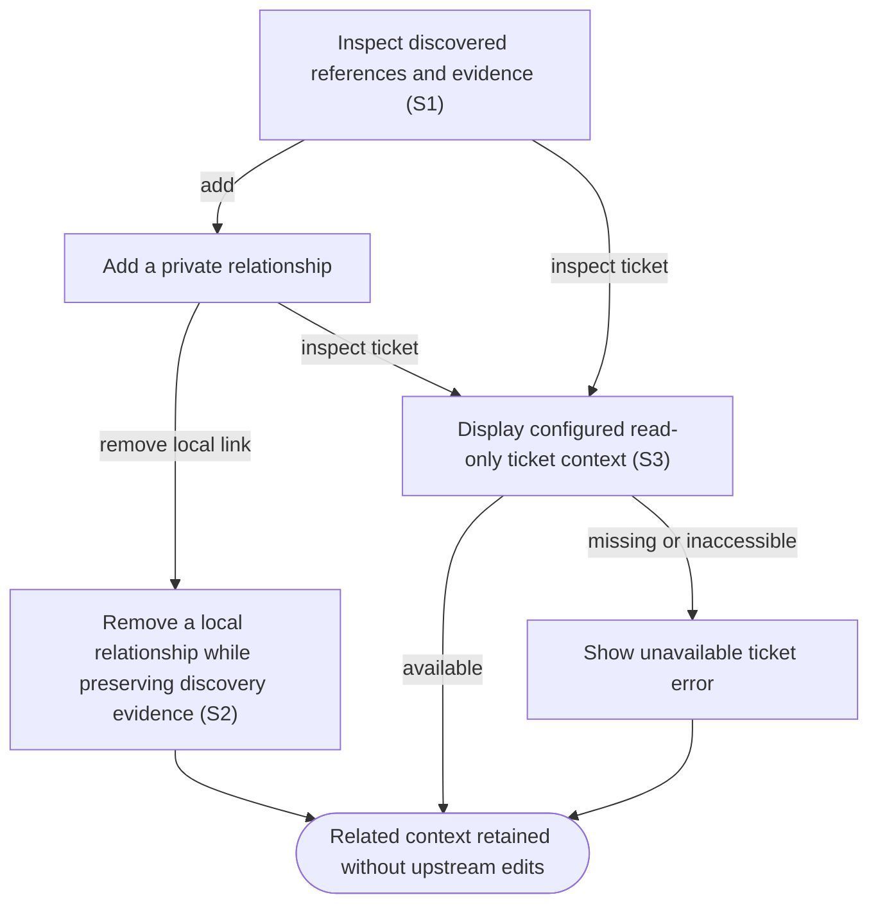

# Connect related work and inspect ticket context

## Goal

The owner can understand references between items and add private relationships without editing upstream content.

## Preconditions

An item is synchronized; external ticket context additionally requires an explicitly configured tenant and credential.

## Main flow

1. Inspect discovered references and their source evidence.
2. Add a local relationship to another item or ticket.
3. Remove a local relationship when it is no longer useful.
4. When ticket access is configured, display available ticket summary and status alongside related work.

## Alternatives and recovery

Removing a local relationship preserves independently discovered evidence. Missing or inaccessible tickets show an error. Local relationships never write to either external provider. Unsubmitted targets are retained per item for the lifetime of the open app, including tab changes, and never carry into another item. Successful Add and Remove refresh visible relationships without clearing unrelated drafts; late earlier responses cannot replace later selected detail.

## Scenarios

- **S1** References are discovered from item content/activity and retain evidence.
- **S2** Adding and removing local links does not delete discovered references.
- **S3** Configured ticket context is read-only; unavailable tickets remain visible as errors.

<!-- flow-references -->
## Terminology and UI references

Glossary: [relationship](../glossary/README.md#relationship), [work-item](../glossary/README.md#work-item), [coverage-gap](../glossary/README.md#coverage-gap), [unverified-behavior](../glossary/README.md#unverified-behavior).
UI entities: [W-RELATIONSHIPS](../ui/README.md#W-RELATIONSHIPS), [W-TICKET-CONTEXT](../ui/README.md#W-TICKET-CONTEXT), [W-PR-EVIDENCE](../ui/README.md#W-PR-EVIDENCE), [C-LINK](../ui/README.md#C-LINK), [C-BACK](../ui/README.md#C-BACK).

## Flow diagram

## Implementation references

- [internal/app/app.go](../../internal/app/app.go) — Reference discovery, local links and ticket refresh (`func (a *App) Link(`)
- [internal/providers/jira.go](../../internal/providers/jira.go) — Restricted read-only ticket provider
- [web/src/main.tsx](../../web/src/main.tsx) — Local relationship editor and ticket context
- [internal/domain/types.go](../../internal/domain/types.go) — Shared domain, persistence, transport or dependency contract
- [internal/store/store.go](../../internal/store/store.go) — Shared domain, persistence, transport or dependency contract
- [internal/transport/mcp.go](../../internal/transport/mcp.go) — Shared domain, persistence, transport or dependency contract
- [go.mod](../../go.mod) — Shared domain, persistence, transport or dependency contract
- [go.sum](../../go.sum) — Shared domain, persistence, transport or dependency contract
- [internal/testutil/testutil.go](../../internal/testutil/testutil.go) — Shared fake-provider verification input; changes require assertion reconciliation.
- [internal/testutil/fakecodex/main.go](../../internal/testutil/fakecodex/main.go) — Shared fake-provider verification input; changes require assertion reconciliation.

## Test references

- [internal/app/app_test.go](../../internal/app/app_test.go) — `func TestInboxRevisionStatesPriorityAndLinks(`; S1, S2. Discovered references survive local unlink.
- [web/tests/factory.spec.ts](../../web/tests/factory.spec.ts) — `test("unlink removes the visible relationship without clearing unrelated detail drafts"`; S2. Add displays a manual relationship; Remove removes its row once and retains priority/target drafts.
- [web/tests/factory.spec.ts](../../web/tests/factory.spec.ts) — `test("a delayed relationship refresh cannot replace a later selection or its drafts"`; S2. A held earlier relationship detail response cannot replace a later selected item or its independent drafts.
- [web/tests/factory.spec.ts](../../web/tests/factory.spec.ts) — `test("item switching restores saved priorities and keeps relationship drafts by item"`; S2. Unsubmitted relationship drafts are isolated by item and retained across tabs.
- [web/tests/factory.spec.ts](../../web/tests/factory.spec.ts) — `single-page navigation preserves list context and drafts at`; S1. Both themes and 1280px/390px widths assert exclusive list/item/agent pages, Back focus/scroll/query restoration and per-record draft preservation.

## Verification and gaps

Local suites: `go`, `browser`.
Fixture success does not establish real-host acceptance.
- **S3** — `gap-flow-relate-items-s3-01` · Unverified behavior · P2 · owner: user-flow-maintainer. No dedicated Jira provider fixture or live tenant acceptance exists. Jira remains disabled in the personal pilot; this spec does not authorize enabling it. Next verification: Add a read-only ticket-provider fixture covering summary/status and unavailable-ticket errors; retain Jira-disabled pilot status and leave tenant acceptance open.

<!-- /flow-references -->
