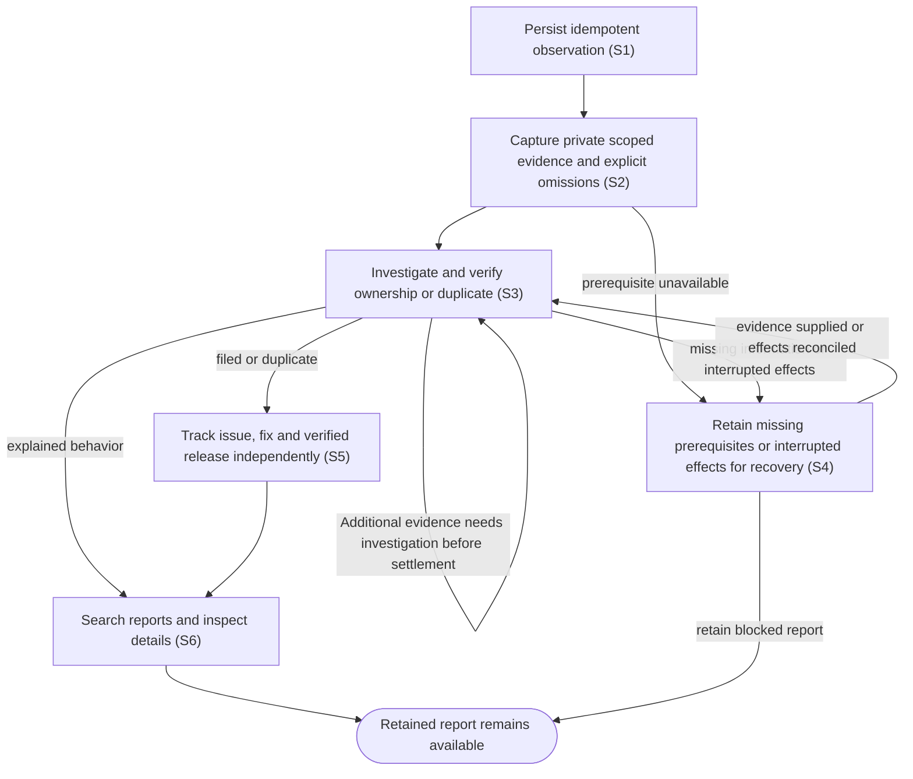

# Report suspected defects and track verified delivery

## Goal

Retain observations of suspected Code Factory defects, investigate and file useful issues automatically, and distinguish investigation progress from verified delivery.

## Preconditions

The owner has an authenticated private connection. Automatic investigation requires the installed workflow engine, native Codex authentication and the installed issue-drafting skill. Missing prerequisites retain actionable blocked reports.

## Main flow

1. Submit an observation time, affected surface, expected/actual results and reproduction steps or an explicit unknown-reproduction explanation, with a stable idempotency key. Include host-only errors and responses and available relevant IDs. Separate suspected causes from facts.
2. Retain the report immediately and collect relevant local evidence privately, with origins, capture times, hashes, explicit omissions and truncation. Credentials, authentication and unrelated work are excluded.
3. Investigate the captured evidence and relevant source through durable local work. Classify confirmed or suspected bugs, duplicates, insufficient information or behavior explained by the contract. Verify component ownership and destination within the organization before drafting repository-native issue text.
4. Publish the verified draft automatically, recording intent before the external effect and retaining the issue identity afterward. Reuse clear duplicates. Reporting authority does not authorize fixing code.
5. Keep the shared ledger current with independent processing, outcome, GitHub state, fix references, component versions, published stable/prerelease versions and observed installed versions. Unknown evidence stays Unknown.
6. Search and filter Reported issues, inspect details and missing-information requests, append host evidence, refresh delivery evidence and explicitly recover blocked or interrupted work.

## Alternatives and recovery

Repeated submissions with the same key and payload return the same durable report; conflicting keys fail. Lost workflow acknowledgements retry retained admission inputs. One investigation executes at a time with a thirty-minute deadline. Missing information resumes when supplied. Interrupted effects require inspection and explicit reconciliation before resume. Uncertain GitHub creation is searched by its opaque report marker and never blindly repeated. Uncertain routing blocks publication. Evidence unavailable locally can be requested from the host; locally available records are collected by the service.

An investigation that finishes with unusable findings retains an actionable report. It releases investigation capacity only after finalization succeeds; an explicit retry starts a fresh investigation rather than repeating the unusable result.

An uncertain issue publication retains its reconciliation requirements without holding investigation capacity after its investigation has finalized. Other reports can investigate while that issue identity is recovered; the uncertain creation is never repeated.

Additional evidence accepted before an investigation result settles is considered before the report completes or an unclaimed issue creation begins. Work already using an immutable observation finishes and finalizes before a fresh investigation incorporates missed evidence. Evidence accepted after issue creation has been claimed remains retained while that effect settles or is reconciled once.

Issue closure does not prove a fix; a verified closing commit or merged fix can establish its identity independently of release availability. Published package provenance and fix ancestry must agree before availability is shown. Verified component versions enrich the linked fix. Dependencies retain their own versions, using their checked package evidence and independently verified closing-fix ancestry; attribution to a Code Factory release requires an explicit provenance relationship. Source-only releases without checked package evidence stay Unknown. Issue state refreshes at startup and every five minutes; releases refresh every fifteen minutes. Manual refresh starts no agent. Failed release reads preserve discovered fixes and earlier verified availability, with errors, retry times and freshness. A credential's rate-limit deadline applies across reporting operations and reports, including reopened processes; skipped reads do not claim fresh results.

Journal updates refresh the loaded report range, including a pending request for more reports. Changing query filters resets pagination. Detail reads continue to make progress while journal events arrive; pending refreshes coalesce. Older detail responses cannot replace newer selected-report findings, processing or recovery controls, and a previous selection's completed request cannot suppress the current selection's details. Opening a report's GitHub link sends that report's exact issue destination to the host.

## Scenarios

- **S1** Complete submissions persist; incomplete/conflicting requests fail and concurrent retries return one report. Reporting ships in portable, Codex and browser packages.
- **S2** Relevant local context is captured with redaction and a private manifest; additional host observations are idempotent and resume requests for information.
- **S3** Durable investigation verifies ownership, reuses duplicates and files only a verified repository-native draft within the organization.
- **S4** Missing prerequisites, interrupted controllers, deadlines and uncertain effects remain recoverable without replaying issue creation.
- **S5** Closure, merged fixes, stable/prerelease delivery, dependency releases, mismatched assets and unknown installed versions remain independent; failed/rate-limited refresh preserves successful evidence.
- **S6** The shared view supports search, details, information requests, recovery controls, exact GitHub destinations and explicit unknown/version displays. Journal refreshes preserve the loaded report range; query changes reset pagination.

<!-- flow-references -->
## Terminology and UI references

Glossary: [issue-report](../glossary/README.md#issue-report), [report-ledger](../glossary/README.md#report-ledger), [report-processing](../glossary/README.md#report-processing), [report-outcome](../glossary/README.md#report-outcome), [evidence-manifest](../glossary/README.md#evidence-manifest), [delivery-evidence](../glossary/README.md#delivery-evidence), [fixed-issue](../glossary/README.md#fixed-issue), [credential](../glossary/README.md#credential).
UI entities: [PAGE-REPORTS](../ui/README.md#PAGE-REPORTS), [P-REPORT-LIST](../ui/README.md#P-REPORT-LIST), [P-REPORT-DETAIL](../ui/README.md#P-REPORT-DETAIL), [W-REPORT-LIST](../ui/README.md#W-REPORT-LIST), [W-REPORT-DETAIL](../ui/README.md#W-REPORT-DETAIL), [C-REPORT-SELECT](../ui/README.md#C-REPORT-SELECT), [C-REPORT-EVIDENCE](../ui/README.md#C-REPORT-EVIDENCE), [C-REPORT-RECOVER](../ui/README.md#C-REPORT-RECOVER), [C-REPORT-REFRESH](../ui/README.md#C-REPORT-REFRESH), [W-NAVIGATION](../ui/README.md#W-NAVIGATION), [C-NAVIGATE](../ui/README.md#C-NAVIGATE), [C-REPORT-QUERY](../ui/README.md#C-REPORT-QUERY), [C-REPORT-MORE](../ui/README.md#C-REPORT-MORE), [C-REPORT-OPEN-LINK](../ui/README.md#C-REPORT-OPEN-LINK).

## Flow diagram

## Implementation references

- [cmd/code-factory/main.go](../../cmd/code-factory/main.go) — Report ledger, private evidence, durable investigation, deterministic publication or verified release provenance.
- [go.mod](../../go.mod) — Report ledger, private evidence, durable investigation, deterministic publication or verified release provenance.
- [go.sum](../../go.sum) — Report ledger, private evidence, durable investigation, deterministic publication or verified release provenance.
- [internal/app/app.go](../../internal/app/app.go) — Report ledger, private evidence, durable investigation, deterministic publication or verified release provenance.
- [internal/pluginbundle/hosting.go](../../internal/pluginbundle/hosting.go) — Report ledger, private evidence, durable investigation, deterministic publication or verified release provenance.
- [internal/reports/engine.go](../../internal/reports/engine.go) — Report ledger, private evidence, durable investigation, deterministic publication or verified release provenance.
- [internal/reports/evidence.go](../../internal/reports/evidence.go) — Report ledger, private evidence, durable investigation, deterministic publication or verified release provenance.
- [internal/reports/github.go](../../internal/reports/github.go) — Report ledger, private evidence, durable investigation, deterministic publication or verified release provenance.
- [internal/reports/investigate.yml](../../internal/reports/investigate.yml) — Report ledger, private evidence, durable investigation, deterministic publication or verified release provenance.
- [internal/reports/service.go](../../internal/reports/service.go) — Report ledger, private evidence, durable investigation, deterministic publication or verified release provenance.
- [internal/reports/types.go](../../internal/reports/types.go) — Report ledger, private evidence, durable investigation, deterministic publication or verified release provenance.
- [internal/transport/mcp.go](../../internal/transport/mcp.go) — Report ledger, private evidence, durable investigation, deterministic publication or verified release provenance.
- [plugin/skills/code-factory-report-issue/SKILL.md](../../plugin/skills/code-factory-report-issue/SKILL.md) — Report ledger, private evidence, durable investigation, deterministic publication or verified release provenance.
- [plugin/skills/code-factory/SKILL.md](../../plugin/skills/code-factory/SKILL.md) — Report ledger, private evidence, durable investigation, deterministic publication or verified release provenance.
- [release/fixed-issues.json](../../release/fixed-issues.json) — Report ledger, private evidence, durable investigation, deterministic publication or verified release provenance.
- [scripts/ci.py](../../scripts/ci.py) — Report ledger, private evidence, durable investigation, deterministic publication or verified release provenance.
- [web/src/reports.tsx](../../web/src/reports.tsx) — Report ledger, private evidence, durable investigation, deterministic publication or verified release provenance.
- [internal/reports/provider.py](../../internal/reports/provider.py) — Restores the full retained dk-workflows receipt and lifecycle environment at the native provider boundary while preserving native Codex authentication.

## Test references

- [internal/reports/service_test.go](../../internal/reports/service_test.go) — `func TestSubmissionValidationConcurrentIdempotencyAndConflicts(`; S1. Assertions inspect the corresponding retained state, boundary effects or visible report behavior.
- [internal/reports/service_test.go](../../internal/reports/service_test.go) — `func TestEvidenceIsPrivateScopedHashedAndRedacted(`; S2. Assertions inspect the corresponding retained state, boundary effects or visible report behavior.
- [internal/reports/service_test.go](../../internal/reports/service_test.go) — `func TestWorkflowLostAdmissionDaemonRestartAndUncertainCreation(`; S3, S4. Assertions inspect the corresponding retained state, boundary effects or visible report behavior.
- [internal/reports/service_test.go](../../internal/reports/service_test.go) — `func TestMissingPrerequisitesInformationAndExplicitRecovery(`; S2, S4. Assertions inspect the corresponding retained state, boundary effects or visible report behavior.
- [internal/reports/service_test.go](../../internal/reports/service_test.go) — `func TestDuplicateReuseRoutingBlockAndSingleInvestigation(`; S3. Assertions inspect the corresponding retained state, boundary effects or visible report behavior.
- [internal/reports/service_test.go](../../internal/reports/service_test.go) — `func TestRefreshSeparatesIssueFixDeliveryAndPreservesSuccessfulState(`; S5. Issue reopen, independent fix identity, partial verified fixes/releases, retained prior availability, error freshness and rate-limit backoff survive failed release reads without starting an agent.
- [internal/reports/service_test.go](../../internal/reports/service_test.go) — `func TestLedgerPaginationSearchAndVersionFilters(`; S6. Assertions inspect the corresponding retained state, boundary effects or visible report behavior.
- [internal/reports/github_test.go](../../internal/reports/github_test.go) — `func TestRepositoryRoutingLabelsDuplicateAndPublicationBoundary(`; S3. Assertions inspect the corresponding retained state, boundary effects or visible report behavior.
- [internal/reports/github_test.go](../../internal/reports/github_test.go) — `func TestTrackingRequiresPublishedMatchingProvenance(`; S5. Verified direct closing commits and merged fixes stay independent of release reads; reject foreign or unverified commits, preserve partial discoveries, and enrich fix versions while retaining PR association only with matching published provenance.
- [internal/reports/engine_test.go](../../internal/reports/engine_test.go) — `func TestNativeWorkflowEngineWithFakeProviderAndLifecycle(`; S3, S4. Real controller and fake provider verify large observations and accumulated evidence through a private immutable prompt file, idempotent admission, explicit uncertain lifecycle recovery, controller restart and deadlines.
- [internal/transport/mcp_test.go](../../internal/transport/mcp_test.go) — `func TestAuthenticatedMCPDiscoveryToolsAndUI(`; S1, S2, S6. Assertions inspect the corresponding retained state, boundary effects or visible report behavior.
- [web/tests/factory.spec.ts](../../web/tests/factory.spec.ts) — `"reported issues shares ledger search, information requests and evidence recovery"`; S2, S6. Assertions inspect the corresponding retained state, boundary effects or visible report behavior.
- [web/tests/factory.spec.ts](../../web/tests/factory.spec.ts) — `"reported issues displays independent closure, prerelease delivery and explicit workflow recovery"`; S4, S5, S6. Rendered independent delivery/recovery controls send the selected report exact GitHub URL through the host open-link boundary.
- [scripts/test_ci.py](../../scripts/test_ci.py) — `def test_component_versions_come_from_promoted_packages(`; S5. Assertions inspect the corresponding retained state, boundary effects or visible report behavior.
- [scripts/test_ci.py](../../scripts/test_ci.py) — `def test_fixed_issue_requires_ancestor_commit_and_explicit_issue_reference(`; S5. Assertions inspect the corresponding retained state, boundary effects or visible report behavior.
- [scripts/test_packaging.py](../../scripts/test_packaging.py) — `def test_zip_is_self_contained_deterministic_and_contains_no_host_state(`; S1. Assertions inspect the corresponding retained state, boundary effects or visible report behavior.
- [scripts/test_packaging.py](../../scripts/test_packaging.py) — `def test_registered_browser_package_has_no_local_mcp_launcher(`; S1. Assertions inspect the corresponding retained state, boundary effects or visible report behavior.
- [web/tests/factory.spec.ts](../../web/tests/factory.spec.ts) — `"reported issues paginates and filters processing component and version"`; S6. A pending second page and loaded 32 unique rows survive journal updates, later-row content refreshes, and query changes reset the loaded range while retaining server filters.
- [internal/reports/service_test.go](../../internal/reports/service_test.go) — `func TestConcurrentPublicationCommandsClaimOneExternalEffect(`; S3, S4. Concurrent publication claims one external create, and interrupted lifecycle preparation cannot replay without explicit reconciliation.
- [internal/reports/service_test.go](../../internal/reports/service_test.go) — `func TestInterruptedPreparationNeedsLifecycleReconciliation(`; S4. Concurrent publication claims one external create, and interrupted lifecycle preparation cannot replay without explicit reconciliation.
- [internal/reports/service_test.go](../../internal/reports/service_test.go) — `func TestSimilarTitlesDoNotSilentlyMergeDistinctObservations(`; S3. Similar titles alone cannot merge distinct observations; duplicate reuse requires an explicit investigated issue identity.
- [internal/reports/service_test.go](../../internal/reports/service_test.go) — `func TestRejectedCreationCanResumeWithoutTreatingItAsAnUnknownEffect(`; S4. Definite GitHub rejections recover after correction; ambiguous server/network results never permit a repeated issue creation.
- [internal/reports/github_test.go](../../internal/reports/github_test.go) — `func TestHTTPPublicationRejectsKnownFailuresAndRetainsServerUncertainty(`; S4. Definite GitHub rejections recover after correction; ambiguous server/network results never permit a repeated issue creation.
- [internal/reports/engine_test.go](../../internal/reports/engine_test.go) — `func TestNativeAuthenticationPrerequisitesUseOnlyFakeBoundaries(`; S2, S4. Fake native login-status boundaries distinguish authentication prerequisites and verify unknown prefixed cookies/id_token are excluded from private failed-command diagnostics while adjacent evidence is retained.
- [internal/reports/service_test.go](../../internal/reports/service_test.go) — `func TestUncertainResumeLifecycleNeedsAcknowledgedRecovery(`; S4. Retained uncertain resume entry cannot replay or release the sole slot without acknowledged reconciliation; recovery preserves admission identity, rotates only its lifecycle attempt and lets queued work progress.
- [internal/reports/service_test.go](../../internal/reports/service_test.go) — `func TestFinalizedUnusableFindingsReleaseSlotAndAllowFreshInvestigation(`; S3, S4. Empty summaries and invalid classifications hold the slot until lifecycle completion, then allow other reports to progress and explicit recovery to start a fresh investigation generation.
- [internal/reports/service_test.go](../../internal/reports/service_test.go) — `func TestPriorGenerationFindingsDoNotReleaseUncertainPreparation(`; S3, S4. Prior-generation findings cannot release the sole slot while a newly admitted generation retains uncertain lifecycle preparation.
- [internal/reports/service_test.go](../../internal/reports/service_test.go) — `func TestRefreshRateLimitStopsOtherOperationsAndReports(`; S5. Issue/release rate-limit deadlines stop other operations and reports, retain previous delivery evidence and leave skipped operation/row freshness untouched.
- [web/tests/factory.spec.ts](../../web/tests/factory.spec.ts) — `"reported issues keeps newer journal details after a delayed mutation read"`; S4, S6. An older mutation read cannot overwrite newer journal processing, findings or recovery controls for the selected report.
- [web/tests/factory.spec.ts](../../web/tests/factory.spec.ts) — `"reported issues keeps a pending selection read when an older selection mutation finishes"`; S6. A completed old-selection mutation cannot suppress the pending current-selection detail read.
- [internal/reports/github_test.go](../../internal/reports/github_test.go) — `func TestTrackingNativeWorkflowRelease(`; S5. Actual native manifest, dependency/conformance metadata and package/checksum inventory establish dependency stable/prerelease delivery only with an independent closing fix and ancestry; malformed, missing or source-only proof stays Unknown.
- [internal/reports/github_test.go](../../internal/reports/github_test.go) — `func TestGitHubReportingCooldownSurvivesRestartAndSeparatesCredentials(`; S4, S5. Store-backed credential/endpoint deadlines suppress reporting HTTP across operations, adapters and reopened state; expiry and credential changes are independent, storage failures stop before HTTP and rejected POST retains retry provenance.
- [internal/reports/service_test.go](../../internal/reports/service_test.go) — `func TestEvidenceAfterWorkerCompletionRequiresFreshGeneration(`; S2, S3, S4. Evidence accepted after worker completion is captured exactly once by a fresh generation after lifecycle finalization, before stale suspected/information/explained findings settle.
- [internal/reports/service_test.go](../../internal/reports/service_test.go) — `func TestEvidencePublicationClaimBoundary(`; S2, S3, S4. Atomic evidence/admission checks reject stale unclaimed drafts during validation/marker races and preserve known issue identity; durable or uncertain create claims settle once without replay.
- [web/tests/factory.spec.ts](../../web/tests/factory.spec.ts) — `"reported issues makes detail progress while journal updates continue"`; S4, S6. Per-read delays span ongoing confirmed journal updates while selected findings and recovery controls become visible and remain current before the queued refresh.

## Verification and gaps

Local suites: `go`, `browser`, `packaging`, `tooling`.
Fixture success does not establish real-host acceptance.
- **S6** — `gap-flow-report-issue-host` · Unverified behavior · P2 · owner: user-flow-maintainer. Installed-host reporting and authenticated live filing acceptance have not been observed; ordinary CI uses fake provider, lifecycle and GitHub boundaries. Next verification: Run separately authorized acceptance against the approved private test repository and browser session; retain private version-bound evidence outside Git.

<!-- /flow-references -->
