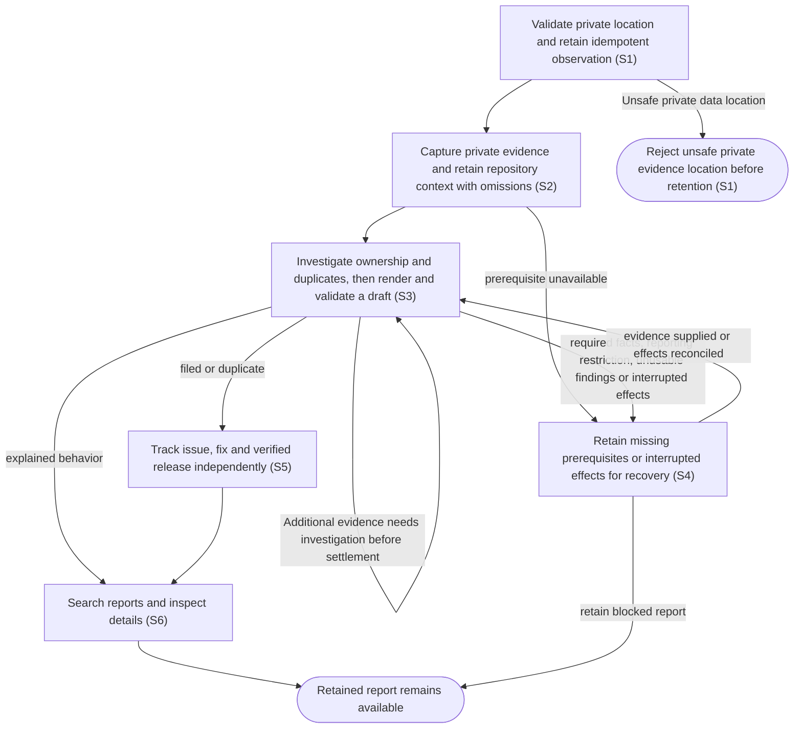

# Report suspected defects and track verified delivery

## Goal

Retain observations of suspected Code Factory defects, investigate and file useful issues automatically, and distinguish investigation progress from verified delivery.

## Preconditions

The owner has an authenticated private connection. Automatic investigation requires the installed workflow engine, native Codex authentication and the installed issue-drafting skill. Missing prerequisites retain actionable blocked reports.

## Main flow

1. Submit an observation time, affected surface, expected/actual results and reproduction steps or an explicit unknown-reproduction explanation, with a stable idempotency key. Include host-only errors and responses and available relevant IDs. Separate suspected causes from facts.
2. Require a private data location outside source checkouts before retaining observations or additional evidence. Retain an accepted report immediately and collect relevant local evidence privately, with origins, capture times, hashes, explicit omissions and truncation. Credentials, authentication and unrelated work are excluded.
3. Retain a private snapshot of destination status, labels, templates, contribution/security/support guidance and at most ten duplicate candidates per destination before investigation. Reuse that snapshot through polling and recovery of the same investigation; a fresh investigation captures fresh context. Investigate the captured evidence and relevant source through durable local work. Classify confirmed or suspected bugs, duplicates, insufficient information or behavior explained by the contract. Verify component ownership within the organization. The component determines the destination; the investigator supplies narrative facts, template selection and typed answers. Render repository headings and field order, supported labels and form answers consistently.
4. Publish the verified draft automatically, recording intent before the external effect and retaining the issue identity afterward. Reuse clear duplicates. Reporting authority does not authorize fixing code.
5. Keep the shared ledger current with independent processing, outcome, GitHub state, fix references, component versions, published stable/prerelease versions and observed installed versions. Unknown evidence stays Unknown.
6. Search and filter Reported issues, inspect details, the collapsible issue draft, visible layout limitation and missing-information requests, append host evidence, refresh delivery evidence and explicitly recover blocked or interrupted work.

A mutation acknowledgement releases its controls independently of later background completion. Shared updates refresh saved lists/details without dismissing uncertain mutation errors or replacing newer selections and evidence drafts.

## Alternatives and recovery

Repeated submissions with the same key and payload return the same durable report; conflicting keys fail. Lost workflow acknowledgements retry retained admission inputs. One investigation executes at a time with a thirty-minute deadline. Missing information resumes when supplied. Interrupted effects require inspection and explicit reconciliation before resume. Uncertain GitHub creation is searched by its opaque report marker and never blindly repeated. Uncertain routing blocks publication. Evidence unavailable locally can be requested from the host; locally available records are collected by the service.

Missing, unavailable or unsupported issue layouts use a standard report with environment, reproduction or an explicit unknown-reproduction explanation, expected/actual behavior, relevant evidence, findings and uncertainty, plus a brief layout limitation. Complex Markdown, upload fields and unknown form constructs use this fallback. Missing required facts request actionable information; unsupported choices and checkbox attestations without explicit host evidence are rejected. An observed security/support routing restriction prevents public issue publication even when generic formatting is used. Metadata omissions alone permit generic formatting, while authentication, destination availability and source ownership remain publication requirements.

An investigation that finishes with unusable findings retains an actionable report. Empty information requests, contradictory classifications, invalid duplicate identities and incomplete or oversized drafts are unusable. Retained older investigations and drafts preserve their original output contract and publication identity. It releases investigation capacity only after finalization succeeds; an explicit retry starts a fresh investigation rather than repeating the unusable result.

An uncertain issue publication retains its reconciliation requirements without holding investigation capacity after its investigation has finalized. Other reports can investigate while that issue identity is recovered; the uncertain creation is never repeated.

An interrupted publication command retains an actionable recovery state and allows other queued investigations to progress. Recovery distinguishes an unclaimed creation from a claimed or uncertain external effect. A delayed publication result from an earlier investigation cannot replace a newer verified issue or outcome, change its state or release its capacity. A failure proven to occur before request dispatch permits retry after prerequisites recover; a possibly dispatched creation still requires reconciliation.

Additional evidence accepted before an investigation result settles is considered before the report completes or an unclaimed issue creation begins. Work already using an immutable observation finishes and finalizes before a fresh investigation incorporates missed evidence. Evidence accepted after issue creation has been claimed remains retained while that effect settles or is reconciled once.

Issue closure does not prove a fix; a verified closing commit or merged fix can establish its identity independently of release availability. Published package provenance and fix ancestry must agree before availability is shown. Verified component versions enrich the linked fix. Dependencies retain their own versions, using their checked package evidence and independently verified closing-fix ancestry; attribution to a Code Factory release requires an explicit provenance relationship. Source-only releases without checked package evidence stay Unknown. Issue state refreshes at startup and every five minutes; releases refresh every fifteen minutes. Manual refresh starts no agent. Failed release reads preserve discovered fixes and earlier verified availability, with errors, retry times and freshness. The persisted application request budget and a credential's rate-limit deadline apply across inbox reads, reporting operations and reports, including publication in a separate process; skipped reads do not claim fresh results.

Journal updates refresh the loaded report range, including a pending request for more reports. Additional pages remain available during continuing background refreshes. Changing query filters resets pagination. Detail reads continue to make progress while journal events arrive; pending refreshes coalesce. Older detail responses cannot replace newer selected-report findings, processing or recovery controls, and a previous selection's completed request cannot suppress the current selection's details. Opening a report's GitHub link sends that report's exact issue destination to the host.

## Scenarios

- **S1** Complete submissions in a private location outside source checkouts persist; incomplete/conflicting requests and unsafe evidence locations fail before private input is retained, and concurrent retries return one report. Reporting ships in portable, Codex and browser packages.
- **S2** Relevant local context is captured with redaction and a private manifest; additional host observations are idempotent and resume requests for information.
- **S3** Durable investigation verifies ownership and supplied duplicate candidates; deterministic routing and template rendering file only a complete verified draft within the organization, or request required facts and respect reporting restrictions.
- **S4** Missing prerequisites, interrupted controllers, deadlines and uncertain effects remain recoverable without replaying issue creation.
- **S5** Closure, merged fixes, stable/prerelease delivery, dependency releases, mismatched assets and unknown installed versions remain independent; failed/rate-limited refresh preserves successful evidence.
- **S6** The shared view supports search, details, a collapsible rendered draft and visible layout limitation, information requests, recovery controls, exact GitHub destinations and explicit unknown/version displays. Journal refreshes preserve the loaded report range; query changes reset pagination.

Report refreshes share matching issue and delivery evidence within each refresh. Issue state remains on a five-minute schedule and release evidence on a 15-minute schedule. A manual refresh revalidates mutable evidence. Changed tag or asset identities require current verification; partial failure retains independently verified fixes and releases without marking skipped work fresh.

Before creating or recovering an issue, synchronize private marker history and verify each matching issue's current identity and body. Incomplete history, unreadable private state or conflicting concurrent updates cannot establish absence. Rebuild complete history at least hourly and after inconsistent candidates; duplicate current markers require manual reconciliation. An uncertain creation remains reconciliation-only.

<!-- flow-references -->
## Terminology and UI references

Glossary: [issue-report](../glossary/README.md#issue-report), [report-ledger](../glossary/README.md#report-ledger), [report-processing](../glossary/README.md#report-processing), [report-outcome](../glossary/README.md#report-outcome), [evidence-manifest](../glossary/README.md#evidence-manifest), [delivery-evidence](../glossary/README.md#delivery-evidence), [fixed-issue](../glossary/README.md#fixed-issue), [credential](../glossary/README.md#credential).
UI entities: [PAGE-REPORTS](../ui/README.md#PAGE-REPORTS), [P-REPORT-LIST](../ui/README.md#P-REPORT-LIST), [P-REPORT-DETAIL](../ui/README.md#P-REPORT-DETAIL), [W-REPORT-LIST](../ui/README.md#W-REPORT-LIST), [W-REPORT-DETAIL](../ui/README.md#W-REPORT-DETAIL), [C-REPORT-SELECT](../ui/README.md#C-REPORT-SELECT), [C-REPORT-EVIDENCE](../ui/README.md#C-REPORT-EVIDENCE), [C-REPORT-RECOVER](../ui/README.md#C-REPORT-RECOVER), [C-REPORT-REFRESH](../ui/README.md#C-REPORT-REFRESH), [W-NAVIGATION](../ui/README.md#W-NAVIGATION), [C-NAVIGATE](../ui/README.md#C-NAVIGATE), [C-REPORT-QUERY](../ui/README.md#C-REPORT-QUERY), [C-REPORT-MORE](../ui/README.md#C-REPORT-MORE), [C-REPORT-OPEN-LINK](../ui/README.md#C-REPORT-OPEN-LINK).

## Flow diagram

## Implementation references

- [cmd/code-factory/main.go](../../cmd/code-factory/main.go) — Report ledger, private evidence, durable investigation, deterministic publication or verified release provenance.
- [go.mod](../../go.mod) — Report ledger, private evidence, durable investigation, deterministic publication or verified release provenance.
- [go.sum](../../go.sum) — Report ledger, private evidence, durable investigation, deterministic publication or verified release provenance.
- [internal/app/app.go](../../internal/app/app.go) — Report ledger, private evidence, durable investigation, deterministic publication or verified release provenance.
- [internal/pluginbundle/hosting.go](../../internal/pluginbundle/hosting.go) — Report ledger, private evidence, durable investigation, deterministic publication or verified release provenance.
- [internal/reports/engine.go](../../internal/reports/engine.go) — Report ledger, private evidence, durable investigation, deterministic publication or verified release provenance.
- [internal/reports/evidence.go](../../internal/reports/evidence.go) — Report ledger, private evidence, durable investigation, deterministic publication or verified release provenance.
- [internal/reports/github.go](../../internal/reports/github.go) — Report ledger, private evidence, durable investigation, deterministic publication or verified release provenance.
- [internal/reports/investigate.yml](../../internal/reports/investigate.yml) — Report ledger, private evidence, durable investigation, deterministic publication or verified release provenance.
- [internal/reports/service.go](../../internal/reports/service.go) — Report ledger, private evidence, durable investigation, deterministic publication or verified release provenance.
- [internal/reports/types.go](../../internal/reports/types.go) — Report ledger, private evidence, durable investigation, deterministic publication or verified release provenance.
- [internal/transport/mcp.go](../../internal/transport/mcp.go) — Report ledger, private evidence, durable investigation, deterministic publication or verified release provenance.
- [plugin/skills/code-factory-report-issue/SKILL.md](../../plugin/skills/code-factory-report-issue/SKILL.md) — Report ledger, private evidence, durable investigation, deterministic publication or verified release provenance.
- [plugin/skills/code-factory/SKILL.md](../../plugin/skills/code-factory/SKILL.md) — Report ledger, private evidence, durable investigation, deterministic publication or verified release provenance.
- [release/fixed-issues.json](../../release/fixed-issues.json) — Report ledger, private evidence, durable investigation, deterministic publication or verified release provenance.
- [scripts/ci.py](../../scripts/ci.py) — Report ledger, private evidence, durable investigation, deterministic publication or verified release provenance.
- [web/src/reports.tsx](../../web/src/reports.tsx) — Report ledger, private evidence, durable investigation, deterministic publication or verified release provenance.
- [internal/reports/provider.py](../../internal/reports/provider.py) — Restores the full retained dk-workflows receipt and lifecycle environment at the native provider boundary while preserving native Codex authentication.
- [internal/reports/evidence.go](../../internal/reports/evidence.go) — Shared traversal redacts structured header pairs and decoded embedded JSON/MCP text, retaining full raw-header association and bounded fail-closed omission guards. (`func redactCredentialValue(`)
- [internal/providers/github_requests.go](../../internal/providers/github_requests.go) — Shared serialized conditional requests, operation authentication and durable cooldowns.
- [internal/providers/github.go](../../internal/providers/github.go) — Shared identity-scoped bounded cache and provider client.
- [internal/reports/tracking_batch.go](../../internal/reports/tracking_batch.go) — Verified release proof memoization keyed by release metadata, tag target and credential scope.
- [internal/reports/marker_index.go](../../internal/reports/marker_index.go) — Private versioned incremental marker index, complete scans, candidate revalidation and transactional generations.
- [internal/reports/context.go](../../internal/reports/context.go) — Read-only bounded metadata and duplicate collection pins default-branch documents and sanitizes a private generation snapshot. (`func (g *GitHubAdapter) PrepareContext(`)
- [internal/reports/draft.go](../../internal/reports/draft.go) — Deterministic component routing, classification validation, repository template rendering and actionable required-field/restriction requests. (`func renderDraft(`)
- [internal/reports/investigate-legacy.yml](../../internal/reports/investigate-legacy.yml) — Retained unversioned generations preserve their original repository/body output schema.

## Test references

- [internal/reports/service_test.go](../../internal/reports/service_test.go) — `func TestSubmissionValidationConcurrentIdempotencyAndConflicts(`; S1. Twenty concurrent submissions retain one queued report identity, reject changed-payload conflicts and emit exactly the expected journal events; cancellable workers execute in an owned child with a local kill/reap deadline before fixture cleanup.
- [internal/reports/service_test.go](../../internal/reports/service_test.go) — `func TestEvidenceIsPrivateScopedHashedAndRedacted(`; S1, S2, S3. Unknown authorization schemes, OAuth client_secret values and structured proxy authorization proofs are absent from persisted observations, private evidence, additions, investigator input and publication while unrelated evidence lines remain. Serialized authorization/proxy arrays inside textual evidence are also redacted across these boundaries while adjacent fields remain. Structured/serialized header pairs, X-Api-Key aliases, named header-value records and escaped nested MCP text are excluded before all retained/external boundaries, while adjacent fields and complete raw header association survive. Captured Event.Data and Attention.Params retain the exact large integer JSON token without rounding or conversion to a string.
- [internal/reports/service_test.go](../../internal/reports/service_test.go) — `func TestWorkflowLostAdmissionDaemonRestartAndUncertainCreation(`; S3, S4. Assertions inspect the corresponding retained state, boundary effects or visible report behavior.
- [internal/reports/service_test.go](../../internal/reports/service_test.go) — `func TestMissingPrerequisitesInformationAndExplicitRecovery(`; S2, S4. Assertions inspect the corresponding retained state, boundary effects or visible report behavior.
- [internal/reports/service_test.go](../../internal/reports/service_test.go) — `func TestDuplicateReuseRoutingBlockAndSingleInvestigation(`; S3. Assertions inspect the corresponding retained state, boundary effects or visible report behavior.
- [internal/reports/service_test.go](../../internal/reports/service_test.go) — `func TestRefreshSeparatesIssueFixDeliveryAndPreservesSuccessfulState(`; S5. Issue reopen, independent fix identity, partial verified fixes/releases, retained prior availability, error freshness and rate-limit backoff survive failed release reads without starting an agent.
- [internal/reports/service_test.go](../../internal/reports/service_test.go) — `func TestLedgerPaginationSearchAndVersionFilters(`; S6. Assertions inspect the corresponding retained state, boundary effects or visible report behavior.
- [internal/reports/github_test.go](../../internal/reports/github_test.go) — `func TestRepositoryRoutingLabelsDuplicateAndPublicationBoundary(`; S3. Assertions inspect the corresponding retained state, boundary effects or visible report behavior.
- [internal/reports/github_test.go](../../internal/reports/github_test.go) — `func TestTrackingRequiresPublishedMatchingProvenance(`; S5. Verified direct closing commits and merged fixes stay independent of release reads; reject foreign or unverified commits, preserve partial discoveries, and enrich fix versions while retaining PR association only with matching published provenance.
- [internal/reports/engine_test.go](../../internal/reports/engine_test.go) — `func TestNativeWorkflowEngineWithFakeProviderAndLifecycle(`; S3, S4. Real controller and fake provider verify large observations and accumulated evidence through a private immutable prompt file, idempotent admission, explicit uncertain lifecycle recovery, controller restart and deadlines. The deadline subtest independently observes its exact fake provider start, requires the retained timeout classification, and verifies provider termination before teardown; launch failure cannot satisfy the oracle.
- [internal/transport/mcp_test.go](../../internal/transport/mcp_test.go) — `func TestAuthenticatedMCPDiscoveryToolsAndUI(`; S1, S2, S6. Assertions inspect the corresponding retained state, boundary effects or visible report behavior.
- [web/tests/factory.spec.ts](../../web/tests/factory.spec.ts) — `"reported issues shares ledger search, information requests and evidence recovery"`; S2, S6. Assertions inspect the corresponding retained state, boundary effects or visible report behavior.
- [web/tests/factory.spec.ts](../../web/tests/factory.spec.ts) — `"reported issues displays independent closure, prerelease delivery and explicit workflow recovery"`; S4, S5, S6. Rendered independent delivery/recovery controls send the selected report exact GitHub URL through the host open-link boundary.
- [scripts/test_ci.py](../../scripts/test_ci.py) — `def test_component_versions_come_from_promoted_packages(`; S5. Assertions inspect the corresponding retained state, boundary effects or visible report behavior.
- [scripts/test_ci.py](../../scripts/test_ci.py) — `def test_fixed_issue_requires_ancestor_commit_and_explicit_issue_reference(`; S5. Assertions inspect the corresponding retained state, boundary effects or visible report behavior.
- [scripts/test_packaging.py](../../scripts/test_packaging.py) — `def test_zip_is_self_contained_deterministic_and_contains_no_host_state(`; S1. Assertions inspect the corresponding retained state, boundary effects or visible report behavior.
- [scripts/test_packaging.py](../../scripts/test_packaging.py) — `def test_registered_browser_package_has_no_local_mcp_launcher(`; S1. Assertions inspect the corresponding retained state, boundary effects or visible report behavior.
- [web/tests/factory.spec.ts](../../web/tests/factory.spec.ts) — `"reported issues paginates and filters processing component and version"`; S6. A pending second page and loaded 32 unique rows survive journal updates, later-row content refreshes, and query changes reset the loaded range while retaining server filters.
- [internal/reports/service_test.go](../../internal/reports/service_test.go) — `func TestConcurrentPublicationCommandsClaimOneExternalEffect(`; S3, S4. Two service instances concurrently publish the same retained report, claim exactly one external creation and retain its completed issue identity; the owned child bounds and reaps stalled workers before private fixture cleanup.
- [internal/reports/service_test.go](../../internal/reports/service_test.go) — `func TestInterruptedPreparationNeedsLifecycleReconciliation(`; S4. Retained Preparing state becomes needs attention without starting an engine; unacknowledged resume fails, and explicit lifecycle reconciliation with a recovery note permits one fresh engine start.
- [internal/reports/service_test.go](../../internal/reports/service_test.go) — `func TestSimilarTitlesDoNotSilentlyMergeDistinctObservations(`; S3. Similar titles alone cannot merge distinct observations; duplicate reuse requires an explicit investigated issue identity.
- [internal/reports/service_test.go](../../internal/reports/service_test.go) — `func TestRejectedCreationCanResumeWithoutTreatingItAsAnUnknownEffect(`; S4. A definite rejected creation leaves the report blocked with no uncertain creation claim; after correcting the rejection, explicit resume permits a second creation attempt and completes the report.
- [internal/reports/github_test.go](../../internal/reports/github_test.go) — `func TestHTTPPublicationRejectsKnownFailuresAndRetainsServerUncertainty(`; S4. Single HTTP 400/403/422/429 responses classify as definite rejections, HTTP 500 remains uncertain, and HTTP 429 retains a future retry deadline. This fixture does not exercise recovery or repeated creation attempts.
- [internal/reports/engine_test.go](../../internal/reports/engine_test.go) — `func TestNativeAuthenticationPrerequisitesUseOnlyFakeBoundaries(`; S2, S4. Fake native login-status boundaries distinguish authentication prerequisites and verify unknown prefixed cookies/id_token are excluded from private failed-command diagnostics while adjacent evidence is retained.
- [internal/reports/service_test.go](../../internal/reports/service_test.go) — `func TestUncertainResumeLifecycleNeedsAcknowledgedRecovery(`; S4. Retained uncertain resume entry cannot replay or release the sole slot without acknowledged reconciliation; recovery preserves admission identity, rotates only its lifecycle attempt and lets queued work progress.
- [internal/reports/service_test.go](../../internal/reports/service_test.go) — `func TestFinalizedUnusableFindingsReleaseSlotAndAllowFreshInvestigation(`; S3, S4. Empty summaries and invalid classifications hold the slot until lifecycle completion, then allow other reports to progress and explicit recovery to start a fresh investigation generation.
- [internal/reports/service_test.go](../../internal/reports/service_test.go) — `func TestPriorGenerationFindingsDoNotReleaseUncertainPreparation(`; S3, S4. Prior-generation findings cannot release the sole slot while a newly admitted generation retains uncertain lifecycle preparation.
- [internal/reports/service_test.go](../../internal/reports/service_test.go) — `func TestRefreshRateLimitStopsOtherOperationsAndReports(`; S5. Issue/release rate-limit deadlines stop other operations and reports, retain previous delivery evidence and leave skipped operation/row freshness untouched.
- [web/tests/factory.spec.ts](../../web/tests/factory.spec.ts) — `"reported issues keeps newer journal details after a delayed mutation read"`; S4, S6. An older mutation read cannot overwrite newer journal processing, findings or recovery controls for the selected report.
- [web/tests/factory.spec.ts](../../web/tests/factory.spec.ts) — `"reported issues keeps a pending selection read when an older selection mutation finishes"`; S6. A completed old-selection mutation cannot suppress the pending current-selection detail read.
- [internal/reports/github_test.go](../../internal/reports/github_test.go) — `func TestTrackingNativeWorkflowRelease(`; S5. Actual native manifest, dependency/conformance metadata and package/checksum inventory establish dependency stable/prerelease delivery only with an independent closing fix and ancestry; malformed, missing or source-only proof stays Unknown.
- [internal/reports/github_test.go](../../internal/reports/github_test.go) — `func TestGitHubReportingCooldownSurvivesRestartAndSeparatesCredentials(`; S4, S5. Store-backed credential/endpoint deadlines suppress reporting HTTP across operations, adapters and reopened state; expiry and credential changes are independent, storage failures stop before HTTP and rejected POST retains retry provenance.
- [internal/reports/service_test.go](../../internal/reports/service_test.go) — `func TestEvidenceAfterWorkerCompletionRequiresFreshGeneration(`; S2, S3, S4. Evidence accepted after worker completion is captured exactly once by a fresh generation after lifecycle finalization, before stale suspected/information/explained findings settle.
- [internal/reports/service_test.go](../../internal/reports/service_test.go) — `func TestEvidencePublicationClaimBoundary(`; S2, S3, S4. Atomic evidence/admission checks reject stale unclaimed drafts during validation/marker races and preserve known issue identity; durable or uncertain create claims settle once without replay.
- [web/tests/factory.spec.ts](../../web/tests/factory.spec.ts) — `"reported issues makes detail progress while journal updates continue"`; S4, S6. Per-read delays span ongoing confirmed journal updates while selected findings and recovery controls become visible and remain current before the queued refresh.
- [web/tests/factory.spec.ts](../../web/tests/factory.spec.ts) — `"reported issues allows pagination during continuing slow journal refreshes"`; S6. Slow list reads span confirmed continuing journal polls while Load more remains usable; duplicate clicks admit one additional page and exactly the expected 60 unique rows appear before another background refresh.
- [internal/reports/service_test.go](../../internal/reports/service_test.go) — `func TestPrivateInputsAreRejectedBeforeCheckoutPersistence(`; S1, S2, S4. Private observations, idempotency keys and events are absent after unsafe-location rejection; additions and recovery notes cannot modify a retained ledger after its directory becomes a checkout.
- [internal/reports/service_test.go](../../internal/reports/service_test.go) — `func TestPublicationCommandInterruptionRecovery(`; S3, S4. Real child-process interruption before and after durable creation claims persists actionable recovery despite cancellation, lets queued investigation proceed and reconciles a claimed effect once without replay. Owned child execution has its own bounded context/test timeout and termination/reaping proof; parent cancellation remains an independent recovery stimulus.
- [internal/reports/service_test.go](../../internal/reports/service_test.go) — `func TestObsoletePublicationFailuresPreserveActiveGeneration(`; S2, S3, S4. Delayed validation, duplicate, marker and subprocess failures preserve the exact newer report/runtime or fresh-evidence queue and keep the active investigator capacity.
- [internal/reports/service_test.go](../../internal/reports/service_test.go) — `func TestPublicationFailuresPreserveRecoveredIssueAndClaim(`; S3, S4. Recovered issue identities and claim state survive late rejection, uncertain creation and reconciliation failure/empty-result paths.
- [internal/reports/github_test.go](../../internal/reports/github_test.go) — `func TestHTTPPublicationFailuresBeforeDispatchAreDefinite(`; S3, S4. Known encoding, request-configuration, token and cooldown-storage failures before HTTP dispatch retain a sanitized actionable definite-rejection outcome and send zero POSTs.
- [internal/reports/github_test.go](../../internal/reports/github_test.go) — `func TestHTTPPublicationRecoveryDistinguishesTokenFailureFromLostResponse(`; S3, S4. One token resolution per publication: operation-start token failure dispatches no requests, restored authentication files once, while a lost POST response retains its durable claim and reconciliation never repeats creation.
- [internal/reports/service_test.go](../../internal/reports/service_test.go) — `func TestDelayedPublicationSuccessPreservesEstablishedIssue(`; S3, S4. Delayed duplicate successes preserve newer/same-generation established identities, outcomes, timestamps and Runtime; a newer claimed creation retains ownership while safe missing-identity recovery preserves newer processing/outcome.
- [web/tests/factory.spec.ts](../../web/tests/factory.spec.ts) — `"reported issues releases mutation controls during continuing slow journal refreshes"`; S4, S6. Mutation refresh completion re-enables refresh, evidence and acknowledged recovery controls while subsequent journal list reads remain pending; a second evidence submission reaches the selected report.
- [scripts/test_ci.py](../../scripts/test_ci.py) — `def test_delivery_checkout_verifies_historical_fixes_without_publishing(`; S5. Actual delivery validation from a workflow-depth local clone accepts checked packages containing a historical fix commit, preserving fix ancestry and exact artifact download without publication.
- [web/tests/factory.spec.ts](../../web/tests/factory.spec.ts) — `"reported issues retries uncertain evidence without duplicating it and accepts edited evidence"`; S2, S6. A controlled accepted addition returns two lost acknowledgements; unchanged retries preserve one retained addition and identity, while an edited draft uses a distinct identity and successfully appends another observation.
- [internal/reports/service_test.go](../../internal/reports/service_test.go) — `func TestRedactCredentialCandidateStormOmitsPrivateTail(`; S2. Malformed serialized candidate storms preserve inspected diagnostic text and omit unresolved private tails instead of returning uninspected material.
- [internal/reports/service_test.go](../../internal/reports/service_test.go) — `func TestRedactCredentialExhaustedDepthOmitsPrivateText(`; S2. An exhausted serialized-decoding state omits unresolved private text without allocating exponentially escaped input.
- [internal/reports/service_test.go](../../internal/reports/service_test.go) — `func TestRedactCredentialPreservesLargeDiagnosticInteger(`; S2. Decoded serialized evidence removes an unknown credential while preserving adjacent fields, surrounding prose and the exact diagnostic integer above2^53.
- [internal/reports/github_optimization_test.go](../../internal/reports/github_optimization_test.go) — `func TestTrackingBatchSharesAndRevalidatesEvidence(`; S5. Three reports deduplicate issue/timeline/closing-commit/list/tag/assets/ancestry requests; a new refresh revalidates mutable evidence and tag changes invalidate proof.
- [internal/reports/github_optimization_test.go](../../internal/reports/github_optimization_test.go) — `func TestReportingLinkTraversalAndCachedPagination(`; S4, S5. Exactly 100/200 results terminate through Link without empty-page probes; cached links survive 304 while cycles and foreign origins fail.
- [internal/reports/github_optimization_test.go](../../internal/reports/github_optimization_test.go) — `func TestMarkerIndexIncrementalSafetyAndRecovery(`; S3, S4. Complete cold scan, restart and overlap updates, marker edits/removal, duplicates, deleted candidate rebuild, failed-pagination watermark preservation and hourly/version rebuild.
- [internal/reports/github_optimization_test.go](../../internal/reports/github_optimization_test.go) — `func TestMarkerIndexGenerationConflictsAndCreationCheckpoint(`; S3, S4. Three conflicting generations fail recoverably without overwrite; creation associations preserve synchronization watermark.
- [internal/reports/github_optimization_test.go](../../internal/reports/github_optimization_test.go) — `func TestMarkerIndexConcurrentWriters(`; S3, S4. Independent clients and database connections retry concurrent full scans and preserve both committed generations.
- [internal/reports/github_optimization_test.go](../../internal/reports/github_optimization_test.go) — `func TestCrossConsumerCooldownStopsInboxAndPublication(`; S3, S4, S5. Rate limits from inbox or reports suppress both consumers and prevent publication dispatch.
- [internal/reports/github_optimization_test.go](../../internal/reports/github_optimization_test.go) — `func TestLostCreationResponseRecoversThroughMarkerIndexWithoutReplay(`; S3, S4. Actual HTTP accepts a POST then loses its response; incremental marker recovery revalidates the new issue and completes without a duplicate POST.
- [internal/reports/github_optimization_test.go](../../internal/reports/github_optimization_test.go) — `func TestAssetCacheRequiresDigestAcrossOperations(`; S5. Digestless bytes are operation-only; validated digests permit cross-operation reuse while changed asset sizes invalidate it.
- [internal/store/store_test.go](../../internal/store/store_test.go) — `func TestCompareAndSwapPreservesConcurrentEntities(`; S4. Atomic entity comparison across independent SQLite connections accepts current bytes, rejects stale/absence overwrites and retains the newer generation.
- [internal/reports/github_optimization_test.go](../../internal/reports/github_optimization_test.go) — `func TestManagedInboxAndReportingSharePersistentRequestBudget(`; S4, S5. A managed inbox read exhausts the shared persisted request budget; report reads and a separate publication transport fail before dispatch, retain the one consumed request and never create an issue.
- [internal/providers/github_usage_test.go](../../internal/providers/github_usage_test.go) — `func TestManagedTransportsShareProcessGateAndPreserveCooldown(`; S4, S5. Separate database connections and transports cannot overlap managed HTTP; a cancelled waiting publication remains BeforeDispatch, exactly two attempts survive, and a later rate-limit deadline is preserved.
- [internal/reports/context_test.go](../../internal/reports/context_test.go) — `func TestRepositoryContextPinsDocumentsBoundsSearchAndUsesConditionalCache(`; S2, S3. Authenticated GETs pin document revisions and hashes, follow label pagination, bound each search to ten candidates, redact credentials and conditionally reuse immutable content.
- [internal/reports/context_test.go](../../internal/reports/context_test.go) — `func TestRepositoryContextMetadataOmissionsAndSharedCooldown(`; S2, S4. Unavailable metadata retains explicit omissions; persisted rate-limit cooldown suppresses subsequent preparation and publication reads.
- [internal/reports/context_test.go](../../internal/reports/context_test.go) — `func TestInvestigationSnapshotPrivateImmutableAndFreshOnRecovery(`; S2, S3, S4. Restarted polling reuses the private snapshot; malformed output finalizes before explicit recovery prepares fresh context and a new generation.
- [internal/reports/draft_test.go](../../internal/reports/draft_test.go) — `func TestDeterministicReportTemplatesAndFallback(`; S3. Markdown frontmatter/headings and ordered form text/dropdown/checkbox answers render with supported labels, code hints and complete standard facts; missing layout has a limitation notice.
- [internal/reports/draft_test.go](../../internal/reports/draft_test.go) — `func TestUnsupportedTemplatesFailToGenericLayout(`; S3. Malformed YAML, complex Markdown, upload fields and unknown attributes use the generic layout with an unsupported-layout reason.
- [internal/reports/draft_test.go](../../internal/reports/draft_test.go) — `func TestStructuredDraftRejectsContradictionsAndInventedAnswers(`; S3, S4. Empty information requests, invalid duplicates, contradictory findings, unsupported labels, invented templates, uncertain ownership and oversized drafts fail; every supported component routes deterministically.
- [internal/reports/draft_test.go](../../internal/reports/draft_test.go) — `func TestRequiredFactsChoicesAttestationsAndRestrictions(`; S2, S3. Required facts and template fields request information; unsupported choices and invented checkbox attestations fail; generic fallback cannot bypass interpreted security routing or unreviewed guidance.
- [internal/reports/draft_test.go](../../internal/reports/draft_test.go) — `func TestStructuredDraftSanitizedBeforeRetentionAndPublication(`; S2, S3. Completed deterministic bodies are sanitized before ledger retention and publication while adjacent diagnostic evidence survives.
- [internal/reports/draft_test.go](../../internal/reports/draft_test.go) — `func TestLegacyDraftRemainsOnPublicationPath(`; S3, S4. Unversioned retained drafts keep their destination/body through publication without structured re-rendering.
- [web/tests/factory.spec.ts](../../web/tests/factory.spec.ts) — `"reported issues exposes rendered draft limitations and required repository fields"`; S2, S3, S4, S6. Rendered repository-required information requests accept host evidence, fallback limitation stays visible, the issue draft opens with full content and finalized unusable work uses existing acknowledged recovery.
- [internal/reports/draft_test.go](../../internal/reports/draft_test.go) — `func TestControllerRejectedContractFinalizesBeforeFreshRecovery(`; S3, S4. Controller schema rejection holds capacity until lifecycle completion succeeds, then explicit recovery prepares fresh context and a new admission without publishing malformed output.
- [internal/reports/draft_test.go](../../internal/reports/draft_test.go) — `func TestFormFieldsWithoutIDsGetStableOrderedIdentities(`; S3. Optional GitHub field IDs normalize to stable ordered identities; an available layout cannot be bypassed by omitting template selection.
- [internal/reports/context_test.go](../../internal/reports/context_test.go) — `func TestPrivateContextSanitizesSecretsBeforeBodyLimits(`; S2, S3. A known 64-character owner secret crossing the candidate-body byte limit is fully redacted before truncation; retained snapshots exclude its prefix, stay bounded and record omissions.

## Verification and gaps

Local suites: `go`, `browser`, `packaging`, `tooling`.
Fixture success does not establish real-host acceptance.
- **S6** — `gap-flow-report-issue-host` · Unverified behavior · P2 · owner: user-flow-maintainer. Installed-host reporting and authenticated live filing acceptance have not been observed; ordinary CI uses fake provider, lifecycle and GitHub boundaries. Next verification: Run separately authorized acceptance against the approved private test repository and browser session; retain private version-bound evidence outside Git.

<!-- /flow-references -->
