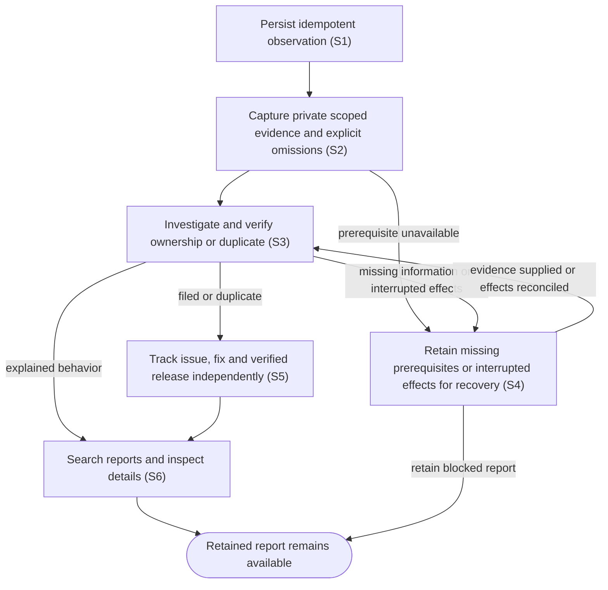

# Report suspected defects and track verified delivery

## Goal

Retain observations of suspected Code Factory defects, investigate and file useful issues automatically, and distinguish investigation progress from verified delivery.

## Preconditions

The owner has an authenticated private connection. Automatic investigation requires the installed workflow engine, native Codex authentication and the installed issue-drafting skill. Missing prerequisites retain actionable blocked reports.

## Main flow

1. Submit an observation time, affected surface, expected/actual results and reproduction steps or an explicit unknown-reproduction explanation, with a stable idempotency key. Include host-only errors and responses and available relevant IDs. Separate suspected causes from facts.
2. Retain the report immediately and collect relevant local evidence privately, with origins, capture times, hashes, explicit omissions and truncation. Credentials, authentication and unrelated work are excluded.
3. Investigate the captured evidence and relevant source through durable local work. Classify confirmed or suspected bugs, duplicates, insufficient information or behavior explained by the contract. Verify component ownership and destination within the organization before drafting repository-native issue text.
4. Publish the verified draft automatically, recording intent before the external effect and retaining the issue identity afterward. Reuse clear duplicates. Reporting authority does not authorize fixing code.
5. Keep the shared ledger current with independent processing, outcome, GitHub state, fix references, component versions, published stable/prerelease versions and observed installed versions. Unknown evidence stays Unknown.
6. Search and filter Reported issues, inspect details and missing-information requests, append host evidence, refresh delivery evidence and explicitly recover blocked or interrupted work.

## Alternatives and recovery

Repeated submissions with the same key and payload return the same durable report; conflicting keys fail. Lost workflow acknowledgements retry retained admission inputs. One investigation executes at a time with a thirty-minute deadline. Missing information resumes when supplied. Interrupted effects require inspection and explicit reconciliation before resume. Uncertain GitHub creation is searched by its opaque report marker and never blindly repeated. Uncertain routing blocks publication. Evidence unavailable locally can be requested from the host; locally available records are collected by the service.

Issue closure does not prove a fix; a merged fix does not prove release availability. Published package provenance and fix ancestry must agree before availability is shown. Dependencies retain their own versions; attribution to a Code Factory release requires an explicit provenance relationship. Issue state refreshes at startup and every five minutes; releases refresh every fifteen minutes. Manual refresh starts no agent. Rate limits preserve successful state with errors, retry times and freshness.

## Scenarios

- **S1** Complete submissions persist; incomplete/conflicting requests fail and concurrent retries return one report. Reporting ships in portable, Codex and browser packages.
- **S2** Relevant local context is captured with redaction and a private manifest; additional host observations are idempotent and resume requests for information.
- **S3** Durable investigation verifies ownership, reuses duplicates and files only a verified repository-native draft within the organization.
- **S4** Missing prerequisites, interrupted controllers, deadlines and uncertain effects remain recoverable without replaying issue creation.
- **S5** Closure, merged fixes, stable/prerelease delivery, dependency releases, mismatched assets and unknown installed versions remain independent; failed/rate-limited refresh preserves successful evidence.
- **S6** The shared view supports search, details, information requests, recovery controls, GitHub links and explicit unknown/version displays.

<!-- flow-references -->
## Terminology and UI references

Glossary: [issue-report](../glossary/README.md#issue-report), [report-ledger](../glossary/README.md#report-ledger), [report-processing](../glossary/README.md#report-processing), [report-outcome](../glossary/README.md#report-outcome), [evidence-manifest](../glossary/README.md#evidence-manifest), [delivery-evidence](../glossary/README.md#delivery-evidence), [fixed-issue](../glossary/README.md#fixed-issue), [credential](../glossary/README.md#credential).
UI entities: [PAGE-REPORTS](../ui/README.md#PAGE-REPORTS), [P-REPORT-LIST](../ui/README.md#P-REPORT-LIST), [P-REPORT-DETAIL](../ui/README.md#P-REPORT-DETAIL), [W-REPORT-LIST](../ui/README.md#W-REPORT-LIST), [W-REPORT-DETAIL](../ui/README.md#W-REPORT-DETAIL), [C-REPORT-SELECT](../ui/README.md#C-REPORT-SELECT), [C-REPORT-EVIDENCE](../ui/README.md#C-REPORT-EVIDENCE), [C-REPORT-RECOVER](../ui/README.md#C-REPORT-RECOVER), [C-REPORT-REFRESH](../ui/README.md#C-REPORT-REFRESH), [W-NAVIGATION](../ui/README.md#W-NAVIGATION), [C-NAVIGATE](../ui/README.md#C-NAVIGATE).

## Flow diagram

## Implementation references

- [cmd/code-factory/main.go](../../cmd/code-factory/main.go) — Report ledger, private evidence, durable investigation, deterministic publication or verified release provenance.
- [go.mod](../../go.mod) — Report ledger, private evidence, durable investigation, deterministic publication or verified release provenance.
- [go.sum](../../go.sum) — Report ledger, private evidence, durable investigation, deterministic publication or verified release provenance.
- [internal/app/app.go](../../internal/app/app.go) — Report ledger, private evidence, durable investigation, deterministic publication or verified release provenance.
- [internal/pluginbundle/hosting.go](../../internal/pluginbundle/hosting.go) — Report ledger, private evidence, durable investigation, deterministic publication or verified release provenance.
- [internal/reports/engine.go](../../internal/reports/engine.go) — Report ledger, private evidence, durable investigation, deterministic publication or verified release provenance.
- [internal/reports/evidence.go](../../internal/reports/evidence.go) — Report ledger, private evidence, durable investigation, deterministic publication or verified release provenance.
- [internal/reports/github.go](../../internal/reports/github.go) — Report ledger, private evidence, durable investigation, deterministic publication or verified release provenance.
- [internal/reports/investigate.yml](../../internal/reports/investigate.yml) — Report ledger, private evidence, durable investigation, deterministic publication or verified release provenance.
- [internal/reports/service.go](../../internal/reports/service.go) — Report ledger, private evidence, durable investigation, deterministic publication or verified release provenance.
- [internal/reports/types.go](../../internal/reports/types.go) — Report ledger, private evidence, durable investigation, deterministic publication or verified release provenance.
- [internal/transport/mcp.go](../../internal/transport/mcp.go) — Report ledger, private evidence, durable investigation, deterministic publication or verified release provenance.
- [plugin/skills/code-factory-report-issue/SKILL.md](../../plugin/skills/code-factory-report-issue/SKILL.md) — Report ledger, private evidence, durable investigation, deterministic publication or verified release provenance.
- [plugin/skills/code-factory/SKILL.md](../../plugin/skills/code-factory/SKILL.md) — Report ledger, private evidence, durable investigation, deterministic publication or verified release provenance.
- [release/fixed-issues.json](../../release/fixed-issues.json) — Report ledger, private evidence, durable investigation, deterministic publication or verified release provenance.
- [scripts/ci.py](../../scripts/ci.py) — Report ledger, private evidence, durable investigation, deterministic publication or verified release provenance.
- [web/src/reports.tsx](../../web/src/reports.tsx) — Report ledger, private evidence, durable investigation, deterministic publication or verified release provenance.
- [internal/reports/provider.py](../../internal/reports/provider.py) — Restores the full retained dk-workflows receipt and lifecycle environment at the native provider boundary while preserving native Codex authentication.

## Test references

- [internal/reports/service_test.go](../../internal/reports/service_test.go) — `func TestSubmissionValidationConcurrentIdempotencyAndConflicts(`; S1. Assertions inspect the corresponding retained state, boundary effects or visible report behavior.
- [internal/reports/service_test.go](../../internal/reports/service_test.go) — `func TestEvidenceIsPrivateScopedHashedAndRedacted(`; S2. Assertions inspect the corresponding retained state, boundary effects or visible report behavior.
- [internal/reports/service_test.go](../../internal/reports/service_test.go) — `func TestWorkflowLostAdmissionDaemonRestartAndUncertainCreation(`; S3, S4. Assertions inspect the corresponding retained state, boundary effects or visible report behavior.
- [internal/reports/service_test.go](../../internal/reports/service_test.go) — `func TestMissingPrerequisitesInformationAndExplicitRecovery(`; S2, S4. Assertions inspect the corresponding retained state, boundary effects or visible report behavior.
- [internal/reports/service_test.go](../../internal/reports/service_test.go) — `func TestDuplicateReuseRoutingBlockAndSingleInvestigation(`; S3. Assertions inspect the corresponding retained state, boundary effects or visible report behavior.
- [internal/reports/service_test.go](../../internal/reports/service_test.go) — `func TestRefreshSeparatesIssueFixDeliveryAndPreservesSuccessfulState(`; S5. Assertions inspect the corresponding retained state, boundary effects or visible report behavior.
- [internal/reports/service_test.go](../../internal/reports/service_test.go) — `func TestLedgerPaginationSearchAndVersionFilters(`; S6. Assertions inspect the corresponding retained state, boundary effects or visible report behavior.
- [internal/reports/github_test.go](../../internal/reports/github_test.go) — `func TestRepositoryRoutingLabelsDuplicateAndPublicationBoundary(`; S3. Assertions inspect the corresponding retained state, boundary effects or visible report behavior.
- [internal/reports/github_test.go](../../internal/reports/github_test.go) — `func TestTrackingRequiresPublishedMatchingProvenance(`; S5. Assertions inspect the corresponding retained state, boundary effects or visible report behavior.
- [internal/reports/engine_test.go](../../internal/reports/engine_test.go) — `func TestNativeWorkflowEngineWithFakeProviderAndLifecycle(`; S3, S4. Assertions inspect the corresponding retained state, boundary effects or visible report behavior.
- [internal/transport/mcp_test.go](../../internal/transport/mcp_test.go) — `func TestAuthenticatedMCPDiscoveryToolsAndUI(`; S1, S2, S6. Assertions inspect the corresponding retained state, boundary effects or visible report behavior.
- [web/tests/factory.spec.ts](../../web/tests/factory.spec.ts) — `"reported issues shares ledger search, information requests and evidence recovery"`; S2, S6. Assertions inspect the corresponding retained state, boundary effects or visible report behavior.
- [web/tests/factory.spec.ts](../../web/tests/factory.spec.ts) — `"reported issues displays independent closure, prerelease delivery and explicit workflow recovery"`; S4, S5, S6. Assertions inspect the corresponding retained state, boundary effects or visible report behavior.
- [scripts/test_ci.py](../../scripts/test_ci.py) — `def test_component_versions_come_from_promoted_packages(`; S5. Assertions inspect the corresponding retained state, boundary effects or visible report behavior.
- [scripts/test_ci.py](../../scripts/test_ci.py) — `def test_fixed_issue_requires_ancestor_commit_and_explicit_issue_reference(`; S5. Assertions inspect the corresponding retained state, boundary effects or visible report behavior.
- [scripts/test_packaging.py](../../scripts/test_packaging.py) — `def test_zip_is_self_contained_deterministic_and_contains_no_host_state(`; S1. Assertions inspect the corresponding retained state, boundary effects or visible report behavior.
- [scripts/test_packaging.py](../../scripts/test_packaging.py) — `def test_registered_browser_package_has_no_local_mcp_launcher(`; S1. Assertions inspect the corresponding retained state, boundary effects or visible report behavior.
- [web/tests/factory.spec.ts](../../web/tests/factory.spec.ts) — `"reported issues paginates and filters processing component and version"`; S6. Report list cursor pagination and all three structured filters select the matching ledger row.
- [internal/reports/service_test.go](../../internal/reports/service_test.go) — `func TestConcurrentPublicationCommandsClaimOneExternalEffect(`; S3, S4. Concurrent publication claims one external create, and interrupted lifecycle preparation cannot replay without explicit reconciliation.
- [internal/reports/service_test.go](../../internal/reports/service_test.go) — `func TestInterruptedPreparationNeedsLifecycleReconciliation(`; S4. Concurrent publication claims one external create, and interrupted lifecycle preparation cannot replay without explicit reconciliation.
- [internal/reports/service_test.go](../../internal/reports/service_test.go) — `func TestSimilarTitlesDoNotSilentlyMergeDistinctObservations(`; S3. Similar titles alone cannot merge distinct observations; duplicate reuse requires an explicit investigated issue identity.
- [internal/reports/service_test.go](../../internal/reports/service_test.go) — `func TestRejectedCreationCanResumeWithoutTreatingItAsAnUnknownEffect(`; S4. Definite GitHub rejections recover after correction; ambiguous server/network results never permit a repeated issue creation.
- [internal/reports/github_test.go](../../internal/reports/github_test.go) — `func TestHTTPPublicationRejectsKnownFailuresAndRetainsServerUncertainty(`; S4. Definite GitHub rejections recover after correction; ambiguous server/network results never permit a repeated issue creation.
- [internal/reports/engine_test.go](../../internal/reports/engine_test.go) — `func TestNativeAuthenticationPrerequisitesUseOnlyFakeBoundaries(`; S4. Fake native login-status boundaries distinguish available authentication from actionable Codex and GitHub sign-in prerequisites, without reading real credentials.

## Verification and gaps

Local suites: `go`, `browser`, `packaging`, `tooling`.
Fixture success does not establish real-host acceptance.
- **S6** — `gap-flow-report-issue-host` · Unverified behavior · P2 · owner: user-flow-maintainer. Installed-host reporting and authenticated live filing acceptance have not been observed; ordinary CI uses fake provider, lifecycle and GitHub boundaries. Next verification: Run separately authorized acceptance against the approved private test repository and browser session; retain private version-bound evidence outside Git.

<!-- /flow-references -->
