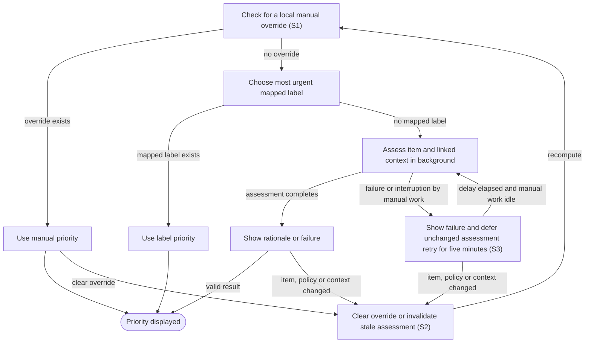

# Resolve and override item priority

## Goal

The owner sees a useful priority with its source and can change it locally.

## Preconditions

The inbox contains synchronized items and a priority policy is configured.

## Main flow

1. Use a manual priority override when present.
2. Otherwise use the most urgent mapped label.
3. Otherwise request a background assessment using the item and linked context.
4. Show assessment rationale or failure, and defer retry of an unchanged failed assessment for five minutes. This delay is fixed rather than a configurable setting.

## Alternatives and recovery

Removing an override returns to label or assessment priority. Item, policy or linked-context changes invalidate old assessments. Manual agent work takes precedence over background assessment. Assessment must not publish provider labels.

## Scenarios

- **S1** Override takes precedence over label, and label over valid assessment.
- **S2** An unchanged assessment is reused; changing policy invalidates it.
- **S3** Context changes invalidate assessments; assessment failure and retry remain visible and background work yields to manual work.

<!-- flow-references -->
## Terminology and UI references

Glossary: [priority](../glossary/README.md#priority), [work-item](../glossary/README.md#work-item), [coverage-gap](../glossary/README.md#coverage-gap), [unverified-behavior](../glossary/README.md#unverified-behavior).
UI entities: [W-PRIORITY](../ui/README.md#W-PRIORITY), [C-PRIORITY](../ui/README.md#C-PRIORITY).

## Flow diagram

## Implementation references

- [internal/app/app.go](../../internal/app/app.go) — Priority precedence and context fingerprint (`func (a *App) AssessmentContext(`)
- [internal/app/assessment.go](../../internal/app/assessment.go) — Read-only background inference; failed or interrupted inference sets a fixed five-minute retry time for unchanged assessment inputs, with no configuration field for the delay.
- [web/src/main.tsx](../../web/src/main.tsx) — Priority source and override controls
- [internal/domain/types.go](../../internal/domain/types.go) — Shared domain, persistence, transport or dependency contract
- [internal/store/store.go](../../internal/store/store.go) — Shared domain, persistence, transport or dependency contract
- [internal/transport/mcp.go](../../internal/transport/mcp.go) — Shared domain, persistence, transport or dependency contract
- [go.mod](../../go.mod) — Shared domain, persistence, transport or dependency contract
- [go.sum](../../go.sum) — Shared domain, persistence, transport or dependency contract
- [internal/testutil/testutil.go](../../internal/testutil/testutil.go) — Shared fake-provider verification input; changes require assertion reconciliation.
- [internal/testutil/fakecodex/main.go](../../internal/testutil/fakecodex/main.go) — Shared fake-provider verification input; changes require assertion reconciliation.

## Test references

- [internal/app/app_test.go](../../internal/app/app_test.go) — `func TestInboxRevisionStatesPriorityAndLinks(`; S1. Override/label/inference precedence.
- [internal/app/app_test.go](../../internal/app/app_test.go) — `func TestAssessmentCacheAndInvalidation(`; S2. Reuse and policy invalidation.

## Verification and gaps

Local suites: `go`.
Fixture success does not establish real-host acceptance.
- **S3** — `gap-flow-resolve-priority-s3-01` · Unverified behavior · P2 · owner: user-flow-maintainer. Linked-context changes, fixed five-minute failure retry timing, earlier eligibility after input invalidation and manual-work preemption need dedicated assertions. Real inference is opt-in and is not established by the fake-provider suite. Next verification: Use deterministic fixture timing to assert linked-context invalidation, five-minute retry deferral, earlier eligibility after changed inputs and yielding to manual work; keep real inference evidence separate.

<!-- /flow-references -->
