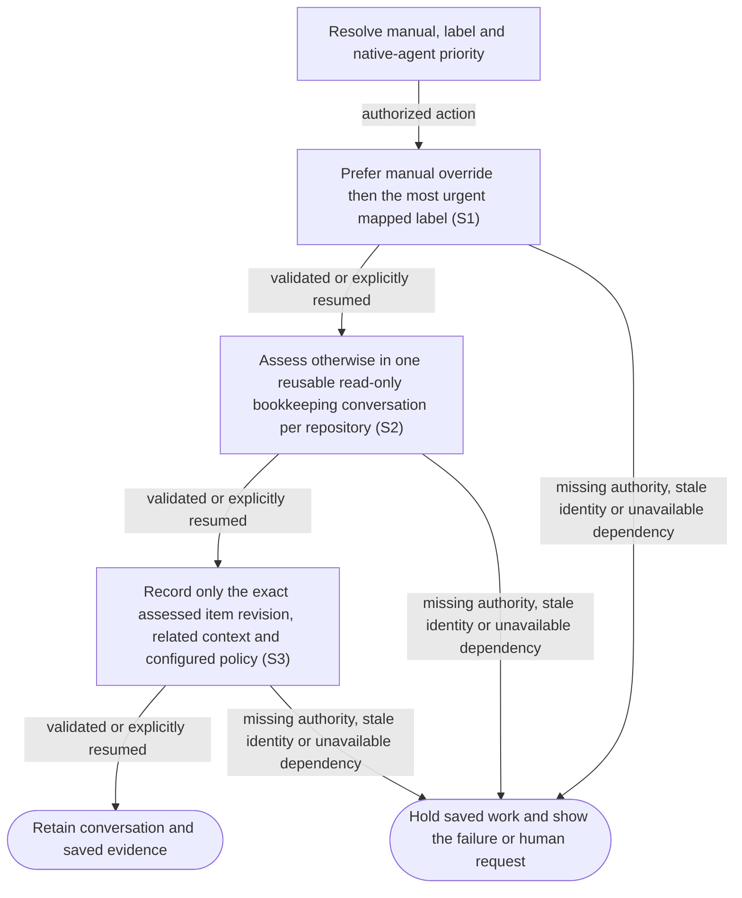

# Resolve manual, label and native-agent priority

## Goal

Resolve manual, label and native-agent priority.

## Preconditions

The private owner connection is established. Application data starts clean in the session-state database; native Codex authentication and configuration remain outside application state. GitHub source text is task data, not new authority.

## Main flow

1. Prefer manual override then the most urgent mapped label.

2. Assess otherwise in one reusable read-only bookkeeping conversation per repository.

3. Record only the exact assessed item revision, related context and configured policy.

Related context includes both incoming and outgoing relationships, their evidence,
and the current revision or ticket state of the related item. Adding, removing or
changing that context invalidates cached and in-flight assessments. Unrelated
relationships and enumeration order do not invalidate an otherwise current result.

## Alternatives and recovery

Read-only inspection does not launch a model turn. Surface validation or provider errors and retain saved work. Human questions, explicit interruptions and uncertain deliveries hold automatic dispatch. Resume against current retained history; never replay an uncertain send or an answered RPC blindly. Explicit cleanup preserves dirty worktrees.

## Scenarios

- **S1** — Prefer manual override then the most urgent mapped label.
- **S2** — Assess otherwise in one reusable read-only bookkeeping conversation per repository.
- **S3** — Record only the exact assessed item revision, related context and configured policy.

## Verification scope

The assertion references below establish their fixture scope. Native installed-host, real-provider and assistive-technology acceptance require separate dated observations. The retired pipeline editor, review artifacts, AI question repair and built-in issue-report ledger have no compatibility path.

<!-- flow-references -->
## Terminology and UI references

Glossary: [profile](../glossary/README.md#profile), [skill](../glossary/README.md#skill), [work-item](../glossary/README.md#work-item).
UI entities: [W-PRIORITY](../ui/README.md#W-PRIORITY), [W-ITEM-ROW](../ui/README.md#W-ITEM-ROW).

## Flow diagram

## Implementation references

- [internal/app/app.go](../../internal/app/app.go) — Retained revision-aware triage, priority precedence and relationships. (`func (a *App) UserAction(`)
- [internal/factory/configuration.go](../../internal/factory/configuration.go) — Concrete application/native proposals, explicit confirmation and safe boundaries. (`func (s *Service) Confirm(`)
- [internal/factory/requests.go](../../internal/factory/requests.go) — Exact session-bound native requests and explicit status, without classifiers. (`func (s *Service) Answer(`)

## Test references

- [web/tests/wrapper.spec.ts](../../web/tests/wrapper.spec.ts) — `priorities relationships and PR queues remain available`; S1. Acknowledge, unread and recorded actions remain independent; P0 override and clearing, manual link addition/removal and My PRs use explicit controls.
- [internal/factory/service_test.go](../../internal/factory/service_test.go) — `func TestPriorityBookkeepingReusesThreadAndRejectsStaleAssessment(`; S2, S3. Reusable bookkeeping thread records only exact item revision/context/policy results.
- [internal/app/app_test.go](../../internal/app/app_test.go) — `func TestInboxRevisionStatesPriorityAndLinks(`; S1. Manual override wins over mapped labels and cached inference; clearing override selects most urgent mapped label.
- [internal/factory/regressions_test.go](../../internal/factory/regressions_test.go) — `func TestCachedPrioritySkipsFullHistoryDecode(`; S3. A valid cached priority assessment avoids decoding full malformed item history and launches no new native work.
- [internal/app/assessment_context_test.go](../../internal/app/assessment_context_test.go) — `func TestAssessmentContextTracksBothRelationshipDirectionsAndRelatedState(`; S3. Both incoming and outgoing relationship addition, related revision and evidence changes affect assessment context; removal restores baseline. Incoming ticket state changes invalidate context, unrelated links do not, and enumeration order is stable.
- [internal/factory/review6_test.go](../../internal/factory/review6_test.go) — `func TestIncomingPriorityRelationshipsInvalidateCacheAndLateToolRecords(`; S1, S2, S3. Incoming relationship add, ticket-state change, evidence change and removal reject stale tool records, invalidate actual InboxSummaries AI priority, and trigger one fresh assessment each. Fresh results cache and all five assessments reuse one native thread; label then manual override precedence starts no extra assessment.

## Verification and gaps

Local suites: `go`, `browser`.
Fixture success does not establish real-host acceptance.

<!-- /flow-references -->
