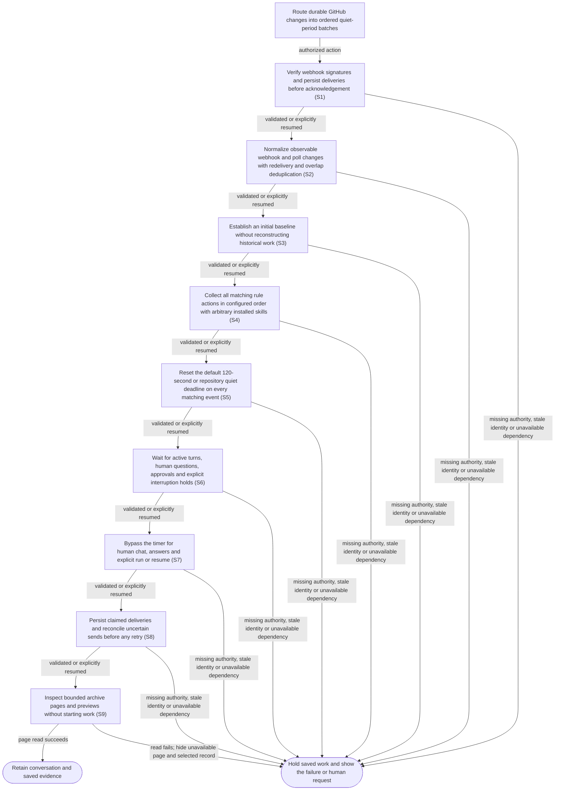

# Route durable GitHub changes into ordered quiet-period batches

## Goal

Route durable GitHub changes into ordered quiet-period batches.

## Preconditions

The private owner connection is established. Application data starts clean in the session-state database; native Codex authentication and configuration remain outside application state. GitHub source text is task data, not new authority.

## Main flow

1. Verify webhook signatures and persist deliveries before acknowledgement.

2. Normalize observable webhook and poll changes with redelivery and overlap deduplication.

3. Establish an initial baseline without reconstructing historical work.

4. Collect all matching rule actions in configured order with arbitrary installed skills.

5. Reset the default 120-second or repository quiet deadline on every matching event.

6. Wait for active turns, human questions, approvals and explicit interruption holds.

7. Bypass the timer for human chat, answers and explicit run or resume.

8. Persist claimed deliveries and reconcile uncertain sends before any retry.

9. Inspect bounded event, webhook-delivery, batch and ordered-rule archive pages without starting work.

Already queued CI deliveries may share one successful live observation per
repository, PR and head within the same polling pass, with separate durable
processing for every delivery. Reuse requires receipt strictly before the live
read started and the same credentials and saved observation. The live read and
its cache identity use one pinned credential resolution, even if authentication
changes during the read. Later arrivals,
ambiguous equal timestamps and intervening lifecycle or discussion events require
fresh reads. Failed reads retain their delivery retry, and subsequent polling
passes refresh CI again so newly observable changes still reach matching rules.

## Alternatives and recovery

Read-only inspection does not launch a model turn. Begin with 50 records and offer 100 or 200 per page, previous/next navigation and manual refresh. Selecting a record reveals compact metadata and a bounded preview, including truncation and original byte counts where available; rule metadata lists are bounded and report total counts. Read full rule instructions through Configuration. Kind and size changes reset selection and offset. Hide the unavailable same-query page and selection on a pending or failed refresh; a changed query must never show the previous kind's records. Discard late superseded responses and reread the archive when reopening Events. Surface validation or provider errors and retain saved work. Human questions, explicit interruptions and uncertain deliveries hold automatic dispatch. Resume against current retained history; never replay an uncertain send or an answered RPC blindly. Both retry and discard require a successful history lookup: unavailable history preserves the uncertain claim, confirmed delivery is reconciled as delivered, and only confirmed absence permits either choice. Recovery itself starts no turn. Explicit cleanup preserves dirty worktrees. A busy conversation must not delay independent event discovery or quiet deadlines in its repository or other repositories. Defer its own pending webhook or baseline without losing it, inventing historical work or treating contention as a provider failure.

Saved content is current only after its required saved revisions are ready. While
the requested revision is preparing, show loading and disable actions needing that
content. Searches include saved source bodies. Large source, configuration and exact
question documents remain complete through versioned parts; never silently discard
functional text. A lost or abandoned detail view does not acknowledge a revision.

An already open archive reloads its current query when a replacement service is observed.
While the replacement page is unavailable, hide the earlier page and selected record.
Preserve the archive kind, page size and navigation; inspection launches no work.

## Scenarios

- **S1** — Verify webhook signatures and persist deliveries before acknowledgement.
- **S2** — Normalize observable webhook and poll changes with redelivery and overlap deduplication.
- **S3** — Establish an initial baseline without reconstructing historical work.
- **S4** — Collect all matching rule actions in configured order with arbitrary installed skills.
- **S5** — Reset the default 120-second or repository quiet deadline on every matching event.
- **S6** — Wait for active turns, human questions, approvals and explicit interruption holds.
- **S7** — Bypass the timer for human chat, answers and explicit run or resume.
- **S8** — Persist claimed deliveries and reconcile uncertain sends before any retry.
- **S9** — Inspect bounded archive pages and previews without starting work.

## Verification scope

The assertion references below establish their fixture scope. Native installed-host, real-provider and assistive-technology acceptance require separate dated observations. The retired pipeline editor, review artifacts, AI question repair and built-in issue-report ledger have no compatibility path.

<!-- flow-references -->
## Terminology and UI references

Glossary: [normalized-event](../glossary/README.md#normalized-event), [event-rule](../glossary/README.md#event-rule), [event-batch](../glossary/README.md#event-batch), [quiet-period](../glossary/README.md#quiet-period), [retained-session](../glossary/README.md#retained-session).
UI entities: [W-EVENT-BATCHES](../ui/README.md#W-EVENT-BATCHES), [W-WORK-STATUS](../ui/README.md#W-WORK-STATUS), [W-MESSAGE](../ui/README.md#W-MESSAGE), [W-QUESTIONS](../ui/README.md#W-QUESTIONS).

## Flow diagram

## Implementation references

- [internal/factory/github.go](../../internal/factory/github.go) — Durable webhook/poll normalization with initial baseline and CI association. (`func (s *Service) Poll(`)
- [internal/factory/service.go](../../internal/factory/service.go) — Durable canonical sessions, event queue, quiet clock and delivery claims. (`func (s *Service) Chat(`)
- [internal/factory/native.go](../../internal/factory/native.go) — Direct native app-server retained thread creation and resumption. (`func (s *Service) attach(`)
- [internal/factory/requests.go](../../internal/factory/requests.go) — Exact session-bound native requests and explicit status, without classifiers. (`func (s *Service) Answer(`)
- [internal/transport/factory.go](../../internal/transport/factory.go) — Session, configuration, event and retained triage APIs. (`func NewFactory(`)
- [internal/gateway/gateway.go](../../internal/gateway/gateway.go) — Forward signed GitHub webhooks through the existing public gateway. (`func (g *Gateway) Public(`)
- [web/src/wrapper.tsx](../../web/src/wrapper.tsx) — Read-only bounded archive inspection with query guards and selected previews. (`function Archive(`)
- [internal/transport/factory_events.go](../../internal/transport/factory_events.go) — Page each archive independently and return bounded compact record metadata. (`func factoryEvents(`)
- [internal/store/reads.go](../../internal/store/reads.go) — Select bounded compact archive records before Go decoding rather than reading retained full-history payloads. (`func (s *Store) FactoryArchive(`)
- [internal/httpbudget/budget.go](../../internal/httpbudget/budget.go) — Observe slow finite responses without latency cancellation; bound admission/body buffers and preserve caller/service cancellation and acknowledged SSE lifetime. (`func Wrap(`)
- [internal/factory/github_ci.go](../../internal/factory/github_ci.go) — Bounded polling-pass CI snapshot reuse with strict delivery/read ordering, credential and saved-observation isolation. (`func (s *Service) refreshCI(`)
- [internal/providers/github_source.go](../../internal/providers/github_source.go) — Pins one read operation so HTTP Authorization and query/batch cache identities use the same resolved credentials. (`func PinGitHubRead(`)

## Test references

- [internal/factory/service_test.go](../../internal/factory/service_test.go) — `func TestWebhookSignaturePersistenceRedelivery(`; S1, S2. Invalid HMAC is rejected, valid delivery persists before202, redelivery stays singular, and signed same-ID different body or event type returns503 without replacing the original ledger.
- [internal/factory/service_test.go](../../internal/factory/service_test.go) — `func TestBaselineAndPollingOverlap(`; S2, S3. Baseline observations launch no work; overlapping webhook/poll observations deduplicate.
- [internal/factory/service_test.go](../../internal/factory/service_test.go) — `func TestQuietPeriodResetAndOrderedActions(`; S4, S5. Controllable clock resets default quiet deadline and retains all matching actions in rule order.
- [internal/factory/service_test.go](../../internal/factory/service_test.go) — `func TestRepositoryQuietOverrideAndIdleWithoutStatus(`; S5. Repository quiet override, completion without report, and source closure retain history.
- [internal/factory/service_test.go](../../internal/factory/service_test.go) — `func TestChatFlushBusySteerHoldAndRetainedReuse(`; S6, S7. Human chat flushes queued events, steers unblocked active work and respects holds while retaining thread.
- [internal/factory/service_test.go](../../internal/factory/service_test.go) — `func TestStatusToolBlockingAndNativeAnswers(`; S6, S7. Explicit status, suspended blocked tool and exact native answers separate work status from execution.
- [internal/factory/service_test.go](../../internal/factory/service_test.go) — `func TestRestartExpiresIdentitiesAndNeverReplaysUncertainBatch(`; S8. Restart expires RPC identities and holds uncertain delivery without blind replay.
- [internal/factory/service_test.go](../../internal/factory/service_test.go) — `func TestCIWebhookAssociatesEveryCurrentHeadPRAndPollDeduplicates(`; S2. CI result refresh reaches every PR at the current SHA; overlapping poll emits no duplicate.
- [internal/factory/service_test.go](../../internal/factory/service_test.go) — `func TestAnswerFlushesPendingEventsBeforeQuietDeadline(`; S7. An explicit native answer steers pending events before the quiet deadline.
- [internal/factory/service_test.go](../../internal/factory/service_test.go) — `func TestExplicitRetryRequiresSuccessfulHistoryReconciliation(`; S8. Explicit retry refuses unavailable history or confirmed delivery and requeues only after a successful lookup proves absence; resolution itself sends no work.
- [internal/factory/service_test.go](../../internal/factory/service_test.go) — `func TestDiscussionWebhooksKeepNewerPRContext(`; S1. Late review, inline-comment and thread webhook snapshots retain newer saved PR head, title and labels in both saved state and normalized event context.
- [internal/factory/regressions_test.go](../../internal/factory/regressions_test.go) — `func TestCommentDeletionNormalizesOnceAcrossWebhookAndPolling(`; S2. Discussion and inline-comment deletion normalize once through both webhook and poll despite unchanged body/timestamp and redelivery.
- [internal/factory/regressions_test.go](../../internal/factory/regressions_test.go) — `func TestDetailRefreshAdvancesPastSkippedAndFailedItems(`; S2. Detail cursor advances past paused, removed and failed rows to refresh the later eligible item while preserving the failure.
- [internal/factory/regressions_test.go](../../internal/factory/regressions_test.go) — `func TestInitialDetailBaselineCannotLaunchUnprocessedHistory(`; S3. Multiple initial detail pages establish historical comments as baseline without starting sessions.
- [internal/factory/regressions_test.go](../../internal/factory/regressions_test.go) — `func TestPollReadsOnlyDuePendingDeliveries(`; S1, S2. Polling selects due unprocessed webhook rows without decoding processed archives or future pending deliveries.
- [internal/factory/regressions_test.go](../../internal/factory/regressions_test.go) — `func TestElicitationSchemaAndRemainingBlockers(`; S6. Missing content and wrong schema types retain requests without replies; valid answer preserves another pending blocker and final decline resumes execution.
- [web/tests/wrapper.spec.ts](../../web/tests/wrapper.spec.ts) — `uncertainty recovery uses durable delivery state rather than error text`; S8. Uncertain batch recovery controls follow persisted deliveryState independently of error wording; pending thread recovery offers retry without batch discard.
- [internal/factory/regressions_test.go](../../internal/factory/regressions_test.go) — `func TestCIRefreshPreservesDiscussionWhenProviderReturnsEmptyActivity(`; S2. Four CI webhook types preserve saved discussion when provider activity is empty; queued events contain compact context and the delivered batch contains full current discussion once.
- [internal/factory/regressions_test.go](../../internal/factory/regressions_test.go) — `func TestPollFirstWebhookEnrichesActionsWithoutDuplicateRules(`; S2, S4. Poll-first request/comment-created/comment-edited observations are enriched by later webhook actions once, with one canonical event, ordered specific rules and no repeated general rule before or after prior delivery.
- [internal/store/factory_reads_test.go](../../internal/store/factory_reads_test.go) — `func TestDueRecordsCompareInstantsAcrossTimezones(`; S1. Due-record selection includes a past positive-offset timestamp and excludes a future negative-offset timestamp by comparing instants.
- [internal/factory/regressions_test.go](../../internal/factory/regressions_test.go) — `func TestWebhookLifecycleReturningToBaselineStillRunsOnce(`; S2, S3. A received reopened webhook matching an initial open baseline still creates one authorized action; redelivery and overlapping polling do not repeat it.
- [internal/factory/regressions_test.go](../../internal/factory/regressions_test.go) — `func TestReviewThreadWebhooksUseActionWithoutInventedResolvedField(`; S2. Resolved and unresolved webhooks use top-level action and node_id without invented is_resolved; saved state changes and each transition queues once across redelivery/polling.
- [internal/factory/regressions_test.go](../../internal/factory/regressions_test.go) — `func TestReviewStateCasingDeduplicatesActualRESTAndWebhookOverlap(`; S2, S5. Actual REST uppercase review state and lowercase webhook normalize identically in either order, producing one action without resetting the quiet deadline.
- [internal/factory/regressions_test.go](../../internal/factory/regressions_test.go) — `func TestCachedDetailCannotReverseNewerWebhookObservation(`; S2. A cached older detail snapshot cannot reverse a newer resolved webhook or queue a false reverse action; a genuinely later unresolved snapshot remains observable.
- [internal/factory/regressions_test.go](../../internal/factory/regressions_test.go) — `func TestCommentCatchupStoresLinearDeltasAndWritesQueueOnce(`; S2, S4. A catch-up of 100 comments at 4 KiB each performs one SQL session write and keeps aggregate events and the queued session each within 1 MiB; a selected comment marker occurs exactly twice in the delivered batch and actual native input.
- [internal/factory/regressions_test.go](../../internal/factory/regressions_test.go) — `func TestDelayedCommentWebhookCannotReverseNewerActivity(`; S2. Older timezone-aware discussion/inline-comment webhook versions cannot replace retained B or cause poll duplication; genuinely newer C is saved and authorizes one action.
- [internal/factory/regressions_test.go](../../internal/factory/regressions_test.go) — `func TestSchedulerSkipsHeldQueueDecodeAndBusyConfiguration(`; S6. Thirty intentionally undecodable histories cover 15 held, 14 due but paused, and one running session with runtime rows within 512 bytes; three ticks preserve deferred active configuration and start no native work.
- [internal/factory/regressions_test.go](../../internal/factory/regressions_test.go) — `func TestAutomaticBatchBypassesBusyAndSlowPeerAttachments(`; S6. Actual B turn/start occurs before A is released for both slow human attachment with empty queue and slow automatic due attachment; B running state has no pending events afterward.
- [internal/factory/regressions_test.go](../../internal/factory/regressions_test.go) — `func TestPausedRepositoryRetainsQueueAndAllowsExplicitChat(`; S6, S7. Repository pause retains an authorized queue without automatic send; explicit chat flushes it, and unpause plus a new event automatically reuses the retained thread.
- [web/tests/wrapper.spec.ts](../../web/tests/wrapper.spec.ts) — `event and rule inspection uses bounded pages and previews without starting work`; S9. A 1,000-row mocked archive displays 50 records by default, pages forward/back, resets selection and offset for 200-row and kind changes, shows a bounded preview with original byte count, reads all four archive kinds and opens Configuration without agent/configuration mutations. The fixture projection does not establish backend payload bounds.
- [web/tests/wrapper.spec.ts](../../web/tests/wrapper.spec.ts) — `archive refresh hides unavailable data on failure and rejects stale queries`; S9. Failed same-query refresh hides its unavailable page and selected record; a failed changed kind displays no stale page or detail. The exact superseded delivery invocation completes SDK decoding and its React continuation barrier before asserting that the accepted batch page remains intact, without any repairing refresh. Reopening Events rereads the default page.
- [internal/factory/review6_test.go](../../internal/factory/review6_test.go) — `func TestRetainedRefreshCannotOverwriteConcurrentWebhook(`; S2. An in-flight retained PR refresh cannot replace a newer webhook row on either success or provider failure: current head/body/discussion/CI and automatic links remain, and actual batch/native input agrees.
- [internal/factory/review6_test.go](../../internal/factory/review6_test.go) — `func TestUnchangedRetainedRefreshStillAppliesProviderResult(`; S2. An unchanged saved row accepts fresh provider title/CI and automatic links, while provider failure preserves source and records retry backoff.
- [internal/factory/review6_test.go](../../internal/factory/review6_test.go) — `func TestBlockedAndAnsweredTransitionsEmitSessionSubscription(`; S6, S7. An exact session.changed webhook subscriber receives one blocked and one answered transition; notifications contain neither question nor answer text.
- [internal/factory/review6_test.go](../../internal/factory/review6_test.go) — `func TestAnswerPreservesOtherExplicitBlockedRequests(`; S6, S7. For blocking and nonblocking native input, an invalid answer fails; valid native and first explicit-status answers retain blocked/waiting while a second explicit status question remains. Only the final answer yields working/running.
- [internal/factory/review6_test.go](../../internal/factory/review6_test.go) — `func TestRecoveryChoicesRequireHistoryBeforeDiscardOrRetry(`; S8. Both retry and discard require retained history: unavailable lookup preserves uncertain state, confirmed delivery stays delivered, and confirmed absence clears the claim with only retry requeueing; all six cases send no new native input.
- [internal/factory/review6_test.go](../../internal/factory/review6_test.go) — `func TestCIHeadDiscoveryProjectsBeforeDecodingUnrelatedArchives(`; S2. Three CI bursts skip 120 unrelated large histories with invalid typed activity/checks, associate matching saved and explicit PR heads, exclude moved/wrong heads, and leave one normalized CI pending event per matching PR.
- [internal/transport/factory_test.go](../../internal/transport/factory_test.go) — `func TestFactoryEventsProjectsBoundedPagesBeforeArchiveDecode(`; S9. With 205 records of each archive kind and 205 ordered rules containing large retained data, defaults return 50 compact records; a requested 999 limit clamps to 200 and offset 200 returns five. First-page payloads stay under 500,000 bytes and omit raw body/context/instructions; event Unicode previews stay within 512 UTF-8 bytes with original 3,000-byte/truncated metadata; rule skills show 16 entries of at most 128 UTF-8 bytes and total 30. Empty pages preserve totals, invalid kinds/negative offsets fail, and reads create no session.
- [internal/factory/review7_test.go](../../internal/factory/review7_test.go) — `func TestSignedWebhookCommitsInboxNotificationWithoutProviderRead(`; S1, S2. A signed webhook persists changed PR source and emits one metadata-only inbox.changed subscription for matching and absent rules, without private body/native turn. Redelivery and same-source new delivery emit no extra notification.
- [internal/factory/review7_test.go](../../internal/factory/review7_test.go) — `func TestPollingDiscoversPeerChangesWhileNativeAttachmentIsHeld(`; S2, S3, S5, S6. Five held-attachment modes cover unchanged issue, changed PR, detail refresh, initial baseline and busy webhook. Actual Poll discovers same- and other-repository peer heads and sets their 120-second quiet deadlines before the held attachment releases. Busy webhook remains pending without backoff; canceled Poll stops; release+two polls preserve one deferred head transition/no initial historical queue and no extra native turns.
- [internal/factory/review7_test.go](../../internal/factory/review7_test.go) — `func TestBusyWebhookPageDoesNotStarveIndependentDelivery(`; S2, S5, S6. With 64 older signed deliveries held by one busy conversation, two later independent deliveries are processed and receive their 120-second quiet deadlines before release. Two polls preserve every busy payload without error/backoff; release processes the retained page without starting native work.
- [internal/factory/review7_test.go](../../internal/factory/review7_test.go) — `func TestDeletedDiscussionCannotBeResurrectedByDelayedDeliveries(`; S2. For issue and inline comments, deletion followed by distinct delayed created/edited deliveries retains absent source activity, the deletion observation and one pending action; an independent new comment ID still authorizes once.
- [internal/factory/review7_test.go](../../internal/factory/review7_test.go) — `func TestEqualTimestampDiscussionRetainsCurrentPRContext(`; S2. Inline-comment, review and thread webhooks with tied PR timestamps retain the saved current head/title/body/labels and route new discussion with that current context rather than the older enclosing snapshot.
- [internal/factory/review7_test.go](../../internal/factory/review7_test.go) — `func TestInitialBaselineSkipsBusyItemAndObservesIndependentPeer(`; S2, S3, S5, S6. With pending baseline [A,B] and A locked, B establishes a quiet baseline, then routes a saved head change and a later provider-only discussion with exact quiet deadlines before A releases. Release completes A without reconstructing historical work or starting native turns.
- [internal/factory/review7_test.go](../../internal/factory/review7_test.go) — `func TestDetailRefreshRetainsCachedFreshnessWithoutRepeatedImports(`; S2. After an actual CachedGitHub detail load, controlled passes at 31 seconds, one minute, just before the provider detail TTL and twice after the service freshness deadline preserve the UI version and one underlying fetch. An identical still-cached observation skips item import while event reconciliation remains available.
- [internal/factory/webhook_budget_test.go](../../internal/factory/webhook_budget_test.go) — `func TestWebhookFiniteResponseForDelayedSecretAndStoreContention(`; S1. Explicit caller cancellation reports uncertainty during held secret/store access, prevents late persistence and preserves safe exact-id redelivery.
- [internal/factory/api_performance_test.go](../../internal/factory/api_performance_test.go) — `func TestWebhookAPILatency(`; S1. Twenty isolated successful signed webhook acknowledgements each retain a durable delivery before202 and satisfy the75ms verification gate; deliberate slow/canceled paths are separate correctness fixtures.
- [web/tests/wrapper.spec.ts](../../web/tests/wrapper.spec.ts) — `an open archive retires its page and selection when the daemon changes`; S9. Loaded archive replacement observes daemon identity, hides old page/selection while pending, then displays current records without manual refresh, preserving query controls and navigation without chat.
- [internal/factory/github_ci_test.go](../../internal/factory/github_ci_test.go) — `func TestCIWebhookBurstSharesLiveRequestsAcrossDeliveryPages(`; S2. Seventy queued mixed CI deliveries across two pages share eight real HTTP requests for two current-head PRs; every delivery commits, unchanged CI queues once per PR, and a later poll reads live and queues a changed CI result.
- [internal/factory/github_ci_test.go](../../internal/factory/github_ci_test.go) — `func TestCIWebhookBatchRefreshesDeliveriesReceivedDuringRead(`; S2. A delivery arriving during the first provider read forces another four-request live read in the same polling pass.
- [internal/factory/github_ci_test.go](../../internal/factory/github_ci_test.go) — `func TestCIWebhookBatchEqualArrivalTimesReadLive(`; S2. Deliveries whose receipt time equals the read start never reuse an ambiguously ordered observation.
- [internal/factory/github_ci_test.go](../../internal/factory/github_ci_test.go) — `func TestCIWebhookBatchFailureRemainsDurableAndRetryable(`; S2. Failed reads remain pending with durable retry state and are not cached; a later successful retry batch shares one live observation.
- [internal/factory/github_ci_test.go](../../internal/factory/github_ci_test.go) — `func TestCIWebhookBatchSeparatesHeads(`; S2. An old-head CI event cannot reverse a lifecycle head update; a new-head event reads live.
- [internal/factory/github_ci_test.go](../../internal/factory/github_ci_test.go) — `func TestCIWebhookBatchSeparatesCredentialsAndSavedObservations(`; S2. Changed credentials and a concurrently replaced saved item each force another live provider read.
- [internal/factory/github_ci_test.go](../../internal/factory/github_ci_test.go) — `func TestCIWebhookBatchWithoutHeadNeverSharesSnapshot(`; S2. Missing-head deliveries force separate live reads and never apply CI without a verified head association.
- [internal/factory/github_ci_test.go](../../internal/factory/github_ci_test.go) — `func TestCIWebhookBatchInvalidatesAfterLifecycleWithUnchangedVersion(`; S2. An intervening lifecycle delivery leaves the head and saved version unchanged, yet the next queued CI delivery must make four fresh HTTP requests and observe changed CI.
- [internal/factory/github_ci_test.go](../../internal/factory/github_ci_test.go) — `func TestCIWebhookBatchPinsCredentialScopeToLiveRead(`; S2. A credential resolver returning A then B cannot label B HTTP observations as A; return to A safely reuses only an A-authenticated live read.

## Verification and gaps

Local suites: `go`, `browser`.
Fixture success does not establish real-host acceptance.

<!-- /flow-references -->
