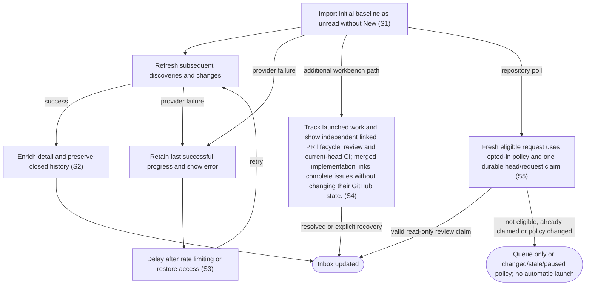

# Synchronize repository issues and pull requests

## Goal

The owner receives an up-to-date local inbox with activity and synchronization status.

## Preconditions

At least one accessible repository is configured.

## Main flow

1. Import open issues and pull requests as the initial baseline.
2. Refresh automatically and include subsequent discoveries and item changes.
3. Include pull-request reviews, checks, commits and references in item detail.
4. Keep previously synchronized closed or merged history available when viewing all items.

## Alternatives and recovery

Authentication and provider errors remain visible. Failed refreshes retain their last successful progress. Rate limits delay retries, and access recovery permits later refreshes.

## Scenarios

- **S1** Initial import is unread without a New badge; later discoveries receive New.
- **S2** Pagination and pull-request enrichment preserve content revisions and item history.
- **S3** Failed or rate-limited synchronization does not advance progress and later recovers.

- **S4** Track launched work and show independent linked PR lifecycle, review and current-head CI; merged implementation links complete issues without changing their GitHub state.

- **S5** Repository monitoring displays its last successful poll and failures, supports a manual poll and can pause. System and repository policy determines whether current user/team review requests remain queued or start a read-only review after fresh synchronization. Durable request/head claims prevent duplicate polls or restart from repeating launches; stale provider state cannot authorize a new review.

<!-- flow-references -->
## Terminology and UI references

Glossary: [repository](../glossary/README.md#repository), [inbox](../glossary/README.md#inbox), [work-item](../glossary/README.md#work-item), [state-new](../glossary/README.md#state-new), [state-unread](../glossary/README.md#state-unread), [coverage-gap](../glossary/README.md#coverage-gap), [unverified-behavior](../glossary/README.md#unverified-behavior), [working-queue](../glossary/README.md#working-queue), [implementation-relationship](../glossary/README.md#implementation-relationship), [review-policy](../glossary/README.md#review-policy), [review-request-claim](../glossary/README.md#review-request-claim), [repository-review-prompt](../glossary/README.md#repository-review-prompt).
UI entities: [PAGE-INBOX](../ui/README.md#PAGE-INBOX), [P-INBOX-QUERY](../ui/README.md#P-INBOX-QUERY), [P-INBOX-LIST](../ui/README.md#P-INBOX-LIST), [P-ITEM-DETAIL](../ui/README.md#P-ITEM-DETAIL), [W-INBOX-QUERY](../ui/README.md#W-INBOX-QUERY), [W-SYNC-HEALTH](../ui/README.md#W-SYNC-HEALTH), [W-ITEM-ROW](../ui/README.md#W-ITEM-ROW), [W-INBOX-EMPTY](../ui/README.md#W-INBOX-EMPTY), [W-ITEM-OVERVIEW](../ui/README.md#W-ITEM-OVERVIEW), [W-ITEM-ACTIONS](../ui/README.md#W-ITEM-ACTIONS), [W-ITEM-HISTORY](../ui/README.md#W-ITEM-HISTORY), [C-FILTER](../ui/README.md#C-FILTER), [C-SELECT-ITEM](../ui/README.md#C-SELECT-ITEM), [C-ITEM-STATE](../ui/README.md#C-ITEM-STATE), [W-RELATIONSHIPS](../ui/README.md#W-RELATIONSHIPS), [W-TICKET-CONTEXT](../ui/README.md#W-TICKET-CONTEXT), [W-PR-EVIDENCE](../ui/README.md#W-PR-EVIDENCE), [C-LINK](../ui/README.md#C-LINK), [PAGE-AGENT](../ui/README.md#PAGE-AGENT), [PAGE-WORKING](../ui/README.md#PAGE-WORKING), [W-REPOSITORY-SETTINGS](../ui/README.md#W-REPOSITORY-SETTINGS), [W-SYSTEM-DEFAULTS](../ui/README.md#W-SYSTEM-DEFAULTS), [C-REVIEW-POLICY](../ui/README.md#C-REVIEW-POLICY), [C-REPOSITORY-REVIEW-PROMPT](../ui/README.md#C-REPOSITORY-REVIEW-PROMPT).

## Flow diagram

## Implementation references

- [internal/app/app.go](../../internal/app/app.go) — Import transactions and scheduled synchronization (`func (a *App) Sync(`)
- [internal/providers/github.go](../../internal/providers/github.go) — Read-only pagination, enrichment and conditional cache
- [web/src/main.tsx](../../web/src/main.tsx) — Repository sync status
- [internal/domain/types.go](../../internal/domain/types.go) — Shared domain, persistence, transport or dependency contract
- [internal/store/store.go](../../internal/store/store.go) — Shared domain, persistence, transport or dependency contract
- [internal/transport/mcp.go](../../internal/transport/mcp.go) — Shared domain, persistence, transport or dependency contract
- [go.mod](../../go.mod) — Shared domain, persistence, transport or dependency contract
- [go.sum](../../go.sum) — Shared domain, persistence, transport or dependency contract
- [internal/testutil/testutil.go](../../internal/testutil/testutil.go) — Shared fake-provider verification input; changes require assertion reconciliation.
- [internal/testutil/fakecodex/main.go](../../internal/testutil/fakecodex/main.go) — Shared fake-provider verification input; changes require assertion reconciliation.
- [internal/app/work.go](../../internal/app/work.go) — Server queue membership and linked PR/work projections. (`func (a *App) projectWork(`)
- [internal/providers/pull_requests.go](../../internal/providers/pull_requests.go) — Read-only authoritative PR review/CI/development links with current-head and freshness checks. (`func (g *GitHub) EnrichPullRequest(`)
- [internal/app/review_requests.go](../../internal/app/review_requests.go) — Resolve inherited review policies, fresh requests, durable claims and pinned automatic launches. (`func (a *App) ProcessReviewRequests(`)

## Test references

- [internal/app/app_test.go](../../internal/app/app_test.go) — `func TestScheduledSyncRecoversCredentialsAndFindsNewItems(`; S1, S3. Scheduled credential failure, recovery and later item discovery.
- [internal/providers/github_test.go](../../internal/providers/github_test.go) — `func TestGitHubPaginationPREnrichmentAndRecovery(`; S2. Pagination, enrichment and activity revisions.
- [internal/providers/github_test.go](../../internal/providers/github_test.go) — `func TestGitHubRateLimitsRevocationAndPaginationOrigin(`; S3. Rate limits and credential revocation.
- [internal/providers/github_test.go](../../internal/providers/github_test.go) — `func TestConditionalCacheKeepsPaginationAndScopesAuthentication(`; S2. Cache preserves pagination and separates identities.
- [internal/providers/work_queues_test.go](../../internal/providers/work_queues_test.go) — `func TestReviewRequestsRefreshWithoutIssueTimestampChange(`; S2. Review users/teams synchronize and removal changes revision even without timestamp/head changes.
- [internal/app/work_queues_test.go](../../internal/app/work_queues_test.go) — `func TestSyncPublishesAuthenticatedViewerAndTeamFailures(`; S2. Authenticated account/team metadata is stored; membership failure clears stale teams with feedback; changed account never inherits old membership.
- [internal/app/work_tracking_test.go](../../internal/app/work_tracking_test.go) — `func TestWorkingTracksSessionsUntilGitHubCompletion(`; S4. Working completion follows explicit implementation links; references do not complete an issue.
- [internal/providers/pull_requests_test.go](../../internal/providers/pull_requests_test.go) — `func TestPullRequestMetadataPaginationCurrentHeadAndRevision(`; S4. Metadata pagination, status reruns, current head and stable semantic revisions.
- [web/tests/factory.spec.ts](../../web/tests/factory.spec.ts) — `Working and linked PR monitoring follow server projections`; S4. Both narrow themes consume server membership and linked summaries, preserve source links and remove merged work without launch.
- [internal/app/review_requests_test.go](../../internal/app/review_requests_test.go) — `func TestReviewPolicyInheritancePromptAndExactlyOnceAutomaticStart(`; S5. System defaults queue; enabled inherited policy starts one pinned read-only review with appended repo text, survives duplicate polls/restart and accepts a new request episode.
- [internal/app/review_requests_test.go](../../internal/app/review_requests_test.go) — `func TestRepositoryQueueOverridePauseDraftAndStaleRequestsDoNotStart(`; S5. Queue override, pause, draft, old sync, absent request, sync error and unsafe review profile cannot launch automatically.
- [internal/app/review_requests_test.go](../../internal/app/review_requests_test.go) — `func TestNewPRHeadGetsOneNewReviewAndExtraPromptIsNotDuplicated(`; S5. A changed head receives one new review, while repeated preparation does not duplicate repository instruction blocks.
- [internal/app/work_queues_test.go](../../internal/app/work_queues_test.go) — `func TestPausedRepositorySkipsProviderPollingAndRetainsPolicy(`; S5. Paused monitoring makes no repository-provider calls and retains policy and the untouched checkpoint.
- [internal/app/work_queues_test.go](../../internal/app/work_queues_test.go) — `func TestFailedPollCannotOverwriteConcurrentRepositoryPolicyChanges(`; S3, S5. An old failed provider poll records its error without overwriting concurrently edited monitoring policy or advancing the checkpoint.

## Verification and gaps

Local suites: `go`.
Fixture success does not establish real-host acceptance.
- **S2** — `gap-flow-sync-inbox-s2-01` · Unverified behavior · P2 · owner: user-flow-maintainer. Closed/merged retention and hourly reconciliation are implemented but not exhaustively asserted by the enrichment fixture; full current-version host inbox matrix is open. Next verification: Add retention and hourly-reconciliation fixture assertions, then record the current-version host inbox matrix without treating provider enrichment fixtures as host acceptance.

<!-- /flow-references -->
