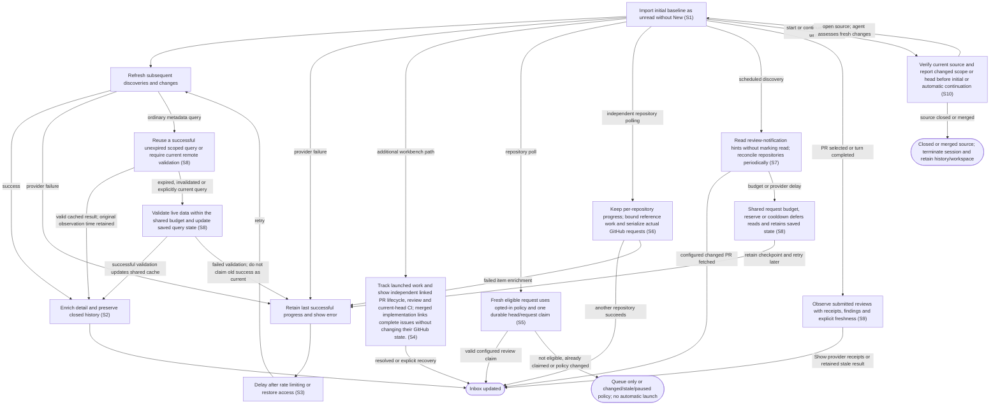

# Synchronize repository issues and pull requests

## Goal

The owner receives an up-to-date local inbox with activity and synchronization status.

## Preconditions

At least one accessible repository is configured.

## Main flow

1. Import open issues and pull requests as the initial baseline.
2. Read review-notification hints on the configured interval without marking GitHub notifications read. Reconcile repository summaries periodically and when the owner explicitly polls. New repositories receive an initial baseline; each repository retains independent successful progress.
3. Refresh full reviews, checks, commits and references for selected or tracked work within the request budget; keep saved information available when refresh is deferred.
4. Keep previously synchronized closed or merged history available when viewing all items.

## Alternatives and recovery

Authentication and provider errors remain visible. Failed refreshes retain their last successful progress. Reference backfill yields to repository polling and resumes with other references on its next pass. Rate limits delay retries, and access recovery permits later refreshes.

Normal provider reads reuse successful saved query results until expiry or invalidation. Explicit polling, new notification targets, pre-execution lifecycle checks and post-turn publication checks require current remote validation through the same read boundary; successful live responses update the shared cache. A failed live check never silently substitutes older data. Entries are scoped by authenticated account and endpoint, survive restart and retain original observation times. Invalidation affects the requested item or repository and related repository summaries. Newly observed head/scope changes cannot reuse older item details; cache hits remain available while another query waits on the network.

## Scenarios

- **S10** An observed closed issue or closed/merged PR terminates all started sessions belonging to that source, retires their provider processes and questions, and retains history/workspaces. Reopening the source does not revive terminated sessions.

- **S1** Initial import is unread without a New badge; later discoveries receive New.
- **S2** Pagination and pull-request enrichment preserve content revisions and item history.
- **S3** Failed or rate-limited synchronization does not advance progress and later recovers.

- **S4** Track launched work and show independent linked PR lifecycle, review and current-head CI; merged implementation links complete issues without changing their GitHub state.

- **S5** Repository monitoring displays its last successful poll and failures, supports a manual poll and can pause. System and repository policy determines whether current user/team review requests remain queued or start the configured review pipeline with its explicitly selected authority after fresh synchronization. Durable request/head claims prevent duplicate polls or restart from repeating launches; stale provider state cannot authorize a new review.

- **S6** Repository summary discovery does not fetch every item’s full history. Requests are serialized and bounded; failures retain successful progress, and reference backfill yields between passes.

- **S7** Read and unread review notifications identify changed PRs only in configured active repositories. Unchanged hints are deduplicated across polling/restart; unsuccessful batches retain the notification cursor. Periodic repository reconciliation covers missing notifications.
- **S8** Scheduled, manual and selected-detail reads share a persistent rolling request budget and reported-quota reserve. Conditional responses, server polling intervals and primary/secondary cooldowns are respected across restart. Deferred reads retain records/checkpoints, and cached freshness cannot authorize stale automatic review.

- **S9** A PR's posted reviews retain provider receipt links, author, verdict, reviewed commit, submission time, body and inline findings. Pending drafts are excluded. Completed PR turns trigger a read; routine reads share a one-minute cache and the GitHub request budget. Paused repositories and failed reads preserve prior successful observations with visible stale/error feedback; no read starts or publishes work.

<!-- flow-references -->
## Terminology and UI references

Glossary: [repository](../glossary/README.md#repository), [inbox](../glossary/README.md#inbox), [work-item](../glossary/README.md#work-item), [state-new](../glossary/README.md#state-new), [state-unread](../glossary/README.md#state-unread), [coverage-gap](../glossary/README.md#coverage-gap), [unverified-behavior](../glossary/README.md#unverified-behavior), [working-queue](../glossary/README.md#working-queue), [implementation-relationship](../glossary/README.md#implementation-relationship), [review-policy](../glossary/README.md#review-policy), [review-request-claim](../glossary/README.md#review-request-claim), [repository-review-prompt](../glossary/README.md#repository-review-prompt), [github-request-budget](../glossary/README.md#github-request-budget), [github-request-reserve](../glossary/README.md#github-request-reserve), [github-review-notification](../glossary/README.md#github-review-notification), [published-review](../glossary/README.md#published-review), [state-terminated](../glossary/README.md#state-terminated).
UI entities: [PAGE-INBOX](../ui/README.md#PAGE-INBOX), [P-INBOX-QUERY](../ui/README.md#P-INBOX-QUERY), [P-INBOX-LIST](../ui/README.md#P-INBOX-LIST), [P-ITEM-DETAIL](../ui/README.md#P-ITEM-DETAIL), [W-INBOX-QUERY](../ui/README.md#W-INBOX-QUERY), [W-SYNC-HEALTH](../ui/README.md#W-SYNC-HEALTH), [W-ITEM-ROW](../ui/README.md#W-ITEM-ROW), [W-INBOX-EMPTY](../ui/README.md#W-INBOX-EMPTY), [W-ITEM-OVERVIEW](../ui/README.md#W-ITEM-OVERVIEW), [W-ITEM-ACTIONS](../ui/README.md#W-ITEM-ACTIONS), [W-ITEM-HISTORY](../ui/README.md#W-ITEM-HISTORY), [C-FILTER](../ui/README.md#C-FILTER), [C-SELECT-ITEM](../ui/README.md#C-SELECT-ITEM), [C-ITEM-STATE](../ui/README.md#C-ITEM-STATE), [W-RELATIONSHIPS](../ui/README.md#W-RELATIONSHIPS), [W-TICKET-CONTEXT](../ui/README.md#W-TICKET-CONTEXT), [W-PR-EVIDENCE](../ui/README.md#W-PR-EVIDENCE), [C-LINK](../ui/README.md#C-LINK), [PAGE-AGENT](../ui/README.md#PAGE-AGENT), [PAGE-WORKING](../ui/README.md#PAGE-WORKING), [W-REPOSITORY-SETTINGS](../ui/README.md#W-REPOSITORY-SETTINGS), [W-SYSTEM-DEFAULTS](../ui/README.md#W-SYSTEM-DEFAULTS), [C-REVIEW-POLICY](../ui/README.md#C-REVIEW-POLICY), [C-REPOSITORY-REVIEW-PROMPT](../ui/README.md#C-REPOSITORY-REVIEW-PROMPT), [W-GITHUB-USAGE](../ui/README.md#W-GITHUB-USAGE), [C-GITHUB-USAGE](../ui/README.md#C-GITHUB-USAGE).

## Flow diagram

## Implementation references

- [internal/app/app.go](../../internal/app/app.go) — Import transactions and scheduled synchronization (`func (a *App) Sync(`)
- [internal/providers/github.go](../../internal/providers/github.go) — Read-only pagination, enrichment and conditional cache
- [web/src/main.tsx](../../web/src/main.tsx) — Repository sync status
- [internal/domain/types.go](../../internal/domain/types.go) — Shared domain, persistence, transport or dependency contract
- [internal/store/store.go](../../internal/store/store.go) — Shared domain, persistence, transport or dependency contract
- [internal/transport/mcp.go](../../internal/transport/mcp.go) — Shared domain, persistence, transport or dependency contract
- [go.mod](../../go.mod) — Shared domain, persistence, transport or dependency contract
- [go.sum](../../go.sum) — Shared domain, persistence, transport or dependency contract
- [internal/testutil/testutil.go](../../internal/testutil/testutil.go) — Shared fake-provider verification input; changes require assertion reconciliation.
- [internal/testutil/fakecodex/main.go](../../internal/testutil/fakecodex/main.go) — Shared fake-provider verification input; changes require assertion reconciliation.
- [internal/app/work.go](../../internal/app/work.go) — Server queue membership and linked PR/work projections. (`func (a *App) projectWork(`)
- [internal/providers/pull_requests.go](../../internal/providers/pull_requests.go) — Read-only authoritative PR review/CI/development links with current-head and freshness checks. (`func (g *GitHub) EnrichPullRequest(`)
- [internal/app/review_requests.go](../../internal/app/review_requests.go) — Resolve inherited review policies, fresh requests, durable claims and pinned automatic launches. (`func (a *App) ProcessReviewRequests(`)
- [internal/providers/github_usage.go](../../internal/providers/github_usage.go) — Durable shared request budget/reserve, pacing and resource cooldowns with bounded credential-scoped cache. (`func (g *GitHub) beginRequest(`)
- [internal/providers/github_notifications.go](../../internal/providers/github_notifications.go) — Read-only notification hints, pagination and validated targets. (`func (g *GitHub) ReviewNotifications(`)
- [internal/app/github_usage.go](../../internal/app/github_usage.go) — Persist notification cadence/cursor, deduplicate updated targets and preserve scoped queue behavior. (`func (a *App) SyncNotifications(`)
- [web/src/reviews.tsx](../../web/src/reviews.tsx) — Visible submitted review receipts, verdict/head, inline findings, cached freshness and host links. (`export function PostedReviews(`)
- [internal/app/review_publication.go](../../internal/app/review_publication.go) — Durable budgeted review observations, failure retention and post-turn refresh. (`func (a *App) ReadPRReviews(`)
- [internal/providers/github_reviews.go](../../internal/providers/github_reviews.go) — Read submitted review and inline-comment pages; omit pending drafts. (`func (g *GitHub) PublishedReviews(`)
- [internal/app/continuation.go](../../internal/app/continuation.go) — Verify fresh source for initial/automatic continuation; message-triggered restoration supplies saved context and lets the agent perform task-required GitHub reads. (`func (m *Manager) continuationContext(`)
- [internal/providers/continuation.go](../../internal/providers/continuation.go) — Targeted conditional GitHub source read bypasses local TTL while retaining shared budget and cooldown enforcement. (`func (g *GitHub) CurrentWorkItem(`)
- [internal/providers/github_source.go](../../internal/providers/github_source.go) — Application-facing read interface and explicit cache/live freshness choice; live adapter scopes cache identity by endpoint and principal. (`type GitHubSource interface {`)
- [internal/providers/github_cache.go](../../internal/providers/github_cache.go) — Same-API persistent query cache with TTLs, scoped invalidation, bounded eviction, direct write-through and independent caller values. (`type CachedGitHub struct {`)

## Test references

- [internal/app/app_test.go](../../internal/app/app_test.go) — `func TestScheduledSyncRecoversCredentialsAndFindsNewItems(`; S1, S3. Scheduled credential failure, recovery and later item discovery.
- [internal/providers/github_test.go](../../internal/providers/github_test.go) — `func TestGitHubPaginationPREnrichmentAndRecovery(`; S2. Pagination, enrichment and activity revisions.
- [internal/providers/github_test.go](../../internal/providers/github_test.go) — `func TestGitHubRateLimitsRevocationAndPaginationOrigin(`; S3. Rate limits and credential revocation.
- [internal/providers/github_test.go](../../internal/providers/github_test.go) — `func TestConditionalCacheKeepsPaginationAndScopesAuthentication(`; S2. Cache preserves pagination and separates identities.
- [internal/providers/work_queues_test.go](../../internal/providers/work_queues_test.go) — `func TestReviewRequestsRefreshWithoutIssueTimestampChange(`; S2. Review users/teams synchronize and removal changes revision even without timestamp/head changes.
- [internal/app/work_queues_test.go](../../internal/app/work_queues_test.go) — `func TestSyncPublishesAuthenticatedViewerAndTeamFailures(`; S2. Authenticated account/team metadata is stored; membership failure clears stale teams with feedback; changed account never inherits old membership.
- [internal/app/work_tracking_test.go](../../internal/app/work_tracking_test.go) — `func TestWorkingTracksSessionsUntilGitHubCompletion(`; S4. Working completion follows explicit implementation links; references do not complete an issue.
- [internal/providers/pull_requests_test.go](../../internal/providers/pull_requests_test.go) — `func TestPullRequestMetadataPaginationCurrentHeadAndRevision(`; S4. Metadata pagination, status reruns, current head and stable semantic revisions.
- [web/tests/factory.spec.ts](../../web/tests/factory.spec.ts) — `Working and linked PR monitoring follow server projections`; S4. Both narrow themes consume server membership and linked summaries, preserve source links and remove merged work without launch.
- [internal/app/review_requests_test.go](../../internal/app/review_requests_test.go) — `func TestReviewPolicyInheritancePromptAndExactlyOnceAutomaticStart(`; S5. System defaults queue; enabled inherited policy starts one pinned read-only review with appended repo text, survives duplicate polls/restart and accepts a new request episode.
- [internal/app/review_requests_test.go](../../internal/app/review_requests_test.go) — `func TestRepositoryQueueOverridePauseDraftAndStaleRequestsDoNotStart(`; S5. Queue override, pause, draft, old sync, absent request, sync error and unsafe review profile cannot launch automatically.
- [internal/app/review_requests_test.go](../../internal/app/review_requests_test.go) — `func TestNewPRHeadGetsOneNewReviewAndExtraPromptIsNotDuplicated(`; S5. A changed head receives one new review, while repeated preparation does not duplicate repository instruction blocks.
- [internal/app/work_queues_test.go](../../internal/app/work_queues_test.go) — `func TestPausedRepositorySkipsProviderPollingAndRetainsPolicy(`; S5. Paused monitoring makes no repository-provider calls and retains policy and the untouched checkpoint.
- [internal/app/work_queues_test.go](../../internal/app/work_queues_test.go) — `func TestFailedPollCannotOverwriteConcurrentRepositoryPolicyChanges(`; S3, S5. An old failed provider poll records its error without overwriting concurrently edited monitoring policy or advancing the checkpoint.
- [internal/providers/github_test.go](../../internal/providers/github_test.go) — `func TestSyncEnrichmentHasBoundedParallelismAndCancelsOnFailure(`; S2, S3, S6. Four independent items hydrate concurrently; the worker bound holds and a failed worker returns no partial repository.
- [internal/app/work_queues_test.go](../../internal/app/work_queues_test.go) — `func TestSyncImportsOtherRepositoryWhileOneIsBlocked(`; S5, S6. A requested PR enters the fast repository review queue while another repository remains blocked and its checkpoint stays untouched.
- [internal/app/work_queues_test.go](../../internal/app/work_queues_test.go) — `func TestReferencePollingCancellationYieldsAndRotatesWithoutFalseErrors(`; S3, S6. A canceled reference backfill yields without replacing successful metadata with a false error; the next pass advances to another reference.
- [internal/providers/github_usage_test.go](../../internal/providers/github_usage_test.go) — `func TestGitHubSharedBudgetSurvivesRestartSerializesAndFailsClosed(`; S8. Serialize actual requests, preserve rolling counts after restart and fail closed when accounting is unavailable.
- [internal/providers/github_usage_test.go](../../internal/providers/github_usage_test.go) — `func TestGitHubPersistentConditionalCacheAuthIsolationAnd304RateObservation(`; S2, S8. Preserve conditional cache across restart/auth scopes and observe fresh 304 quota headers.
- [internal/providers/github_usage_test.go](../../internal/providers/github_usage_test.go) — `func TestGitHubSecondaryCooldownBlocksRESTAndGraphQLAcrossRestart(`; S3, S8. Secondary 403 and HTTP-200 GraphQL rate errors block both request paths after restart.
- [internal/providers/github_usage_test.go](../../internal/providers/github_usage_test.go) — `func TestIndexCallCountDoesNotGrowWithPRHistory(`; S6, S7. One hundred requested PRs need two listing calls, independent of history size.
- [internal/providers/github_usage_test.go](../../internal/providers/github_usage_test.go) — `func TestNotificationConditionalReadsHonorPollIntervalAcrossCursorChanges(`; S7, S8. Last-Modified persists and X-Poll-Interval applies even after the since cursor changes.
- [internal/providers/github_usage_test.go](../../internal/providers/github_usage_test.go) — `func TestGitHubRedirectsAreBudgetedAndNeverForwardAuthenticationOffOrigin(`; S3, S8. Same-origin redirect hops consume the shared budget and cross-origin redirect targets receive no request.
- [internal/app/github_usage_test.go](../../internal/app/github_usage_test.go) — `func TestNotificationReviewHintsAreScopedReadOnlyAndRestartSafe(`; S5, S7. Notification reads retain read threads, fetch only configured changed PRs, skip duplicate hints, retain failed cursors and queue without launching.
- [internal/domain/types_test.go](../../internal/domain/types_test.go) — `func TestItemFreshnessKeepsLegacyContentRevision(`; S1, S2. Operational freshness does not invalidate legacy revisions or consume unread state.
- [internal/providers/github_usage_test.go](../../internal/providers/github_usage_test.go) — `func TestRateHeadersStopRequestsEvenWhenErrorBodyIsTruncated(`; S3, S8. Rate headers establish a global cooldown before an incomplete error body can hide them.
- [internal/app/github_usage_test.go](../../internal/app/github_usage_test.go) — `func TestCachedPRObservationCannotBorrowFreshRepositoryAuthority(`; S5, S8. A cached PR observation cannot become eligible by borrowing a newer repository checkpoint.
- [internal/app/review_publication_test.go](../../internal/app/review_publication_test.go) — `func TestPostedReviewsRefreshAfterTurnAndRetainReceiptsOnFailure(`; S9. Completed PR turns refresh actual GitHub receipts; repeated reads respect cadence; failure and pause retain successful receipts and freshness; issues reject.
- [internal/providers/github_reviews_test.go](../../internal/providers/github_reviews_test.go) — `func TestPublishedReviewsKeepVerdictCommitAndPaginatedInlineEvidence(`; S9. Read-only authenticated pagination preserves verdict, author, commit, body and correctly grouped inline comments; pending drafts are excluded.
- [web/tests/factory.spec.ts](../../web/tests/factory.spec.ts) — `posted reviews show verified verdicts findings and refresh after completion`; S9. Both narrow themes expose receipts/verdicts/current or earlier commits/body/inline comments, unverified and stale states; snapshot version refresh, host links and manual refresh launch no work; scoped Axe passes.
- [internal/transport/mcp_test.go](../../internal/transport/mcp_test.go) — `func TestAuthenticatedMCPDiscoveryToolsAndUI(`; S9. Model/app discovery exposes read_pr_reviews; authenticated read_pr_reviews/read_run preserve receipt URL, reviewed head and inline findings.
- [internal/app/continuation_test.go](../../internal/app/continuation_test.go) — `func TestContinuationProvidesFreshChangesWithoutReplacingSession(`; S10. Fresh title/body/update/assignment changes reach the retained agent in structured source context while thread, workspace and original task remain unchanged.
- [internal/app/continuation_test.go](../../internal/app/continuation_test.go) — `func TestClosedOrMergedSourcePermanentlyTerminatesContinuation(`; S10. Closed issue, closed PR and merged PR prevent another provider invocation; messages/resume are refused and dirty cleanup preserves terminal state and unsaved files.
- [internal/app/continuation_test.go](../../internal/app/continuation_test.go) — `func TestUnverifiedSourceNeverStartsProviderOrReplaysTask(`; S10. Failed fresh source reads fail visibly before provider or workspace creation with no stale fallback.
- [internal/app/continuation_test.go](../../internal/app/continuation_test.go) — `func TestSyncedClosureStopsActiveWorkAndRetiresQuestions(`; S10. Synced source closure retires active provider work, stales pending questions, survives restart without resurrecting asks and remains terminal after source reopening.
- [web/tests/factory.spec.ts](../../web/tests/factory.spec.ts) — `terminated work retains history and cleanup without allowing continuation`; S10. Both themes show Stopped and terminal reason, retain cleanup and history, disable Send and expose no Interrupt or launch action.
- [internal/providers/github_cache_test.go](../../internal/providers/github_cache_test.go) — `func TestGitHubCacheExpiryInvalidationLiveWriteThroughAndRestart(`; S8. Normal hits avoid HTTP; explicit live, expiry and invalidation fetch fresh data and persist it across restart without principal crossover.
- [internal/providers/github_cache_test.go](../../internal/providers/github_cache_test.go) — `func TestGitHubCacheLiveFailureNeverFallsBackAndHitsDoNotWaitForNetwork(`; S8. Live failures never use stale success; ordinary hits stay available during another network request.
- [internal/providers/github_cache_test.go](../../internal/providers/github_cache_test.go) — `func TestGitHubCacheDirectGraphReadUpdatesSharedHTTPState(`; S8. Explicit live reads bypass GraphQL TTL and retain the verified response for ordinary reads.
- [internal/providers/github_cache_test.go](../../internal/providers/github_cache_test.go) — `func TestGitHubCachePreservesSummarySemanticsCopiesAndRelatedInvalidation(`; S8. Summary-only flags and original observation times survive cache serialization; caller edits cannot corrupt cache; direct item refresh invalidates its index but preserves other repositories.
- [internal/providers/github_cache_test.go](../../internal/providers/github_cache_test.go) — `func TestGitHubCacheNewHeadOrUpdateCannotReuseOldDetail(`; S8. A newly observed PR head or updated scope cannot inherit old detail data from a still-valid unrelated snapshot.
- [internal/app/continuation_test.go](../../internal/app/continuation_test.go) — `func TestContinuationUsesLiveSourceDespiteWarmGitHubCache(`; S10. A cached open item does not authorize execution after remote closure; preflight fetches live, terminates before workspace/provider creation and updates the cache.
- [internal/app/review_requests_test.go](../../internal/app/review_requests_test.go) — `func TestPreparePRReviewHonorsExplicitFullAccess(`; S5. Explicit owner full-access/never/authorized authority is retained by manual preparation and accepted once by automatic policy without enabling that policy implicitly.

## Verification and gaps

Local suites: `go`, `browser`.
Fixture success does not establish real-host acceptance.
- **S2** — `gap-flow-sync-inbox-s2-01` · Unverified behavior · P2 · owner: user-flow-maintainer. Closed/merged retention and hourly reconciliation are implemented but not exhaustively asserted by the enrichment fixture; full current-version host inbox matrix is open. Next verification: Add retention and hourly-reconciliation fixture assertions, then record the current-version host inbox matrix without treating provider enrichment fixtures as host acceptance.

<!-- /flow-references -->
