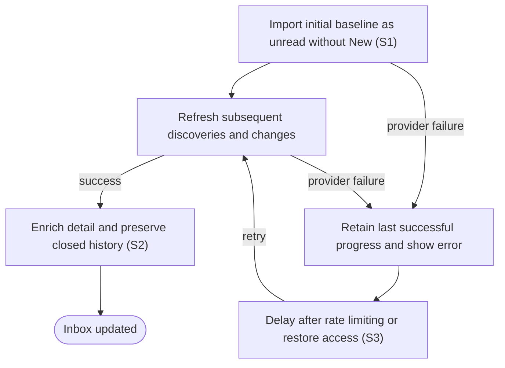

# Synchronize repository issues and pull requests

## Goal

The owner receives an up-to-date local inbox with activity and synchronization status.

## Preconditions

At least one accessible repository is configured.

## Main flow

1. Import open issues and pull requests as the initial baseline.
2. Refresh every 30 seconds and include subsequent discoveries and item changes; reconcile all open items hourly.
3. Include pull-request reviews, checks, commits and references in item detail. Refresh mutable activity independently of issue timestamps and retain matching commit evidence until the head or base changes or hourly reconciliation runs.
4. Keep previously synchronized closed or merged history available when viewing all items.

## Alternatives and recovery

Authentication and provider errors remain visible. Failed refreshes retain their last successful progress. Rate limits delay inbox and report requests sharing the same connection, and access recovery permits later refreshes. Cached identity and response evidence stay scoped to the current connection; incomplete pagination cannot advance progress.

## Scenarios

- **S1** Initial import is unread without a New badge; later discoveries receive New.
- **S2** Pagination and pull-request enrichment preserve content revisions and item history.
- **S3** Failed or rate-limited synchronization does not advance progress and later recovers.

<!-- flow-references -->
## Terminology and UI references

Glossary: [repository](../glossary/README.md#repository), [inbox](../glossary/README.md#inbox), [work-item](../glossary/README.md#work-item), [state-new](../glossary/README.md#state-new), [state-unread](../glossary/README.md#state-unread), [coverage-gap](../glossary/README.md#coverage-gap), [unverified-behavior](../glossary/README.md#unverified-behavior).
UI entities: [PAGE-INBOX](../ui/README.md#PAGE-INBOX), [P-INBOX-QUERY](../ui/README.md#P-INBOX-QUERY), [P-INBOX-LIST](../ui/README.md#P-INBOX-LIST), [P-ITEM-DETAIL](../ui/README.md#P-ITEM-DETAIL), [W-INBOX-QUERY](../ui/README.md#W-INBOX-QUERY), [W-SYNC-HEALTH](../ui/README.md#W-SYNC-HEALTH), [W-ITEM-ROW](../ui/README.md#W-ITEM-ROW), [W-INBOX-EMPTY](../ui/README.md#W-INBOX-EMPTY), [W-ITEM-OVERVIEW](../ui/README.md#W-ITEM-OVERVIEW), [W-ITEM-ACTIONS](../ui/README.md#W-ITEM-ACTIONS), [W-ITEM-HISTORY](../ui/README.md#W-ITEM-HISTORY), [C-FILTER](../ui/README.md#C-FILTER), [C-SELECT-ITEM](../ui/README.md#C-SELECT-ITEM), [C-EMPTY-SETUP](../ui/README.md#C-EMPTY-SETUP), [C-ITEM-STATE](../ui/README.md#C-ITEM-STATE), [W-RELATIONSHIPS](../ui/README.md#W-RELATIONSHIPS), [W-TICKET-CONTEXT](../ui/README.md#W-TICKET-CONTEXT), [W-PR-EVIDENCE](../ui/README.md#W-PR-EVIDENCE), [C-LINK](../ui/README.md#C-LINK).

## Flow diagram

## Implementation references

- [internal/app/app.go](../../internal/app/app.go) — Import transactions and scheduled synchronization (`func (a *App) Sync(`)
- [internal/providers/github.go](../../internal/providers/github.go) — Read-only pagination, enrichment and conditional cache
- [web/src/main.tsx](../../web/src/main.tsx) — Repository sync status
- [internal/domain/types.go](../../internal/domain/types.go) — Shared domain, persistence, transport or dependency contract
- [internal/store/store.go](../../internal/store/store.go) — Shared domain, persistence, transport or dependency contract
- [internal/transport/mcp.go](../../internal/transport/mcp.go) — Shared domain, persistence, transport or dependency contract
- [go.mod](../../go.mod) — Shared domain, persistence, transport or dependency contract
- [go.sum](../../go.sum) — Shared domain, persistence, transport or dependency contract
- [internal/testutil/testutil.go](../../internal/testutil/testutil.go) — Shared fake-provider verification input; changes require assertion reconciliation.
- [internal/testutil/fakecodex/main.go](../../internal/testutil/fakecodex/main.go) — Shared fake-provider verification input; changes require assertion reconciliation.
- [internal/providers/github_requests.go](../../internal/providers/github_requests.go) — Serialized operation-scoped requests, conditional LRU, shared private cooldowns and same-origin Link parsing.

## Test references

- [internal/app/app_test.go](../../internal/app/app_test.go) — `func TestScheduledSyncRecoversCredentialsAndFindsNewItems(`; S1, S3. Scheduled credential failure, recovery and later item discovery.
- [internal/providers/github_test.go](../../internal/providers/github_test.go) — `func TestGitHubPaginationPREnrichmentAndRecovery(`; S2. Pagination, enrichment and activity revisions.
- [internal/providers/github_test.go](../../internal/providers/github_test.go) — `func TestGitHubRateLimitsRevocationAndPaginationOrigin(`; S3. Rate limits and credential revocation.
- [internal/providers/github_test.go](../../internal/providers/github_test.go) — `func TestConditionalCacheKeepsPaginationAndScopesAuthentication(`; S2. Cache preserves pagination and separates identities.
- [internal/providers/github_requests_test.go](../../internal/providers/github_requests_test.go) — `func TestInboxRequestBudgetAndIndependentFreshness(`; S2. Cold 73 and warm 62 requests including identity; independent reviews/CI, head/base invalidation, hourly commit reconciliation and stable incremental buckets.
- [internal/providers/github_requests_test.go](../../internal/providers/github_requests_test.go) — `func TestSharedCacheLRUAccountingAndExpiry(`; S2. Bounded LRU evicts oldest entries, accounts replacements and expires exact TTL boundaries.
- [internal/providers/github_requests_test.go](../../internal/providers/github_requests_test.go) — `func TestSharedOperationCacheAuthenticationAndSerialization(`; S2, S3. One token resolution per operation, serialized requests, merged cached headers, media isolation and revocation invalidation.
- [internal/providers/github_requests_test.go](../../internal/providers/github_requests_test.go) — `func TestSharedPersistedCooldownAndPagination(`; S2, S3. HTTP-date and reset deadlines, restarted cross-consumer cooldowns, credential isolation, unreadable storage and unsafe Link rejection.
- [internal/providers/github_requests_test.go](../../internal/providers/github_requests_test.go) — `func TestCheckRunLinksCompletenessAndIncrementalExpiry(`; S2, S3. Multi-page check-run completeness, cyclic/incomplete Link rejection and ten-minute incremental validator expiry.
- [internal/app/app_test.go](../../internal/app/app_test.go) — `func TestSharedGitHubCooldownPreservesInboxCheckpoints(`; S3. Limits from identity or a repository stop the batch, preserve successful/remaining checkpoints, persist diagnostics and suppress the next operation.

## Verification and gaps

Local suites: `go`.
Fixture success does not establish real-host acceptance.
- **S2** — `gap-flow-sync-inbox-s2-01` · Unverified behavior · P2 · owner: user-flow-maintainer. Closed/merged retention and hourly reconciliation are implemented but not exhaustively asserted by the enrichment fixture; full current-version host inbox matrix is open. Next verification: Add retention and hourly-reconciliation fixture assertions, then record the current-version host inbox matrix without treating provider enrichment fixtures as host acceptance.

<!-- /flow-references -->
